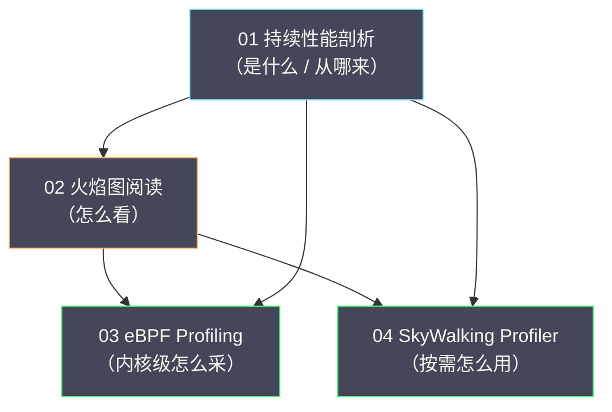

# Profiler 专栏导览

## 专栏定位

持续性能剖析（Continuous Profiling）是可观测性四大信号中**最年轻、也最容易被低估**的一种。指标告诉你"P99 延迟升高了"，链路追踪告诉你"慢在 order-service 的 processOrder 方法"，日志告诉你"GC 暂停了 500ms"——但它们都无法回答那个最终的问题：**这个方法内部到底在做什么？CPU 时间花在了哪一行代码上**？

Profiler 填补的正是这个盲区。它以函数调用栈为粒度记录程序的运行时行为，再通过火焰图把"CPU 在哪些函数上花了多少时间"直观地摊开。**它是从"哪个服务慢"到"哪行代码慢"的最后一段路**，也是很多性能问题的"最终判决"。

本专栏的目标，是让你既能理解剖析的**原理**（采样的统计学基础、火焰图的生成、eBPF 的观测机制），也能掌握它的**工程**（工具选型、生产部署、开销控制、与追踪的联动）。原理部分讲"为什么这样设计"，工程部分讲"怎么用好它"。

## 为什么以"采样 + 火焰图"为主线

Profiler 的生态里，工具很多：JVM 侧的 async-profiler、JFR，内核侧的 eBPF（Pyroscope、Parca），APM 内置的按需剖析（SkyWalking），还有各家商业产品。本专栏并不试图穷举它们，而是把主线放在两条贯穿全篇的线索上。

第一，**采样的统计学基础**。几乎所有生产级的 Profiler 都基于"周期采样调用栈"——每隔一段时间抓一次栈，用"某个函数被采样到的次数"近似"它占用的 CPU 比例。理解了这个统计学基础，就能理解"为什么采样开销低""为什么样本越多越准""为什么火焰图是近似的"。

第二，**火焰图这套阅读语言**。无论数据来自 JVM 采样还是 eBPF，最终几乎都会汇成一张火焰图。**学会了读火焰图，就掌握了跨工具的通用分析能力**——换一个工具，看图的逻辑不变。

需要说明的是，本专栏讲采样与火焰图，**不是要否定其他剖析方式**（如插桩式、追踪式）。它们在某些场景里各有优势，第 01 篇会给出对照。把主线放在采样与火焰图上，是因为它们覆盖了绝大多数生产场景，也最能体现"持续剖析"这个新范式的价值。

## 目录

| 序号 | 文章 | 核心内容 |
|---|---|---|
| 01 | [[01 持续性能剖析]] | Profiling 的定义与分类（CPU / 内存 / 锁 / 分配）、采样的统计学基础、传统 Profiling 与持续 Profiling 的差异、主流平台对比 |
| 02 | [[02 火焰图阅读与性能问题识别]] | 火焰图的数据结构与生成原理、自顶向下与自底向上两种读法、常见性能模式识别（CPU 热点、锁竞争、内存分配、GC） |
| 03 | [[03 eBPF Profiling 内核级性能观测]] | eBPF 的原理与安全模型、基于 eBPF 的零侵入剖析、Pyroscope 与 Parca、跨语言的统一观测 |
| 04 | [[04 SkyWalking 集成 Profiler]] | SkyWalking 线程栈采样的原理、按需触发与 Trace 关联、与持续剖析的取舍、生产实践 |

## 知识图谱

本专栏各篇之间的关系，可以用一张图概括——从"是什么"到"怎么用"，逐层推进：

## 主线与阅读路径

本专栏的主线可以概括为一条"从告警到代码"的链路：**剖析是什么、为什么重要（01）→ 怎么读懂剖析结果（02）→ 内核级怎么采（03）→ APM 里怎么按需用（04）**。第 01 篇是全篇的立论基础，第 02 篇是全篇的认知枢纽——后面的所有工具，最终都要落到"看图定位"这件事上。

按需求选择路径：

- **快速建立认知**：01 → 02。
- **深入内核观测**：01 → 03。
- **APM 集成落地**：02 → 04。
- **完整通读**：01 → 02 → 03 → 04。

## 贯穿全篇的四条判断

本专栏不追求罗列工具，而是围绕四条判断展开，先在这里点出，便于阅读时留意：

1. **剖析解决的是"最后一段路"**。指标负责发现问题，追踪负责定位服务，剖析负责定位代码。**它是排查链的末端，而不是起点**——没有前两者，剖析会失去目标。
2. **采样的本质是"用统计学近似真相"**。火焰图不是"精确的耗时统计"，而是"采样得到的概率分布"。理解这一点，才能正确解读它的精度与偏差。
3. **开销决定能否常开**。按需剖析与持续剖析的核心差异，不在技术，而在"能不能 7×24 小时开着而业务无感"。**低开销是持续剖析成立的前提**。
4. **没有银弹，只有权衡**。JVM 采样与 eBPF 内核观测、按需触发与持续采集，各有各的适用场景；选择哪一种，取决于你的语言栈、开销预算与排查习惯。

## 关联专栏

- [[可观测/链路追踪/00 专栏导览|链路追踪]]：追踪定位到"哪个服务慢"，Profiler 下钻到"哪行代码慢"，两者是接力关系。
- [[可观测/指标/00 专栏导览|指标与 VictoriaMetrics]]：指标发现异常后触发剖析，是排查链的起点。
- [[可观测/日志/00 专栏导览|日志与 Grafana Loki]]：日志提供"那一刻发生了什么"的现场证据。
- [[Java/JVM/00 专栏导览|JVM]]：JVM 线程栈采样与 GC 剖析的语言侧基础。
- [[Linux/性能优化/00 专栏导览|性能优化]]：eBPF 剖析的内核侧基础。
- [[可观测/00 可观测性全景导览|可观测性全景导览]]：剖析在四大信号中的位置与协作机制。
