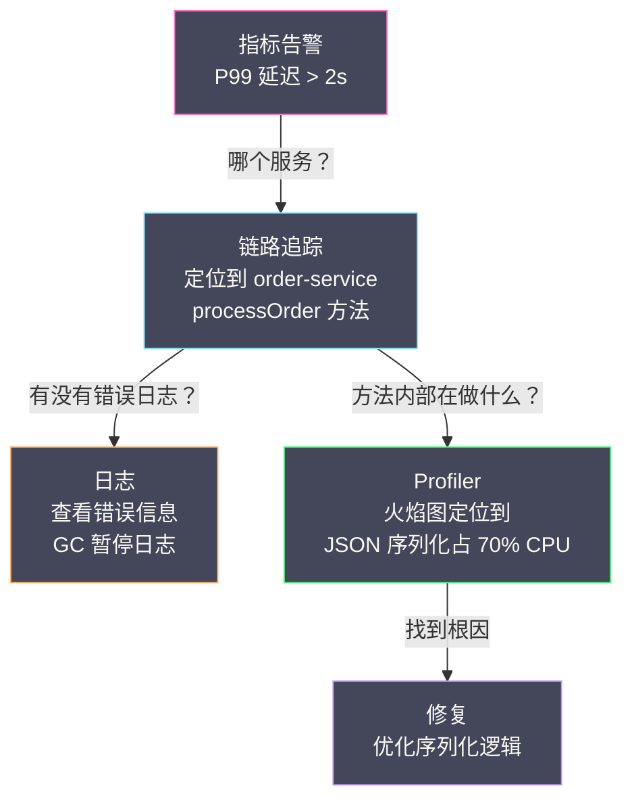
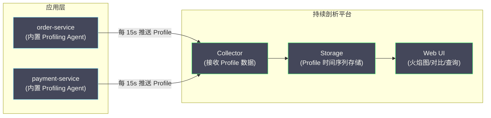

# 01 持续性能剖析

**摘要：**

性能剖析（Profiling）是回答"**CPU 时间花在了哪些代码上**"这个问题的唯一手段。指标告诉你"慢了"，链路追踪告诉你"慢在哪个服务"，但只有 Profiler 能告诉你"慢在哪个函数、哪一行代码"。传统的 Profiling 是一种临时性的调试手段——发现问题后手动启动、抓一段时间、分析后关闭；这种模式有一个致命缺陷：**你无法剖析已经过去的问题**。如果一次 P99 尖峰发生在凌晨三点并在五分钟后自愈，第二天上班的工程师既复现不了、也无从分析。**持续性能剖析（Continuous Profiling）** 正是为解决这个问题而生——它以极低开销在生产环境 7×24 小时不间断采集，使工程师可以"回放"任意时间点的代码热点。本文从剖析的基本原理出发，讲清采样与插桩的取舍、剖析的四种类型、传统与持续的差异、pprof 存储格式与主流平台，最后落到它与指标、追踪、日志的联动闭环。读完之后，你应当能回答两个问题：**为什么剖析是排查链的最后一公里，以及为什么"持续"是它成立的关键**。

---

## 第 1 章 为什么需要 Profiling

### 1.1 可观测性的"最后一公里"

在可观测性的技术栈里，前三种信号各司其职：**指标**告诉你"系统整体的健康状态"——QPS、错误率、P99 延迟；**链路追踪**告诉你"一个请求经过了哪些服务、每个服务花了多少时间"；**日志**告诉你"某个时刻发生了什么事件"。

但它们都有一个共同的盲区——**无法深入到代码层面**。

考虑这样一个场景：Grafana 仪表盘显示 order-service 的 P99 延迟从 200ms 飙升到 3 秒。你通过链路追踪定位到慢请求卡在 `processOrder()` 方法上，该方法的 Span 耗时 2.8 秒。然后呢？

`processOrder()` 内部可能调用了数十个子方法——数据库查询、缓存读取、业务逻辑计算、序列化。链路追踪通常只埋点到框架层面（HTTP 调用、数据库查询），**不会深入到每个业务方法**。你无法从 Trace 中知道：2.8 秒里有多少花在了 JSON 序列化上？有多少花在了一个低效的循环里？有多少花在了等锁上？

**Profiler 填补的正是这个盲区**。它以函数调用栈（Call Stack）为粒度记录程序的运行时行为，能够精确到"函数 A 内部调用了函数 B，函数 B 占用了总 CPU 时间的 35%"。

### 1.2 一个真实的排查案例

为了具体说明 Profiler 的价值，看一个案例。

**现象**：某 Java 微服务在流量高峰期 CPU 使用率从 40% 飙升到 95%，P99 延迟随之恶化。

**指标层面的信息**：CPU 使用率高、P99 延迟高、QPS 正常（排除了流量突增的可能）。

**链路追踪层面的信息**：慢请求集中在 `UserService.getProfile()` 方法，平均耗时从 50ms 增加到 800ms。但 `getProfile()` 内部的数据库查询只用了 30ms，其余 770ms 不知道花在了哪里。

**Profiler 的发现**：CPU 火焰图显示 `getProfile()` 内部有 70% 的 CPU 时间花在了 `com.fasterxml.jackson.databind.ObjectMapper.writeValueAsString()` 上——JSON 序列化。进一步分析发现，由于一次代码重构，`getProfile()` 的返回对象里新增了一个嵌套层级极深的字段，导致 Jackson 序列化耗时从 5ms 增加到 600ms。

**没有 Profiler，这个根因几乎不可能被发现**——因为从 Trace 与日志里只能看到"`getProfile()` 整体变慢"，无法定位到内部的具体热点。**这就是"最后一公里"的含义：前三公里都有工具，最后一公里只能靠剖析**。

### 1.3 Profiling 在可观测性中的位置

把四种信号的协作关系画出来，"最后一公里"的位置就很清楚了：



这张图说明了两点。**其一，剖析是"末端"**——它的输入是"已经定位到的某个方法"，而不是"整个系统"。**其二，剖析是"终点"**——它给出的是"可执行的修改点"，而不是又一个需要继续下钻的线索。**从"哪个服务慢"到"哪行代码慢"，剖析是最后一段，也是唯一能给出"改哪里"的一段**。

### 1.4 剖析的历史：从 gprof 到持续剖析

剖析不是新事物，它的历史比"可观测性"这个词长得多。早在 1980 年代，Unix 上就有 `gprof`——通过编译期插桩统计函数调用次数与耗时。此后几十年，剖析一直是"开发者手上的调试工具"，与生产环境绝缘。

转折发生在两个时间点。**其一是采样式剖析的普及**：它以极低开销换取了"可以在生产环境运行"的可能（对比插桩的昂贵）。**其二是 Google 2010 年的论文**《Google-Wide Profiling: A Continuous Profiling Infrastructure for Data Centers》——它证明"在所有生产服务器上常开剖析"是可行的，CPU 开销不超过 0.5%。

这两件事合起来，把剖析从"开发工具"变成了"生产观测手段"。**"持续剖析"这个词里的"持续"，正是这次范式转变的核心**——它意味着剖析从"出问题时才用"变成了"一直都在"。理解这条历史线，就能理解为什么本篇要花大量篇幅讲"开销"与"采样"——**因为"能不能常开"，正是持续剖析成立与否的全部关键**。

### 1.5 剖析与前三者的边界再讨论

"最后一公里"这个比喻容易让人误解，以为剖析"更重要"。其实不是——**它只是"更靠后"**。把四者的边界再说清一层。

**指标是"面"**：它覆盖整个系统、连续不断，但每个点都很粗（一个聚合值）。**追踪是"线"**：它跟随一个请求穿过多个服务，有因果，但只看得到"跨进程的边界"。**日志是"点"**：它记录某一刻发生了什么，有细节，但没有结构。**剖析是"深"**：它在单个实例内部往下挖，直到函数与代码行。

这四种视角各有各的"看得到"与"看不到"。**剖析看不到"整体趋势"，也看不到"请求的因果链"**——它只有一个"单实例内部的资源分布"。因此它必须"被指路"：由指标指出"什么时候"、由追踪指出"哪个服务"。**没有前两者的指引，剖析出来的火焰图可能只是"一张很漂亮但无关的图"**。

**理解了"剖析需要被指路"，就能理解为什么本专栏要把联动单独用一章来讲**——联动的意义，就是让"指路"这件事自动化，从而让剖析不必靠人工去猜时间与范围。

---

## 第 2 章 Profiling 的基本原理

### 2.1 什么是 Profile

**Profile** 是程序在一段时间内的**资源使用分布**——哪些函数消耗了多少 CPU 时间、分配了多少内存、等待了多少锁时间。它的核心数据结构是**调用栈的统计聚合**。

一个 CPU Profile 的原始数据大致如下：

```text
调用栈                                              采样次数
main → handleRequest → processOrder → serialize        350
main → handleRequest → processOrder → queryDB          120
main → handleRequest → processOrder → validateInput     30
main → handleRequest → authenticate                     80
main → GC.collect                                       20
                                                  总计：600
```

每一行是一个**调用栈（Call Stack）**——从栈底（main）到栈顶（当前正在执行的函数）的完整调用路径。采样次数表示在采样期间，该调用栈被"看到"了多少次。采样次数除以总次数，就是该调用路径占总 CPU 时间的比例。

理解这个数据结构，是理解后面一切的基础：**火焰图、Diff 对比、Top 函数排行，都是这份"调用栈计数表"的不同呈现方式**。

### 2.2 采样与插桩

获取 Profile 数据有两种基本方法。

**插桩（Instrumentation）**：在每个函数的入口和出口插入计时代码，精确记录每次函数调用的耗时。

```java
// 插桩示例（伪代码）
void processOrder(Order order) {
    long start = System.nanoTime();   // ← 插入的计时代码
    // ... 原始业务逻辑 ...
    long elapsed = System.nanoTime() - start;  // ← 插入的计时代码
    profiler.record("processOrder", elapsed);   // ← 插入的记录代码
}
```

插桩的优点是**精确**——每次函数调用都被记录，没有遗漏。缺点是**开销巨大**——每次函数调用都增加了计时与记录的开销。如果一个函数每秒被调用 100 万次，插桩的开销可能远超函数本身的执行时间。因此插桩通常只用于开发与测试环境。

**采样（Sampling）**：以固定频率（如每秒 100 次）中断程序执行，记录当时的调用栈。

采样不修改任何业务代码，对性能影响极小——每秒 100 次采样意味着每 10 毫秒中断一次，每次中断只需读取当前线程的调用栈（通常不超过 10 微秒）。总开销约为 100 × 10μs = 1ms/秒，即 **0.1% 的 CPU 开销**。

采样的缺点是**不精确**——它是统计采样，不是精确计数。但根据统计学原理，当样本足够多时，采样结果能准确反映真实的 CPU 时间分布。**这正是"低开销"与"足够准"之间的一次成功交易**——它也是持续剖析能在生产环境常开的根本原因。

### 2.3 为什么采样是正确的

采样剖析的数学基础是**大数定律**。假设函数 A 占用了 30% 的 CPU 时间，那么在任意时刻采样时，就有 30% 的概率"看到"函数 A 正在执行。采样 1000 次后，函数 A 被看到的次数期望是 300，标准差约 √(1000 × 0.3 × 0.7) ≈ 14——也就是说，**采样 1000 次就能以约 ±1.4% 的精度估算出函数 A 的 CPU 占比**。

对于性能分析，这个精度完全足够：你需要找到的是"占 30% CPU 的热点函数"，而不是"精确到小数点后两位的比例"。**理解了这一点，就能正确看待火焰图的精度**——它不是一个精确的计时器，而是一个"概率分布的近似"；样本越多越准，样本太少则噪声大。

> [!info] 为什么采样是正确的
> 大数定律保证：只要采样次数足够，样本比例就会收敛到真实比例。因此"采样"不是"抽样碰运气"，而是"用统计规律换取低开销"。这也解释了为什么"采样频率"与"采样时长"是可以权衡的——想更准，要么提高频率（增加开销），要么延长时间（增加数据量）。

### 2.4 不同语言的采样机制

不同语言与运行时使用不同的采样机制。

**Java（JVM）**：**async-profiler** 通过 POSIX 信号（SIGPROF 或 ITIMER_PROF）触发采样，在信号处理函数中调用 JVM 内部的 `AsyncGetCallTrace` API 获取当前线程的调用栈——这是目前 Java 生态中最准确的 CPU 剖析方法，它避免了 **Safepoint Bias（安全点偏差）**问题。另一条路是 **JFR（Java Flight Recorder）**——JDK 内置的剖析框架，从 JDK 11 起免费可用，使用 JVM 内部的事件系统，开销极低。

**Go**：内置 `runtime/pprof` 包，用 `SIGPROF` 信号采样，默认频率 100 Hz；通过 `net/http/pprof` 包暴露 HTTP 端点即可在线获取 Profile。

**C / C++ / Rust / 任意原生程序**：**perf** 是 Linux 内核的性能计数器子系统，用硬件性能计数器（PMU）或软件事件触发采样，`perf record -g -p <PID>` 即可采集。**eBPF** 则通过在内核中注入 BPF 程序，在 perf 事件触发时收集用户态与内核态的调用栈——零侵入、极低开销（第 03 篇的主题）。

**Python / Ruby / Node.js**：这些解释型语言通常需要运行时的特殊支持来获取调用栈。Python 有 `py-spy`（基于进程外采样），Node.js 有 V8 CPU Profiler。

> [!note] Safepoint Bias：Java 剖析的一个经典坑
> JVM 只会在**安全点（Safepoint）**才能安全地遍历线程栈。如果采样依赖"让线程跑到安全点再抓栈"，那么采样点就会偏向"容易到达安全点的代码"（如循环边界），从而系统性高估某些函数的占比。async-profiler 用 `AsyncGetCallTrace` 绕开了这个限制——它能在非安全点异步抓栈，因此更接近真实分布。**"采样机制"的差异，会直接影响剖析结果的准确性**，这也是选工具时该关注的细节。

### 2.5 采样频率与时长的权衡

既然采样是"统计近似"，那么"采多少"就直接决定了精度。这里有一组需要权衡的量。

**采样频率**决定"时间分辨率"。频率越高，越能捕捉短时的热点；但每次采样都有开销，频率过高会让"低开销"这个前提不成立。100 Hz 是常见折中——它既能覆盖大部分场景，开销又足够低。

**采样时长**决定"样本量"。同样 100 Hz 下，采 10 秒得到 1000 个样本，采 60 秒得到 6000 个样本。样本越多，估算越稳。**但时长也不能无限拉长**——因为"时间越长，覆盖的场景越杂"，把"一次尖峰"和"平时的正常执行"混在一起，反而模糊了信号。

这带来一条实用经验：**持续剖析负责"采集与留存"，分析时再按需"切片"**。也就是说，采集端不必纠结"该采多久"，它一直采着；分析端则通过"选择时间范围"来决定"用哪一段样本"。**这正是"持续"的又一个好处——它把"采多久"这个决策，从"采集时"推迟到了"分析时"，而分析时你往往更清楚自己想要什么**。

### 2.6 调用栈是怎么被"抓"到的

采样听起来简单（"中断一下、看看在跑什么"），但"抓到一个完整的调用栈"在实现上并不平凡，值得理解一下它的机制。

**对于原生程序**，抓栈依赖"栈回溯"（Stack Unwinding）——从当前的栈指针出发，逐帧往上找返回地址。但编译器优化（如省略帧指针）会让"逐帧回溯"失效，因此现代方案更多依赖**调试信息（DWARF）**来还原调用栈。**这也解释了为什么"带不带调试符号"会影响剖析质量**——没有符号，栈就还原不全，火焰图会出现大片的 `[unknown]`。

**对于 JVM**，情况更复杂——JVM 的栈不是"标准 C 栈"，需要专门的 API（`AsyncGetCallTrace`）才能安全地遍历。**这也是为什么 async-profiler 的出现是一个里程碑**：它绕开了"只能在安全点抓栈"的限制。

**对于 eBPF**，它能在内核侧同时抓"内核栈"与"用户栈"——这带来了一个独特能力：**看到"系统调用两端的完整路径"**（从用户态函数到内核态函数）。这是纯用户态剖析做不到的。

这些实现细节的共同启示是：**"抓栈"的准确性，取决于"工具与运行时的配合程度"**。同一个应用，用不同的工具剖析，可能得到精度不同的结果——**选工具时，"它抓栈的方式"值得关注**。

### 2.7 采样偏差：哪些情况会让火焰图"骗人"

采样是近似，因此它也会在某些情况下产生系统性偏差，值得提前知道。

**偏差一：样本太少。** 如果只采了几百个样本，个别函数的占比波动会很大。**对策**：看火焰图时留意"样本量"，占比接近的差异不要过度解读。

**偏差二：安全点偏差（JVM）。** 如 2.4 节所述，依赖安全点的采样会系统性高估"靠近安全点的代码"。**对策**：优先选 async-profiler 这类异步抓栈的工具。

**偏差三：内联与栈还原。** JIT 内联后，逻辑上分离的函数在物理栈上已经合并，火焰图可能"看不到"某个函数（它被内联进了调用者）。**对策**：理解"火焰图反映的是物理栈，不完全是源码结构"。

**偏差四：符号缺失。** 没有调试符号时，栈还原不全，会出现大量 `[unknown]`。**对策**：保证发布产物带符号（或单独留存符号文件）。

**偏差五：采样频率与事件的"共振"。** 如果采样频率与某种周期性事件（如定时任务）恰好同步，可能系统性偏多或偏少地采到它。**对策**：让采样频率"非整数倍"于已知的周期事件。

这五条偏差的共同启示是：**火焰图是"证据"，不是"判决"**。它能强烈地提示"往哪看"，但最终的结论仍要结合代码、日志与对比来确认。**把火焰图当"线索"而不是"答案"，是用好剖析的心态前提**。

---

## 第 3 章 Profiling 的分类

### 3.1 CPU Profiling

**目标**：分析 CPU 时间花在了哪些函数上。它是最常用的剖析类型，回答"程序在忙什么"——如果 CPU 使用率很高，CPU Profile 会告诉你哪些函数是"CPU 热点"。

**适用场景**：CPU 使用率异常升高；延迟增加但不是由 I/O 或锁等待引起；优化计算密集型代码。

### 3.2 Allocation Profiling（内存分配剖析）

**目标**：分析哪些函数分配了最多的堆内存。它记录每次堆内存分配的调用栈与大小，不关心"当前内存里有什么"（那是 Heap Dump 的工作），而是关心"谁在不断地分配新对象"。

**适用场景**：GC 频繁，Young GC 或 Full GC 暂停时间过长；内存使用率持续增长（可能有泄漏）；优化对象分配热点。

**为什么关注"分配"而不是"存活"**？在带 GC 的语言（Java、Go、C#）中，短生命周期的临时对象虽然很快被回收，但它们的分配与回收本身消耗 CPU——分配器要找空闲内存，GC 要扫描与回收。**如果一个函数每秒分配 1 GB 的临时对象，即使这些对象很快被回收，GC 的开销也会非常显著**。分配剖析能精确定位这些"分配大户"。

### 3.3 Lock / Contention Profiling（锁竞争剖析）

**目标**：分析线程在哪些锁上花了最多的等待时间。当多个线程争抢同一把锁时，只有一个能获得，其余必须等待。锁剖析记录每次锁等待的调用栈与时长。

**适用场景**：CPU 使用率不高但延迟很高（线程在等锁而非执行代码）；线程池的线程大量处于 BLOCKED 状态；并发性能不随线程数线性提升。

### 3.4 Wall-clock Profiling（挂钟时间剖析）

**目标**：分析函数的"实际经过时间"（包含 CPU 执行时间、I/O 等待时间、锁等待时间）。

CPU Profiling 只记录 CPU 正在执行的采样点——如果一个线程在等网络 I/O 或磁盘 I/O，它不占 CPU，因此不会出现在 CPU Profile 里。Wall-clock Profiling 不区分"CPU 执行"与"等待"，它记录的是"函数从开始到结束的全部时间"。

**适用场景**：延迟很高但 CPU 使用率很低（说明时间花在了等待上）；分析 I/O 密集型代码的瓶颈；需要看到完整的时间分布。

### 3.5 四种类型的对比

| 类型 | 度量的资源 | 典型问题 | 适用的现象 |
|---|---|---|---|
| CPU | CPU 时间 | 计算热点 | CPU 高，延迟高 |
| Allocation | 堆内存分配量 | GC 压力、内存泄漏 | GC 频繁，内存增长 |
| Lock | 锁等待时间 | 锁竞争 | CPU 低，线程 BLOCKED |
| Wall-clock | 实际经过时间 | I/O 等待、综合瓶颈 | 延迟高，CPU 低 |

### 3.6 如何选择剖析类型

选择哪一种，其实由"现象"直接决定。**"CPU 高、延迟高"** → CPU 剖析，找计算热点。**"CPU 低、延迟高"** → Wall-clock 剖析，看时间花在了哪个等待上（如果确认是锁，再切到 Lock 剖析）。**"GC 频繁"** → Allocation 剖析，找分配大户。

这条判断逻辑的价值在于：**它把"该用哪种剖析"从一个需要经验的问题，变成了一个看现象就能回答的问题**。而**先选对类型，再看图，是剖析不白做的第一步**——用错类型，火焰图上看到的会是完全无关的热点。

### 3.7 剖析类型与工具的组合

不同类型需要不同工具支持，把它们配起来看：

| 剖析类型 | 常用工具 | 备注 |
|---|---|---|
| CPU | async-profiler、perf、eBPF、py-spy | 最成熟，几乎所有工具都支持 |
| Allocation | async-profiler（alloc 模式）、JFR、Go pprof（heap） | 需要运行时支持 |
| Lock | async-profiler（lock 模式）、JFR | 依赖运行时的锁实现 |
| Wall-clock | async-profiler（wall 模式）、eBPF | 需要"按时间采样"而非"按 CPU 采样" |

这张表说明：**CPU 剖析是最"通用"的**——几乎所有工具都能做；而 Allocation、Lock、Wall-clock 则需要工具与运行时的更深度配合。因此**在选型时，"CPU 剖析够不够"不该是唯一标准**——如果团队经常遇到"CPU 低、延迟高"的问题，那么"Wall-clock 与 Lock 剖析的支持程度"才是关键。

**选工具时按"最常遇到的问题类型"来选**，比按"功能列表的长度"来选更实际。

### 3.8 剖析的"度量单位"

一个容易被忽略但很基础的细节：**不同剖析类型，度量单位不同**，读图前要先确认。

**CPU 剖析**的"值"通常是**采样次数**（或折算出的 CPU 时间）。火焰图上"某函数占 35%"，意思是"35% 的采样点落在它身上"。

**Allocation 剖析**的"值"是**分配字节数**——"某函数占 35%"意味着它分配了 35% 的堆内存。

**Lock 剖析**的"值"是**等待时间**——占 35% 意味着它占了 35% 的锁等待时间。

**Wall-clock 剖析**的"值"是**实际经过时间**。

**"值"的单位决定了"35% 代表什么"**。如果不确认单位，就可能把"分配了 35% 的内存"误读成"占了 35% 的 CPU"，从而得出完全错误的结论。**火焰图看起来都一样，但"同一个宽度"在不同类型下含义不同**——这是使用剖析时最容易犯、也最容易避免的错误。

---

## 第 4 章 传统剖析与持续剖析

### 4.1 传统剖析的工作模式

传统剖析是一种**临时性的调试手段**：工程师发现问题 → 登录服务器或通过管理接口启动 Profiler → 运行一段时间（30 秒到几分钟）→ 下载数据用工具分析 → 关闭。

它的致命问题有四个。**其一，无法分析已经过去的问题**：性能问题通常是间歇性的，一次 P99 尖峰可能只持续五分钟；如果工程师在一小时后才开始剖析，系统已经恢复正常，什么都看不到。**其二，问题可能无法复现**：某些问题只在特定负载模式下出现，手动剖析时这些条件可能不存在。**其三，启动剖析本身可能改变行为**：在生产环境手动启动剖析需要谨慎——开销过大可能让本已不堪重负的系统雪上加霜。**其四，缺乏历史对比**：即使抓到了当前的 Profile，也无法与"正常时期"对比，因为正常时期没有开。

这四条的**共同根源是"剖析是临时的"**——它只在"你想看的时候"存在，而问题往往发生在"你不想看的时候"。**"按需"这个看似合理的设计，恰恰是它最大的局限**。

### 4.2 持续剖析的工作模式

**持续性能剖析（Continuous Profiling）** 的核心思想是：**在生产环境中以极低开销 7×24 小时不间断采集，把 Profile 数据作为时间序列存储，支持按时间范围查询与对比**。



持续剖析恰好解决了传统剖析的四个问题：**问题发生后可以回溯**（任何时间点的数据都已采集）、**无需复现**（问题发生时的 Profile 已自动保存）、**始终在线**（不需要手动启动）、**支持历史对比**（任意两个时间段可做 Diff）。

**其中"支持历史对比"的价值最容易被低估**。性能分析里最有用的一招是"把异常时段的 Profile 与正常时段对比"——差异会立刻高亮出"哪些函数的占比上升了"。**而对比的前提，恰恰是"正常时段也有数据"**——这是只有持续剖析才能提供的能力。

### 4.3 持续剖析的开销

持续剖析之所以可行，是因为采样式剖析的开销极低：

| 参数 | 典型值 | 说明 |
|---|---|---|
| 采样频率 | 100 Hz | 每秒采样 100 次 |
| 每次采样耗时 | 约 10 μs | 读取调用栈 |
| CPU 开销 | 小于 1% | 100 × 10μs = 1ms/s |
| 内存开销 | 约 10 MB | 缓冲未发送的 Profile 数据 |
| 网络开销 | 约 1 KB/s | 压缩后的 Profile 数据 |

这些开销在生产环境中完全可以接受。Google 在 2010 年的论文中报告，他们在所有生产服务器上运行持续剖析，CPU 开销不超过 0.5%。

> [!note] Google 的实践
> Google 从 2010 年起就在所有生产服务中运行持续剖析（内部系统名为 Google-Wide Profiling）。它帮助 Google 识别了大量性能优化机会——据报告，通过它发现并优化的代码热点每年为 Google 节省了数百万美元的计算资源成本。**这个案例证明了两件事：持续剖析在大规模生产环境里可行；以及它的收益会随规模放大**——单个服务省 1% 的 CPU 或许不值一提，但乘以几十万台机器，就是一笔真实的账。

### 4.4 持续剖析的部署形态

持续剖析落地时，采集端有两种典型形态，各有取舍。

**形态一：进程内 Agent（SDK 式）。** 剖析逻辑作为库或 Agent 跑在应用进程里（如 async-profiler 以 agent 形式加载、Pyroscope 的 SDK）。它的优势是"能拿到语言运行时的深度信息"（如 JVM 的精确栈、JFR 事件）；代价是"需要改应用或加启动参数"，且对"无法改代码的第三方服务"无能为力。

**形态二：进程外 Agent（eBPF 式）。** 剖析逻辑作为节点级 Agent 跑在宿主机上（如 Parca Agent、Pyroscope 的 eBPF 模式）。它的优势是"零侵入、覆盖全节点所有进程"；代价是"能拿到的信息依赖内核能力"，对某些语言运行时内部的细节可能不如进程内方案精确。

实践中常见的是**两者并存**：核心 Java 服务用进程内 Agent（拿精度），第三方组件与无法改代码的服务用 eBPF（拿覆盖）。**这与追踪领域"应用埋点 + 网格观测"的互补关系如出一辙**——**覆盖与精度，往往需要两条腿走路**。

**这条形态选择，本质上是"侵入性"与"覆盖/精度"之间的又一次权衡**——它贯穿本系列的所有信号，从追踪的 Agent、日志的采集器，到剖析的进程内外。

### 4.5 持续剖析的成本收益

把持续剖析当一笔投资来算账，会更清楚它的定位。

**成本有三块**：应用侧的采样开销（通常小于 1% CPU、约 10 MB 内存）、网络与存储（Profile 数据的传输与保留）、平台侧的组件运维（Collector、存储、UI）。**其中应用侧开销最值得关注**，因为它直接影响业务；后两块是"平台成本"，随规模线性增长。

**收益也有三块**：**其一是"能回溯"**——把"无法复现的问题"变成"可以回放的问题"，这在间歇性故障里价值巨大；**其二是"能对比"**——把性能回归定位从"靠猜"变成"看 Diff"，这在每次发版后都兑现；**其三是"能预防"**——通过长期基线发现"缓慢劣化"的趋势，在它变成故障前处理。

这三块收益里，**"能对比"的兑现频率最高**——每次发版、每次改代码，都可以问一句"性能变了吗"。**而它恰恰是"传统按需剖析"给不了的**（正常时段没数据，没法比）。**持续剖析最日常的价值，不是"救火"，而是"防微杜渐"**——这也解释了为什么它值得"常开"，而不是"出事才开"。

---

## 第 5 章 Profile 数据的存储格式

### 5.1 pprof 格式

**pprof** 是 Google 开发的 Profile 数据格式与分析工具，已成为事实上的行业标准。它用 Protocol Buffers 编码，结构（简化）如下：

```protobuf
message Profile {
  repeated Sample sample = 1;         // 采样数据
  repeated Mapping mapping = 2;       // 内存映射（可执行文件/库）
  repeated Location location = 3;     // 代码位置
  repeated Function function = 4;     // 函数信息
  repeated string string_table = 5;   // 字符串去重表
  repeated ValueType sample_type = 6; // 采样值类型（cpu、alloc 等）
  int64 duration_nanos = 7;           // Profile 持续时间
}

message Sample {
  repeated uint64 location_id = 1;  // 调用栈（从栈顶到栈底的 Location 列表）
  repeated int64 value = 2;         // 采样值（如 CPU 时间、分配字节数）
  repeated Label label = 3;         // 附加标签
}
```

pprof 的设计特点有三。**其一是字符串去重**——所有函数名、文件名、库名都存在统一的字符串表里，通过整数索引引用；这大幅减小了数据体积，因为同一个函数名可能出现在数万个采样的调用栈中。**其二是"值类型"可扩展**——`sample_type` 决定了"采样值代表什么"（CPU 时间、分配字节数、锁等待时间），因此同一套格式能承载多种剖析类型。**其三是"标签"**——`Label` 允许给采样附加维度（如 `pod`、`version`），这让"按维度切分火焰图"成为可能。

**格式统一的意义，与第 03 篇讲的 OTLP 是同一个道理**：当所有工具都用同一种格式时，"换工具不换数据"就成为可能。**pprof 之所以能成为"事实标准"，正是因为它先被广泛使用、再被广泛接受**。

### 5.2 JFR 格式

**Java Flight Recorder（JFR）** 使用自己的二进制格式，包含丰富的 JVM 事件信息：不仅有 CPU 与内存剖析，还有 GC 事件、线程状态变化、I/O 操作、编译事件等。JFR 格式比 pprof 更丰富，但也更复杂。

主流的持续剖析平台通常同时支持 pprof 与 JFR 格式的摄入。**JFR 的"更丰富"是一把双刃剑**：它让"一次采集、多种分析"成为可能，但也让数据体积更大、格式更复杂。**选 pprof 还是 JFR，取决于"你要的是通用性还是 JVM 深度"**。

### 5.3 为什么格式标准化重要

值得单独强调格式标准化的价值。在 pprof 成为标准之前，每种剖析工具都有自己的输出格式，**分析工具与采集工具被绑定在一起**——换一个采集器，就要换一套分析工具，之前的经验与脚本都要重写。

pprof 的普及改变了这一点：**采集端可以五花八门（async-profiler、py-spy、eBPF），分析端却可以统一（都用 pprof 的火焰图与 Diff）**。这与 OTLP 之于追踪、OTLP/OpenMetrics 之于指标是同一个模式——**把"采集"与"分析"解耦，是任何可观测信号走向成熟的标志**。

### 5.4 Profile 数据的存储与保留

Profile 数据虽然是"聚合后的样本"，但持续采集的累积量并不小，值得算一下。

**数据量取决于三个因素**：采样频率、采样时长、以及"推送/聚合的粒度"。常见做法是"应用侧每 10 到 15 秒聚合一次、推送一次"，这样一条时间序列的点密度不高；但**标签维度（如按 `pod`、`version`、`function` 切分）会显著放大数据量**——这与指标的高基数问题完全同源（第 02 篇讲 Span 命名、Loki 讲标签基数时都提过）。

因此，Profile 的存储同样需要**高基数治理**：不要把 `pod` 名、`request_id` 这类易变值作为标签；标签维度要"可枚举"。**"任何用于聚合的维度必须低基数"这条规律，在剖析里同样成立**。

**保留策略上**，Profile 与 Trace 类似——"近期数据用于回放、远期数据用于趋势"。但 Profile 还有一个特殊用法：**作为"性能基线"长期保留**（如每周同一时段的 Profile），用于跨版本的性能对比。**这意味着一部分 Profile 数据值得"长期低频保留"，而不是"短周期全删"**。

### 5.5 格式与工具的生态

pprof 之所以能成为"事实标准"，还因为它自带一个成熟的工具生态：`go tool pprof` 可以直接分析任意 pprof 文件并生成火焰图；各类库（如 `google/pprof`、`py-spy`）都能输出或读取它；Grafana 的火焰图面板也直接吃 pprof 数据。**一个格式的普及，从来不只靠"格式本身好"，更靠"围绕它的工具够多"**。

这给技术选型提了个醒：**当你在两个方案之间犹豫时，"哪个方案的生态更成熟"往往比"哪个方案的参数更漂亮"更值得权重**。格式会被工具生态"锁定"——**一旦某个格式有了足够多的工具，后来者就很难取代它，即使它在设计上更优**。pprof、OTLP、OpenMetrics 的胜出，走的都是这条路。

---

## 第 6 章 主流持续剖析平台

### 6.1 平台对比

| 平台 | 开源 | 支持的语言 | 采集方式 | 存储后端 | 与可观测性栈的集成 |
|---|---|---|---|---|---|
| Grafana Pyroscope | 是（AGPL 3.0） | Go、Java、Python、Ruby、Node.js、.NET、Rust、eBPF | Agent / SDK / eBPF | 自研（对象存储） | Grafana 原生集成，支持 Exemplar 跳转 |
| Parca | 是（Apache 2.0） | 任意（eBPF 采集） | eBPF Agent | 自研 | 独立 UI，支持 pprof 格式 |
| Datadog Continuous Profiler | 否（商业） | Go、Java、Python、Ruby、Node.js、.NET | Datadog Agent | Datadog 云端 | 与 Datadog APM 深度集成 |
| Google Cloud Profiler | 否（商业） | Go、Java、Python、Node.js | Agent | Google Cloud | 与 Cloud Trace 集成 |

### 6.2 Grafana Pyroscope

Grafana Pyroscope（原名 Pyroscope，2023 年被 Grafana Labs 收购）是目前最受关注的开源持续剖析平台。它与 Grafana 的深度集成，使其成为"Grafana + Prometheus + Loki + Tempo + Pyroscope"全栈可观测性方案的最后一块拼图。

它的核心能力有四条：**多语言支持**（通过语言特定的 SDK 或通用 eBPF Agent 采集）、**火焰图 UI**（在 Grafana 中直接查看，支持时间范围选择）、**Diff 视图**（对比两个时间段的 Profile，高亮差异）、**与 Trace 关联**（通过 Exemplar 或 Span Profile，把 Trace 中的 Span 关联到对应时间的 Profile）。

**"最后一块拼图"这个定位很关键**：它意味着如果团队已经在用 Grafana 全家桶，那么接入 Pyroscope 是"补齐能力"，而不是"另起一套"。**在可观测性选型里，"与既有栈的契合度"往往比"功能多寡"更重要**。

### 6.3 Parca

Parca 是 Polar Signals 公司开发的开源持续剖析平台，最大特点是**完全基于 eBPF 采集**——不需要在应用里集成任何 SDK，只需在节点上部署 Parca Agent，即可采集节点上所有进程的 CPU Profile。

这种零侵入方式，对于那些**无法修改代码的第三方服务**（如 MySQL、Redis、Nginx）特别有价值。**它把"能不能剖析"从"应用有没有集成 SDK"变成了"节点上有没有部署 Agent"**——后者的门槛低得多。

### 6.4 选型要点

选型时，有几条比"功能对比"更实际的判断依据。

**其一是语言栈**。Java 为主，则 async-profiler 与 JFR 的成熟度是优势；多语言，则 eBPF 的"一次部署、全语言覆盖"更省事。

**其二是既有栈**。已经在用 Grafana 全家桶，Pyroscope 的契合度最高；已经在用某个商业 APM，则优先看它自带的剖析能力（省一次集成）。

**其三是最缺什么**。缺"与 Trace 的联动"，选集成度高的；缺"覆盖无法改代码的服务"，选 eBPF 方案。

**其四是开销预算**。持续剖析要常开，因此"单位开销"是关键；如果某个方案开销偏高，就只能退回到"按需"模式，而按需又失去了持续剖析的核心价值。**开销不是"一个参数"，而是"决定了你能不能用持续剖析"的前提**。

### 6.5 自建还是用云

与追踪、日志一样，剖析也有"自建、开源自部署、商业云"三条路。

**自建**（pprof 数据 + 自研存储/UI）：可控性最高，但剖析数据的存储与查询（尤其是"按时间范围 + 标签切分"的查询）并不简单，自研成本不低。它适合"有专门平台团队、且规模足以摊薄成本"的组织。

**开源自部署**（Pyroscope、Parca）：开箱即用程度高、无厂商锁定，但需要自己承担部署、扩容与运维。它是多数中型团队的现实选择。

**商业云**（Datadog、Google Cloud Profiler）：上手最快、运维最省，但成本随规模上升，且有数据出域与锁定的顾虑。

**判断依据与追踪、日志一致**：团队有没有专职人力、数据规模多大、对数据主权的要求有多高、预算是按人力算还是按账单算。**一个务实的路径是"先用开源自部署起步，规模大了再评估"**——这与第 04 篇讲的"架构随规模演进"是同一个道理。

### 6.6 一个落地的取舍清单

把选型与落地收成一份清单，方便对照。

- **语言栈是什么？** Java 为主 → 关注 async-profiler / JFR 的支持；多语言 → 关注 eBPF 的覆盖。
- **最常遇到哪类问题？** 计算热点 → CPU 剖析够用；"CPU 低延迟高" → 必须支持 Wall-clock 与 Lock。
- **能不能改代码？** 能 → 进程内 Agent 拿精度；不能（第三方组件）→ 必须上 eBPF。
- **既有栈是什么？** 已有 Grafana 全家桶 → Pyroscope 契合度最高；已有商业 APM → 优先用它自带的剖析。
- **开销预算是多少？** 这是"能不能常开"的前提——开销超预算，就只能退回按需，而按需失去持续剖析的核心价值。
- **要不要与 Trace 联动？** 要 → 优先选集成度高的（支持 Exemplar / Span Profile）。

**这份清单的用法是"从上往下逐条收敛"**——每答一条，候选范围就小一圈。**选型不是"比较功能表"，而是"用约束收敛选项"**，这与第 03、04 篇讲追踪选型时的方法完全一致。

### 6.7 一条务实的演进路径

对一个尚未引入剖析的团队，一条渐进的路径是：**手动工具 → 按需平台 → 持续平台**。

**第一步，用手动工具建立习惯**。用 `perf`、`async-profiler`、`go tool pprof` 这类命令行工具，在排查时手动抓一次 Profile。**这一步的目标不是"覆盖"，而是"让团队先看到火焰图的价值"**。

**第二步，上"按需"的剖析能力**。把剖析集成进 APM（如 SkyWalking 的按需触发，第 04 篇），让"从 Trace 一键剖析"成为可能。**这一步解决的是"用起来顺不顺手"**。

**第三步，过渡到持续剖析**。当团队习惯了"看图定位"，再引入持续采集（Pyroscope、Parca），把"能否回溯"与"能否对比"补齐。**这一步解决的是"间歇性问题"与"性能回归"**。

**为什么要按这个顺序？** 因为**每一步的价值都建立在前一步的习惯之上**——没有"看图的习惯"，直接上持续剖析，只会得到一个"数据很多但没人看"的系统（8.4 节）。**这又是"工具只有嵌进流程才会被使用"的又一次印证**。

---

## 第 7 章 持续剖析与其他信号的联动

### 7.1 从指标到 Profile

在 Grafana 中，通过 **Exemplar** 或**数据源关联**，可以从指标面板直接跳转到对应时间段的 Profile：仪表盘显示 P99 延迟在 14:00 到 14:05 有一个尖峰；点击尖峰区域，跳转到 Pyroscope 的 14:00 到 14:05 时间段的火焰图；火焰图立即显示该时间段的 CPU 热点。

**这条路径的价值，是"省掉了'选时间范围'这一步"**——因为指标已经帮你圈定了"哪一段时间有问题"。**联动之所以重要，很大程度上是因为它替你完成了那些"看起来简单、却很费时"的操作**。

### 7.2 从 Trace 到 Profile

更精细的联动是 **Span Profile**——把链路追踪的 Span 与同一时间段的 Profile 数据关联。当你在 Tempo 中查看一个慢 Span 时，可以直接查看该 Span 执行期间的火焰图，精确到"这个 Span 内部的 CPU 时间花在了哪些函数上"。

**Span Profile 是"最后一公里"的极致形态**：它把"哪个服务慢"直接接到了"哪行代码慢"，中间不需要人工选时间、不需要人工猜范围。**第 04 篇会讲 SkyWalking 是如何用"按需触发 + 与 Trace 关联"实现这条路径的**。

### 7.3 完整的排查闭环

把四段拼起来，就构成了完整的排查闭环：

```text
指标告警 → Grafana 仪表盘 → 选择时间范围
    → 链路追踪 → 定位慢 Span
        → Profiler 火焰图 → 定位热点函数
            → 修改代码 → 部署 → 验证指标恢复
```

> [!info] 可观测性的完整闭环
> 四种信号各自回答不同层次的问题，通过关联机制形成闭环：**指标**回答"有问题吗"（全局健康度）；**链路追踪**回答"问题在哪个服务或方法"（请求级定位）；**日志**回答"发生了什么事件"（事件级上下文）；**Profiler**回答"代码内部在做什么"（代码级根因）。
>
> 闭环的意义在于"**每一段的产出，都是下一段的输入**"——指标给出时间范围，追踪给出服务与方法，Profiler 给出代码热点。**排查的效率，取决于这条链的每一环是否顺畅**。

### 7.4 联动的实现前提

联动听上去只是"配一个链接"，但要真正可用，有几个前提。

**前提一：时间对齐。** 指标、追踪、剖析三者的时间戳要能对上——这需要统一的时钟源（或至少能容忍一定的偏差）。第 02 篇讲时钟偏移时提过，跨系统的绝对时间对齐并不可靠，因此跳转时要留出时间余量。

**前提二：标识贯通。** 从"指标"跳到"剖析"，靠的是"时间范围"；从"追踪"跳到"剖析"，靠的是"服务名 + 时间范围"（或更强的 Trace ID 关联）。**标识不通，联动就断了**——这与追踪里"上下文传播"的必要性同源。

**前提三：数据都在。** 联动的另一头，必须"恰好有那个时间段的数据"。如果剖析只在"按需"时才有数据，那么"跳过去"只会看到一个空图。**这再次说明"持续"是联动的前提**——没有持续采集，"从指标跳到剖析"就无从谈起。

这三条前提合起来说明：**联动不是"加个链接"的功能，而是"数据贯通"的结果**。**它要求四种信号在采集时就"共享同一套坐标系"（时间、服务名、实例）**，否则再多的跳转按钮也只是摆设。

### 7.5 剖析在优化闭环里的位置

值得单独说明：剖析不只是"定位"，它还参与"验证"。

**定位阶段**：剖析给出"哪个函数热"。**优化阶段**：工程师据此改代码。**验证阶段**：剖析再次出场——对比"优化前后"的 Profile，看目标函数的占比是否真的下降了。**如果没有优化后的 Profile，你只能靠"指标有没有改善"来判断**，而指标改善可能是别的因素导致的；Profile 则能给出"这个函数确实变轻了"的直接证据。

这条"定位 → 优化 → 验证"的闭环，是"持续剖析 + Diff"能力最完整的用法。**它把性能优化从"改完看看"变成了"改前有基线、改后有对照"**——**有了基线，"优化有没有效果"就不再是感觉，而是数据**。

这也解释了为什么"长期保留一部分 Profile 作为基线"值得做（5.4 节）：**没有基线，就没有对比；没有对比，验证就无从谈起**。

---

## 第 8 章 边界与误区

### 8.1 Profiler 不能替代什么

剖析很强，但它有明确的边界。

**它不能替代指标。** 剖析是"单实例、单时间点"的视角，指标是"全局、连续"的视角。**你无法靠剖析发现"整体趋势在变差"**——那是指标的活。剖析的价值在"已经知道有问题之后"。

**它不能替代追踪。** 剖析看不到"请求的因果链"——它只知道"哪些函数在烧 CPU"，不知道"这些函数是被哪个请求触发的"。**从"服务"到"方法"，仍需要追踪来指路**。

**它不能替代代码评审。** 剖析给出的是"哪个函数热"，但"这个热点该不该优化、怎么优化"仍然需要人的判断。**一个 30% 的热点，可能是一个完全合理的设计，也可能是一个明显的 bug——剖析分不清，只有人能分**。

### 8.2 常见误区

**误区一：以为火焰图是"精确的耗时统计"。** 它是采样得到的概率分布，样本少时噪声大。**看到"某函数占 5%"时，要先问"样本量够不够"**。

**误区二：只看 CPU 剖析。** 如果现象是"CPU 低、延迟高"，那么 CPU 剖析会一无所获——此时该用 Wall-clock 或 Lock 剖析（3.6 节）。

**误区三：把"热点"当成"问题"。** 火焰图上最宽的函数未必是问题——它可能只是"本来就很忙"。**判断"是不是问题"，要结合"与正常时段的对比"**，而不是"谁的占比最大"。

**误区四：以为"持续剖析"就等于"一直全量采"。** 持续剖析仍是采样（低频），它"持续"的是"数据流的连续性"，而不是"采样密度的完整"。**理解了采样的本质，就不会对它的精度抱有不切实际的期待**。

### 8.3 一句总结

把本章收成一句话：**剖析是"最后一公里"，它把"哪个服务慢"变成了"哪行代码慢"；而"持续"是它的前提，因为只有在问题发生时已经有数据，你才有机会去回放它**。

### 8.4 剖析文化的建立

最后说一个"软"但重要的问题：**如何让剖析真正被用起来**。

剖析有一个天然的推广障碍——**它比看指标、看日志"难"**。指标是一个数字，日志是一行文本，而火焰图是一张需要"会读"的图。**这个门槛，让很多团队装了剖析却没人用**。

跨越这个门槛的关键有三条。**其一，把"看图"变成"接力"**——不要指望工程师"主动去剖析"，而是让"从指标到火焰图"的跳转足够顺滑，把剖析变成排查流程里"顺手点一下"的一步。**其二，从"对比"教起**——"把异常时段与正常时段对比，看哪些函数变宽了"，比"从零读懂一张火焰图"容易得多，也更接近实际用法。**其三，用真实案例建立信任**——一次"靠火焰图找到 JSON 序列化热点"的经历，比任何培训都有效。

**这与第 08 篇讲追踪推广时的结论一致：工具只有嵌进流程，才会被持续使用**。剖析尤其如此——**因为它是最"靠后"的一种信号，只有当前三种信号已经顺畅时，它才有被使用的机会**。

### 8.5 常见问题速答

把读者最可能问的几个问题收在这里。

**"剖析会不会拖慢生产？"** 采样式剖析的开销通常小于 1% CPU，这也是它能常开的原因；但插桩式剖析开销大，不应上生产。

**"火焰图为什么和我想的不一样？"** 它是物理栈的近似——内联、符号缺失、安全点偏差都会让它与源码结构不完全对应（2.7 节）。

**"为什么 CPU 火焰图看不出问题？"** 大概率是"选错了类型"——"CPU 低、延迟高"时该用 Wall-clock 或 Lock 剖析（3.6 节）。

**"按需剖析够用吗？"** 如果问题"总是能复现"，够用；如果问题"间歇且事后才发现"，按需就无能为力——这正是持续剖析存在的理由。

**"剖析和追踪是不是重复了？"** 不重复。追踪看到"跨服务的调用"，剖析看到"服务内部的函数"。**一个横向、一个纵向**，缺一不可。

**这五个问题，恰好覆盖了"能不能用、怎么看、怎么选、值不值、和别的信号什么关系"五个角度**——如果你能顺畅回答它们，就说明对持续剖析已经有了完整的认知。

---

## 小结

持续性能剖析的价值，可以用一句话概括：**它让"代码级根因"从"事后追查"变成了"随时可回放"**。

回看全篇，有三条判断值得记住。**其一，剖析是排查链的末端**——指标发现问题，追踪定位服务，剖析定位代码；没有前两者，剖析会失去目标。**其二，采样是持续剖析成立的前提**——它用统计学近似换来了低开销，从而让"7×24 常开"成为可能；而"常开"又带来了"可回溯"与"可对比"这两个传统剖析给不了的能力。**其三，格式标准化让采集与分析解耦**——pprof 成为事实标准，意味着你可以自由组合采集器与分析工具。

下一篇（第 02 篇）会进入"怎么看图"——把火焰图的数据结构、生成原理与阅读技巧讲透。**第 01 篇讲了"剖析是什么、为什么重要"，第 02 篇讲"怎么读懂它"**，两者合起来，才构成"从数据到结论"的完整能力。

---

## 参考资料

1. Google (2010). *Google-Wide Profiling: A Continuous Profiling Infrastructure for Data Centers*. EuroSys.
2. Grafana Pyroscope Documentation：https://grafana.com/docs/pyroscope/latest/
3. Parca Documentation：https://www.parca.dev/docs/overview
4. Brendan Gregg (2020). *BPF Performance Tools*. Addison-Wesley, Chapter 13: Applications.
5. async-profiler：https://github.com/async-profiler/async-profiler
6. Go pprof Documentation：https://pkg.go.dev/runtime/pprof
7. JDK Flight Recorder：https://docs.oracle.com/en/java/javase/17/jfapi/

---

> [!note] 思考题
> 1. 为什么说"剖析是排查链的最后一公里"？如果团队还没有指标与追踪，直接上剖析会带来什么问题？
> 2. 采样剖析"以统计近似换取低开销"。请说明"采样 1000 次、函数占 30%"时，估算的精度大约是多少，以及这个精度对性能分析是否够用。
> 3. "CPU 高、延迟高"与"CPU 低、延迟高"分别该用哪种剖析？如果用错了类型，火焰图会呈现什么样子？
> 4. 持续剖析相比传统剖析，最关键的两个新增能力是什么？为什么"支持历史对比"的价值容易被低估？
> 5. 你所在的团队如果要引入持续剖析，会优先看哪几个选型因素？为什么"单位开销"往往比"功能多寡"更关键？
