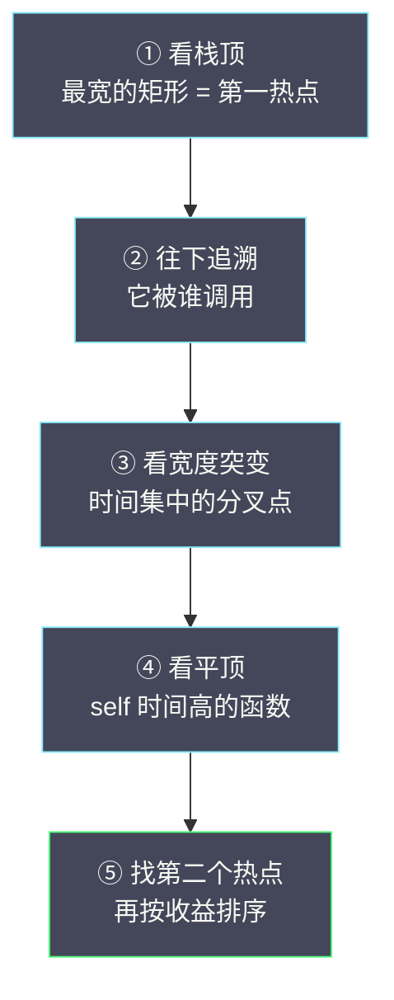

# 02 火焰图阅读与性能问题识别

**摘要：**

火焰图（Flame Graph）是 Brendan Gregg 在 2011 年发明的 Profile 可视化方法，它把成千上万条调用栈采样聚合成一张直观的图——X 轴是函数（按字母序排列），Y 轴是调用栈深度，每个矩形的宽度代表该函数被采样到的比例。它之所以成为性能分析的"通用语言"，是因为它同时具备两个特性：**一眼可见热点**（宽的矩形就是热点）与**完整的调用上下文**（从栈底到栈顶可见完整链路）。本文从火焰图的数据结构与生成原理出发，讲透阅读技巧（self 与 total、两种读法、颜色语义），逐一拆解五种常见性能模式的图形特征（CPU 热点、GC 压力、锁竞争、I/O 等待、线程饥饿），给出 Java / Go / Python 的实操命令，最后落到四类常见误区与"看图之后该做什么"。读完之后，你应当能回答两个问题：**火焰图到底该怎么读，以及如何从一张图走到一个可执行的结论**。

---

## 第 1 章 火焰图的起源与设计

### 1.1 Profile 数据的可视化难题

在 [[01 持续性能剖析]] 里我们知道，Profile 的原始数据是"调用栈加采样次数"的列表。一个典型的 CPU Profile 可能包含数万条不同的调用栈。如何把这些数据可视化，让工程师快速找到热点？

在火焰图出现之前，主要方式是**调用树（Call Tree）**与**表格（Table）**，但它们各有硬伤。

**调用树**：以树形结构展示函数的调用关系，每个节点显示该函数的 CPU 时间。问题是——当调用树深度超过 20 层、分支超过 100 个时，树形视图变得难以浏览；工程师需要不断展开与折叠节点，很难建立全局视角。**树的"可折叠"本是优点，但在"找热点"这个任务上，它反而成了障碍**——因为你不知道该展开哪一枝。

**表格**：按 CPU 时间排序的函数列表，显示每个函数的"self 时间"（自身执行，不含子调用）与"total 时间"（含子调用）。问题是——表格丢失了调用上下文。知道 `serialize()` 占了 30% 的 CPU，但不知道它是被 `processOrder()` 调的还是被 `sendNotification()` 调的——而这两种情况的优化方向完全不同。**表格回答了"谁最忙"，却没回答"它在哪条路径上忙"**。

### 1.2 Brendan Gregg 的三条设计原则

Brendan Gregg（Netflix 高级性能工程师）在 2011 年设计了火焰图，恰好补上了这两个短板。它的设计原则有三条。

**原则一：宽度等于热点。** 每个矩形的宽度与它在 Profile 中被采样到的比例成正比。最宽的矩形就是最大的 CPU 消耗者——工程师一眼就能看到热点，不必逐行阅读。**把"占比"直接编码成"宽度"，是最关键的一步**——它让"找热点"从"读数字"变成了"看形状"。

**原则二：垂直方向等于调用关系。** Y 轴从下到上是从调用者到被调用者。栈底是程序入口（如 `main`），栈顶是实际执行代码的函数，每个矩形的上方是它调用的子函数。**这把"调用上下文"编码进了"位置"**——你不需要读文字，只需要看"它在谁的上面"。

**原则三：X 轴不是时间。** 这是最常见的误读。X 轴的排列顺序是**按函数名的字母顺序**，目的是把相同函数名的调用栈合并在一起，让同一个函数的所有调用路径在视觉上聚集。**X 轴的左右位置没有时间含义**——这一条必须记住，否则整张图都会被误读。

### 1.3 火焰图的数据结构

火焰图的底层结构是一棵**前缀合并树（Prefix-Merged Trie）**：

```text
原始采样数据（5 条调用栈，每条被采样到的次数不同）：

main → handleRequest → processOrder → serialize      350 次
main → handleRequest → processOrder → queryDB         120 次
main → handleRequest → processOrder → validate         30 次
main → handleRequest → authenticate                    80 次
main → GC.collect                                      20 次
                                                 总计：600 次

合并为前缀树：

main (600)
├── handleRequest (580)
│   ├── processOrder (500)
│   │   ├── serialize (350)
│   │   ├── queryDB (120)
│   │   └── validate (30)
│   └── authenticate (80)
└── GC.collect (20)
```

火焰图把这棵树"拍平"成矩形堆叠图：

```text
                  serialize (58.3%)
          processOrder (83.3%)              authenticate
     handleRequest (96.7%)                              GC
main (100%)
```

每一层的矩形宽度之和等于其父节点的宽度——`processOrder` 的宽度是 `handleRequest` 的 500/580 ≈ 86.2%。**"前缀合并"是火焰图能"一眼看出全局"的关键**：它把共享前缀的调用栈合并了，因此同一层的矩形不重复、宽度之和恒等于 100%。

### 1.4 为什么火焰图成了"通用语言"

火焰图之所以能跨越语言与工具，成为性能分析的通用语言，原因有三。

**其一是"无文字依赖"。** 你不需要读懂具体的函数名，只需要看"形状"——宽的、靠上的、平顶的，就是热点。**这让它跨语言可用**：Java 的火焰图与 Go 的火焰图，读法完全一样。

**其二是"信息无损"。** 它保留了完整的调用栈信息——不像表格会丢掉上下文，也不像"Top 函数榜"会丢掉路径。

**其三是"可组合"。** 它能派生出很多变体（倒置、Diff、Sandwich），服务于不同的分析任务（第 3 章）。**一个"基础表示"能派生出多种视图，是它成为标准的另一个原因**。

**学会读火焰图，等于掌握了一项跨工具、跨语言的分析能力**——这也是本专栏把它单独用一章来讲的原因。

### 1.5 火焰图与其他可视化的对照

要理解火焰图的独特性，最好的办法是把它与"表格式"和"树形式"的可视化放在一起对照。

**表格（Top 函数榜）** 回答"谁最忙"，它把函数按 self 时间排序，一眼可见"排名"。**它的优点是"排序清晰"，缺点是"丢了上下文"**——你看到 `serialize` 排第一，却不知道它是被哪条路径调用的。

**调用树（Call Tree）** 回答"谁调用了谁"，它保留了完整的层级。**它的优点是"上下文完整"，缺点是"要展开才能看"**——树太大时，你需要在无数节点里找热点，效率很低。

**火焰图** 试图同时拿下两者的优点：**它保留了上下文（垂直方向就是调用关系），又做到了"一眼可见"（水平宽度就是热点）**。这个"既完整又直观"的组合，正是它能成为通用语言的根本原因。

这张对照说明了一个更普遍的规律：**可视化的设计，本质是在"信息完整"与"认知负荷"之间找平衡**。表格为了"易读"牺牲了信息，树为了"完整"牺牲了易读；火焰图的巧思，是**用一个二维平面同时承载了这两个维度**——垂直管"关系"，水平管"占比"。**理解了这一点，就能理解为什么"设计一个好的可视化"是一件极难的事**。

### 1.6 火焰图的三条设计启示

火焰图的设计不只是"画得好看"，它的三个选择本身就是三条通用的可视化设计原则，值得抽出来。

**启示一：把最重要的维度编码成最直观的视觉属性。** 火焰图把"占比"编码成"宽度"——因为宽度是人眼最容易比较的属性。**反过来说，如果你想让读者"一眼看出"某个量，就要把它编码成"一眼能比较"的视觉属性**（长度、面积、颜色深浅），而不是"需要读的数字"。

**启示二：不要用一个维度承载两个含义。** 火焰图的 X 轴只承载"字母序"，Y 轴只承载"调用深度"——各司其职。**如果 X 轴既要表示"时间"又要表示"分组"，图就会变得无法解读**。**"一个视觉维度只编码一种信息"，是可视化不产生歧义的前提**。

**启示三：为"主要任务"优化，接受"次要任务"的牺牲。** 火焰图是为"找热点"优化的，代价是"看时间顺序"不方便（X 轴非时间）。**没有一种可视化能对所有任务都最优**——**明确"这张图主要用来回答什么问题"，然后为它做取舍，是设计的核心**。

这三条启示不止适用于火焰图。**任何"要把复杂数据讲清楚"的场合——无论是画架构图、做仪表盘、还是写技术文章的结构——都在做同样的取舍**。

---

## 第 2 章 火焰图的阅读技巧

### 2.1 识别热点函数

**核心规则：看栈顶（最上面一行）最宽的矩形。**

栈顶的矩形代表"**self 时间**"——函数自身正在执行的代码时间（不含它调用的子函数）。如果一个函数在栈顶占据了很宽的空间，说明它本身消耗了大量 CPU，而不是因为它调用了耗时的子函数。

在上面的例子里，`serialize` 在栈顶占了 58.3%——这就是最大的 CPU 热点。优化 `serialize` 本身（如换更快的 JSON 库、减少序列化字段）是最有效的方向。

**一个常见的误读**：看到 `main` 占了 100% 的宽度就认为 `main` 是热点——错。`main` 只是程序入口，所有 CPU 时间都"经过"了它；`main` 的 self 时间接近 0%。**热点永远在栈顶**，不在栈底。

### 2.2 理解 self 时间与 total 时间

| 概念 | 含义 | 在火焰图中的体现 |
|---|---|---|
| Self 时间 | 函数自身执行的时间（不含子调用） | 该矩形上方**没有子矩形**的部分 |
| Total 时间 | 函数从进入到退出的总时间（含子调用） | 该矩形的总宽度 |

`processOrder` 的 total 时间是 83.3%，但它的 self 时间只有 83.3% 减去 58.3%（serialize）减去 20%（queryDB）减去 5%（validate）等于 0%——**`processOrder` 本身几乎不消耗 CPU，所有时间都花在了它的子调用上**。

这意味着：优化 `processOrder` 本身（如重构它的代码逻辑）不会有任何收益——你该优化的是它调用的 `serialize`。**"self 还是 total"这个问题，决定了"优化哪个函数"**——这是读火焰图时最该先问自己的问题。

### 2.3 两种读法

**从下往上读（Bottom-Up）**：从 `main` 开始，看每一层的分支——"程序入口 → 请求处理 → 业务逻辑 → 序列化"。这种读法适合理解"请求的整体执行路径"。

**从上往下读（Top-Down）**：先看栈顶最宽的矩形（热点），再沿垂直方向往下看——"serialize ← processOrder ← handleRequest ← main"。这种读法适合"快速定位热点，再追溯调用链路"。

**推荐的阅读顺序**是：**先看栈顶**（找最宽的栈顶矩形，即最大热点）→ **往下追溯**（看这个热点被谁调用）→ **看宽度突变**（在调用链里找"宽度突然变窄"的地方，那是时间集中的分叉点）→ **看"平顶"**（若某矩形顶部很平、上方没有子矩形，说明它的 self 时间高，本身是 CPU 密集的）。



### 2.4 颜色的含义

火焰图的颜色在**原始设计**中没有特殊含义——Brendan Gregg 最初用随机的暖色调（红、橙、黄），纯粹是为了视觉美观与区分相邻矩形。

但在现代工具里，颜色被赋予了语义：

| 工具 | 颜色含义 |
|---|---|
| Grafana Pyroscope | 按包名或模块着色（不同模块不同颜色） |
| async-profiler | 绿色 = Java 代码，黄色 = C/C++ 原生代码，红色 = 内核代码 |
| Diff 火焰图 | 红色 = 增加（比基线多），蓝色或绿色 = 减少（比基线少） |

**"颜色在原始设计里没有含义"这一点值得记住**——它意味着"不要从颜色推断重要程度"。在 Diff 火焰图里颜色才承载关键信息（增或减），在普通火焰图里颜色只是"区分用"。

### 2.5 一个完整的阅读示例

把上面的技巧串成一个走查。假设你拿到一张 `order-service` 的 CPU 火焰图：

**第一步，看总览**：最底部的 `main`（或 `Thread.run`）是 100%，往上逐层收窄。**这说明"所有 CPU 时间都从这一个入口进来"**——符合"单线程处理请求"的预期。

**第二步，找栈顶最宽的**：假设看到 `ObjectMapper.writeValueAsString` 在栈顶占了 45%。**这是第一热点**。

**第三步，往下追溯**：它上面是 `OrderController.render` ← `DispatcherServlet.doDispatch` ← `HttpServlet.service`。**这说明热点来自"HTTP 响应渲染"**，而不是来自"处理逻辑"。

**第四步，找"平顶"**：再往下看，发现 `GZIPOutputStream.write` 也有一块较宽的平顶（15%）。**这说明"压缩响应"也在烧 CPU**——这是第二个热点，容易被第一热点掩盖。

**第五步，形成假设**：这张图提示两个优化方向——减少序列化的字段（降低 45%）、或者对已压缩的内容不再二次压缩（降低 15%）。

**这个走查的关键，是"不满足于找到第一个热点"**。一张图里往往有两三个热点，而**最宽的那个未必是最容易解决的**——**先找到它们，再按"收益乘以难度"排序**。

### 2.6 如何"问"一张火焰图

火焰图不是一个"读一遍就有答案"的东西，它更像一个"可以反复提问的对象"。学会"问对问题"，比"读得多"更重要。

**问题一："最宽的栈顶是谁？"** 这是找第一热点。它回答"CPU 主要花在哪"。

**问题二："它在谁的上面？"** 这是找调用路径。它回答"这个热点是从哪条路径来的"。

**问题三："它下面是平顶吗？"** 平顶意味着这个函数自己有 self 时间；如果是"尖顶"（上面还有子矩形），那真正的热点在更上面。

**问题四："有没有第二个宽矩形？"** 一张图往往有两三个热点，最宽的那个未必最容易解决。

**问题五："这张图与上周的差在哪？"** 这是 Diff 视角——把"绝对值"变成"变化量"。

**这五个问题，构成了一套"由浅入深"的提问顺序**：先找热点，再看路径，再判 self，再找次热点，最后看变化。**带着问题去看图，比"漫无目的地看"高效得多**——而"能提出好问题"，本身就是"会看图"的体现。

### 2.7 噪声与信号：哪些"宽"是真的

火焰图上"宽"不一定等于"值得优化"，这里有一层需要分辨的"噪声与信号"。

**真实信号的特征**：宽度大、且在多次采样中都稳定出现；对应的代码逻辑"确实在做重活"（如序列化、加解密）；优化它之后宽度会明显收窄。

**噪声的特征**：宽度忽大忽小（不同采样窗口差异很大）；对应的函数是"框架的调度、初始化、类加载"等一次性或低频工作；优化它几乎没有效果。

**一个实用判据是"它在不在关键路径上"**：如果某个宽矩形是"类加载"或"首次初始化"，它可能只是"因为应用刚启动"——这类宽度会随运行时间自然消失。**看到宽矩形，先问"它是不是一次性的"**，能过滤掉相当一部分假信号。

**这层分辨之所以重要，是因为"优化错了目标"比"没优化"更浪费**——你花了一周重构一个"其实只是一次性初始化"的函数，收益为零。**火焰图给的是"线索"，而"哪条线索值得追"，需要结合"它是不是关键路径、是不是稳定出现"来判断**。

---

## 第 3 章 火焰图的变体

### 3.1 倒置火焰图（Icicle Graph）

传统火焰图栈底在下、栈顶在上。**倒置火焰图（Icicle Graph）** 把方向翻转——栈底在上、栈顶在下，像倒挂的冰柱。

倒置火焰图在某些场景下更直观：当你关注"哪些入口函数消耗了最多 CPU"时，倒置图把入口函数放在最上面（视觉焦点），子调用向下展开。Grafana Pyroscope 默认使用倒置火焰图。**"从上往下读"还是"从下往上读"，取决于你的问题**——找热点用传统图，看入口分布用倒置图。

### 3.2 Diff 火焰图

**Diff 火焰图**是持续剖析中最有用的分析手段之一。它把两个时间段的 Profile 做差异对比，用颜色标注变化：**红色矩形**表示相比基线该函数的 CPU 占比增加了；**蓝色或绿色矩形**表示占比减少了；**白色或灰色**表示没有显著变化。

它的典型用法有三种。**场景一，排查性能退化**：把"本次部署后"与"上次部署前"做 Diff，红色的部分就是"新代码引入的热点"。**场景二，排查间歇性延迟**：把"延迟尖峰时段"与"正常时段"做 Diff，红色的部分就是"导致延迟升高的代码路径"。**场景三，验证优化效果**：把"优化后"与"优化前"做 Diff，蓝色的部分就是"优化生效的路径"。

**Diff 之所以比"看绝对值"更有用，是因为它消除了"背景噪声"**——一张普通的火焰图上，某个函数占 20% 可能完全正常；而"它比上周多了 15%"才是真正的信号。**持续剖析最日常的用法，就是 Diff**（第 01 篇 4.5 节）。

### 3.3 Sandwich 视图

**Sandwich 视图**聚焦单个函数，同时显示它的"所有调用者（Callers）"与"所有被调用者（Callees）"：

```text
           ┌─────────────┐
           │  Callers     │  谁调用了 serialize？
           │  (上半部分)   │  processOrder (70%), sendResponse (30%)
           ├─────────────┤
           │  serialize   │  ← 选中的函数
           ├─────────────┤
           │  Callees     │  serialize 调用了谁？
           │  (下半部分)   │  ObjectMapper.writeValueAsString (90%), ...
           └─────────────┘
```

它回答两个问题：**"这个热点是从哪些代码路径被调用到的"**（Callers），以及**"这个函数内部的时间花在了哪些子调用上"**（Callees）。**当你在火焰图上锁定了一个函数、想进一步"上下求索"时，Sandwich 视图就是那把放大镜**。

### 3.4 其他变体

除了上面三种，还有几种值得知道。**差分冰柱图**（Diff Icicle）是 Diff 与倒置的结合，用于"看入口维度的性能变化"。**Off-CPU 火焰图**不是展示"CPU 在跑什么"，而是展示"线程为什么不在跑"（等锁、等 I/O、等调度）——它是 Wall-clock 剖析的典型呈现。**冷火焰图**（Cool Flame Graph）按"调用次数"而非"CPU 时间"着色，用于找"调用次数异常多"的函数。

这些变体的共同点，是**"同一个数据结构（前缀合并树）的不同着色或翻转方式"**。**理解了底层结构，这些变体就都是"换个角度切同一块蛋糕"**。

### 3.5 变体的共同底层

前面几种变体看起来花样很多，但它们共享同一个底层：**一棵前缀合并树，加上不同的"呈现方式"**。

**倒置**只是把树"翻过来画"；**Diff** 是"两棵树按节点做差、再用颜色编码差值"；**Sandwich** 是"把树在某个节点处'切开'，分别展示它的祖先与后代"；**Off-CPU** 是"用另一类数据（等待时间）建同一棵树"。

**理解了"变体只是呈现方式不同"，就能推演出更多用法**。比如，你可以把"CPU 树"与"分配树"并排看，对比"哪个函数既烧 CPU 又大量分配"；也可以把"某服务"与"另一服务"的树做 Diff，看"同样的接口，为什么一个快一个慢"。

**底层统一带来的是"能力的可组合性"**——这正是第 01 篇讲的"pprof 格式标准化"的价值所在：**格式统一了，工具就能在同一个数据结构上自由地"切片、对比、组合"**。

### 3.6 如何自己生成一张火焰图

有时你手上有一份 pprof 文件，想自己生成火焰图。常见路径有三条。

**用 `go tool pprof`**（对任何 pprof 文件都可用）：`go tool pprof -http=:8080 profile.pb.gz` 会启动一个 Web 界面，其中就有火焰图视图。**它的好处是"不需要额外的工具"**——只要装了 Go 环境。

**用 Brendan Gregg 的 FlameGraph 脚本**：`stackcollapse-*.pl` 把各种格式的栈折叠成"分号分隔的调用栈 + 计数"，再喂给 `flamegraph.pl` 生成 SVG。**它的好处是"格式无关"**——只要能把栈折叠成那个格式，任何数据源都能画。

**用平台自带的**：Pyroscope、Parca、async-profiler 都能直接输出 HTML 火焰图。**它的好处是"零配置"**。

**理解了"折叠格式"这个中间层，就理解了火焰图的通用性来源**：`stackcollapse` 把五花八门的栈数据统一成"分号分隔 + 计数"，`flamegraph.pl` 再把这份统一格式渲染成图。**"统一中间格式 + 可替换的前后端"，是它跨工具、跨语言的工程基础**——与 pprof 格式标准化的思路异曲同工。

---

## 第 4 章 常见性能模式识别

### 4.1 模式一：CPU 计算热点

**火焰图特征**：栈顶有一个或几个非常宽的矩形，这些函数不是 I/O 操作也不是锁等待，而是纯计算逻辑。

**典型场景**：JSON/XML 序列化与反序列化（`ObjectMapper.writeValueAsString`、`Gson.toJson`）；正则表达式匹配（`Pattern.matcher` 在复杂正则上的回溯）；加密解密（`AES.encrypt`、`RSA.sign`）；字符串拼接（大量 `String.concat` 或 `StringBuilder.append`）；集合遍历（对大集合做 `stream().filter().map().collect()`）。

**优化方向**：换更高效的库（如启用 Jackson 的 Afterburner 模块、或更换 JSON 库）；减少不必要的计算（如缓存正则编译结果，避免每次请求重新 `Pattern.compile`）；减少数据量（只序列化必要字段，避免返回巨大的嵌套对象）。

### 4.2 模式二：GC 压力

**火焰图特征**：图中出现显著比例（大于 5%）的 GC 相关函数，如 Java 的 `GC.collect`、`GCWorker`、`G1 Young Generation`，或 Go 的 `runtime.gcBgMarkWorker`、`runtime.gcDrain`、`runtime.mallocgc`。

**根因分析**：GC 压力通常由过多的堆内存分配引起。此时应结合 **Allocation Profile**（而非 CPU Profile）来定位分配热点。**"GC 占了 20%"是一个症状，而"谁在疯狂分配"才是病因**——CPU 火焰图只能告诉你症状。

**典型场景**：循环内创建大量临时对象；日志框架在每次打日志时格式化字符串（`String.format()` 或 `+` 拼接）；频繁的装箱拆箱。

**优化方向**：对象复用（对象池）；减少临时对象分配（用 `StringBuilder` 替代字符串拼接）；调整 GC 参数（增大 Young Generation、切换 GC 算法）。

### 4.3 模式三：锁竞争

**火焰图特征**：在 **Lock/Contention Profile** 或 **Wall-clock Profile** 里出现大量锁等待函数，如 Java 的 `ReentrantLock.lock`、`synchronized`、`ThreadPoolExecutor.getTask`，或 Go 的 `sync.Mutex.Lock`、`runtime.semacquire`。

**在 CPU Profile 里，锁竞争可能完全看不见**——因为等待锁的线程不消耗 CPU。这正是"用错剖析类型就白做"的典型场景（第 01 篇 3.6 节）。

**典型场景**：全局单例的同步方法（如单一的连接池 `getConnection` 加了全局锁）；日志框架的同步写入；共享的 `HashMap`/`ArrayList` 加了全局锁而非用 `ConcurrentHashMap`。

**优化方向**：减小锁粒度（全局锁拆成分段锁）；用无锁数据结构（`ConcurrentHashMap`、`AtomicLong`）；用 ThreadLocal 避免竞争；异步化（如日志异步写入）。

### 4.4 模式四：I/O 等待

**火焰图特征**：在 **Wall-clock Profile**（或 Off-CPU Profile）里出现大量 I/O 等待函数，如 `SocketInputStream.read`、`FileInputStream.read`、`EPollSelectorImpl.doSelect`，或系统调用 `epoll_wait`、`read`、`write`。

**在 CPU Profile 里，I/O 等待几乎不可见**——因为等 I/O 的线程让出了 CPU。**这又一次印证："看不到"不等于"不存在"，而是"用错了工具"**。

**典型场景**：同步的数据库查询；同步的 HTTP 调用；磁盘文件读写。

**优化方向**：异步化 I/O；加缓存减少 I/O 次数；批量化 I/O（把多次小查询合并成一次批量查询）；用连接池减少连接建立开销。

### 4.5 模式五：线程饥饿

**火焰图特征**：图中 `ThreadPoolExecutor.getTask` 或线程池调度相关函数占比很高——**线程在等待任务，而不是执行任务**。

这种模式通常伴随"**CPU 使用率低但延迟高**"——请求在线程池队列里排队，而可用线程都被慢请求占住了。

**典型场景**：线程池大小配置过小；少数慢请求（如慢 SQL）阻塞了大部分线程；线程池类型选择不当（用固定大小线程池处理 I/O 密集型任务）。

### 4.6 模式识别的通用方法

五种模式看下来，可以提炼出一条通用方法：**先分类，再看形状**。

**分类的依据是"CPU 高不高"与"时间花在哪"**：CPU 高 → 看计算热点或 GC；CPU 低 → 看锁竞争、I/O 等待或线程饥饿。**先确定"问题属于哪一类"，再去看对应的图形特征**，比"上来就盯着图看"效率高得多。

**这条方法的普适性在于：它把"看图"变成了"验证假设"**。你先根据现象提出假设（"可能是锁竞争"），再去图上找证据（"锁等待函数占比是否很高"）。**带着假设看图，比"看图猜问题"要快得多**——这与第 01 篇讲的"剖析需要被指路"是同一个道理。

### 4.7 五种模式的对照与记忆法

五种模式容易记混，一个实用的记忆法是**按"CPU 高不高"与"卡在哪"分类**。

**CPU 高的两种**：**CPU 热点**（栈顶宽矩形、纯计算）与 **GC 压力**（GC 相关函数占比高）。两者的区别是"谁在烧 CPU"——前者是业务代码，后者是垃圾回收。**判据很简单：栈顶是业务函数还是 GC 函数**。

**CPU 低的三种**：**锁竞争**（锁等待函数多）、**I/O 等待**（read/epoll 等函数多）、**线程饥饿**（线程池调度函数多）。三者的区别是"线程在等什么"——等锁、等 I/O、还是等任务。**判据是"等待函数的名字"**。

**这条分类法的价值，是把"五种模式"压缩成"两类三种"**——先问"CPU 高不高"，再问"等的是什么"。**认知负荷一下子降了下来**，而这正是"模式识别"该有的样子：**用最少的判据，覆盖最多的情形**。

值得补充的是，这五种模式**可能同时出现**。一个真实的系统里，可能既有 CPU 热点、又有 GC 压力、还有锁竞争——它们互相纠缠（如"锁竞争导致线程堆积、进而引发更多对象分配、最终推高 GC"）。**所以不要指望"一张图对应一个根因"，而要有"多条线索互相印证"的准备**。

### 4.8 从模式到根因：一次完整的推演

把模式识别走一遍完整推演，看看"从图形到根因"是怎么一步步收敛的。

**现象**：`user-service` 的 P99 从 100ms 涨到 900ms，CPU 使用率从 30% 涨到 75%。

**第一步，分类**：CPU 高 → 优先看 CPU 剖析。

**第二步，看栈顶**：栈顶最宽的是 `String.format`，占 38%。**这是一个"CPU 计算热点"模式**。

**第三步，追溯调用者**：它上面是 `LoggingEvent.format` ← `log4j.Logger.info`。**说明热点来自"日志格式化"**。

**第四步，形成假设**：代码里在循环中打了大量日志，且每次都用 `String.format` 拼接。

**第五步，验证**：去看那段代码，果然——一个处理 1000 条记录的循环里，每条都打了一条 `info` 日志，且用了 `String.format`。

**第六步，设计改动**：把日志移到循环外（或降到 `debug` 级别），并用条件判断避免不必要的格式化。

**第七步，用 Diff 验证**：改完后对比火焰图，`String.format` 的占比从 38% 降到 2%。

**这条推演的每一步，都对应本篇讲过的一个技巧**：分类（4.6 节）、看栈顶（2.1 节）、追溯调用者（2.3 节）、形成假设与验证（7.1 节）、Diff 验证（7.2 节）。**从"现象"到"根因"，中间不是一步跨越，而是七步收敛**——理解了这七步，就知道"看图"只是其中一步，而"看图之后"才是大头。

### 4.9 模式识别与业务语义

最后补一层容易被忽略的：**同样占 30% 的宽度，业务语义不同，结论可能完全相反**。

举例来说，一个函数占 30% 的 CPU——如果它是**加解密**，那可能是"业务本来就需要的开销"，优化空间有限；如果它是**日志格式化**，那大概率是"写得不合理"，优化空间很大；如果它是**JSON 序列化**，那要看"是不是序列化了不该序列化的字段"。

**同样宽度的矩形，背后的"可优化性"天差地别**。因此"模式识别"只完成了"它属于哪一类问题"，还要再问一句"**在这个业务里，这类开销合不合理**"。

这条补充的实践意义是：**不要拿着火焰图去问"哪个最宽"，而要问"哪个最宽且最不合理"**。前者是机械的，后者才需要理解业务。**这也是为什么"看火焰图"这件事，最终无法被工具替代——工具能告诉你"哪宽"，只有人知道"哪不合理"**。

---

## 第 5 章 不同语言的火焰图实践

### 5.1 Java

Java 生态里最推荐的 Profiler 是 **async-profiler**——它用 JVM 内部的 `AsyncGetCallTrace` API，避免了传统 Java Profiler 的安全点偏差问题。

> [!warning] 安全点偏差（Safepoint Bias）
> JVM 的传统剖析方法（如 `jstack`、VisualVM 的 CPU Sampler）只能在**安全点**采样——即 JVM 暂停所有线程进行 GC 或其他全局操作的时间点。问题在于，安全点的出现与代码的 CPU 热点无关——紧凑的数值计算循环内部如果没有安全点，这些热点就永远不会被采样到。async-profiler 用 POSIX 信号机制，可以在任意时刻采样，不受安全点限制。

```bash
# async-profiler 采集 CPU Profile（持续 30 秒）
./asprof -d 30 -f profile.html <PID>

# 采集 Allocation Profile
./asprof -d 30 -e alloc -f alloc_profile.html <PID>

# 采集 Lock Contention Profile
./asprof -d 30 -e lock -f lock_profile.html <PID>

# 采集 Wall-clock Profile
./asprof -d 30 -e wall -f wall_profile.html <PID>
```

**JFR（Java Flight Recorder）** 是 JDK 内置的替代方案，从 JDK 11 起免费可用：

```bash
# 启动 JFR 记录
jcmd <PID> JFR.start duration=60s filename=recording.jfr

# 或通过 JVM 启动参数
java -XX:StartFlightRecording=duration=60s,filename=recording.jfr -jar app.jar
```

JFR 记录的内容比 async-profiler 更丰富——除 CPU 与内存剖析外，还含 GC 事件、线程状态、编译事件、I/O 事件。可以用 JDK Mission Control 或 `jfr` 命令行工具分析。

### 5.2 Go

Go 的内置剖析支持是所有主流语言中最完善的。只需导入 `net/http/pprof` 包，即可通过 HTTP 端点在线获取 Profile：

```go
import _ "net/http/pprof"

func main() {
    go func() {
        http.ListenAndServe("localhost:6060", nil)
    }()
    // ... 业务代码 ...
}
```

```bash
# 采集 CPU Profile（30 秒）
go tool pprof http://localhost:6060/debug/pprof/profile?seconds=30

# 采集堆内存 Profile
go tool pprof http://localhost:6060/debug/pprof/heap

# 采集 Goroutine 堆栈
go tool pprof http://localhost:6060/debug/pprof/goroutine

# 采集 Mutex Contention Profile
go tool pprof http://localhost:6060/debug/pprof/mutex

# 在 pprof 交互界面中生成火焰图
(pprof) web    # 在浏览器中打开 SVG 火焰图
```

### 5.3 Python

Python 由于 GIL（Global Interpreter Lock）的存在，CPU 剖析有其特殊性——多线程 Python 程序在 CPU 密集型任务上无法真正并行。

**py-spy** 是 Python 最推荐的 Profiler——它从进程外部采样（不需要改 Python 代码），支持生成火焰图：

```bash
# 采集 CPU Profile 并生成火焰图
py-spy record -o profile.svg --pid <PID>

# 实时查看热点函数（类似 top）
py-spy top --pid <PID>
```

### 5.4 语言间的共性与差异

把三种语言放在一起看，会发现**"读图的逻辑完全一致，采集的命令各不相同"**。

**共性是火焰图本身**——无论哪种语言，都是"看栈顶最宽的矩形、追它的调用者、判断 self 与 total"。

**差异在采集机制**：Java 需要绕过安全点（用 async-profiler）；Go 内置得最完整（一个 HTTP 端点搞定）；Python 受 GIL 限制（用进程外采样绕开）。

**这条"共性在分析、差异在采集"的规律，正是火焰图作为通用语言的价值所在**——**你学一次读图，就能用在所有语言上；而采集的差异，只是一次性的适配成本**。

### 5.5 采集端的选择

知道了各语言的采集命令，还有一个"用什么方式采"的选择：**进程内还是进程外**。

**进程内采集**（async-profiler 作为 agent 加载、Go 的 `net/http/pprof`、JFR）：能拿到语言运行时的深度信息（JVM 的精确栈、JFR 的事件），精度高；但需要改应用（加 agent、开端口），且对"无法改代码的服务"无效。

**进程外采集**（py-spy 从外部 attach、eBPF 从内核观测）：零侵入、能覆盖无法改代码的进程；但能拿到的信息受限于运行时的可观测接口，某些情况下不如进程内精确。

**选择依据是"能不能改代码"与"要不要精度"**：自己的服务、要精度 → 进程内；第三方组件、要覆盖 → 进程外。**这与第 01 篇 4.4 节讲的"部署形态"是同一件事的两个视角**——一个从"部署"看，一个从"采集"看。

**一个常见的组合是"两套并存"**：核心服务用进程内 agent 拿精度，基础设施组件用 eBPF 拿覆盖。**不要试图用一套方案覆盖所有场景**——覆盖与精度，往往需要两条腿走路（第 01 篇 4.4 节）。

### 5.6 跨语言系统的统一视图

在一个多语言系统里（Java + Go + Python），还有一个"如何统一看"的问题。

**好消息是"图能统一"**：无论数据来自哪种语言的采集器，最终都能转成 pprof 格式、渲染成同一种火焰图。**这意味着"读图的方法"是跨语言的**——你在 Java 上学到的"看栈顶、判 self"，在 Go 上完全适用。

**麻烦的是"语义未必统一"**：不同语言的"GC 函数名"不同（Java 是 `GC.collect`、Go 是 `runtime.gcBgMarkWorker`），"锁等待函数名"也不同。因此**"模式识别"需要针对语言做一点适配**——但只是"换个函数名"，识别逻辑（CPU 高看计算、CPU 低看等待）不变。

**统一视图的价值，在于"用一套方法管理多语言系统"**。设想一个团队同时维护 Java 与 Go 服务：如果没有统一视图，他们得学两套剖析工具、两套读图方法；有了统一视图，**他们只需要学一次"怎么读火焰图"，剩下的只是"记住两种语言的 GC 函数长什么样"**。

**这是"标准化"在剖析领域的又一次兑现**——与 pprof 格式、OTLP 协议一样，**统一的价值不在"技术优雅"，而在"降低人的学习与协作成本"**。

---

## 第 6 章 火焰图分析的常见误区

### 6.1 误区一：把 X 轴当时间线

再强调一次——火焰图的 X 轴**不是时间线**。矩形在 X 轴上的位置是按函数名字母序排列的，与时间无关。不要试图从"左边的先执行、右边的后执行"去解读。**这是火焰图最容易被误读的地方，也是初学者的第一个坎**。

### 6.2 误区二：只看 CPU Profile

CPU Profile 只能看到"CPU 正在执行"的时间——线程等锁、等 I/O、等调度的时间都不会出现在 CPU Profile 里。如果你的问题是"延迟高但 CPU 不高"，CPU Profile 可能完全看不到问题。

**选择剖析类型的决策**：CPU 使用率高 → CPU Profile；CPU 使用率低加延迟高 → Wall-clock Profile；线程 BLOCKED 多 → Lock Profile；GC 频繁 → Allocation Profile。

### 6.3 误区三：过度关注"小"热点

如果一个函数只占 2% 的 CPU，即使把它优化到 0%，也只省了 2%——效果微乎其微。性能优化应遵循 **Amdahl 定律**：优化收益取决于被优化部分占总时间的比例。**始终优先优化最宽的矩形**。

但这里有一个补充：**"宽度"不是唯一的排序依据**。一个占 5% 但"改一行就能消除"的热点，优先级可能高于一个占 20% 但"需要大重构"的热点。**正确的排序是"收益乘以可实施性"，而不是"只看宽度"**。

### 6.4 误区四：忽略采样偏差

采样剖析是统计估算——样本太少（如只有 100 个）时置信度很低。一个函数在 100 个样本中被采到 5 次（5%），其真实占比可能在 1% 到 9% 之间波动。

**经验法则**：至少需要 1000 个以上的采样点（约 10 秒的 Profile、100 Hz 采样）才能得到统计上可靠的结果。对于持续剖析，由于数据长期累积，采样数量通常足够。**看到"某函数占 5%"时，先问"样本量够不够"，再下结论**。

### 6.5 误区的共同根源

这四个误区有一个共同根源：**把火焰图当成"精确的、完整的、按时间排列的"数据**。而实际上，它是"近似的（采样）、聚合的（前缀合并）、按名称排列的（非时间序）"。

**理解了火焰图的这三个"不是"，四个误区就自然避开了**。**对待任何一种可视化，先搞清"它编码了什么、又丢掉了什么"，是避免误读的前提**。

### 6.6 一个真实的误读案例

把误区具体化，看一个常见的误读场景。

**场景**：某团队排查"接口变慢"，抓了一张 CPU 火焰图。他们看到 `main` 占了 100%，于是断定"`main` 函数有问题"，花了两天去重构 `main` 里的初始化逻辑——毫无效果。

**问题出在哪**：他们把"栈底的入口"当成了"热点"。**`main` 占 100% 是必然的**——所有 CPU 时间都从它这里流过，它的宽度等于"全部"。真正的热点在栈顶：`serialize` 占了 45%。

**更隐蔽的误读**：还有团队把火焰图的 X 轴当时间线，看到"左边的函数先执行"，于是去分析"为什么左边的先跑"——方向完全错了，因为 X 轴是字母序。

**这两个误读的共同点，是"没有搞清图编码了什么"**。`main` 的宽度是"累计时间"而非"自身时间"；X 轴是"名字顺序"而非"时间顺序"。**一旦把这两个"编码方式"搞反，整张图都会被误读**。

**避免这类误读的最简单办法，是每次看图前先默念一遍**：**宽度是占比，垂直是调用，栈顶才是热点，X 轴不是时间**。**这四句话，是读火焰图的"四则运算"**——不熟练时多念几遍，熟练后它们会变成直觉。

### 6.7 误区清单

把全篇的误区收成一份清单，作为看图前的自查。

- **把 X 轴当时间线** → X 轴是字母序，与时间无关。
- **把栈底当热点** → 热点永远在栈顶；栈底是入口，宽度必然大。
- **把 total 当 self** → 宽但"上面还有子矩形"的函数，本身不烧 CPU。
- **只看 CPU 剖析** → "CPU 低、延迟高"时，要换 Wall-clock 或 Lock。
- **过度关注小热点** → 收益等于占比乘以可实施性，2% 的热点通常不值得先动。
- **忽略采样偏差** → 样本少于约 1000 时，占比的波动可能很大。
- **把"宽"都当真信号** → 一次性初始化、类加载的"宽"会自然消失，不是优化目标。
- **只找第一个热点** → 一张图往往有两三个热点，最宽的未必最好解决。
- **优化后不做 Diff 验证** → "优化有效"就只是感觉，不是事实。

**这份清单的用法是"看图前扫一遍、看图后再扫一遍"**——前一遍防止误读，后一遍防止漏判。**九条误区，覆盖了"读图的编码方式""剖析类型的选择""优化的排序""结果的验证"四个层面**——把这四层都想到，看图就不会跑偏。

### 6.8 误读的代价

误区不只是"看错一眼"，它有真实的代价，值得算一算。

**最轻的代价是"浪费时间"**：把 `main` 当热点、花两天重构一个无关函数。**中等代价是"改错了地方"**：优化了一个占比高但"不可优化"的热点（如业务必需的加解密），结果收益为零，还引入了风险。**最重的代价是"掩盖了真问题"**：因为一直在看 CPU 剖析，而问题其实在锁竞争上，于是"每次都找不到根因"，团队逐渐失去对剖析的信任。

**第三种代价最隐蔽、也最昂贵**。**一个被误用的工具，会比"没有这个工具"更糟**——因为它消耗了信任，让团队在真正需要它时不再相信它。

因此，**花时间把"怎么读"讲清楚，是有回报的投入**。本专栏把"误区"单列一章，正是因为这个原因：**工具的威力，取决于使用者对它的理解程度**——理解到位，它是利器；理解错位，它是负担。

---

## 第 7 章 从火焰图到结论

### 7.1 看图之后该做什么

看懂图只是第一步，**从图到结论还有一段路**。一个务实的流程是：**形成假设 → 回到代码验证 → 设计改动 → 用 Diff 验证效果**。

**形成假设**：图上显示 `serialize` 占 45%，假设是"序列化的字段太多或库太慢"。

**回到代码验证**：去看 `serialize` 被调用处的代码——返回对象里是不是有一个不该序列化的大字段？库的版本是不是偏旧？

**设计改动**：可能的选择有"减少字段""加 `@JsonIgnore`""换库"。**不同选择的风险与收益不同，需要权衡**。

**用 Diff 验证**：改完后，对比"优化前后"的火焰图，确认 `serialize` 的占比确实下降了。**没有这一步，"优化有效"就只是感觉**。

### 7.2 如何验证优化效果

验证的关键是**"有基线"**。如果只在优化后抓一次 Profile，你无法判断"占比下降"是"优化生效"还是"负载变化"。因此正确做法是：**优化前抓一次（基线）、优化后抓一次（对照），在同一负载条件下对比**。

**这与"持续剖析的 Diff 能力"是配套的**：持续剖析提供了"随时可取的基线"，Diff 提供了"对比的手段"。**两者结合，性能优化才从"改完看看"升级为"改前有基线、改后有对照"**。

### 7.3 一张图看不出来怎么办

有时你会遇到"图很平、没有明显热点"的情况。这通常意味着几种可能。

**其一，问题不在 CPU**：图很平可能是"CPU 没怎么用"，问题在 I/O 或锁——该换剖析类型。

**其二，问题在"分布"而非"热点"**：如果每个函数都占一点点、加起来才导致慢，那么"单个热点"这个视角就不适用——此时该看"总耗时分解"或"调用次数"（冷火焰图）。

**其三，采样不足**：样本太少时，图看起来"到处都一样"，其实是噪声。

**遇到"图很平"，不要急着下"没有性能问题"的结论**——先排除"用错类型""样本不足"这两种可能，再考虑"问题确实不在 CPU"。**"看不出问题"本身也是一个需要解释的结果，而不是一个终点**。

### 7.4 把火焰图纳入日常

最后说一个"习惯"层面的建议：**让火焰图从"排查时才用"变成"发版时就看"**。

性能回归往往不是"某天突然变慢"，而是"每次发版慢一点、累积几个月后才发现"。**如果在每次发版后，都对比一下"关键接口的火焰图有没有变红"，就能在回归变成故障前发现它**。

这个习惯的门槛不高：一次 Diff、几分钟时间。**但它把性能治理从"被动救火"变成了"主动巡检"**——这正是持续剖析（第 01 篇）最日常、也最容易被忽视的价值。

**判断一个团队有没有真正用好剖析，看一个指标就够了：他们是在"故障后"才打开火焰图，还是在"每次发版后"就打开它**。前者把剖析当"急救箱"，后者把它当"体检仪"——**而体检仪的价值，远高于急救箱**。

### 7.5 一个完整的排查复盘

把全篇的技巧放进一个真实感的复盘里，作为收束。

**背景**：某电商大促前压测，`cart-service` 的吞吐上不去——CPU 到 80% 就卡住，QPS 上不去。

**第一轮，抓 CPU 火焰图**：栈顶最宽的是 `HashMap.get`（25%）与 `ArrayList.add`（18%）。**这是"CPU 计算热点"模式**，但"集合操作"本身很便宜——为什么占这么高？

**第二轮，追溯调用者**：`HashMap.get` 上面是 `RecommendService.filterByRules`。**说明热点来自"推荐规则的过滤逻辑"**。

**第三轮，看代码**：发现"过滤规则"是一个嵌套循环——对每个商品遍历所有规则、对每条规则遍历所有商品，复杂度是"商品数乘以规则数"。

**第四轮，形成假设与改动**：把规则预编译成索引（如按类目分桶），把"嵌套遍历"变成"按桶查找"。

**第五轮，Diff 验证**：改完后，`HashMap.get` 的占比从 25% 降到 3%，QPS 提升了 40%。

**复盘这个案例，能看清几件事**。**其一，"集合操作占 25%"这种看似"不合理"的宽度，往往指向"算法复杂度"问题**——不是集合慢，而是"被调用了太多次"。**其二，火焰图只指路，不解释**——它告诉你是 `filterByRules`，但"为什么慢"要回到代码里看。**其三，验证是闭环的最后一环**——没有 Diff，你无法确认"改动真的有效"。

**这个复盘最想传达的是：火焰图是"侦探的线索"，不是"法官的判决"**。它把范围从"整个服务"收窄到"一个函数"，但"这个函数为什么慢"的答案，仍然在代码里、在算法里、在对业务的理解里。

### 7.6 从"看图"到"建基线"

如果说这一章有一个"最终建议"，那就是：**把火焰图从"排查工具"升级为"基线工具"**。

做法很简单：**为每个关键服务，定期（如每周、或每次发版后）保存一张"典型负载下的火焰图"**，作为性能基线。之后每次发版，都与这张基线做 Diff。

**这个习惯的价值，是让"性能回归"变得"看得见"**。没有基线时，"接口慢了一点"往往被归为"感觉"；有了基线，"`serialize` 的占比从 10% 涨到 30%"就是一条可追踪的证据。**把主观的"感觉慢"变成客观的"哪块变宽了"，是性能治理从"被动"走向"主动"的分水岭**。

**建基线的门槛，比想象的低**——一次采集、一次保存。**而它的收益，是"每一次发版都多一道性能防线"**。**持续剖析（第 01 篇）提供了"随时可采"的能力，而"建基线"是把这个能力用起来的最简单方式**。

---

## 第 8 章 火焰图之外：其他可视化

火焰图不是唯一的性能可视化，了解它的"同行"，有助于在合适的场景选对工具。

**热力图（Heatmap）**：用颜色深浅表示"某函数在某时间段的活跃度"，适合看"热点的随时间变化"——比如"某个函数在每天下午三点都会飙高"。**它比火焰图多了"时间维度"**。

**差分图（Differential）**：除了火焰图的 Diff，还有"按函数列表做差分"的形式——列出"哪些函数的占比变化最大"，适合"快速定位回归点"，比看图更直接。

**调用计数图（Call Count）**：按"调用次数"而非"CPU 时间"着色，用于找"调用次数异常多"的函数——**有些性能问题不是"某个函数慢"，而是"某个函数被调用了太多次"**。

**拓扑图（Topology）**：那是追踪领域的可视化，用于"跨服务的调用关系"——与火焰图是"横向"与"纵向"的关系（第 01 篇 1.3 节）。

**这些可视化的共同点是"同一份数据的另一个切面"**。**没有哪种"更好"，只有"哪个切面更适合当前的问题"**——找热点用火焰图，看趋势用热力图，找回归用差分，找"调用过多"用计数图。**理解每个工具"回答什么问题"，比"熟练使用某一个"更重要**。

### 8.2 可视化的选择原则

把这一章收成一条选择原则：**先想清楚"你要回答什么问题"，再选可视化**。

**要回答"谁在烧 CPU"** → 火焰图。
**要回答"热点怎么随时间变"** → 热力图。
**要回答"哪个函数占比涨了"** → 差分列表。
**要回答"哪个函数被调用得太频繁"** → 调用计数图。
**要回答"跨服务怎么调用的"** → 追踪的拓扑图。

**"用什么图"从来不是一个独立的问题，它是"回答什么问题"的派生**。因此与其纠结"该学哪种可视化"，不如先练"把问题问清楚"——**问题清楚了，工具的选择往往是唯一的**。

这条原则与本专栏反复出现的"因地制宜""按需选择"一脉相承。**在可观测性领域，工具与手段永远过剩，稀缺的从来是"对问题的清晰定义"**。

---

## 小结

火焰图的价值，在于它把"调用栈占比"这个抽象数据，编码成了"宽度"与"位置"两个直观的视觉维度——**宽的在上的是热点，它在谁的上面就是被谁调用的**。理解了这个编码方式，读图就成了一件有章可循的事。

回看全篇，有三条判断值得记住。**其一，热点永远在栈顶**——栈底是入口，栈顶才是真正在跑代码的函数；self 与 total 的区别，决定了"该优化哪个"。**其二，不同的性能问题有不同的图形特征**——CPU 热点、GC 压力、锁竞争、I/O 等待、线程饥饿，各有各的"形状"；而先分类、再找形状，比"盯着图猜"高效得多。**其三，火焰图是"证据"而非"答案"**——它是近似的、聚合的、非时间序的；从图到结论，还需要"形成假设、回到代码、用 Diff 验证"这几步。

下一篇（第 03 篇）会转到"怎么采"——讲 eBPF 如何在**内核层面**观测性能，从而实现"跨语言、零侵入"的剖析。**第 02 篇讲了"怎么看图"，第 03 篇讲"图从哪来"**——两者合起来，构成"从采集到分析"的完整能力。

---

## 参考资料

1. Brendan Gregg (2011). *Flame Graphs*. https://www.brendangregg.com/flamegraphs.html
2. Brendan Gregg (2020). *BPF Performance Tools*. Addison-Wesley, Chapter 2: Flame Graphs.
3. async-profiler Documentation：https://github.com/async-profiler/async-profiler
4. Go pprof Blog：https://go.dev/blog/pprof
5. py-spy：https://github.com/benfred/py-spy
6. Nitsan Wakart (2016). *Why (Most) Sampling Java Profilers Are Terrible*. http://psy-lob-saw.blogspot.com/
7. Grafana Pyroscope - Flame Graph Guide：https://grafana.com/docs/pyroscope/latest/view-and-analyze-profile-data/

---

> [!note] 思考题
> 1. 为什么"热点永远在栈顶"？请用 self 与 total 的区别，解释"为什么优化一个 total 很高但 self 很低的函数毫无收益"。
> 2. 火焰图的 X 轴不是时间线。如果不小心把它当时间线读，最容易得出什么错误结论？
> 3. 遇到"CPU 低、延迟高"，CPU 火焰图为什么看不到问题？此时该换哪种剖析类型，图上的特征是什么？
> 4. Diff 火焰图为什么比"看绝对值"更有用？请举例说明"某函数占 20%"与"某函数比上周多了 15%"这两种信息，哪个更能指示问题。
> 5. 如果你看到一张"很平、没有明显热点"的火焰图，会依次排查哪几种可能？为什么"看不出问题"本身也需要被解释？
