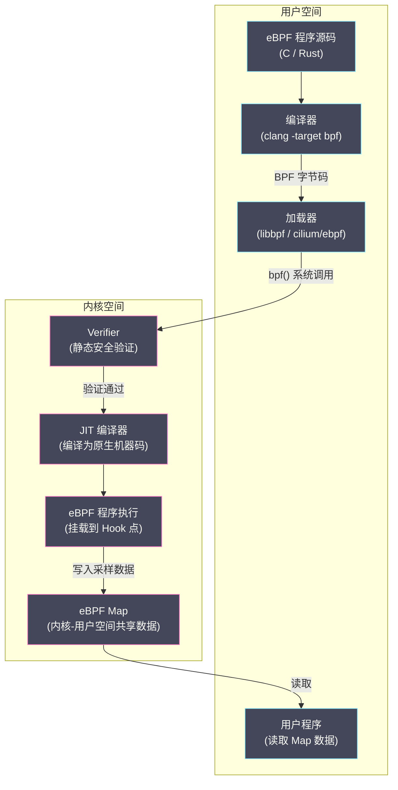

# 03 eBPF Profiling 内核级性能观测

**摘要：**

前两篇讲的剖析技术——无论是 Java 的 async-profiler、JFR，还是 Go 的 `runtime/pprof`——都依赖**语言运行时的配合**：剖析器要嵌入应用进程，并调用运行时提供的 API 获取调用栈。这种方式有侵入性（需改启动参数或引依赖），也无法剖析那些你无法改代码的第三方程序（MySQL、Redis、Nginx）。eBPF（extended Berkeley Packet Filter）改变了这个局面——它允许在 **Linux 内核中安全地运行自定义程序**，无需改内核、无需重启、无需向目标进程注入任何东西。基于 eBPF 的剖析器可以从内核层面采集**任意进程**的调用栈，实现真正的**零侵入、全覆盖**观测。本文从 eBPF 的起源与安全模型讲起，拆解它的程序生命周期、Map 与 Hook 点，讲透基于 eBPF 的 CPU 剖析原理与"符号解析"这个最大的工程挑战，随后介绍 perf、bcc/bpftrace、Parca、Pyroscope 等工具，最后落到它的边界、争议，以及它在网络、安全、自动埋点等更广领域的应用。读完之后，你应当能回答两个问题：**eBPF 凭什么做到"零侵入全覆盖"，以及它的边界在哪里**。

---

## 第 1 章 eBPF 的起源与演进

### 1.1 从 BPF 到 eBPF

**BPF（Berkeley Packet Filter）** 最初由 Steven McCanne 与 Van Jacobson 在 1992 年的论文中提出，目的是为 `tcpdump` 这类抓包工具提供一种高效的包过滤机制。原始 BPF 是一个极简的虚拟机——它有一组寄存器与指令集，用户可以编写 BPF 程序来决定"这个网络包是否该被捕获"。BPF 程序运行在内核里，避免了"把每个包从内核拷到用户空间再判断"的开销。

2014 年，Alexei Starovoitov 在 Linux 3.18 内核中引入了 **eBPF（extended BPF）**——一个大幅增强的版本。eBPF 不再局限于网络包过滤，而成了**通用的内核可编程框架**：

| 维度 | 经典 BPF | eBPF |
|---|---|---|
| 用途 | 网络包过滤 | 通用：网络、安全、追踪、剖析 |
| 寄存器 | 2 个（32 位） | 10 个（64 位）加栈空间 |
| 指令集 | 约 30 条 | 100 条以上 |
| Map（数据结构） | 无 | 丰富：HashMap、Array、RingBuffer 等 |
| Helper 函数 | 无 | 数百个内核辅助函数 |
| 安全验证 | 简单 | 完善的 Verifier 静态分析 |
| JIT 编译 | 部分架构 | 所有主流架构 |

这张表的关键不在"数字变大"，而在"**用途从'过滤包'变成了'可编程内核'**"。**这是一次从'专用'到'通用'的跃迁**——而通用能力，正是它能同时服务网络、安全、追踪、剖析四类场景的原因。

### 1.2 eBPF 为什么重要

eBPF 的革命性，在于它打破了一个长期困局：**要观测内核行为，要么改内核代码（危险且耗时），要么用有限的静态追踪点（灵活性不足）**。

eBPF 提供了第三条路——**在不改内核的前提下，把自定义的观测逻辑注入内核的几乎任何位置**。一个贴切的比喻是：**就像 JavaScript 让浏览器变得可编程一样，eBPF 让 Linux 内核变得可编程**。浏览器不必为每个网页功能重新发版，内核也不必为每种观测需求重新编译。

对剖析而言，eBPF 的价值有三点。

**零侵入**：不需要在目标进程注入 Agent、改启动参数或引 SDK。eBPF 程序跑在内核里，从"外部"观测目标进程。

**全覆盖**：可以剖析系统上的**任意进程**——Java 服务、Go 服务、C++ 程序、MySQL、Redis、Nginx，甚至内核本身。

**极低开销**：eBPF 程序经 JIT 编译为原生机器码执行，又经 Verifier 确保不会有死循环或越界访问，开销可控。

**"零侵入 + 全覆盖"这六个字，正是 eBPF 剖析最核心的卖点**——它把"能不能剖析"从"应用有没有集成 SDK"变成了"节点上有没有装 Agent"，门槛的下降是数量级的。

### 1.3 为什么"安全"是它的核心

理解 eBPF 有一个关键角度：**它的全部设计，都围绕"如何安全地让用户代码在内核里跑"**。

内核是系统的命脉——一个在内核里死循环或越界访问的程序，会让整台机器崩溃。因此 eBPF 必须解决一个难题：**如何既让用户自由地写程序，又保证程序绝对不会危害内核**。它的答案就是 **Verifier**（第 2 章）——一个在加载时对程序做静态分析、拒绝一切"可能不安全"的程序的组件。

**理解了"安全是核心约束"，就能理解 eBPF 的很多限制**：为什么不允许无界循环（可能死循环）、为什么栈只有 512 字节（限制复杂度）、为什么要 `CAP_BPF` 特权（防止非特权用户滥用）。**这些"限制"不是设计缺陷，而是"安全"这个目标下必然的代价**——**想要"可编程内核"，就必须接受"受限的编程"**。

### 1.4 eBPF 的生态与地位

eBPF 已经从一个内核特性，长成了一个有完整生态的技术栈，理解它的生态有助于把握它的位置。

**在内核侧**，eBPF 是内核的正式子系统，由内核社区持续演进——新的 Hook 点、新的 Helper 函数、新的 Map 类型不断加入。**这意味着"eBPF 能做什么"是随内核版本持续扩张的**。

**在工具侧**，形成了 libbpf（C 库）、cilium/ebpf（Go 库）、aya（Rust 框架）等开发库，以及 bpftrace（脚本）、bcc（Python 前端）等使用工具。**这降低了"写一个 eBPF 程序"的门槛**。

**在应用侧**，Cilium（网络）、Falco（安全）、Parca（剖析）、Beyla（追踪）等一大批项目把它用于各自的领域。**这证明了它作为"底层基础设施"的通用性**。

**在标准侧**，CNCF 下设有 eBPF 相关项目，OTel 社区也在探索把它纳入自动埋点。**这预示着它会进一步融入主流可观测性栈**。

**这个生态的繁荣，本身就是 eBPF 价值的证据**——**一项技术是否重要，不看它"设计得多优雅"，而看"有多少人基于它造出了东西"**。

### 1.5 三种"看内核"的手段对照

在 eBPF 之前，观测内核行为主要有两条路，把它们与 eBPF 放在一起，eBPF 的位置就清楚了。

**第一条是"改内核源码"**：直接在内核里加打印或埋点。能力最强（想改哪里改哪里），但**代价是"重新编译内核、重启机器"**——在生产环境几乎不可行。

**第二条是"静态追踪点"**：内核预置了一批 tracepoint，用户通过 perf、ftrace 等接口读取。**安全、方便，但"能看什么"由内核预先决定**——你想看一个没被预置的点，就只能等内核加上。

**第三条就是 eBPF**：**它既有"改内核"的灵活性（能挂到几乎任意位置），又有"静态追踪点"的安全性（Verifier 保证不出事）**。它把前两者的优点合在了一起，同时避开了各自的硬伤。

| 手段 | 灵活性 | 安全性 | 落地成本 |
|---|---|---|---|
| 改内核源码 | 极高 | 低（易引入 bug） | 极高（编译重启） |
| 静态追踪点 | 低（预先定义） | 高 | 低 |
| eBPF | 高 | 高（Verifier） | 低（加载即用） |

**这张表解释了 eBPF 为什么是一次"范式转变"**：它不是"比前两者好一点点"，而是"同时拿到了前两者各自的优点"。**当一个新方案能同时解决旧方案的两个对立缺陷时，它就具备了取代它们的资格**。

---

## 第 2 章 eBPF 的核心架构

### 2.1 eBPF 程序的生命周期



**步骤一：编写程序。** 通常用受限的 C 编写（不支持循环、不支持全局变量、栈大小有限），也可以用 Rust（aya 框架）。

**步骤二：编译为 BPF 字节码。** 用 `clang -target bpf` 把 C 代码编译成 BPF 字节码（类似 JVM 字节码）。

**步骤三：加载到内核。** 用户空间程序通过 `bpf()` 系统调用把字节码加载进内核。

**步骤四：Verifier 验证。** 这是 eBPF 安全性的核心——内核的 Verifier 对字节码做**静态分析**，确保程序不会无限循环（所有循环必须有明确上界）、不会越界访问内存、不会访问未初始化的寄存器、不会调用未授权的内核函数。**验证不通过，程序被拒绝加载**——内核不会执行任何不安全的 eBPF 程序。

**步骤五：JIT 编译并执行。** 验证通过后，BPF 字节码被 JIT 编译为目标架构（x86_64、ARM64）的原生机器码，然后挂载到指定的 Hook 点。当 Hook 点被触发（如 perf 事件、tracepoint、kprobe），eBPF 程序自动执行。

**步骤六：通过 Map 交换数据。** eBPF 程序把采集到的数据（如调用栈）写入 **eBPF Map**——一种内核与用户空间共享的数据结构。用户空间程序定期从 Map 读取并处理。

这条生命周期里，"**Verifier 在前、JIT 在后**"的顺序至关重要：**先验证安全，再编译执行**。**它保证了"任何进入内核执行的代码，都已经过安全审查"**——这也是 eBPF 能"既开放又安全"的根本机制。

### 2.2 eBPF Map

eBPF Map 是 eBPF 程序与用户空间程序之间的**数据通道**。常用的 Map 类型如下：

| Map 类型 | 用途 |
|---|---|
| `BPF_MAP_TYPE_HASH` | 哈希表，键值对存储 |
| `BPF_MAP_TYPE_ARRAY` | 固定大小数组 |
| `BPF_MAP_TYPE_PERF_EVENT_ARRAY` | 将数据推送到 perf 事件缓冲区 |
| `BPF_MAP_TYPE_RINGBUF` | 高效的环形缓冲区（推荐的数据传输方式） |
| `BPF_MAP_TYPE_STACK_TRACE` | 专门存储调用栈的 Map |

对剖析场景，最关键的是 `BPF_MAP_TYPE_STACK_TRACE`——它让 eBPF 程序可以高效地捕获与存储调用栈。**它的巧妙之处在于"去重"**：同一个调用栈会被分配同一个栈 ID，因此 Map 里存的是"栈 ID → 次数"，而不是"完整栈 → 次数"——**这与火焰图的"前缀合并"是同一个思路：把重复的部分只存一次**。

### 2.3 Hook 点：eBPF 程序挂载在哪里

eBPF 程序需要挂载到内核的某个 **Hook 点**才能被触发。不同类型的 Hook 适用于不同场景：

| Hook 类型 | 触发条件 | 剖析用途 |
|---|---|---|
| perf_event | 硬件或软件性能计数器 | CPU 剖析（定时采样） |
| kprobe | 内核函数入口 | 追踪内核函数调用 |
| kretprobe | 内核函数返回 | 追踪内核函数返回值 |
| uprobe | 用户空间函数入口 | 追踪用户空间函数调用 |
| tracepoint | 内核静态追踪点 | 追踪预定义的内核事件 |
| fentry / fexit | 内核函数入口或出口（BPF 原生） | 比 kprobe 更高效的内核追踪 |

**CPU 剖析用的是 `perf_event` Hook**：配置一个基于 CPU 时钟的 perf 事件，每隔固定时间（如 10ms，即 100 Hz）触发一次 eBPF 程序。每次触发时，eBPF 程序读取当前 CPU 上正在运行的进程的调用栈，写入 Map。**这正是"周期采样"在内核层的实现**——它与第 01 篇讲的"用户态采样"是同一个统计学原理，只是采样点换到了内核。

### 2.4 "内核可编程"的一次直观体会

把上面的机制串起来，体会一下 eBPF 的"可编程"到底意味着什么。

设想你要"统计每个进程的 CPU 时间分布"。传统做法要么改内核、要么用现成的 perf 命令（但格式受限）。用 eBPF，你可以**写一段十几行的程序**：在 perf_event 上挂一个采样函数，每次触发时抓栈、累加计数、写进 Map；用户态程序定期读 Map、转成 pprof。**整个过程不需要改内核、不需要改目标进程、不需要重启任何服务**。

**这种"随时给内核加一个新观测能力"的自由度，是 eBPF 最本质的价值**。它把"观测手段的开发周期"从"改内核、编译、重启（数周到数月）"压缩到了"写一段程序、加载（几分钟）"。**观测能力的供给速度，决定了排障能力的上限**——这正是 eBPF 被称作"可观测性底层基础设施"的原因。

### 2.5 eBPF 与内核模块的对比

要理解 eBPF 的独特性，最好的对照是"内核模块（Kernel Module）"——那是它出现之前，扩展内核能力的唯一方式。

**内核模块**：一段可以动态加载进内核的代码，能力几乎不受限（能访问任意内核数据结构）。但代价巨大——**它有权限让整个系统崩溃**；一个 bug 就是一次内核 panic；每次修改都要重新编译、卸载、加载，且不同内核版本之间通常不兼容。

**eBPF**：同样能"扩展内核"，但被 Verifier 严格限制，**几乎不可能让内核崩溃**；修改只需重新加载一段程序（秒级）；借助 CO-RE（Compile Once, Run Everywhere）机制，**同一份程序能在不同内核版本上运行**。

| 维度 | 内核模块 | eBPF |
|---|---|---|
| 安全性 | 有权限让内核崩溃 | Verifier 保证不会崩溃 |
| 开发迭代 | 编译、卸载、加载 | 加载一段程序（秒级） |
| 跨内核版本 | 通常不兼容 | CO-RE 支持跨版本 |
| 能力上限 | 几乎不受限 | 受 Verifier 与 Hook 限制 |

**这张表解释了 eBPF 为什么会"取代"内核模块成为主流的扩展方式**：**它用"受限的能力"换来了"安全与可迭代"**。在"观测"这类需求上，"能力稍受限但不会把系统搞挂"远比"能力无限但风险极高"更可取。

**这是一次典型的"以约束换可用性"的工程选择**——与第 02 篇讲火焰图"为主要任务优化、接受次要任务牺牲"是同一个思路。

### 2.6 Helper 函数与 CO-RE

eBPF 程序不能随意调用内核函数，只能调用**Helper 函数**——一组由内核提供的、经过安全审查的接口。常用的有 `bpf_get_current_pid_tgid()`（取当前进程 ID）、`bpf_get_stackid()`（抓调用栈）、`bpf_map_lookup_elem()`（读 Map）、`bpf_perf_event_output()`（往用户态推数据）等。

**Helper 函数是"能力白名单"**：你能做什么，取决于内核开放了哪些 Helper。**这既是限制（想做的事未必有 Helper），也是保障（不会有危险的 Helper）**。

另一个关键机制是 **CO-RE（Compile Once, Run Everywhere）**。内核的内部数据结构（如 `task_struct`）在不同版本间会变化，如果 eBPF 程序硬编码这些结构，就"换个内核版本就跑不了"。CO-RE 借助 BTF（BPF Type Format）在加载时动态调整偏移量，**让同一份程序能跨内核版本运行**。

**CO-RE 的意义，与容器"一次构建、到处运行"是同一种诉求**：**它把"移植"这件事从"每次重编译"变成了"一次编译"**。这也是 eBPF 能从"内核极客的玩具"变成"可运维的工程组件"的关键一步——**没有可移植性，就没有规模化的运维**。

### 2.7 编译与加载的工具链

eBPF 程序从源码到运行，要经过一条工具链，理解它有助于排查"程序加载失败"这类问题。

**编译**：`clang -target bpf` 把 C 源码编译成 BPF 字节码（`.o` 文件）。这一步的常见问题是"用了不受支持的 C 特性"（如变长数组、复杂控制流）——**eBPF 的 C 是"受限的 C"**。

**骨架生成**：`bpftool gen skeleton` 把编译产物生成一个"骨架头文件"，让用户空间程序能方便地加载与访问 Map。**这一步是"开发体验"的关键**——它把"手动管理 Map 与加载逻辑"变成了"调用生成的函数"。

**加载与附加**：用户空间程序通过 libbpf（或 cilium/ebpf）加载字节码、创建 Map、附加到 Hook 点。**这一步的常见问题是"权限不足"或"内核版本不支持某个 Helper"**。

**这条工具链说明：eBPF 开发不是"写一个 C 文件就完了"，而是一套"编译、生成、加载"的工程流程**。**工具链的成熟度，直接决定了"写 eBPF 程序"的门槛**——libbpf 与 bpftool 的完善，正是 eBPF 从"内核极客玩具"走向"工程组件"的关键。

---

## 第 3 章 基于 eBPF 的 CPU Profiling

### 3.1 工作原理

基于 eBPF 的 CPU Profiler 核心逻辑很简洁：

```text
1. 创建一个 perf_event，类型 = PERF_TYPE_SOFTWARE，
   config = PERF_COUNT_SW_CPU_CLOCK，频率 = 100 Hz

2. 将 eBPF 程序挂载到这个 perf_event 上

3. 每次 perf_event 触发（即每 10ms），eBPF 程序执行：
   a. 调用 bpf_get_stackid() 获取当前的用户态调用栈 ID
   b. 调用 bpf_get_stackid() 获取当前的内核态调用栈 ID
   c. 获取当前进程的 PID 和 TID
   d. 将 (PID, 用户栈 ID, 内核栈 ID) → 采样次数 写入 HashMap

4. 用户空间程序定期（如每 15 秒）读取 HashMap，
   将栈 ID 翻译为人类可读的函数名，
   生成 pprof 格式的 Profile 数据
```

**核心 eBPF 程序（简化）**：

```c
// eBPF 程序：每次 perf_event 触发时执行
SEC("perf_event")
int do_sample(struct bpf_perf_event_data *ctx) {
    // 获取当前进程 ID
    u64 pid_tgid = bpf_get_current_pid_tgid();
    u32 pid = pid_tgid >> 32;
    u32 tid = pid_tgid & 0xFFFFFFFF;

    // 获取用户态调用栈 ID
    int user_stack_id = bpf_get_stackid(ctx, &stack_traces, BPF_F_USER_STACK);

    // 获取内核态调用栈 ID
    int kernel_stack_id = bpf_get_stackid(ctx, &stack_traces, 0);

    // 构建 Key
    struct sample_key key = {
        .pid = pid,
        .user_stack_id = user_stack_id,
        .kernel_stack_id = kernel_stack_id,
    };

    // 累加采样次数
    u64 *count = bpf_map_lookup_elem(&counts, &key);
    if (count) {
        __sync_fetch_and_add(count, 1);
    } else {
        u64 init_val = 1;
        bpf_map_update_elem(&counts, &key, &init_val, BPF_ANY);
    }

    return 0;
}
```

这段代码里有一个值得注意的细节：**它同时抓了"用户栈"与"内核栈"**。这是 eBPF 剖析的独特能力——它能一次采样看到"从用户态函数一路到内核态函数"的完整路径（如"Java 的 `SocketInputStream.read` → 内核的 `sys_read` → `vfs_read` → 文件系统"）。**纯用户态剖析做不到这一点**，因为它看不到内核部分。

### 3.2 符号解析：最大的工程挑战

eBPF 采集到的调用栈是**内存地址**的列表（如 `[0x7f3a2b4c, 0x5600ab12, 0x5600a890, ...]`）。要把这些地址翻译成人类可读的函数名，需要进行**符号解析（Symbol Resolution）**。

不同语言的解析方式不同。**原生代码（C/C++/Rust/Go）**：通过二进制文件的 DWARF 调试信息或 `.symtab` 段解析；如果编译时 strip 了符号表，则无法解析。**Java**：JVM 用 JIT 编译，函数地址是动态的，需要通过 `perf-map-agent` 把 JIT 编译的方法地址映射写入 `/tmp/perf-<PID>.map` 文件来解析。**Python / Ruby / Node.js**：解释型语言的调用栈在运行时内部维护，eBPF 只能看到解释器的 C 层调用栈（如 `PyEval_EvalFrameDefault`），看不到 Python 层面的函数名，需要特殊技巧来还原。

> [!warning] 符号解析是 eBPF Profiling 最大的工程挑战
> eBPF 程序本身的逻辑相对简单——真正复杂的是把采集到的内存地址翻译成有意义的函数名。每种语言、每种运行时都有不同的符号解析需求。这也是为什么 Parca、Pyroscope 等平台投入了大量工程在符号解析上。**"采到栈"与"看懂栈"之间，隔着一整个符号解析的工程**。

### 3.3 与语言内置剖析的对比

| 维度 | eBPF 剖析 | 语言内置剖析 |
|---|---|---|
| 侵入性 | 零侵入（不需要改应用） | 需要 Agent 或 SDK |
| 语言覆盖 | 任意语言 | 只支持特定语言 |
| 内核态调用栈 | 可采集 | 通常不支持 |
| 符号解析精度 | 取决于符号信息（可能不完整） | 精确（运行时提供） |
| JIT 代码支持 | 需要额外的符号映射 | 原生支持 |
| 部署方式 | 每个节点部署一个 Agent | 每个应用集成 |
| 最低内核版本 | Linux 4.9+（推荐 5.8+） | 无限制 |

**最佳实践**：对 Java、Go 这样有成熟剖析支持的语言，语言内置的剖析器通常提供更精确的结果。eBPF 剖析的最大价值在于三点——剖析你**无法改代码**的程序（MySQL、Redis、第三方中间件）；获取**内核态调用栈**（`epoll_wait`、文件系统、网络协议栈）；实现**统一的全节点剖析**（一个 Agent 覆盖节点上所有进程）。

**这条"分工"值得记住：能改代码的用自己的剖析器，改不了的用 eBPF**。**这与第 01 篇 4.4 节讲的"部署形态"、第 02 篇 5.5 节讲的"采集端选择"是同一件事的三种说法**——**覆盖与精度，永远需要两条腿走路**。

### 3.4 内核态调用栈的独特价值

上面提到"内核态调用栈"，值得单独展开——因为它能回答用户态剖析答不了的一类问题。

**问题**：某个 Go 服务的"延迟高、CPU 低"。用户态剖析显示大量时间在 `netpoll` 上——但"为什么等"，它答不上来。

**内核态剖析**能给出答案：采样显示这些 `netpoll` 对应的内核栈是 `sys_epoll_wait` → `ep_poll`，而且 `ep_poll` 的时间特别长。**进一步看，这些等待大多对应"同一个 fd"**——说明问题不在"等网络"，而在"某个连接一直没返回数据"。

**这就是内核态栈的价值：它把"用户态看起来是'等 I/O'"细化为"在等哪个具体的系统调用、哪个 fd、甚至哪个内核函数"**。**用户态看到的是"等待"，内核态看到的是"为什么等"**。

**理解了这一点，就能理解为什么"eBPF 剖析 + 语言内置剖析"是一对好搭档**：前者提供"内核视角"，后者提供"语言视角"，**两者拼起来，才是"从应用代码到内核行为"的完整链路**。

### 3.5 采样频率与开销

与用户态剖析一样，eBPF 剖析的核心也是"周期采样"，因此同样面临"频率与开销"的权衡。

**采样频率**（如 100 Hz）决定时间分辨率与开销。**每次采样的开销**主要花在"抓栈"与"写 Map"上——抓栈要遍历调用栈、写 Map 要更新计数。**eBPF 的优势在于这两步都在内核里完成、且经 JIT 编译为原生码，因此单次开销极低**。

**整体开销**的经验值是**小于 1% CPU**（与用户态采样剖析相当）。但要注意两个会放大开销的因素：**其一，栈很深时抓栈更贵**（遍历的帧更多）；**其二，进程很多时，每 10ms 一次的采样要覆盖所有活跃进程**。因此在"节点上进程极多"的场景里，可能需要在 Agent 侧做取舍（如只采指定命名空间）。

**这条"频率 × 覆盖 = 开销"的关系，说明 eBPF 也不是"零成本"**——它只是把成本压得很低。**"低开销"是相对的，不是绝对的**；在超大规模节点上，仍然需要根据实际负载调采样参数。

### 3.6 一个真实的 eBPF 剖析案例

看一个 eBPF 剖析"发挥不可替代作用"的案例。

**背景**：某团队用 Redis 作为缓存，发现"缓存偶尔超时"，但**无法在 Redis 里集成任何 Agent**（用的是发行版二进制，不想改）。

**用户态剖析的困境**：Redis 是 C 写的第三方程序，团队没有它的剖析工具链，也不方便重新编译。

**eBPF 的解法**：在节点上部署 eBPF Agent，直接剖析 Redis 进程。火焰图显示，Redis 有相当比例的时间花在了 `jemalloc` 的内存分配上，而不是网络处理上——**说明瓶颈在"内存分配"而非"网络"**。进一步发现，是"大 key"导致的内存分配抖动。

**这个案例的价值，在于它展示了 eBPF 的"不可替代性"**：**对一个"不想改、也不方便改"的第三方程序，eBPF 是唯一能在生产环境里拿到代码级火焰图的手段**。**"无法改代码"这个约束，正是 eBPF 剖析最大的用武之地**（3.3 节）。

### 3.7 eBPF 剖析与 Wall-clock

eBPF 不只做 CPU 剖析，它同样能做 Wall-clock（Off-CPU）剖析，而这恰恰是它的一个独特优势。

**CPU 剖析**采样"正在占用 CPU 的进程"。**Wall-clock（Off-CPU）剖析**采样"被阻塞、没在跑"的线程——它要回答的是"线程为什么没在跑"。**在用户态做 Off-CPU 剖析并不容易**（需要追踪"线程何时被调度出去、何时被换回来"，这发生在内核里）；而 eBPF 天然就在内核里，能直接观测调度事件。

**这带来一个能力**：eBPF 能把"线程被阻塞"与"阻塞原因"关联起来——**是因为等锁、等 I/O、还是被抢占**。**用户态的剖析器往往只能看到"线程在等"，eBPF 能看到"它在等什么"**。

**这与 3.4 节讲的"内核态调用栈"是一回事**：eBPF 的独特价值，正在于它能观测"发生内核里的那些事"——**调度、阻塞、系统调用**。**对"CPU 低、延迟高"这类问题，eBPF 的 Off-CPU 剖析往往是最直接的答案**。

---

## 第 4 章 eBPF Profiling 工具

### 4.1 perf

`perf` 是 Linux 内核自带的性能分析工具，虽然它不直接用 eBPF（用的是 perf_event 子系统），但它是理解 eBPF 剖析的基础。

```bash
# 采集 CPU Profile（30 秒，99 Hz 采样）
perf record -F 99 -p <PID> -g -- sleep 30

# 生成报告
perf report

# 生成折叠格式（可用于火焰图生成）
perf script | stackcollapse-perf.pl | flamegraph.pl > flame.svg
```

`perf` 的局限在于它需要手动操作、无法持续运行、数据格式不适合长期存储。**它适合"一次性排查"，不适合"持续观测"**。

### 4.2 bcc 与 bpftrace

**bcc（BPF Compiler Collection）** 与 **bpftrace** 是 eBPF 的前端工具，提供了大量现成的剖析脚本：

```bash
# bcc 的 CPU Profile 工具
# 采集所有进程的 CPU 调用栈，持续 30 秒，生成折叠格式
profile-bpfcc -F 99 -f 30 > profile.folded

# bpftrace 的单行 CPU Profiler
bpftrace -e 'profile:hz:99 { @[ustack] = count(); }'
```

bcc / bpftrace 适合临时的性能调查，但不适合持续剖析——它们缺乏数据持久化、符号解析集成与 Web UI。**它们更像是"内核观测的瑞士军刀"**——随手可用，但不适合做成常驻服务。

### 4.3 Parca Agent

**Parca Agent** 是专为持续剖析设计的 eBPF Agent。它作为 DaemonSet 部署在 Kubernetes 集群的每个节点上，自动发现并剖析节点上的所有进程。

它的核心特性包括：基于 eBPF 的 CPU 剖析、零侵入；自动发现 Kubernetes Pod 与容器；内置符号解析（支持 DWARF、Go、JIT Map）；把数据推送到 Parca Server；支持 pprof 格式输出。

```yaml
# Kubernetes DaemonSet 部署 Parca Agent
apiVersion: apps/v1
kind: DaemonSet
metadata:
  name: parca-agent
spec:
  template:
    spec:
      containers:
        - name: parca-agent
          image: ghcr.io/parca-dev/parca-agent:latest
          securityContext:
            privileged: true  # eBPF 需要特权模式
          volumeMounts:
            - name: modules
              mountPath: /lib/modules
              readOnly: true
            - name: sys-kernel
              mountPath: /sys/kernel
              readOnly: true
      volumes:
        - name: modules
          hostPath:
            path: /lib/modules
        - name: sys-kernel
          hostPath:
            path: /sys/kernel
```

注意配置里的 `privileged: true`——**这是 eBPF Agent 落地的现实门槛**（5.2 节会展开）。**"零侵入"是对应用的，不是对集群的**：应用不用改，但节点上要有一个特权容器。

### 4.4 Grafana Pyroscope 的 eBPF 模式

Grafana Pyroscope 也提供了 eBPF 采集模式——通过 Grafana Alloy（原 Grafana Agent）配置 eBPF 组件：

```hcl
// Grafana Alloy 配置 eBPF Profiling
pyroscope.ebpf "instance" {
  forward_to     = [pyroscope.write.endpoint.receiver]
  targets_only   = false    // true = 只 Profile 指定目标
  default_target = {"service_name" = "unspecified"}

  // Kubernetes 发现
  demangle = "none"
}
```

Pyroscope 的 eBPF 模式与 Parca 的定位类似，但优势在于它与 Grafana 生态的深度集成——数据直接在 Grafana 中查看，支持与 Prometheus 指标、Tempo 链路的跳转。**"与既有栈的契合度"再一次成为选型的关键**（第 01 篇 6.4 节）。

### 4.5 工具的选择

把四个工具放在一起，选择依据其实很清晰。**临时调查**：用 `perf` 或 `bpftrace`（一行命令就出结果）。**持续剖析、自建**：用 Parca Agent（专为持续设计）。**持续剖析、已有 Grafana 栈**：用 Pyroscope 的 eBPF 模式（契合度最高）。

**四者的关系不是"替代"，而是"覆盖不同的使用阶段"**：从"手动看一眼"到"持续观测"，工具随需求升级。**这与第 01 篇 6.7 节讲的"手动工具 → 按需平台 → 持续平台"是同一条演进路径**。

### 4.6 一个完整的部署示例

把工具串成一个可运行的部署示例，会更容易理解它"怎么落地"。

**目标**：在 Kubernetes 集群里，对所有节点上的进程做持续剖析，数据汇入 Grafana。

**第一步，部署 Agent（DaemonSet）**：在每个节点跑一个 eBPF Agent（Parca Agent 或 Alloy），以特权容器运行，负责采集与初步处理。

**第二步，配置采集**：指定采样频率（如 100 Hz）、目标进程范围（全部或指定命名空间）、符号解析方式（DWARF、Go、JIT Map）。

**第三步，数据汇聚**：Agent 把 Profile 数据推送到后端存储（Parca Server 或 Pyroscope）。

**第四步，符号解析**：后端或 Agent 侧完成"地址到函数名"的翻译——这是最需要调优的一环（3.2 节）。

**第五步，展示与联动**：在 Grafana 中查看火焰图，配置与 Prometheus、Tempo 的跳转。

**第六步，验证**：人为制造一个 CPU 热点，确认"能采到、能看懂、能定位"。

**这六步里，最容易出问题的是第三步与第四步**——数据推不上去（网络或权限问题）、符号解析不全（火焰图全是 `[unknown]`）。**部署 eBPF 剖析，"跑起来"不难，"解析准"才难**。**这也再次印证：eBPF 剖析的工程难点在符号解析，不在采集**。

---

## 第 5 章 eBPF 的安全模型与限制

### 5.1 Verifier：eBPF 的安全基石

eBPF 的安全性依赖内核的 **Verifier**——一个在加载时对程序做静态分析的组件。它确保三件事。

**无限循环保护**：eBPF 程序不允许有回边——所有循环必须在编译时展开，或使用有明确迭代上界的 `bpf_loop()` Helper。这保证了程序**一定会终止**，不会让内核挂起。

**内存安全**：所有内存访问必须在有效范围内——Verifier 追踪每个寄存器的值范围与类型，确保不会越界读写。

**特权控制**：加载 eBPF 程序需要 `CAP_BPF`（或 `CAP_SYS_ADMIN`）特权，非特权用户无法加载。

**Verifier 的设计哲学是"宁可错杀、不可放过"**：只要它无法证明"这个程序一定安全"，就拒绝加载。**这带来了一些"明明能跑却不让加载"的挫败感**（比如某个循环它算不出上界），但**正是这种严格，让"用户代码在内核里跑"成为一件可以接受的事**。**安全机制的"保守"，往往是"能力开放"的前提**。

### 5.2 eBPF 的实际限制

**限制一：内核版本要求。** 完善的 eBPF 剖析支持需要 Linux 5.8+ 内核。较低版本缺少部分 Helper 函数或 Map 类型。**这让"能不能用 eBPF"取决于"你的内核有多新"**——在老旧的企业环境里，这可能是一个真实的阻碍。

**限制二：栈深度限制。** eBPF 程序的栈大小限制为 512 字节。对剖析来说通常不是问题（逻辑很简单），但对复杂程序是约束。

**限制三：容器环境的权限。** eBPF Agent 需要 `privileged` 模式或特定 Capabilities。在安全要求严格的 Kubernetes 集群里，这可能需要额外审批。**"特权容器"在受监管的环境里往往是一个需要走流程的事**。

**限制四：解释型语言的栈解析。** eBPF 只能看到原生调用栈——对 Python、Ruby 等解释型语言，需要额外工作来还原语言层面的信息（3.2 节）。

### 5.3 安全与能力的权衡

把这四条限制放在一起，能看到一条贯穿 eBPF 的张力：**能力越强，安全约束越紧**。

- 想观测任意进程 → 需要特权容器。
- 想跑复杂逻辑 → 受限于 512 字节栈与无界循环禁令。
- 想支持所有语言 → 受限于符号解析（尤其是解释型语言）。
- 想支持所有内核 → 受限于内核版本。

**这四条限制，每一条都是"安全"这个目标的副产品**。**eBPF 的"安全"不是"没有代价的安全"，而是"用能力换来的安全"**——理解了这一点，就不会再抱怨"为什么 eBPF 这也不能、那也不能"。**任何"安全的可编程能力"，都必须划定边界**；eBPF 的价值，正在于它把这条边界划得足够宽，又足够可靠。

### 5.4 在 Kubernetes 里落地 eBPF

在 Kubernetes 环境里落地 eBPF，有几条实践值得知道。

**权限方面**：Agent 通常需要 `privileged` 或一组特定 Capabilities（`CAP_BPF`、`CAP_PERFMON`、`CAP_SYS_ADMIN`）。**在受限集群里，这往往需要与安全团队沟通**——把它当作一次"安全评审"，而不是"随手一装"。

**内核方面**：确认节点内核版本满足要求（推荐 5.8+）。**异构集群里可能有多种内核版本**，需要确认最老的那一批也能跑。

**发现方面**：利用 Kubernetes 的元数据（Pod、Namespace、Labels）做"目标发现"与"标签附加"，让 Profile 数据能按"服务、命名空间"切分。**这与指标、日志的标签模型一致**——**标签维度的设计，在剖析里同样重要**（第 01 篇 5.4 节）。

**成本方面**：eBPF Agent 是"每节点一个"，因此它的资源占用乘以节点数。**在大集群里，Agent 本身的资源也要算进容量规划**——**这与追踪 Agent 要算进 JVM 容量是同一个道理**（追踪专栏第 04 篇 3.6 节）。

**这几条的共同点是"把 eBPF Agent 当成一项集群基础设施来管理"**——它有权限要求、有版本要求、有资源开销、有标签设计。**"零侵入"是对应用的，不是对运维的**。

### 5.5 eBPF 与容器的边界

在容器化的环境里，eBPF 剖析还有一个值得说明的"视角问题"。

**eBPF 是"节点级"的**：它从宿主机内核观测，看到的是"节点上的所有进程"——包括容器里的、以及宿主机自己的。**这意味着它天然能覆盖"容器里无法改代码的程序"，但也意味着"它看到的进程不一定都属于你的应用"**。

**这带来两个实践要点**。**其一，要有"目标过滤"**：通过 cgroup、命名空间、或容器元数据，把采样范围限定到"关心的容器"上——否则火焰图里会混入大量无关进程。**其二，要有"标签附加"**：把"容器 ID、Pod、命名空间"作为标签附加到采样上，这样火焰图才能"按服务切分"。

**这与指标、日志、追踪的"标签模型"是一致的**——**eBPF 采到的是"原始数据"，要把它变成"可用的可观测数据"，仍然需要"过滤 + 打标签"这两步**。**采集的通用性（能看所有进程）与可用的针对性（只看关心的服务），是一对需要调和的张力**。

---

## 第 6 章 eBPF 在可观测性中的更广泛应用

### 6.1 超越剖析

eBPF 在可观测性领域的价值远不止剖析。它正在成为可观测性的**底层基础设施**。

**网络观测**：Cilium 用 eBPF 实现 Kubernetes 网络策略与服务网格，同时提供细粒度的流量可观测性（Pod 之间的流量、延迟、丢包率）。**它把"网络观测"做进了数据面本身**——不必额外部署探针。

**安全观测**：Falco、Tracee 等工具用 eBPF 监控系统调用，检测可疑行为（容器逃逸、未授权的文件访问）。

**自动埋点**：基于 eBPF 的链路追踪（如 Grafana Beyla）可以零侵入地自动生成 HTTP/gRPC 的 Span——不需要在应用中集成任何 SDK。

**这三类应用有一个共同点：它们都利用了"内核层观测"这个 eBPF 的独有位置**。网络流量、系统调用、进程行为——**这些都发生在内核里，因此只有内核层的观测能"看得全、看得早"**。eBPF 的价值，正是把这个"最佳观测点"变得可编程。

### 6.2 与 OpenTelemetry 的融合

OTel 社区正在探索把 eBPF 作为自动埋点的底层技术。传统的自动埋点依赖语言特定机制（Java 的字节码增强、Python 的 monkey-patching），而 eBPF 能提供跨语言的统一方案——在内核层面观测所有 HTTP/gRPC/数据库调用，自动生成 Trace 与 Span。

这种方式的优势是**真正的零侵入**——不改应用代码、不引 SDK、不重启服务。缺点是**精细度有限**——eBPF 只能在系统调用与网络包层面观测，无法获取应用内部的业务上下文（如用户 ID、订单 ID）。

**"零侵入"与"精细度"的这组取舍，是本系列反复出现的主题**。eBPF 在追踪领域的位置，与它在剖析领域的位置一致——**它覆盖"框架与内核边界"，但够不着"业务语义"**。因此 eBPF 自动埋点更可能成为"应用埋点的补充"，而不是"替代"。

### 6.3 与网格、追踪的关系

把 eBPF 放在可观测性的全景里，它的位置会更清楚。

**它和网格（Service Mesh）有重叠**：两者都能在内核或代理层观测服务间流量。区别在于**网格侧重"治理"**（路由、限流、mTLS），**eBPF 侧重"观测"**（低开销、全覆盖）。实践中二者可能互补——网格管策略，eBPF 管细粒度观测。

**它是追踪的"另一条采集路径"**：应用埋点从"代码里"采，eBPF 从"内核里"采。前者精细（有业务上下文），后者零侵入（覆盖改不了代码的服务）。**两条路径拼起来，才是完整的链路覆盖**（第 01 篇 1.4 节的"广泛部署"原则）。

**它在剖析里是最重要的"覆盖手段"**：它让"无法改代码的第三方服务"也能被剖析。**这是它在剖析领域不可替代的价值**。

### 6.4 eBPF 在 AIOps 中的位置

把 eBPF 放到更大的可观测性图景里，它在 AIOps 方向也有位置。

**其一是"更细的输入"**。AIOps 的异常检测、根因分析，本质上依赖"输入数据的质量"。eBPF 提供的"内核级、全覆盖"数据（系统调用、网络流量、调用栈），是传统埋点难以覆盖的一类输入。**更细的输入，往往能带来更准的检测**。

**其二是"更低的采集门槛"**。AIOps 要"全量数据"，而传统埋点的接入成本让"全量"很难达成。eBPF 的零侵入，让"全量覆盖"变得可行——**没有数据，任何智能分析都是空谈**。

**其三是"更早的信号"**。内核层的信号往往比应用层更早（如"网络重传开始增多"早于"应用超时"）。**更早的信号，意味着更早的预警**。

不过也要清醒：**eBPF 给的是"底层数据"，不是"智能结论"**。它能提供更丰富的输入，但"从数据到结论"仍然需要异常检测、根因分析这些上层能力。**eBPF 是 AIOps 的"燃料"，不是"引擎"**——这一点与第 03 篇讲 OTel"是管道不是能力"是同一个判断。

### 6.5 eBPF 与四种信号的关系

把 eBPF 与四种信号的关系理一遍，能更清楚地看到它的位置。

**对剖析**：eBPF 是"覆盖手段"——它让"改不了代码的服务"也能被剖析，并提供内核态调用栈（本篇主题）。

**对追踪**：eBPF 是"另一条采集路径"——从内核采 HTTP/gRPC 调用，零侵入（6.1 节）。但它拿不到业务上下文，因此更像"应用埋点的补充"。

**对指标**：eBPF 能生成"网络、系统调用"维度的指标（如 Cilium 提供的网络指标），补充了应用自埋指标覆盖不到的地方。

**对日志**：关系最弱——eBPF 不产出日志，但能观测"进程写了多少日志"这类行为。

**把四条合起来看，eBPF 在每种信号里的角色都是一致的：它提供"内核视角的、零侵入的"那一部分**。**它不取代任何一种信号，而是给每一种信号补上"应用够不着的那一层"**。**这正是"底层基础设施"这个定位的准确含义**——它不站在台前，而是托着所有信号。

### 6.6 eBPF 在故障复盘中的价值

eBPF 的"全覆盖"特性，在**故障复盘**这个场景里格外有价值。

**故障复盘最怕的是"信息缺失"**：事后回看时，发现"当时那个进程的调用栈没采到""那个第三方组件没有任何数据"。而 eBPF 的零侵入与全覆盖，恰好把这类"信息缺失"压到了最低——**因为它从内核采，不依赖"应用有没有接埋点"**。

**举个具体的对比**：一次故障涉及"Java 服务 + Redis + 内核网络栈"。如果没有 eBPF，你可能只有 Java 服务的数据，Redis 与网络栈是盲区；有了 eBPF，三者都在一张图上。**复盘的完整性，直接决定了"能不能找到真正的根因"**。

**这带来一条实践建议：把 eBPF 剖析纳入"故障复盘的标准动作"**——复盘时，除了看指标、追踪、日志，也把"当时的火焰图"调出来。**持续剖析（第 01 篇）提供了"能回看"的能力，eBPF 提供了"看得全"的覆盖**；两者结合，复盘的信息完整度会上一个台阶。

**"复盘的信息完整度"，是观测体系成熟度的最终检验**——**平时看不出的差距，会在一次复杂故障里被彻底暴露**。

---

## 第 7 章 边界与争议

### 7.1 eBPF 不能做什么

把边界讲清，才算完整。

**它看不到业务语义。** eBPF 在内核层观测，能看到"调用了哪个系统调用、发了哪个网络包"，但看不到"这次调用对应哪个用户、哪个订单"。**业务上下文只有应用自己知道**。

**它的精度依赖符号。** 没有符号信息，栈还原不全，火焰图上会出现大片 `[unknown]`。**"采到栈"不等于"看懂栈"**。

**它对解释型语言的支持有限。** Python、Ruby 的语言层调用栈，eBPF 难以直接还原。

**它需要特权。** 在安全敏感的环境里，"装一个特权容器"本身就是一个需要审批的动作。

**这四条边界，每一条都指向同一个结论：eBPF 是"覆盖广"的方案，但不是"什么都能"的方案**。**把它放在"与语言内置剖析互补"的位置上，才能发挥它最大的价值**。

### 7.2 一场关于"可观测性未来"的争议

eBPF 的出现，引发了一场值得了解的争论：**未来的可观测性，会以 eBPF 为核心，还是以应用埋点为核心**？

**"eBPF 派"的理由**：零侵入、全覆盖、跨语言，能解决"接入成本高"这个最大的落地障碍。随着内核能力增强，它能观测的深度会不断逼近应用层。

**"应用埋点派"的理由**：业务语义只有应用知道；eBPF 的"深度"受限于"内核能看到什么"；而应用埋点能精确控制"采什么、怎么采"。**可观测性的价值在于"能回答业务问题"，而业务问题需要业务上下文**。

**这场争议没有简单的答案，但有一个务实的共识**：**两者是互补的，不是替代的**。eBPF 覆盖"改不了代码的服务"与"内核行为"，应用埋点覆盖"业务语义"与"精细控制"。**最可能的未来，是"两条路径并存、由统一的标准（如 OTel）缝合起来"**。

**这又一次回到了本系列的核心判断：没有银弹，只有权衡**。**任何宣称"一种技术解决所有问题"的说法，都值得警惕**——无论是当年的"网格包办一切"，还是今天的"eBPF 包办一切"。

### 7.3 eBPF 的学习路径

对想深入 eBPF 的读者，一条务实的路径是：**先用现成工具 → 再用 bpftrace 写脚本 → 最后用 libbpf 写程序**。

**第一步，用现成工具**。`perf`、`bpftrace` 的一行命令、Parca/Pyroscope 的现成 Agent——**先用起来，建立"内核观测能做什么"的直觉**。

**第二步，用 bpftrace 写脚本**。bpftrace 的语法接近 awk，几行就能写一个"统计某系统调用次数"的脚本。**这一步建立"写观测逻辑"的感觉**。

**第三步，用 libbpf 写程序**。当需求超出 bpftrace 的表达力时，才进入 C + libbpf 的世界。**这一步才需要理解 Verifier、Helper、Map、CO-RE 这些细节**。

**这条路径的价值，是"按需深入"**——**大多数人只需要走到第一步或第二步**（用现成工具与脚本），只有"要造轮子"的人才需要走到第三步。**不要被 eBPF 的"内核"二字吓住**——它的绝大部分价值，是通过现成工具就能享受到的。

### 7.4 eBPF 的演进方向

最后看一眼 eBPF 的未来方向，有助于判断"现在投入值不值"。

**方向一：内核能力持续扩张。** 新的 Hook、Helper、Map 类型不断加入，eBPF 能观测的深度会持续逼近应用层。**这意味着"今天做不到的，明年可能就做到了"**。

**方向二：跨语言观测的深化。** 社区在探索更好地还原解释型语言（Python、Ruby）的语言层调用栈。**一旦突破，"全覆盖"的短板就补上了**。

**方向三：与标准栈的融合。** OTel 社区在探索把 eBPF 纳入自动埋点；eBPF 相关项目也在融入 CNCF 生态。**标准化的融合，会进一步降低它的接入门槛**。

**方向四：安全模型的演进。** 社区在推动"非特权 eBPF"——让部分场景不需要特权容器即可使用。**这会解决它"落地门槛高"这一现实痛点**。

**这四个方向的共同指向是"能力更强、门槛更低"**。**从这个趋势看，eBPF 在可观测性里的地位大概率会继续上升**——但**它的定位不会变：它是"底层覆盖"，不是"业务语义"**。**上升的是"它能覆盖的范围"，不变的是"它够不着的地方"**。

---

## 第 8 章 eBPF 的工程实践

### 8.1 何时该用 eBPF 剖析

把"该不该用"的判断收成几条。

**该用的场景**：要剖析"无法改代码"的第三方程序（MySQL、Redis、Nginx）；要观测"内核行为"（系统调用、网络协议栈、文件系统）；要"一个 Agent 覆盖整节点所有进程"的统一观测。

**可以不用 eBPF 的场景**：自己的 Java / Go 服务，且有成熟的运行时剖析器——用语言内置的往往更精确（3.3 节）；只是偶尔做一次性能调查——用 `perf` 或 `bpftrace` 就够了。

**该慎用的场景**：安全要求极严、不允许特权容器的集群；内核版本过老的节点。

**这几条判断的核心，是"eBPF 的独特价值在'覆盖'，而不在'精度'"**。**当你的需求是"覆盖改不了的东西"时，它是唯一解；当你的需求是"精确剖析自己能改的服务"时，语言内置方案往往更好**。

### 8.2 eBPF 的常见坑

**坑一：符号解析不全，火焰图全是 `[unknown]`。** 多半是"没带符号"或"JIT Map 没生成"。**先检查符号，再怀疑采集**。

**坑二：权限不足，Agent 起不来。** 检查是否给了 `privileged` 或正确的 Capabilities。

**坑三：内核版本过低，某些 Helper 不可用。** 检查内核版本，或降级使用兼容的 Helper。

**坑四：栈太深或进程太多，采样开销超预期。** 调整采样频率或目标范围。

**坑五：把"内核栈"与"用户栈"混在一张图里看。** 两者含义不同，**看图时要分清"这段是用户代码还是内核代码"**。

**这五个坑有一个共同特征：它们都发生在"采集之后、分析之前"**——**采集本身通常顺利，麻烦都在"让数据变得可读"这一步**。**这与 3.2 节的判断一致：eBPF 剖析的工程难点在符号解析，不在采集**。

### 8.3 一个"最小可用"的落地顺序

最后给一条务实的落地顺序：**先在单节点上用 `perf` 验证"能看到火焰图" → 再上 eBPF Agent 验证"能持续采" → 最后接入 Grafana 验证"能联动"**。

**为什么要"先单节点"？** 因为"能采到"与"采得对"是两回事——在单节点上先确认"符号解析正常、火焰图可读"，再上集群，能避免"一上来就在几十个节点上排查同一个问题"。**小步验证，是任何基础设施落地的通用原则**。

**这三步的每一步，都对应一个可验证的目标**：能看到火焰图（采集通）、能持续采（部署通）、能联动（集成通）。**把大目标拆成"可验证的小目标"，是工程落地的通用方法**——它同样适用于第 01 篇讲的"剖析平台演进路径"。

### 8.4 把 eBPF 剖析当"常备能力"

最后一条建议：**把 eBPF 剖析从"专项排查手段"变成"常备能力"**。

两个日常动作值得固化下来。**其一，定期看"节点上谁在烧 CPU"**——eBPF 的节点级视角，让它天然适合回答"这台机器上，除了我的应用，还有谁在抢资源"。**这是用户态剖析看不到的**（它只看得见自己）。**其二，对"改不了代码的组件"建立"随时可查火焰图"的能力**——不必等到出故障才去装工具。

**这两个动作的价值，是"把未知变成已知"**：前者回答"资源被谁占了"，后者回答"这个黑盒在忙什么"。**它们都不是"故障时才需要"的能力，而是"平时就该有"的储备**——**储备的意义，在于故障来临时不必从零开始**。

**这与第 02 篇 7.6 节讲的"建基线"是同一个思路**：**平时积累，急时可用**。**观测体系的成熟度，恰恰体现在"故障时有多少现成的信息可用"上**。

---

## 小结

eBPF 的价值，可以用一句话概括：**它把 Linux 内核变成了一个"可编程的观测平台"，从而让"零侵入、全覆盖"的观测成为可能**。

回看全篇，有三条判断值得记住。**其一，"安全"是 eBPF 全部设计的核心约束**——Verifier、特权要求、栈限制、无界循环禁令，都是"让用户代码安全地跑在内核里"这个目标的副产品。**其二，"符号解析"是它最大的工程挑战**——采到栈容易，看懂栈难；这也是 Parca、Pyroscope 投入大量工程的地方。**其三，eBPF 与语言内置剖析是互补的**——前者覆盖"改不了代码的服务"与"内核行为"，后者提供"业务语义"与"精确控制"。

在剖析这个主题里，eBPF 的位置很清晰：**它是"覆盖手段"，解决的是"能不能剖析"的问题；而"看懂剖析结果"仍然要靠火焰图与人的判断**（第 02 篇）。**采集的广度与分析的深度，是两件事**——eBPF 极大地扩展了前者，但后者仍然需要工程判断。

下一篇（第 04 篇）是本专栏的收官——回到 SkyWalking，看它如何用"按需触发 + 与 Trace 关联"的方式集成剖析，形成"从指标告警到代码级火焰图"的完整闭环。**第 03 篇讲了"内核级怎么采"，第 04 篇讲"APM 里怎么用"**。

---

## 参考资料

1. Brendan Gregg (2020). *BPF Performance Tools*. Addison-Wesley.
2. Brendan Gregg (2019). *BPF Performance Tools: Linux System and Application Observability*. Addison-Wesley, Chapter 17-18.
3. Alexei Starovoitov, Daniel Borkmann. *BPF: the universal in-kernel virtual machine*. LWN.net.
4. Parca Documentation：https://www.parca.dev/docs/overview
5. Grafana Pyroscope eBPF：https://grafana.com/docs/pyroscope/latest/configure-client/grafana-agent/ebpf/
6. eBPF.io：https://ebpf.io/
7. Cilium Documentation：https://docs.cilium.io/
8. Google (2010). *Google-Wide Profiling: A Continuous Profiling Infrastructure for Data Centers*. EuroSys.

---

> [!note] 思考题
> 1. 为什么说"安全是 eBPF 全部设计的核心约束"？请用"无界循环禁令""512 字节栈限制""特权要求"三条，说明它们各自防的是什么风险。
> 2. 为什么"符号解析是 eBPF Profiling 最大的工程挑战"？请对比原生代码、Java、Python 三种情况，说明解析难度的差异。
> 3. eBPF 剖析与语言内置剖析是互补的。请给出两个"只能用 eBPF 剖析"的场景，并说明为什么语言内置方案覆盖不了它们。
> 4. eBPF 能采到"内核态调用栈"，这带来了什么用户态剖析给不了的能力？请举一个"延迟高、CPU 低"的例子说明。
> 5. 关于"eBPF 会不会成为可观测性的核心"，你更认同哪一派？为什么说"两者互补"是更务实的共识？
