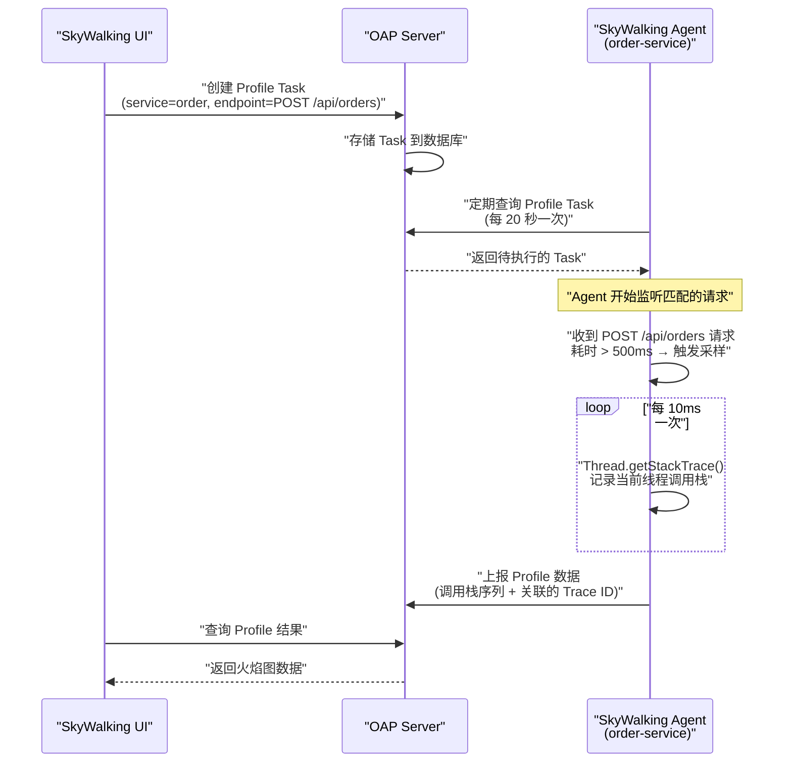
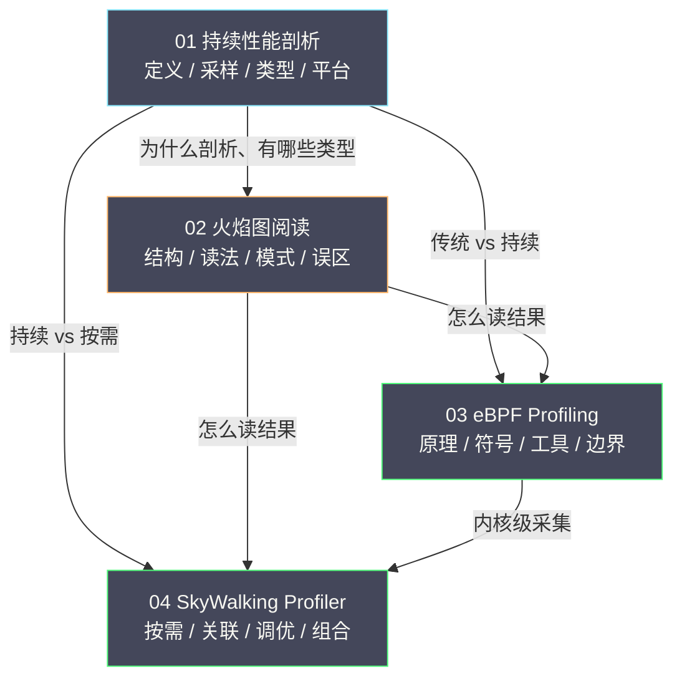

# 04 SkyWalking 集成 Profiler

**摘要：**

前三篇分别讲了持续剖析的概念、火焰图的阅读技巧、eBPF 的内核级观测能力。本篇作为 Profiler 子专栏的收官，回到链路追踪专栏里深入剖析过的 SkyWalking 平台，聚焦它内置的 **Profile 功能**。SkyWalking 的剖析设计理念与 Pyroscope、Parca 等独立平台不同——它不是"7×24 小时持续采集"，而是**按需触发、与 Trace 关联**的线程栈采样。当工程师在 UI 中发现某个 Endpoint 延迟异常时，可以针对它创建一个 Profile Task，Agent 会在匹配的请求执行期间高频采样线程调用栈，并把结果以火焰图的形式展示——直接关联到具体的 Trace 与 Span。这种"Trace → Profile"的工作流，把链路追踪与性能剖析无缝打通。本文讲透它的设计哲学、Task 的工作机制、线程栈采样的实现细节与取舍、结果解读、生产调优建议，最后收束整个 Profiler 专栏。读完之后，你应当能回答两个问题：**SkyWalking 为什么选择"按需"而不是"持续"，以及它与持续剖析该如何配合使用**。

---

## 第 1 章 SkyWalking Profiler 的设计哲学

### 1.1 为什么不是持续剖析

第 01 篇讲过持续剖析的优势——7×24 小时不间断采集，问题发生后可以回溯。那么 SkyWalking 为什么选择了"按需触发"？

**原因一：开销控制。** SkyWalking Agent 已经在应用进程里跑着链路追踪的埋点逻辑（第 05 篇的主题）。如果再叠加持续剖析的采集，Agent 的 CPU 与内存开销会进一步增加。SkyWalking 的设计原则是"对业务的侵入与影响降到最低"——**按需触发意味着"只在需要排查时才产生额外开销"**。

**原因二：数据量控制。** 持续剖析产生的数据量远大于链路追踪——每 10 毫秒一次的调用栈采样，乘以数百个线程，再乘以数百个服务实例，数据量可轻松达到 GB/小时级别。SkyWalking 的 OAP 存储架构是为 Trace 与 Metric 设计的，不是为海量剖析数据设计的（第 06 篇的主题）。

**原因三：与 Trace 的天然集成。** SkyWalking 的 Profile Task 绑定到具体 Endpoint（如 `POST /api/orders`），采样数据自动关联到匹配的 Trace。这种"从 Trace 跳到 Profile"的工作流，对 SkyWalking 用户是最自然的排查路径。

> [!note] 设计取舍
> SkyWalking 的 Profiler 与 Pyroscope、Parca 不是竞争关系，而是互补关系。SkyWalking Profiler 适合"**定向排查**"——已经通过 Trace 定位到问题 Endpoint，需要进一步深入代码层面。Pyroscope、Parca 适合"**持续观测**"——在问题发生前就开始采集，事后可回溯任意时间点。两者可以在同一个可观测性栈里共存。**这不是"谁更好"，而是"服务不同的排查阶段"**。

### 1.2 Profiler 在排查链中的位置

在 SkyWalking 的排查工作流里，Profiler 处于**最后一环**：


这条链路说明：**Profiler 的输入是"已经定位到的 Endpoint"，而不是"整个系统"**。它的价值在于"把范围从'哪个方法慢'收窄到'哪行代码慢'"——**这正是第 01 篇讲的"最后一公里"**。

### 1.3 与持续剖析的互补关系

把"按需"与"持续"放在一起，各自的适用边界很清楚。

**按需（SkyWalking）适合**：问题可复现或持续存在；已经定位到具体 Endpoint；目标是 Java 服务；不想为"平时"付出采集开销。

**持续（Pyroscope、Parca）适合**：问题偶发、事后才发现；需要回溯"已经过去的那段时间"；多语言环境；需要长期基线与 Diff 能力。

**两者的关系不是"替代"，而是"覆盖不同的时间视角"**：**按需覆盖"现在"，持续覆盖"过去"**。一个只按需的系统，无法回答"上周那次尖峰时发生了什么"；一个只有持续的系统，可能因为采样率不够细而错过"偶发但很短的热点"。**成熟的团队往往两者都要**——用持续做"底座与回溯"，用按需做"定向与高精度"。

### 1.4 为什么"与 Trace 关联"是它的核心优势

SkyWalking 剖析最独特的地方，不是"能采到线程栈"，而是"**采到的栈天然知道它属于哪条 Trace**"。这一点值得单独展开。

**持续剖析的数据是"聚合的"**：它告诉你"过去一小时 `serialize` 占 30% 的 CPU"，但不知道"这是哪一次请求贡献的"。**按需剖析的数据是"个体的"**：它把采样绑在"某一条具体的慢请求"上，因此能回答"**这一次**慢请求内部，CPU 花在了哪"。

**这个差别带来两个实际好处**。**其一，能精确定位"个体"**——排查时你关心的往往是"用户投诉的那一次请求"，而不是"整体的平均值"。**其二，能与 Trace 视图无缝跳转**——因为剖析数据带了 Trace ID，UI 才能"点一下就从 Span 跳到火焰图"。

**为什么"个体"在排查里这么重要？** 因为**慢请求往往不是均匀分布的**——可能是"某类参数触发的慢"、"某个特定用户数据导致的慢"。**聚合数据会把这些差异抹平，而个体数据能保留它们**。**这正是"按需 + 与 Trace 关联"这条路线的独特价值**。

### 1.5 APM 内置剖析的来龙去脉

顺带讲一段历史：APM 内置剖析是怎么出现的。

在早期，APM（包括 SkyWalking）只做"追踪 + 指标 + 拓扑"，**剖析是"另一个工具"的事**。但当工程师在 APM 里定位到"某个方法慢"之后，却要"切换到另一个工具、手动抓一次 Profile、再自己分析"——**这个"切换"就是体验的断点**。

于是 APM 厂商与开源社区开始把剖析"内置"进来：**让"定位到慢方法"与"看它内部的火焰图"发生在同一个界面里**。SkyWalking 的 Profile Task 就是这一思路的产物。

**这段历史说明了一个规律：工具的价值，不只在于"它能做什么"，还在于"它与其他工具衔接得顺不顺"**。**剖析从"独立工具"变成"APM 的一部分"，本质上是"把断点接上"**。**这与第 01 篇讲"联动"、第 03 篇讲"OTel 是管道"是同一个主题——可观测性的竞争力，越来越体现在"整合"上，而不是"单点功能"上**。

### 1.6 APM 内置与独立平台的选择

如果团队既可以用 APM 内置剖析、也可以部署独立平台，该怎么选？这里有一条实用的判断。

**优先用 APM 内置的场合**：团队已经深度使用某个 APM（如 SkyWalking）；问题多为"可复现"；团队规模不大、不想再维护一套平台。**它的优势是"零额外部署"——能力已经在那儿了，用起来就行**。

**优先用独立平台的场合**：需要持续剖析与回溯；多语言环境；需要长期基线与 Diff。**它的优势是"专业"——专门为持续剖析设计，能力更完整**。

**两者都有的场合**：**用独立平台做"底座与回溯"，用 APM 内置做"定向与关联"**——这正是 6.2 节讲的组合方案。

**这条判断的核心是"先看'你已经有什么'"**。**技术选型里，"复用既有能力"通常优于"引入新组件"**——因为每多一个组件，就多一份运维负担（第 03 篇讲追踪选型时反复强调过这一点）。**在"能力够用"的前提下，能不加组件就不加**。

### 1.7 剖析与追踪的边界再讨论

SkyWalking 把剖析与追踪做进了同一个平台，但它们回答的问题仍然泾渭分明，值得再说清一层。

**追踪的粒度是"调用"**：它记录"服务 A 调用了服务 B、耗时 80ms"。**它的强项是"跨进程的因果链"**——谁调用了谁、慢在哪一跳。**它的弱项是"服务内部的细节"**——一个 Span 内部可能跑了几十行代码、几次循环、几次序列化，追踪看不到。

**剖析的粒度是"代码"**：它记录"函数 X 占了 30% 的 CPU"。**它的强项是"服务内部的分布"**——哪段代码最耗时。**它的弱项是"跨服务的因果"**——它只知道"这个函数在烧 CPU"，不知道"它是被哪个请求、哪条链路触发的"。

**两者的边界恰好互补**：**追踪管"横向的调用"，剖析管"纵向的代码"**。而 SkyWalking 用"Trace ID 关联"把它们缝了起来——**这正是它作为"一体化 APM"的价值**。

**理解这条边界，能避免一种常见的误用：拿剖析去回答"哪个服务慢"**。**剖析答不了这个问题**——它只能回答"这个服务的哪段代码慢"。**"哪个服务慢"是追踪的活**。

---

## 第 2 章 Profile Task 的工作机制

### 2.1 创建 Profile Task

工程师在 SkyWalking UI 中创建 Profile Task，需要指定以下参数：

| 参数 | 含义 | 典型值 |
|---|---|---|
| Service | 目标服务名 | `order-service` |
| Endpoint | 目标接口 | `POST /api/orders` |
| Start Time | 任务开始时间 | 立即或定时 |
| Duration | 任务持续时间 | 5 分钟或 10 分钟 |
| Min Duration Threshold | 只采样耗时超过此阈值的请求 | 500ms |
| Dump Period | 线程栈采样间隔 | 10ms |
| Max Sampling Count | 单个任务的最大采样 Trace 数 | 5 或 10 |

**Min Duration Threshold 是一个关键参数**——它确保只有"慢请求"才会被剖析。如果阈值设为 500ms，那么耗时 50ms 的正常请求不会触发线程栈采样，**避免了对正常请求的额外开销**。**这个参数体现的正是"按需"的精髓：只在"确实有问题的地方"付出开销**。

**Max Sampling Count 限制了单个任务采集的 Trace 数量**——避免高流量下产生过多剖析数据。**它的存在说明了一个隐含判断：同一个 Endpoint 的慢请求，热点往往是相似的**——因此采几条就够，不必全采。

### 2.2 Task 的下发与执行



**步骤一**：工程师在 UI 中创建 Task，OAP 把 Task 存到数据库。

**步骤二**：SkyWalking Agent 定期（默认每 20 秒）向 OAP 查询是否有待执行的 Profile Task。如果有匹配当前服务的 Task，Agent 把它加载到本地。

**步骤三**：Agent 开始监听匹配的请求。当一个 `POST /api/orders` 请求到达、且执行时间超过阈值时，Agent 启动线程栈采样。

**步骤四**：请求执行期间，Agent 以 `dumpPeriod`（10ms）为间隔反复调用 `Thread.getStackTrace()` 获取当前线程的调用栈，暂存在内存里。

**步骤五**：请求结束后，Agent 把采集到的调用栈序列与关联的 Trace ID 一起上报给 OAP。

**步骤六**：OAP 存储并聚合剖析数据，在 UI 中以火焰图展示。

这条流程里，**"Agent 定期拉取 Task"这个设计值得留意**——它是"拉"而不是"推"。**这意味着 Agent 不需要 OAP 主动连接（Agent 可能在 NAT 后面），也意味着 Task 的下发有最多 20 秒的延迟**。**理解这个机制，就能理解"为什么创建 Task 后要等一会儿才开始采"**。

### 2.3 线程栈采样的实现细节

SkyWalking Agent 的线程栈采样核心逻辑如下：

```java
// 简化的采样逻辑（非实际源码，展示核心思路）
public class ProfileThread implements Runnable {
    private final Thread targetThread;       // 被 Profile 的业务线程
    private final int dumpPeriodMs;          // 采样间隔（如 10ms）
    private final List<StackTraceElement[]> stacks = new ArrayList<>();

    @Override
    public void run() {
        while (targetThread.isAlive() && !stopped) {
            // 获取目标线程的调用栈
            StackTraceElement[] stack = targetThread.getStackTrace();
            stacks.add(stack);

            // 等待下一次采样
            Thread.sleep(dumpPeriodMs);
        }
        // 采样结束，上报数据
        reportToOAP(stacks);
    }
}
```

**`Thread.getStackTrace()` 的开销**：这个方法需要 JVM 暂停目标线程以读取其调用栈——这是一次"stop-the-world"操作，但只影响被采样的那个线程，且暂停时间极短（通常不超过 100 微秒）。在 10ms 的采样间隔下，开销约为 100μs / 10ms = 1%——可以接受。

**与 async-profiler 的对比**：SkyWalking 用 `Thread.getStackTrace()` 而非 async-profiler 的 `AsyncGetCallTrace`，原因是前者不需要额外的 native 库依赖——SkyWalking Agent 是纯 Java 实现的，可以在任何 JVM 上跑。缺点是 `Thread.getStackTrace()` 受安全点偏差的影响（第 02 篇 5.1 节），但对大部分业务代码（方法调用粒度较粗），这个影响可以忽略。

### 2.4 采样机制的取舍

"用 `Thread.getStackTrace()` 还是用 `AsyncGetCallTrace`"，是一次典型的工程取舍，值得单独看清。

**`Thread.getStackTrace()`**：纯 Java、无 native 依赖、实现简单；但受安全点偏差影响，且"暂停目标线程"这个动作本身有一定开销。

**`AsyncGetCallTrace`（async-profiler 的路子）**：精度更高（异步抓栈、无安全点偏差）；但需要 native 库（`libasyncProfiler.so`），与"纯 Java Agent"的定位有冲突，且在不同 JVM 版本、不同架构上的兼容性更复杂。

**SkyWalking 选了前者，是因为它的第一优先级是"零依赖、可移植"**——一个需要装 native 库的 Agent，在"统一部署到几百个服务"的场景里会带来大量兼容性问题。**这与它"开箱即用"的整体定位一致**。

**这条取舍的意义在于：它说明"精度"不是唯一的优化目标**——**可移植性、零依赖、易部署，同样重要，甚至更重要**。**在"给几百个服务统一装上"这个场景里，"能用"比"最准"更关键**。

### 2.5 采样数据的传输与存储

剖析数据从 Agent 到 UI，中间要经过"传输、存储、聚合"三步，每一步都有取舍。

**传输**：Agent 把"调用栈序列 + Trace ID"上报给 OAP。**注意这里传的不是"聚合后的火焰图"，而是"原始的调用栈序列"**——因为聚合可以在后端做，而原始序列能保留更多信息（如"热点随时间的变化"）。**"前端传原始、后端做聚合"是一条通用设计**——它让"换一种聚合方式"不必重新采集。

**存储**：剖析数据存入 OAP 的存储（与 Trace、Metric 同一套）。**这里有一个隐含的约束**：剖析数据比 Trace 明细更"重"（每次请求几百个快照），因此它的保留周期通常更短，且不太适合"长期全量留存"。**这也解释了为什么 SkyWalking 选择"按需"**——如果持续全量采集，存储压力会远超它的设计假设。

**聚合**：OAP 把"调用栈序列"聚合为"火焰图数据"——统计每个调用栈出现的次数。**这一步就是第 02 篇讲的"前缀合并"**，只是它发生在后端而非采集端。

**这三步里，"前端传原始"这个选择最值得记住**：它把"聚合方式"的决定权留在了后端，从而让"同一个数据能被多种方式解读"。**这与 pprof 格式"保留原始采样、分析时再聚合"是同一个思路**（第 01 篇 5.1 节）。

### 2.6 Profile Task 的生命周期

一个 Profile Task 从创建到"可查结果"，要经历一个完整的生命周期，理解它有助于判断"为什么结果还没出来"。

**阶段一：创建与存储**（秒级）。工程师在 UI 提交 Task，OAP 把它写进数据库。

**阶段二：Agent 拉取**（最长 20 秒）。Agent 定期轮询，因此 Task 下发有一个最长 20 秒的延迟。**"创建后等一会儿才有反应"是正常现象**。

**阶段三：等待匹配请求**（不定）。Agent 开始监听匹配的 Endpoint，直到"有一个超过阈值的慢请求"才真正开始采样。**如果这个 Endpoint 在任务期间没有慢请求，任务就会"空跑"**。

**阶段四：采样与上报**（请求时长 + 上报时间）。慢请求执行期间采样，结束后上报。

**阶段五：后端聚合与展示**（秒级）。OAP 聚合后，UI 可查。

**这个生命周期说明："创建 Task"不等于"马上有结果"**——它要等"匹配的慢请求出现"。**如果任务跑了 10 分钟却没有采到任何 Trace，最可能的原因是"这段时间内没有超过阈值的慢请求"**——此时该检查"阈值是不是设得太高"或"问题是不是已经消失了"。**理解了生命周期，就能自己判断"为什么没结果"**。

### 2.7 线程栈采样的技术细节再讨论

关于 `Thread.getStackTrace()`，还有几个细节值得补充。

**其一，"暂停目标线程"意味着什么？** 读一个线程的栈，需要让它"停在一个安全的位置"，这由 JVM 的机制保证。**对业务线程而言，这个暂停极短（微秒级），基本无感**；但如果采样频率极高（如 1ms），累积的暂停时间就会显著。

**其二，采到的是"哪一刻的栈"？** 是"采样那一刻该线程正在执行的函数"。**因此采样频率越高，"捕捉到短时热点"的概率越大**——一个只持续 5ms 的热点，在 10ms 采样间隔下很可能被漏掉，在 5ms 间隔下则大概率被捕捉。

**其三，为什么"采到栈"还要"关联 Trace"？** 因为线程栈本身不含"这是哪次请求"的信息。**关联 Trace ID 是"把栈归到请求上"的关键一步**——**没有这一步，采到的栈就只是一堆"某个时刻的栈"，无法与具体请求对应**。

**这三个细节合起来，解释了 SkyWalking 剖析的两个参数（Dump Period、关联机制）为什么重要**：**前者决定"能不能捕捉到热点"，后者决定"能不能知道是哪个请求的热点"**。

### 2.8 采样间隔与"捕捉短热点"的概率

采样间隔这个参数，背后是一个"概率"问题，值得算一笔账。

**问题**：一个只持续 5ms 的热点函数，在 10ms 采样间隔下，被捕捉到的概率有多大？

**直觉上的答案**：如果热点持续 5ms、采样每 10ms 一次，那么它"恰好被采到"的概率大约是一半——**但这是"至少采到一次"的概率，而"采到一次"往往不够**（一次采样在火焰图上的宽度很小，容易被忽略）。

**要"看清楚"一个 5ms 的热点**，需要的不是"提高单次捕捉概率"，而是"让它被采到足够多次"。而单次请求只有一次机会——**因此更实际的思路是"多采几条请求、把它们的火焰图叠加起来看"**。

**这条推演的实际指导意义**：**对"短热点"，不要指望"一次任务、一条请求"就能看清**——**要么把采样间隔调小（如 5ms），要么多采几条 Trace（提高 Max Sampling Count），要么叠加多条请求的剖析**。**理解了"采样是概率"，就能理解"为什么要多采几条"**——这与第 02 篇 6.4 节讲的"样本量"是同一个道理。

### 2.9 Task 的并发与冲突

如果同时创建多个 Task，会发生什么？这值得说明，因为它是"多人协作"时的现实问题。

**同一 Agent 上的多个 Task**：如果两个 Task 都匹配同一个 Endpoint，Agent 的行为可能取决于实现——**通常它会按某种规则选一个执行，或者串行执行**。**这意味着"重复创建 Task"可能不会带来"双倍数据"，而是"互相干扰"**。

**不同 Agent 上的 Task**：各自独立执行，互不影响。

**实践建议**：**创建 Task 前先看一眼"有没有正在进行的同目标 Task"**。排查往往由一个人主导，但如果多个工程师同时排查同一个服务，就可能出现"重复创建"。**把"查看现有 Task"作为创建前的习惯动作**，能避免无谓的重复与干扰。

**这条"并发约束"的存在，本身也说明了一个设计事实：按需剖析是"稀缺资源"，而不是"随便用的公共设施"**。**它的定位是"定向排查的放大镜"，不是"随手一开的监控"**——**理解这一点，就不会把它当"常备开关"来用**。

---

## 第 3 章 Profile 结果的分析

### 3.1 在 SkyWalking UI 中查看 Profile

SkyWalking UI 的 Profile 页面展示三类信息。**Task 列表**：所有创建过的 Profile Task，含状态（进行中、已完成）与采集到的 Trace 数量。**Trace 选择**：每个 Task 下列出被采样的 Trace，每条显示 Trace ID、Endpoint 名称、总耗时。**火焰图或线程栈视图**：选择一条 Trace 后，展示该 Trace 执行期间采集到的线程调用栈——以火焰图或栈列表的形式。

### 3.2 解读 Profile 数据

SkyWalking 的 Profile 数据是一个**时间序列的调用栈快照**——每 10ms 一个快照，按时间排列：

```text
t=0ms:   main → handleRequest → processOrder → queryDB
t=10ms:  main → handleRequest → processOrder → queryDB
t=20ms:  main → handleRequest → processOrder → queryDB
t=30ms:  main → handleRequest → processOrder → serialize
t=40ms:  main → handleRequest → processOrder → serialize
...
t=800ms: main → handleRequest → processOrder → serialize
```

从这个序列可以看出：`queryDB` 占了 3 个快照乘以 10ms 约 30ms；`serialize` 占了 77 个快照乘以 10ms 约 770ms。**结论：`serialize` 是这次慢请求的瓶颈**。

SkyWalking UI 把这些快照聚合成火焰图，**第 02 篇讲的阅读技巧完全适用**——看栈顶最宽的矩形、判 self 与 total、追溯调用者。

**这里有一个值得注意的点：SkyWalking 的剖析数据是"单次请求的时间序列"，而持续剖析的数据是"一段时间内的聚合"**。前者能回答"这一次慢请求内部发生了什么"，后者能回答"这段时间整体的热点在哪"。**两者的"粒度"不同，回答的问题也不同**——这也再次说明它们是互补的。

### 3.3 与 Trace 的关联

SkyWalking Profile 最大的优势是**剖析数据天然关联到 Trace**：你可以先在 Trace 视图里看到 `processOrder` Span 耗时 800ms；然后切到 Profile 视图，看到同一条 Trace 的火焰图；火焰图显示 `serialize` 占了 770ms；进一步看到 `serialize` 内部调用了 `ObjectMapper.writeValueAsString`。

**这种从 Trace 到 Profile 的无缝跳转，消除了"追踪告诉你慢在哪个 Span，但无法深入代码层面"的盲区**。**"无缝"这个词是关键**——如果这个跳转需要"手动选时间范围、手动找 Trace ID"，那么实际使用率会大幅下降（第 01 篇 7.4 节讲过联动的三个前提）。

### 3.4 与持续剖析数据的关系

如果团队同时有 SkyWalking 剖析与持续剖析，两者该怎么配合？

**SkyWalking 剖析负责"这一次"**：当你要看"某一条具体慢请求内部发生了什么"，用它——它精确关联到那条 Trace，且采样间隔可以调到 5ms 获得更高精度。

**持续剖析负责"这一段时间"**：当你要看"过去一小时这个服务整体在哪烧 CPU"，用 Pyroscope——它有全时段的聚合数据，支持 Diff。

**一个实用的组合是：先用持续剖析的 Diff 找到"哪个服务、哪个时间点变红了"，再用 SkyWalking 的 Trace 定位到"具体是哪类请求"，最后用 SkyWalking 剖析看"那类请求内部的热点"**。**两种剖析能力各管一段，拼起来才是完整的**。

### 3.5 一个完整的火焰图解读示例

把第 02 篇的阅读技巧用在 SkyWalking 的剖析结果上，走一遍。

**背景**：你从 Trace 视图点进一条 2.5 秒的慢请求，切到它的 Profile 火焰图。

**第一步，看总览**：火焰图最底部是 `http-nio-8080-exec-1`（线程入口），往上逐层收窄。**这确认了"这是一个 HTTP 请求线程"**。

**第二步，找栈顶最宽的**：假设 `ObjectMapper.writeValueAsString` 在栈顶占了 62%。**这是第一热点**。

**第三步，往下追溯**：它上面是 `OrderController.render` ← `DispatcherServlet.doDispatch`。**说明热点来自"HTTP 响应渲染"**。

**第四步，找"平顶"**：再往下看，`GZIPOutputStream.write` 有一块较宽的平顶（18%）。**这是第二热点**。

**第五步，结合 Trace 验证**：回到 Trace 视图，确认这条请求的"处理逻辑 Span"只有 50ms——**与"热点在渲染阶段"吻合**。

**第六步，形成改动方案**：减少序列化字段（降 62%）+ 检查"是否对已压缩内容二次压缩"（降 18%）。

**这个走查的价值，在于它展示了"两种视图的配合"**：**Trace 告诉你"慢在哪一段（处理还是渲染）"，Profile 告诉你"那一段里具体是哪个函数"**。**单看任何一个都不够，配合起来才能定位**。

### 3.6 剖析数据的精度与偏差

SkyWalking 剖析的数据同样有精度问题，值得在使用前知道。

**样本量的影响**：一次请求的剖析，采样点数量等于"请求时长除以采样间隔"。一个 800ms 的请求、10ms 间隔，只有 80 个采样点——**样本量偏少**。因此"某个函数占 62%"这种数字，在单次请求的剖析里波动可能不小。**要看"明显的主导热点"（如占 60% 以上），而不是纠结"12% 还是 15%"**。

**安全点偏差的影响**：如 2.3 节所述，`Thread.getStackTrace()` 受安全点偏差影响。**对"方法调用粒度较粗"的业务代码，影响可忽略；对"紧凑的数值计算循环"，可能低估其占比**。

**单次 vs 多次的影响**：一次请求的剖析可能恰好碰上"缓存未命中"这类偶发情况。**因此更好的做法是"采几条 Trace、对比着看"**——如果几条慢请求的热点一致，结论就更可信。

**这三条合起来，指向一个使用原则：把剖析结果当"强线索"，而不是"精确统计"**。**它与第 02 篇讲的"火焰图是证据不是判决"完全一致**——只是在这里，"样本量"与"偏差"这两个因素需要更主动地考虑，因为按需剖析的样本量天然比持续剖析少。

### 3.7 如何"看懂"一条请求的剖析

看单条请求的剖析，与看聚合后的火焰图有一个细微差别：**它更"细"、也更"噪"**。

**"更细"**：因为它是单条请求，你能看到"这次请求内部，时间是怎么一段一段花掉的"——比如"前 200ms 在查库、中间 2.6s 在等锁、最后 100ms 在序列化"。**这是聚合火焰图给不了的"时间视角"**。

**"更噪"**：因为样本量少，个别函数的占比波动较大（3.6 节）。**因此不要纠结"某函数占 12% 还是 15%"，而要看"有没有一个占绝对主导的热点"**。

**一个实用的读法是"先看'时间块'"**：把调用栈序列按时间切开，看"前 1/3 在做什么、中间 1/3 在做什么、后 1/3 在做什么"。**这种"分段看"的方式，能把"一条请求的故事"讲清楚**——而"讲故事"，恰恰是排查里最需要的。

**"把一次请求讲成一个故事"，是单条剖析最独特的用法**：它不是"统计视角"，而是"叙事视角"。**当你需要向他人解释"这次慢请求到底经历了什么"时，一条请求的剖析序列比一张聚合火焰图更有说服力**。

### 3.8 剖析结果的常见解读错误

第 02 篇讲过火焰图的通用误区，这里补充几个"按需剖析"特有的解读错误。

**错误一：把"这一次"当"每一次"。** 一次请求的剖析反映的是"那一次"的情况——它可能恰好碰上缓存未命中，也可能恰好碰上一次 GC。**要用"几条 Trace 的一致性"来判断结论是否成立**（3.6 节）。

**错误二：忽略"请求时长"对样本量的影响。** 一个 200ms 的请求、10ms 间隔，只有 20 个采样点——**这种样本量下，占比数字基本不可信**。**先看"请求时长"，再决定"要不要相信这张图"**。

**错误三：把"锁等待"读成"锁本身慢"。** 火焰图上 `synchronized` 很宽，往往意味着"在等锁"，而不是"锁的实现慢"。**优化方向是"减小锁粒度或去掉锁"，而不是"换个锁的实现"**。

**错误四：把"方法调用栈"当"代码行级"。** 线程栈采样给的是"方法级"的栈，不是"代码行级"的。**它能告诉你"哪个方法热"，不能告诉你"方法里哪一行热"**——后者需要更细的手段。

**这四个错误的共同点，是"没有考虑按需剖析的固有特性"**——样本量小、粒度是方法级、单次而非聚合。**把这些特性记在心里，解读时就会自动打上"折扣"**。

---

## 第 4 章 生产实践建议

### 4.1 何时使用 SkyWalking Profile

**适用场景**：通过链路追踪发现某个 Endpoint 延迟异常，需要进一步定位代码热点；问题可复现或持续存在，可以在问题发生时创建 Task；目标是 Java 服务（SkyWalking Agent 的剖析功能目前主要支持 Java）。

**不适用场景**：问题偶发且无法复现——此时需要持续剖析；需要剖析非 Java 语言的服务；需要内核态调用栈分析（需要 eBPF）。

**这张对照的用法很简单：先看"问题能不能复现"**。能复现 → 按需剖析；不能复现 → 必须靠持续剖析。**"能不能复现"是选择剖析方式的第一分水岭**。

### 4.2 Profile Task 的参数调优

**Dump Period（采样间隔）**：10ms（默认）适合大部分场景，每秒 100 个快照，开销约 1%；5ms 精度更高，适合排查非常短的热点函数，但开销升到约 2%；50ms 开销更低，适合对性能极其敏感的服务，但可能错过短暂的热点。

**Min Duration Threshold（最小耗时阈值）**：设为当前 P99 延迟的 2 到 3 倍——确保只有"真正的慢请求"才被剖析。例如正常 P99 是 200ms，就把阈值设为 500ms。

**Duration（任务持续时间）**：不要设太长——5 到 10 分钟通常足够捕获几条慢请求。太长的任务会让 Agent 长时间保持监听，增加不必要的资源消耗。

**Max Sampling Count**：5 到 10 条通常足够分析——同一个 Endpoint 的慢请求热点通常是一致的。设得过大只会产生过多上报数据。

**这四个参数的调优逻辑是一致的：都在"精度"与"开销"之间找平衡**。**而"平衡点在哪"，取决于你的服务对开销的敏感程度**——对延迟极其敏感的服务，就该把采样间隔调大、阈值调高。

### 4.3 一次完整的排查流程

```text
1. 指标告警：order-service P99 > 2s
   → Grafana 仪表盘确认告警

2. 链路追踪：在 SkyWalking Trace 页面搜索慢请求
   → 发现 POST /api/orders 的 processOrder Span 耗时 2.5s
   → 但 Span 内部只有一个 MySQL 查询 Span（50ms），其余 2.45s 不可见

3. 创建 Profile Task
   → Service: order-service
   → Endpoint: POST /api/orders
   → Min Duration: 1000ms
   → Dump Period: 10ms
   → Duration: 5min
   → Max Sampling: 5

4. 等待 Profile 完成
   → 5 分钟后回到 Profile 页面，选择一条被采样的 Trace

5. 分析火焰图
   → 发现 serialize() 占了 80% 的 CPU 时间
   → 进一步看到是 Jackson ObjectMapper 在处理一个嵌套很深的对象

6. 修复
   → 优化 DTO 结构，减少序列化字段；或缓存序列化结果

7. 验证
   → 部署后观察指标恢复正常
   → 可以再次创建 Profile Task 对比火焰图（手动 Diff）
```

**第 7 步的"手动 Diff"值得注意**：因为 SkyWalking 剖析是"按需"的，所以它没有"自动 Diff 基线"的能力——**对比需要你自己在两次任务之间做**。**这正是"按需"相对"持续"的一个短板**——**持续剖析的 Diff 是"开箱即用"的，而按需的 Diff 需要手工组织**。

### 4.4 局限与补充

| 局限 | 补充方案 |
|---|---|
| 不是持续剖析（问题需可复现） | 部署 Pyroscope、Parca 作为持续剖析补充 |
| 只支持 Java（Agent 限制） | 用 eBPF Agent 覆盖其他语言 |
| 受安全点偏差影响 | 关键场景用 async-profiler 作为补充 |
| 无法看到内核态调用栈 | 用 perf 或 eBPF 获取内核态信息 |
| 采样数据量有限（Task 持续短） | 增大 Duration 与 Max Sampling Count |

**这张表最有价值的，不是"补丁清单"，而是它揭示的一个事实：没有任何一种剖析方案能覆盖所有场景**。**每一种方案都有它的"盲区"，而成熟的体系是"多种方案互补"**——这正是第 01 篇到第 03 篇反复出现的主题。

### 4.5 与其他信号的联动

SkyWalking 剖析处在"排查链的末端"，因此它的联动方向主要是"向上游要输入、向下游给结论"。

**向上游（指标、追踪）**：指标圈定"时间范围"，追踪圈定"服务与 Endpoint"——**这两个输入决定了"给哪个 Endpoint 创建 Task"**。**没有上游的指路，剖析就失去了目标**（第 01 篇 1.5 节）。

**向下游（修复与验证）**：剖析给出"热点函数"，工程师据此改代码；改完后，**用指标验证"延迟恢复"、用一次新的 Task 验证"热点消失"**。

**这条"输入—处理—输出"的链条，与第 02 篇 7.1 节讲的"从图到结论"是同一件事**：**剖析从来不是孤立的一步，它是"排查闭环"里的一个环节**。**理解它在闭环里的位置，比理解它的内部实现更重要**。

### 4.6 一个生产案例

看一个 SkyWalking 剖析"发挥关键作用"的案例。

**背景**：某服务在大促压测时，"下单"接口的 P99 从 200ms 涨到 3s，但"下单"的 Span 内部只有一个 100ms 的数据库查询——**剩下的 2.9 秒是"黑盒"**。

**排查**：团队创建了一个针对 `POST /api/orders` 的 Profile Task（阈值 1s、间隔 10ms、采 5 条）。火焰图显示，2.9 秒里有 2.6 秒花在 `synchronized` 块上——**是锁竞争**。

**根因**：一段"生成订单号"的逻辑用了全局 `synchronized`，在高并发下成了串行瓶颈。

**修复**：改用无锁的分布式 ID 生成器。修复后 P99 回落到 250ms。

**这个案例的启示有三条**。**其一，"追踪看不到的地方"往往正是问题所在**——Trace 的 Span 粒度是"框架边界"，业务内部的锁、循环、序列化都看不见。**其二，锁竞争在 CPU 剖析里未必显眼**（等待锁的线程不占 CPU），但在这个案例里，因为"锁等待发生在业务线程上"，所以通过线程栈采样能捕捉到。**其三，一次按需剖析就定位了根因**——因为问题是"稳定复现"的，恰好适合按需模式。**如果这个锁竞争是"偶发"的，那就得靠持续剖析了**。

### 4.7 剖析数据的治理

剖析数据同样需要治理，否则会逐渐堆积成负担。

**其一，控制任务数量。** 如果每个人都随手创建 Task，Agent 会长期处于"监听"状态，且后端会积累大量历史剖析数据。**一个务实的做法是"用完即止"**——排查完就确认任务结束，不必长期保留。

**其二，控制采样粒度。** Dump Period 越小、Max Sampling Count 越大，数据量越大。**在"够用"的前提下，尽量选更省的参数**——排查绝大多数问题时，10ms 加 5 条已经足够。

**其三，控制保留周期。** 剖析明细不适合长期留存（第 2.5 节）。**如果确实需要"长期性能基线"，更合适的是持续剖析平台的"低频长期保留"，而不是把 SkyWalking 的剖析明细留很久**。

**这三条治理逻辑，与第 06 篇讲 OAP 存储治理是同一套思路**：**先定策略（任务、粒度、周期），再谈容量**。**任何"能采集的数据"，如果不加治理，都会变成负担**——**"能采"不等于"该采"，更不等于"该留"**。

---

## 第 5 章 Profiler 专栏回顾

### 5.1 四篇的脉络

作为本专栏的收官，把四篇的脉络串一遍。

**第 01 篇**建立认知：剖析是什么、为什么它是"最后一公里"、采样与插桩的取舍、传统与持续的区别。**第 02 篇**教怎么看：火焰图的数据结构、阅读技巧、五种性能模式的图形特征、常见误区。**第 03 篇**讲内核级怎么采：eBPF 的原理与安全模型、零侵入全覆盖、符号解析的挑战。**第 04 篇**（本篇）讲 APM 里怎么用：SkyWalking 的按需触发、与 Trace 的关联、生产调优。

**四篇合起来，构成一条"从认知到采集到分析到落地"的完整链路**：01 是"为什么"，02 是"怎么看"，03 与 04 是"怎么采"的两条路（内核级与 APM 内置）。**理解了这条脉络，就掌握了持续剖析的全貌**。

### 5.2 三种采集路径的对照

把全专栏讲过的三种采集路径放在一起：

| 路径 | 代表 | 侵入性 | 覆盖 | 精度 |
|---|---|---|---|---|
| 语言内置（进程内） | async-profiler、JFR、Go pprof | 需集成 | 单语言 | 高 |
| eBPF（内核级） | Parca、Pyroscope eBPF | 零侵入 | 全语言、全进程 | 依赖符号 |
| APM 按需（进程内） | SkyWalking Profile | 需 Agent | Java 为主 | 中到高 |

**三条路径没有"谁替代谁"**：语言内置拿精度，eBPF 拿覆盖，APM 按需拿"与 Trace 的天然关联"。**一个成熟的剖析体系，往往是三者的组合**——**用语言内置剖析核心服务，用 eBPF 覆盖第三方与内核，用 APM 按需做定向排查**。

**这张表是本专栏的一个缩影**：它把"采集"这件事拆成"侵入性、覆盖、精度"三个维度，而每一种方案都在这三个维度上做了不同的取舍。**理解了这张表，就理解了"剖析选型"的全部逻辑**。

### 5.3 从"哪个服务"到"哪行代码"

最后回到整个 Profiler 专栏的核心命题：**它填补的是"从'哪个服务慢'到'哪行代码慢'"这一段**。

指标回答"有问题吗"，追踪回答"在哪个服务"，而剖析回答"在哪个函数、哪一行"。**这一段是排查链的末端，也是唯一能给出"改哪里"的一段**。**没有它，排查会停在"知道哪个服务慢"这一步，而"知道"不等于"能改"**。

**理解了这一点，就能理解为什么剖析值得"持续"**——因为**问题往往发生在"你没在看的时候"**。**持续剖析把"事后追查"变成了"随时回放"，这正是它最本质的价值**（第 01 篇）。

### 5.4 剖析的四种"视角"

把全专栏的内容再抽象一层，剖析其实提供了四种不同"视角"，理解它们有助于按需选择。

**视角一：热点视角（CPU 剖析）**。回答"CPU 花在哪些函数上"——最常用，也是火焰图的经典用法。

**视角二：分配视角（Allocation 剖析）**。回答"谁在疯狂分配内存"——用于定位 GC 压力的源头。

**视角三：等待视角（Lock 与 Wall-clock 剖析）**。回答"线程为什么没在跑"——用于"CPU 低、延迟高"这类问题。

**视角四：内核视角（eBPF 的内核态栈）**。回答"系统调用、调度、I/O 在做什么"——用户态剖析看不到的那一层。

**这四种视角的划分依据，是"你在问什么问题"**：问"在算什么"用热点视角，问"GC 为什么频繁"用分配视角，问"为什么在等"用等待视角，问"内核在忙什么"用内核视角。**选对视角，比"会用某个工具"更重要**——**用错视角，看再多图也找不到答案**（第 02 篇 6.2 节）。

**这四种视角，也正好对应了全专栏的四条主线**：01 讲了四种剖析类型的划分，02 讲了热点视角怎么读，03 讲了内核视角怎么采，04 讲了在 APM 里怎么把这些视角用起来。

### 5.5 全专栏的知识地图

把这四篇的知识点串成一张地图，方便日后回查。



**这张图的用法是"按需跳转"**：想知道"剖析是什么"，看 01；想知道"怎么看图"，看 02；想知道"内核级怎么采"，看 03；想知道"APM 里怎么用"，看 04。**四篇之间不是线性依赖，而是"四个入口"**——**你可以从任何一个切入，再按图上的箭头找到相关内容**。

### 5.6 从专栏到实践

作为全专栏的收尾，给一条"从读完到用起来"的路径。

**第一步，把"手边能用的剖析能力"找出来。** 你的 APM 有没有内置剖析？`perf`、`async-profiler`、`go tool pprof` 装了没有？**先盘点，再决定补什么**。

**第二步，为一个"已知的慢接口"手动抓一次剖析。** 不要等故障——**用一个你已经知道慢的接口练手，走通"抓取 → 看图 → 定位"的全流程**。

**第三步，把"从指标到火焰图"的跳转配通。** 如果用的是 SkyWalking，配置好 Trace 与 Profile 的跳转；如果用的是 Grafana 栈，配置好 Exemplar 与 Pyroscope 的关联。

**第四步，把"发版后看 Diff"变成一个动作。** 这是从"按需"迈向"持续"的关键习惯（第 02 篇 7.6 节）。

**这四步的意义，是把"知识"变成"肌肉记忆"**。**读完一个专栏，与"能用起来"，中间隔着"练习"**——**而练习的第一步，永远是"挑一个具体的问题，完整走一遍流程"**。

**这也是本专栏的期望：不是让你记住"四种剖析类型"或"五种性能模式"，而是让你在下次遇到"这个方法为什么慢"时，知道"该抓一张什么图、该怎么看"**。

---

## 第 6 章 边界与选择

### 6.1 按需与持续的选择

把"按需还是持续"这个问题收成一条判断：**看你的问题"能不能等"**。

**能等（可复现、持续存在）** → 按需（SkyWalking Profile）。它开销更低、与 Trace 天然关联。

**不能等（偶发、事后才发现）** → 持续（Pyroscope、Parca）。它保证"问题发生时已经有数据"。

**如果两者都需要，就都上**——这不冲突，因为它们的采集方式、存储、UI 都可以共存。**很多团队的现实路径是"先用按需（随 APM 一起来），发现偶发问题无解后，再补持续"**。

### 6.2 一个组合方案

给一个可参考的组合方案。**底座**：持续剖析（Pyroscope 或 Parca），覆盖所有服务与第三方组件，提供"随时可回溯"与"Diff 基线"。**定向**：SkyWalking Profile，用于"已经定位到某条 Trace、要看它内部"的场景。**内核**：eBPF，用于"改不了代码的组件"与"内核态问题"。

**这三层的分工是"底座、定向、内核"**——**底座保证"不会缺数据"，定向保证"能看得细"，内核保证"覆盖得到"**。**三者叠加，才是一个"没有明显盲区"的剖析体系**。

**但要提醒一句：不必一步到位**。按第 01 篇 6.7 节的演进路径——**先用起来（哪怕只是手动工具），再按痛点补层**。**"先用起来"永远比"配齐再上"更重要**。

### 6.3 一个反例：把按需当持续用

有一类常见的误用，值得单独指出：**把"按需剖析"当成"持续剖析"用**。

**表现**：团队遇到一个"偶发、几分钟后自愈"的延迟尖峰。他们创建了一个 Profile Task，跑了几分钟——**结果什么都没采到**，因为任务期间恰好没有慢请求。

**问题出在哪**：按需剖析的前提是"**任务期间恰好有匹配的慢请求**"。对偶发问题，"恰好"这个词是致命的——**你无法预知它什么时候发生**。**"按需"的能力边界，就是"问题可复现或持续存在"**；一旦问题"来无影去无踪"，按需就无能为力。

**正确的做法**：**对偶发问题，必须用持续剖析**（Pyroscope、Parca），因为它"问题发生时已经有数据"。**这不是"SkyWalking 的剖析不够好"，而是"按需这个模式本身不适合偶发问题"**——**用错模式的代价，是"永远采不到想要的数据"**。

**这个反例的教训很实用：选剖析方式的第一步，永远是判断"问题能不能复现"**（4.1 节）。**把"能不能复现"这个前提想清楚，就不会在偶发问题上反复创建"采不到东西"的任务**。

### 6.4 剖析能力的成熟度模型

最后给一个"成熟度模型"，帮助判断团队处在哪个阶段。

**第一级：没有剖析**。出问题时只能看指标、日志、追踪，停在"知道哪个服务慢"。

**第二级：手动剖析**。有工程师会用 `perf`、`async-profiler` 手动抓一次。**这是"有能力但没流程"**。

**第三级：按需剖析**。APM 里集成了按需剖析（如 SkyWalking Profile），"从 Trace 跳火焰图"成为标准动作。**这是"有流程"**。

**第四级：持续剖析**。有常开的持续剖析（Pyroscope、Parca），能回溯、能 Diff。**这是"有储备"**。

**第五级：剖析驱动优化**。剖析不只是"救火工具"，而是"每次发版后的体检"——用 Diff 发现性能回归、用基线验证优化效果。**这是"有文化"**。

**这五级的递进，与第 01 篇 6.7 节讲的"演进路径"、第 02 篇 7.4 节讲的"建基线"是同一条线索**：**从"有能力"到"有流程"到"有储备"到"有文化"**。**判断团队在哪一级，只需要问一句：出性能问题时，他们第一步做什么**？

### 6.5 剖析与其他信号的关系矩阵

把剖析与其余三种信号的关系收成一个矩阵，便于整体把握。

| 关系 | 方向 | 说明 |
|---|---|---|
| 指标 → 剖析 | 指路 | 指标圈定"时间范围"，提示"该看哪段" |
| 追踪 → 剖析 | 指路 | 追踪圈定"服务与 Endpoint"，提示"该看哪个方法" |
| 剖析 → 日志 | 互补 | 剖析说"哪行慢"，日志说"那行当时发生了什么" |
| 剖析 → 指标 | 验证 | 优化后，用指标确认"延迟恢复了" |
| 日志 → 剖析 | 线索 | 日志里的异常（如 GC 日志）提示"该往哪个方向剖析" |

**这张矩阵最有价值的一行是"指标 → 剖析"**：**它说明了剖析为什么"不能独立使用"**——**没有指标告诉你"什么时候有问题"，剖析就无从下手**。**这也解释了为什么"先有指标、再有剖析"是一个合理的建设顺序**（第 01 篇 1.5 节）。

### 6.6 给不同规模团队的建议

最后按团队规模给几条差异化建议。

**小团队（几个服务）**：先用"手动剖析"（`async-profiler`、`go tool pprof`）建立习惯；如果已经用了带内置剖析的 APM，直接用它的按需剖析。**不必一开始就上持续剖析平台**。

**中型团队（几十个服务）**：在 APM 按需剖析的基础上，引入一个持续剖析平台（Pyroscope 或 Parca）覆盖"偶发问题"与"多语言服务"。**重点是把"从 Trace 到火焰图"的跳转打通**。

**大型团队（上百个服务、多语言、多集群）**：持续剖析作为底座、APM 按需作为定向、eBPF 作为覆盖——**三层都要有**。同时把"发版后看 Diff"变成流程的一部分。

**这三档建议的共同点是"按规模递进，不一步到位"**。**这与本系列反复出现的"因地制宜""架构随规模演进"完全一致**——**剖析能力的建设，同样是一个"随团队成长"的过程，而不是"一次配置到位"的事**。

### 6.7 最后一句：剖析的心态

全专栏讲完，最后留一句关于"心态"的话。

**剖析解决的是"最后一公里"，因此它天然带着一种"接近真相"的诱惑**——看到火焰图上某个函数占了 60%，很容易产生"找到根因了"的兴奋。**但火焰图只是"证据"，不是"判决"**（第 02 篇 6.5 节）：**它告诉你"哪里热"，但"为什么热、该不该改、怎么改"，仍然要回到代码、算法与业务里去判断**。

**保持这种克制，是用好剖析的关键**。**把火焰图当"线索"，而不是"答案"；把剖析当"放大镜"，而不是"判决书"**——这样，它就会成为一件趁手的工具；而如果把它当"万能药"，它迟早会让人失望（第 01 篇 8.2 节）。

**可观测性的每一种信号，最终都服务于"更快地理解系统、更准地做出决策"**。**工具只是工具，判断永远在人**。

---

## 小结

SkyWalking 的 Profiler，代表了一种与"持续剖析"不同的思路：**按需触发、与 Trace 关联、把开销压到最低**。它的取舍很清晰——放弃了"随时可回溯"，换来了"零额外常驻开销"与"与 Trace 的天然集成"。

回看这个专栏，有三条判断值得记住。**其一，剖析是排查链的最后一公里**——它把"哪个服务慢"变成"哪行代码慢"，是唯一能给出"改哪里"的一段。**其二，采集有三条路径（语言内置、eBPF、APM 按需），各有取舍**——精度、覆盖、关联，三者难以兼得，成熟的体系是组合。**其三，"按需还是持续"取决于"问题能不能等"**——能等就按需，不能等就必须持续。

至此，Profiler 子专栏的四篇全部完成。**从"剖析是什么"，到"怎么看火焰图"，到"内核级怎么采"，再到"APM 里怎么用"**——这条链路讲完了"性能剖析"这个信号的全貌。

而放眼更大的图景，可观测性的四种信号——指标、日志、链路追踪、持续剖析——各有各的盲区，也各有各的擅长。**真正的能力，不在于掌握其中某一种，而在于理解它们如何协作、如何互补**。**这四种信号如何拼成一张完整的图，是全景导览要收束的主题**。

---

## 参考资料

1. SkyWalking Documentation - Profile：https://skywalking.apache.org/docs/main/latest/en/setup/backend/profile/
2. SkyWalking Blog - Thread Profiling：https://skywalking.apache.org/blog/
3. Wu Sheng (2020). *SkyWalking Profile Design*. Apache SkyWalking GitHub Wiki.
4. 链路追踪子专栏：[[04 SkyWalking 整体架构深度解析]]、[[05 SkyWalking Java Agent 字节码增强原理]]
5. Profiler 子专栏：[[01 持续性能剖析]]、[[02 火焰图阅读与性能问题识别]]、[[03 eBPF Profiling 内核级性能观测]]

---

> [!note] 思考题
> 1. SkyWalking 为什么选择"按需触发"而不是"持续采集"？请从"开销控制""数据量控制""与 Trace 的集成"三个角度回答。
> 2. `Min Duration Threshold` 这个参数体现了"按需"的什么精髓？如果把它设得过低，会带来什么问题？
> 3. SkyWalking 用 `Thread.getStackTrace()` 而非 async-profiler 的 `AsyncGetCallTrace`。这次取舍优先考虑了什么？在"给几百个服务统一部署"的场景里，这个取舍是否合理？
> 4. "按需剖析"没有自动的 Diff 基线，"持续剖析"有。这给"验证优化效果"带来了什么差别？你会如何弥补按需方案的这一短板？
> 5. 如果你要为一个多语言、含第三方组件的系统设计剖析体系，会如何组合"语言内置、eBPF、APM 按需"这三条路径？为什么"不必一步到位"？
