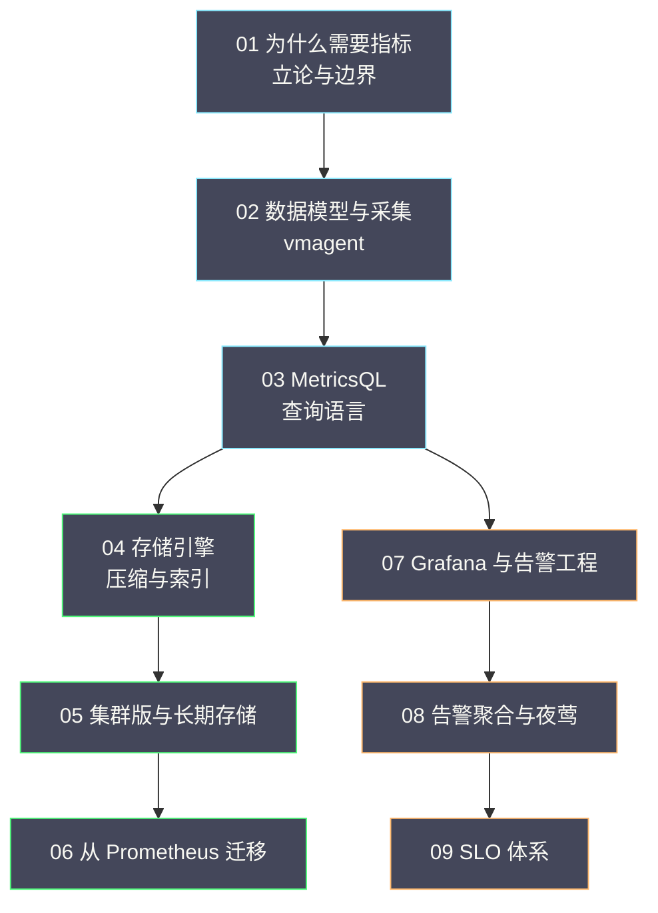

# 指标专栏导览

## 专栏定位

指标（Metrics）是可观测性四大信号中**成本最低、覆盖面最广**的一种。一条时间序列经过压缩后每个数据点只占一到两字节，却能持续记录系统的健康状态——QPS、错误率、延迟分位数、队列深度。正因为便宜，指标成了唯一能在流量规模下持续回答"系统整体怎么样"的信号，也因此成为可观测性建设的第一站。

本专栏的目标，是让你既能理解指标的**原理**（数据模型、查询语言、存储引擎），也能掌握指标的**工程**（采集治理、告警设计、成本控制、迁移落地）。原理部分讲"为什么这样设计"，工程部分讲"怎么用好它"。

## 为什么以 VictoriaMetrics 为主线

Prometheus 是指标生态的事实标准，本专栏并不回避这一点——它的数据模型、暴露格式、查询语言，都是理解整个生态的基础。但落到工程实践上，本专栏把主线放在 **VictoriaMetrics** 上，理由有三条。

第一，**成本结构更优**。VictoriaMetrics 通过整数 ID 索引、列式压缩与扁平合并，把单机可承载的序列数与保留时长显著拉高。对"数据量在长、成本在涨"的团队来说，这是最直接的收益。

第二，**查询语言更友好**。它的 **MetricsQL** 在兼容 PromQL 的前提下，补齐了时间窗口、默认值、分位数函数与子查询上的一批短板，让查询更容易写对——而在事故现场，写对查询的速度就是排障的速度。

第三，**形态更完整**。它同时提供单机版与集群版，且两者接口一致，让"先用单机、不够再上集群"成为一条平滑的演进路径，而不必一开始就背上分布式复杂度。

需要说明的是，本专栏讲 VictoriaMetrics，**不是要否定 Prometheus**，而是因为前者在"成本与规模"这条轴上提供了更多可用的选项。选型一节（第 06 篇）会明确给出"什么情况下该迁移、什么情况下不该迁"的判断框架。

## 目录

| 序号 | 文章 | 核心内容 |
|---|---|---|
| 01 | [[01 为什么需要指标]] | 指标的定位与边界、时间序列数据模型、四种指标类型、USE/RED 方法论、分位数原理 |
| 02 | [[02 指标数据模型与采集——vmagent 与 Prometheus 协议]] | 暴露格式与 OpenMetrics、Pull/Push 取舍、服务发现与 relabel、vmagent 的磁盘缓冲与流式聚合 |
| 03 | [[03 MetricsQL 深度解析]] | 即时/范围向量、rate 与 irate、聚合与 by/without、histogram_quantile 插值、向量匹配 |
| 04 | [[04 VictoriaMetrics 存储引擎深度解析]] | 序列标识与倒排索引、DoD 与 XOR 编码、列式布局、合并与保留、高基数应对 |
| 05 | [[05 VictoriaMetrics 集群版与长期存储]] | vminsert/vmselect/vmstorage、按序列分片、副本与故障域、三条长期存储路线 |
| 06 | [[06 从 Prometheus 迁移到 VictoriaMetrics]] | 迁移动机与成本、语义兼容与差异、四阶段路径、并行验证、回滚预案 |
| 07 | [[07 Grafana 仪表盘与告警工程化]] | 仪表盘设计原则、变量与模板化、告警规则、Alertmanager 路由与静默 |
| 08 | [[08 告警聚合与夜莺工程化]] | 告警风暴与疲劳、夜莺的定位与分工、聚合与抑制、通知路由与值班、告警质量度量 |
| 09 | [[09 指标工程落地与 SLO 体系]] | SLI/SLO/Error Budget、燃尽率告警、指标治理与成本控制、落地路径 |

## 知识图谱

本专栏各篇之间的关系，可以用一张图概括——从信号到决策，逐层上升：

## 主线与阅读路径

本专栏的主线可以概括为一条"从信号到行动"的链路：**数据怎么进来（02）→ 数据怎么查（03）→ 数据怎么存（04）→ 存不下怎么办（05）→ 已有系统怎么迁（06）→ 怎么变成看得懂的视图（07）→ 怎么变成可信的告警（08）→ 怎么度量服务可靠性（09）**。第 01 篇是全篇的立论基础，讲清"为什么需要指标"以及它的边界。

按需求选择路径：

- **快速建立认知**：01 → 02 → 03 → 07。
- **深入存储与规模**：02 → 04 → 05。
- **工程落地与治理**：01 → 03 → 06 → 08 → 09。
- **告警与可靠性**：01 → 03 → 08 → 09。

## 贯穿全篇的四条判断

本专栏反复出现四条判断，先在这里点出，便于阅读时留意：

1. **指标是聚合信号，不能回答"为什么"**。根因需要日志与链路追踪，指标负责"发现问题"。
2. **基数是生命线**。绝大多数指标平台的问题，最终都能追溯到"某个高基数标签"。治理的第一现场是采集入口的 relabel。
3. **降基数优于扩容**。序列数增长带来的开销是超线性的，而扩容是线性的——先做最便宜的那件事。
4. **没有银弹，只有权衡**。单机与集群、本地与对象存储、阈值告警与 SLO 告警，都是取舍，选择取决于你的瓶颈在哪一端。

## 关联专栏

- [[可观测/日志/00 专栏导览|日志]]：日志与指标的分工，以及 Trace ID / Exemplar 的联动。
- [[可观测/链路追踪/00 专栏导览|链路追踪]]：指标发现异常后的下钻。
- [[可观测/Profiler/00 专栏导览|Profiler]]：从"哪个服务慢"到"哪行代码慢"。
- [[可观测/00 可观测性全景导览|可观测性全景]]：四大信号的整体视角与协作机制。
- [[云原生/Kubernetes/kubernetes生产实践与集群管理/00 专栏导览|K8s 生产实践]]：集群场景下的指标采集与告警。
- [[SRE/CVM集群可靠性工程/00 专栏导览|CVM 集群可靠性工程]]：本专栏的告警与 SLO 方法在虚拟化场景的应用。
