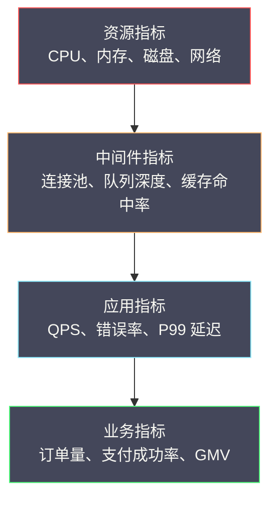
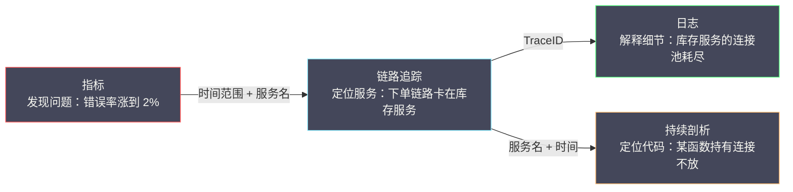

# 01 为什么需要指标

**摘要：**

凌晨三点，值班工程师被一条告警叫醒，被告知订单服务的错误率越过阈值。他打开日志平台，输入服务名，得到的是最近一小时的两亿行日志——即便全文检索只要几秒，人脑也无法在两亿行文本里"看出"错误率是从哪一分钟开始抬头的。这个场景点出了日志这种信号的根本局限：它记录了**每一件事**，却没有回答**整体怎么样**。指标（Metrics）正是为回答后一个问题而生的信号形态——它以数值化的时间序列承载聚合信息，用极小的存储代价换取极快的查询速度与全局视角。本文从"为什么不能只靠日志"这个问题出发，先追溯监控工具从 Nagios 到 Prometheus 的两代范式，再逐层拆解指标的定义与边界、时间序列的数据模型、四种指标类型的语义与选型、分位数的计算原理、USE 与 RED 等方法论的由来，最后落到指标的成本结构、治理手段与边界反例——尤其是高基数这个几乎所有指标平台都会踩的坑。读完之后，你应当能回答两个问题：**指标究竟替代了日志的哪一部分工作，以及什么时候指标会反过来成为负担**。

---

## 第 1 章 一次排障场景引出的问题

### 1.1 凌晨三点的两亿行日志

设想一个再普通不过的电商系统。订单服务每天处理约五千万次请求，每个请求平均产生四条结构化日志（入口、数据库调用、下游调用、出口），一天下来就是两亿行。日志被采集、传输、存入 [[可观测/日志/00 专栏导览|Loki]]，按服务名与级别打了标签。

某个凌晨，监控系统发现订单服务的 HTTP 5xx 比例在五分钟内从 0.01% 抬升到 2%。值班工程师的第一反应是打开日志平台，检索 `service="order" AND level="error"`。检索本身很快——Loki 的标签索引能在几秒内把范围缩小到相关的时间段与服务。但他很快发现两件事：

第一，错误日志的绝对数量太大。2% 的错误率意味着每分钟有上千条错误日志，工程师无法逐条阅读，只能采样。而采样意味着他可能恰好错过那条真正解释问题的堆栈。

第二，也是最关键的：**日志能告诉他"有哪些错误"，却难以直接告诉他"错误率是多少、从哪一刻开始涨、涨了多少"**。后者是一个聚合问题，而日志平台的查询引擎并不擅长对海量原始事件做聚合——它擅长的是"找出满足条件的那几行"。

工程师真正需要的，是一张曲线：横轴是时间，纵轴是错误率，一眼就能看出拐点在哪一分钟。这张曲线，就是指标。

### 1.2 日志的"昂贵直觉"

日志之所以被默认成排查问题的第一工具，是因为它符合人的直觉——出事了，就去看看系统当时"说了什么"。这种直觉在单体应用时代几乎没有代价：一台服务器、几个进程、几百兆日志，`grep` 一下就能定位。

但直觉背后藏着一个被忽视的成本结构。日志是一种**按事件规模线性增长**的信号：请求量翻十倍，日志量就翻十倍；流量峰值翻一百倍，日志量就翻一百倍。一个中等规模集群每天产生 TB 级日志是常态，而其中 99% 以上的行，在故障发生后永远不会被任何人阅读。

这并不意味着日志没有价值——恰恰相反，日志是唯一能提供**完整上下文**（请求参数、异常堆栈、SQL 语句、用户 ID）的信号，是定位"具体发生了什么"的最后一公里。问题在于，把它当成**发现异常**的第一道工具，是把最昂贵、最擅长回答"细节"的信号，用在了最需要"概览"的场景上。

> [!info] 一个粗略的成本对比
> 假设一个服务每秒处理 1000 个请求，每个请求产生 4 条日志、每条 500 字节。一天的日志量为 `1000 × 4 × 500 × 86400 ≈ 173 GB`。而同一条服务的核心指标（QPS、错误率、P99 延迟、CPU、内存、GC 次数等）大约 50 条时间序列，按 15 秒采集间隔，一天的数据点是 `50 × 5760 ≈ 28.8 万个`，按每个点约 1.5 字节计算，不到 **0.5 MB**。两者相差约 **35 万倍**。

### 1.3 指标回答的是"整体"

指标的设计哲学，是把"很多个事件"预先压缩成"一个数"。它不关心第 12345 个请求耗时多少毫秒，只关心这一分钟所有请求的 P99 是多少毫秒。这种**主动的降维**，换来三个日志永远给不了的能力：

- **成本可控**：无论流量多大，指标的数据量只与"序列数 × 采集频率"有关，与请求数无关。
- **查询极快**：聚合在写入时就已经完成，查询只是在一个已经聚合好的小数据集上做时间范围扫描，延迟通常在毫秒到秒级。
- **全局视角**：指标天然适合横向对比——不同服务、不同机房、不同版本之间，用同一套维度做切片。

换句话说，**指标与日志不是替代关系，而是分工关系**：指标负责"发现问题"与"描述趋势"，日志负责"解释细节"与"提供证据"。把这两件事混淆，是许多团队在可观测性建设上走的第一个弯路。

### 1.4 从 Nagios 到 Prometheus：监控的两代范式

指标并非新事物，但"指标体系"作为一个工程范式，经历了一次明显的代际更替。理解这次更替，才能理解今天的指标模型为什么长成这样。

第一代监控以 **Nagios**（1999 年）为代表，它的模型是"主机 + 服务 + 检查脚本 + 阈值"。运维人员为每台主机配置若干检查项，脚本返回 `OK`、`WARNING`、`CRITICAL` 三态之一，Nagios 据此决定是否告警。这套模型的隐含假设是"状态是离散的、有限的、可枚举的"——一台主机要么活着要么死了，一个磁盘要么够用要么快满了。

这个假设在单体时代成立，在动态的容器环境里迅速瓦解。容器会在几秒内创建和销毁，主机名不再稳定，服务实例数以千计，"为每台主机配置检查项"在运维上不可行。更根本的是，三态模型丢掉了**趋势**——它只能回答"现在是否越界"，无法回答"是否在持续恶化"。

第二代监控以 **Prometheus**（2012 年由 SoundCloud 开源，2016 年成为 CNCF 第二个毕业项目）为代表，它做了三件根本性的改变：把"状态"换成"数值时间序列"，把"静态配置"换成"服务发现"，把"三态告警"换成"基于表达式的告警规则"。于是"某台主机磁盘快满了"这种表述，变成了 `(node_filesystem_avail_bytes / node_filesystem_size_bytes) < 0.1` 这样一条可组合、可切片、可做趋势判断的表达式。

这次代际更替的本质，是把监控的对象从**实体**转向了**测量**：你不再描述"哪些机器需要被检查"，而是描述"哪些数值需要被持续记录"。这也解释了为什么指标的标签模型如此重要——它必须能表达"这个测量属于哪个动态变化的实例"，而实例本身是随时在变的。

---

## 第 2 章 指标是什么：定义与边界

### 2.1 形式化定义

指标（Metric）是一条**带时间戳的数值序列**，它由两部分构成：描述"测量什么"的**度量名（metric name）**与一组描述"这是谁的测量"的**标签（label）**，二者合起来唯一确定一条**时间序列（time series）**。

用数学语言描述，一条时间序列是从时间点到实数（或整数）的映射：

```
series = {(t₁, v₁), (t₂, v₂), (t₃, v₃), ...}
```

其中 `t` 严格递增，`v` 是采样值。例如 `http_requests_total{service="order", method="GET", status="200"}` 这条序列，在 10:00:00 时刻的值是 152340，在 10:00:15 时刻的值是 152411，表示"订单服务的 GET 请求累计成功次数"。

这个定义里有两个值得强调的点。其一，**指标的值是采样值，不是全量记录**——两次采样之间发生的一切都被丢弃了，这是它便宜的根源，也是它丢失上下文的根源。其二，**指标的身份由度量名与标签共同决定**，标签不是"附加信息"，而是时间序列身份的一部分——改变任何一个标签，就是另一条序列。

### 2.2 指标的四个特征

把上面的定义展开，可以得到指标的四个关键特征，它们同时也是它相对日志与链路追踪的定位：

| 特征 | 含义 | 工程意义 |
|---|---|---|
| **聚合性** | 指标是预聚合的数值，不携带单事件上下文 | 查询快，但无法回答"是哪一个请求" |
| **低存储开销** | 每个数据点经过压缩后约 1-2 字节 | 可以长期保留（数月到数年） |
| **高可组合性** | 通过标签可任意切片、聚合、连接 | 同一批数据能回答"按机房看""按版本看" |
| **时间维度天然** | 每条序列都是一个时间函数 | 趋势、同环比、预测都是原生操作 |

这四个特征彼此咬合：正因为聚合了，所以存储小；正因为存储小，所以能长期保留；正因为能长期保留，所以趋势分析才有意义。这是一个自洽的设计，而不是四个独立的巧合。

### 2.3 指标的历史谱系

在 Prometheus 之前，已经有一批工具在探索"如何低成本地记录系统状态"，它们留下的设计选择至今仍在影响指标生态：

- **RRDtool（1999 年）**：用固定大小的环形缓冲区（Round Robin Database）存储指标，通过预定义的"合并函数"（AVERAGE、MAX、MIN）在多层时间分辨率之间自动降采样。它的核心洞见是"**老数据不需要那么细**"——最近的数据按秒存，一周前的按小时存，一年前的按天存。这个"分层降采样"思想，后来在各类长期存储方案里反复出现。
- **collectd（2005 年）**：把采集能力做成插件体系，用统一的内部格式在插件之间传递数据点。它奠定了"采集与后端分离"的雏形。
- **StatsD（2008 年，Etsy 开源）**：用 UDP 接收应用侧发送的计数、计时、仪表事件，在服务端做聚合。它的价值在于**把聚合前移**——应用只发原始事件，聚合发生在采集层，从而降低应用侧开销。UDP 无连接、无重传的取舍，也直接影响了后来"指标可以丢一点"的容错哲学。
- **Graphite（2008 年）**：引入点分层的命名空间（如 `servers.web01.cpu.user`）和 Whisper 存储格式，第一次让"用路径表达维度"变得自然。但它用命名空间而非标签表达维度，导致维度组合必须写死在路径里——这正是标签模型要解决的问题。
- **Borgmon（Google 内部，2000 年代）**：Google 在 Borg 集群上自建的监控系统，第一次把"用表达式对时间序列做运算"作为一等公民，直接启发了 PromQL 的设计。

从这条谱系里能看清一条主线：**指标的每一次演进，都是在"表达能力"与"存储成本"之间重新找平衡点**。RRDtool 选择了成本优先（固定大小），Graphite 选择了表达能力优先（命名空间），Prometheus 用标签模型 + 表达式语言试图两者兼得——而 VictoriaMetrics 这类后起之秀，则是在 Prometheus 的语义基础上，把成本这一端压得更低。

### 2.4 指标不擅长什么

理解一个工具的边界，比理解它的能力更重要。指标在以下场景中会明显乏力，勉强使用只会得到错误的结论：

- **需要单事件上下文时**：指标能告诉你"错误率 2%"，但不能告诉你"这 2% 的错误里，有 80% 是同一个用户触发的超时"。
- **需要高基数分析时**：想按 `user_id` 或 `request_id` 做维度分析，会瞬间产生百万级序列，压垮任何时序数据库。
- **需要精确重放时**：指标是采样值，丢失了两次采样之间的所有信息，无法用于审计或对账。
- **需要非数值信息时**：异常堆栈、SQL 语句、请求体这些文本内容，本质上不属于指标的范畴。

> [!warning] 一个常见的误用
> 有人试图用"每个用户一条序列"的方式实现"按用户统计请求量"，指标名形如 `user_requests_total{user_id="12345"}`。这在用户量小的时候能跑，一旦用户数上万，序列数爆炸，采集端、存储端、查询端会同时崩溃。正确做法是把这种需求交给日志或分析型数据库（如 [[中间件/Clickhouse/00 专栏导览|ClickHouse]]），指标只保留"整体请求量"这类低基数视图。

---

## 第 3 章 时间序列的数据模型

### 3.1 度量 + 标签 = 时间序列

时序数据库（TSDB）与关系数据库最根本的差异，在于它对"身份"的建模方式。关系数据库用**主键**标识一行，用**外键**建立关系；时序数据库则用**标签集（label set）**标识一条序列，而标签集本身就是查询的入口。

以 Prometheus 的数据模型为例，一条样本可以表示为：

```
http_requests_total{service="order", method="GET", status="200", instance="10.0.0.5:8080"} 152411 1704067215000
```

其中 `http_requests_total` 是度量名，花括号内是标签集，`152411` 是值，`1704067215000` 是毫秒时间戳。度量名在 Prometheus 内部其实也是一个特殊的标签 `__name__`，因此"一条序列由标签集唯一确定"这句话是严格成立的。

这种建模方式带来一个非常实用的性质：**查询即过滤 + 聚合**。要得到"订单服务所有 GET 请求的总量"，只需写：

```promql
sum(http_requests_total{service="order", method="GET"})
```

引擎会找到所有匹配的序列（不同 `status`、不同 `instance`），按时间对齐后求和。整个过程不需要预先定义 schema，也不需要 JOIN——这是时序数据模型最优雅的地方。

### 3.2 基数：指标平台的生命线

标签的数量与其取值组合数，决定了序列的总数，这个数被称为**基数（cardinality）**。基数是指标平台最重要的容量指标，也是最容易被忽视的隐性成本。

举一个具体的例子。假设有 5 个标签，每个标签各有 10 个取值，理论上的序列数上限是 `10⁵ = 10 万`。如果实际组合都能出现，那么就是 10 万条序列。每增加一个"有 10 个取值"的标签，序列数就翻十倍；而如果某个标签的取值是**无界的**（如 `user_id`、`trace_id`、`url_path`），序列数就会随流量持续增长，最终失控。

基数的代价体现在三处：**采集端**要为每条序列维护状态，**存储端**要为每条序列建立索引与倒排表，**查询端**的标签匹配与集合运算复杂度随序列数上升。许多团队第一次遇到 Prometheus 内存暴涨，根因几乎都是某个不受控的高基数标签。

> [!info] 经验法则
> 生产环境的活跃序列数建议控制在百万级以内，单个实例（或单个租户）的标签取值组合应尽量收敛。任何取值可能无界增长的维度——用户 ID、请求 ID、会话 ID、完整 URL——都不应该成为指标标签。

### 3.3 标签命名规范

标签的价值在于"可组合"，而可组合的前提是**命名一致**。如果同一个语义在不同服务里被写成 `service`、`app`、`application`、`svc` 四种名字，那么跨服务的聚合就无从谈起。Prometheus 生态在长期实践中沉淀出一套约定：

- 标签名用小写字母加下划线，语义固定：`instance`（采集目标）、`job`（采集任务）、`service`（服务名）、`version`（版本）、`env`（环境）。
- 度量名以单位结尾：`_seconds`、`_bytes`、`_total`，让"这个数的量纲是什么"一眼可辨。
- Counter 用 `_total` 后缀，且名字用复数（`http_requests_total` 而非 `http_request_total`）。
- 不使用被测对象的名字做前缀（如 `order_service_requests_total`），而应把服务名放进标签（`http_requests_total{service="order"}`）——否则度量名会随服务数线性膨胀。

这些约定看似琐碎，但它们直接决定了"能不能在故障时快速写出正确的查询"。一个命名混乱的指标集合，会让工程师在排障时把时间浪费在"这个指标到底叫什么"上。

### 3.4 序列的生命周期与陈旧标记

时间序列不是永恒的。当采集目标下线、标签变化或采集任务被删除时，对应的序列会停止更新。这里有一个容易踩坑的细节：**停止更新不等于值为 0**。

如果一个 Gauge 序列在 10:00 之后再没有新数据点，那么它在 10:05 查询时的"最后值"仍然是 10:00 时的那个值。如果不加区分，你会误以为"这个指标一直没变"。为此，Prometheus 引入了**陈旧标记（staleness marker）**：当采集目标消失时，系统会写入一个特殊的标记，告诉查询引擎"这条序列此后无数据"，从而让聚合函数能正确地把失效实例排除出去。

这个机制在告警里尤其重要。如果一条序列静默失效却仍被当作"有效值"参与 `sum()`，那么当整个集群的目标都失效时，你得到的不是"数据缺失"，而是一个看似正常的旧值——这会掩盖最严重的故障（监控自身失联）。

### 3.5 与关系模型、文档模型的对比

为了看清时序模型的取舍，不妨把它与另外两种常见模型并排比较：

| 维度 | 关系模型 | 文档模型 | 时序模型 |
|---|---|---|---|
| 身份标识 | 主键 | 文档 ID | 标签集 |
| 主要操作 | JOIN、事务 | 嵌套检索 | 过滤 + 聚合 + 时间窗口 |
| 写入模式 | 随机读写 | 随机写入 | 追加为主，极少更新 |
| 典型数据量 | 中等 | 中等 | 极大（时间 × 序列） |
| 擅长的问题 | "这些实体之间什么关系" | "这个对象长什么样" | "整体随时间如何变化" |

时序模型放弃了事务与 JOIN，换来的是对"高频追加 + 按时间范围扫描"这一单一访问模式的极致优化——这正是第 04 篇要展开的存储引擎话题。

### 3.6 采集间隔、抖动与对齐

时间序列的"时间"并不是任意的，它由**采集间隔（scrape interval）**决定。Prometheus 默认 15 秒，VictoriaMetrics 的 vmagent 可以按目标灵活配置。这个参数同时影响三件事：**精度**（间隔越短，越能捕捉瞬时尖峰）、**成本**（间隔减半，存储翻倍）、**对齐难度**（不同目标的采样时刻如果各不相同，聚合时的插值误差会累积）。

这里有一个容易被忽视的细节：**不同目标的时间戳天然不对齐**。如果 A 服务在 10:00:03 采样、B 服务在 10:00:11 采样，那么"10:00:00 这一时刻的总 QPS"就无从直接取得。PromQL 的做法是**按时间窗口对齐**——在 `[t - interval, t]` 的窗口内取最后一个样本，用 `rate()` 时则取窗口内的首尾两个点做差分。这种"容忍少量错位"的设计，正是指标能接受抖动、不必强一致的原因。

由此可以推出一条工程经验：**采集间隔应当一致且整除查询步长**。如果采集是 15 秒、查询步长也是 15 秒，那么每次查询都能命中真实采样点；如果查询步长是 10 秒，就会有一半的查询点在做插值，图形出现锯齿。许多"指标图看起来毛刺很多"的抱怨，根因不在数据，而在间隔不匹配。

### 3.7 标签漂移：一种安静的基数泄漏

比"一开始就引入高基数标签"更难排查的，是**标签漂移（label churn）**——标签的取值在运行过程中悄悄发生变化，每次都产生一批新序列，而旧序列并不会立即消失。

典型的漂移来源有几种：Pod 重启后 `pod` 标签从 `order-7d9f-abc` 变成 `order-7d9f-xyz`，旧序列在保留期内仍然占着索引；URL 里带了时间戳或自增 ID，`path` 标签的取值组合无限增长；某个中间件把连接 ID 写进了标签，连接一重建就换一批。这些序列单看都"合法"，但它们共同的效果是**活跃序列数只增不减**。

对抗漂移的手段是"在采集入口做减法"：用 relabel 规则把易漂移的标签丢弃或收敛（比如把 `pod` 名称收敛为 `deployment` 名称），在存储之前就切断泄漏源。等到漂移已经发生再去清理，成本要高得多——因为你得先找出"是哪个标签在漂"，而这往往需要专门的基数分析工具。**指标治理的性价比，在采集入口处最高**。

---

## 第 4 章 四种指标类型

### 4.1 为什么需要类型

一个数值序列本身是中性的，但它的**语义**决定了它能做什么运算。把"累计请求数"和"当前连接数"混为一谈，就会出现"对连接数做增长率计算"这种毫无意义的操作。Prometheus 与多数兼容其协议的时序系统，用四种类型来固化语义。

### 4.2 Counter：只增不减的累计量

Counter（计数器）表示一个**单调递增**的累计值，例如"自进程启动以来的请求总数"。它的值只能增加（或在进程重启时归零），永远不会下降。

Counter 的原始值几乎没有意义——"请求总数 152411"这个数字本身说明不了任何问题。有意义的是它的**变化率**：通过 `rate()` 或 `increase()` 函数，把累计值转换成"每秒请求数"或"某时间段内的增量"。这也是为什么 Counter 是最常见、也最容易被误用的类型：直接把 Counter 的值拿去画图或设阈值，得到的是一条永远向上的斜线。

Counter 的另一个隐蔽陷阱是**进程重启导致的归零**。当应用重启时，Counter 从 0 重新开始计数，原始序列上会出现一个"断崖式下跌"。`rate()` 函数会自动处理这种情况——它检测到值的下降后，会假设发生了重置，并据此修正增量。但如果你手写计算（比如用 `delta()` 或直接做差），就会在重启点得到一个巨大的负数或异常尖峰。

### 4.3 Gauge：可增可减的瞬时值

Gauge（仪表）表示一个**可增可减的瞬时值**，例如当前内存占用、当前在线用户数、队列长度、温度。它的值可以在任意时刻上升或下降，直接读取即有语义。

Gauge 适合表达"状态"，不适合做累计。一个典型的错误是拿 Gauge 去做 `rate()`——比如对"当前连接数"求增长率，虽然在语法上合法，但结论没有意义，因为 Gauge 的上升不代表"新增了连接"，只代表"这一刻比上一刻多"。

Gauge 的一个常见高级用法是**滑动窗口聚合**：用 `avg_over_time`、`max_over_time`、`quantile_over_time` 对一段时间内的 Gauge 值做统计，从而把"瞬时快照"变成"区间统计"。这在不适合用 Histogram 的场景（如磁盘使用率的 P99）里很有用。

### 4.4 Histogram：分桶统计的分布

Histogram（直方图）是四种类型中最复杂、也最有价值的一种。它不存储单次观测值，而是把观测值**分桶（bucket）**累计：每个桶表示"观测值小于等于该边界的次数"。例如一个延迟直方图可以有如下桶：

```
http_request_duration_seconds_bucket{le="0.1"}  1200
http_request_duration_seconds_bucket{le="0.5"}  3100
http_request_duration_seconds_bucket{le="1"}    3800
http_request_duration_seconds_bucket{le="+Inf"} 4000
http_request_duration_seconds_sum              512.3
http_request_duration_seconds_count            4000
```

从这个结构里，可以还原出分位数：P99 延迟就是"使得累计比例达到 99% 的那个桶边界附近的值"。Prometheus 用 `histogram_quantile()` 做这件事。

Histogram 的精妙之处在于**可聚合性**：多个实例的桶可以直接相加，得到一个"全局的"直方图。这意味着"按机房聚合的 P99"是可以正确计算的——而这恰恰是 Summary 做不到的。

### 4.5 Summary：客户端分位数

Summary（摘要）在客户端直接计算并暴露分位数，例如 `http_request_duration_seconds{quantile="0.99"}`。它看起来更省事——不需要选桶边界，直接给出 P99。

但 Summary 有一个致命缺陷：**分位数不可聚合**。把两个实例的 P99 相加、取平均、取最大值，都不能得到这两个实例合起来的 P99。因此，只要你的查询需要任何形式的跨实例聚合（而这在分布式系统里几乎是必然的），Summary 就无法胜任。

Summary 的实现细节也值得一提。它在客户端维护一个**滑动时间窗口**内的分位数估计（基于流式分位数算法，如 CKMS），窗口大小可配置。这意味着它给出的 P99 是"最近一段时间"的，而不是"自进程启动以来"的——这个隐式的时间语义，常常让不熟悉它的人感到困惑。

> [!warning] 为什么官方推荐 Histogram
> 这正是 Prometheus 官方文档明确建议优先使用 Histogram 的原因。Histogram 的代价是"桶边界需要预先选择"以及"精度受桶粒度限制"，但它换来了可聚合性——在分布式系统中，可聚合性是压倒性的优点。桶边界选得不合适可以调整，分位数不可聚合则是无解的。

### 4.6 分位数是怎么算出来的

`histogram_quantile(0.99, ...)` 背后并不是精确统计，而是**桶间线性插值**。理解这一点，能避免对分位数结果的过度信任。

算法大致如下：对目标分位 `q`，先算出"需要落在前多少比例"的目标计数 `q × count`；然后从最小的桶开始累加，找到第一个使累计计数超过目标的桶；在这个桶内，假设观测值**均匀分布**，用线性插值估算出具体值。用公式表达，若落在桶 `[le_low, le_high]`，桶内目标计数为 `n`，则该桶的贡献计数为 `bucket_count`：

```
quantile ≈ le_low + (le_high - le_low) × (n - count_below) / bucket_count
```

这个公式暴露了三个重要事实。其一，**分位数精度受桶边界密度限制**——如果桶边界只有 `0.1`、`1`、`10`，那么 P99 只能在这三个值附近插值，误差可能很大。其二，**最坏的误差出现在最后一个桶**——如果 P99 落在 `+Inf` 桶里（即观测值超过了最大显式桶边界），`histogram_quantile` 只能返回最大桶边界值，此时的 P99 实际上是"被低估"的。其三，**分位数不能做算术平均**——`avg(histogram_quantile(...))` 是错误的，正确做法是先聚合桶（`sum by (le)`）再算分位数。

> [!info] 桶边界怎么选
> 经验做法是让桶在"你关心的量级"附近加密。延迟通常关心 100ms 到 2s 这段，所以边界可以设为 `0.05, 0.1, 0.25, 0.5, 1, 2.5, 5, 10`。用指数间距（每档约 2-2.5 倍）而不是等差，能让相对误差保持均匀。桶不是越多越好——每个桶都是一条额外的序列，10 个桶就等于把该指标的存储成本乘以 11。

### 4.7 Native Histogram

传统 Histogram 的桶边界是固定的，这带来两个问题：边界选错难以调整，以及桶数量带来序列膨胀。Prometheus 2.40 之后引入的 **native histogram（原生直方图）**试图解决这一点：它用**指数桶（exponential buckets）**动态记录分布，不再需要预先定义边界，同时把整个直方图压缩为**单条序列**，显著降低基数压力。

代价是兼容性——原生直方图需要客户端、服务端、查询端三方都支持，且与传统 Histogram 的存储格式不同。VictoriaMetrics 也提供了对原生直方图的支持路径。这是一个正在演进的领域，选型时应关注生态成熟度，而不只是理论优势。

### 4.8 选型决策表

把四种类型的适用场景整理成一张表，便于查阅：

| 类型 | 语义 | 典型用途 | 关键运算 | 常见误用 |
|---|---|---|---|---|
| Counter | 单调递增累计 | 请求数、错误数、字节数 | `rate`、`increase` | 直接画原值；手写差值忽略重启 |
| Gauge | 可增可减瞬时值 | 内存、连接数、队列深度 | 直接读、`avg_over_time` | 对 Gauge 求 `rate` |
| Histogram | 分桶分布 | 延迟、请求体大小 | `histogram_quantile` | 桶边界设置不当；对分位数取平均 |
| Summary | 客户端分位数 | 延迟（单实例） | 直接读分位标签 | 跨实例聚合分位数 |

### 4.9 暴露格式与 OpenMetrics

指标要能被采集，就得有一个约定的"输出格式"。Prometheus 的**文本暴露格式（text exposition format）**是事实标准，长这样：

```text
# HELP http_requests_total Total number of HTTP requests.
# TYPE http_requests_total counter
http_requests_total{method="GET",status="200"} 152411
http_requests_total{method="POST",status="500"} 37
```

每行一条样本，`# HELP` 与 `# TYPE` 提供元信息，采集端只需按行解析即可。这种"人类可读、机器可解"的设计，是 Prometheus 生态能迅速铺开的原因之一——任何语言只要能把这几行文本写到 HTTP 端点上，就接入了整个生态。

**OpenMetrics** 是对该格式的标准化（2018 年由 CNCF 发起，2021 年成为 CNCF 孵化项目），它在文本格式的基础上补充了更严格的语法、Exemplar 支持与原生直方图表达。二者的关系类似"实现"与"标准"：Prometheus 的文本格式先成为事实标准，OpenMetrics 再把事实标准写成规范。理解这层关系，就能理解为什么"兼容 OpenMetrics"往往意味着"能被绝大多数采集端识别"。

---

## 第 5 章 指标体系的方法论

### 5.1 从"有什么指标"到"该有什么指标"

采集工具装好之后，团队往往会陷入另一个困境：指标一大堆，但真正出事时不知道该看哪个。方法论的价值就在于，它给出了一套"从系统结构推导出该采集什么"的框架，避免指标集合靠拍脑袋堆积。

### 5.2 USE：面向资源

USE 方法由 Brendan Gregg 提出，针对**资源**（CPU、内存、磁盘、网络）给出三个维度：

- **使用率（Utilization）**：资源在多大比例的时间内处于忙碌状态，如 CPU 使用率。
- **饱和度（Saturation）**：资源排队等待的程度，如运行队列长度、磁盘 I/O 等待队列。
- **错误（Errors）**：资源层面的错误计数，如网卡丢包、磁盘坏道。

USE 的洞察在于：**使用率不等于瓶颈**。一个 CPU 使用率 70% 的系统可能完全健康，而一个使用率 40% 但运行队列持续排队的系统已经在过载。只看使用率，会漏掉饱和度这个更早期的信号。

### 5.3 RED：面向服务

RED 方法针对**请求驱动的服务**，给出另外三个维度：

- **速率（Rate）**：每秒请求数（QPS）。
- **错误（Errors）**：每秒失败请求数或错误比例。
- **时延（Duration）**：请求耗时分布，通常看 P50/P90/P99。

RED 与 USE 的分工很清晰：RED 描述"用户感受到的服务质量"，USE 描述"支撑服务的资源状态"。当 RED 指标恶化而 USE 指标正常，问题多半在应用逻辑；当 USE 指标先恶化，问题多半在资源层。

### 5.4 四个黄金信号

Google SRE 提出的"四个黄金信号"（Four Golden Signals）可以看作 RED 的一个变体：**延迟（Latency）、流量（Traffic）、错误（Errors）、饱和度（Saturation）**。它比 RED 多了一个饱和度维度，比 USE 多了一个流量维度，是面向分布式服务的一种折中。

这三种方法论并不互斥，实际落地时通常是叠加使用的：用 USE 覆盖基础设施，用 RED 覆盖应用服务，用黄金信号做 SLO 的度量口径。

### 5.5 从资源指标到业务指标

一个成熟指标体系的分层，往往是从下往上的四层：



越靠下的指标越通用、越容易采集，但离"用户是否受影响"越远；越靠上的指标越贴近业务价值，但采集成本越高、口径越需要与业务方对齐。**告警应当尽量挂在靠近业务的那一层**——用户不关心你的 CPU 使用率是 60% 还是 90%，只关心下单是否成功。

### 5.6 采集方式：Pull 与 Push 的取舍

指标的采集方式，与"指标体系怎么组织"这件事关系密切。主流方案分两派：

**Pull（拉取）**：监控服务端主动按固定间隔向目标发起 HTTP 请求，抓取 `/metrics` 端点。Prometheus、vmagent 默认采用这种模式。它的优点是目标列表由服务发现动态维护，配置集中、易于统一采集间隔，且"抓取失败"本身就是一个有价值的信号（目标不可达）。缺点是短生命周期任务（如几秒就结束的批处理）可能来不及被抓取，需要额外引入 Pushgateway。

**Push（推送）**：目标主动把数据点发给采集端或接收端，如 StatsD、InfluxDB 的写入接口、Remote Write。它天然适合短生命周期任务与跨网络边界的场景，但缺点是把"节奏控制"交给了发送方——发送方可以超频、可以静默，接收端难以统一治理。

两种模式并非水火不容。现代实践常见的是"Pull 为主、Push 补位"：长期运行的服务用 Pull，批处理任务用 Pushgateway 或 Remote Write。选择哪种，取决于你的目标生命周期是否稳定、网络拓扑是否允许反向访问，以及你更看重"配置集中"还是"发送灵活"。

### 5.7 聚合维度：指标体系里最难的决策

方法论给出的是"该采集哪几个维度"，但真正决定指标体系好不好用的，是**聚合维度怎么选**。同一个 QPS，按 `service` 聚合能看服务健康，按 `instance` 聚合能看实例均衡，按 `version` 聚合能看灰度效果，按 `region` 聚合能看机房差异。维度选得对，一个指标顶十个用；选得不对，就得为每种视角各采一条序列。

这里有一个隐含的张力：**维度的"可下钻性"与基数成本直接冲突**。你希望出事时能下钻到 Pod，就得保留 `pod` 标签；而 `pod` 的取值随重启不断变化，会持续制造新序列。折中办法是"分层保留"——核心维度常驻，细粒度维度只在高精度期保留，或改用日志/追踪来承担下钻。

还有一个常被忽略的陷阱：**聚合会掩盖问题**。`sum by (service)` 之后，某个实例彻底挂掉可能被其他实例的成功请求稀释掉，整体错误率纹丝不动。所以，**面向告警的聚合应当保守，面向概览的聚合可以激进**——告警规则尽量保留关键维度（如 `instance`），避免"一个坏实例被平均掉"。

---

## 第 6 章 指标与其他信号的关系

### 6.1 三支柱的分工

可观测性常被概括为"三大支柱"：指标、[[可观测/日志/00 专栏导览|日志]]、[[可观测/链路追踪/00 专栏导览|链路追踪]]。三者的分工可以用一个故障排查的时间线来理解：



指标站在最前面，因为它是唯一能在**秒级**发现"整体异常"的信号。追踪与日志依次下钻，逐步把"哪里出了问题"细化到"哪个服务的哪行代码出了问题"。

### 6.2 Exemplar：把指标和追踪缝在一起

指标与追踪之间最大的鸿沟，是"聚合"与"个体"的断裂：指标告诉你"P99 涨了"，却无法告诉你"是哪一类请求涨了"。Exemplar（样本点）机制就是为了缝合这道鸿沟——它允许在直方图的某个桶里，附加一个真实请求的 Trace ID。

```text
http_request_duration_seconds_bucket{le="1"} 3800 # {trace_id="abc123"} 0.87
```

这样，工程师在 Grafana 上看到某个桶的延迟异常时，可以直接点开这个 Exemplar，跳转到那条真实的慢请求链路。这是一种**从聚合回到个体**的跳转，是"三支柱联动"在工程上最直接的落地方式。

Exemplar 本身也带来一点基数压力——每个桶可以携带一个样本点，但它的数量远小于全量 Trace，且通常只保留最近的一小段。这是一个"用极小成本换取极大可观测性"的典型折中。

### 6.3 为什么指标必须先行

在资源有限的情况下，可观测性建设应当**先指标、后日志与追踪**。原因不复杂：指标的采集成本最低、覆盖最广、查询最快，它是唯一能在流量规模下持续给出"系统整体是否健康"答案的信号。没有指标，日志与追踪就失去了"该去哪里看"的入口；没有入口的海量数据，只会变成另一个成本黑洞。

### 6.4 标签：跨信号的通用货币

三支柱能联动，靠的是一个共同的约定：**用同一套标签命名描述同一个对象**。当指标用 `service="order"`、日志也用 `service="order"`、追踪的 resource attribute 还是 `service.name="order"` 时，Grafana 才能在三个数据源之间一键跳转，把"指标上的一个异常点"直接变成"该服务该时段的日志与链路"。

这意味着一件常被低估的事：**标签规范不只是指标内部的事，而是整个可观测性平台的公共契约**。如果指标叫 `service`、日志叫 `app`、追踪叫 `service.name`，那么三支柱之间的每一次跳转都要靠人工翻译，联动价值大打折扣。OpenTelemetry 的 **Semantic Conventions（语义约定）**正是为此而设——它规定了一套跨信号的统一属性名，让"同一个语义在所有信号里叫同一个名字"。

---

## 第 7 章 指标的成本结构

### 7.1 三笔账

指标"便宜"是相对的，它同样有三笔成本：

- **采集成本**：采集端（如 Prometheus、vmagent）为每条序列维护内存状态，序列数越多，采集端内存占用越大。
- **存储成本**：与"序列数 × 保留时长 / 采集间隔"成正比。序列数翻十倍，存储成本就翻十倍。
- **查询成本**：标签匹配与聚合的复杂度随匹配到的序列数上升，高基数会让查询从毫秒退化到分钟。

这三笔账都由同一个变量主导——**基数**。这也解释了为什么"指标治理"的第一要务永远是"控制基数"。

### 7.2 一个存储估算

用第 02 篇会展开的编码效率做一个粗略估算。假设有 10 万条活跃序列，采集间隔 15 秒，每条序列每个数据点压缩后约 1.5 字节：

```
每条序列一天的点数 = 86400 / 15 = 5760
每条序列一天的存储 = 5760 × 1.5 字节 ≈ 8.6 KB
10 万条序列一天的存储 ≈ 860 MB
保留 1 年 ≈ 314 GB
```

作为对比，同样这个服务一天的日志是 173 GB——指标一年的存储量，还不如日志两天的量。这就是"指标是成本最低的信号"这句话的量化依据。

### 7.3 VictoriaMetrics 为什么能进一步降本

传统 Prometheus 在两个方面存在结构性瓶颈：一是**单机存储容量**，本地磁盘限制了保留时长，于是不得不引入远程存储（Thanos、Mimir）来做长期化；二是**高基数下的内存压力**，头部块（Head Block）的倒排索引全在内存里，序列数一高就吃紧。

VictoriaMetrics 针对这两点做了重新设计：它采用更激进的列式压缩与合并策略，把单机可承载的序列数与保留时长显著拉高；同时提供单机版与集群版两种形态，让"单机够用就不上集群"成为可能。本专栏后续几篇会逐层拆解它的存储引擎（04）、集群形态（05）与迁移路径（06）。这里先记住一个结论：**指标的降本空间，主要来自存储引擎的设计，而不是采集频率的调低**——后者会牺牲精度，前者才是真正的工程红利。

### 7.4 指标治理的四个抓手

成本失控几乎是所有指标平台长大之后的必然问题。治理不是一次性动作，而是四条持续运行的轨道：

1. **采集侧收敛**：用 relabel 规则丢弃无用指标与高基数标签，在数据进入存储之前就把它挡掉。这是性价比最高的一招。
2. **写入侧降采样**：对保留期外的数据做降采样（如 15 秒 → 5 分钟），用精度的损失换取保留时长的延长。分层保留是标准做法：近 15 天保精度，之后降采样保留一年。
3. **查询侧限流**：对昂贵的查询设置超时与并发上限，避免一条失控的 `by (pod)` 查询拖垮整个查询层。
4. **命名与标签规范**：从源头减少"语义相同但标签不同"的重复序列。规范的成本在事前，收益在事后。

这四条轨道里，第一条的杠杆最大。很多团队的存储成本，一半以上是被无用的采集数据消耗掉的。

### 7.5 一个反直觉的成本观

最后澄清一个常见误解：**降低采集频率并不是最有效的降本手段**。把 15 秒改成 60 秒，只省下 75% 的存储，却同时牺牲了捕捉瞬时故障的能力——一个持续 20 秒的尖峰会被完全漏掉。相比之下，砍掉一条高基数指标（比如把 5 万条序列的 `url_path` 维度去掉），可能一次性省下几十个百分点，而且不损失任何有用的信息。

换句话说，**成本治理的方向应当是"砍维度"而不是"砍频率"**。这也解释了为什么 VictoriaMetrics 把工程重心放在压缩与合并算法上——它试图在不牺牲采集精度的前提下，把单条序列的存储开销压到更低。这是"从存储引擎要红利"而不是"从采集频率要红利"。

---

## 第 8 章 边界与反例

### 8.1 高基数：最昂贵的一课

几乎所有自建过指标平台的团队，都经历过一次"基数事故"。常见的触发方式有几种：把 `url_path` 作为标签，而路径里带了自增 ID；把 `user_id` 作为标签做用户级统计；把 `trace_id` 写进指标以便"关联追踪"。

这些做法的共同点是**把无界维度引入有界模型**。指标模型的容量假设是"标签取值组合有限"，一旦破坏这个前提，代价是指数级的：序列数爆炸 → 采集端内存耗尽 → 存储写入放大 → 查询超时。而且这个过程往往是渐进的，等发现时已经很难回滚。

### 8.2 指标不能替代审计

指标是采样值，两次采样之间的数据被永久丢弃。因此它**不能**用于对账、审计、计费这类要求"一条不漏"的场景。把计费系统建立在指标之上，是一类灾难性的设计错误——它的错误不会立刻显现，而是会在某个月末的对账中集中爆发。

### 8.3 指标不能回答"为什么"

这是最容易被忽视的边界。指标能精确地告诉你"P99 从 200ms 涨到 2s"，但**永远无法告诉你为什么**。原因很简单：为什么需要上下文，而上下文在聚合时已经被丢弃了。指望从指标里读出根因，就像指望从一份月度财务报表里读出某个员工当天为什么迟到——粒度不匹配。

### 8.4 四个真实踩坑

把常见错误整理成一组"反例清单"，比抽象的原则更容易记住：

- **用 Counter 做阈值告警**：`http_requests_total > 100000` 这样的规则，在服务运行足够久之后必然触发，与是否出事无关。正确做法是对 `rate()` 的结果设阈值。
- **用平均延迟掩盖长尾**：平均延迟 50ms 听起来健康，但可能藏着 5% 的请求耗时 3 秒。延迟必须看分位数，不能看平均值。
- **用 `irate()` 做告警**：`irate()` 只取最近两个数据点，波动剧烈，用它做告警会产生大量抖动。告警应基于 `rate()` 这类有平滑效果的函数。
- **忘记区分"零"与"无数据"**：某条序列静默失效后，聚合函数可能把它当作 0 参与计算，导致"错误率 0%"这种假象。需要用 `absent()` 或 `up` 指标显式检测数据缺失。

### 8.5 反例：口径不一致导致 SLO 失真

有一个比技术错误更隐蔽的坑：**指标口径不一致**。同一个"成功率"，网关按"HTTP 200"算，业务服务按"业务码 0"算，两者可能差出几个百分点——因为网关的 200 里混着业务失败。当 SLO 用网关口径、故障复盘用业务口径时，就会出现"SLO 显示达标、用户却在投诉"的荒诞局面。

避免这个坑的办法只有一个：**在指标层就固定口径，并把口径写进指标的 HELP 注释与团队约定里**。口径是业务决策，不是技术细节——它必须在采集之前就想清楚，而不是在告警响起之后才开始争论。

### 8.6 一个正例：SLO 用指标度量

反过来，指标也有它不可替代的高光场景。SLO（服务等级目标）的度量几乎只能用指标来做：可用性 = 成功请求数 / 总请求数，延迟达标率 = 满足阈值时延的请求比例。这两个比例都需要在长时间窗口（如 30 天）上、对海量请求做聚合，而只有指标能以可接受的成本持续保留这么长时间的聚合数据。这也解释了为什么 SLO 工程与指标体系天然绑定——本专栏第 08 篇会专门展开。

---

## 小结

从"凌晨三点的两亿行日志"到"一张错误率曲线"，本文试图说清一件事：指标不是日志的简化版，而是为回答"整体怎么样"这个问题专门设计的信号形态。它用主动降维换来了低成本、快查询与全局视角，代价是丢失了单事件的上下文——这个代价不可消除，只能通过与其他信号的分工来弥补。

回看从 Nagios 到 Prometheus 的两代范式，能看到指标模型演进的一条主线：把监控的对象从"实体"换成"测量"，从而适配动态的基础设施；而 VictoriaMetrics 这类后起系统，则是在同一套语义上继续压低成本这一端。理解这条主线，就能理解为什么"标签模型"和"表达式语言"会成为现代指标平台的两个核心——它们分别解决了"如何描述动态的测量对象"和"如何从聚合数据中提炼结论"。

理解指标的边界，比掌握它的用法更重要。高基数、审计场景、根因追问，是三个指标永远不擅长的领域；而趋势发现、告警触发、SLO 度量，是它不可替代的舞台。认清这条分界线，后续几篇关于数据模型、查询语言、存储引擎与告警工程的讨论才有立足点。

最后补一句关于取舍的话。指标的"便宜"不是免费的——它用**信息的有损压缩**换来了规模上的可行，而这笔交易是否划算，取决于你是否真的只需要"整体"。当一个团队开始抱怨"指标看不出根因"时，问题往往不在指标本身，而在于他们对指标的期待越了界：他们想要的其实是日志与追踪的答案，却把问题提给了指标。分清哪些问题该问哪个信号，比把任何单一信号做到极致都更重要。

---

## 参考资料

1. Prometheus 官方文档 - Metric types: https://prometheus.io/docs/concepts/metric_types/
2. Prometheus 官方文档 - Data model: https://prometheus.io/docs/concepts/data_model/
3. Prometheus 官方文档 - Histograms and summaries: https://prometheus.io/docs/practices/histograms/
4. Brendan Gregg (2020). *Systems Performance: Enterprise and the Cloud* (2nd Edition). Addison-Wesley. 第 2 章 "Methodologies"。
5. Google SRE Book (2016). *Site Reliability Engineering*, Chapter 6: Monitoring Distributed Systems. O'Reilly Media.
6. Cindy Sridharan (2018). *Distributed Systems Observability*. O'Reilly Media.
7. T. D. Cook, et al. (1999). *RRDtool* 设计文档: https://oss.oetiker.ch/rrdtool/doc/
8. VictoriaMetrics 官方文档: https://docs.victoriametrics.com/

---

> [!note] 思考题
> 1. 你的系统里有哪些指标是"直接读原值"在画图的？其中有多少其实是 Counter（应该用 `rate`）或 Gauge（不该求 `rate`）被用错了？
> 2. 如果业务方要求"按用户统计下单成功率"，你会怎么设计？是指标、日志还是分析型数据库更合适，为什么？
> 3. USE、RED、四个黄金信号三套方法论，在你的场景里哪一套更贴合？有没有出现"指标一堆、出事不知道看哪个"的情况？
> 4. 你能否为自己的系统算一笔账：当前活跃序列数是多少，保留一年的存储成本大约多少，其中有多少是被无用指标消耗的？
