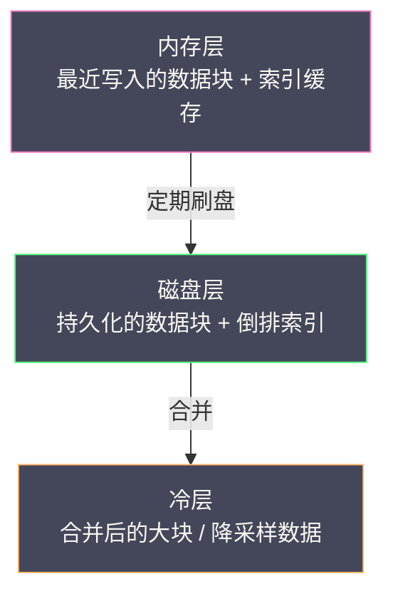
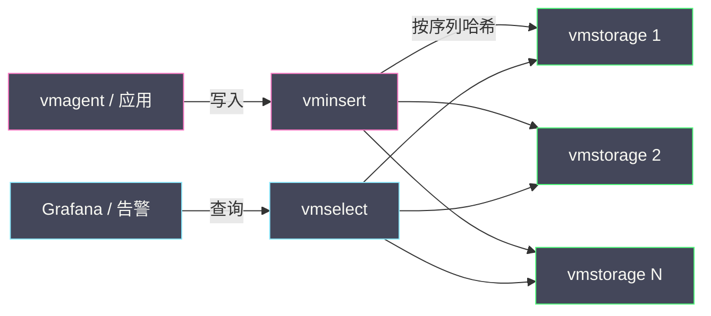

# 04 VictoriaMetrics 存储引擎深度解析

**摘要：**

前几篇一直在说"指标便宜"，但这份便宜不是天上掉下来的——它来自存储引擎在编码、索引与合并三个层面的精心设计。Prometheus 的内置 TSDB 用 Gorilla 论文的 XOR 编码把每个数据点压到约 1.37 字节，已经相当出色，但它在两个地方存在结构性瓶颈：一是索引与头部数据全在内存里，序列数一高就吃紧；二是单机容量与合并策略限制了长期保留。VictoriaMetrics 针对这两点重新设计了存储引擎，用更激进的列式压缩、更省内存的索引结构与更扁平的合并策略，把单机可承载的序列数与保留时长显著拉高。本文从"为什么 Prometheus 的 TSDB 需要被重写"这个问题出发，逐层拆解 VictoriaMetrics 的整体架构、序列标识与倒排索引、列式压缩与时间戳编码、合并与保留策略，再讨论高基数下它为什么能扛住，以及单机版与集群版的边界。最后落到边界与反例：压缩比不是越高越好，降采样会牺牲什么，以及容量估算该怎么做。读完本文，你应当能回答两个问题：**VictoriaMetrics 究竟在哪几个设计上换来了成本优势，以及这些优势在什么情况下会失效**。

---

## 第 1 章 为什么要重写一个 TSDB

### 1.1 Prometheus TSDB 的三个结构性瓶颈

要理解 VictoriaMetrics 的设计动机，先要理解 Prometheus 内置 TSDB 在规模上去之后会撞到哪几堵墙。这三堵墙都不是"实现不够好"，而是"设计假设与规模不匹配"。

第一堵墙是**内存与序列数强绑定**。Prometheus 的头部块（Head Block）在内存里维护一个倒排索引，把"标签值 → 序列 ID"的映射全部放在内存中，同时每条活跃序列都对应一个 `memSeries` 结构，保存标签集、当前块的引用、最后一个时间戳等状态。这意味着**活跃序列数直接决定了内存占用**——序列数从 10 万涨到 100 万，内存占用大致也涨 10 倍。而在多租户或大规模集群里，活跃序列数上百万是常态，单机内存很快成为天花板。

第二堵墙是**本地磁盘容量与保留时长强绑定**。Prometheus 的持久化块（Persistent Block）默认按 2 小时切分，靠后台合并把小块合成大块。但合并是 I/O 密集型操作，且随着保留时长增加，合并的层数与成本都在上升。结果是"保留 15 天"这个默认值，在数据量大时都难以维持，只能引入远程存储（Thanos、Mimir）来做长期化——而远程存储又带来一套新的组件与运维复杂度。

第三堵墙是**查询与写入争抢同一进程的资源**。采集、压缩、合并、查询跑在同一个进程里，任何一端的负载尖峰都会影响其他端。当你想"给查询加机器"时，你会发现采集端也跟着变重了。

### 1.2 VictoriaMetrics 的设计目标

VictoriaMetrics 的设计目标可以概括为一句话：**在单机上承载尽可能多的序列与尽可能长的保留，同时保持查询的低延迟**。围绕这个目标，它做了三个关键选择。

第一个选择是**把索引做得更省内存**。它用更紧凑的倒排索引结构与更高效的数据布局，降低"每条序列的固定内存开销"，从而在同样的内存下容纳更多序列。

第二个选择是**把压缩做得更激进**。它在 Gorilla 编码的基础上引入列式存储与块级压缩，让每个数据点的存储开销进一步下降。压缩比的提升，直接转化为"同样的磁盘能存更久"。

第三个选择是**把合并做得更扁平**。它采用更简单、更可预测的合并策略，减少"合并风暴"与 I/O 争抢，让长期保留不再依赖复杂的层级合并。

这三个选择彼此咬合：省内存的索引让高基数可行，激进的压缩让长期保留可行，扁平的合并让两者在持续运行中保持稳定。理解这三条，就理解了 VictoriaMetrics 与其他 TSDB 的差异所在。

---

### 1.3 一段历史：从"另一个 Prometheus"到独立赛道

VictoriaMetrics 于 2018 年开源，最初常被简单描述为"另一个 Prometheus 兼容的时序数据库"。但它的设计动机从一开始就不是"做一个替代品"，而是**解决 Prometheus 在超大规模与超长保留下的成本问题**。它的作者在公开的设计说明里反复强调一个观点：监控系统的成本瓶颈不在采集，而在存储与查询——这一点在多年之后被越来越多的团队验证。

这个定位决定了它的技术路线：**优先优化"单机成本效率"，而不是"分布式功能完备"**。它先做单机版，把"一台机器能存多少、能查多快"做到极致；集群版是后加的，用来突破单机的物理上限。这个顺序与很多分布式系统"先分布式、后优化单机"的路线相反，却更符合监控数据的实际分布——绝大多数团队的数据量，单机其实是够的。

从这条历史线索里，能读出一条更普遍的经验：**技术产品的竞争力，往往来自"选择了哪个约束去突破"**。VictoriaMetrics 选择突破"成本"，因而在压缩、索引、合并上做文章；Thanos 选择突破"长期存储的可用性"，因而在对象存储与联邦查询上做文章；Mimir 选择突破"多租户与超大规模"，因而在分片与水平扩展上做文章。三者都能"解决 Prometheus 的规模问题"，但解决的侧面完全不同。理解它们各自突破了什么约束，比记住它们的组件列表更有价值。

---

## 第 2 章 整体架构

### 2.1 写入路径

VictoriaMetrics 的写入路径可以概括为"接收 → 解析 → 序列化 → 落盘"四段，但每一段都有讲究。

**接收**阶段，数据可以来自 vmagent 的 Remote Write、来自兼容 Prometheus 的写入接口，也可以来自它自己的采集能力。无论来源如何，样本都会被转成统一的内部表示——"标签集 + 时间戳 + 值"。

**解析**阶段，最关键的一步是**把标签集映射为时间序列 ID（TSID）**。这个映射是写入路径的性能核心：如果每条样本都要重新计算标签集的哈希、再查一次全局映射表，写入吞吐会被这个操作限制住。VictoriaMetrics 用一个分片的内存映射表（类似"标签集 → TSID"的字典）来做这件事，并把映射关系持久化，使得重启后不必重建。

**序列化**阶段，样本被追加到对应 TSID 的"数据块"里。这里的选择很关键：样本不是"按到达顺序逐条写"，而是**按序列聚合、按时间排序后成块写入**。这样做的代价是需要在内存里攒一段数据，收益是磁盘上的数据布局天然有序，压缩与查询都能受益。

**落盘**阶段，数据块被写入磁盘并建立索引。为了避免"随机写"，写入以追加为主，合并则交给后台任务。

### 2.2 查询路径

查询路径与写入路径大致对称，但方向相反：**解析查询 → 定位序列 → 读取数据块 → 解压 → 计算**。

定位序列这一步，依赖倒排索引：查询的标签匹配器被转成"从索引里取出满足条件的 TSID 集合"，多个匹配器的结果做交集。这一步的效率决定了"能多快把范围缩小到相关序列"——也是高基数下查询变慢的主要来源。

读取与解压这一步，依赖数据的物理布局：如果同一序列的数据在磁盘上是连续的，顺序读取会非常高效；如果数据分散，读取就会退化成大量随机 I/O。VictoriaMetrics 的列式布局正是为了让"同一序列、同一时间范围"的数据尽可能连续。

计算这一步，由查询引擎完成，与前一篇讲的 MetricsQL 对应。

### 2.3 存储分层

把存储分层看，VictoriaMetrics 的形态可以概括为三层：

这个分层的意义在于**把"最近热数据"与"历史冷数据"分开对待**：热数据留在内存与快速磁盘上保证低延迟，冷数据靠压缩与合并降低单位成本。这与 RRDtool 时代的"分层降采样"是同一思路的延续——**老数据不需要那么细，也不需要那么快**。

---

### 2.4 写入放大与 WAL 的取舍

任何"先攒后写"的存储设计，都要面对一个绕不开的问题：**攒在内存里的数据，在落盘之前如果进程崩溃，会不会丢**？传统的答案是"写 WAL"——在数据进入内存结构之前，先把原始操作顺序写进日志文件，崩溃后从日志重放。

WAL 的代价是**写入放大**：每一份数据实际上被写了两次（一次进 WAL，一次进最终存储），磁盘带宽被消耗掉一倍。这对"写入量大、磁盘带宽紧张"的场景是实实在在的成本。因此，是否启用 WAL、WAL 保留多久、WAL 与最终存储的比例如何，都是需要在"可靠性"与"写入成本"之间权衡的旋钮。

VictoriaMetrics 的取舍思路是"**把可靠性下移到采集端**"。既然 vmagent 已经通过磁盘缓冲保证了"不丢数据"，那么存储端就可以在 WAL 上更节制——因为它相信上游会重发。这个设计把"不丢数据"的责任从存储端前移到采集端，从而降低了存储端的写入放大。它体现了一条重要的架构原则：**可靠性可以在链路的任意一层实现，选择哪一层，取决于哪一层的代价最低**。在这个例子里，采集端（数据量相对小、已有磁盘缓冲）是更便宜的落点。

但这条原则有一个前提：**下游必须真的能重发**。如果采集端没有磁盘缓冲，或者重发窗口有限，那么把可靠性下移就等于把丢数据的风险上移。因此，"用 vmagent 保证不丢数据"这句话，只有在 vmagent 的磁盘缓冲被正确配置、且缓冲容量足以覆盖存储端的故障时长时，才成立。

### 2.5 内存映射与页缓存

存储引擎的性能，一半取决于它自己的算法，另一半取决于**操作系统为它做了什么**。其中最重要的机制是**内存映射（mmap）与页缓存（page cache）**。

内存映射的用法是"把磁盘文件映射到进程地址空间"，之后对文件的读写就变成对内存的访问。它的好处是"不必显式管理缓冲区"——操作系统的页缓存会自动帮你缓存热数据，内存紧张时自动换出冷数据。它的风险是"**内存占用看起来不透明**"：进程的实际内存占用 = 堆内存 + 页缓存，而后者经常被监控工具漏掉。这就是为什么"Prometheus 的容器内存 limit 要同时考虑堆内存和页缓存"——如果只按堆内存设 limit，页缓存一涨就会触发 OOM Kill。

VictoriaMetrics 对索引采用"按需加载"，本质上就是在利用页缓存：索引文件在磁盘上，热的部分被页缓存缓存，冷的部分按需换入。这个设计的收益取决于**查询的局部性**——如果查询总是落在少数热标签上，页缓存命中率高，性能接近纯内存；如果查询频繁触碰冷门标签，就会不断触发磁盘读，性能退化。

由此可以推出一条运维经验：**给存储引擎预留的"可用内存"必须包含页缓存的份额**。一个常见的错误配置是"把机器内存全部划给进程堆，不给页缓存留空间"，结果是"进程没 OOM，但查询慢得离谱"——因为每次查询都要从磁盘读索引。**页缓存不是可有可无的优化，而是存储引擎赖以工作的基础**。在做容量规划时，应当把"索引文件大小"与"数据文件的热区大小"一起纳入内存预算。

---

### 2.6 架构的四条不变量

把前面三节的描述收敛，VictoriaMetrics 的存储设计建立在四条不变量的基础上，它们解释了"为什么它要这么做"：

- **序列身份必须持久且稳定**：TSID 与标签集的映射落盘，重启不重建。
- **数据按序列聚合、按时间有序**：这是压缩与顺序读取的前提。
- **热数据在内存与快盘，冷数据靠合并与压缩降本**：分层是成本控制的根本。
- **删除以块为单位，不以行为单位**：按时间分块让删除与保留变成廉价操作。

这四条不变量彼此支撑：身份稳定让聚合可行，聚合可行让压缩有效，压缩有效让分层有意义，分层有意义让块级删除成为可能。任何一条被破坏，其他几条的收益都会打折。因此在调优或改造存储引擎时，**先确认这四条没有被破坏，比调参数更重要**。

---

## 第 3 章 序列标识与倒排索引

### 3.1 标签集到 TSID

VictoriaMetrics 给每条时间序列分配一个内部 ID（TSID），后续所有的读写都基于这个 ID，而不是每次都处理字符串标签集。这是一个非常经典的"用整数 ID 换取性能"的设计，它的价值在于把"字符串比较"变成"整数比较"，把"哈希计算"变成"查表"。

但这里有一个必须解决的问题：**ID 与标签集的映射关系必须持久化**。如果映射只存在内存里，进程重启后 ID 会重新分配，磁盘上按旧 ID 组织的数据就无法对应。VictoriaMetrics 的做法是把映射关系也写入磁盘，让 ID 在重启后保持稳定。这个设计让它可以在重启后快速恢复，而不必重建索引。

### 3.2 倒排索引的结构

倒排索引的作用是"给定标签条件，快速找到满足条件的 TSID 集合"。它的基本结构是：对每个"标签名=标签值"的组合，维护一个有序的 TSID 列表。查询时，把每个匹配器转成一个 TSID 列表，然后对这些列表做交集。

这个结构与 Elasticsearch 的倒排索引概念相同，但取舍不同。Elasticsearch 面向全文检索，索引粒度细、支持分词与模糊匹配；VictoriaMetrics 面向"精确的标签匹配"，索引只需要支持"相等"与"正则"两种操作。正因为查询模式更简单，它的索引可以做得更紧凑、更省内存——**这是"限定使用场景"换来的效率**。

索引的紧凑性体现在几个方面：标签名与标签值都只存一份（去重），TSID 用变长整数编码（小 ID 占更少字节），列表按 ID 排序以便做归并交集。这些细节单独看都是小优化，合起来决定了"百万序列的索引能不能装进内存"。

### 3.3 索引的持久化与缓存

索引既然是性能核心，它的持久化策略就决定了重启速度与内存占用。VictoriaMetrics 的做法是"**索引落盘、按需加载**"：倒排索引的主体存在磁盘上，运行时按需把热的部分加载进内存。这避免了"启动时必须把所有索引读进内存"的开销。

按需加载带来一个副作用：**首次查询某个冷门标签时会有一次磁盘读**。这在交互式查询里可以接受（第一次慢，后续快），但在"大量冷门标签同时被查询"的场景里（如一次性扫描所有标签组合）会退化。因此，索引缓存的命中率是一个值得监控的指标——它直接反映"查询是否落在热区"。

---

### 3.4 序列的删除与"复活"

时间序列的生命周期并非"创建后永远存在"。当标签漂移发生时，旧序列会停止更新；当保留期过去，旧数据会被整块删除。但在这个过程中，有一个容易被忽视的细节：**序列 ID 的复用与"复活"**。

假设某条序列因为标签变化而"消失"（不再有新数据），它的 TSID 在索引里仍然存在，只是没有新数据。如果后续某个时刻，又有一条标签集完全相同的序列出现（比如 Pod 重启后名字又变回了原来的名字），那么它会**复用同一个 TSID**。这在索引层面是高效的——不必创建新条目；但在语义层面会造成困惑：一条时间序列在时间轴上出现了"断档后重新出现"的形态，中间那段是空的。

这个"断档"对查询有实际影响。`rate()` 在遇到断档时，会把断档前后的数据当作**两条独立的段**来处理（因为中间没有样本，差分无法跨越断档）。因此，一条"中间空了一段"的序列，其速率曲线会在断档处出现异常——不是错误，但需要理解。在排查"为什么某条序列的速率图中间有一段空白"时，答案往往就是"这条序列在中间被删过或漂移过"。

理解这一点，能避免一类误判：把"序列断档"当成"数据丢失"。它们是不同的现象——数据丢失是存储层的问题，而序列断档是指标生命周期的正常表现。**指标不是"连续的时间函数"，而是"一系列有生命周期的时间序列"**，这个视角的转变，是理解时序存储的关键一步。

---

## 第 4 章 压缩：从 Gorilla 到列式

### 4.1 时间戳编码

时间戳的压缩，Gorilla 论文给出了一个极其聪明的方案：**delta-of-delta（DoD）编码**。核心观察是"如果采集间隔固定，那么相邻时间戳的差值是常数，而差值的差值（DoD）几乎总是 0"。于是绝大多数时间戳只需要 **1 bit** 表示（编码为 `0`），偶尔的抖动用几比特表示，极端情况才用完整的 36 比特。

VictoriaMetrics 沿用了这套思路，并在细节上做了适配。它的价值在监控场景里被放大到极致：15 秒的固定采集间隔意味着 DoD 长期为 0，时间戳的存储开销几乎可以忽略。**这也是为什么"采集间隔固定"不仅是运维便利，还是压缩效率的前提**——如果采集间隔剧烈抖动，DoD 编码的优势就会大打折扣。

### 4.2 值编码

值的压缩比时间戳更依赖数据特征。Gorilla 的 **XOR 编码**利用了"相邻数值非常接近"这一性质：把相邻两个 64 位浮点数做 XOR，结果的符号位、指数位与高位尾数大多是 0，只有低位尾数有差异。编码时只存"前导零个数 + 有效位长度 + 有效位"，值相同则只需 1 bit。

这套编码对"平滑变化的指标"（CPU 使用率、内存占用）效果极佳，因为相邻值几乎相同；对"跳变剧烈的指标"（每次采样都是全新随机数）效果很差。VictoriaMetrics 在此基础上引入了列式存储：把同一条序列（或同一批序列）的值**按列连续存放**，而不是按行交织。列式布局的好处是"同一列的数据具有相似的分布"，压缩算法能更充分地利用这种相似性，同时查询"只要某一列"时不必读取整行。

### 4.3 块与块级压缩

除了"点级编码"，VictoriaMetrics 还引入了**块级压缩**：把一批数据点组成一个块，在点级编码之上再做一层通用压缩。两层压缩叠加的效果是压缩比进一步上升，代价是"解压时要先解块再解点"，多了一层 CPU 开销。

这个取舍体现了一条普遍原则：**压缩比与解压速度是权衡关系**。块越大、压缩越激进，存储越省，但随机查询（只需要块内一小段数据）就越吃亏——因为你必须解压整个块。因此，块的大小选择要匹配查询模式：如果查询通常是"大范围扫描"，大块有利；如果查询是"精确定位少量点"，小块有利。VictoriaMetrics 的选择偏向"大范围扫描"这一主流模式，这与指标查询的典型形态是一致的。

### 4.4 压缩比从哪里来

把前面的机制汇总，VictoriaMetrics 的压缩比优势来自四个来源：**时间戳的 DoD 编码**（几乎免费）、**值的 XOR 编码**（利用平滑性）、**列式布局**（利用分布相似性）、**块级压缩**（利用块内冗余）。四者叠加，使得每个数据点的平均开销可以低到远小于未压缩的 16 字节。

但必须强调：**压缩比是数据的性质，不是引擎的常数**。同一个引擎，对"平滑的 CPU 指标"和对"随机跳变的指标"，压缩比可能相差数倍。因此，"VictoriaMetrics 能省 X 倍存储"这类说法必须绑定具体的指标特征才有意义。在做容量规划时，最可靠的做法是**用你自己的真实数据做一次实测**，而不是套用别人的倍数。

---

### 4.5 压缩比的实测方法

既然压缩比是数据的性质，那么"实测"就成了容量规划不可跳过的一步。实测的方法并不复杂，但需要一点纪律。

第一步是**采样一段有代表性的数据**。不要只测"最平滑的那条指标"，也不要只测"最跳变的那条"，而应当覆盖你的指标谱系——平滑的、跳变的、高基数的、低基数的各取几条。第二步是**记录"原始数据点总数"与"磁盘占用"**，用前者除以后者，得到"每点字节数"。第三步是**与理论下限对比**：Gorilla 的基准是 1.37 字节/点，如果你实测是 3 字节/点，就要问"为什么差了一倍"——是数据跳变，还是块级压缩没生效，还是索引开销被算了进去。

这里有一个容易忽略的细节：**磁盘占用包含索引**。一个高基数但每条序列数据量很少的场景，磁盘占用可能主要来自索引而不是数据。如果只盯着"数据压缩比"，就会低估真实成本。因此实测时应当把"数据文件"与"索引文件"分开统计。

实测的价值不只是"得到一个数"，更在于**发现异常**。如果某条指标的压缩比远低于同类，往往说明它的数据特征有问题——比如时间戳不规律（采集间隔抖动）、值跳变异常（指标定义有误）、或者标签设计导致序列被反复重建。**压缩比是一面镜子，能照出指标质量问题**。

### 4.6 编码的边界：哪些数据压不动

理解压缩算法的边界，与理解它的能力同等重要。DoD 时间戳编码在"间隔固定"时几乎免费，但在"间隔剧烈抖动"时成本上升——如果某些目标是被随机抓取的（比如通过 Push 进入、时间戳由发送方决定），DoD 的优势就会消失。XOR 值编码在"相邻值接近"时效果极佳，但在"值随机跳变"时几乎不压缩——比如一个记录"请求 ID 哈希"的指标，每个点都是全新随机数，压缩比为 1。

块级压缩也有边界。它依赖"块内数据存在冗余"，而冗余来自"同一条序列的相邻数据相似"。如果块的组织方式把不同序列的数据混在一起（比如按到达顺序而不是按序列分块），块内冗余就会降低，压缩效果变差。这解释了为什么"按序列聚合后再写"是压缩效率的前提——**压缩算法依赖数据的物理布局，而布局是写入策略决定的**。

把这些边界放在一起，可以得到一条判断：**指标的"可压缩性"是设计出来的**。让采集间隔稳定、让序列的写入按序列聚合、避免无意义的随机值指标——这些"设计"动作，比事后换一个压缩算法更有效。**压缩比的提升空间，一半在引擎，一半在你的指标设计**。

---

### 4.7 列式布局的代价

列式布局并非只有好处。它的代价主要有三处，理解这些代价才能判断"什么时候列式不划算"。

第一处代价是**写入时的重排开销**。列式要求"同一列的数据连续存放"，但样本是**按时间顺序到达**的。要满足列式布局，写入侧就必须在内存里做一次"按列重排"——把同一时间段内、不同序列的样本，整理成"同一列连续"的形态。这个重排在写入路径上引入了额外的内存与 CPU 开销。数据量越大、序列越多，重排的窗口就越大。

第二处代价是**随机读取的放大**。列式布局优化的是"顺序扫描一整列"，而"只读某一列的某几个点"会退化成"读出整块再挑"。指标查询的典型形态是"取某序列某时间范围的全部点"，这恰好是列式擅长的；但如果查询是"取很多序列在某一时刻的值"（跨序列的点查），列式就不占优势。VictoriaMetrics 选择偏向"按序列、按时间范围"的查询模式，因此列式的收益大于代价——但这个前提不能忘。

第三处代价是**压缩与解压的耦合**。块级压缩让"读一小段"必须先解压整个块，前面已经说过。列式进一步把"读一列"与"读多列"的成本分开——读单列便宜，读多列贵。如果查询需要同时读取"时间戳列"与"值列"（这是常态），那么两者的解压都要做。列式布局的收益，主要来自"压缩率提升"，而不是"读取更少数据"。

把这三处代价放在一起，可以得出一条判断：**列式布局是一个"写入更贵、存储更省、顺序查询更快"的取舍**。它适合"写入量相对可控、存储成本敏感、查询以顺序扫描为主"的场景——这正是监控指标的典型画像。如果换成"写入量巨大、查询随机"的场景（如某些 OLTP 分析），列式反而可能不如行式。**布局的选择，永远取决于访问模式，而不是"哪种更先进"**。

---

## 第 5 章 合并、保留与降采样

### 5.1 合并策略

合并（merge/compaction）的作用是把"很多个小块"合成"少数大块"，减少查询时需要打开的文件数，同时提高压缩比。VictoriaMetrics 的合并策略偏向"**扁平、可预测**"：它按时间顺序把相邻的块合并，而不是像 LSM 树那样做多层级的归并。

扁平合并的优点是**成本可预测、不产生合并风暴**——每一层的合并量大致相当，不会出现"某个时刻突然要合并巨量数据"的情况。缺点是对"写入极度不均匀"的场景适应性稍差。这是一个明确的取舍：**用"最坏情况可预测"换"最优情况更激进"**，这在长期运行的生产系统里通常是更稳妥的选择。

### 5.2 保留与删除

保留策略决定"数据留多久"。VictoriaMetrics 支持按时间保留（如 `-retentionPeriod=12`，单位月），当数据超过保留期后，**以"块"为单位整体删除**——因为数据是按时间分块组织的，删除最老的块是 O(1) 的操作，不需要逐条删除。

这个"按块删除"的设计是"存储布局决定运维能力"的典型例子。如果数据是按序列组织的（每条序列的数据分散在各处），那么"删除 30 天前的数据"就要扫描所有序列、逐条判断时间戳，成本极高。按时间分块的组织方式，让删除变成"删目录"这种廉价操作。**可运维性不是事后加上的功能，而是存储布局的自然结果**。

### 5.3 降采样

降采样（downsampling）是"用精度换保留时长"的手段：把细粒度的历史数据聚合成粗粒度（如 15 秒 → 5 分钟），从而在有限的磁盘上保留更长的历史。它适用于"只需要看长期趋势、不需要看瞬时细节"的场景。

降采样有一个必须警惕的代价：**它改变了分位数等统计量的语义**。如果对原始的直方图桶做降采样（比如取 5 分钟内的最大桶增量），那么之后算出的分位数就不再是"精确的窗口分位数"，而是一个近似。因此，**降采样只应用于那些"确定不需要精确分位数"的指标**，并且应当在查询时明确知道"这个数据是降采样过的"。把降采样数据当成原始数据来做 SLO 计算，是一类隐蔽的错误。

---

### 5.4 保留策略的工程实践

保留策略看起来只是"设一个天数"，实际涉及几组需要权衡的判断。

第一组判断是**"保留多久"与"保留多细"的组合**。一种做法是"全精度保留 15 天，降采样后保留一年"；另一种是"全精度保留 30 天，不做降采样"。前者省磁盘但损失了历史精度，后者保精度但成本高。选择哪一种，取决于你的使用场景：如果历史数据主要用于"看长期趋势与容量规划"，降采样足够；如果历史数据要用于"复盘某个具体事故"，全精度才有价值。

第二组判断是**"按时间保留"还是"按容量保留"**。按时间保留（"留 12 个月"）语义清晰，但磁盘占用不可控；按容量保留（"最多用 500 GB"）磁盘可控，但保留时长不确定。VictoriaMetrics 主要用按时间保留，配合容量监控来预警。一个务实做法是"按时间设目标，按容量设告警"——目标告诉你"该留多久"，告警告诉你"成本是否失控"。

第三组判断是**"删除"与"归档"的区别**。删除是不可逆的，而归档（把冷数据搬到更便宜的存储）保留了"未来可能需要"的可能性。在合规要求严格的场景里（如金融、医疗），"删除"往往不被允许，必须走"归档"。因此保留策略的设计，必须先把合规要求摆在前头——**这不是技术选择，而是业务约束**。

把这三组判断放在一起，可以看出保留策略的本质：**它是在"成本、精度、合规"三者之间找一个可接受的平衡点**。任何一方的极端要求，都会让另外两方付出代价。而 VictoriaMetrics 的"按块删除 + 降采样"能力，正是为了让这个平衡点更容易达成。

---

## 第 6 章 高基数：为什么能扛住

### 6.1 高基数难在哪

高基数之所以是所有 TSDB 的噩梦，是因为它同时冲击三个层面：**索引膨胀**（标签组合数爆炸，倒排索引变大）、**内存压力**（每条序列的固定开销累加）、**查询退化**（集合交集的规模变大）。

一个具体的例子：假设有 10 个标签，每个 10 个取值，理论组合 100 亿种。现实中当然不会全出现，但只要出现 1%，就是 1000 万条序列。每条序列哪怕只有 100 字节的固定开销，也是 1 GB 内存——而这还只是"固定开销"，不含数据本身。

### 6.2 VictoriaMetrics 的应对

VictoriaMetrics 对高基数的应对，是把"每条序列的固定开销"压到尽可能低：**用整数 ID 代替字符串标签**、**索引按需加载而非全量常驻**、**数据按列压缩而非按行存储**。这三条的共同效果是"同样的内存能容纳更多序列"。

但这不意味着"高基数不再是问题"。需要说清楚的是：**VictoriaMetrics 提升了高基数的天花板，但没有取消天花板**。当序列数增长到超过内存与索引缓存的承载能力时，它同样会退化——只是这个临界点比 Prometheus 高得多。把"VM 能扛高基数"理解成"可以随意加标签"，是这类产品最常见的误解。

### 6.3 内存估算与容量规划

容量规划的核心是估算"活跃序列数 × 每条序列的固定开销 + 索引大小 + 查询缓存"。这三个数里，"活跃序列数"是输入，其余是系数。系数因引擎而异，但估算的方法是一致的：**用一小部分真实数据测出系数，再外推到全量**。

一条实践建议是**给容量留出余量**。因为"活跃序列数"不是恒定的——它随业务增长、随标签漂移而上升，而且往往是缓慢的、不易察觉的。如果容量规划刚好卡在临界点上，那么任何一次业务增长都会触发故障。**留 30%~50% 的余量**，是这类系统常见的做法。

---

### 6.4 高基数的观测手段

既然高基数是慢慢长出来的，就需要有手段**在它长到危险之前发现它**。VictoriaMetrics 与 Prometheus 都提供了一组"元指标"，用来观测自身的基数状况，它们是高基数治理的仪表盘。

最直接的是**当前活跃序列数**（`vm_..._series` 或 `prometheus_tsdb_head_series`）。它的绝对值告诉你"现在有多少条序列"，而它的**增长斜率**告诉你"是否在泄漏"。一个健康的系统，序列数应当随业务规模阶梯式上升；如果它持续线性上升而没有对应的业务增长，就是漂移的信号。

其次是**"新增序列数"**（`scrape_series_added` 或 VM 的对应指标）。它衡量"每次采集新增了多少条序列"，是发现标签漂移最灵敏的探针。如果这个数长期为正，说明标签在持续产生新的组合。

第三是**"按标签名统计的序列数分布"**。这个需要主动查询——用 `count by (__name__)` 或专门的基数分析接口，看"哪条指标贡献了最多序列"。高基数的元凶往往是少数几条指标，找出它们就能对症下药。

把这三个手段组合成一个"基数看板"，就能把高基数治理从"事后救火"变成"持续观测"。这与第 02 篇讲的"采集自监控"是同一套思路：**平台的健康必须由平台自己的指标来度量**。区别在于，第 02 篇关心的是"采集链路是否健康"，这里关心的是"存储的基数是否失控"。两者共同构成了指标平台的"自监控"体系。

---

### 6.5 高基数的三个来源与对策

把高基数的来源与对策整理成一张对照表，便于治理时按图索骥：

| 来源 | 典型表现 | 对策 |
|---|---|---|
| 服务发现元标签未清理 | `__meta_*` 直接进入存储 | 采集端 relabel 丢弃 |
| 应用埋点引入了无界维度 | `user_id`、`trace_id` 成为标签 | 改用日志/分析库，或收敛维度 |
| 标签漂移（Pod 名、连接 ID） | 序列数只增不减 | relabel 收敛到 deployment 级别 |
| 直方图桶过多 | 每条指标 ×N 条序列 | 精简桶边界，或改用原生直方图 |
| 正则过宽导致的维度残留 | 大量低价值序列 | 收紧 metric_relabel 规则 |

这张表的价值在于把"高基数"从一个笼统的概念，拆成五个可定位、可处置的具体来源。**治理的第一步永远是定位来源**——因为不同的来源需要完全不同的对策，用错对策不仅无效，还可能掩盖问题。

---

## 第 7 章 单机版与集群版

### 7.1 单机版的边界

VictoriaMetrics 单机版（single-node）把采集（可选）、存储、查询放在一个进程里，部署极其简单。它的容量边界取决于单机的内存与磁盘——在合理配置下，单机可以承载数百万活跃序列、保留数月到一年。对绝大多数团队来说，这个容量是够用的。

"够用"这一点值得强调，因为它改变了一个常见的架构决策：**很多团队并不需要分布式时序数据库**。分布式带来了水平扩展能力，也带来了组件数量、运维复杂度与故障面的上升。如果单机能满足需求，那么"不上集群"本身就是一种明智的选择——这与本专栏一贯的"因地制宜"立场一致。

### 7.2 集群版的组件

当单机确实不够时，VictoriaMetrics 集群版把职责拆成三类组件：

- **vminsert**：接收写入，按序列一致性哈希分发到存储节点。
- **vmstorage**：实际存储数据与索引。
- **vmselect**：接收查询，向所有存储节点发起子查询并合并结果。

这个拆分的关键设计是**按序列分片**（而不是按时间分片）：同一条序列的所有数据落在同一个存储节点上，因此"查某条序列"只需访问一个节点，"查某个标签组合"则需要访问所有节点并合并。这个选择与查询模式高度相关——指标查询经常需要"按标签聚合"，因此合并是常态，分片策略必须让合并尽可能高效。

集群版的代价是**组件数量与一致性成本**：分片策略要稳定（否则序列会漂移）、副本要管理、扩缩容要重新分配。因此，"什么时候该上集群"是一个需要慎重判断的决策——**不是"数据多了就上集群"，而是"单机的容量边界真的被突破了，且短期内无法通过降基数解决"**。

---

### 7.3 集群扩缩容与再平衡

集群版最考验工程能力的时刻，不是"上线"，而是"扩缩容"。因为按序列分片意味着"序列与节点的绑定关系"，而这个关系在节点数变化时必须重新分配——否则要么旧节点过载，要么新节点闲着。

再平衡的核心难题是**"分片函数的稳定性"**。如果分片用简单的取模（`hash % N`），那么节点数从 N 变成 N+1 时，几乎所有的序列都要重新分配——这会造成巨量的数据搬迁。解决办法是**一致性哈希**（或类似的环状分片）：节点数变化时只有一部分序列需要迁移。但一致性哈希也带来"负载可能不均匀"的问题，需要靠虚拟节点等技巧来缓解。

由此可以得出一条工程建议：**在部署集群版之前，就把"未来怎么扩"想清楚**。分片键的选择、哈希环的构造、副本策略，这些决策在集群还小的时候看起来无关紧要，但一旦数据量长大，改动它们的成本极高。**集群的复杂度，很大程度上不是"运行"的复杂度，而是"变更"的复杂度**。

### 7.4 单机版的调优要点

如果选择单机版，有几个调优旋钮值得了解，它们的共同主题是"内存与磁盘的分配"。

第一个是**内存分配**。单机版需要为"索引缓存、查询缓存、写入缓冲"三部分留内存。三者的比例不是固定的，而应当按负载特征调整：查询密集的场景多给查询缓存，写入密集的场景多给写入缓冲，高基数的场景多给索引。一个常见的错误是"用默认配置跑所有场景"，结果在某一种负载下性能骤降。

第二个是**磁盘选择**。存储引擎的合并是 I/O 密集型操作，SSD 与 HDD 的表现差异巨大。用 HDD 跑合并，会让查询延迟在合并期间出现明显抖动。如果预算允许，**数据目录用 SSD、冷数据归档用 HDD** 是常见的分层做法。

第三个是**文件描述符与打开文件数**。存储引擎需要同时打开大量文件（数据块、索引段），文件描述符上限如果没调高，会在大规模下出现"打开文件失败"。这类问题往往在系统长大之后才暴露，而根因只是一行 ulimit 配置。

这三个旋钮的共同点是：**它们都不是"引擎内部的算法"，而是"运行环境"**。这再次说明，存储引擎的实际表现 = 算法 × 环境。再好的引擎，跑在不合适的环境里，也发挥不出应有的水平。

---

### 7.5 形态选择决策表

把"单机还是集群"的判断整理成一张表：

| 判断维度 | 选单机版 | 选集群版 |
|---|---|---|
| 活跃序列数 | 百万级以内 | 千万级及以上 |
| 保留时长 | 数月到一年 | 一年以上且持续增长 |
| 可用性要求 | 可接受短暂中断 | 要求滚动升级与副本 |
| 团队运维能力 | 人手有限 | 有专职平台团队 |
| 数据隔离 | 单一租户 | 多租户隔离 |
| 未来增长 | 可预测、平缓 | 不可预测、快速增长 |

这张表的用法是"看有没有任何一列全中"。如果"活跃序列数、保留时长、可用性"三条都指向单机，那么即便数据量在涨，也应当优先考虑"降基数 + 降采样"，而不是直接上集群——因为集群的复杂度是长期成本，而基数治理是一次性收益。**架构升级的门槛，应当设得比"感觉不够用了"更高一些**。

---

## 第 8 章 与 Prometheus TSDB 的对比

把两套引擎放在一起对照，可以更清楚地看到 VictoriaMetrics 的取舍：

| 维度 | Prometheus TSDB | VictoriaMetrics |
|---|---|---|
| 索引位置 | 头部索引常驻内存 | 索引落盘、按需加载 |
| 序列内存开销 | 每条序列固定开销较大 | 用整数 ID 压缩开销 |
| 压缩方式 | Gorilla 点级编码 | 点级 + 列式 + 块级 |
| 合并策略 | 分层合并（类 LSM） | 扁平合并，成本可预测 |
| 长期保留 | 依赖远程存储 | 单机可承载较长保留 |
| 集群形态 | 需配合 Thanos/Mimir | 原生集群版 |
| 查询语言 | PromQL | MetricsQL（兼容 PromQL） |

这张表里没有"谁更好"的结论，只有"谁更适合什么场景"。Prometheus TSDB 与 Prometheus 生态深度耦合，在中小规模下简单可靠；VictoriaMetrics 在"高基数 + 长期保留 + 单机成本"这个组合上更有优势。选择哪一个，取决于你的瓶颈是"简单"还是"规模"。

---

## 第 9 章 边界与反例

### 9.1 反例：把压缩比当常数

最常见的误解，是把"VictoriaMetrics 能省几倍存储"当成一个固定倍数。前面已经说过，压缩比是数据的性质：平滑的指标压缩比高，跳变的指标压缩比低。**用别人的倍数做容量规划，结果往往是磁盘不够用**。正确的做法是用自己的数据实测。

### 9.2 反例：用降采样数据做 SLO

前面提过，降采样会改变分位数的语义。如果 SLO 的分母（总请求数）来自原始数据、分子（达标请求数）来自降采样数据，两者口径不一致，SLO 就会失真。**降采样数据的用途应当被严格限定在"看长期趋势"**，而不是参与任何精确计算。

### 9.3 反例：按序列分片下的"热点序列"

集群版按序列分片，意味着**某一条序列的全部数据落在一个节点上**。如果某条序列的写入量远高于其他（比如一个高频更新的 Gauge），这个节点就会成为热点。这是"按序列分片"的固有代价——它优化了"查询单条序列"的效率，却可能造成"写入热点"。缓解办法包括对超高频序列做特殊处理，或在应用侧避免产生这类序列。

### 9.4 一个正例：单机 + 降基数的组合拳

反过来，最务实的方案往往是"**单机版 + 采集侧降基数 + 合理降采样**"的组合。先用 relabel 把高基数标签在入口丢掉，再用单机版承载剩下的序列，最后对历史数据做降采样延长保留。这套组合拳的成本远低于"上集群"，效果却常常更好——因为它解决的是"基数"这个根因，而不是"容量"这个症状。

### 9.5 反例：用扩容掩盖基数问题

最后一个反例，是一个在团队里反复上演的模式：**发现存储不够用，第一反应是"加磁盘、加机器"，而不是"查基数"**。

扩容当然能缓解症状，但它的成本是指数级的——序列数增长带来的内存、索引、查询开销是超线性的，而扩容是线性的。这意味着"扩容"这个手段会越来越贵，直到某一天"加再多机器也不够"。而与此同时，真正的根因（某个高基数标签）可能只是一个配置项的问题，改一行 relabel 就能省下大半的序列。

这个反例的教训不是"不要扩容"，而是"**扩容之前先做基数审计**"。基数审计的成本很低（查几个元指标、看几条最贵的指标），收益却可能是数量级的。把"先审计、后扩容"作为一条纪律，能让指标平台的成本曲线平缓得多。

### 9.6 反例：把单机版的容量当成"无限的"

与之相对的另一个极端，是**低估单机版的边界**。因为单机版"部署简单"，团队容易在它上面无限堆积——既存指标，又跑查询，还兼职做长期归档。等到某天性能骤降时，才发现"所有的负载都压在同一个进程上"。

单机版的能力确实比很多人想象的强，但它的边界是存在的：内存决定了索引与缓存的上限，磁盘决定了保留的上限，CPU 决定了"写入 + 合并 + 查询"三者叠加后的吞吐上限。**把单机版用好的前提，是知道它的边界在哪，并在接近边界时主动规划**——而不是等到它扛不住才被动应对。

### 9.7 一份存储引擎的检查清单

把本文的要点收敛成一份可执行的清单：

- 活跃序列数当前是多少？增长斜率是否与业务增长匹配？
- 索引缓存、查询缓存、写入缓冲的内存配比，是否与负载特征匹配？
- 是否给页缓存预留了内存（而不是把内存全划给进程堆）？
- 压缩比是否实测过？是否与同类指标做过对比？
- 保留策略是否绑定合规要求？降采样数据是否被排除在精确计算之外？
- 单机版是否接近容量边界？接近时是否有明确的"下一步"（降基数 or 上集群）？
- 是否有基数看板，能在泄漏演变成故障之前发出预警？

这份清单不需要一次全部回答，但它标出了"存储引擎运维"的全部关键决策点。其中最重要的是最后一条——**没有基数看板的平台，本质上是在盲开**。前面所有的设计优势，都建立在"基数可控"这个前提上；而只有持续观测，才能保证这个前提一直成立。

---

## 小结

VictoriaMetrics 存储引擎的核心，是在三个层面同时做减法：**索引省内存**（整数 ID、按需加载）、**压缩省磁盘**（点级 + 列式 + 块级）、**合并省复杂度**（扁平策略）。三者叠加，换来"单机承载更多序列、保留更长历史"的能力。理解这三条，就理解了它为什么能在 Prometheus 生态里站稳脚跟。

但本文反复强调的另一面同样重要：**这些优势都有边界**。压缩比不是常数，高基数的天花板只是被抬高而没有取消，降采样会改变统计语义，按序列分片会产生写入热点。把它们当成"免费的能力"，就会在容量规划与 SLO 设计上踩坑。

最后把落点收束到一条判断：**存储引擎的选择，本质是在"简单"与"规模"之间选一个当前最合适的点**。中小规模下，Prometheus 的简单性可能比 VictoriaMetrics 的规模优势更值钱；大规模且高基数下，则反过来。没有普适的答案，只有与你的现状匹配的答案。而在此之前，先把"降基数"这件事做到位——因为无论选哪套引擎，它都是性价比最高的一招。

---

## 参考资料

1. VictoriaMetrics 官方文档 - Storage: https://docs.victoriametrics.com/#storage
2. VictoriaMetrics 官方文档 - Cluster version: https://docs.victoriametrics.com/cluster-victoriametrics/
3. Tuomas Pelkonen et al. (2015). *Gorilla: A Fast, Scalable, In-Memory Time Series Database*. VLDB.
4. Fabian Reinartz (2017). *Writing a Time Series Database from Scratch*. PromCon Munich.
5. Prometheus 官方文档 - Storage: https://prometheus.io/docs/prometheus/latest/storage/
6. VictoriaMetrics 官方文档 - Capacity planning: https://docs.victoriametrics.com/#capacity-planning
7. Aliaksandr Valialkin. *VictoriaMetrics: A fast, cost-effective and scalable monitoring solution*. 系列设计说明。

---

> [!note] 思考题
> 1. 你的集群当前活跃序列数是多少？如果序列数翻三倍，现有的存储引擎会在哪个环节先出问题（索引内存、磁盘容量，还是查询延迟）？
> 2. 用你的一段真实数据，估算压缩比：把原始数据量除以磁盘占用，再与"每个点 1.37 字节"的 Gorilla 基准对比，差异来自哪里？
> 3. 降采样能延长保留，但会改变分位数语义。在你的场景里，哪些指标可以接受降采样、哪些绝对不能？
> 4. 如果单机版的内存够、磁盘不够，你会选择"上集群"还是"降采样 + 降基数"？为什么？
> 5. 本文提到"可靠性可以在链路任意一层实现"。在你的架构里，"不丢数据"这份责任目前落在哪一层，为什么选在那一层？
> 6. 你能否用一段真实数据，测出"平滑指标"与"跳变指标"的压缩比差距？这个差距对你的容量规划意味着什么？
> 7. 集群版按序列分片会产生"写入热点"。在你的指标里，是否存在写入频率远高于其他的序列？它们会带来什么风险？
