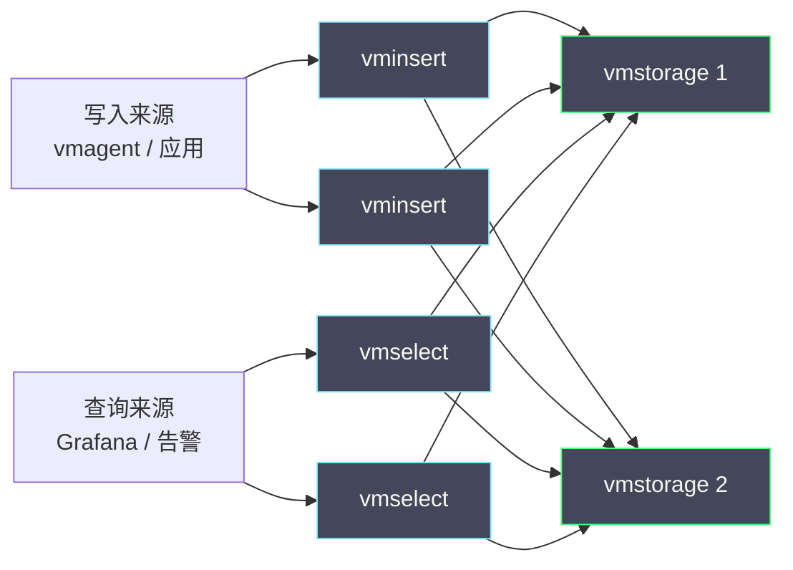

# 05 VictoriaMetrics 集群版与长期存储

**摘要：**

上一篇把 VictoriaMetrics 的单机存储引擎拆开看了一遍，结论是"单机能承载的比想象中多"。但单机终究有物理上限——内存决定索引与缓存的天花板，磁盘决定保留时长的天花板。当业务规模真的越过这道天花板时，就需要回答两个问题：**怎么水平扩展，以及怎么长期保留**。本文从"单机到底什么时候该让位"这个判断切入，先讲清集群版三个组件（vminsert、vmselect、vmstorage）的职责与数据流，再拆解"按序列分片"这一核心设计带来的收益与代价——为什么它让"查单条序列"极快，却会产生写入热点；随后讨论查询在集群里的合并过程，以及 VictoriaMetrics 为什么选择了"不依赖对象存储"的长期保留路线，并把它与 Thanos、Mimir 这两条主流路线并排对比。最后落到高可用、灾备、扩缩容与迁移的工程实践，以及边界与反例——包括"为了高可用引入副本却忘了它对查询成本的影响"这类常见误判。读完本文，你应当能判断：**你的场景需要的是集群版的横向扩展，还是单机版的降基数与降采样**。

---

## 第 1 章 单机的尽头与分布式的起点

### 1.1 单机到底能扛多少

第 04 篇已经说明，单机版的容量边界由三个物理量决定：**内存、磁盘、CPU**。内存决定"索引与缓存能装下多少序列"，磁盘决定"能保留多久"，CPU 决定"写入 + 合并 + 查询三者叠加后的吞吐"。三者中任何一个先到极限，单机就撞墙了。

具体到数字上，一个配置合理的单机实例（几十 GB 内存、数 TB SSD），通常可以承载**数百万活跃序列**、保留**数月到一年**的数据。这个量级覆盖了绝大多数团队——这也是 VictoriaMetrics 官方一直强调"先考虑单机版"的原因。

但"通常够用"不等于"永远够用"。有几类场景会更快地撞到边界：**多租户平台**（多个业务共用一套存储，序列数叠加）、**超高频采集**（大量短间隔指标）、**超长保留要求**（合规要求保留数年）。这些场景里，单机的物理上限会成为硬约束。

### 1.2 撞墙之前的三个问题

在决定上集群之前，有三个问题值得先问清楚，它们能避免大量"不必要的分布式化"。

第一个问题是：**这个瓶颈是"基数"还是"容量"**？如果序列数在持续增长，那么真正的根因可能是高基数标签，扩容只是掩盖问题。第 04 篇已经论证过：序列数增长带来的开销是超线性的，而扩容是线性的——用扩容解决基数问题，成本会越来越贵。

第二个问题是：**这个瓶颈是"写入"还是"查询"**？如果瓶颈只在查询侧（比如某些昂贵查询拖慢了整体），那么加一个独立的查询层（或把查询与存储分离）就能缓解，不必做完整的分片。VictoriaMetrics 的组件化设计本身就允许"按需拆分"——你可以先只拆出 vmselect，观察效果，再决定要不要拆存储。

第三个问题是：**增长是可预测的还是不可预测的**？如果业务增长平缓且可预测，那么"单机 + 定期降基数 + 降采样"的路线可以撑很久；如果增长剧烈且不可预测（比如平台要接入大量新业务），那么提前规划集群形态更有意义。**分布式化的成本是"长期运维复杂度"，只有在增长确实不可控时才值得支付**。

### 1.3 一条判断线索

把三个问题收敛成一条线索：**先降基数，再拆查询，最后才拆存储**。这个顺序的理由是成本——降基数是"改配置"，成本最低、收益最大；拆查询是"改部署"，成本中等；拆存储是"引入分布式"，成本最高、影响面最广。任何一次架构升级，都应当从"成本最低且能解决问题的那一步"开始，而不是一步到位。

这条线索也与第 04 篇的结论一致：**在指标系统里，"降基数"永远是性价比最高的一招**。集群版能突破单机的物理上限，但它突破不了"基数超线性增长"这条规律。理解这一点，就不会把集群当成"万能扩容按钮"。

---

### 1.4 单机容量的估算方法

"单机能扛多少"这个问题，不能靠感觉回答，而要靠估算。估算的关键是把"容量"拆成三个独立的预算，分别核算，取最先耗尽的那个作为边界。

第一笔预算是**内存**。它要容纳"活跃序列的索引条目 + 查询缓存 + 写入缓冲"。索引条目的大小取决于标签集长度与引擎的实现，通常每条序列几十到几百字节。用"活跃序列数 × 单条索引开销"估算索引占用，再给查询与写入留出同等量级的空间，就得到内存需求。这笔预算最容易耗尽，因为序列数增长是持续的。

第二笔预算是**磁盘**。它要容纳"全精度数据 + 索引文件 + 合并所需的临时空间"。用"活跃序列数 × 保留天数 × 每天点数 × 每点字节数"估算数据量，索引文件按数据量的某个比例估算，再留出 20%~30% 的合并余量。这笔预算的估算最依赖"每点字节数"这个系数，而这个系数必须实测。

第三笔预算是**CPU**。它要支撑"写入解析 + 合并 + 查询计算"三件事同时进行。这笔预算最难量化，通常用"观察高负载时的 CPU 使用率"来判断：如果长期高于 50%，说明余量不足；如果合并期间飙到 90% 以上并影响查询，说明需要错峰或加资源。

三笔预算里，**内存通常最先耗尽**，因为序列数的增长最不可控。这也是为什么"降基数"是最高优先级——它直接缓解最紧的那笔预算。

---

## 第 2 章 集群版架构

### 2.1 三个组件

VictoriaMetrics 集群版把职责拆成三类组件，它们通过内部协议协作：

- **vminsert**：无状态，接收外部写入（Remote Write / Prometheus 写入接口），按序列做一致性哈希，把样本分发给对应的 vmstorage。
- **vmstorage**：有状态，实际存储数据与索引。它对外提供"按序列或按时间范围读写"的接口。
- **vmselect**：无状态，接收查询，向所有 vmstorage 发起子查询，把结果合并后返回给客户端。

这个拆分的核心思想是**"把无状态的部分与有状态的部分分开"**：vminsert 与 vmselect 无状态，可以随意增减；vmstorage 有状态，扩展需要数据再平衡。这个划分让"扩展查询能力"变得廉价（加 vmselect 即可），而"扩展存储能力"则需要更谨慎的规划（加 vmstorage 会触发数据迁移）。

### 2.2 数据流：一次写入的旅程

一次写入在集群版里的旅程，可以拆成五步。**接收**：vminsert 收到一批样本。**解析与分组**：把样本按序列分组，计算每条序列的分片位置。**分发**：把同一分片的样本打包，发给对应的 vmstorage。**落盘**：vmstorage 把样本写入本地存储（走第 04 篇讲的单机引擎）。**确认**：vmstorage 返回成功后，vminsert 才向写入方确认。

这五步里，**分发**是集群版特有的开销，也是最容易出问题的一环。如果某个 vmstorage 变慢，vminsert 的写入会被它拖住（背压），进而影响整个写入链路。因此集群版必须考虑**"慢节点隔离"**——不能让一个慢节点拖垮全局。

### 2.3 数据流：一次查询的旅程

一次查询在集群版里的旅程更长。**接收**：vmselect 收到查询。**解析与规划**：把查询拆成"对每个 vmstorage 的子查询"。**并行下发**：向所有 vmstorage 并发发起子查询。**局部计算**：每个 vmstorage 在自己持有的数据上做尽可能多的计算（下推）。**合并**：vmselect 把各节点的结果合并，完成最终聚合。

这个流程里最关键的设计是**"计算下推"**——把能在存储节点本地完成的过滤、聚合，尽量下推到 vmstorage 执行，而不是把原始数据全部拉到 vmselect 再算。计算下推能显著降低网络传输量与 vmselect 的内存压力。代价是 vmselect 必须能表达"哪些计算可以下推、哪些必须在合并时做"——这对查询引擎的设计提出了更高要求。

---

### 2.4 vminsert 的背压与限流

vminsert 是无状态组件，但"无状态"不等于"无瓶颈"。它的瓶颈来自两个方向：**上游写入的速率**与**下游 vmstorage 的响应速度**。当某个 vmstorage 变慢时，发往它的样本会积压，进而让 vminsert 的请求处理变慢——这就是背压。

背压如果处理不当，会沿着链路向上传播：vminsert 变慢 → vmagent 的发送队列积压 → vmagent 的磁盘缓冲增长 → 最终在缓冲写满后开始丢数据。因此，**背压的应对必须分层**：vminsert 层要有请求超时与限流（宁可快速失败，不要无限等待）；vmstorage 层要有慢节点隔离（不让一个慢节点拖垮全局）；采集端要有足够的磁盘缓冲来吸收短暂的拥塞。

这里有一条重要原则：**在写入链路上，"快速失败"通常优于"无限等待"**。因为无限等待会让积压向上传播，最终导致更大范围的不可用；而快速失败让上游能感知到"下游有压力"，从而触发自己的缓冲或降级机制。这与"熔断"的思想一致——**在分布式系统里，让故障局部化，比让故障扩散更可取**。

### 2.5 vmselect 的查询队列与超时

vmselect 的瓶颈来自"查询的并发度与复杂度"。它需要向所有 vmstorage 发起子查询，因此一个查询的延迟取决于"最慢的那个 vmstorage"。当某些查询特别昂贵（大时间范围、高基数聚合）时，它们会长时间占用 vmselect 的资源，挤占其他查询。

因此，vmselect 必须配置**查询超时与并发上限**。超时让"跑不完的查询"被终止，而不是无限占用资源；并发上限让"突发的查询洪峰"被排队，而不是瞬间打满。这两个参数的选择，直接决定了"查询层的可用性"——设置过松会让昂贵查询拖垮整体，设置过紧会让正常查询被误杀。

一个实用的判断方法是**观察"被超时终止的查询比例"**：如果这个比例长期为零，说明超时设置过松（可能已经存在被拖慢的查询）；如果这个比例很高，说明要么有大量需要优化的查询，要么超时设置过紧。**这个比例是查询层健康度的核心指标之一**，应当纳入监控。

---

### 2.6 部署形态与规模档位

集群版的部署形态，可以按规模分成几档，每一档的复杂度与收益不同。

**小规模档**：只把 vminsert 与 vmselect 拆出来（各自两实例做冗余），存储仍用少量 vmstorage。这一档解决的是"查询拖慢写入"与"单点故障"，不解决容量。它适合"数据量尚可、但可用性有要求"的场景。

**中规模档**：vmstorage 也做多实例 + 副本，按序列分片。这一档开始涉及数据再平衡，需要规划分片数与故障域。它适合"单机容量接近上限、需要横向扩展"的场景。

**大规模档**：在上一档基础上引入多租户隔离、跨可用区部署、以及可选的"老数据归档到对象存储"。这一档的复杂度主要来自"多租户的配额与隔离"与"跨区域的延迟"。

这三档之间没有"必须逐级升级"的规则——**你可以直接跳到最适合当前需求的那一档，也可以长期停留在小规模档**。关键不是"用最全的组件"，而是"用刚好解决当前瓶颈的组件"。这与前面反复强调的"先降基数、再拆查询、最后拆存储"是同一个思路：**每一步都只解决当前的瓶颈，不为想象中的未来过度设计**。

---

### 2.7 单机版与集群版的接口兼容性

一个常被问到的问题是：从单机版迁到集群版，应用侧要不要改？答案基本是"不要"——集群版对外暴露的写入与查询接口与单机版一致，应用（vmagent、Grafana、告警引擎）只需把地址从"单机端点"改成"集群的 vminsert / vmselect 端点"即可。

这个兼容性不是偶然，而是设计目标的一部分。VictoriaMetrics 希望"单机版与集群版是同一套语义的两种部署形态"，而不是两个产品。这样做的好处是**架构演进不需要改应用**——团队可以先在单机版上验证，等容量不够时再平滑迁移到集群版，中间不需要重写任何查询或采集配置。

但"接口兼容"不等于"行为完全一致"。集群版因为分片与副本的存在，会有一些单机版没有的行为差异：**部分结果**（某节点不可用时返回不完整结果）、**副本去重**（查询结果可能因副本而需要去重）、**查询延迟的方差更大**（取决于最慢的节点）。这些差异不会破坏兼容性，但会影响"结果的可预期性"。因此，**从单机迁到集群时，应当重新评估告警规则的可靠性**——因为它们对"结果是否完整"比仪表盘更敏感。

---

### 2.8 集群版的四个常见误解

在讨论集群之前，先把几个流传很广的误解澄清掉，它们会导致错误的架构决策：

- **"集群版一定比单机版快"**：不对。集群版引入了分片与合并，查询反而可能更慢。它的优势在"容量与可用性"，不在"单查询延迟"。
- **"上了集群就不怕数据量大"**：不对。集群提高了上限，但基数超线性增长的规律没变，天花板只是被推高。
- **"副本越多越安全"**：不对。副本要跨故障域才有意义，否则只是"同一场故障的多个受害者"。
- **"组件拆得越细越好"**：不对。每个组件都是一份运维负担，拆分的收益必须大于负担。

这四个误解有一个共同点：**它们都把"分布式"当成了目的，而不是手段**。分布式是"突破单机物理上限"的手段，只有在确实需要突破时才值得用。**把手段当目的，是架构决策里最典型的错误**。

---

## 第 3 章 分片与副本

### 3.1 按序列分片

集群版最重要的设计决策是**按序列分片**：同一条序列的所有数据（不论时间）都落在同一个 vmstorage 上。这个选择的收益很直接——**查询单条序列时只需访问一个节点**，不必做跨节点的时间拼接。

它的代价也同样直接。其一，**查询某个标签组合需要访问所有节点**。因为"哪些序列匹配这个标签"的答案分散在各节点，vmselect 必须问遍所有人。这在"按标签聚合"的查询里是常态，因此集群版的查询天然比单机版更贵——这是分片换来的必然代价。其二，**写入热点**。如果某条序列的写入频率远高于其他，那么它所在的那个节点会成为热点，而其他节点闲着。按序列分片无法通过"再加节点"来分摊这个热点，因为序列与节点的绑定是确定的。

### 3.2 副本

副本（replication）解决的是"节点故障时不丢数据"。集群版允许把每条序列的副本数设为 N，即"同一分片的数据写到 N 个 vmstorage 上"。副本带来两个好处：**故障容忍**（一个节点挂了，数据还在其他节点）与**读取分摊**（查询可以分散到副本上）。

但副本的代价常被低估。其一，**写入放大**：副本数为 N，写入量就是 N 倍，磁盘占用也是 N 倍。其二，**查询去重**：查询时必须对来自多个副本的相同数据做去重，否则聚合结果会翻倍——这是一个容易出错、且出错时不易察觉的细节（错误率看起来"变高了"，其实是重复计算）。其三，**一致性**：副本之间的数据可能有短暂差异，查询结果的稳定性会受影响。

因此，副本数的选择是"可用性"与"成本 + 复杂度"之间的权衡。**单副本省成本但怕故障，多副本抗故障但查询更贵更复杂**。常见的折中是"关键指标多副本、一般指标单副本"，但这需要按序列区分策略，实现上更复杂。

### 3.3 分片键的稳定性

分片依赖一个**分片函数**：把序列映射到节点。这个函数的稳定性至关重要——如果它随节点数变化而剧烈改变，那么每次扩缩容都会引发巨量数据迁移。

解决办法是**一致性哈希**：把节点与序列都映射到一个哈希环上，序列归它顺时针方向最近的节点。节点数变化时，只有落在"新节点与它前驱之间"的序列需要迁移，其余不受影响。为了缓解"负载不均"，通常还会引入**虚拟节点**：每个物理节点在环上占多个位置，让序列分布更均匀。

这里有一条容易被忽视的经验：**分片键的选择应当尽量均匀，且与查询模式匹配**。如果分片键是"序列的哈希"，那么分布是均匀的，但"查某个标签组合"就必须问遍所有节点。如果分片键是"服务名"，那么"查某个服务"只需访问一个节点，但服务之间的负载可能极不均匀。**没有一种分片键能同时优化所有查询**——这又是一个"因地制宜"的决策。

---

### 3.4 分片的实际配置与常见坑

在真实部署里，分片的配置有几个反复出现的坑，值得提前说明。

第一个坑是**分片数的"可变更性"**。VictoriaMetrics 的集群版用一个参数指定"序列被分成多少份"，这个数一旦设定，就与"当前的 vmstorage 节点数"绑定。如果要增加节点，通常的做法是"先扩大分片数，再让新节点接管一部分分片"。如果一开始就把分片数设成"刚好等于节点数"，那么后续扩容就必须改分片数，从而触发全量数据迁移。**因此，分片数应当一次性设得比当前节点数更大**（比如节点数的数倍），为未来扩容留出空间——这是集群规划里最容易被忽略、代价又最高的一条经验。

第二个坑是**查询时的"部分结果"**。当某个 vmstorage 不可用时，查询可能返回"部分结果"而非报错。这在"看趋势"的场景里可以接受，但在"做告警判断"的场景里是危险的——你可能会因为"少了一个节点的数据"而误判。因此，查询侧应当能感知"这次查询覆盖了多少节点"，并在覆盖不全时给出明确标识。

第三个坑是**副本与分片的组合语义**。副本数与分片数共同决定了"数据被写到几个节点"。这两个数如果设置不当，可能出现"副本都在同一分片内"的情况，从而丧失故障隔离的意义。**配置副本时，必须确认副本跨越的是不同的节点、不同的故障域**。

### 3.5 副本与一致性的现实

副本带来的"一致性"问题，在指标场景里有一个特殊性：**指标数据是"只追加、不更新"的**。这意味着副本之间不存在"同一行被改写成不同值"的冲突——它们只可能"某个副本多了一段数据、另一个少了一段"。这大大简化了一致性问题：**不需要复杂的冲突解决，只需要"去重"与"补齐"**。

"去重"发生在查询侧：同一条序列的同一个时间点，可能来自多个副本，必须只算一次。"补齐"发生在恢复时：某个副本落后了，重新同步即可。这种"只追加"的语义，是指标数据比事务数据更容易做多副本的根本原因——**数据的写入模式，决定了它的一致性成本**。

理解这一点，就能理解为什么"指标的多副本"比"数据库的多副本"简单得多，也能理解为什么"副本数"在指标场景里可以更激进一些——只要查询侧的去重做对了，多副本的代价主要就是存储与带宽，而不是复杂的一致性协议。

---

### 3.6 分片数的规划算例

分片数怎么定，是集群规划里最实际的问题。用一个算例说明。

假设当前有 300 万活跃序列，规划未来两年增长到 900 万。当前有 3 个 vmstorage 节点，未来可能扩到 6 个。那么分片数应当如何选择？

一个稳妥的做法是**把分片数设为"未来节点数的若干倍"**，比如 12 或 16。这样做的理由是：分片数决定了"数据被切成的份数"，而每个 vmstorage 可以承载多个分片。当节点从 3 增到 6 时，只需把一部分分片从旧节点迁到新节点，**不需要改变分片数本身**，从而避免了全量重哈希。

| 策略 | 分片数 | 扩容时 | 代价 |
|---|---|---|---|
| 分片数 = 节点数 | 3 | 必须改分片数 | 全量数据迁移 |
| 分片数 = 节点数 × 4 | 12 | 迁移部分分片 | 局部迁移 |
| 分片数远大于节点数 | 64 | 迁移少量分片 | 局部迁移，但分片元数据更多 |

这张表说明了一个权衡：**分片数越大，扩容越平滑，但元数据与调度开销越高**。经验上取"节点数的 4 到 16 倍"是一个合理的区间。关键原则是**"宁可一开始多切几片，也不要未来重切"**——因为重切的代价是全量迁移，而多切几片的代价只是一点元数据开销。

### 3.7 分片键与查询模式的匹配

前面说过，分片键的选择应当与查询模式匹配。这里给出一个更具体的判断框架。

如果查询主要是"按服务聚合"（`sum by (service)`），那么无论怎么分片，都必须问遍所有节点——因为每个服务的数据都可能分散在各节点。这种情况下，分片键选择的影响不大，重点是**优化合并效率**。

如果查询主要是"查某个特定对象的历史"（如某个实例、某条链路），那么"按该对象分片"能让查询只访问一个节点。但代价是"该对象的负载可能不均"，且"跨对象的聚合"仍然要问遍所有节点。

因此，一个务实的结论是：**在指标场景里，"问遍所有节点"是常态，分片键的选择主要影响"写入是否均匀"，而不是"查询是否高效"**。理解了这一点，就能把优化重心放在"合并效率"与"计算下推"上，而不是纠结分片键。

---

## 第 4 章 长期存储：三条路线

### 4.1 为什么长期保留是个难题

"保留一年"听起来只是一个参数，但它牵动整个架构。长期保留的难点不在"存得下"（磁盘便宜），而在**"查询时如何高效地找到老数据"**。如果一年的数据分散在数千个文件里，每次查历史都要打开大量文件，查询就会变慢。因此，长期保留方案的核心，是"如何组织老数据，让查询仍然可接受"。

### 4.2 路线一：本地存储 + 降采样

最简单的一条路线是"**继续用本地存储，靠降采样延长保留**"。把超过一定时长的数据从原始精度降采样到粗粒度（如 15 秒 → 5 分钟），磁盘占用可以降低数倍，保留时长相应延长。VictoriaMetrics 的单机版与集群版都支持这种路线。

它的优点是**简单、无额外组件、查询延迟可控**（因为数据仍在本地快盘上）。缺点有三：一是**降采样改变精度**，历史数据的瞬时细节丢失；二是**受本地磁盘上限约束**，保留时长仍然有限；三是**灾备需要额外设计**（本地磁盘不是天然的异地存储）。

### 4.3 路线二：对象存储 + 索引层（Thanos / Mimir）

第二条路线是"**把数据放到对象存储，用索引层来查询**"，代表是 Thanos 与 Grafana Mimir。它的思路是：数据块上传到对象存储（S3 等），查询时由一个索引层（Thanos 的 Store Gateway、Mimir 的 store-gateway）来定位"该读哪些块"，再拉取计算。

这条路的优点很突出：**存储成本低**（对象存储远比块存储便宜）、**容量近乎无限**、**天然多副本**（对象存储自带冗余）。代价是**架构复杂**（组件多、需要管理索引与元数据）、**查询延迟更高**（要经过"定位 → 下载 → 解压"多步）、以及**对对象存储的强依赖**（对象存储抖动会直接反映为查询变慢）。

### 4.4 路线三：VictoriaMetrics 的选择

VictoriaMetrics 的路线介于两者之间：**默认不依赖对象存储，靠自身的高压缩率与扁平合并来延长本地保留**；同时提供把老数据归档到对象存储的能力，但这是可选增强，而不是架构必需。

这个选择的理由是**成本与复杂度的重新分配**。对象存储路线的核心假设是"块存储贵、对象存储便宜"，因此"把数据搬过去"能省钱。但 VictoriaMetrics 通过更高的压缩率，把"本地存储的单位成本"压得足够低，以至于"搬去对象存储省下的钱"可能不足以抵消"多出来的组件复杂度与查询延迟"。**当压缩率足够高时，"不搬"本身就是一种优化**。

三条路线的对比可以整理成一张表：

| 维度 | 本地 + 降采样 | 对象存储 + 索引层 | VM 默认路线 |
|---|---|---|---|
| 组件数量 | 少 | 多 | 少（集群版则中等） |
| 单位存储成本 | 中 | 低 | 低（靠高压缩） |
| 查询延迟 | 低 | 中到高 | 低到中 |
| 容量上限 | 受本地磁盘约束 | 近乎无限 | 高但有限 |
| 运维复杂度 | 低 | 高 | 中 |
| 精度损失 | 有（降采样） | 无 | 可选 |

这张表里没有"最优解"。选择哪条，取决于你最在意的是"简单"（选路线一）、"无限容量"（选路线二）还是"成本与延迟的平衡"（选路线三）。

---

### 4.5 成本对比的正确算法

比较长期存储路线时，最常见的错误是"只比存储费"。真实的成本要算四笔账。

第一笔是**存储费**：块存储与对象存储的单价差异，这是最直观的一笔，也是对象存储路线的主要卖点。第二笔是**查询费**：对象存储路线每次查询都要从对象存储拉数据，这会带来"请求费用"与"流量费用"，在查询频繁时可能超过存储费。第三笔是**计算费**：索引层、网关层需要额外的计算资源，这些资源不是免费的。第四笔是**人力费**：多出来的组件需要部署、监控、排障，这部分成本往往被低估，但在长期运行中占比不小。

把四笔账放在一起，结论常常与直觉相反：**在查询频繁的场景里，"便宜的存储"未必带来"便宜的总成本"**。这正是 VictoriaMetrics 选择"高压缩 + 本地保留"路线的经济学基础——它用更高的压缩率降低了第一笔账，用"不搬数据"降低了第二、三、四笔账。

这条分析也给出了一条通用方法：**任何"降本方案"都应当核算"总拥有成本"，而不是单一维度的费用**。把数据搬去更便宜的地方，往往只是把成本从"存储"转移到了"查询与人力"。**成本不会消失，只会转移**——这是架构决策里最需要记住的一条。

---

### 4.6 归档到对象存储的适用条件

VictoriaMetrics 虽然默认走"本地保留"路线，但也提供了把老数据归档到对象存储的能力。这项能力什么时候值得用？有三个条件值得对照。

第一，**保留时长确实超过了本地磁盘的合理上限**。如果本地磁盘能留一年，而合规要求留三年，那么"把两年以上的数据归档"就是必要的。反之，如果本地够用，归档只是徒增复杂度。

第二，**历史数据的查询频率足够低**。归档数据的查询要走"从对象存储拉取"的路径，延迟更高。如果历史数据经常被查询（比如每月做一次跨年对比分析），那么归档带来的延迟会反复被感受到。只有当历史数据"基本不查、只在极少数场景下查"时，归档才划算。

第三，**团队有能力运维归档链路**。归档涉及"上传、索引、过期、恢复"一整条链路，任何一环出问题都可能导致"数据在但取不出来"。如果团队没有专门的精力维护它，那么"数据取不出来"的风险可能超过"磁盘不够"的风险。

这三个条件同时成立时，归档才值得做。**能力的存在不等于能力的必要**——这是选型时最需要克制的一点。

---

### 4.7 三条路线的选择决策

把三条路线的适用条件整理成一份决策清单：

- 如果**本地磁盘够用、查询频繁、团队人手有限**：选"本地 + 降采样"。
- 如果**保留时长要求远超本地上限、历史查询极少、团队有运维能力**：选"对象存储 + 索引层"。
- 如果**追求成本与延迟的平衡、希望少组件、接受本地容量上限**：选"VM 默认路线"。

这里有一条贯穿的判断：**先问"本地够不够"，再问"要不要搬"**。因为"搬数据"会引入"取数据"的成本，而这份成本只在"本地确实不够"时才值得支付。很多团队在没有算清这笔账的情况下就上了对象存储路线，结果是"省了存储费，赔了查询体验与运维精力"。

### 4.8 保留策略与合规的交集

长期存储的话题绕不开合规。金融、医疗、政务等行业往往有"数据必须保留 N 年"的硬性要求，而"保留"的具体含义又因行业而异——有的要求"可查询"，有的只要求"可归档",有的还要求"不可删除"（防篡改）。

这些要求会直接影响架构。如果要求"不可删除"，那么"按块删除过期数据"的能力反而成了风险——你需要确保删除逻辑符合合规要求。如果要求"可查询"，那么归档路线必须保证"取出来能查"，而不只是"存着"。如果只要求"可归档"，那么冷备可能就够了。

因此，长期存储方案的设计，**第一步应当是与合规团队确认"保留"的确切含义**，而不是先选技术路线。**技术方案服务于业务约束，而不是反过来**——这也是本专栏反复出现的一条立场。

---

## 第 5 章 高可用与灾备

### 5.1 高可用的三个层次

"高可用"这个词在不同语境下指不同的事，在指标平台里至少要区分三个层次。

**采集高可用**：确保数据能被采集到，即使某个采集端故障。解决办法是采集端冗余（多个 vmagent 抓同一批目标）或分片（不同 vmagent 抓不同目标，故障时重新分配）。

**写入高可用**：确保采集到的数据能进入存储，即使某个 vminsert 或 vmstorage 故障。解决办法是 vminsert 多实例 + 负载均衡、vmstorage 多副本。

**查询高可用**：确保查询能返回结果，即使某个 vmselect 或 vmstorage 故障。解决办法是 vmselect 多实例 + 重试、查询时容忍部分节点不可用。

三个层次的成本递增。**采集高可用最容易实现**（加个 vmagent 即可），**写入高可用涉及数据副本**（成本最高），**查询高可用介于两者之间**。务实的做法是"先保证采集与查询的高可用，再按数据重要性决定是否上写入副本"。

### 5.2 灾备：异地与冷备

灾备与高可用是两件事。高可用解决"单点故障"，灾备解决"整个机房或区域失效"。指标平台的灾备通常有两种形态。

**双写灾备**：采集端同时把数据写入生产与灾备两套存储。它的优点是切换快（灾备数据基本是最新的）；缺点是成本翻倍，且"双写"本身可能引入一致性问题（一边写成功一边失败）。vmagent 的多路复用能力让双写变得容易，但成本问题依然存在。

**冷备灾备**：定期把数据快照或归档复制到异地。它的优点是成本低；缺点是**RPO 不为零**（快照之间的数据会丢），且恢复时间长。对指标这类"丢了也能重建一部分"的数据，冷备往往是可接受的折中。

这里有一条判断原则：**灾备的强度应当与"数据丢失的代价"匹配**。指标数据的价值主要在"近期排障"与"长期趋势"，前者靠高可用保证，后者靠定期归档保证。把指标做成"金融级灾备"通常是过度设计——**不是所有数据都值得同等的可靠性投入**。

### 5.3 一个常被忽略的可用性细节

最后提醒一个细节：**"副本数 = 2"不等于"高可用"**。如果两个副本跑在同一台物理机、同一个机架、或同一个可用区，那么这台机器/机架/可用区一挂，两个副本同时失效。副本的价值取决于**故障域的隔离程度**——真正的冗余，要求副本分布在独立的故障域上。

这个细节之所以重要，是因为它常常在"配置看起来没问题"的情况下埋下隐患。**冗余的有效性，不由副本数量决定，而由故障域的隔离度决定**。在规划时，应当明确问一句："这两个副本，会因为什么共同的原因同时挂掉？"

---

### 5.4 可用性的量化：RTO 与 RPO

"高可用"与"灾备"如果不定量，就会变成空谈。两个标准指标能把它拉回现实：**RTO（Recovery Time Objective，恢复时间目标）**与 **RPO（Recovery Point Objective，恢复点目标）**。

RTO 回答"故障发生后多久能恢复"。对指标平台来说，RTO 的核心是"查询什么时候能重新可用"与"写入什么时候能恢复"。RTO 越短，需要的冗余越多。RPO 回答"能容忍丢失多长时间的数据"。双写灾备的 RPO 接近零，冷备的 RPO 等于快照间隔。

把这两个指标与"数据价值"对齐，是灾备设计的关键。指标数据的价值分布很不均匀：**最近几小时的数据价值最高**（用于排障），**很久以前的数据价值较低**（用于趋势与归档）。因此一个合理的灾备设计是"近期数据用高可用保护（低 RTO/RPO），远期数据用归档保护（高 RTO/RPO）"——**用差异化的保护强度匹配差异化的数据价值**。

这与"所有数据同等保护"的直觉相反，却是更经济的做法。**灾备不是"越强越好"，而是"与数据价值匹配"**。

---

### 5.5 多可用区部署的取舍

跨可用区（AZ）部署是"提升可用性"的常见手段，但它对指标平台有特殊的代价。

第一是**延迟**。跨 AZ 的网络往返延迟通常比同 AZ 高一个量级。这对"写入路径"影响较大——vminsert 到 vmstorage 的每一次写入都要跨 AZ，累积起来会显著增加写入延迟。对"查询路径"的影响更明显——vmselect 要问遍所有节点，跨 AZ 的查询会把延迟放大数倍。

第二是**流量成本**。跨 AZ 的流量通常要计费，而指标平台的写入量往往不小。跨 AZ 部署会让这部分成本显著上升。

第三是**复杂度**。跨 AZ 意味着"故障域"的划分更细，副本放置、扩缩容、数据迁移都要考虑 AZ 的约束。

因此，多 AZ 部署的决策应当基于"AZ 级故障的频率与代价"来判断。如果 AZ 级故障很少见，且指标数据的价值不足以支撑"AZ 故障时仍然零中断"，那么"同 AZ 高可用 + 跨 AZ 冷备"可能是更经济的选择。**可用性的每一级提升，都要问一句"它值多少"**。

---

## 第 6 章 扩缩容与迁移

### 6.1 扩容：加节点之后会发生什么

集群版扩容（增加 vmstorage）不是"插上就能用"。因为分片函数变了，一部分序列需要从旧节点迁移到新节点。迁移过程中，写入要保证不丢（新数据要写到新节点），查询要保证正确（旧数据还在旧节点，查询必须同时覆盖两边）。这要求系统支持"迁移期间双读"。

迁移的规模取决于分片函数的稳定性。一致性哈希能把迁移量控制在"约 1/N"（N 为新节点数），但即便如此，在大集群上这也可能是数 TB 的数据移动。因此**扩容应当规划在低峰期，且预留足够的时间窗口**。

### 6.2 缩容与下线

缩容（下线 vmstorage）比扩容更危险，因为它涉及"数据必须先在别处可用，才能删除本地的"。正确的顺序是：先把待下线节点上的数据迁移出去（或确认已有多副本覆盖），再摘除节点，最后清理磁盘。任何一步颠倒，都可能导致数据丢失。

这里有一条通用经验：**下线有状态节点，永远是"先保证数据可恢复，再执行下线"**。这与分布式系统里"节点下线要先驱逐数据"的常规做法一致，但指标平台的特殊性在于"数据量巨大"，因此驱逐过程可能很长，需要专门的操作窗口。

### 6.3 迁移：从 Prometheus 到 VM

除了集群内部的扩缩容，还有一类迁移是从"Prometheus + 远程存储"迁到 VictoriaMetrics。这类迁移通常分三步：**双写并行**（vmagent 同时写入新旧两套）、**验证一致性**（用同一查询对比两边结果）、**切换读取**（Grafana 与告警指向新存储）。

双写并行的价值是**可回滚**——如果新存储有问题，随时切回旧的。它的代价是**成本翻倍**与**一致性的微妙差异**（两边对同一条查询可能有细微不同）。因此验证阶段必须足够长，且要覆盖各类查询（简单的、聚合的、分位数的）。关于迁移的完整方法论，本专栏第 06 篇会专门展开。

---

### 6.4 迁移的验证清单

迁移的成败，取决于验证是否充分。把验证拆成一份清单，可以让"能不能切换"从主观判断变成客观核对。

- **数据完整性**：新旧存储的序列数是否一致？差异是否都能解释（如迁移开始前的数据、已知的丢点）？
- **查询一致性**：对同一批查询，两边结果是否在可接受误差内一致？覆盖简单查询、聚合查询、分位数查询、跨时间对比查询。
- **边界查询**：迁移窗口附近的数据是否正确？时间边界、标签边界、空值处理是否一致？
- **告警规则**：把告警规则在两套存储上并行运行一段时间，对比"触发次数与触发时刻"是否一致。这是最能暴露差异的一环。
- **性能对比**：典型查询的延迟是否可接受？昂贵查询是否会拖垮新存储？
- **回滚预案**：如果切换后发现问题，能否在 N 分钟内切回？回滚期间的数据如何处理？
- **观测覆盖**：新存储的自身指标（写入速率、序列数、查询延迟）是否已纳入监控？

这份清单里，"告警规则并行运行"这一条最容易被跳过，却最能发现问题——因为告警规则对数据的口径、边界、缺失处理最敏感。**让告警规则替你做一次"压力测试"，比任何人工核对都更彻底**。

---

## 第 7 章 边界与反例

### 7.1 反例：为了高可用引入副本，却忘了查询成本

一个典型的误判是"给所有序列加两副本，图个安心"。副本确实提升了可用性，但它同时带来写入放大与查询去重。如果查询去重没做对，聚合结果会翻倍——表现为"错误率莫名其妙地高"或"QPS 看起来翻倍"。这类问题不会报错，只会给出错误数字，因此特别危险。

**副本是"可用性"与"成本 + 复杂度"的权衡，不是免费保险**。引入副本之前，应当先确认查询侧的去重逻辑正确，且评估成本是否可接受。

### 7.2 反例：把对象存储当成"免费的无限容量"

另一类误判出现在长期存储上：认为"对象存储便宜，所以数据全放对象存储就好"。但对象存储路线需要索引层、需要管理元数据、查询要经过多次网络往返。**对象存储省的是"存储费"，付出的是"查询延迟与运维复杂度"**。在指标查询频繁的场景里，这笔交易可能并不划算——尤其是当你每打开一块仪表盘就要拉一次历史数据时。

### 7.3 反例：集群化之后忘了"降基数"

最常见也最根本的反例是：**上了集群之后，就以为基数问题解决了**。集群版提高了上限，但没有取消上限。序列数继续超线性增长，最终仍然会撞到新的天花板——只是这一次，撞墙的代价更大（因为集群的扩容更复杂）。**集群是"容量的扩容"，不是"基数的解药"**。

### 7.4 一个正例：先拆查询，再拆存储

反过来，一个务实的做法是**分步拆解**。第一步，把采集从存储里拆出来（用 vmagent），解决"采集与存储互相拖累"。第二步，把查询从存储里拆出来（独立 vmselect），解决"查询拖慢写入"。第三步，只有当存储本身成为瓶颈时，才做分片。这个顺序让每一步的收益可观测、可回滚，避免"一次性上完整分布式"带来的风险。

### 7.5 一个正例：分阶段的平台演进

反过来，一个务实的演进路径可以这样规划，它把本文的所有判断串成一条线。

**第一阶段：单机 + 采集分离**。先用单机版承载，把采集拆到 vmagent，解决"采集与存储耦合"。这个阶段的目标是"跑起来、用起来"，成本最低。

**第二阶段：治理基数**。建立基数看板，用 relabel 清理高基数标签，把序列数控制在单机能承载的范围内。这个阶段的目标是"推迟架构升级"，收益最大。

**第三阶段：按需拆分**。如果查询开始拖慢写入，拆出独立的 vmselect；如果磁盘不够，先做降采样，再考虑归档。

**第四阶段：横向扩展**。只有当单机的内存与磁盘确实到顶，且降基数与降采样都已用尽时，才上集群版。

这条路径的价值在于**每一步都只解决当前的真实瓶颈**，且每一步都可回滚。它避免了"一开始就上全分布式"的过度设计，也避免了"一路扩容直到撞墙"的被动。**平台演进的最佳节奏，是"跟着瓶颈走"，而不是"跟着技术潮流走"**。

### 7.6 一份集群决策的检查清单

最后把本文收敛成一份清单：

- 当前的单机瓶颈是内存、磁盘还是 CPU？对应的是"基数问题"还是"容量问题"？
- 是否已经做过降基数与降采样？它们能推迟多久的扩容？
- 如果上集群，分片数是否留了余量？副本是否跨故障域？
- 查询层是否配置了超时与并发上限？"被超时终止的查询比例"是多少？
- 长期存储选哪条路线？是否核算了"存储 + 查询 + 计算 + 人力"四笔账？
- 灾备的 RTO/RPO 是否与数据价值匹配？近期与远期数据是否用了差异化保护？
- 是否准备了"分阶段演进"的路线图，而不是一步到位？

这份清单覆盖了集群化的全部关键决策。其中最重要的仍然是第一条与第二条——**在考虑任何架构升级之前，先确认"降基数"这条路已经走到位**。因为无论最终选哪条路线，降基数都是性价比最高的一招。

---

## 小结

VictoriaMetrics 集群版的本质，是把"单机的存储能力"横向摊开：vminsert 负责分发，vmstorage 负责存储，vmselect 负责合并。它的核心设计是"按序列分片"，这让"查单条序列"极快，却让"按标签聚合"必须问遍所有节点，并可能产生写入热点。理解这对取舍，就能理解集群版的性能特征。

长期存储上，VictoriaMetrics 选择了一条"不依赖对象存储"的中间路线——靠高压缩率与扁平合并延长本地保留。这不是说对象存储路线不好，而是说**当压缩率足够高时，"不搬"本身就是一种优化**。三条路线（本地降采样、对象存储 + 索引层、VM 默认路线）各有取舍，选择取决于你最在意简单、无限容量，还是成本与延迟的平衡。

最后回到那条贯穿全篇的判断线索：**先降基数，再拆查询，最后才拆存储**。集群版是突破物理上限的手段，但它突破不了"基数超线性增长"的规律。把降基数做在前面，能让任何一条路线都走得更远、更省。

如果把这一篇放回整个指标专栏的脉络里看，它的位置很清晰：第 02 篇讲"数据怎么进来"，第 03 篇讲"数据怎么查"，第 04 篇讲"数据怎么存"，本篇讲"存不下、扛不住时怎么办"。四篇连起来，构成了从采集到存储再到扩展的完整链路。而下一篇（第 06 篇）会把这条链路接到一个更现实的问题上——**如果你手上已经有一套 Prometheus，怎么平滑地迁到这条链路上**。迁移之所以值得单独成篇，是因为它考验的不是"技术选型"，而是"工程判断"：什么时候迁、怎么迁、迁到什么程度算成功。

---

## 参考资料

1. VictoriaMetrics 官方文档 - Cluster version: https://docs.victoriametrics.com/cluster-victoriametrics/
2. VictoriaMetrics 官方文档 - Replication and data safety: https://docs.victoriametrics.com/cluster-victoriametrics/#replication-and-data-safety
3. Thanos 官方文档: https://thanos.io/tip/thanos/design.md/
4. Grafana Mimir 官方文档: https://grafana.com/docs/mimir/latest/
5. Prometheus 官方文档 - Remote Write: https://prometheus.io/docs/specs/remote_write_spec/
6. Cindy Sridharan (2018). *Distributed Systems Observability*. O'Reilly Media.

---

> [!note] 思考题
> 1. 你的集群如果活跃序列数翻三倍，会先在内存、磁盘还是查询延迟上撞墙？对应的"下一步"是降基数、拆查询，还是拆存储？
> 2. "副本数 = 2"在你的部署里，两个副本是否落在独立的故障域上？它们会因为什么共同原因同时失效？
> 3. 对象存储路线的"省存储费"与"高查询延迟"，在你的场景里哪一头更重要？为什么？
> 4. 如果要做一次"Prometheus → VictoriaMetrics"的迁移，你的验证阶段会覆盖哪几类查询？如何判断"可以切换"？
> 5. 你的分片数是如何定的？如果未来要扩到两倍的存储节点，需要全量迁移吗？
> 6. "副本数 = 2"在你的部署里跨越了几个故障域？这个数字足以支撑你的 RTO/RPO 目标吗？
> 7. 长期存储路线你选了哪条？是否核算过"存储 + 查询 + 计算 + 人力"四笔账的总和？
> 8. 你的平台演进是否有一条"跟着瓶颈走"的路线图？下一个瓶颈会出现在哪里？
> 9. 如果合规要求"数据保留三年且不可删除"，你的存储架构需要做哪些调整？
> 10. 本文说"成本不会消失，只会转移"。你最近一次"降本"动作，把成本转移到了哪里？
