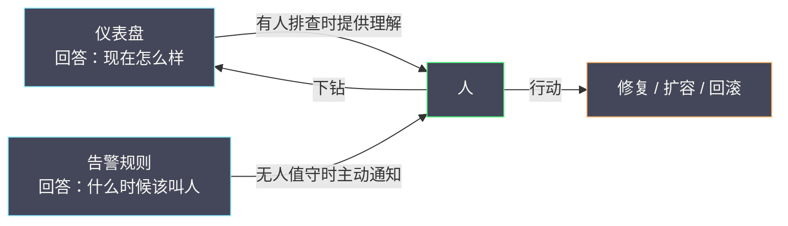

# 07 Grafana 仪表盘与告警工程化

**摘要：**

数据采集进来、查询语言也写顺了，接下来的问题是：**怎么把它变成人一眼能看懂、且能据此行动的视图**。这一步的两个产物是仪表盘（Dashboard）与告警规则（Alerting Rule）。前者回答"现在怎么样"，后者回答"什么时候该叫人"。它们看起来是两件事，实际共享同一个前提——**"可视化"不是把数据画出来，而是把"该看的结论"组织出来**。本文从"为什么大多数仪表盘没人看"这个问题切入，先讲清仪表盘的设计原则（面板的取舍、变量与模板化、布局与导航），再讨论如何从仪表盘里"提炼"出告警规则，以及 Alertmanager 的路由、分组、抑制与静默如何工作。随后落到几个反复出现的反例：把仪表盘当成告警、把告警当成仪表盘、变量滥用导致查询爆炸、以及"仪表盘即文档"的缺失。本文与第 08 篇的分工是：**本篇讲"规则与视图本身怎么设计"，第 08 篇讲"多条告警如何聚合成可信的信号"**。读完本文，你应当能设计出"有人愿意看、且看了能行动"的仪表盘与告警。

---

## 第 1 章 仪表盘的目的是"回答问题"

### 1.1 为什么大多数仪表盘没人看

一个常见的现象是：团队花了两周搭了一块"大而全"的仪表盘，上线第一周很热闹，之后就再也没人打开过。原因往往不是"数据不对"，而是**它没有回答任何具体问题**。

一块仪表盘的价值，取决于它能回答的问题。如果一块盘上堆了五十个面板，涵盖了 CPU、内存、网络、磁盘、GC、连接池、QPS、错误率、延迟……那么当有人问"订单服务现在健康吗"时，他仍然需要在一堆曲线里"找"。**信息过载不等于信息丰富**——它的效果恰恰相反：因为什么都有，所以什么都看不清。

### 1.2 仪表盘应当回答的三类问题

按"回答什么"来分类，仪表盘大致有三类，它们的读者与设计目标完全不同。

**第一类是"概览盘（Overview）"**，回答"现在有没有事"。它的读者是值班人员，目标是一眼看出"整体是否健康"。因此它应当**极简**——通常是几个关键指标的红绿状态，而不是一堆曲线。

**第二类是"排障盘（Troubleshooting）"**，回答"哪里出了问题"。它的读者是正在处理故障的工程师，目标是快速定位到具体的服务或环节。因此它应当**支持下钻**——从服务到实例、从整体到分位、从指标到日志。

**第三类是"复盘盘（Postmortem / Capacity）"**，回答"长期趋势如何"。它的读者是容量规划与复盘的人，目标是看长期变化。因此它应当**覆盖长时段、突出趋势**，而不是精确到秒。

把这三类混在一块盘上，是"没人看"的常见根因。**一块盘只回答一类问题**，是仪表盘设计的第一原则。

### 1.3 一个判断标准

怎么判断一块仪表盘"好不好"？一个实用的标准是：**假设凌晨三点告警响了，值班的人打开这块盘，能不能在三十秒内判断"这是不是一个需要立刻处理的问题"**。

如果答案是"能"，那么这块盘的设计是成功的。如果答案是"我得先找找看"，那么它就需要重构。这个标准把"设计好坏"从主观审美变成了可检验的体验——**它衡量的是"在压力下的可用性"，而不是"在演示时的好看程度"**。

---

### 1.4 仪表盘的"读者模型"

设计仪表盘之前，先要明确"它是给谁看的"。同一个系统，不同角色的关注点差异很大。

**值班工程师**关心"现在有没有事"，他需要的是"关键指标的状态"与"最快的下钻入口"。他不关心历史趋势，只关心"此刻是否需要动手"。

**业务负责人**关心"用户是否受影响"，他需要的是"业务指标"（下单成功率、支付成功率）而非"技术指标"（CPU、GC）。给他看 GC 次数，等于给他看天书。

**容量规划者**关心"长期趋势"，他需要的是"几个月的曲线"与"增长的斜率"，而不是"今天的尖峰"。

**事故复盘者**关心"当时发生了什么"，他需要的是"事件时间线"与"关键指标的对比"。

一个常见的错误是**试图用一块盘满足所有角色**，结果是"谁都不满意"。正确的做法是**为不同角色建不同的盘**，并在导航上把它们区分开。**仪表盘的设计起点是"读者模型"，而不是"数据来源"**。

---

### 1.5 仪表盘设计的"三问"

在动手画第一个面板之前，先回答三个问题。

**第一问：这块盘回答什么问题？** 如果答案不是一个明确的问句（如"订单服务现在健康吗"），那么这块盘就不该建。

**第二问：谁在什么时候看它？** 是值班的人在凌晨三点看，还是容量规划的人在季度末看？读者与时机决定了"信息密度"与"时间范围"。

**第三问：看了之后要做什么？** 如果"看了之后没什么可做的"，那么这块盘就只是"装饰"。一块好的盘，应当指向一个明确的动作——"扩容""回滚""深入排查"。

这三个问题合起来，就是"**目的、读者、行动**"。它们构成了仪表盘设计的骨架。**跳过这三问直接画图，是"没人看的仪表盘"最常见的成因**。

---

### 1.6 仪表盘与告警的共同前提：口径一致

有一个前提贯穿仪表盘与告警：**口径必须一致**。如果仪表盘上的"成功率"按 HTTP 200 算、告警规则里的"成功率"按业务码算，那么"盘上看着正常、告警却响了"这种矛盾就会反复出现。

口径不一致的危害在于"**信任崩塌**"。当团队发现"盘和告警说的不一样"时，他们就不再相信任何一方——要么去手工核对，要么干脆忽略。而一个不被信任的可观测性系统，等于没有。

避免口径不一致的办法是"**把口径固化成派生指标**"：用录制规则产出"经过明确定义的成功率指标"，仪表盘与告警都引用它。这样"口径"只有一处定义，所有人都看同一个数。**把口径收敛到一处，是消除"盘告警打架"的根本手段**。

---

### 1.7 从"看图"到"决策"

仪表盘的终点不是"看到图"，而是"做出决策"。这条链路是：**数据 → 图形 → 结论 → 行动**。仪表盘设计的好坏，取决于它把这条链路缩短了多少。

缩短链路的技巧有几个。**把"结论"直接呈现**（用 Stat 面板显示"健康/不健康"，而不是让人自己判断曲线）；**把"行动"放在手边**（面板旁直接给出"扩容""回滚"的链接或说明）；**把"异常"高亮**（用阈值着色，让越界一眼可见）。

反过来，会让链路变长的设计包括：**需要心算**（把两个数放在不同面板，让人自己算比值）、**需要记忆**（不写单位，让人自己回忆量纲）、**需要跳转多次**（把相关信息分散在多块盘）。**每增加一步"人工加工"，就多一分"出错与变慢"的可能**。

---

## 第 2 章 面板设计

### 2.1 面板类型的选择

Grafana 提供多种面板类型，各有适用场景。选择的原则是"**让数据的形态决定面板的类型**"，而不是"用喜欢的类型"。

| 数据形态 | 推荐面板 | 说明 |
|---|---|---|
| 单个当前值 | Stat / Gauge | 一眼看出"现在是多少" |
| 随时间变化的曲线 | Time series | 看趋势与异常 |
| 分布（分位数） | Time series + 多条线 | 看 P50/P90/P99 的分离 |
| 占比 / 构成 | Pie / Bar gauge | 看"各占多少" |
| 排行榜 | Table / Bar gauge | 看"谁最高" |
| 拓扑关系 | Node graph / Canvas | 看"谁连谁" |

这里最容易被误用的是**Stat 与 Time series**。Stat 适合"此刻的值"（如当前错误率），Time series 适合"趋势"（如错误率随时间的变化）。把"当前值"画成曲线，或者把"趋势"压成一个数字，都会丢失信息。

### 2.2 曲线上的"单位与量纲"

一个常被忽略的细节是**单位**。同一条曲线上如果混了不同量纲（如把"毫秒"和"秒"画在一起），或者 Y 轴没有单位标注，读者就需要"自己换算"。在事故现场，这种换算成本很贵。

Grafana 支持"单位（unit）"配置与"阈值（thresholds）"着色。用好它们，能让面板"自解释"：绿色表示正常、黄色表示接近阈值、红色表示越界。**着色的价值不是美观，而是"把判断从人脑转移到视觉"**——读者不需要记住"多少算高"，颜色已经告诉了他。

### 2.3 面板的取舍：少即是多

一块盘上放几个面板合适？没有固定答案，但有一条原则：**每个面板都应当"值得被看一眼"**。如果某个面板的数据"从来不影响任何决策"，那么它就是在占用注意力。

一个实用的做法是**给面板做减法**：先按"假如只能保留三个面板"的思路排序，把最重要的三个放在左上角（人的视线起点），其余的按重要性递减排列。**布局本身就在传递优先级**。

---

### 2.4 图例、注释与事件标记

面板的"可读性"不只取决于曲线本身，还取决于围绕它的辅助元素。

**图例（legend）**决定"读者能否分辨哪条线是哪条"。默认的图例往往把标签全量展示，导致又长又乱。好的做法是**只展示关键维度**（如 `service`），并支持"点击隐藏某条线"。一个混乱的图例会让读者花时间"辨认"，而不是"判断"。

**注释（annotation）**用于在时间轴上标记"事件"——如一次发布、一次配置变更、一次扩缩容。它的价值在于**把"指标的变化"与"人为的动作"关联起来**。当曲线在某个时刻突变时，如果时间轴上恰好有一个"发布"标记，根因判断会快很多。**注释是"低成本、高价值"的可视化能力**，但常被忽略。

**事件标记**还包括"告警触发"的时间点。把告警的时间点画在指标曲线上，能让读者看到"告警触发时，指标处在什么状态"——这对判断"阈值是否合理"很有帮助。

### 2.5 面板的"性能"

面板的性能常被忽略，但它直接影响"仪表盘是否被使用"。一个加载要十秒的仪表盘，会让人不愿意打开。

影响性能的因素有几个：**查询的复杂度**（高基数聚合、大时间范围）、**面板的数量**（每个面板都是一次查询）、**刷新频率**（高频刷新会持续消耗资源）、以及**变量的取值规模**（"所有实例"这样的变量会让查询爆炸）。

优化的手段与第 03 篇讲的"查询优化"一致：**用录制规则把昂贵查询预先算好**、**限制时间范围**、**减少面板数量**、**降低刷新频率**。**仪表盘的性能问题，本质上是查询的性能问题在界面上的体现**。

---

### 2.6 图表类型与"视觉语法"

图表类型的选择，本质上是在选择一种"视觉语法"——不同的图形擅长表达不同的关系。选错了类型，会让读者"看错"。

**折线**表达"随时间的变化"，它的斜率对应"变化速度"。**柱状**表达"离散类别的比较"，它适合"每月对比"这类场景。**堆叠**表达"构成与总量"，但它容易让人误判"各部分的绝对值"（因为只有最底层是"贴着零轴"的）。**热力图**表达"二维分布"，如"不同服务在不同时间的延迟"。**散点**表达"两个变量的关系"，如"延迟与并发数的相关性"。

这里最常见的误用是**堆叠图**。堆叠图适合"看总量的构成变化"，不适合"比较各部分的绝对值"——因为除了最底层，其他层的"起点"都在变化，视觉上的高度不等于数值。**想比较绝对值，应当用分组柱状或并列折线**。

选择图表类型时，问自己一个问题：**我想让读者看到"趋势""对比"还是"构成"**？答案决定了图表类型。**图表不是装饰，而是"把数据翻译成视觉结论"的工具**。

---

### 2.7 时间范围与"对比视图"

时间范围（time range）的选择，直接影响"能看到什么"。选"最近 15 分钟"，能看到瞬时异常但看不到趋势；选"最近 7 天"，能看到趋势但看不清瞬时尖峰。

一个好的仪表盘应当支持"**多时间尺度**"：默认给一个"中等尺度"（如最近 6 小时），并提供快捷切换（15 分钟、1 小时、1 天、7 天）。这样读者可以按需调整，而不必"重新打开一块盘"。

"**对比视图**"是另一个值得掌握的技巧：把"今天"与"昨天"、或"当前版本"与"上一版本"画在同一条时间轴上（用 `offset`），能直观看出"是否有异常偏离"。**对比比绝对值更有信息量**——一个"500ms 的延迟"是好是坏，取决于"平时是多少"。这也是第 03 篇讲的"同环比查询"在可视化上的应用。

### 2.8 面板的"加载与刷新"

面板的刷新频率是一个需要权衡的参数。刷新太快，会持续消耗查询资源（尤其是在大屏常驻的场景）；刷新太慢，会让人看到"过期的数据"。

一个实用的原则是"**刷新频率应当与数据的更新频率匹配**"。如果指标是 15 秒采集一次，那么刷新频率低于 15 秒没有意义（只会重复读到同一个点）；如果刷新频率远高于采集频率，只会浪费资源。**让"刷新"与"采集"节奏一致，是最省心的选择**。

---

### 2.9 面板的说明文本与"自解释"

一块面板如果只能靠"作者解释"才能理解，那么它对其他人就是"黑盒"。让面板"自解释"，需要善用说明文本（Text 面板与面板描述）。

说明文本应当回答三个问题：**这个面板看什么**（指标含义）、**正常范围是什么**（多少算正常）、**异常时怎么办**（第一步做什么）。这三条与告警注解的要求一致——**因为它们的读者面对的是同一个问题："我看到这个，然后呢"**。

一个实用的做法是**在仪表盘顶部放一段"阅读指南"**：说明这块盘的组织方式、各面板的含义、以及下钻的路径。这段文字的成本很低，却能让"第一次打开的人"少走很多弯路。**仪表盘不是给作者看的，是给所有使用者看的**。

---

## 第 3 章 变量与模板化

### 3.1 变量解决什么问题

变量（Variable）是 Grafana 的"模板化"能力：把仪表盘里"会变的部分"（如服务名、实例、环境）抽成变量，用户通过下拉框选择，从而**用一块盘覆盖多种场景**。

变量的价值在"规模"上体现得最明显。如果为每个服务建一块盘，那么一百个服务就是一百块盘——维护成本极高。用变量之后，一块盘可以切换一百个服务，维护成本大幅下降。

### 3.2 变量的类型

常见的变量类型有几种。**Query 变量**从数据源查询取值（如"所有 service 的列表"）；**Custom 变量**手工定义取值列表；**Interval 变量**定义时间间隔（如 `1m`、`5m`）；**Datasource 变量**切换数据源（如"生产 / 灾备"）。**Constant 变量**用于把"魔法数字"提取出来，便于统一修改。

选对变量类型，能让"切换场景"变得自然。比如用 Datasource 变量，可以在同一块盘上切换"生产"与"灾备"两个数据源，这对故障切换时的对比很有用。

### 3.3 变量滥用的代价

变量虽好，但滥用会带来两个问题。第一是**查询爆炸**：如果一块盘上有多个变量，且每个面板的查询都引用它们，那么"切换一次变量"可能触发几十条查询。在变量取值范围大（如"所有实例"）时，这会显著拖慢加载。

第二是**理解成本**：变量越多，读者越难判断"我现在看的是哪个场景"。一块盘如果同时有"环境、区域、服务、实例、版本"五个变量，那么"当前视图是什么"就成了一个需要拼凑的问题。

应对办法是**限制变量的数量与默认值**：只保留真正需要的变量，并为每个变量设置"最有代表性的默认值"。**默认值决定了大多数人的第一印象**，值得认真选。

---

### 3.4 模板化的进阶：动态行与重复面板

变量之外，Grafana 还提供"**重复（repeat）**"能力：根据变量的取值，动态生成多个面板或行。比如，选择"三个服务"，就自动生成"三行面板"，每行对应一个服务。

重复的价值在"对比"上。当你想同时看"三个服务的错误率"时，重复面板能让它们并排展示，便于横向对比。这比"在一个面板里画三条线"更清晰——因为每个服务有自己的量级，混在一起会互相干扰。

重复的代价是**查询数量随取值增长**。选择十个服务，就意味着十倍的查询。因此重复应当用在"取值数量有限且固定"的场景，而不是"取值可能很多"的场景。**重复的适用边界，是"少量、固定、需要对比"**。

### 3.5 变量的默认值与"第一印象"

变量的默认值决定了"大多数人的第一印象"。如果默认值是"所有服务"（一个空选择），那么打开仪表盘的人看到的是"什么都没有"或"一大堆线"，体验很差。如果默认值是一个"有代表性的服务"，那么打开就能看到有意义的内容。

因此，**默认值应当被认真选择**：它应当是"最常被查看的场景"，或者是"最需要被关注的场景"（如当前有告警的服务）。有些团队会用"最近有异常的服务"作为默认值，让仪表盘"自动指向问题"——这是一个值得借鉴的思路。

---

### 3.6 数据源变量与多环境对比

数据源变量（Datasource variable）是一个容易被低估的能力。它让"同一块盘"可以切换"不同的数据源"——如"生产环境"与"灾备环境"、"旧存储"与"新存储"。

它的价值在"对比"上。在做迁移验证时，可以用同一块盘切换数据源，直观地对比"两边结果是否一致"；在做故障切换演练时，可以快速切到灾备数据源，看"灾备是否已同步"。**把"对比"变成"切换一个变量"，能大幅降低对比的成本**。

数据源变量还有一个隐性价值：**降低迁移的心理门槛**。当团队知道"切换数据源就能对比"，他们就更愿意去做"双跑验证"，而不是凭感觉判断"新存储是否可靠"。这与第 06 篇讲的"验证需要可执行"是同一件事。

---

### 3.7 变量的依赖与级联

当一块盘上有多个变量时，它们之间可能存在"依赖"：先选"环境"，再选"区域"，最后选"服务"。Grafana 支持"变量级联"——上层变量的取值决定下层变量的可选范围。

级联的价值是"**防止无效选择**"。如果没有级联，用户可能选到"某个环境中不存在的服务"，导致面板空白。有了级联，"可选的服务"会自动收敛到"该环境中真实存在的"。

级联的代价是"**加载变慢**"：每次切换上层变量，都要重新查询下层变量的取值。因此，级联的层数应当受控——两到三层通常是合理的上限。**级联是"便利"与"性能"的权衡，不是越多越好**。

---

## 第 4 章 仪表盘的组织与导航

### 4.1 从"一块大盘"到"一组相关的盘"

当服务数量增长后，"一块大盘"会变得难以维护。更可扩展的组织方式是"**一组相关的盘**"，用导航把它们串起来。

常见的组织模式是三层：**顶层概览盘**（全局健康）→ **服务级盘**（单个服务的 RED + 依赖）→ **组件级盘**（数据库、缓存、消息队列的细节）。层与层之间用链接跳转，形成"从整体到局部"的路径。

这个结构的价值在于**匹配排障的思维方式**：排障天然是"从整体到局部"的——先发现"整体有问题"，再定位"哪个服务"，最后下钻到"哪个组件"。仪表盘的组织应当顺着这条路径，而不是逆着它。

### 4.2 链接与"跳转的成本"

仪表盘的导航依赖链接。链接设计的关键是**减少"跳转的成本"**——从一块盘跳到另一块盘时，读者不应该需要"重新选择一遍上下文"。

Grafana 支持用变量传递上下文（如从服务盘跳到组件盘时，自动带上"当前服务"）。用好它，能让跳转"无缝"；用不好，读者每跳一次都要重新选一遍服务名，体验很差。**导航的流畅度，直接决定了仪表盘"是否被真正使用"**。

### 4.3 仪表盘的"生命周期"

仪表盘也有生命周期。团队应当定期审视"哪些盘还在被打开、哪些已经废弃"。Grafana 提供的"使用统计"能帮助识别"僵尸盘"。

清理僵尸盘的价值在于**降低搜索成本**。当工程师在几十块盘里找"那一块"时，废弃的盘会干扰搜索。**维护一个"小而准"的仪表盘集合，比维护一个"大而全"的更有用**。

---

### 4.4 仪表盘的共享与复用

仪表盘是"资产"，因此应当被共享与复用，而不是"每人一份"。共享的方式有几种：**用变量实现复用**（一块盘覆盖多个服务）、**用模板实现复用**（新服务上线时从模板生成）、**用配置即代码实现复用**（仪表盘定义存在 Git 里，通过工具部署）。

"配置即代码"值得单独强调。当仪表盘以 JSON 形式存在 Git 里时，它就获得了代码的全部好处：**版本历史**（谁什么时候改了什么）、**评审**（变更需要 review）、**回滚**（出问题能恢复旧版）、**批量修改**（用脚本统一调整）。

很多团队把仪表盘当"手工配置"，结果是"改的人不知道改了什么、别人不知道盘为什么长这样"。**把仪表盘当代码来管理，是它长期可维护的前提**。

### 4.5 仪表盘的"发现性"

仪表盘再多，如果"找不到"就等于不存在。因此，"发现性"是组织设计的一部分。

提升发现性的手段有几个：**命名规范**（统一的前缀与结构，便于搜索）、**目录结构**（按业务域或团队分组）、**统一入口**（一个"首页盘"，链接到各个领域）、**搜索友好**（把关键信息写进标题与标签）。

一个实用的做法是建一块"**导航首页**"，把最常用的仪表盘按"角色"或"场景"列出来。这样新人和老手都能快速找到"该看哪一块"。**导航首页的成本很低，收益却很高**——它把"找盘"这件事从"搜索与试错"变成"看一眼就知道"。

---

### 4.6 仪表盘的权限与分享

仪表盘涉及"谁能看、谁能改"。权限设计看似是"管理问题"，实际影响"可观测性是否安全"。

**读权限**决定"谁能看到哪些数据"。在有多租户或数据隔离要求的场景里，仪表盘不应当"对所有人可见"——否则可能泄露其他业务的数据。

**写权限**决定"谁能修改"。如果任何人都能改生产仪表盘，那么"某次误操作把关键面板删了"的风险就存在。更稳妥的做法是"**配置即代码 + 评审**"——修改通过代码提交与评审，而不是直接在界面上改。

**分享**决定"仪表盘能否被带出平台"。对外分享（如给客户看的状态页）需要额外的脱敏与权限设计。**把"分享"当成一次"数据外发"来对待**，能避免不少意外。

---

### 4.7 仪表盘的版本与变更记录

当仪表盘以配置即代码的方式管理时，它天然有了版本历史。但"有历史"不等于"有人看历史"。要让版本真正有用，需要**把"变更记录"与"可读的说明"结合**：每次变更都写明"改了什么、为什么改"。

变更记录的价值在"**回溯**"。当有人问"这个面板为什么长这样"时，答案在提交记录里；当"某次变更后盘变慢了"时，能快速定位到那次变更。**把"为什么"写进提交信息，是对未来使用者最大的善意**。

这也与本文反复强调的"可维护性"一脉相承：**可观测性资产的可维护性，取决于"它的变化是否被记录、是否可追溯"**。一块"没人知道为什么长这样"的盘，最终会变成"没人敢动"的遗产。

---

## 第 5 章 从仪表盘到告警规则

### 5.1 告警规则的本质

告警规则的本质是"**对查询结果做条件判断，并在条件持续满足时产生一个事件**"。它由四个要素构成：查询（取什么数）、条件（什么情况算异常）、持续时长（多久算稳定异常）、标签与注解（这个事件的身份与说明）。

这与仪表盘的关系是：**仪表盘上的"一条曲线 + 一个阈值线"，本质上就是一条告警规则的雏形**。当你在仪表盘上反复观察到"这条线越过某个值就意味着出问题"时，就应该把它固化成告警规则。

### 5.2 告警规则与仪表盘的分工

两者最容易被混淆的地方是"谁该承担发现问题的职责"。有一个明确的分工：

- **告警规则负责"在无人值守时发现问题"**。它的读者是"不在看屏幕的人"，因此必须能主动通知。
- **仪表盘负责"在有人排查时提供理解"**。它的读者是"正在看屏幕的人"，因此要能下钻与对比。

**把仪表盘当成告警（靠人盯着）是不可扩展的**——人不能 7×24 盯着屏幕，服务数量增长后更盯不过来。反过来，**把告警当成仪表盘（只看数字不看趋势）也不够**——告警给的是"点"，理解问题需要"面"。两者互补，不能互相替代。

### 5.3 从"观察到"到"固化"

把"观察到的问题"变成"告警规则"，需要一个提炼过程。这个过程包括：确定用哪条查询、选哪个阈值、设多长的持续时长、写清注解。

其中"**写清注解**"最容易被跳过，却最重要。注解要回答四个问题：**是什么**（这条告警意味着什么）、**为什么重要**（影响谁）、**怎么看**（仪表盘链接）、**怎么查**（日志与追踪链接）。缺了后两项，收到告警的人第一步就得"自己去找在哪看"。

---

### 5.4 告警规则的分级

告警应当分级，常见分法是 P0/P1/P2（或 critical/warning/info）。分级的价值在于**匹配响应强度**：P0 立即呼叫，P1 工作时间处理，P2 仅记录。

分级的设计有两个要点。第一，**级别的定义要清晰**——"什么算 P0"必须有明确的判据（如"核心业务不可用"），而不是"感觉严重就是 P0"。第二，**级别的分布要合理**——如果一个系统的告警里 80% 是 P0，那么分级就失效了，因为"什么都是 P0"等于"没有级别"。

一个实用的检查是**统计各级别的占比**：健康的分布通常是"P2 最多、P1 次之、P0 极少"。如果 P0 占比很高，要么是"分级标准过松"，要么是"系统真的不稳"——两者都需要处理。

### 5.5 告警的"静默"与"抑制"在规则层的对应

虽然抑制与静默主要由 Alertmanager 处理，但**规则的标签设计**会影响它们的生效。抑制依赖"标签之间的匹配关系"（如"用 `severity=critical` 的告警抑制 `severity=warning` 的同类告警"），因此**规则的标签必须设计得能支持这种匹配**。

这意味着"标签设计"不只是"给告警起个名字"，而是"为后续的聚合、抑制、路由提供依据"。**标签是告警的"接口"**——设计得好，聚合与路由就自然；设计得差，就要写大量特例规则来弥补。

---

### 5.6 告警规则的模板化

与仪表盘一样，告警规则也应当模板化。为"某类服务"定义一套规则模板（如"所有 Web 服务都应当有：错误率、延迟、饱和度三条告警"），新服务上线时从模板生成。

模板化的收益有三。其一，**一致性**：所有服务用同一套标准，避免"有的服务只监控错误率、有的只监控延迟"。其二，**效率**：新服务上线时不必重新设计规则。其三，**可演进**：当团队决定"增加一条新标准"时，只需改模板，再批量应用到现有服务。

模板化的代价是"**需要先想清楚'标准是什么'**"。这本身是一件好事——它迫使团队把"什么样的监控算合格"明确下来。**把隐性标准显性化，是模板化最被低估的价值**。

### 5.7 告警规则的"依赖顺序"

告警规则之间可能存在依赖：一条规则产出的"派生指标"被另一条规则使用。迁移或修改时，需要按依赖顺序处理，否则会出现"上层规则引用了还没产出的指标"。

这与第 06 篇讲的"录制规则依赖链"是同一类问题。**告警规则与录制规则共同构成一张依赖图**，理解这张图，是"安全地修改告警体系"的前提。

---

### 5.8 告警规则的评审清单

新增或修改一条告警规则时，用这份清单过一遍：

- 这条规则解决什么问题？没有它，什么故障会被漏掉？
- 阈值是怎么定的？是否用历史数据回测过？
- 持续时长是否合理？会不会因为瞬时抖动误报？
- 注解是否包含"是什么、为什么重要、怎么看、怎么查"？
- 是否与现有规则重复？能否合并？
- 级别是否恰当？会不会让 P0 的占比失衡？
- 标签设计是否支持后续的聚合、抑制与路由？

这份清单的价值在于"**把评审从'凭感觉'变成'有依据'**"。其中"是否与现有规则重复"最容易被忽略，却是控制"规则库膨胀"的关键——**减少一条冗余规则，与增加一条有效规则同等重要**。

---

## 第 6 章 Alertmanager 的路由与静默

### 6.1 路由树

告警产生后，由 Alertmanager 决定"发给谁"。它的核心结构是**路由树**：从根节点开始，按标签逐层匹配，最终到达叶子节点——每个叶子节点对应一组接收者与通知方式。

路由树的设计目标是"**让告警流向最有能力处理它的人**"。如果路由不当，会出现"告警发给了不负责的人"，他只能转发，从而延误响应。

### 6.2 分组、抑制与静默

Alertmanager 有三个核心机制，它们分别解决不同的问题。

**分组（grouping）**把"相关的多条告警"合并成"一条通知"，解决"告警太多"的问题。分组的粒度由 `group_by` 决定——粒度太粗会丢信息，太细等于没分组。

**抑制（inhibition）**在"某条高级别告警触发时，屏蔽由它引起的低级别告警"，解决"根因与症状"的问题。它的难点在于"如何定义抑制关系"，这需要团队对系统依赖拓扑有清晰的认识。

**静默（silence）**是"手动、临时"的屏蔽，用于计划内的维护。它必须有**到期时间**——否则会变成"永久静默"，把问题藏起来。

三者的区别可以概括为：分组管"怎么合"，抑制管"要不要发"（自动），静默管"暂时不发"（手动、临时）。混淆它们的用途，会导致"该合的没合""该抑的没抑""该恢复的没恢复"。

### 6.3 通知渠道与级别匹配

通知渠道（邮件、IM、短信、电话）应当与告警级别匹配。P0 用能叫醒人的方式，P1 用即时通讯，P2 用邮件或仅记录。这个匹配关系看似简单，却直接决定了"人是否会被及时叫醒"。

一个常被忽略的设计是**升级（escalation）**：如果 P0 告警在 N 分钟内无人响应，自动通知上级或扩大范围。**升级机制的价值是"防止告警被静默地忽略"**——如果告警发出去没人看，它就等于没发。

---

### 6.4 通知模板与"可操作性"

通知的模板决定了"收到告警的人第一眼看到什么"。一个好的模板应当做到"**标题即结论**"——只读标题就知道"是什么问题、严重程度如何"。

模板的内容应当分层：**必读信息**（问题描述、影响、级别）放在最前；**辅助信息**（当前值、阈值、时间）紧随其后；**操作入口**（仪表盘、日志、运行手册链接）放在最后。这样即使读者只看前几行，也能判断"要不要立刻处理"。

模板里还应当有"**可操作性**"——不只是"告诉你出事了"，还要"告诉你第一步做什么"。比如"数据库连接池耗尽，建议先检查慢查询与连接泄漏，见运行手册 xxx"。**把"排查的第一步"写进告警，能省下事故现场最宝贵的时间**。

### 6.5 值班与升级

值班（on-call）是告警体系的"最后一环"，它确保"任何时候都有明确的人对告警负责"。值班体系要回答几个问题：谁在值班、如何交接、无人响应时如何升级、以及如何补偿。

值班设计里有一条容易被忽视的原则：**值班的负担应当与告警的质量成正比**。如果一个团队的值班"总是很累"，那么首先该做的是**减少无效告警**，而不是"增加值班人手"。因为值班的疲惫，根源往往是告警信噪比低，而不是人手不足。

---

### 6.6 Alertmanager 配置的管理与灰度

Alertmanager 的配置（路由、抑制、静默）是"告警行为"的核心，但它的变更常常是"直接改、直接生效"，没有评审与灰度。这在"改错一条路由导致告警发错人"时，代价很大。

更稳妥的做法是把配置纳入"配置即代码"：**存在 Git 里、经过评审、通过工具部署**。同时，配置的变更应当"可灰度"——比如先在一个团队的路由分支上验证，再全量生效。

配置的"可观测性"也值得建设：记录"每次配置变更的时间与内容"，并在"告警行为异常"时能快速对照"是不是刚改过配置"。**把配置变更与告警行为关联起来，是排查"告警为什么突然变了"的最快路径**。

### 6.7 静默的治理

静默（silence）是"手动、临时"的屏蔽，它最容易被滥用。治理静默的关键是"**强制到期与原因记录**"：每条静默都写明"为什么、到什么时候、谁负责"。

更进一步的做法是"**统计静默的使用情况**"：哪些规则被静默得最多、静默的平均时长是多少、有多少静默"到期后根因仍未解决"。这些数据能揭示"哪些规则长期不准"——它们才是"该被改进的规则"，而不是"该被静默的规则"。**静默数据是"告警质量"的一面镜子**。

---

### 6.8 路由的测试与验证

路由树配好之后，需要验证"它真的把告警发给了对的人"。验证的方法有几种：**用测试告警**（主动触发一条测试告警，看它流向哪里）、**用历史回放**（把历史告警按当前路由重新计算，看流向是否合理）、**定期演练**（模拟一次故障，看通知是否到达）。

验证的价值在"**发现配置与预期的偏差**"。路由树是"声明式的"（我期望告警这样流），而实际行为可能因"匹配顺序""标签缺失"而与预期不同。**声明与实际之间的差距，只能通过验证来发现**。

一个务实的做法是**把"路由验证"纳入变更流程**：每次修改路由，都做一次"测试告警"的验证，确认"关键告警仍然流向对的人"。这就像"改完网络配置后 ping 一下"——成本很低，却能避免大问题。

---

## 第 7 章 边界与反例

### 7.1 反例：把仪表盘当成告警

前面提过，靠人盯仪表盘来发现问题不可扩展。它的典型表现是"团队养成了'没事就刷刷盘'的习惯"，而一旦没人刷，故障就没人发现。**仪表盘是"排查工具"，不是"发现工具"**。

### 7.2 反例：把告警当成仪表盘

反过来，只靠告警也看不清全貌。告警给的是"点"（某个阈值被越过），而理解问题需要"面"（趋势、对比、关联）。因此，**收到告警后打开仪表盘**，应当是一个自然的动作——这要求告警的注解里带上仪表盘链接。

### 7.3 反例：变量滥用导致查询爆炸

一块盘上堆了太多变量，切换一次变量触发几十条查询，加载缓慢。对策是"**限制变量数量、设置合理默认值、必要时拆分仪表盘**"。**模板化的目的是降低维护成本，而不是把复杂度转嫁给查询**。

### 7.4 反例：仪表盘即文档的缺失

一块没有标题、没有说明、没有单位的面板，对"不熟悉它的人"毫无价值。**仪表盘也应当"自解释"**——标题写清"这是什么"，面板标注单位，关键结论用 Text 面板说明。**让仪表盘能"自我说明"，是它被复用的前提**。

### 7.5 反例：仪表盘里的"魔法数字"

有些仪表盘的面板里，写着"阈值 = 500"这样的判断，却没有任何说明"500 是怎么来的"。这类"魔法数字"会让读者困惑：为什么是 500，不是 400 或 600？

对策是**把阈值"显式化"**：要么用 Grafana 的阈值配置（带颜色与说明），要么用 Text 面板写明"这条线代表 SLO 阈值，来自 xxx 的约定"。**阈值的来源应当是可追溯的**——它是业务决策，不是随手填的数字。

### 7.6 反例：告警规则的"复制粘贴"

新服务上线时，最常见的做法是"把上一个服务的告警规则复制过来改改"。这种复制会持续累积债务：阈值沿用了上一个服务的历史选择，注解里残留着上一个服务的链接，标签带上了上一个团队的偏好。

对策是**用模板生成而不是复制**：为"某类服务"定义一套规则模板，新服务从模板生成，只填"服务特有的参数"。**模板化的价值，是把"重复的决策"变成"一次性的设计"**。

### 7.7 检查清单

把本文的要点收敛成一份清单：

- 你的仪表盘分成了"概览、排障、复盘"三类吗？是否混在一块盘上？
- 每个面板是否"值得被看一眼"？有没有"从不影响决策"的面板？
- 关键面板是否有单位、阈值着色与图例说明？
- 变量数量是否受控？默认值是否是"最有代表性的场景"？
- 仪表盘是否纳入版本控制？变更是否经过评审？
- 告警规则是否从"观察到的现象"提炼而来，而非凭空设定？
- 告警注解是否包含"是什么、为什么重要、怎么看、怎么查"？
- 告警是否分级？P0 的占比是否合理？
- 路由树是否确保"告警流向最有能力处理它的人"？是否有升级机制？

这份清单覆盖了"从视图到行动"的全部关键决策。其中"告警注解是否完整"与"P0 占比是否合理"两项最容易被忽略，却直接影响"告警是否可信"。

### 7.8 一个正例：从事故复盘反哺仪表盘

一个高明的做法是**在每次事故复盘后，回头检查仪表盘与告警**：这次故障，是哪块盘、哪条告警最先发现的？如果没有及时发现，是"缺了告警"还是"告警被淹没了"？排查过程中，工程师"想看的"是哪个面板，它存在吗？

把这些问题问一遍，往往能发现几处改进点：补一条缺失的告警、加一个缺失的面板、调整一处不合理的阈值。**事故复盘的价值，一半在"修复系统"，一半在"改进观测"**——后者常被忽略，却能让下一次故障"更早被发现"。

这条做法也把本文与"可观测性建设"的整体节奏连了起来：**可观测性不是一次性搭好的，而是在一次次故障中逐步长出来的**。每一次"发现得太晚"，都是一次"该补什么"的提示。

### 7.9 反例：把刷新频率调得太高

有一个容易被忽视的反例：**为了"实时"，把仪表盘的刷新频率调到 5 秒甚至 1 秒**。后果是查询量成倍增长，在"多人大屏常驻"的场景里会显著拖慢数据源。

刷新频率的正确选择，前面讲过，应当与"数据的更新频率"匹配。指标 15 秒采集一次，那么刷新频率低于 15 秒毫无意义——读到的还是同一个点。**"看起来更实时"的错觉，代价是"查询资源被浪费"**。

更根本的是，**需要"秒级反应"的场景，应当用告警而不是仪表盘**。仪表盘是"人看的"，人的反应速度本就在秒级以上；需要"秒级发现"的场景，应当交给告警规则。**把"实时性"需求交给正确的工具**，是这类反例的教训。

### 7.10 一个正例：仪表盘的"用户访谈"

一个高明的做法是**对仪表盘的使用者做一次"用户访谈"**：问他"你平时打开哪块盘、看哪些面板、看到什么会采取行动"。访谈的产出往往出乎意料——有些你精心设计的面板"从没人看"，而有些你没想到的地方"其实是关键"。

这种做法的价值在于**用真实使用数据校正设计假设**。设计师容易"以自己为中心"，假设"别人也会像我一样看"；而访谈能把"设计者的想象"换成"使用者的现实"。**仪表盘是给人用的产品，产品就该听用户**。

### 7.11 一条收束的原则：都要"可执行"

把全文的取向收敛成一句话：**仪表盘与告警都应当"可执行"**。

"可执行"意味着：看到它，就知道下一步做什么。仪表盘的"可执行"是"看完能判断是否需要行动、以及行动的方向"；告警的"可执行"是"收到后知道第一步查什么、找谁"。两者都不满足于"把数据展示出来"，而是要求"把数据变成行动"。

这条原则提供了一个统一的设计标准。当你纠结"这个面板要不要加""这条规则要不要写"时，问一句"**它是否让某个人更容易做出正确的行动**"。如果答案是"不"，那么无论它看起来多"完整"，都不该加。**可观测性的价值，最终体现在"人因此做出了更好的决策"上**——而不是"数据被画出来了"。

---

## 小结

仪表盘与告警，是"数据变成行动"的两个关键环节。仪表盘回答"现在怎么样"，告警回答"什么时候该叫人"。两者的共同前提是"**为具体问题而设计**"——一块盘只回答一类问题，一条告警只对应一个待办事项。

本文给出的几条原则可以概括为：**概览盘要极简、排障盘要能下钻、复盘盘要看长期**；**告警规则从仪表盘里提炼，而不是靠人盯着仪表盘**；**通知渠道与告警级别匹配，并设置升级机制**。这些原则都不复杂，难的是"持续执行"——因为它们的收益是"减少无效信息"，而这在短期内容易被忽视。

最后回到那条判断标准：**凌晨三点告警响了，值班的人能否在三十秒内判断"这是不是一个需要立刻处理的问题"**。这条标准同时衡量了仪表盘与告警的质量——如果答案是"能"，说明两者都设计对了。

本篇与第 08 篇构成一对：本篇讲"单条规则与单块视图怎么设计"，第 08 篇讲"多条告警如何聚合成可信的信号"。前者解决"局部质量"，后者解决"全局信噪比"。两者合起来，才构成完整的"告警工程"——**先保证每条规则是好的，再保证好规则之间不互相干扰**。

---

## 参考资料

1. Grafana 官方文档 - Dashboards: https://grafana.com/docs/grafana/latest/dashboards/
2. Grafana 官方文档 - Variables: https://grafana.com/docs/grafana/latest/dashboards/variables/
3. Prometheus 官方文档 - Alerting rules: https://prometheus.io/docs/prometheus/latest/configuration/alerting_rules/
4. Prometheus Alertmanager 官方文档: https://prometheus.io/docs/alerting/latest/alertmanager/
5. Google SRE Book (2016). *Site Reliability Engineering*, Chapter 6: Monitoring Distributed Systems. O'Reilly Media.
6. Rob Ewaschuk. *My Philosophy on Alerting*: https://docs.google.com/document/d/199PqyG3UsyXlwieHaqbGiWVa8eMWi8zzAn0YfcApr8Q

---

> [!note] 思考题
> 1. 你团队的仪表盘里，有多少块"超过一个月没人打开"？它们的维护成本是否值得？
> 2. 随机挑一条告警，它的注解里是否写清了"是什么、为什么重要、怎么看、怎么查"？
> 3. 你的 Alertmanager 路由树，是否确保"每条告警都流向最有能力处理它的人"？
> 4. 告警的升级机制是否配置？P0 告警如果无人响应，会发生什么？
> 5. 你的仪表盘与告警，是否引用了"同一处定义的口径"？有没有出现过"盘上正常、告警却响"的矛盾？
> 6. 你最近一次事故复盘后，有没有回头改进过仪表盘或告警？如果没有，下一次该从哪里入手？
> 7. 如果只能保留三块仪表盘，你会保留哪三块？这个选择说明了你真正在意的是什么？
> 8. 你的告警模板里，是否写明了"第一步做什么"？如果没写，收到告警的人平均要花多久才能开始处理？
> 9. 如果让你把一块"没人看"的仪表盘删掉，你会删哪一块？它当初为什么被建出来？
