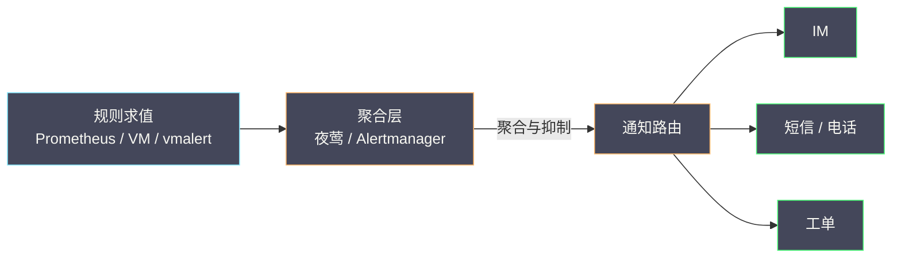

# 08 告警聚合与夜莺工程化

**摘要：**

前几篇把"数据怎么采集、怎么查、怎么存"讲完了，但可观测性的最后一公里是**"出事时谁来告诉你"**。这一步的难点不在"能不能告警"，而在"告警是否可信"——告警太多，人会麻木；告警太少，会漏掉故障；告警不准，会被忽略。本文从"告警疲劳"这个几乎所有运维团队都经历过的困境切入，先讲清告警链路从"规则求值"到"通知送达"的完整流程，再引出为什么需要一个**独立的告警聚合层**。随后以夜莺（Nightingale）为主线，拆解它在告警规则管理、告警聚合降噪、通知路由与值班升级上的设计，并说明它与 Prometheus、Alertmanager 的分工关系——它不替代它们，而是在它们之上补齐"多数据源聚合"与"企业级告警治理"这两块能力。最后落到告警工程的边界与反例：阈值该设在哪、抑制规则为什么会"抑制过头"、以及"告警即文档"这条常被忽视的原则。读完本文，你应当能设计一套"既不漏报、又不扰民"的告警体系，并知道夜莺在其中扮演什么角色。

---

## 第 1 章 告警的困境

### 1.1 告警风暴

一个典型的场景：某次网络抖动导致一批服务同时超时，于是几十条告警在五分钟内同时涌来。值班工程师的手机被连续震动，屏幕上是几十条"某某服务响应超时"的通知——它们指向同一个根因，却各自独立地触发。

这就是**告警风暴（alert storm）**。它的危害不是"告警多"，而是"**信息被淹没**"。当几十条告警同时到达时，工程师的第一反应往往是"关掉通知，先看看再说"——而这恰恰是最危险的时刻，因为真正的关键告警可能就混在里面。

告警风暴的根源，是**每条告警规则都只看到自己那一小块**。规则 A 看到"服务 A 超时"，规则 B 看到"服务 B 超时"，它们都不知道"这两个现象其实是同一个网络故障引起的"。因此，解决告警风暴的关键，是引入一个**能同时看到所有告警的视角**——这正是聚合层的价值。

### 1.2 告警疲劳

比告警风暴更隐蔽的是**告警疲劳（alert fatigue）**。它的成因是"长期收到大量低价值告警"，后果是"人对告警脱敏"——当告警再次响起时，工程师的第一反应是"大概又是那个老问题"，而不是"立刻去看"。

告警疲劳的形成是渐进的。起初，每一条告警都会被认真对待；随着误报与重复告警的积累，处理告警的"预期收益"下降，人就会本能地降低响应强度。等到真正严重的事故发生时，这条告警与那些"狼来了"的告警混在一起，就可能被一起忽略。

对抗告警疲劳的办法只有一个：**提高告警的信噪比**。每一条送达工程师的告警，都应当"值得被看到"。这要求告警体系能**过滤、聚合、抑制**——把"同一个根因的多条告警"合并成一条，把"由上游故障引起的下游告警"抑制掉，把"已知的、正在处理的"静默掉。

### 1.3 为什么需要独立的聚合层

上述两个问题都指向同一个需求：**在"规则求值"与"通知送达"之间，需要一个独立的处理层**。这个层要能做几件事：接收来自多个数据源的告警、按规则聚合与抑制、按路由分发通知、并记录告警的全生命周期。

为什么这个层要"独立"？因为它处理的是**"告警"这种跨数据源的通用对象**，而不是"某个数据源的查询"。如果把它嵌在存储里，就无法聚合来自不同存储（指标、日志）的告警；如果把它嵌在规则里，就无法做"跨规则"的抑制。**独立性带来的是"全局视角"，而全局视角正是降噪的前提**。

---

### 1.4 告警体系的三个层次

一个完整的告警体系，可以分成三个层次，缺任何一层都会出问题。

**第一层是"规则层"**：定义"什么情况下算异常"。它决定了"能不能发现问题"。这一层的常见问题是"规则覆盖不全"（漏报）与"规则过于敏感"（误报）。

**第二层是"聚合层"**：定义"多条异常如何合并成一条告警"。它决定了"问题是否被淹没"。这一层的常见问题是"聚合维度不当"（把不相关的合并，或该合并的没合并）。

**第三层是"通知层"**：定义"告警发给谁、怎么发"。它决定了"问题是否被及时处理"。这一层的常见问题是"路由错误"（发给了不负责的人）与"通知方式与级别不匹配"（P0 用邮件，没人看）。

三层的关系是**递进的**：规则层负责"发现问题"，聚合层负责"不让问题淹没在噪音里"，通知层负责"把问题送到能解决它的人手里"。很多团队的告警体系只做了第一层，然后就抱怨"告警太吵"——**问题不在规则层，而在缺少聚合层与通知层的设计**。

---

### 1.5 告警的三种错误

告警体系的错误可以分成三种，它们的危害与对策各不相同。

第一种是**漏报（false negative）**：该响的没响。它的危害最大——故障发生时无人知晓，只能等用户投诉。漏报的常见原因是"规则没覆盖""阈值太松""持续时长太长"。

第二种是**误报（false positive）**：不该响的响了。它的危害是"累积"的——单次误报无害，长期误报导致疲劳。误报的常见原因是"阈值太紧""用了绝对阈值""没有考虑业务周期"。

第三种是**错报（misreport）**：响了，但内容错了。比如告警说"数据库故障"，实际是"缓存故障"。它的危害是"误导"——工程师按错误的方向排查，浪费时间。错报的常见原因是"规则描述与实际情况不符""标签语义混乱"。

三种错误里，**漏报最危险、误报最常见、错报最费时**。一个成熟的告警体系，应当能分别度量这三种错误的发生率，而不是笼统地谈"告警准不准"。

---

### 1.6 告警链路的完整流程

把"规则求值"到"通知送达"的完整流程画出来，能看清聚合层在其中的位置：

这张图里，"聚合层"是降噪的关键——它同时看到所有告警，因此能做"跨规则的合并与抑制"。**没有这一层，每条规则就只能"各自为战"**。

---

## 第 2 章 夜莺的定位

### 2.1 夜莺是什么

夜莺（Nightingale，常简称 n9e）是一个开源的、面向企业的**告警与可观测性平台**。它的核心定位可以概括为一句话：**在 Prometheus/VictoriaMetrics/Loki 等数据源之上，提供统一的告警规则管理、告警聚合降噪与通知分发**。

它不是一个存储系统，也不是一个查询引擎——它不存指标，也不做查询计算。它做的是"**站在数据源之上，把数据变成可信的告警**"。这个定位决定了它的价值：它不解决"数据从哪来"，而解决"数据如何变成行动"。

### 2.2 与 Prometheus、Alertmanager 的分工

理解夜莺，关键是理解它与 Prometheus 生态的分工。Prometheus 自带一套告警机制：**告警规则（alerting rules）在 Prometheus 内部求值，产生的告警发送给 Alertmanager，由 Alertmanager 做聚合、抑制与路由**。

这套机制在单一 Prometheus 环境下工作良好，但在多数据源、多集群的场景下会暴露局限：Alertmanager 是"每个 Prometheus 配一个"的，跨集群的告警无法统一聚合；告警规则分散在各 Prometheus 的配置文件里，难以集中管理；而且 Alertmanager 的配置是"文件式"的，变更需要重启，不适合频繁调整。

夜莺补上的正是这几块：**集中式的规则管理**（在一个界面上管理所有数据源的告警规则）、**跨数据源的统一聚合**（把来自多个 Prometheus/VM 的告警统一处理）、**动态的配置管理**（改规则不用重启）。它与 Alertmanager 的关系是"能力覆盖 + 体验增强"，而不是"替代"——很多部署里两者并存，夜莺处理统一层，Alertmanager 处理某些特定场景。

### 2.3 核心能力清单

把夜莺的能力整理成一份清单，便于对照自己的需求：

| 能力 | 说明 |
|---|---|
| 数据源管理 | 接入 Prometheus、VictoriaMetrics、Loki、Elasticsearch 等多种数据源 |
| 告警规则管理 | 集中管理规则，支持多数据源、多集群 |
| 告警聚合 | 按规则把多条相关告警合并为一条 |
| 告警抑制 | 上游故障时抑制下游告警 |
| 通知路由 | 按标签路由到不同的通知渠道与人员 |
| 值班管理 | 排班、升级策略 |
| 事件记录 | 告警的全生命周期记录，便于复盘 |
| 静默与订阅 | 临时屏蔽、按需订阅 |

这份清单里，"聚合"与"抑制"是最能体现夜莺价值的两个能力——它们直接对抗告警风暴与告警疲劳，是"告警工程"区别于"告警配置"的关键。

---

### 2.4 部署形态与选型考虑

夜莺这类平台有两种典型的部署形态，选择哪种取决于你的现状。

**形态一：作为统一告警层，替换各处的 Alertmanager**。把所有数据源的告警都汇聚到夜莺，由它统一做聚合、抑制与路由。这种形态的优点是"视角统一、管理集中"；缺点是需要把现有的告警规则迁移过来，有一定工作量。

**形态二：作为规则管理与可视化层，底层仍用 Alertmanager**。夜莺负责"管理规则的界面与版本"，实际求值仍由各 Prometheus/VM 完成，聚合仍由 Alertmanager 完成。这种形态的优点是"改动小、渐进迁移"；缺点是"跨数据源的统一聚合"能力发挥不充分。

选型的关键问题是：**你的痛点在哪一层**？如果痛点是"规则分散、难以管理"，那么形态二就够；如果痛点是"跨数据源的告警无法统一聚合"，那么需要形态一。**先定位痛点，再选形态**——这与本专栏一贯的立场一致。

---

### 2.5 夜莺与 vmalert 的关系

在 VictoriaMetrics 生态里，还有一个专门的告警组件 **vmalert**。它负责"按 Prometheus 兼容的语法求值告警规则与录制规则，并把告警发给下游"。理解它与夜莺的关系，有助于把组件摆对位置。

vmalert 是"**求值引擎**"——它执行规则、产出告警，功能上对应 Prometheus 内置的规则求值部分。夜莺是"**聚合与管理平台**"——它管理规则、聚合告警、路由通知。两者的分工类似"Prometheus 求值 + Alertmanager 聚合"，只是夜莺把"规则管理"与"聚合"做得更集中、更企业化。

因此一个常见的组合是：**vmalert 负责在 VictoriaMetrics 上求值规则，夜莺负责统一管理规则与聚合告警**。这样既利用了 vmalert 与 VM 的深度集成（如 MetricsQL 的支持），又发挥了夜莺在"多数据源统一治理"上的优势。**把"求值"与"治理"分开，是这类平台化设计的常见思路**。

---

## 第 3 章 告警规则工程化

### 3.1 一条规则的四个要素

一条告警规则，无论写在哪个系统里，都包含四个要素：**查询**（用什么样的表达式取数）、**条件**（在什么情况下触发）、**持续时长**（条件满足多久才触发）、**标签与注解**（告警的身份与说明）。

这四个要素里，最容易做错的是**持续时长**。设为 0 意味着"条件一满足就触发"，这会让瞬时抖动直接变成告警；设得太长意味着"故障持续很久才告警"，这会延误响应。常见的做法是"设置一个与业务容忍度匹配的时长"——比如"错误率超过 1% 持续 5 分钟"，其中 5 分钟就是"可容忍的短暂抖动"。

### 3.2 阈值该设在哪

阈值的设定是告警工程里最考验经验的部分。有几种常见的错误。

第一种是**用绝对阈值而非相对阈值**。比如"QPS 低于 1000 就告警"——但在业务低峰期，QPS 本来就可能低于 1000，这条规则会每天准时误报。更好的做法是用"与历史同期对比"或"与上游流量对比"这样的相对口径。

第二种是**用平均值掩盖长尾**。前面讲过，平均延迟 50ms 可能藏着 5% 的请求耗时 3 秒。告警应当基于分位数或比例，而不是平均值。

第三种是**阈值定得过紧**。阈值定得过紧会产生大量"擦边触发"，久而久之形成疲劳。**阈值的正确性，应当用"历史数据回测"来验证**——把规则应用到过去一个月的数据上，看它会触发多少次、是否都是真实问题。这个回测动作，是"设阈值"从玄学变成工程的关键。

### 3.3 分级与抑制

告警应当分级。常见的分法是"P0/P1/P2"或"critical/warning/info"。分级的价值在于**匹配响应强度**：P0 立即呼叫，P1 工作时间处理，P2 仅记录。如果所有告警都是"立即呼叫"，那么工程师很快会疲劳。

分级之后是**抑制（inhibition）**：当一条高级别告警触发时，抑制由它引起的低级别告警。比如"机房网络故障"触发时，抑制所有"该机房内服务超时"的告警。抑制的价值是**把"一个根因引发的 N 条告警"压缩成"一条根因告警 + 被抑制的 N 条"**——工程师只需处理那一条。

抑制的难点在于"**如何定义抑制关系**"。这需要团队对系统拓扑有清晰的认识：谁依赖谁、谁的故障会引起谁的症状。这份"依赖关系"本身就是重要的运维知识，应当被显式记录下来，而不是靠个人记忆。

---

### 3.4 规则的版本管理与评审

告警规则是"代码"，但它常常被当作"配置"来对待——直接在生产界面里改，改完就生效，没有版本、没有评审、没有回滚。这种做法的问题在事故现场会集中暴露：**当告警行为异常时，你无法回答"它什么时候被改的、谁改的、改之前是什么样"**。

因此，成熟的团队会把告警规则纳入与代码相同的管理流程：**版本控制**（规则存在 Git 里）、**评审**（变更需要他人 review）、**灰度**（新规则先只在部分环境生效）、**回滚**（出问题能快速恢复旧版本）。

评审环节有一个额外的价值：**它是"规则质量"的第一道防线**。一个工程师写规则时，容易只考虑自己负责的那部分；而评审者会问"这条规则会不会误报""它的注解是否清楚""它和现有规则是否重复"。**这些问题在评审时问，成本极低；在生产里问，成本极高**。

### 3.5 规则的"生命周期"

告警规则也有生命周期：**引入 → 调优 → 稳定 → 废弃**。很多团队只做了"引入"，从不做"废弃"，结果是规则库不断膨胀，其中夹杂着大量"已经没人关注"的规则。

废弃规则的必要性在于**信噪比**。一条从不触发的规则，表面上"无害"，实际它占用了"规则库的可读性"——当工程师需要判断"某类问题有没有被覆盖"时，他需要在一个混乱的规则库里搜索。**清理规则库，与清理代码库一样重要**。

一条实用的做法是**为每条规则记录"最后触发时间"**，并定期审视"长期未触发"的规则——它们要么是"过于宽松"（该触发而没触发，需要检查），要么是"已经过时"（可以删除）。**把"沉默的规则"找出来，是规则治理最有效的切入点**。

---

### 3.6 阈值回测的具体做法

"用历史数据回测"这句话，落地时有具体步骤。

第一步是**选定回测窗口**。窗口要足够长，以覆盖不同的业务形态——通常至少一个月，最好覆盖一次大促或月底结算这类特殊时段。

第二步是**确定"应触发"与"不应触发"的基准**。这需要历史事故记录：在回测窗口里，哪些时段是"真实故障"（规则应当触发），哪些时段是"正常波动"（规则不应触发）。这份基准是回测的"标准答案"，也是回测里最难获取的部分——因为很多团队没有详细的事故时间线记录。

第三步是**计算两个指标**：**召回率**（真实故障里，规则触发的比例）与**精确率**（规则触发里，真实故障的比例）。理想的规则应当两者都高；现实中往往需要权衡——阈值调低提高召回、降低精确。

第四步是**调整阈值，观察曲线**。把阈值从松到紧扫一遍，画出"召回 - 精确"曲线，选一个符合团队容忍度的点。**这个过程把"设阈值"从"拍脑袋"变成了"有据可依"**。

### 3.7 持续时长与"抖动容忍"

规则的"持续时长"参数，本质上是在定义"可容忍的抖动"。设为 5 分钟，意味着"5 分钟内的短暂越界不算故障"。这个参数的选择，应当与"业务的容忍度"对齐，而不是与"技术的敏感度"对齐。

一个实用的判断方法是**观察"抖动分布"**：把指标的瞬时值画出来，看"越界"是"孤立的尖峰"还是"持续的抬升"。如果是孤立的尖峰，那么持续时长应当足够长以过滤它们；如果是持续的抬升，那么持续时长可以短一些（因为信号本身就很明确）。

**持续时长是"信噪比"的调节旋钮**，它的目标不是"不漏报"，而是"在漏报与误报之间找平衡"。这个平衡点因系统而异，因此需要按系统调，而不能套用统一值。

---

### 3.8 规则的命名与注解规范

规则的命名看似小事，却直接影响"规则库的可读性"。一套好的命名规范，能让工程师"只看名字就知道这条规则管什么"。

推荐的命名结构是"**对象 + 现象 + 级别**"，例如"订单服务 - 错误率过高 - P1"。这种结构让规则在列表里可排序、可搜索，也让告警通知的标题自解释。

注解（annotation）则承载"为什么"与"怎么办"。一条规则的注解至少应包含：**描述**（这条告警意味着什么）、**影响**（谁会受影响）、**处理建议**（第一步做什么）、**链接**（仪表盘、日志、运行手册）。前面讲的"告警即文档"，落地时就是"注解要写全这四项"。

**命名与注解是"低成本的长期投资"**：写的时候多花五分钟，能让之后每一次收到告警的人省下五分钟。**在告警体系里，"可读性"是一种可以被量化的效率**。

---

## 第 4 章 告警聚合与降噪

### 4.1 聚合的维度

聚合（aggregation）是把"多条相关告警"合并成"一条"的过程。它的关键是选择**聚合维度**——按什么把告警归为一组。

常见的聚合维度有几种。按**服务**聚合：同一个服务的多条告警合并成一条。按**根因**聚合：把"由同一根因引起"的告警合并。按**时间窗口**聚合：一段时间内的同类告警合并。

聚合维度的选择，决定了"工程师看到的是一条还是十条"。维度选得太粗，会把不相关的告警合并（丢失信息）；选得太细，等于没聚合。**好的聚合维度，应当让"一条聚合告警"对应"一个需要采取行动的事项"**。

### 4.2 抑制、静默与订阅的区别

这三个概念常被混淆，但它们的用途完全不同。

**抑制（inhibition）**是"自动的"——当条件 A 成立时，自动屏蔽 B 类告警。它解决的是"根因与症状"的关系，无需人工干预。

**静默（silence）**是"手动的、临时的"——在计划内的维护期间，手动屏蔽某类告警。它解决的是"预期内的变更"。

**订阅（subscription）**是"按人的"——不同的人订阅不同范围的告警。它解决的是"告警发给谁"。

三者的区别可以概括为：抑制管"要不要发"（自动），静默管"暂时不发"（手动、临时），订阅管"发给谁"。混淆它们的后果是：用静默代替抑制（导致每次故障都要手动屏蔽），或用抑制代替静默（导致维护期间的告警被错误地永久屏蔽）。

### 4.3 根因关联

最理想的降噪，是**把告警与根因关联起来**。比如，当"数据库连接池耗尽"告警触发时，系统能自动关联出"依赖该数据库的 5 个服务"的告警，并把它们归为一组。

根因关联的实现，依赖两样东西：**服务依赖拓扑**（谁知道谁依赖谁）与**告警的传播模型**（一个根因会引起哪些症状）。前者是"静态知识"，需要被维护；后者是"动态推断"，可以从历史告警中学习。

夜莺这类平台的价值，正在于提供了"记录与展示这种关联"的场所——它让"根因关联"从"某个资深工程师的脑子里"变成"系统里可查的事实"。**把隐性知识显性化，是告警平台最被低估的价值**。

---

### 4.4 降噪效果的度量

降噪不是"感觉变安静了"，而应当被度量。有几个指标能反映降噪的效果。

**告警总量**：单位时间内产生的告警条数。它反映"系统的异常程度"，也反映"规则的敏感度"。

**聚合比**：聚合后的告警数 / 聚合前的告警数。它反映"聚合的有效性"——如果这个比值接近 1，说明聚合几乎没起作用。

**抑制比**：被抑制的告警数 / 总告警数。它反映"抑制规则的有效性"，但也需要警惕"抑制过头"。

**误报率**：被人工判定为"无需处理"的告警比例。它是最能反映"告警疲劳"的指标。

**平均确认时间**：从告警发出到有人确认的时间。它反映"通知是否到达了对的人"。

把这五个指标放在一块看板上，就能把"告警体系的健康度"量化。**只有被量化，才能被改进**——这与本专栏第 04 篇讲的"基数看板"是同一种思路：**系统的健康必须由系统自己的指标来度量**。

### 4.5 聚合的"人工兜底"

自动化聚合并非万能。有些告警的关联关系无法用规则表达（比如"这两个服务的告警同时出现时才是同一个问题"）。对这类情况，需要"人工兜底"——提供一个界面，让工程师手动把多条告警"合并成一个事件"，并记录这个合并的原因。

人工兜底的价值有二：其一，它处理了"规则无法覆盖"的边角情况；其二，它**为自动化聚合提供了学习材料**——当同类的手动合并反复出现时，说明这类关联应当被固化成规则。**人工兜底不是"自动化的失败"，而是"自动化的输入"**。

---

### 4.6 分组、去重与"告警的身份"

在聚合之前，先要解决一个更基础的问题：**如何判断两条告警是不是"同一个"**？这需要一个"告警身份"的定义。

告警的身份通常由"**规则名 + 关键标签**"构成。同一条规则、同一组标签，就是同一条告警；标签不同，就是不同的告警。这个定义决定了"去重"的行为：当同一身份的多条告警在短时间内重复触发时，它们应当被合并成一条，而不是产生 N 条通知。

分组（grouping）则是在"去重"之上的一层：把"身份不同但相关"的告警归为一组。比如，把"同一个服务的所有告警"分为一组。分组的粒度由"group by"的标签决定。

这里有一个微妙的权衡：**分组的粒度越粗，通知越少但越模糊；越细，通知越多但越具体**。一个实用的原则是"**按'处理者'分组**"——如果两条告警会被同一个人处理，那么它们就该分到一组。**分组的本质，是"按响应者组织信息"**。

---

### 4.7 "降噪"与"不漏报"的平衡

降噪与不漏报是一对矛盾：降噪越激进，漏报的风险越高。找到平衡点，是告警工程的核心难题。

有一条原则可以指导这个平衡：**降噪应当作用在"重复信息"上，而不是"独立信息"上**。把"同一个根因的十条告警"合并成一条，这是无损降噪；把"十个不同服务的告警"合并成一条，这是有损降噪。**前者应当大胆做，后者应当谨慎**。

判断"重复"还是"独立"，看的是"是否需要不同的处理动作"。如果需要，就是独立信息；如果不需要，就是重复信息。**降噪的目标不是"让告警变少"，而是"让每条告警都对应一个独立的处理动作"**。这条标准一旦明确，"该不该合并"就不再是主观判断，而是可以按"处理动作是否相同"来客观回答。

---

## 第 5 章 通知与路由

### 5.1 路由树

告警产生之后，需要被送到"对的人"手里。这个过程由**路由（routing）**完成，通常组织成一棵"路由树"：根节点接收所有告警，按标签逐层分流到叶子节点，每个叶子节点对应一组接收者与通知方式。

路由树的设计要点是"**让告警流向最有能力处理它的人**"。比如，数据库相关的告警路由给 DBA 组，业务服务的告警路由给业务团队，基础设施的告警路由给平台团队。如果路由设计不当，会出现"告警发给了不负责的人"——他只能转发，从而延误响应。

### 5.2 通知渠道与"通知的降级"

通知渠道（邮件、短信、IM、电话）的选择，应当与告警级别匹配：P0 用电话或短信，P1 用 IM，P2 用邮件。这个匹配关系看似简单，却直接决定了"人是否会被及时叫醒"。

一个常被忽视的设计是**通知的降级与升级**。如果 P0 告警在 N 分钟内无人响应，应当自动升级（通知上级或扩大通知范围）。这个机制的价值是"**防止告警被静默地忽略**"——如果告警发出去没人看，它就等于没发。

### 5.3 值班与升级

值班（on-call）是告警体系的"最后一环"。它确保"任何时候都有明确的人对告警负责"。值班体系要回答几个问题：谁在值班、如何交接、无人响应时如何升级、以及如何补偿（值班的负担是否被合理分配）。

值班设计里有一条容易被忽视的原则：**值班的负担应当与告警的质量成正比**。如果一个团队的值班"总是很累"，那么首先该做的是**减少无效告警**，而不是"增加值班人手"。因为值班的疲惫，根源往往是告警信噪比低，而不是人手不足。

---

### 5.4 通知的"最后一公里"

通知送达，不等于"人看到了"。有几类"最后一公里"的失败，值得专门设计。

第一类是**通知被淹没**。当 IM 群里同时涌入几十条消息时，告警通知会被聊天内容淹没。对策是"**把告警与聊天分开**"——用专门的告警频道或工单系统，而不是让告警混在讨论里。

第二类是**通知不可操作**。有些通知只给出"某某指标异常"，却不给任何链接或下一步。对策是前面讲的"告警即文档"——注解里带上仪表盘与日志链接。

第三类是**通知无法确认**。如果工程师无法"标记某条告警已收到"，那么系统就不知道"这条告警是否有人在处理"，也就无法做升级。对策是"**告警状态机**"：新建 → 确认 → 处理中 → 关闭，每个状态都有明确的责任人。

这三类失败有一个共同点：**它们都发生在"告警离开系统之后"**，因此不在"规则设计"的视野内，却直接决定了"告警是否有效"。**告警的价值，在它被处理的那一刻才真正实现**。

### 5.5 值班的公平性

值班设计里有一个常被忽视的维度：**公平性**。如果某个人的值班频率远高于他人，或者值班时间总落在深夜，那么"值班"很快就会变成"离职理由"。

公平性可以从几个方面改善：**轮转规则透明**（谁什么时候值班是可预测的）、**负担均衡**（频率与时段分配均匀）、**补偿机制**（值班的付出被认可）。这些是"组织问题"，但它们直接影响"告警体系能否长期运行"。

一个务实的判断是：**如果团队开始抱怨值班，先看告警质量，再看值班安排**。前者是"告警太多太吵"，后者是"分配不均"。两者的对策完全不同，需要先分清。

---

### 5.6 通知模板与可读性

通知的"可读性"常被低估。一条措辞混乱、信息堆砌的告警，会让工程师花额外的时间去"读懂它"——而在事故现场，每一分钟都很贵。

好的通知模板有几个特征：**标题即结论**（一眼看出是什么问题）、**关键信息前置**（最重要的数字放在最前）、**链接紧随其后**（怎么看、怎么查）、**避免堆砌**（不要把所有标签都塞进去）。

模板的可读性还涉及"**面向谁**"的问题。发给值班工程师的通知，应当包含技术细节与链接；发给管理者的通知，应当包含"影响范围与预计恢复时间"。**同一条告警，对不同角色的呈现应当不同**——这需要路由与模板的配合。

一个务实的做法是**让模板经过"非作者"的检验**：把通知发给一个不了解该系统的人，看他能否"只看通知就明白发生了什么"。**能通过这个检验的模板，才是好模板**。

---

## 第 6 章 与其他信号源的联动

### 6.1 告警不是终点

一条告警送达之后，工程师要做的是"定位与修复"。因此，告警应当**携带足够的上下文与跳转入口**——从告警直接跳到对应的仪表盘、日志查询、链路追踪。

这就是"告警即入口"的设计。一条好的告警，注解里应当包含：**是什么**（描述）、**为什么重要**（影响）、**怎么看**（仪表盘链接）、**怎么查**（日志/追踪链接）。缺了后两项，工程师收到告警后的第一步就是"自己去找在哪看"——这几分钟在事故现场很宝贵。

### 6.2 与 VictoriaMetrics 的联动

在指标侧，告警规则通常直接查询 VictoriaMetrics。夜莺作为聚合层，负责把"查询结果"变成"告警事件"。这个联动的关键在于**查询的表达能力**——告警规则需要的不只是"某个值超过阈值"，还包括"与历史同期对比""变化率""多个指标的组合判断"。因此，告警规则背后的查询语言（MetricsQL）能力，直接决定了"能写多聪明的规则"。

### 6.3 与 Loki 的联动

在日志侧，告警可以是"基于日志的"——比如"出现某种错误日志的频率超过阈值"。这类告警补充了指标告警的盲区：指标看不到"具体的错误类型"，而日志可以。

把指标告警与日志告警聚合到同一个平台（如夜莺），价值在于**统一视角**：工程师在一个地方就能看到"指标说服务慢、日志说数据库连接超时"这两类告警的关联。**跨信号的告警聚合，是"可观测性聚合层"最实际的价值**。

---

### 6.4 告警与 SLO 的关系

告警与 SLO（服务等级目标）是两套"发现问题"的机制，它们的关系值得理清。

**基于阈值的告警**回答"某个瞬时值是否越界"。它反应快，但容易误报（因为瞬时值天然波动）。

**基于 SLO 的告警**回答"错误预算是否在被过快消耗"。它反应慢一些，但更贴近"用户体验是否真的受损"。

两者的关系不是"替代"，而是"互补"。阈值告警适合"快速发现明显故障"（如服务直接不可用），SLO 告警适合"发现缓慢恶化"（如错误率从 0.1% 慢慢爬到 0.5%）。**一个好的告警体系，应当同时包含两者**——用阈值告警兜住"急性病"，用 SLO 告警发现"慢性病"。

SLO 的完整工程（SLI 定义、错误预算、燃尽率）会在第 09 篇展开。这里只需要记住一条：**SLO 告警是"从用户视角"出发的告警，它比"从资源视角"出发的阈值告警更接近业务的真实影响**。

### 6.5 告警与根因分析

告警是"根因分析"的起点。一条告警触发后，工程师要做的第一件事是"确认它是不是根因，还是某个根因的症状"。这个判断的质量，取决于**告警是否携带了足够的上下文**（依赖关系、时间线、相关告警）。

因此，告警平台应当能回答"**这条告警出现时，还有哪些告警同时出现**"。这个"同时性"是判断根因的重要线索——同一个根因引起的告警往往在时间上聚集。把"时间聚集性"可视化，是告警平台在根因分析上最有价值的贡献。

---

### 6.6 告警数据的留存与复盘

告警事件本身就是一份宝贵的数据。它记录了"系统在什么时候出过什么问题"，是复盘与改进的原材料。因此，告警平台应当**保留告警的历史记录**，并支持"按时间、按服务、按规则"的检索。

这份数据的价值有几个方面。其一，**复盘**：事故复盘时，能查到"当时触发了哪些告警、什么时候确认的、怎么关闭的"。其二，**改进**：通过统计"哪条规则触发最多"，能发现"哪些系统最不稳定"，从而指导改进的优先级。其三，**容量规划**：告警的分布反映了"系统在什么时候最紧张"，这对资源规划有参考价值。

很多团队只把告警当"即时通知"，用完即弃。**把告警当"数据资产"来积累，才能让它持续产生价值**——这与"指标要被长期保留"是同一种思路。

---

### 6.7 告警与变更的关联

一个非常有价值、却常被忽略的关联是"**告警与变更的关联**"。大量故障是由变更引起的，如果告警平台能显示"这条告警出现前 10 分钟，该服务有过一次发布"，那么根因判断会快很多。

实现这个关联，需要把"变更事件"（发布、配置变更、扩缩容）作为一类数据接入告警平台，并在告警界面上展示"同一时间窗内的变更"。这要求"变更管理"与"告警平台"之间有数据打通。

它的价值在事故现场很直接：**"故障前有没有变更"是根因判断的第一问**。如果平台能自动回答这个问题，就能省下工程师"去问谁发了版"的时间。**把两个系统的数据关联起来，往往比在任何一个系统里做深度优化更有价值**。

---

## 第 7 章 边界与反例

### 7.1 反例：把抑制规则配成"抑制一切"

抑制规则写得太宽，会"抑制过头"——把不该抑制的告警也屏蔽了。比如，"网络故障抑制所有服务告警"这条规则，如果网络故障本身没被正确识别，就可能出现"网络故障告警没触发、服务告警又被抑制"的双重失效。

避免的办法是**为抑制规则本身加监控**：记录"被抑制的告警数量"，如果某天抑制量异常高，说明抑制规则可能过宽。**抑制规则也需要被观测**——这是"监控系统自身也需要被监控"的又一例证。

### 7.2 反例：阈值靠"拍脑袋"

前面讲过，阈值应当用历史数据回测。但实践中，很多阈值是"根据经验拍出来的"，从未被验证。结果是"要么长期误报，要么长期不触发"。

**回测是低成本的**——把规则应用到历史数据上跑一遍即可。**不回测的代价是长期的**——误报会持续消耗团队注意力，漏报会持续积累风险。这笔账很容易算，却常被忽略。

### 7.3 反例：告警即文档的缺失

有一类告警特别让人头疼：**收到之后不知道该怎么办**。它没有描述、没有链接、没有处理步骤。工程师只能去问"这条告警是谁写的、什么意思"。

对策是"**告警即文档**"：每条告警规则的注解里，都应当写明"这条告警意味着什么、第一步该做什么、找谁"。这看起来是"文档工作"，实际是"事故响应效率"的关键——**在事故现场，最贵的资源是"理解问题的时间"**。

### 7.4 一个正例：用告警质量指标驱动改进

反过来，一个成熟的做法是**为告警体系本身建立指标**：告警总量、误报率、平均响应时间、被抑制比例、静默数量。这些指标能回答"我们的告警体系健康吗"。

其中最有用的是**"误报率"**——它直接对应告警疲劳的程度。如果一个团队的误报率长期高于某个阈值，那么"减少误报"就应当成为一项明确的改进任务，而不是"大家忍一忍"。**把告警质量量化，才能让它被持续改进**。

### 7.5 一个正例：把"告警评审"做成常规动作

一个高明的做法是**把告警评审做成常规动作**：每次新增或修改告警规则，都过一道"评审"，评审的内容包括：这条规则解决什么问题、阈值是怎么定的、误报的可能性有多大、注解是否完整、与现有规则是否重复。

评审的价值不只是"提高单条规则的质量"，更是"**让团队形成对告警的共识**"。当所有人都在同一个标准下写规则时，"什么样的告警是好告警"就成了团队的共同语言，而不是各自的偏好。

评审还有一个隐性收益：**它让"减少告警"成为一件被鼓励的事**。当评审时有人问"这条规则能不能合并到已有的规则里"时，"精简"就成了一种被认可的行为——而不是"多写规则显得更负责"。

### 7.6 一份告警体系的检查清单

把本文的要点收敛成一份清单：

- 告警体系是否有"规则层、聚合层、通知层"三层？缺哪一层？
- 每条规则的阈值是否用历史数据回测过？误报率是多少？
- 聚合维度是否让"一条聚合告警"对应"一个待办事项"？
- 抑制规则是否覆盖了主要的"根因 → 症状"关系？是否有抑制过头的风险？
- 通知渠道是否与告警级别匹配？P0 能否叫醒人？
- 告警注解是否包含"是什么、为什么重要、怎么看、怎么查"？
- 告警规则是否纳入版本控制与评审？有没有"沉默的规则"待清理？
- 是否为告警体系本身建立了指标（总量、误报率、确认时间）？

这份清单里，"误报率"与"沉默的规则"两项最容易被忽略，却最能反映"告警体系的真实健康度"。**一个从不清理规则、从不统计误报的团队，它的告警体系一定在慢慢退化**。

### 7.7 反例：把静默当成常规手段

有一种团队文化很危险：**遇到"烦人的告警"就静默掉**。起初只是"这次先屏蔽一下"，久而久之，静默列表越来越长，最终"该响的告警也不响了"。

静默的设计初衷是"临时、有计划、有到期时间"。如果静默被当成常规手段，说明**根因没有被解决**——告警之所以烦人，是因为规则不准，而不是因为"告警本身错了"。**静默告警，等于把问题从"看得见的噪音"变成"看不见的盲区"**。

对策是"**静默必须有到期时间与原因记录**"：每条静默都写明"为什么静默、静默到什么时候、谁来负责解决根因"。到期后如果根因未解决，静默自动失效，告警重新出现——**用"自动失效"逼着问题被真正处理**。

### 7.8 反例：告警只发给一个人

另一个常见的问题是"**告警只发给一个人**"——通常是那个"最懂系统的人"。这在短期内有效（他知道怎么处理），但长期风险极大：他一休假，告警就无人响应；他一离职，告警体系就瘫痪。

对策是"**告警发给角色，而不是发给个人**"——路由到"值班人"或"某个团队"，而不是"某某人"。这样即使人员变动，告警也能被正确处理。**把"人"的依赖从告警链路里移除，是告警体系可维护性的前提**。

这条反例的教训不限于告警：**任何"依赖某个特定的人"的系统，都是脆弱系统**。告警作为"故障的第一道防线"，尤其不能有这样的脆弱点。

### 7.9 一个正例：从告警反推系统改进

告警不只是"通知工具"，它还是"**系统改进的线索来源**"。同一条告警频繁触发，说明对应的系统存在长期问题；某类告警从未触发，说明对应的规则可能需要检查；某类告警的确认时间很长，说明"排查路径不清晰"。

把告警数据按"服务"与"规则"聚合，就能得到一张"系统弱点地图"——哪些服务最常出问题、哪些类型的故障最耗时。这张地图可以直接指导"改进的优先级"。**告警数据是被浪费得最多的一类数据**——大多数团队只用它来"通知"，却不用它来"改进"。

把这条思路贯彻下去，告警体系就从一个"被动响应"的组件，变成了"主动改进"的驱动力。这也呼应了本篇的定位：**告警工程的目标不是"发通知"，而是"让系统更可靠"**。

### 7.10 一条收束的原则：宁可少而准

最后把全文的取向收敛成一句话：**宁可少而准，不要多而杂**。

这条原则的理据是"注意力是稀缺资源"。人的注意力不会因为"告警变多"而变多，只会因为"告警变多"而变淡。因此，一条"可能有用"的告警，如果它十次里只有一次有用，那么它带来的净效果是负的——它消耗了九次注意力，只换来一次价值。

这个判断与很多团队的直觉相反。面对"要不要加这条规则"，团队的默认倾向往往是"加上吧，多一条总没坏处"。但按上述算账，**多一条低价值规则，是净损失**。把这条原则写进团队的告警规范，能有效对抗"规则库无限膨胀"的自然趋势。

当然，"少而准"不等于"越少越好"。它的完整含义是"**每一条规则都应当有明确的价值，且这个价值应当被验证**"。这又回到了前面讲的回测与评审——**用流程保证"留下来的规则都是有价值的"**，是这条原则落地的唯一途径。

---

## 小结

告警工程的本质，是把"数据"变成"可信的行动信号"。它的难点不在"能不能告警"，而在"告警是否值得被看到"。告警风暴与告警疲劳，是这条路上最常见的两个敌人，而对抗它们的武器是**聚合、抑制与分级**。

夜莺的定位，是在数据源之上提供"统一的告警规则管理、聚合降噪与通知分发"。它不替代 Prometheus 与 Alertmanager，而是补齐它们在"多数据源、集中管理、企业级治理"上的短板。理解这层分工，就不会把它当成"另一个监控系统"，而会把它当成"可观测性聚合层"——它站在指标、日志、追踪之上，把分散的信号汇成可信的告警。

最后把本文的落点收束成三条原则。其一，**阈值要用历史数据回测**，不靠拍脑袋。其二，**抑制规则要配监控**，防止抑制过头。其三，**告警即文档**，让每一条告警都能自解释。这三条都不难做到，却能把告警体系从"噪音源"变成"可靠的哨兵"。

把这一篇放回整个指标专栏的脉络里，它的位置也很清晰：前六篇讲"数据怎么进来、怎么查、怎么存、怎么迁"，这一篇讲"数据怎么变成行动"。而下一篇（第 09 篇）会再往上走一层——从"单条告警"上升到"服务的可靠性目标"，把零散的告警串成一套"以用户为中心"的可靠性度量体系。告警解决"出事了要通知"，SLO 解决"多可靠才够"——两者一个管"当下"，一个管"长期"，合起来才构成完整的可靠性工程。

---

## 参考资料

1. Nightingale（夜莺）官方文档: https://n9e.github.io/
2. Prometheus 官方文档 - Alerting rules: https://prometheus.io/docs/prometheus/latest/configuration/alerting_rules/
3. Prometheus Alertmanager 官方文档: https://prometheus.io/docs/alerting/latest/alertmanager/
4. Google SRE Book (2016). *Site Reliability Engineering*, Chapter 11: Being On-Call. O'Reilly Media.
5. Rob Ewaschuk. *My Philosophy on Alerting*: https://docs.google.com/document/d/199PqyG3UsyXlwieHaqbGiWVa8eMWi8zzAn0YfcApr8Q
6. VictoriaMetrics 官方文档 - vmalert: https://docs.victoriametrics.com/vmalert/

---

> [!note] 思考题
> 1. 你的团队当前的误报率是多少？如果把它作为一个明确的改进指标，你会先砍掉哪三条规则？
> 2. 你的抑制规则覆盖了哪些"根因 → 症状"关系？这份依赖拓扑是记录在系统里，还是只在某个人的脑子里？
> 3. 随机挑一条你写的告警规则，它的注解里是否写清了"是什么、为什么重要、怎么看、怎么查"？
> 4. 夜莺在你的架构里应当放在哪一层？它与现有的 Alertmanager 是替代关系还是互补关系？
> 5. 你团队最近一次"静默告警"，根因解决了吗？静默是否设置了到期时间与责任人？
