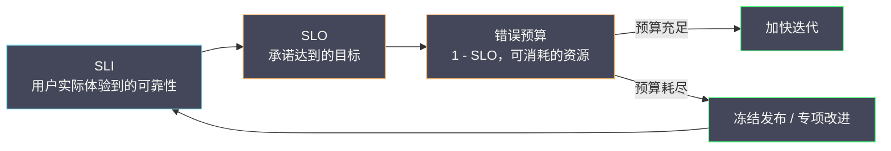

# 09 指标工程落地与 SLO 体系

**摘要：**

前面八篇讲了指标的采集、查询、存储、迁移、可视化与告警。这一篇要回答一个更上位的问题：**"多可靠才算够"**。没有这个问题的答案，告警阈值只能靠经验拍、团队在"要不要发版"上反复拉扯、可靠性投入也缺乏依据。SLO（服务等级目标）体系正是为了回答它而生的——它用 SLI（服务等级指标）度量"用户实际体验到的可靠性"，用 SLO 定义"承诺的目标"，再用错误预算把"可靠性"变成一种可以被消耗、被谈判、被管理的资源。本文从"为什么告警阈值不该靠拍脑袋"这个问题切入，先讲清 SLI 的选取原则（从用户视角出发、用比例而非分位数），再讲 SLO 该定多少（历史数据 + 用户期望 + 成本约束），随后展开错误预算的用法（何时停止发版、如何与业务谈判）与燃尽率告警的设计。之后回到指标工程本身，讨论基数治理、成本控制与命名规范，最后给出一条可执行的落地路径与边界反例。读完本文，你应当能回答三个问题：**该用什么指标度量可靠性、目标该定在哪、以及当错误预算耗尽时团队该做什么**。

---

## 第 1 章 从"监控"到"可靠性目标"

### 1.1 告警阈值的困境

回顾第 07、08 篇讲的告警规则，有一个绕不开的问题：**阈值该定在哪**。错误率超过 1% 就告警？那 0.9% 呢？延迟超过 500ms 就告警？那 490ms 呢？

靠经验拍的阈值有两个问题。其一，**它没有"为什么"**——当有人问"为什么是 1% 不是 0.5%"时，答案往往是"感觉差不多"。其二，**它无法回答"该不该发版"**——如果一个版本让错误率从 0.1% 涨到 0.5%（仍然低于 1% 的阈值），那么这个版本是"可接受"还是"不可接受"？阈值告警给不出答案。

### 1.2 可靠性需要一个"目标"

问题的根源是：**没有"目标"，就没有"达标与否"的判断**。而"目标"必须来自"用户期望"，而不是"技术感觉"。

这就引出了 SLO 的核心思路：**先把"用户实际体验到的可靠性"度量出来（SLI），再定义"承诺达到的目标"（SLO），最后用"目标与实际的差"来管理可靠性（错误预算）**。这三步构成一条完整的闭环——它把"可靠性"从一个模糊的感受，变成了一个可以被度量、被承诺、被消耗的量。

### 1.3 SLO 与告警的关系

SLO 与告警不是替代关系，而是**互补**。第 07 篇讲过：阈值告警适合"快速发现明显故障"，SLO 告警适合"发现缓慢恶化"。两者的分工可以概括为：**阈值告警管"急性病"（服务直接不可用），SLO 告警管"慢性病"（错误率慢慢爬升）**。

一个成熟的可靠性体系，应当同时包含两者。**只做阈值告警，会漏掉"温水煮青蛙"式的恶化；只做 SLO 告警，会在"服务直接挂了"时反应太慢**。

---

### 1.4 为什么"可靠性"需要被经营

传统观念里，"可靠性"是"运维的事"——业务只管发版，运维只管别出事。这种分工在"发布频率低、系统简单"的时代可行，在"每天多次发布、系统复杂"的时代就失效了：**因为"可靠性"与"发布速度"天然矛盾**，而两者的取舍不可能由一方单方面决定。

SLO 体系提供的，正是"**让这个取舍变得可讨论、可计算**"的机制。有了错误预算，"多发一个版"不再是"业务在冒险"或"运维在阻挠"，而是"消耗了多少预算"的一次计算。**把矛盾从"立场之争"变成"数据之争"，是 SLO 最根本的价值**。

这也解释了为什么 SLO 往往需要"组织层面的推动"——它改变的不只是"怎么监控"，而是"怎么协作"。**技术工具能解决技术问题，但 SLO 解决的是一个"协作问题"**。

---

### 1.5 SLO 的三种常见误解

在展开细节之前，先澄清三种常见误解，它们会导致 SLO 项目走偏。

**误解一：SLO 是"运维指标"**。实际上，SLO 的核心是"用户期望"，因此它天然是"业务与技术共同的话题"。如果 SLO 只在运维团队内部讨论，那么它很可能定出"技术上漂亮、业务上无关"的目标。

**误解二：SLO 越高越好**。前面讲过，"9"的代价是指数级的。更高的 SLO 意味着更高的成本与更慢的迭代。**SLO 的目标是"够用"，而不是"最高"**。

**误解三：SLO 是"考核工具"**。如果把 SLO 用来考核团队，那么团队会倾向于"把数据做好看"，而不是"把系统做好"。**SLO 是决策工具，不是考核工具**——这条区分，决定了 SLO 能否长期发挥作用。

---

### 1.6 SLO 的"度量对象"是什么

SLO 度量的是"什么"？这个问题看似简单，实际有一个明确的答案：**它度量的是"用户与系统交互的那一层"**。三者构成一条闭环：

"用户"可能是"真人"（如下单的顾客），也可能是"上游系统"（如调用你的 API 的另一个服务）。无论哪种，SLO 度量的都是"这一次交互是否成功、是否够快"。

这个定位排除了两类东西。**第一类是"系统内部状态"**（CPU、GC、连接池），它们不是"交互"，因此不是 SLO 的对象。**第二类是"基础设施"**（网络、存储），它们是"交互"的支撑，但用户感受不到它们的直接状态。

明确了"度量对象"，就能回答一个常见的困惑："为什么 CPU 使用率 90% 了，SLO 还是达标的？"——因为**SLO 度量的是"交互"，而 CPU 高不一定导致交互失败**。CPU 指标用于"容量与预警"，SLO 用于"判断用户是否满意"，两者的用途不同。

---

## 第 2 章 SLI：怎么度量

### 2.1 SLI 的选取原则

SLI（Service Level Indicator）是"对用户体验的量化度量"。它的选取有一条根本原则：**从用户视角出发，而不是从系统视角出发**。

这条原则的实践含义是：**用户不关心你的 CPU 使用率，只关心"请求是否成功、响应是否够快"**。因此，好的 SLI 通常是"请求级"的：成功率、延迟达标率、以及某些业务语义的指标（如"下单成功"）。

反面例子是把"CPU 使用率""GC 时间""连接池占用"当成 SLI。它们是"系统内部指标"，对容量规划有用，但它们与"用户体验"之间隔了好几层——CPU 高不一定会让用户受影响，CPU 低也不代表用户就满意。

### 2.2 用"比例"而不是"分位数"

SLI 的第二个原则是"**用比例（ratio）而不是分位数（quantile）**"。

举例说明。要度量"延迟达标率"，有两种写法：**分位数写法**（"P99 延迟 < 300ms"）与**比例写法**（"300ms 内完成的请求占比 > 99%"）。两者看起来等价，实际差别很大。

比例写法的优势有三。其一，**它可聚合**——不同实例、不同机房的比例可以直接加权平均，而分位数不能。其二，**它更精确**——比例直接来自直方图的桶，不需要插值。其三，**它更贴近 SLO 的语义**——SLO 说的是"99% 的请求达标"，而不是"P99 小于某值"。

因此，**SLI 应当用比例来表达**。这也是第 03 篇讲"分位数适合看趋势，比例适合设目标"在 SLO 场景的具体落地。

### 2.3 四类常见 SLI

按"用户体验的哪个方面"，SLI 大致有四类。

**可用性（Availability）**：成功请求占总请求的比例。它回答"服务是否可用"。

**延迟（Latency）**：在阈值内完成的请求占比。它回答"服务是否够快"。

**吞吐（Throughput）**：在给定负载下的处理能力。它回答"服务能否承载流量"。这一类比前两类用得少，因为"吞吐"往往表现为"延迟升高"。

**质量（Quality / Freshness）**：特定业务语义的度量，如"推荐结果的准确率""数据的新鲜度"。它回答"服务是否好用"。

选取哪几类，取决于"用户最在意什么"。**不要贪多**——三个以内的 SLI 通常就够，因为每一个都需要被度量、被承诺、被解释。

---

### 2.4 SLI 的口径与数据源

SLI 的落地，需要一个"口径 + 数据源"的组合。口径决定"怎么算"，数据源决定"从哪算"。

**口径**的典型形式是"比例"：分子是"成功（或达标）的请求数"，分母是"总请求数"。这里的关键是"**分子与分母必须来自同一批请求**"——如果分子来自网关、分母来自业务服务，那么两者的差可能来自"网关统计了健康检查而业务没有"这类细节，导致比例失真。

**数据源**的选择影响"口径的准确性"。可选的数据源有三类：**服务端埋点**（最准确，但需要改代码）、**网关/网格指标**（无需改代码，但只能看到网络层）、**合成监控**（从用户视角，但覆盖不到真实流量）。三者各有取舍，常见做法是"以服务端埋点为主，用网关指标做交叉验证"。

这里有一条重要提醒：**SLI 的口径必须在"团队内部"达成共识**。如果不同人对"成功率"的理解不同（是否包含 4xx、是否包含健康检查、是否包含重试），那么 SLI 的数值就会"各说各话"。**口径是 SLO 的地基，地基不稳，上面全是流沙**。

### 2.5 SLI 的"可观测性前提"

SLI 能否被度量，取决于"系统是否被正确地埋点"。这引出一个常见的困境：**很多团队想上 SLO，却发现"根本没有可用的 SLI"**——因为服务没有暴露"请求级别的成功/失败"数据。

解决这个困境的顺序应当是"**先补埋点，再谈 SLO**"。而"补埋点"本身，又依赖于前面几篇讲的东西：应用要暴露指标（第 02 篇）、指标要有正确的标签（第 02 篇）、查询要能算出比例（第 03 篇）。

因此，**SLO 不是"起点"，而是"可观测性成熟到一定程度的结果"**。在埋点不完善时硬上 SLO，只会得到一套"基于错误数据的目标"，反而误导决策。**先把"能看清"做到位，再谈"该达到多少"**。

---

### 2.6 SLI 的"用户旅程"视角

除了"按请求统计"，还有一种更强的 SLI 视角：**按"用户旅程"统计**。

"用户旅程"指的是"用户为了完成一个目标，所经历的一系列步骤"。比如"下单"可能包含"浏览商品 → 加入购物车 → 提交订单 → 支付"。如果只按"单个接口"统计 SLI，那么"每一步都达标、但整体体验很差"（如步骤之间跳转太慢）的情况会被漏掉。

按"用户旅程"统计 SLI，能更贴近"用户是否真的完成了目标"。它的实现通常需要"合成监控"（模拟用户走完整个旅程）或"客户端埋点"（从真实用户那里采集）。

"用户旅程"视角的代价是"实现复杂"，因此它通常是"进阶用法"——先做好"单接口 SLI"，再考虑"旅程 SLI"。但**在核心业务链路上，"旅程视角"往往比"接口视角"更能反映真实体验**。

---

### 2.7 SLI 的"反指标"陷阱

有一种 SLI 特别危险：**它看起来在度量"好"，实际会诱导"坏"的行为**。这类指标被称为"反指标（vanity / perverse metric）"。

举例说明。如果把"平均响应时间"作为 SLI，团队可能会"只优化快的请求"（因为平均被它们拉低），而忽视"慢请求"——结果是"平均变好，长尾变差"。如果把"请求成功率"作为 SLI 而不限定"什么算成功"，团队可能会"把失败重试算成成功"，从而"提高"成功率。

避免反指标的办法是"**问一句：如果团队全力优化这个指标，会不会损害真实目标**"。如果答案是"会"，那么这个指标就不适合作为 SLI。**SLI 必须与"用户真实感受"强相关**，否则它就会变成"数字游戏"。

这条检查在设定 SLI 时非常值得做一遍——**一个选错的 SLI，会让整个 SLO 体系"跑偏"**，而且跑偏得很隐蔽。

---

## 第 3 章 SLO：定多少

### 3.1 目标的三个输入

SLO 的目标值（如"可用性 99.9%"）不是拍出来的，它应当综合三个输入。

**第一个输入是历史表现**。把过去几个月的 SLI 算出来，看"实际达到了多少"。这是"当前能力"的基线。目标定得远高于历史，等于自欺；定得远低于历史，等于没有约束力。

**第二个输入是用户期望**。用户对可靠性的容忍度是多少？这需要与业务方对话。有些场景（如支付）用户对失败极度敏感，有些场景（如推荐）用户可以接受偶尔失败。

**第三个输入是成本约束**。可靠性每提升一个"9"，成本往往成倍上升。"99.9%"与"99.99%"之间的差距，可能需要数倍的冗余投入。因此，目标必须与"愿意付出的成本"匹配。

### 3.2 "9"的代价

把"几个 9"对应的停机时间算清楚，能直观理解"目标的分量"：

| 可用性 | 每年停机 | 每月停机 |
|---|---|---|
| 99% | 3.65 天 | 7.2 小时 |
| 99.9% | 8.76 小时 | 43.2 分钟 |
| 99.99% | 52.6 分钟 | 4.32 分钟 |
| 99.999% | 5.26 分钟 | 25.9 秒 |

这张表说明了一件事：**从 99.9% 到 99.99%，容错时间从"43 分钟/月"压缩到"4 分钟/月"**。这要求系统的"故障恢复能力"提升一个量级——可能需要自动故障转移、多活部署、以及极高的运维成熟度。

因此，**不要盲目追求更多的 9**。目标应当定在"用户真正需要、且成本可接受"的位置。**过度承诺的 SLO，会让团队长期处于"救火"状态，反而损害真实可靠性**。

### 3.3 分层的 SLO

对于复杂系统，SLO 应当分层：**端到端 SLO**（面向用户的服务，如"下单接口"）与**组件 SLO**（面向内部依赖，如"库存服务"）。

分层的关键是"**端到端 SLO 是目标，组件 SLO 是手段**"。不能反过来——不能因为"组件 SLO 达标"就认为"端到端达标"，因为用户的体验取决于整条链路。反过来，当端到端 SLO 未达标时，组件 SLO 能帮助定位"是哪一段拖累的"。

分层的常见错误是"只定组件 SLO，不定端到端 SLO"。这样团队会陷入"每个组件都达标、但用户仍然不满意"的困境——**因为用户不消费组件，用户消费的是完整的服务**。

---

### 3.4 SLO 的分档与差异化

不同的服务，对可靠性的要求不同。给所有服务定同一个 SLO，是"一刀切"，既不公平也不经济。

更合理的做法是"**分档**"：把服务按"用户影响"分成几档，每档对应不同的可靠性要求。比如，"核心交易链路"要求 99.99%，"一般业务功能"要求 99.9%，"内部工具与报表"要求 99%。分档的依据是"**用户是否直接感知、业务是否直接受损**"。

分档的价值在于"**把有限的可靠性投入，用在最需要的地方**"。如果所有服务都要求 99.99%，那么投入会失控；如果所有服务都只要求 99%，那么核心链路的用户会受损。**分档是"成本"与"体验"之间的一次全局优化**。

分档也需要"**可解释**"：当有人问"为什么这个服务是 99.9% 而那个是 99.99%"时，应当能给出清晰的判据。**不可解释的分档，会变成"按嗓门大小分配资源"**。

### 3.5 SLO 的"复审周期"

SLO 不是"定一次就永远不变"。它应当有复审周期——通常每季度或每半年一次。复审的内容包括：**历史表现是否达标**（长期不达标说明目标不现实，长期超额达标说明目标太松）、**用户期望是否变化**（业务发展可能改变对可靠性的要求）、**成本是否可承受**（达成目标的成本是否在预算内）。

复审的价值在于"**让 SLO 保持真实**"。一个"定完就忘"的 SLO，会在业务变化后变成"过时的约束"——要么太松（没有约束力），要么太紧（不合理地限制迭代）。**SLO 是活的，它需要被持续维护**。

---

### 3.6 SLO 与变更管理的结合

SLO 与"变更管理"有一个天然的结合点：**变更前的评估**。

在变更管理里，通常要回答"这次变更的风险有多大"。SLO 提供了一个量化视角：**这次变更可能消耗多少错误预算**。比如，"一次数据库索引重建"可能造成"短暂延迟升高"，那么它"预计消耗 5% 的预算"。这个预估能让"要不要在这个时间点做"变成一个可计算的决策。

结合的另一面是"**变更后的验证**"：变更上线后，观察"预算的消耗速度是否异常"。如果某次变更后燃尽率突然升高，那么"回滚"的决策就有了依据。

**把 SLO 与变更管理结合，是 SLO 从"事后度量"走向"事前决策"的关键一步**。它让 SLO 的价值从"复盘时的参考"变成"发布时的依据"。

---

### 3.7 SLO 作为"沟通语言"

SLO 的一个重要副产品是"**一套跨团队的沟通语言**"。当"用户投诉""系统错误率""资源成本"都能被翻译成"错误预算"时，三方就有了共同的对话基础。

这套语言的实践价值在于"**把争论变成计算**"。以往，"要不要多发一个版"会变成"业务说重要、运维说风险"的立场之争；有了 SLO，它就变成"这次发布预计消耗多少预算、当前预算还剩多少"的一次计算。**立场之争没有标准答案，而计算有**。

因此，SLO 的推广往往伴随着"**沟通方式的改变**"：从"我觉得"变成"数据显示"，从"立场"变成"预算"。这种改变不会一夜发生，但一旦形成，团队的决策质量会显著提升。**SLO 最持久的价值，也许不是"度量"，而是"语言"**。

---

## 第 4 章 错误预算：怎么用

### 4.1 错误预算是什么

错误预算（Error Budget）= **1 - SLO**。如果 SLO 是 99.9%，那么错误预算就是 0.1%——也就是说，**在一个统计窗口内，你可以"消耗"0.1% 的失败**。

这个概念的巧妙之处在于：**它把"可靠性"变成了一种可消耗的资源**。以往，"可靠性"与"发布速度"是矛盾的——可靠性团队想"少发版"，业务团队想"多发版"。错误预算把这场争论变成了一个可计算的判断：**只要预算没耗尽，就可以继续发版；预算耗尽了，就必须停下来解决稳定性问题**。

### 4.2 预算的统计窗口

错误预算需要一个"统计窗口"。常见的窗口有"滚动 30 天"与"自然月"。

**滚动窗口**（如"过去 30 天"）的好处是"平滑"——它不会因为月初的一次故障，导致整个月都无法发版；坏处是"故障的影响会持续很久"（一次故障会在未来 30 天里一直影响预算）。

**自然月窗口**的好处是"清晰"——月底清零，团队知道"下个月重新开始"；坏处是"月初的故障会毁掉整个月"，且容易诱发"月底冲预算"的行为。

选择哪个窗口，取决于团队的文化与业务节奏。一个务实的做法是"**用滚动窗口做技术判断，用自然月做沟通**"——技术上关心"真实的预算状态"，沟通上关心"这个月的表现如何"。

### 4.3 预算耗尽之后

预算耗尽意味着"可靠性已经低于承诺"。此时应当触发一系列明确的动作：**冻结非必要发布**（只允许修复稳定性的变更）、**启动可靠性专项**（投入人力解决根因）、以及**评估是否调整 SLO**（如果"耗尽是常态"，说明目标定得不现实）。

这里的关键是"**动作必须是预先约定的**"。如果"预算耗尽"只是一个数字，没有人因为"耗尽"而改变行为，那么这个 SLO 就没有约束力。**SLO 的价值，取决于"它能否改变决策"**——而这需要事先约定"预算耗尽时怎么办"。

### 4.4 燃尽率告警

错误预算的直接用法是"看剩余量"，但更灵敏的用法是看"**燃尽率（burn rate）**"——即"预算被消耗的速度"。

燃尽率的含义是"以当前速度，预算会在多久内耗尽"。燃尽率为 1，意味着"刚好在窗口结束时耗尽"；燃尽率为 14.4，意味着"预算会在 1/14.4 的窗口时间内耗尽"（对 30 天窗口来说，约 2 天）。

**燃尽率告警**的优势在于"**既灵敏又稳定**"。它比"单点阈值"更稳定（因为它看的是趋势），又比"预算剩余量"更灵敏（因为它能在"还没耗尽"时就发出预警）。Google SRE 推荐的实践是"用多个燃尽率阈值配不同的窗口"——比如"燃尽率 > 14.4 持续 1 小时"触发紧急告警，"燃尽率 > 6 持续 6 小时"触发工单。

---

### 4.5 错误预算的"分配"

当系统由多个组件构成时，"错误预算"可以在组件之间分配。比如，端到端预算是 0.1%，可以分配给"网关 0.02%、服务 A 0.03%、服务 B 0.05%"。

分配的价值在于"**把端到端的目标，拆解成每个组件可以承担的份额**"。这样每个团队都知道"自己有多少容错空间"，而不是"看着端到端的数字，不知道自己该做什么"。

分配的难点在于"**份额怎么定**"。一个务实的做法是"**按历史贡献分配**"——统计过去一段时间，各组件对"端到端失败"的贡献比例，按比例分配预算。这样"谁贡献的失败多，谁分到的预算也多"（因为它的容错空间需要更大）。**按历史数据分配，比按主观判断分配更公平、也更容易被接受**。

分配之后还需要"**汇总校验**"：各组件分到的预算之和，不应当超过端到端预算（否则会出现"每个组件都达标、端到端却不达标"）。这个校验看似简单，却常被忽略。

---

### 4.6 燃尽率的窗口设计

燃尽率告警的关键参数是"窗口"。窗口太短，会因为瞬时抖动误报；窗口太长，会在"预算快速消耗"时反应迟钝。

Google SRE 推荐的实践是"**多窗口组合**"：用"长窗口 + 低阈值"发现"缓慢但持续的消耗"，用"短窗口 + 高阈值"发现"快速且剧烈的消耗"。两者结合，既能捕捉"温水煮青蛙"，也能捕捉"突发事故"。

具体来说，常见的组合是：**短窗口（1 小时）配高燃尽率（14.4）触发紧急告警**、**长窗口（6 小时）配中燃尽率（6）触发工单**。前者对应"预算会在两天内耗尽"的紧急情况，后者对应"预算会在五天内耗尽"的需关注情况。

窗口设计的本质，是"**在灵敏度与稳定性之间找平衡**"。这与第 07、08 篇讲的"告警的持续时长"是同一个权衡——**没有普适的最优参数，只有与你的容忍度匹配的参数**。

---

### 4.7 错误预算的可视化

错误预算如果不可见，就没人会关心它。因此，"预算的可视化"是落地的一环。

一块实用的"错误预算看板"应当包含几个元素：**当前剩余预算**（一个大号的百分比或进度条）、**燃尽率曲线**（当前消耗速度与理想速度的对比）、**预算消耗的时间线**（哪几次事故消耗了多少）、以及**预计耗尽时间**（按当前速度推算）。

其中"**预计耗尽时间**"最直观——它把"燃尽率"这个抽象概念，翻译成"照这个速度，X 天后预算就没了"。这个数字比"燃尽率 6"更容易被非技术角色理解。

可视化还有一个作用：**它让"预算"成为日常讨论的一部分**。当团队每天都在看这块看板时，"预算还剩多少"就会自然进入"要不要发版"的讨论。**被看见的指标，才会被使用**——这与前面几篇讲的"成本可见性"是同一种思路。

---

## 第 5 章 指标治理与成本控制

### 5.1 基数治理

前面几篇反复强调"基数是生命线"。落到工程上，基数治理有几条具体做法：**采集侧用 relabel 丢弃高基数标签**、**限制直方图的桶数量**、**用录制规则把高基数指标聚合成低基数派生指标**、**定期审计"哪条指标贡献了最多序列"**。

其中"定期审计"最容易被忽略，却最有效。因为**基数的增长是渐进的**，如果不主动审计，等到"内存告警"时已经很难回滚。审计的频率建议是"每月一次"，审计的内容是"序列数增长最快的几条指标"。

### 5.2 命名规范

命名规范是"低成本的长期投资"。它包含三部分：**度量名的结构**（如"对象_动作_单位_类型"）、**标签的语义**（如 `service`、`instance`、`env` 的固定含义）、**单位的统一**（如时间一律用秒）。

规范的价值在于"**让查询可写**"。当所有指标都遵循同一套命名时，"按服务聚合"就成了一条通用查询；而当命名混乱时，每写一条查询都要先"查文档或猜"。**规范的成本在事前，收益在事后，且是复利的**。

### 5.3 成本控制的四个抓手

回到第 01 篇提过的"指标治理四抓手"，这里给出更具体的落地顺序：

1. **采集侧收敛**（性价比最高）：用 relabel 丢弃无用指标与高基数标签。
2. **写入侧降采样**：对历史数据降采样，用精度换保留时长。
3. **查询侧限流与缓存**：对昂贵查询设超时，对重复查询加缓存。
4. **录制规则**：把昂贵查询预先算好，降低查询成本。

这四条的顺序体现了"**越靠前的杠杆越大**"。很多团队的存储成本，一半以上是被第一条（无用的采集数据）消耗掉的。

---

### 5.4 指标平台的容量规划

指标平台的容量规划，前面第 04、05 篇从存储引擎角度讲过。这里从"治理"角度补充几条。

第一，**容量规划要基于"趋势"而不是"当前值"**。当前的序列数是"存量"，而"增长速度"才是决定"什么时候需要扩容"的关键。因此，应当监控"序列数的增长斜率"，并在斜率持续为正时提前规划。

第二，**容量规划要留"冗余"**。序列数的增长不是线性的（会有业务增长、标签漂移、新接入的叠加），因此按"当前值 × 1.2"来规划是不够的。常见做法是留 30%~50% 的余量。

第三，**容量规划要"可解释"**。当被问"为什么需要这么多资源"时，应当能给出"序列数、保留时长、压缩比"的拆解，而不是"感觉不够了"。**可解释的容量规划，才能在资源评审中站得住脚**。

### 5.5 指标的成本可见性

"成本"如果不可见，就无法被优化。因此，指标平台应当提供"**成本可见性**"——让团队能看到"自己用了多少资源"。

成本可见性的实现方式有几种：**按租户统计序列数**（哪个团队贡献了最多序列）、**按指标统计存储占用**（哪条指标最贵）、**按查询统计资源消耗**（哪些查询最耗资源）。把这些做成看板，团队就能"看到自己的成本"。

**成本可见性是"成本治理"的前提**。当团队不知道"自己的指标有多贵"时，他们不会有动力去优化。而当他们看到"某条高基数指标占了自己 40% 的成本"时，优化就变得自然了。**让成本可见，是最经济的一种治理手段**。

---

### 5.6 指标治理的组织机制

指标治理不只是技术工作，还需要组织机制。常见的机制有几种：**规范文档**（定义命名、标签、口径的标准）、**评审流程**（新增指标需要评审）、**定期审计**（每月检查基数增长与无用指标）、**成本分摊**（把资源成本分摊到团队）。

其中"**成本分摊**"最有效也最敏感。当团队看到"自己的指标占了多少资源"时，优化动力最强。但分摊也可能引发"抵制"——团队会觉得"凭什么让我承担"。因此，分摊应当"**先可见、后分摊**"：先让团队看到自己的成本，再逐步引入分摊。

**指标治理的长期成败，取决于"组织机制"而非"技术手段"**。技术手段（relabel、降采样）能解决"一次性的问题"，但只有组织机制能保证"不反弹"。**把治理变成日常，而不是一次性的运动**。

---

### 5.7 指标平台的演进路线

把本专栏各篇的建议串起来，一条指标平台的演进路线大致如下。

**第一阶段：能用**。接入采集、配置告警、搭起基础仪表盘。目标是"出事时能看到"。

**第二阶段：能治**。建立基数看板、规范命名、引入录制规则。目标是"控制成本、提升查询效率"。

**第三阶段：能扩**。按需拆分采集与查询、引入降采样或归档。目标是"支撑规模增长"。

**第四阶段：能经营**。引入 SLO 体系、把可靠性变成可决策的量。目标是"让可靠性成为业务语言"。

这四个阶段不是"必须逐级"，但它们有一个自然的顺序：**先解决"看不看得见"，再解决"贵不贵"，再解决"撑不撑得住"，最后解决"值不值"**。跳过前面的阶段直接做后面，往往会"根基不稳"——比如没有可靠的 SLI，就做不出有意义的 SLO。

---

## 第 6 章 落地路径

### 6.1 一个务实的顺序

把 SLO 体系落地，不建议"一步到位"。一个务实的顺序是：

**第一步：选一个服务试点**。选一个"业务重要、且团队配合"的服务，先把 SLI 度量出来（不做 SLO 承诺），观察一两个月。

**第二步：定 SLO 与预算**。基于试点数据，与业务方一起定一个"跳一跳够得着"的目标，并约定"预算耗尽时的动作"。

**第三步：接入燃尽率告警**。让 SLO 从"一个数字"变成"一个会主动提醒的信号"。

**第四步：扩展到其他服务**。把试点的方法沉淀成模板，逐服务推广。

这个顺序的价值是"**每一步都有可验证的产出**"。相比"先建一套 SLO 平台、再推广"，它更慢但更稳——**因为 SLO 的难点不在工具，而在"与业务方就目标达成共识"**。

### 6.2 SLO 的组织前提

SLO 不只是技术工作，它需要组织前提。**目标需要业务方参与制定**（否则"目标"没有权威性）；**预算耗尽的动作需要被授权**（否则"冻结发布"执行不下去）；**SLI 的口径需要被共同认可**（否则"数据打架"）。

因此，SLO 的推广往往需要"**先说服人，再落地技术**"。这一点常被技术团队低估——他们倾向于"先把技术做好，再谈推广"，结果做出了一套"没人认账"的 SLO。**SLO 是一种"承诺"，而承诺需要双方的认可**。

### 6.3 从 SLO 到可靠性文化

SLO 体系的长期价值，是"**塑造一种以用户为中心的可靠性文化**"。当团队习惯了"用错误预算判断该不该发版"时，可靠性就不再是"可靠性团队的独角戏"，而是"所有人的共同语言"。

这种文化的标志是：**讨论发版时，会先看"预算还剩多少"；讨论故障时，会先问"影响了多少用户"；讨论投入时，会算"这个可靠性提升值多少成本"**。这些习惯一旦形成，可靠性就从"被动的救火"变成了"主动的经营"。

---

### 6.4 SLO 与团队协作

SLO 的落地，本质上是一次"跨团队协作的建立"。它需要三方参与：**业务方**（定义"用户期望"）、**研发团队**（定义"技术能力"）、**运维/SRE**（定义"运营方式"）。三方缺一，SLO 都会"悬空"。

三方协作的常见难点是"**语言不通**"。业务方谈"用户投诉"，研发谈"错误率"，运维谈"资源成本"——三者其实是同一件事的不同侧面，但表达方式不同。SLO 的作用之一，就是提供一套"共同语言"：**把"用户投诉"翻译成"错误率"，把"错误率"翻译成"成本"**。

因此，SLO 的推广往往需要一位"**翻译者**"——他能听懂三方的话，并把它翻译成 SLO 的语言。这个角色通常是 SRE 或平台团队。**没有翻译者，SLO 的讨论会变成"各说各话"**。

### 6.5 SLO 的"最小可行版本"

不要一开始就追求"完备的 SLO 体系"。一个"最小可行版本"就够了：**一个服务、一个 SLI、一个 SLO、一个错误预算、一个燃尽率告警**。

这个最小版本的验证价值很高：它能验证"数据是否可得""口径是否能达成共识""预算耗尽的动作是否能被执行"。如果最小版本都跑不通，那么扩大规模只会放大问题。

**最小可行版本的理念，与软件开发的 MVP 一致**——先用最小成本验证核心假设，再规模化。**SLO 的失败往往不是"技术不行"，而是"假设没验证"**。

---

### 6.6 SLO 的季度复审

前面提过 SLO 应当有复审周期。这里给出"季度复审"的具体议程。

**第一项：看达标情况**。过去一个季度，SLO 达标了吗？如果长期不达标，是"目标太高"还是"系统太差"？如果长期超额达标，是"目标太低"还是"系统变好了"？

**第二项：看预算使用**。预算的消耗是否集中在少数几次事故？如果是，说明"系统性风险"大于"日常波动"，应当针对那几次事故做专项改进。

**第三项：看 SLI 的有效性**。当前的 SLI 是否仍然代表"用户感受"？业务变化后，是否出现了"SLI 达标但用户不满"的情况？

**第四项：看动作的执行**。过去一个季度，"预算耗尽"的动作是否被执行过？如果没有，是"运气好"还是"机制没生效"？

**第五项：调整目标**。基于以上四项，决定"是否调整 SLO"。调整应当有依据，而不是"感觉应该调一调"。

这份议程的价值是"**让 SLO 保持活力**"。一个从不复审的 SLO，会在业务变化后逐渐"失真"。**复审是 SLO 与业务保持同步的机制**。

---

### 6.7 SLO 的推广节奏

推广 SLO 时，"节奏"很重要。推得太快，会"消化不良"（团队没准备好、数据不可得）；推得太慢，会"失去动力"（试点之后不了了之）。

一个务实的节奏是"**先深后广**"：**先在少数服务上做深**（把 SLI、SLO、预算、告警、流程全部跑通），**再把方法沉淀成模板**，**最后规模化推广**。

"先深后广"的价值在于"**把方法验证透**"。如果一开始就"铺开十个服务"，那么每个服务都只做了一半，遇到问题时也说不清"是方法不行还是执行不到位"。而"做深一个"能暴露真实的问题，从而让推广时"少踩坑"。

**推广的难点不是"技术复制"，而是"共识复制"**——如何让每个团队都理解"为什么要做 SLO""预算耗尽意味着什么"。这需要持续的布道与培训，而不是"发一份文档"。**把 SLO 的推广当成"文化建设"来做，而不是"工具部署"**。

---

## 第 7 章 边界与反例

### 7.1 反例：SLO 定成"完美"

把 SLO 定成 100%，等于"不允许任何失败"。这在现实中不可能达成，且会带来两个恶果：**其一，团队会放弃**（因为永远达不到）；**其二，团队会造假**（把失败的数据藏起来）。

**SLO 的意义在于"区分正常失败与异常失败"**——它允许一定量的失败，因为"失败是必然的"。把目标定成"完美"，等于取消了这层区分。

### 7.2 反例：SLI 与用户感受脱节

如果 SLI 度量的是"服务端返回 200 的比例"，而用户感受的是"页面能否正常渲染"，那么两者可能脱节——服务端 200 了，但前端因为某个依赖失败而白屏。

对策是"**用端到端的视角选 SLI**"，必要时用"合成监控（synthetic monitoring）"从"用户视角"发起探测。**SLI 必须能代表"用户是否满意"，否则再精确也没有意义**。

### 7.3 反例：错误预算耗尽却无人行动

前面讲过，SLO 的价值取决于"它能否改变决策"。如果"预算耗尽"只是一个"看板上的数字"，没有触发任何动作，那么这个 SLO 就是"装饰品"。

对策是"**把动作写进流程**"——在发布流程里加入"检查错误预算"这一步，在值班手册里写明"预算耗尽时的升级路径"。**只有被写进流程的约定，才会被真正执行**。

### 7.4 反例：SLO 变成"甩锅工具"

有一类误用：把 SLO 当成"追责的依据"——"这个月 SLO 没达标，是谁的责任"。这种用法会破坏 SLO 的价值，因为**SLO 的目的是"改进"，不是"追责"**。一旦 SLO 变成追责工具，团队就会倾向于"把数据做好看"，而不是"把系统做好"。

对策是"**明确 SLO 的用途是决策，不是考核**"。这与"错误预算是一种资源"的定位一致——资源是用来"经营"的，不是用来"评判"的。

### 7.5 一个正例：用 SLO 做"发版决策"

反过来，SLO 最有价值的用法是"**做发版决策**"。当"预算充足"时，团队可以放心地加快迭代；当"预算紧张"时，团队会自动转向"修复稳定性"。这个机制让"发布速度"与"可靠性"不再是对立的，而是"由预算统一调节的"。

这条用法把 SLO 从"一个度量"变成了"一个决策机制"——**这才是 SLO 区别于"普通监控"的地方**。普通监控告诉你"现在怎么样"，SLO 告诉你"现在该做什么"。

### 7.6 反例：SLO 只定不管

一个常见的失败模式是"**定了 SLO，但没有配套的运营**"：目标定了，燃尽率告警没配，预算耗尽的动作没约定，复盘时也没人看 SLO。这样的 SLO，与"一块没人看的面板"没有区别。

对策是"**把 SLO 嵌入日常流程**"：发布前看预算、事故复盘看影响、季度评审看趋势。**只有被嵌入流程的东西，才会被真正使用**。SLO 不是"一份文档"，而是"一套机制"。

### 7.7 检查清单

把本文的要点收敛成一份清单：

- 你的 SLI 是"用户视角"还是"系统视角"？是否用比例而非分位数？
- SLI 的口径是否在团队内达成共识？分子分母是否来自同一批请求？
- SLO 的目标是否综合了"历史表现、用户期望、成本约束"三个输入？
- 服务是否分档？不同档位的目标是否可解释？
- 错误预算的统计窗口是滚动还是自然月？是否与业务节奏匹配？
- 预算耗尽时会发生什么？这个动作是否被预先约定并授权？
- 燃尽率告警是否配置？是否用了"多阈值 + 多窗口"的组合？
- 指标是否有命名规范？是否定期审计基数增长？
- 是否建立了"成本可见性"，让团队看到自己的资源占用？

这份清单覆盖了从"度量"到"经营"的全部关键决策。其中"预算耗尽时会发生什么"最关键——**如果这个问题没有答案，那么 SLO 就只是一组数字**。

### 7.8 反例：把 SLO 当 KPI

前面提过一次，这里展开讲。把 SLO 当 KPI（绩效考核指标）会引发两类行为扭曲。

**第一类是"藏数据"**。如果"错误率超标"会被扣分，那么团队会倾向于"把失败的数据藏起来"——比如调整统计口径、把失败请求归到"不算数"的类别里。结果是"数据好看、系统照旧"。

**第二类是"降低目标"**。如果"达成 SLO"与"绩效"挂钩，那么团队会倾向于"把目标定低"，以便轻松达成。结果是"SLO 变成了一纸空文"。

这两类扭曲的共同原因是"**把'度量'与'考核'绑定**"。度量需要"真实"，考核会诱发"修饰"。**SLO 要发挥作用，必须与考核解耦**——它的用途是"决策"（该不该发版、该投多少资源），而不是"评判"（谁做得好、谁做得差）。

### 7.9 一个正例：SLO 驱动的可靠性投资

反过来，SLO 最有价值的用法是"**为可靠性投资提供依据**"。

当有人问"为什么要花资源做高可用改造"时，SLO 能给出量化的回答：**"当前的错误预算长期在'月底耗尽'，说明系统的可靠性不足以支撑当前的迭代速度。改造后，预计能把燃尽率降到可控范围，从而恢复'每月 N 次发布'的能力"**。

这个论证的威力在于"**把可靠性投入与业务能力挂钩**"。它不再是"运维想要更多资源"，而是"为了支撑业务节奏，需要这笔投入"。**有了 SLO，"可靠性"从成本项变成了"能力项"**——这是它最深刻的价值。

### 7.10 反例：SLO 只覆盖"技术层"

有一类 SLO 只覆盖"技术层"——比如只度量"接口的成功率与延迟"，却不覆盖"业务语义"。这会导致"技术达标、业务受损"的盲区。

典型的例子是"支付服务"。接口可能"100% 返回 200"，但"支付渠道的实际扣款失败"却可能不被计入 SLI（因为它在异步回调里）。用户的实际感受是"钱没扣成功"，而 SLO 显示"一切正常"。

对策是"**把业务语义纳入 SLI**"。对支付而言，SLI 应当包含"扣款成功率"；对订单而言，应当包含"下单成功率"。**技术层的 SLI 是必要的，但不够**——真正代表用户体验的，往往是"业务是否完成了它该完成的事"。

### 7.11 反例：把 SLO 当成"一次性项目"

最后一个反例是把 SLO 当成"一次性项目"——上线之后就不再维护。结果是"目标过时、数据失真、动作失效"。

SLO 是"活的机制"，它需要：**定期复审**（目标是否仍然合理）、**持续维护**（SLI 的口径是否随业务变化）、**持续演练**（预算耗尽的动作是否还能执行）。**任何"定完就忘"的机制，都会慢慢失效**。

### 7.12 一个正例：从 SLO 到"可靠性预算"

最后分享一个把 SLO 用"活"的思路：**把错误预算当成"团队的可靠性预算"来经营**。

具体做法是：每个季度，团队"分到"一份错误预算（对应它的 SLO）。这份预算可以"花"在"加快迭代"上（每次发布消耗一点），也可以"存"起来（保持稳定，为未来留空间）。当预算"花超"时，团队自动进入"稳定期"；当预算"充裕"时，团队可以"加速"。

这个框架的价值在于"**把抽象的可靠性，变成了团队可以经营的资源**"。它让"该发多少版""该不该做稳定性改造"这类问题，有了一个统一的判断依据。**从"目标"到"资源"，是 SLO 落地的高级形态**——它标志着一个团队真正把可靠性纳入了日常决策。

### 6.8 SLO 落地问题速查

把落地中最常见的问题与对策整理成一张表：

| 问题 | 可能原因 | 对策 |
|---|---|---|
| 没有可用的 SLI | 埋点不完善 | 先补请求级埋点，再谈 SLO |
| 目标定完没人认 | 业务方未参与 | 与业务方共同制定，写进流程 |
| 长期不达标 | 目标不现实 / 系统确实差 | 区分"目标太高"与"能力不足" |
| 长期超额达标 | 目标太松 | 提高目标，让 SLO 有约束力 |
| 预算耗尽无动作 | 动作未预先约定 | 把动作写进发布流程与值班手册 |
| 数据各说各话 | 口径未统一 | 用录制规则固化口径 |
| SLI 达标用户不满 | SLI 与体验脱节 | 引入业务语义或用户旅程视角 |
| SLO 无人维护 | 缺乏复审机制 | 建立季度复审议程 |

这张表的用法是"遇到问题先对照，再排查"。它覆盖了 SLO 落地里 80% 的常见困境，能显著缩短"从现象到原因"的时间。

---

## 小结

SLO 体系的核心，是把"可靠性"从一个模糊的感受，变成一个可度量、可承诺、可经营的量。它的三个组成部分——SLI、SLO、错误预算——分别回答"用户体验如何""承诺达到多少""还剩多少余量"。其中最有价值的是错误预算：**它把"可靠性"与"发布速度"的争论，变成了一次基于数据的计算**。

把本文与前面几篇连起来看，位置很清晰：第 01 篇讲"为什么需要指标"，第 02 到 06 篇讲"指标怎么采集、查询、存储、迁移"，第 07 与 08 篇讲"怎么变成视图与告警"，而本篇讲"怎么上升到可靠性目标"。整条链路从"数据"一路走到"决策"，构成了指标工程的完整闭环。

最后回到那条贯穿全专栏的立场：**没有银弹，只有权衡**。SLO 不是"越高越好"，而是"与用户期望、成本约束匹配"；错误预算不是"越多越好"，而是"能支撑迭代节奏"；指标不是"越多越好"，而是"每条都值得被采集与查询"。**指标工程的每一步，都是一次取舍**——理解了这一点，才能把指标用得既经济、又有效。

---

## 参考资料

1. Google SRE Book (2016). *Site Reliability Engineering*, Chapter 4: Service Level Objectives. O'Reilly Media.
2. Google SRE Workbook (2018). *Implementing SLOs*, Chapter 2: Implementing SLOs. O'Reilly Media.
3. Alex Hidalgo (2020). *Implementing Service Level Objectives*. O'Reilly Media.
4. OpenSLO 规范: https://openslo.com/
5. Prometheus 官方文档 - Histograms and summaries: https://prometheus.io/docs/practices/histograms/
6. Sloth - Prometheus SLO generator: https://github.com/slok/sloth
7. VictoriaMetrics 官方文档: https://docs.victoriametrics.com/

---

> [!note] 思考题
> 1. 你的团队现在有没有一个明确的"可靠性目标"？如果没有，业务方和运维方在"服务够不够稳"上如何达成一致？
> 2. 你的 SLI 是"服务端视角"还是"用户端视角"？有没有出现过"指标达标、用户却在投诉"的情况？
> 3. 你的错误预算"耗尽"之后，会发生什么？如果什么都不会发生，这个 SLO 的意义是什么？
> 4. 如果要为你的系统定 SLO，你会选哪三个 SLI？为什么是这三个，而不是其他？
> 5. 从 99.9% 到 99.99%，容错时间从 43 分钟/月压到 4 分钟/月。你的系统当前处在哪个量级？提升一个 9 需要付出什么？
> 6. 你的 SLI 里，有没有"看起来在度量好、实际会诱导坏行为"的反指标？如果团队全力优化它，会不会损害真实目标？
> 7. 如果错误预算被当成"团队可经营的资源"，你的团队会"加速"还是"稳定"？这个选择反映了什么？
> 8. 如果只能为一个服务定一条 SLI，你会选哪一条？为什么它能代表"用户是否满意"？
> 9. 你的团队有没有"月度可靠性回顾"？如果没有，从哪里开始建立这个习惯？
> 10. 本专栏十条"贯穿判断"里，哪一条对你当前的工作最有启发？你打算先改哪一处？
