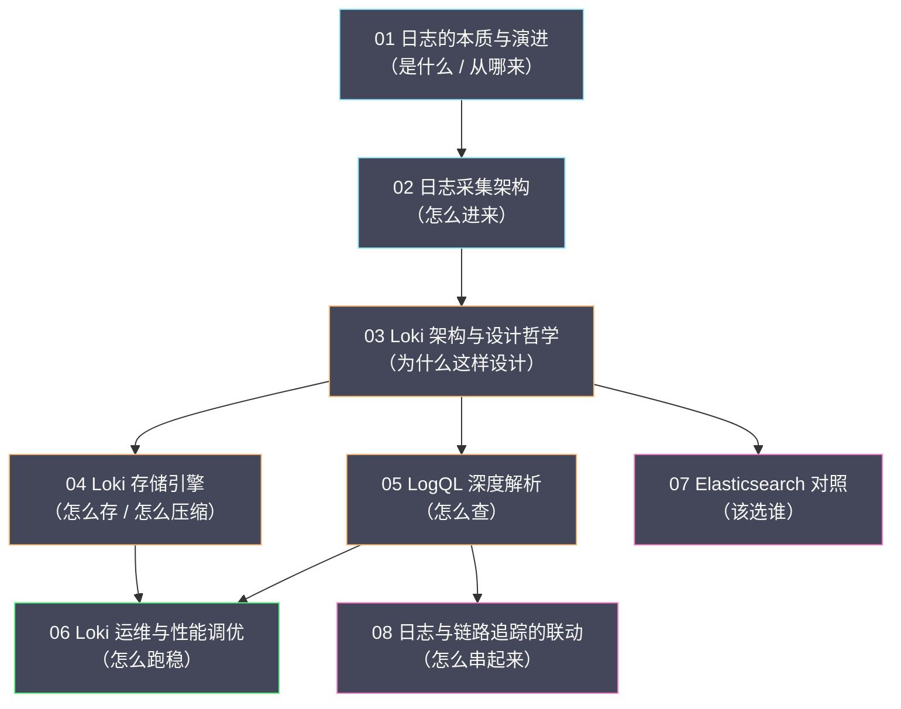

# 日志专栏导览

## 专栏定位

日志是可观测性几种信号里**历史最悠久、使用最广泛、也最容易被低估**的一种。早在"可观测性"这个词出现之前，工程师就已经在用 `printf` 排查问题了；而在指标、链路追踪、持续剖析都已成熟的今天，日志依然是定位"到底发生了什么"的最后一公里。但"能打日志"与"用好日志"之间隔着巨大的鸿沟——日志量爆炸后如何低成本存储？标签该怎么设计？查询为什么偶尔超时？日志又如何与链路追踪联动？

本专栏的目标，是让你既能理解日志的**原理**（本质、演进、存储模型、查询语言），也能掌握日志的**工程**（采集选型、标签治理、成本控制、联动落地）。原理部分讲"为什么这样设计"，工程部分讲"怎么用好它"。

## 为什么以 Loki 为主线

日志存储领域有两个绕不开的名字：Elasticsearch 与 Grafana Loki。本专栏并不回避这一点——第 07 篇会专门把两者放在一起比较。但全篇的主线放在 **Loki** 上，理由有三条。

第一，**它代表了"成本重估"这条主线**。Elasticsearch 用十年证明了"索引一切"能带来毫秒级全文检索，也暴露了这种做法的代价。Loki 用"只索引标签"重新回答了同一个问题，把成本降下一个数量级——这条"重新思考成本"的脉络，是理解现代日志存储的关键。

第二，**它把设计取舍摊在了明面上**。Loki 的每一个设计决策（只索引标签、对象存储、按标签聚类）都对应一个明确的成本或能力取舍。理解这些取舍，比记住"某个系统有什么功能"更有价值——因为取舍是通用的，而功能是具体的。

第三，**它与现网栈高度契合**。Loki 与 Grafana、Prometheus、Tempo 同属一个生态，是"用 Grafana 做统一展示"的团队的自然选择。

需要说明的是，本专栏讲 Loki，**不是要否定 Elasticsearch**，而是因为前者在"成本与规模"这条轴上提供了更多可用的选项。第 07 篇会给出"什么场景该用谁"的判断框架，而不是一句"谁更好"的结论。

## 目录

| 序号 | 文章 | 核心内容 |
|---|---|---|
| 01 | [[01 日志的本质与演进]] | 日志的定义与边界、从 syslog 到结构化日志的演进、日志级别的精确语义 |
| 02 | [[02 日志采集架构——Grafana Alloy、Promtail 与 Vector]] | Alloy / Promtail / Vector / Filebeat / Fluent Bit 的设计取舍与选型 |
| 03 | [[03 Loki 架构与设计哲学——只索引标签]] | "只索引标签"的成本决策、六个核心组件、三种部署形态、标签模型 |
| 04 | [[04 Loki 存储引擎——Chunk、索引、压缩与保留]] | Chunk 的生命周期、索引组织、压缩比的来源、保留与生命周期 |
| 05 | [[05 LogQL 深度解析]] | 日志流选择器、管道与解析器、指标查询与 unwrap、查询代价模型 |
| 06 | [[06 Loki 运维与性能调优]] | 标签治理、容量规划、查询调优、写入限流、可靠性运维与排查手册 |
| 07 | [[07 Elasticsearch 对照——Loki 的边界与选型]] | 倒排索引、ILM、ES 的成本结构，以及与 Loki 的选型决策 |
| 08 | [[08 日志与链路追踪的联动]] | Trace ID 注入与传播、Exemplar、Grafana 跨数据源跳转 |

## 知识图谱

本专栏各篇之间的关系，可以用一张图概括——从"是什么"到"怎么用"，逐层推进：

## 主线与阅读路径

本专栏的主线可以概括为一条"从信号到行动"的链路：**日志是什么（01）→ 怎么采集进来（02）→ Loki 为什么这样设计（03）→ 数据怎么存、怎么压缩（04）→ 怎么查（05）→ 怎么跑稳（06）→ 和 ES 怎么选（07）→ 怎么与链路串起来（08）**。第 01 篇是全篇的立论基础，第 03 篇是全篇的认知枢纽。

按需求选择路径：

- **快速建立认知**：01 → 02 → 03。
- **深入存储与查询**：03 → 04 → 05。
- **运维与排障**：03 → 06 → 07。
- **完整通读**：01 → 02 → 03 → 04 → 05 → 06 → 07 → 08。

## 贯穿全篇的四条判断

本专栏不追求罗列知识点，而是围绕四条判断展开，先在这里点出，便于阅读时留意：

1. **结构化是一切收益的起点**。无论后端选 Loki 还是 ES、采集器选 Alloy 还是 Fluent Bit，把非结构化文本变成结构化事件，都是所有检索、聚合、联动能力的地基。
2. **成本是设计出来的，不是优化出来的**。Loki 比 ES 便宜一个数量级，靠的不是参数调优，而是"只索引标签 + 对象存储"这两个根本的架构选择；同理，日志降本最有效的方向是治理数据源头。
3. **标签设计是架构决策，不是配置细节**。一个错误的高基数标签能拖垮整个集群，而基数同时作用于内存、索引、查询三条成本线——因此标签治理是一项长期运维职责。
4. **工具没有对错，只有匹配与否**。Loki 与 ES 不是"谁替代谁"，而是"谁更适合哪一类查询分布"；选型的第一步，永远是看清自己的需求。

## 关联专栏

- [[可观测/指标/00 专栏导览|指标与 VictoriaMetrics]]：指标与日志的分工，以及 Exemplar / Trace ID 的联动。
- [[可观测/链路追踪/00 专栏导览|链路追踪]]：Trace ID 的注入、传播与跨服务关联。
- [[可观测/Profiler/00 专栏导览|持续剖析]]：日志、链路之外的第四种信号，从代码级定位性能问题。
- [[中间件/Elasticsearch/00 专栏导览|Elasticsearch]]：作为日志存储后端时的检索引擎原理。
- [[云原生/Kubernetes/kubernetes生产实践与集群管理/00 专栏导览|Kubernetes 生产实践]]：容器日志的采集架构与运维。
- [[可观测/00 可观测性全景导览|可观测性全景导览]]：本专栏在可观测性体系中的位置。
