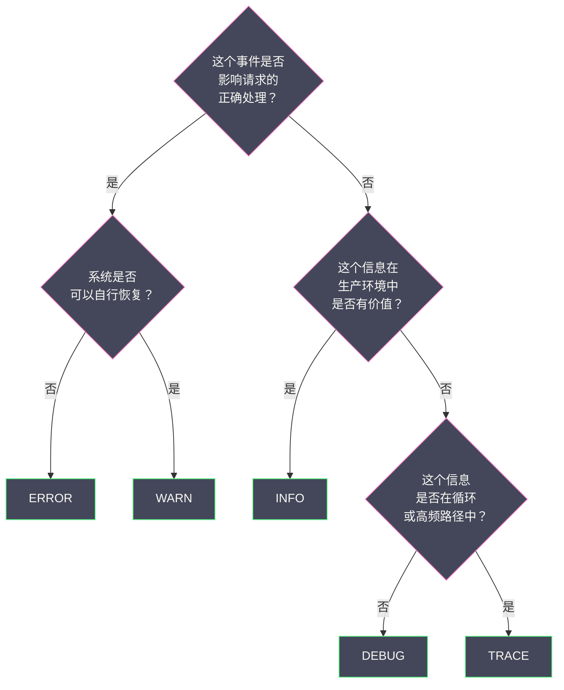
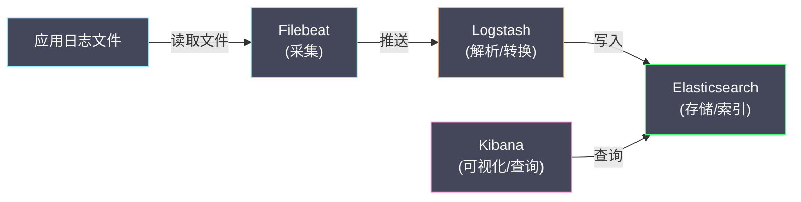

# 01 日志的本质与演进

**摘要：**

日志是软件系统中最古老的可观测性手段——早在"可观测性"这个词出现之前，工程师就已经在用 `printf` 排查问题了。但正因为太过日常，日志的工程实践反而最容易被忽视：级别滥用、非结构化文本无法检索、日志量失控打满磁盘、多实例环境下日志散落在几十台机器上无法关联。本文从"日志"这个词的词源讲起，先给出日志的本质定义与边界，再沿时间线梳理从 Unix syslog 到 Java 日志框架的混乱与统一、再到结构化日志的演进脉络，随后深入日志级别的精确语义、从单机 grep 到集中式平台的四次架构跃迁，最后落到结构化日志的设计代价、常见反模式与边界反例。读完之后，你应当能回答两个问题：**日志这种"最便宜也最昂贵"的信号，究竟该在什么位置承担什么职责；以及为什么把非结构化文本变成结构化事件，是日志工程一切收益的起点**。

---

## 第 1 章 日志的本质：离散事件的文本记录

### 1.1 一个航海术语的迁移

在讨论技术之前，不妨先看一个常被忽略的事实：「日志」这个词本身并非源自计算机，而是来自十六世纪的航海业。那时的水手为了估算船速，把一块系着打结绳子的木板（log）从船头抛入海中，任由船身驶离，再数一定时间内放出的绳结数目——绳结越多，船速越快。船长把每次测量的结果记在一块专用的木板上，再誊抄成册，这本册子就叫 **航海日志（log book）**。

这个朴素的实践里已经埋下了日志的全部基因：**它是按时间顺序记录离散事件的册子**，记录的目的不是"当前状态如何"，而是"在过去某个时刻发生了什么"。三百年后，当 Unix 系统需要记录内核与守护进程的行为时，它们借用了这个词——`/var/log` 目录下的文件，本质就是一台机器的航海日志。理解这层词源，比任何技术定义都更能说明日志是什么：它是一台系统按时间留下的**事件流水账**。

### 1.2 日志的三要素

形式化地说，**日志（Log）** 是系统在运行过程中产生的**带时间戳的离散事件记录**。这个定义里藏着三个不可省略的关键词，缺了任何一个，它就不再是工程意义上的日志。

**第一，带时间戳**。每条日志都携带着它发生的时间（通常精确到毫秒或微秒）。时间戳是日志能按序排列、能还原事件因果、能与指标和链路对齐的前提。一段没有时间戳的文本输出只是调试打印，不是日志——你无法判断它属于哪一次请求，也无法把它放进任何一条时间线。

**第二，离散事件**。日志记录的是一个个彼此独立的事件："用户登录成功"、"数据库查询耗时 150 毫秒"、"连接超时"。这与指标有着根本区别——指标记录的是**连续的数值变化**（CPU 使用率从 30% 升到 80%），而日志记录的是**不可预测的、稀疏发生的**事件。事件的稀疏性是日志存储成本高企的直接原因：你无法像对待指标那样"每 15 秒记一个数"，因为事件什么时候发生是未知的。

**第三，文本记录**。日志的载体是文本——人类可读或机器可解析的字符串。文本是日志最大的优势（灵活、任意上下文都能塞进去），也是它最大的劣势（缺乏结构，难以高效检索与聚合）。后面几章会反复回到这个张力上：日志工程的大部分工作，本质上都是在与"文本"这个载体的松散性作斗争。

### 1.3 日志与另外两种信号的边界

把日志与指标、链路追踪并排比较，边界会清晰很多。

| 维度 | 日志（Logs） | 指标（Metrics） | 链路追踪（Traces） |
|---|---|---|---|
| **数据形态** | 离散事件文本 | 连续数值时间序列 | 请求级调用树 |
| **信息密度** | 高（可含任意上下文） | 低（只有数值） | 中（结构化但字段有限） |
| **数据量** | 极大（每事件一条） | 小（预聚合） | 大（每请求一棵树） |
| **查询模式** | 过滤 + 全文搜索 | 范围聚合（avg/sum/quantile） | 按 Trace ID 点查 |
| **典型问题** | "这次请求为什么失败？" | "过去一小时错误率多少？" | "这个请求经过了哪些服务？" |
| **存储成本** | 最高 | 最低 | 高 |

这张表里最值得咀嚼的是**成本**与**信息密度**这两行。日志的成本最高、信息密度也最高，这不是巧合，而是一体两面：正因为日志允许工程师记录任何认为有用的东西（请求参数、响应体、异常堆栈、业务状态），它才既灵活又昂贵。指标做了主动的降维，因此便宜；链路追踪做了结构化的裁剪，因此适中。**三种信号的差异，本质上是"记录什么"与"放弃什么"的不同取舍**。

> [!info] 一个容易混淆的点
> 访问日志（Nginx access log）看起来像是"结构化的日志"，确实如此——它有固定的字段顺序。但它的字段是**位置约定**（第几个字段是状态码）而非**命名约定**（哪个字段叫 status），因此解析时仍要依赖正则或分隔符规则。真正的结构化日志指的是字段有明确名字、可被解析器直接映射的格式，这一点在第 4 章会展开。

### 1.4 日志的五种来源

从来源与用途看，生产环境里的日志可以粗分为五类，它们的生命周期、保留策略与合规要求各不相同：

**应用日志（Application Log）**：应用代码通过日志框架（如 Logback、Log4j2、Zap）输出的日志，内容由开发者决定，包含业务信息、异常堆栈、调试细节。这是本专栏的主要关注对象，也是"日志工程"真正要治理的部分。

**访问日志（Access Log）**：Web 服务器、网关、负载均衡器自动记录的每个请求的信息，通常包含客户端 IP、方法、路径、状态码、耗时。格式相对固定，量极大，是流量分析与安全审计的重要来源。

**系统日志（System Log）**：操作系统内核与系统服务（systemd、cron、内核）产生的日志，通过 [[中间件/Elasticsearch/00 专栏导览|syslog]] 体系管理，内容包括启动、服务状态变更、硬件错误。

**审计日志（Audit Log）**：记录"谁在什么时间做了什么操作"，服务于安全审计与合规，通常要求不可篡改、长期保留、独立存储，不能与业务日志混在一起。

**数据库日志（Database Log）**：数据库内部的工作日志，如 MySQL 的慢查询日志、binlog，PostgreSQL 的 WAL。它们往往同时承担"运维观测"与"数据恢复"两种职责，因此不完全是可观测性信号。

这五类日志的**治理策略不应一刀切**。应用日志可以采样、可以短保留；审计日志不能采样、必须长保留；数据库日志的格式由数据库决定，采集端只能被动适配。把它们混在同一条采集链路、同一套保留策略里，是很多团队日志成本失控的起点。

### 1.5 谁会读你的日志

一条日志的"消费者"往往被默认成"出事的工程师"，但真实情况远比这复杂。同一条日志可能同时服务于五类读者，而每类读者对它的要求并不相同：

- **值班工程师**：在故障中快速定位，要求"关键字段齐全、可被过滤、堆栈完整"。
- **监控系统**：按关键字或字段计数并触发告警，要求"字段稳定、级别准确、格式可解析"。
- **数据分析**：做流量、转化、行为分析，要求"字段语义清晰、维度可聚合"。
- **审计与合规**：还原"谁在何时做了什么"，要求"不丢、不可篡改、长期保留"。
- **机器学习 / AIOps**：做异常检测与聚类，要求"历史数据量大、模式稳定"。

五类读者对"什么算好日志"的答案并不一致，甚至互相冲突——数据分析想要更多维度，而成本与合规要求更少。这解释了一个常见的困境：**日志设计往往不是技术问题，而是"为谁服务"的优先级问题**。在动手设计日志规范之前，先想清楚"主要读者是谁"，比套用任何一份最佳实践都更重要。

---

## 第 2 章 从 printf 到结构化日志：日志技术的演进

### 2.1 史前时代：printf 与 stderr

最早的"日志"就是把信息直接打到标准输出或标准错误：

```c
/* 最早的"日志"：直接写 stderr */
fprintf(stderr, "ERROR: failed to connect to db, errno=%d\n", errno);
```

这种方式的问题今天看来一目了然：没有级别（无法区分致命错误与调试信息）、没有结构（所有信息挤在一个字符串里）、没有持久化（进程退出即丢失）、没有轮转（文件无限增长直到磁盘打满）。但在单机、单进程、人工盯屏的年代，它够用——因为"读日志的人"和"写日志的人"是同一个开发者，上下文不需要写下来。

### 2.2 Unix syslog：第一个日志标准

转折发生在 1980 年代。Eric Allman 在开发 Sendmail 邮件服务器时，意识到"每个程序各自写文件"在系统层面无法管理，于是创造了 **syslog**——Unix/Linux 世界中第一个标准化的日志系统。syslog 引入了两个沿用至今的核心概念：

**Facility（设施）**：日志的来源类别，如 `kern`（内核）、`mail`（邮件）、`auth`（认证）、`local0`~`local7`（自定义）。

**Severity（严重级别）**：日志的严重程度，定义了八个级别。

| 数值 | 关键字 | 名称 | 含义 |
|---|---|---|---|
| 0 | emerg | Emergency | 系统不可用 |
| 1 | alert | Alert | 必须立即处理 |
| 2 | crit | Critical | 严重错误 |
| 3 | err | Error | 错误 |
| 4 | warning | Warning | 警告 |
| 5 | notice | Notice | 正常但值得注意 |
| 6 | info | Informational | 信息性消息 |
| 7 | debug | Debug | 调试信息 |

syslog 更重要的贡献是它的**架构**：把日志的**产生**与日志的**处理**分离。应用通过 syslog API 把日志交给一个本地守护进程（`syslogd`、`rsyslog`、`syslog-ng`），由守护进程统一决定写入哪个文件、是否转发到远程、按什么规则过滤。这种"应用只负责发、守护进程负责收"的分离式设计，是现代日志架构的雏形——今天所有集中式日志系统，本质上都是这套分离思想在规模上的放大。

顺带一提，syslog 的严重级别后来被 IEEE 收录进 **RFC 3164**（BSD syslog 协议），又在 2009 年被 **RFC 5424** 重新规范。RFC 5424 修正了旧协议里时间戳缺失年份、消息长度受限等历史缺陷，也定义了结构化数据（Structured Data）字段——这是"在日志协议层面支持结构化"的第一次尝试。

### 2.3 Java 日志框架的混乱与统一

Java 生态的日志框架走过一段特别混乱的路，理解它有助于理解今天 Java 日志体系为什么长成"门面 + 实现"的分层结构。

**第一阶段：JDK Logging（JUL）**。Java 1.4（2002 年）在标准库中引入 `java.util.logging`。但它 API 设计不直观（级别叫 `SEVERE`、`FINE` 而非 `ERROR`、`DEBUG`），默认配置不便，很快被社区冷落。

**第二阶段：Log4j 1.x 的统治**。Apache Log4j（2001 年发布）凭借更好的 API、更灵活的配置（XML/properties 配置 Appender、Layout、Filter）、更丰富的输出目标（文件、控制台、远程 syslog、SMTP），迅速成为事实标准。

**第三阶段：SLF4J 的抽象层**。到 2005 年，生态里 JUL、Log4j 1.x、commons-logging 三个框架并存，不同的第三方库依赖不同的框架，同一个应用里被迫配置多套日志系统。Ceki Gülcü（Log4j 原作者）创造了 **SLF4J（Simple Logging Facade for Java）**——一个纯粹的日志门面，只定义 API、不提供实现。应用代码只依赖 SLF4J API，具体实现通过运行时绑定注入：

```java
import org.slf4j.Logger;
import org.slf4j.LoggerFactory;

public class OrderService {
    private static final Logger logger = LoggerFactory.getLogger(OrderService.class);

    public void createOrder(Order order) {
        // {} 是参数化占位符：级别未开启时不会求值参数，避免无谓的字符串拼接
        logger.info("创建订单: orderId={}, userId={}", order.getId(), order.getUserId());
    }
}
```

SLF4J 的设计与后来的 OpenTelemetry"API 与 SDK 分离"异曲同工——库的开发者只依赖轻量的门面 API，应用的开发者再选择具体实现。这套分层把"库依赖什么"与"应用用什么"解耦，是 Java 日志生态能收敛的根本原因。

**第四阶段：Logback 与 Log4j2 的双雄**。**Logback**（2006 年，Ceki Gülcü 的 SLF4J 原生实现，Spring Boot 默认）与 **Log4j2**（2014 年，Apache 重写，基于 Disruptor 的异步日志，性能优秀）成为主流实现。今天 Java 生态的标准架构就是：**SLF4J（门面）+ Logback 或 Log4j2（实现）**。

> [!warning] 2021 年的 Log4Shell
> Log4j2 在 2021 年爆出的 Log4Shell 漏洞（CVE-2021-44228）是一次深刻教训：日志框架为了"灵活"而支持在日志字符串里做 JNDI 查找，反而把一条日志变成了远程代码执行入口。它提醒我们，**日志框架的"便利特性"也是攻击面**，越是处理不可信输入的组件（而日志恰恰经常记录用户输入），越要警惕这类"隐式求值"。安全团队至今仍把 Log4j2 的版本检查列为常规巡检项。

### 2.4 结构化日志：把文本变成事件

传统日志是非结构化的文本行：

```
2024-01-01 10:00:00.150 INFO  [http-nio-8080-exec-1] c.e.OrderService - 创建订单: orderId=789, userId=456, amount=99.5
```

这行对人类很友好，对机器却很糟糕。想搜"所有 userId=456 的订单创建日志"，只能对整行做正则匹配——而在 TB 级日志上做正则扫描，性能是灾难性的。

**结构化日志（Structured Logging）** 把每个字段以明确的键值对记录，最常见的是 JSON：

```json
{
  "timestamp": "2024-01-01T10:00:00.150Z",
  "level": "INFO",
  "thread": "http-nio-8080-exec-1",
  "logger": "com.example.OrderService",
  "message": "创建订单",
  "orderId": "789",
  "userId": "456",
  "amount": 99.5,
  "traceId": "abc123def456"
}
```

结构化带来的收益是连锁的：字段可被采集器直接解析（不需要 Grok 正则）、可被存储后端按字段过滤、可精确匹配而非模糊搜索，并且 `traceId` 作为独立字段能被索引，直接支撑从日志跳转到链路追踪。**这就是为什么"结构化"是日志工程一切收益的起点**——它把一个只能被人类阅读的字符串，变成了一个机器可以切片、聚合、关联的数据对象。

结构化当然也有代价。JSON 因为重复的字段名，体积通常比纯文本大 30%~50%；一行 JSON 不如格式化文本直观（但可以借 `jq` 之类的工具还原）；而且它要求全团队统一——如果只有部分服务用结构化日志，日志平台就得同时处理两种格式。除了 JSON，**logfmt**（`key=value` 空格分隔）也是一种轻量选择，它在"人类可读"与"机器可解析"之间取了一个不同的平衡点，被 Go 生态的许多服务青睐。

> [!note] 迁移的工程建议
> 新项目应当**从第一天就用结构化日志**。存量项目的迁移可以分两步：第一步，统一到 SLF4J + Logback/Log4j2 的门面与实现；第二步，把 Layout 切换为 JSON（Logback 用 `LogstashEncoder`，Log4j2 用 `JsonLayout`），让日志在输出端就带上结构。第二步可以按服务灰度推进，因为采集端同时兼容两种格式。

### 2.5 一个贯穿案例：一次下单的日志如何长成

把上述演进放进一个具体场景，会更直观。设想订单服务处理一次下单：

- **史前时代**：`System.out.println("creating order " + orderId)`——只有一行文本，出事后无从检索。
- **syslog 时代**：`logger.info("creating order " + orderId)` 写入本地文件，工程师 SSH 上去 `grep orderId`——单机可行，多实例崩溃。
- **结构化时代**：输出 JSON，把 `orderId`、`userId`、`traceId`、`durationMs` 都变成字段——采集器直接解析，Loki 或 Elasticsearch 按 `orderId` 精确查询，并借 `traceId` 跳到链路。
- **联动时代**：同一条日志被 [[可观测/日志/05 LogQL 深度解析|LogQL]] 的指标查询直接聚合成"下单失败率"曲线，与 [[可观测/指标/00 专栏导览|指标]] 体系无缝衔接。

同一次下单，日志从"一行给人看的文本"逐步演化为"一条机器可用的事件"。这条演进线，就是本专栏后面几篇要逐层拆开的主线。

### 2.6 日志轮转：被忽视的基础设施

结构化、级别、格式，这些讨论的都是"日志长什么样"的问题，但还有一类问题同样致命却常被忽略——日志文件本身的生命周期。如果应用把日志写进一个文件而无人管理，它会一直增长，直到磁盘打满、进程崩溃。承担这项职责的基础设施是**日志轮转（Log Rotation）**。

最经典的工具是 `logrotate`（Unix 系统上的标准组件）。它的工作方式是"按大小或时间触发"：当一个日志文件达到阈值（如 100 MB）或跨过一天，就把它重命名归档（`app.log` → `app.log.1`），再让应用重新打开一个新的 `app.log`；同时按配置保留最近 N 个归档，更早的自动删除。

```text
/var/log/myapp/*.log {
    daily              # 每天轮转一次
    rotate 7           # 保留 7 个归档
    size 100M          # 或达到 100MB 时轮转
    compress           # 归档压缩
    missingok          # 文件不存在不报错
    copytruncate       # 复制后清空原文件（对不支持重开的应用友好）
}
```

轮转里藏着一个经典陷阱：**`copytruncate` 与"应用重开文件"两种策略的取舍**。`copytruncate` 先复制再清空原文件，对不支持信号重开的应用最友好，但复制与清空之间写入的日志可能丢失；而"应用收到信号后重开文件"不会丢日志，却要求应用实现了 `SIGHUP` 处理。这个细节之所以重要，是因为它揭示了日志基础设施的一条通用规律：**采集端与写入端必须就"文件何时被切割"达成一致**，否则就会出现漏读或重复读——这正是下一篇文章里采集器要靠 inode 与 offset 来追踪文件的原因。

### 2.7 从同步到异步：日志写入的性能账

结构化与级别解决了"日志长什么样"，但还有一笔性能账要算：**日志写入本身会不会拖慢业务**。默认情况下，日志框架的 Appender 是**同步**的——业务线程调用 `logger.info()` 之后，要等日志真正落到磁盘（或控制台）才继续执行。在低延迟服务里，一次磁盘写或一次控制台输出的耗时，可能比业务逻辑本身还长。

解法是**异步 Appender**。Logback 提供 `AsyncAppender`，Log4j2 则内置基于 **Disruptor** 的无锁环形队列。其原理是把"写日志"这个动作从业务线程剥离：业务线程只把日志事件放进一个队列就返回，由后台线程负责真正写盘，业务线程的日志开销因此从"一次 I/O"降到"一次入队"。

异步并非没有代价。**队列满时的策略**是关键：丢弃（`discardingThreshold`）会丢日志，阻塞则把压力传回业务线程，两种选择都必须在"绝不丢日志"与"绝不阻塞业务"之间做取舍。还有一个常被忽略的细节：**崩溃时队列里的日志会丢失**，因为它们仍在内存中尚未落盘。因此，审计类、合规类日志通常不走异步，或者在异步之外额外做同步落盘。这笔账没有标准答案，取决于这条日志"丢了会怎样"。

---

## 第 3 章 日志级别的精确语义

### 3.1 级别为什么重要

日志级别不是装饰品，而是日志系统最重要的元数据之一。正确的级别让三件事成为可能：生产环境可以按级别过滤（只输出 WARN 及以上），降低日志量与存储成本；日志平台可以按级别告警（出现 ERROR 即触发）；排查时可以通过配置中心动态开启某个 Logger 的 DEBUG，而不改代码、不重启。

反过来说，级别一旦被滥用——把所有日志都标成 INFO，或把正常业务流程标成 ERROR——上述能力就全部失效了。级别是"人与日志之间的一份契约"，破坏契约的代价是整条链路失去信号价值。

### 3.2 五个级别的精确语义

以 SLF4J 的五个级别（由低到高：TRACE、DEBUG、INFO、WARN、ERROR）为准，逐一厘清它们的语义与适用场景。

**TRACE：最细粒度的执行轨迹**。用于记录代码执行的极细粒度路径，如方法进出、循环轮次。生产环境**永远不应开启**——它产生的日志量比 DEBUG 还高一个数量级。

```java
logger.trace("进入方法 calculateDiscount, userId={}", userId);
```

**DEBUG：开发调试信息**。记录对开发者有用的中间状态、输入输出、分支走向。生产默认关闭，排查时按需临时开启。

```java
logger.debug("缓存命中: key={}", cacheKey);
```

**INFO：关键业务事件**。生产默认级别，记录"系统心跳"级别的事件，靠它就能了解系统正常运行时在做什么。

```java
logger.info("订单创建成功: orderId={}, amount={}", orderId, amount);
```

**WARN：可恢复的异常状态**。系统遇到非预期情况，但能自行恢复，不影响当前请求的正确处理。WARN 不需要立即处理，但应定期审查——某个 WARN 大量出现往往意味着系统正在缓慢恶化。

```java
logger.warn("缓存不可用，降级为数据库查询: host={}", cacheHost);
```

**ERROR：不可恢复的错误**。系统遇到无法自行恢复的错误，当前请求或操作失败了。ERROR 通常应配合告警。

```java
logger.error("数据库连接失败: host={}", dbHost, exception);
```

### 3.3 级别的判定决策树

级别判断中真正困难的，是"这算 WARN 还是 ERROR"、"这算 INFO 还是 DEBUG"这类边界问题。下面这棵决策树给出了一条可复用的路径：



这棵树的第一个分叉点——"是否影响请求的正确处理"——是级别判断的关键。很多 ERROR 误用都源于把"让我不舒服的事"当成了"影响请求的事"：用户输入校验失败、第三方接口返回了一个业务码，这些都不影响请求被正确处理（服务已经优雅地拒绝了它），应当是 WARN 甚至 INFO，而不是 ERROR。**把业务失败误报为 ERROR，会让 ERROR 告警迅速被噪声淹没**。

### 3.4 两种典型的级别滥用

**滥用一：在循环体内打 INFO**。若循环执行一万次，就产生一万条 INFO。正确做法是循环内用 DEBUG，循环后用一条 INFO 汇总总量与耗时。

**滥用二：把"请求到达"和"请求完成"都打 INFO**。对 QPS 一万的服务，这意味着每秒两万条 INFO。应只在请求完成时打一条（含耗时），或干脆交给访问日志。

```java
// 错误：循环里打 INFO
for (Item item : items) {
    logger.info("处理商品: itemId={}", item.getId());
    process(item);
}

// 正确：循环内 DEBUG，循环后 INFO 汇总
for (Item item : items) {
    logger.debug("处理商品: itemId={}", item.getId());
    process(item);
}
logger.info("批量处理完成: totalItems={}, durationMs={}", items.size(), duration);
```

### 3.5 动态调级：生产环境的"临时放大镜"

级别之所以设计成可配置，核心目的是为了**在不重启、不改代码的前提下临时放大观测范围**。当线上出现一个难以复现的问题时，工程师希望把某个 Logger 从 INFO 降到 DEBUG，看清内部状态，排查完再调回去。

实现动态调级的常见路径有三条，复杂度依次上升：

- **配置中心 + 定时刷新**：把级别放进配置中心（Nacos、Apollo、Consul），应用定时拉取并调用日志框架 API（如 Logback 的 `LoggerContext.setLevel`）动态修改。实现简单，适合大多数场景。
- **管理端点触发**：Spring Boot Actuator 的 `/loggers` 端点允许通过 HTTP 查询与修改任意 Logger 的级别，适合快速应急。
- **信号触发**：通过 `SIGUSR1` 之类的信号让应用重载日志配置，适合没有配置中心的场景。

动态调级有一个必须警惕的副作用：**放大观测范围会同时放大日志量**。把一个高频 Logger 调到 DEBUG，可能在几秒内把日志量推高两个数量级，进而压垮采集端或后端。因此工程上的惯例是"调级 + 限时"——调级时设定一个自动回退的时长（如 30 分钟），避免"忘了调回去"本身变成一次新的故障。

### 3.6 级别在不同系统间的映射

级别并非只有一套实现。syslog 定义了八个级别，SLF4J 定义了五个，Python 的 `logging` 模块定义了六个（额外有 `CRITICAL`），Go 的标准库则长期没有内建级别。当日志从一种系统流向另一种系统时，级别需要被映射，而映射的细节常常带来困惑。

| 语义 | syslog | SLF4J | Python | JUL |
|---|---|---|---|---|
| 最严重 | emerg / alert / crit | ERROR | CRITICAL | SEVERE |
| 错误 | err | ERROR | ERROR | SEVERE |
| 警告 | warning | WARN | WARNING | WARNING |
| 信息 | info / notice | INFO | INFO | INFO |
| 调试 | debug | DEBUG | DEBUG | FINE |
| 追踪 | — | TRACE | — | FINEST |

这张表里最值得注意的是**多对一的映射**：syslog 的 `emerg`、`alert`、`crit` 在 SLF4J 里都归入 `ERROR`，信息因此被压缩。这意味着一条 syslog 的 `crit` 和一条 `err` 流入 Java 体系后可能变得难以区分——如果区分它们很重要，就必须把原始级别保留在字段里，而不能只依赖映射后的级别。

这也解释了为什么现代日志规范倾向于**保留原始级别字段**，而不是在采集时把它"翻译"成目标系统的级别。级别是语义，不是标签——一旦翻译，就丢失了原系统的表达力。

---

## 第 4 章 从单机到集中式：日志架构的四次跃迁

### 4.1 阶段一：本地文件 + SSH + grep

最原始的方式：应用写本地文件（`/var/log/myapp/app.log`），工程师 SSH 上去用 `grep`、`tail`、`awk` 查看。

```bash
tail -100 /var/log/myapp/app.log
grep "ERROR" /var/log/myapp/app.log
```

单机部署时够用，微服务加多实例后彻底崩溃：五十个服务各四个实例就是两百台机器，逐个 SSH 不现实；不同机器时钟漂移（NTP 未同步时），日志时间对不齐；实例扩缩容、机器重启后，本地日志随之消失。**本地日志的根本问题是"日志的生命周期绑在了进程所在的机器上"**，而机器的生命周期远短于故障复盘所需的窗口。

### 4.2 阶段二：rsyslog + 集中存储

syslog 协议天然支持远程传输：应用把日志交给本地 rsyslog，rsyslog 转发到中央日志服务器。

```
应用 → rsyslog（本地）→ rsyslog（中央）→ 日志文件
```

这解决了"日志散落各机"的问题，但中央服务器上仍是纯文本文件，搜索效率低，且中央节点成了单点——一旦它宕机或磁盘打满，整条链路断掉。这个阶段的本质是**把"分散"换成了"集中"，却没有解决"检索"**。

### 4.3 阶段三：ELK 栈——日志平台的标配

2012 年前后，[[中间件/Elasticsearch/00 专栏导览|Elasticsearch]] + Logstash + Kibana 的组合成为业界事实标准，彻底改变了日志的使用方式。



ELK 每个组件各司其职：Filebeat 部署在每台机器上监控文件增量并推送；Logstash 负责解析（用 Grok 从非结构化文本里抽字段）、转换、路由；Elasticsearch 建立**倒排索引**，把"搜索"变成集合交集运算，实现毫秒级全文检索；Kibana 提供浏览器中的搜索与仪表盘。**ELK 的突破在于它给日志建了全文索引**——工程师不再需要预先知道字段在哪，任意关键词都能被搜到。

但全索引的代价也埋在了这里：Elasticsearch 对每个字段都建倒排索引，索引体积常与原始数据等大甚至更大，写入时要分词、要构建索引，CPU 与存储成本双高。日志量一旦上去，ELK 的账单会让很多团队重新思考。这条成本曲线，直接催生了下一个阶段。

### 4.4 阶段四：Loki——重新定义日志存储的经济学

2018 年，[[可观测/日志/03 Loki 架构与设计哲学——只索引标签|Grafana Loki]] 由 Grafana 团队发布，提出了一个完全不同的哲学：**只索引标签，不索引正文**。

```
Elasticsearch：索引一切 → 任何字段毫秒级可搜 → 存储与计算成本高
Loki：只索引标签（service、level 等），正文只压缩存储不索引
      查询时先按标签过滤出候选日志流，再在候选范围内做全文匹配
      → 标签查询毫秒级，正文搜索秒级 → 存储成本低一个数量级
```

Loki 的核心赌注是：**日志的大部分价值在于"能查到"，而不是"能毫秒级查到"**。它把"毫秒级"降为"秒级"，换来十倍以上的成本下降，并借对象存储（S3、GCS、MinIO）替代昂贵的本地磁盘。这与 [[可观测/指标/00 专栏导览|Prometheus 的指标存储哲学]]一脉相承——Loki 与 Prometheus 团队有大量人员重叠，那句 "Like Prometheus, but for logs" 正是这层渊源的自我描述。

Loki 的完整设计（标签模型、Chunk 存储、LogQL、运维调优）是本专栏第 03 到 06 篇的主题，此处先建立"四次跃迁"的整体印象：**每一次架构演进，都是在"检索能力"与"成本"之间重新找平衡点**——本地 grep 成本最低但不可用，rsyslog 解决了集中但没解决检索，ELK 解决了检索但成本高，Loki 则在承认"正文不必全索引"的前提下把成本拉回可接受区间。

### 4.5 一条日志的旅程：流水线的五个阶段

无论后端是 ELK 还是 Loki，一条日志从"被打印"到"能被查询"，都要经过一条形态基本相同的流水线。理解这条流水线，是理解后续所有采集、存储、查询话题的共同地基。

- **采集（Collect）**：采集器从文件、stdout、socket 等来源读取日志，并记录读取位置，保证不丢不重。
- **解析（Parse）**：把非结构化文本解析成字段（JSON、logfmt、正则、多行合并），或从已有内容里提取元信息（时间戳、级别）。
- **富化（Enrich）**：补充日志本身没有的上下文，最常见的是从 Kubernetes API 注入 Pod、Namespace、Label 等元数据。
- **路由（Route）**：按标签或内容把日志分流到不同后端（应用日志进 Loki，审计日志进独立的合规存储）。
- **传输（Transport）**：通过 HTTP、gRPC、Kafka 等协议把日志送到后端，并处理重试、背压与本地缓冲。

这五个阶段里，**采集与解析决定了日志的"下限"，富化与路由决定了日志的"可用性"，传输决定了整条链路的"可靠性"**。下一篇文章会以这五个阶段为骨架，逐一比较 [[可观测/日志/02 日志采集架构——Grafana Alloy、Promtail 与 Vector|主流采集器]] 在设计上的取舍。

### 4.6 时钟、顺序与"时间线幻觉"

集中式日志最容易被想当然的一件事，是"日志按时间排好序了"。真实情况要复杂得多：日志的时间戳由**产生它的那台机器**写下，而集群里各台机器的时钟并非严格一致——NTP 同步通常有毫秒到几十毫秒的偏差，若同步失效，偏差可能达到秒级甚至更多。

这会带来一个隐蔽的后果：当你把 A 机器 10:00:00.100 的日志和 B 机器 10:00:00.050 的日志按时间戳合并时，你看到的"先后"未必是真实的因果先后。排查跨服务问题时，如果过度信任时间线，就可能把"结果"误判成"原因"。

对抗这种"时间线幻觉"的手段有几条：其一，**保证 NTP 同步并监控时钟偏移**，这是所有时序数据的地基；其二，**在日志里带上单调时钟或序列号**（如同一实例内递增的序号），用于同一实例内的精确定序；其三，**跨服务定序优先依赖 `traceId` 与 Span 的父子关系**，而不是单纯依赖时间戳——这正是链路追踪相对日志的一个结构性优势。理解了时间戳的局限，才不会被一条看起来严丝合缝的时间线误导。

---

## 第 5 章 结构化日志的设计与代价

### 5.1 字段命名：一份跨服务的契约

结构化日志的收益来自"字段可被机器处理"，而这个收益的前提是**字段命名一致**。如果同一个语义在 A 服务里叫 `userId`、在 B 服务里叫 `user_id`、在 C 服务里叫 `uid`，那么跨服务的聚合查询就无从写起——你得为每个服务各写一份查询。

OpenTelemetry 的**语义约定（Semantic Conventions）**正是为此而生：它规定了一套跨信号的统一属性名（如 `service.name`、`http.status_code`、`trace_id`），让"同一个语义在所有服务里叫同一个名字"。哪怕不引入 OTel，团队也应当维护一份内部字段字典，把常用的字段名固定下来。**命名规范的成本在事前，收益在事后**——它决定了故障时你能否一条查询覆盖所有服务。

### 5.2 上下文：日志的"最后一公里"

结构化日志最容易被浪费的能力，是它可以携带**任意上下文**。一条 `logger.error("支付失败")` 几乎没有价值，而一条带 `orderId`、`userId`、`channel`、`errorCode`、`traceId` 的日志，能在事故复盘中一次性回答"谁、在哪、为什么失败"。上下文不是"越多越好"（那会撑大体积），而是"关键维度不能少"——通常包括：请求标识（`traceId`、`requestId`）、业务标识（`orderId`、`userId`）、结果（`status`、`errorCode`）、耗时（`durationMs`）。

> [!info] 上下文与基数的张力
> 这里有一个与指标共通的陷阱：**不要把所有上下文都提升为索引字段**。把 `userId`、`orderId` 作为 Loki 标签或 Elasticsearch 的 `keyword` 索引，会制造高基数，压垮存储。正确做法是把它们留在**正文**里，查询时用 `| json | userId="456"`（Loki）或全文检索（ES）来过滤。上下文"记录"与上下文"索引"是两件事。

### 5.3 日志的三笔成本

结构化日志并不免费，它有三笔账：

- **采集成本**：采集器要在每个节点上读文件、解析、传输，节点越多、日志越密，采集端资源占用越高。
- **存储成本**：与日志量、保留时长、是否建索引直接相关。全索引（ES）成本最高，只索引标签（Loki）成本最低。
- **认知成本**：字段越多，团队越需要统一的字典与规范，否则"结构化"只是把混乱从文本搬进了字段。

这三笔账由同一个变量主导——**日志量与结构化的程度**。这也解释了一个反直觉的结论：**日志治理的第一要务不是买更大的存储，而是减少不必要的日志**。一条在循环里被打印一万次的 DEBUG，无论后端多便宜，都是纯浪费。

### 5.4 采样：在成本与完整性之间取舍

当日志量确实降不下来时，**采样（Sampling）**是常用的杠杆。三种常见策略各有适用面：

- **按比例采样**：随机丢弃一定比例的日志（如保留 10%）。实现最简单，但可能恰好丢掉那条关键的堆栈。
- **按级别采样**：INFO/DEBUG 高比例采样，WARN/ERROR 全量保留。保住了异常的可追溯性，是生产环境的常见做法。
- **按 Trace 采样**：以 `traceId` 为粒度决定"这条请求的日志是否全量保留"。链路追踪系统常用这种"头部采样/尾部采样"策略，日志侧可以与之对齐，保证"被采样的那条请求，它的日志、链路、指标都完整"。

采样本质上是在"成本"与"完整性"之间做取舍，而取舍的依据是**你要回答的问题需要多完整的数据**。对"整体趋势"而言，采样几乎无损；对"这一条具体故障的完整现场"而言，采样可能是致命的——这也正是"按级别/按 Trace 采样"比"按比例采样"更可用的原因。

### 5.5 日志格式的横向对比

把几种常见格式并排比较，可以看清"结构化程度"与"可读性/体积"之间其实是一条连续的光谱：

| 格式 | 结构程度 | 可读性 | 体积 | 典型使用者 |
|---|---|---|---|---|
| 纯文本 | 无 | 高 | 小 | 遗留系统、简单脚本 |
| syslog（RFC 5424） | 头部结构化 | 中 | 小 | 系统日志、网络设备 |
| logfmt | 键值对 | 中高 | 中 | Go 生态服务 |
| JSON | 完全结构化 | 低（需格式化） | 大 | 现代应用、云原生 |
| 二进制（如 protobuf） | 完全结构化 | 无 | 最小 | 高吞吐内部链路 |

从纯文本到 JSON，是"用体积与可读性换取可检索性"的过程；从 JSON 到二进制，则是"用可读性换取极致的体积与解析效率"。选择哪一个，取决于日志主要给谁看——给人看的多，可读性权重高；给机器处理的多，结构性与体积权重高。**不存在"最好的格式"，只有"最匹配当前消费方式的格式"**。

### 5.6 日志即契约：被低估的稳定性成本

结构化日志一旦被采集、被查询、被仪表盘引用、被告警规则依赖，它就**不再只是一段文本，而是一份对外契约**。这份契约包含三样东西：字段名、字段语义，以及它们出现的时机。三者中任何一样在版本迭代中悄悄改变，都会让下游"静默失效"——仪表盘不报错，只是不再显示数据；告警规则不报错，只是永远不触发。

这种失效之所以危险，是因为它**没有异常、没有告警**，只是悄悄让观测能力退化。避免它的办法是"把日志当接口来管理"：关键字段名纳入团队的字段字典，变更时走评审流程；在采集端为关键字段设置"存在性检查"（某字段连续 N 分钟不出现就告警）；对仪表盘与告警规则的依赖做版本化记录。

从成本角度看，**日志契约的维护成本在事前几乎为零，在事后却可能很高**——因为一次字段改名，可能要排查所有引用它的仪表盘与规则。这与数据库 schema 变更的性质如出一辙：改动越晚，代价越大。

---

## 第 6 章 日志工程的常见反模式

### 6.1 反模式一：日志中记录敏感信息

```java
// 错误：记录明文密码
logger.info("用户注册: username={}, password={}", username, password);

// 正确：脱敏
logger.info("用户注册: username={}", username);
```

日志通常保留数天到数月，存储在日志平台中，访问控制往往不如数据库严格。把密码、身份证号、银行卡号写入日志，是严重的安全与合规风险。**脱敏应当在日志输出之前完成**，而不是指望在存储端过滤——一旦写出去，就已经进入了无数个副本与备份。

### 6.2 反模式二：catch 块里只记 message，不记堆栈

```java
// 错误：丢失堆栈
try {
    processOrder(order);
} catch (Exception e) {
    logger.error("处理订单失败: " + e.getMessage());
}

// 正确：异常对象作为最后一个参数
try {
    processOrder(order);
} catch (Exception e) {
    logger.error("处理订单失败: orderId={}", order.getId(), e);
}
```

`e.getMessage()` 只返回一行简短描述，丢掉了堆栈——在哪一行、经过什么调用链触发，全部无从得知。SLF4J 约定：当最后一个参数是 `Throwable` 时，自动输出完整堆栈。

### 6.3 反模式三：字符串拼接而非参数化

```java
// 错误：无论级别是否开启，拼接都会执行
logger.debug("查询结果: result=" + expensiveToString(result));

// 正确：参数化，级别关闭时不求值
logger.debug("查询结果: result={}", result);
```

参数化日志的 `{}` 占位符只有在级别允许输出时才调用参数的 `toString()`；字符串拼接则在任何级别下都会执行。在高频路径上，这个差别可能就是"日志关闭后 CPU 仍被吃掉几个百分点"。

### 6.4 反模式四：日志量失控

一个 QPS 一千的服务，若每个请求打十条 INFO，每秒就是一万条日志。按每条 200 字节算，每秒 2 MB、每天 172 GB——单个服务就能填满一个中等规模的日志集群。日志量失控往往不是某一次错误造成的，而是"这里顺手加一条、那里顺手加一条"的累积结果。**控制日志量的手段，一半在代码规范（不要在循环与高频路径打 INFO），一半在采集侧的采样与过滤**。

### 6.5 反模式五：把日志当数据库用

有人试图用日志实现"统计每个用户的下单次数"——靠采集日志、解析、再聚合。这在量小时能跑，量大时会把日志平台拖垮，因为日志平台擅长的是"找到满足条件的行"，而不是"对海量行做聚合"。这类需求应当交给指标（低基数视图）或分析型数据库（如 [[中间件/Clickhouse/00 专栏导览|ClickHouse]]）。**把日志用在它不擅长的聚合场景，是另一类常见的浪费**。

### 6.6 反模式六：日志与业务逻辑的过度耦合

最后一类反模式更隐蔽：把日志当成业务逻辑的一部分。典型的做法是"下游服务靠解析上游的日志来判断状态"——上游打一条 `ORDER_CONFIRMED:789`，下游采集这条日志、解析、再触发后续动作。

这种设计的脆弱之处在于，它把**日志的稳定性要求**提高到了"协议"级别。一旦上游改了日志文案（哪怕只是加了个标点），下游的解析就会静默失效。日志的定位是**观测信号**，它的消费者应当是人和监控系统，而不应是另一段业务代码。当两个服务之间需要传递状态时，正确的通道是 API、消息队列或事件总线，而不是日志。**让日志只承担"被观测"的职责，是保证它长期可用的前提**。

---

## 第 7 章 边界与反例

### 7.1 日志不适合做聚合与趋势

日志是为"离散事件"设计的，因此它在"趋势"与"聚合"这两件事上天然乏力。想回答"过去一小时错误率是多少"，用日志要扫描海量行再计数，而指标只要扫一条曲线。虽然 Loki 的 LogQL 提供了 `rate()`、`count_over_time()` 这类"日志即指标"的能力，但这种能力更适合"小范围、临时"的聚合，而不是替代指标体系。**发现异常交给指标，解释细节交给日志**——这条分界线不因 LogQL 的出现而消失。

### 7.2 日志不是审计系统

审计要求"一条不漏、不可篡改、可长期验证"，而日志天然可能被采样、被轮转、被丢弃。把审计需求寄托在普通应用日志上，会在合规检查时暴露漏洞。审计日志应当独立采集、独立存储、独立保留，并配合写入端的完整性保护。

### 7.3 日志不能替代链路追踪

一条跨十个服务的请求，会在十个服务里各留下几行日志。如果没有统一的 `traceId`，想把这十段日志拼成"一条完整请求的旅程"几乎不可能。日志的粒度是"服务内的事件"，而"跨服务的调用关系"是链路追踪的职责。日志与追踪的联动（第 08 篇）正是为了缝合这道鸿沟，但**联动的前提是两者都在，而不是让日志去兼任追踪**。

### 7.4 一个正例：日志不可替代的高光场景

反过来，日志也有它无可替代的舞台。当生产环境出现一个从未见过的异常堆栈时，只有日志能给出**完整的、未预定义的上下文**——请求参数、内部状态、调用路径、堆栈帧。指标只能告诉你"错误率涨了"，链路只能告诉你"卡在哪个服务"，而"到底发生了什么"这个问题的最终答案，几乎总是躺在某一条日志里。**日志是排查的最后一公里，也是唯一能回答"为什么"的信号**。理解它的成本，正是为了在需要它的那一刻，能真正查到它。

### 7.5 日志与指标的互补：一个双信号排查范式

把日志与指标的边界落到具体动作上，可以总结出一个几乎所有 SRE 都在用的排查范式：

1. **指标发现异常**：错误率曲线抬头，确定"出事了"以及"从哪一刻开始"。
2. **指标缩小范围**：按服务、机房、版本切片，锁定"哪个维度异常"。
3. **日志解释细节**：带着时间范围与服务名去日志平台，看"具体哪条请求、什么堆栈"。
4. **回到指标验证**：修复后观察指标曲线是否回落，确认"真的好了"。

这个范式里，指标负责"哪里"与"何时"，日志负责"什么"与"为什么"，两者交替使用、缺一不可。**任何试图用单一信号覆盖全部环节的尝试，都会在某个环节卡住**——这正是可观测性强调"多信号协同"而非"单一支柱做强"的根本原因。

### 7.6 日志系统自身也需要被观测

一个常被忽视的边界是：**日志链路本身也会故障，而它故障时你往往是最后一个知道的**。采集器进程 OOM、磁盘缓冲写满、后端拒绝写入、采集器与后端的证书过期——这些都会让日志"看起来还在打，实际上没进平台"。等到出事去查日志时才发现"最近一小时是空的"，而那时最需要的日志恰恰丢了。

因此，日志系统必须被自己的指标监控：采集端的发送成功率与本地缓冲队列长度、后端的写入速率与拒绝率、采集端到后端链路的端到端延迟。**"日志管道的健康度"应当是一组独立于业务指标的、最高优先级的告警**——因为它是你排查一切其他问题时的依赖。这也呼应了可观测性的一条底层原则：任何被依赖的基础设施，都必须先能被观测，才能被信任。

---

## 小结

从十六世纪的航海日志到今天的集中式日志平台，日志这种信号走过了一条清晰的演进线：载体从"木板与册子"变成"文本行"再变成"结构化事件"，架构从"单机文件"变成"中央平台"再变成"标签索引 + 对象存储"，而每一次跃迁都是在"记录能力"与"成本"之间重新找平衡。

贯穿始终的是三组张力：**文本的灵活与松散**（结构化是对松散的收敛）、**信息的丰富与昂贵**（采样与过滤是对昂贵的削减）、**检索的深度与成本**（全索引与只索引标签是两端）。日志工程的核心命题，从来不是"要不要打日志"，而是"在什么位置、以什么粒度、记录什么上下文"。

对绝大多数团队而言，最划算的一步不是换存储后端，而是**先把日志结构化**——因为结构是一切检索、聚合、联动能力的地基。地基打好之后，选 Loki 还是 Elasticsearch 才有意义；否则，无论换到哪套后端，你都只是在为混乱的文本买更贵的存储。

本专栏后续几篇会反复用到这一篇建立的两个坐标：一个是"结构化程度"的坐标（从纯文本到结构化事件），另一个是"架构位置"的坐标（从单机到集中式）。无论后面讨论的是采集器选型、Loki 的标签模型，还是 LogQL 的查询优化，本质上都在回答同一个问题——**如何在更结构化的数据上、以更低的成本，回答更具体的问题**。

---

## 参考资料

1. R. Lonning (2009). *The Art of Logging*. USENIX ;login:.
2. RFC 5424 - The Syslog Protocol: https://datatracker.ietf.org/doc/html/rfc5424
3. SLF4J Manual: https://www.slf4j.org/manual.html
4. Logback Configuration: https://logback.qos.ch/manual/configuration.html
5. Log4j2 Architecture: https://logging.apache.org/log4j/2.x/manual/architecture.html
6. OpenTelemetry Logs Data Model: https://opentelemetry.io/docs/specs/otel/logs/data-model/
7. Elastic Stack Documentation: https://www.elastic.co/guide/index.html
8. Grafana Loki Documentation: https://grafana.com/docs/loki/latest/

---

> [!note] 思考题
> 1. 你的服务里，日志级别用得最乱的是哪一处？有没有把业务失败（校验不通过、第三方返回错误码）误标为 ERROR，导致告警被噪声淹没？
> 2. 挑一条你常用的排查日志，数一数它携带了多少关键上下文（请求标识、业务标识、结果、耗时）。如果缺了某一项，事故复盘时会多花多少时间？
> 3. 你们团队的日志字段命名是否统一？如果明天要做一次跨服务的聚合查询，你能写出一条覆盖所有服务的查询吗？
> 4. 面对一次"日志量突然翻倍"的成本告警，你会先动代码规范（减少无用日志），还是先动采集侧（采样过滤）？为什么？
> 5. 在什么情况下，你会认为"这条日志不该记"比"这条日志该记什么"更重要？
