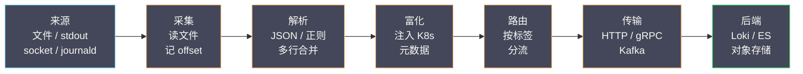
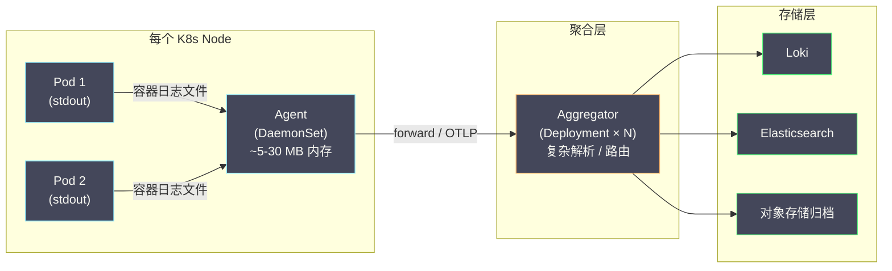

# 02 日志采集架构——Grafana Alloy、Promtail 与 Vector

**摘要：**

日志从应用进程产生，到最终能在平台里被检索，中间要经过**采集 → 解析 → 富化 → 路由 → 传输**五个环节，承担这些环节的组件统称**日志采集器（Log Collector）**。采集器看似只是"把文件读出来发出去"，但它决定了整条日志链路的可靠性下限与资源上限：一个采集器在节点上多占 100 MB 内存，乘以一千个节点就是 100 GB 的隐性成本；一次漏读或重复读，会让故障复盘时最关键的那段日志凭空消失。本文从采集器必须解决的五个问题出发，先厘清 Agent 与 Aggregator 两种部署形态的分工，再逐一剖析当前主流的几条技术路线——Grafana 系的 Promtail 与它的继任者 Alloy、Datadog 系的 Vector、Elastic 系的 Filebeat，以及 CNCF 系的 Fluentd/Fluent Bit 与 OpenTelemetry Collector——最后落到选型决策与可靠性设计（背压、缓冲、投递语义、多行合并陷阱）。读完之后，你应当能回答两个问题：**面对一堆看起来功能重叠的采集器，判断依据究竟是什么；以及一个采集器"不丢数据"的承诺，到底落在链路的哪一层**。

---

## 第 1 章 采集器要解决的五个问题

### 1.1 一个合格采集器的验收清单

日志采集器不是简单的"`tail -f` 加转发"。一个能在生产环境长期运行的采集器，至少要解决五个彼此独立的问题，这五个问题也构成了后文比较各方案的统一坐标。

**问题一：如何发现并读取日志？** 日志可能以多种形态存在——应用写本地文件、容器写 stdout、应用直接通过 TCP/UDP/HTTP 发送、系统通过 journald 管理。采集器必须支持这些来源，并能可靠地追踪读取位置（offset），保证**不丢、不重**。这里的难点不在"读"，而在"记住读到哪了"：文件会被轮转、会被重命名、inode 会被复用，采集器要靠 inode 与 offset 的组合来识别"这是同一个文件的续读，还是另一个新文件"。

**问题二：如何解析非结构化日志？** 大量遗留系统输出的仍是纯文本（Nginx access log、Java 异常堆栈）。采集器要能把文本解析成字段：正则（Grok）、JSON、logfmt、分隔符，以及**多行合并（Multiline）**——把跨越多行的 Java 堆栈拼回一条事件。

**问题三：如何富化上下文？** 裸的日志只有文本，没有"它属于哪个 Pod、哪个 Namespace、哪个环境"。采集器需要从外部（如 Kubernetes API）拉取元数据，注入到每条日志上，否则后续的路由与过滤无从谈起。

**问题四：如何路由与过滤？** 不同来源的日志要送往不同后端：应用日志进 Loki，审计日志进独立合规存储，调试日志直接丢弃。采集器要支持基于标签或内容的过滤与分流。

**问题五：如何以最小代价可靠传输？** 网络会断、后端会过载。采集器要有本地缓冲、重试、背压处理，并明确自己的**投递语义**（至少一次、至多一次，还是尽力而为）。同时，它部署在每个节点上，资源占用必须足够低——理想情况下 CPU 占用在单核的几个百分点、内存几十 MB 以内。

### 1.2 五个环节：一条日志的旅程

把上述问题串起来，就是一条形态基本固定的流水线：



这条流水线是理解所有采集器的钥匙。不同采集器的差异，本质上就是"它把哪几个环节做进了核心、把哪几个环节甩给了别的组件"。**采集与解析决定下限，富化与路由决定可用性，传输决定可靠性**——任何一环缺失，都会在某个具体故障里暴露出来。

### 1.3 采集器的资源预算

采集器是**节点级组件**，这个属性决定了它的资源预算必须按"单节点占用 × 节点数"来算。一个采集器在单节点上多占 100 MB 内存，在一千个节点的集群里就是 100 GB 的隐性成本；它多占半个 CPU 核，在一千个节点上就是五百个核的采购账单。这正是采集器选型中"轻量"权重极高的原因。

资源预算里最容易被低估的，是**内存与"流数"的关系**。采集器要在内存里为每条正在跟踪的日志流维护状态：读取位置、标签集、缓冲。流的数量由标签基数决定，而标签基数往往在运行中悄悄膨胀——某次发版多打了一个高基数标签，采集器内存就会随之上涨。因此，**监控采集器自身的内存与流数，是防止它成为下一个故障源的前提**。

至于"如何测采集器的真实开销"，标准做法是构造一个**可复现的压测**：用一段有代表性的日志样本（而非合成的重复行）反复灌入，测量采集器在不同吞吐下的 CPU、内存、磁盘 I/O，以及从"灌入"到"后端可见"的端到端延迟。**厂商的 benchmark 数字只能作参考，因为真实开销高度依赖日志的字段数、行长度与标签基数**——这些恰恰是 benchmark 最容易简化的变量。

### 1.4 采集器的两类失败模式

采集器的失败可以分成两类，它们的危害程度完全不同。**第一类是"显性失败"**——进程崩溃、OOM、配置解析失败。这类失败会立刻让采集器退出或报错，进程监控与健康检查能马上发现，属于"响亮地坏掉"。**第二类是"隐性失败"**——进程还在跑、指标还在暴露，但数据没有正确地到达后端。它可能表现为漏读（文件轮转快于读取）、重复读（位置未提交）、或静默丢弃（缓冲溢出后按策略丢数据）。隐性失败之所以危险，是因为它**不触发任何进程级告警**，等到故障复盘需要日志时才发现"那段时间是空的"。

对抗这两类失败的手段不同：显性失败靠进程监控（存活探针、重启策略），隐性失败靠**采集器自身的业务指标**（发送成功率、丢弃计数、积压年龄）。**一个成熟的日志平台，必然把"采集器的隐性失败"当作一等公民来监控**——因为它是唯一能在"日志已经丢了"之前就发出预警的信号。

---

## 第 2 章 采集器的两种形态：Agent 与 Aggregator

### 2.1 两种角色

采集器在架构里扮演两种角色，二者常常同时存在：

**Agent（代理）**：部署在**每个**日志产生的节点上，负责"从本地读取、做轻量处理、转发出去"。它数量最多、最贴近业务，因此对资源占用最敏感。

**Aggregator（聚合器）**：部署在**少量**中心节点上，负责"接收多个 Agent 的数据、做重处理（复杂解析、路由、批量化）、再发送到后端"。它可以独立扩缩容，是承压与卸载的关键层。

### 2.2 级联架构：为什么要把轻量留给节点

在 Kubernetes 环境里，一种经典的架构是 **Agent（DaemonSet）→ Aggregator → 后端**：



这种分层的价值有三点：**节点资源最小化**（Agent 只做轻活，把 CPU 密集的解析与路由挪走）、**逻辑集中可维护**（改路由规则只需重发布聚合层，不必滚动每个节点）、**后端解耦**（聚合层可以同时向多个后端发送，后端切换对 Agent 透明）。

但级联并非没有代价。它多了一跳网络传输，引入额外的延迟与故障点；聚合层本身成了需要高可用的组件；而且"两段式缓冲"让端到端的投递语义更难推理。**是否需要聚合层，取决于"解析/路由的复杂度"与"节点资源约束"谁更紧**——小规模、规则简单时，单层 Agent 直连后端反而更省心。

### 2.3 推与拉：节奏掌握在谁手里

日志采集的传输方向几乎总是"推（Push）"——采集器主动把日志发给后端。这与指标的"拉（Pull）"形成对比。为什么日志选推而不选拉？因为日志是**事件驱动**的：事件什么时候发生无法预测，采集器只能在事件产生时立刻送出，无法像指标那样"后端按固定间隔来取一个快照"。

推的代价是**节奏控制权在发送方**：采集器可以超频、可以静默，后端难以统一治理。这也解释了为什么几乎每个采集器都要在后端侧做**限流（rate limit）**——因为发送端天然倾向于"尽快把数据推出去"，而后端的承受能力是有限的。**采集器的可靠性设计，很大程度上就是在"尽快发送"与"不压垮后端"之间找一个动态平衡点**。

### 2.4 Kubernetes 与容器环境的采集特殊性

容器环境把"日志在哪里"这个问题彻底改变了。在传统部署里，应用自己写文件；在容器里，**推荐的做法是应用把日志写到 stdout/stderr**，由容器运行时接管，再由节点级采集器统一收集。这条约定带来了几个必须在采集端处理的细节。

**容器日志的存储路径**：当应用输出到 stdout/stderr，容器运行时会把它落盘到宿主机上的固定位置：

```text
# containerd（CRI）的日志路径
/var/log/pods/<namespace>_<pod-name>_<pod-uid>/<container-name>/<restart-count>.log

# Docker 的日志路径（JSON 文件驱动）
/var/lib/docker/containers/<container-id>/<container-id>-json.log
```

注意路径里的 `<restart-count>` 与 `<container-id>`：**容器每次重启，日志文件都会换一个名字**。采集器必须理解这种"同一条逻辑日志流、物理文件却不断更换"的模式，才能既续读又不重复——这也是为什么采集器普遍依赖 inode 与位置文件，而不是简单地"记住文件路径"。

**kubelet 的日志轮转**：节点上的容器日志由 kubelet 按 `containerLogMaxSize` 与 `containerLogMaxFiles` 轮转。采集器读取的速度如果长期跟不上写入速度，轮转会把尚未读取的旧文件删掉，造成**静默丢日志**。这提醒我们：采集器的吞吐能力必须留有余量，否则丢的不是"延迟"，而是"永远找不回来的日志"。

**Kubernetes 元数据注入**：裸的容器日志只有文本，没有 Pod、Namespace、Label、Node 等元数据。采集器需要通过 **Kubernetes API** 发现这些信息并注入，常见字段包括 `pod_name`、`namespace`、`container_name`、`labels`、`node_name`。注入后的日志才能按 namespace 路由、按 label 过滤。

```json
{
  "log": "2026-01-01 10:00:00 INFO OrderService - 创建订单",
  "kubernetes": {
    "pod_name": "order-service-7b9f5d6c4-xk2m9",
    "namespace_name": "production",
    "container_name": "order-service",
    "labels": { "app": "order-service", "version": "v2.1.0" },
    "node_name": "worker-node-03"
  }
}
```

**两种采集拓扑**：节点级采集（每个节点一个 DaemonSet）与边车采集（每个 Pod 一个 Sidecar）。节点级采集资源效率高、部署简单，是默认选择；边车采集适合"需要独立解析配置、独立资源隔离、或应用日志不在 stdout"的场景（如多行日志、需要注入应用专属字段）。边车采集的代价是资源成倍增加，因此除非有明确理由，否则应优先节点级。

> [!info] 为什么"输出到 stdout"是容器日志的推荐做法
> 它把"日志的落盘、轮转、生命周期"这些琐事从应用手里拿走，交给容器运行时与 kubelet——**应用只需要负责"打印"，剩下的交给平台**。这与"基础设施应替应用隐藏复杂性"的原则一致。代价是应用失去了对日志文件格式与轮转策略的直接控制，一切都要通过 stdout 与平台配置来表达。

### 2.5 部署粒度与故障域

采集器的部署粒度，直接决定了它的**故障域**。节点级部署（每节点一个 Agent）的故障域是"一个节点"——某个节点的 Agent 挂了，只影响该节点上的日志；中心聚合层挂了，则可能影响所有节点。边车部署的故障域是"一个 Pod"——它把隔离性做到最好，但组件数量随 Pod 数线性增长。

这里有一个容易被忽视的取舍：**采集器越集中，越省资源、越好管理，但单点风险越大；越分散，越隔离、越抗故障，但组件数量与运维成本越高**。节点级部署之所以成为主流，是因为它在两者之间取了一个平衡点——故障域限定在单节点（不会全集群瘫痪），组件数量又只与节点数相关（不随 Pod 数膨胀）。而中心聚合层作为"少数几个实例"，则必须按高可用来设计：多副本、负载均衡，并且要能容忍某个聚合实例在滚动升级时短暂离线。

**判断部署粒度是否合理的标准很简单：问自己"某一个采集组件挂掉，会影响多大范围的日志"**。如果答案是"整个集群的日志都断了"，那么这个组件的可用性等级就需要提高。

---

## 第 3 章 Promtail：为 Loki 而生的采集器

### 3.1 设计定位与历史

**Promtail** 是 Grafana 官方为 [[可观测/日志/03 Loki 架构与设计哲学——只索引标签|Loki]] 设计的日志采集器。它的定位非常聚焦：**发现日志文件、附加标签、推送到 Loki**。它不做复杂的解析转换（那是 LogQL 查询端的事），也不追求成为通用管道——它只把"从文件到 Loki"这一段做到极简且可靠。

Promtail 最关键的设计决策是**标签发现（label discovery）**：它的配置核心不是"解析字段"，而是"给日志打上正确的标签"。因为在 Loki 的模型里，标签是唯一的索引维度，标签打得对，查询才快；标签打得乱（高基数），整个 Loki 集群都会被拖垮。Promtail 提供了几种标签来源：静态配置的标签、从文件路径用正则提取的标签、以及从 Kubernetes API 发现并注入的 Pod/Namespace/Label 元数据。

```yaml
# Promtail 配置片段：从 Kubernetes 发现目标并注入标签
scrape_configs:
  - job_name: kubernetes-pods
    kubernetes_sd_configs:
      - role: pod
    relabel_configs:
      # 只采集带指定注解的 Pod
      - source_labels: [__meta_kubernetes_pod_annotation_promtail_io_scrape]
        action: keep
        regex: "true"
      # 把 Pod 的 app 标签注入为日志标签（低基数，可安全用作标签）
      - source_labels: [__meta_kubernetes_pod_label_app]
        target_label: app
      # 把 Namespace 注入为标签
      - source_labels: [__meta_kubernetes_namespace]
        target_label: namespace
```

这段配置里最能说明问题的是最后两条 `relabel`：**只有低基数的维度（app、namespace）才被提升为标签**，而 Pod 名、容器 ID 这些高基数的元数据则被刻意留在正文里。这正是第 01 篇讲过的"上下文记录"与"上下文索引"的区分在采集端的落地——**采集器的标签设计，直接决定了后端能不能扛住**。

### 3.2 从 Promtail 到 Alloy：一个时代的分界

2026 年 3 月 2 日，Grafana 官方宣布 **Promtail 到达生命周期终点（EOL）**，不再维护，所有未来的功能开发都转移到 Grafana Alloy。官方同时提供了一个迁移工具，可以把 Promtail 的配置一键转换为 Alloy 配置。

Promtail 的退场不是因为它不好用，而是因为它所代表的"**一种信号、一个专用二进制**"的模式，在可观测性栈越来越复杂的今天难以为继。一个团队如果同时需要采集指标、日志、链路、持续剖析，就得维护 Promtail、Grafana Agent、以及别的组件，每个都有自己的配置格式与升级节奏。**统一的采集器，成了规模增长后的必然诉求**——这正是下一章 Alloy 要回答的问题。

### 3.3 位置文件与流水线：Promtail 的两个关键机制

Promtail 之所以"极简却可靠"，靠的是两个机制：**位置文件（positions file）** 与 **流水线（pipeline）**。

**位置文件**是 Promtail 的"书签"。它把每个被跟踪文件读到哪了（inode + offset）持久化到本地磁盘（默认 `/var/lib/promtail/positions.yaml`）。Promtail 重启时据此恢复位置，避免重读整个文件——这也是"至少一次"语义的实现基础。位置文件里最关键的字段是 **inode 而非文件名**：因为日志会被轮转重命名（`app.log` → `app.log.1`），而 inode 在文件系统层面唯一标识一个文件，用它才能正确识别"这是同一个文件"。

```yaml
# positions.yaml 的典型内容（Promtail 自动维护）
positions:
  /var/log/pods/production_order-7d9f_.../order/0.log: "1712000000000"
```

**流水线（pipeline）** 是 Promtail 的"轻量解析层"。它由若干 **stage** 串联而成：`docker` / `cri` 解析容器运行时格式、`json` / `regex` 解析正文、`labels` 把解析出的字段提升为标签、`timestamp` 提取时间戳、`metrics` 从日志中生成指标。流水线的关键约束与 LogQL 一致——**能用行过滤解决的，不要做解析**，因为解析比字符串匹配昂贵得多。

```yaml
pipeline_stages:
  - json:                       # 解析 JSON 正文
      expressions:
        level: level
        msg: message
  - labels:                     # 把 level 提升为标签（低基数，安全）
      level:
  - timestamp:
      source: time
      format: RFC3339Nano
```

理解这两个机制，就能理解 Promtail 的设计哲学：**位置文件保证"不丢"，流水线保证"可用"，而标签设计保证"不把后端压垮"**。三者缺一，Promtail 都会从"可靠"退化成"能跑"。

### 3.4 Promtail 的局限

Promtail 的极简是它的优点，也是它的边界。它只服务 Loki、只做日志、解析能力有限——复杂字段处理要么写正则、要么依赖查询端；它不做指标与链路；它的标签发现逻辑与 Prometheus 的 relabel 类似，却并非同一套实现。这些局限在"只需要日志"时无所谓，在"信号越来越多"时就变成摩擦。**这正是 Alloy 出现的原因：不是 Promtail 做错了什么，而是它的"专用"在统一采集的趋势下成了短板**。

---

## 第 4 章 Grafana Alloy：从多 Agent 到统一采集

### 4.1 Alloy 是什么

**Grafana Alloy** 是 Grafana Labs 发布的开源采集器，官方定义为"**Grafana Labs 版本的 OpenTelemetry Collector 发行版**"。它 100% 兼容 OTLP，同时原生支持 OpenTelemetry 与 Prometheus 两种遥测格式，**一个二进制即可采集指标、日志、链路与持续剖析（Profiles）四种信号**。

理解 Alloy 的定位，要把它放在 Grafana 采集器谱系里看：

| 组件 | 定位 | 状态 |
|---|---|---|
| Promtail | 专为 Loki 的日志采集器 | 2026-03-02 EOL |
| Grafana Agent（Static / Flow / Operator） | 通用采集代理 | 2025-11-01 EOL |
| **Grafana Alloy** | OTel Collector 发行版，统一采集四种信号 | 当前主线 |

Grafana Agent 与 Agent Operator 在 2024 年 4 月 9 日进入长期支持（LTS），并于 2025 年 11 月 1 日到达 EOL。Alloy 是它们的"精神继任者"，也是 Promtail 的继任者。于是 Grafana 生态从"多个专用 Agent"收敛为"**一个 Alloy**"——这本身就是可观测性领域"统一采集"趋势的一个缩影。

### 4.2 配置语言：从 River 到 Alloy syntax

Alloy 的配置语言脱胎于 Grafana Agent Flow 模式的 **River**（一种受 HCL 启发的声明式语言），后来在 Alloy 里更名为"**Grafana Alloy configuration syntax**"。它的构成只有三个基本元素：

- **属性（Attribute）**：`NAME = VALUE` 形式的单个设置。
- **块（Block）**：`块名 "标签" { ... }` 形式的组件实例，大括号内是属性与嵌套块。
- **表达式（Expression）**：引用其他组件的输出，从而在组件之间建立数据流。

它的关键特性是**声明式与自动依赖排序**：配置里各块的书写顺序无关紧要，解析器会自动推导组件之间的依赖并按正确顺序求值。下面是一个"读文件 → 打标签 → 写 Loki"的 Alloy 配置骨架：

```hcl
// 读取日志文件
local.file_match "app_logs" {
  path_targets = [{ __path__ = "/var/log/myapp/*.log" }]
}

// 采集并附加标签
loki.source.file "app" {
  targets    = local.file_match.app_logs.targets
  forward_to = [loki.write.default.receiver]
}

// 写入 Loki
loki.write "default" {
  endpoint {
    url = "http://loki:3100/loki/api/v1/push"
  }
}
```

从 Promtail 迁移到 Alloy 时，**概念是一一对应的**：Promtail 的 `scrape_configs` 对应 Alloy 的 `loki.source.*` 组件，`relabel_configs` 对应 `discovery.relabel` 组件。官方迁移工具之所以能一键转换，正是因为两者表达的是同一套采集语义，只是配置语言不同。

> [!note] 为什么统一采集是趋势
> Alloy 与 OpenTelemetry Collector 走的是同一条路：**用一个可编程的管道，采集所有信号**。这样做的好处是运维面收敛（一个二进制、一套配置语言、一个升级节奏），且信号之间天然共享 Resource 属性（服务名、实例 ID），联动配置更简单。代价是这个"统一管道"本身更复杂、学习曲线更陡——对只采集日志的团队来说，Alloy 可能显得过重。**统一采集的收益与团队的信号数量成正比**：只采一种信号时，专用工具更轻；采三种以上时，统一管道才真正划算。

### 4.3 Alloy 的组件模型

Alloy 的配置世界由"组件"构成，每个组件有唯一的**组件 ID**（形如 `loki.source.file.app`），由组件类型加一个标签拼成。组件通过引用彼此的**输出**来连接，形成一张有向图。常见组件大致分四类：

- **发现类（`discovery.*`）**：如 `discovery.kubernetes` 从 K8s API 拉取目标列表，`discovery.relabel` 做标签重写。
- **来源类（`loki.source.*`、`prometheus.scrape` 等）**：定义数据从哪来。
- **处理类（`loki.process` 等）**：定义数据如何被解析、转换、打标签。
- **输出类（`loki.write`、`otelcol.exporter.*` 等）**：定义数据往哪去。

组件之间用"接收器（receiver）"与"转发目标（forward_to）"连接，构成一条**显式的数据流**。与 Promtail 那种"配置块 + 隐式顺序"的写法相比，Alloy 把数据流画进了配置里：你能一眼看出"日志从哪来、经过谁、到哪去"，也能把某一段管道单独拿出来验证。代价是配置的体量与心智负担增加——一个简单需求（读文件、写 Loki）在 Promtail 里是几行 YAML，在 Alloy 里是一组互相引用的组件块。**声明式配置的表达力与简洁性之间永远存在这条张力**，Alloy 选择了表达力这一端，代价由配置的读者承担。

---

## 第 5 章 Vector：Rust 编写的高性能管道

### 5.1 设计定位

**Vector** 由 Datadog 开源，用 **Rust** 编写。它的设计哲学是"**一个工具替代 Filebeat + Logstash + Telegraf**"——同时承担日志与指标的采集、转换、路由。Vector 把自身建模为一条由 **Source（来源）→ Transform（转换）→ Sink（输出）** 三段构成的管道，配置里显式声明数据如何在三者之间流动。

### 5.2 VRL：把转换做成一种语言

Vector 最有辨识度的能力是 **VRL（Vector Remap Language）**——一种专为数据转换设计的语言，用来替代 Logstash 的 Ruby DSL 和 Fluentd 的 Filter Plugin。VRL 的核心卖点是**编译时检查**：语法错误、类型错误在配置加载时就会报出来，而不是等到某条日志流到那一步才在运行时崩溃。

```toml
# Vector 配置：解析 JSON、脱敏、写入 Loki
[sources.myapp]
type = "file"
include = ["/var/log/myapp/*.log"]

[transforms.parse]
type = "remap"
inputs = ["myapp"]
source = '''
  . = parse_json!(.message)   # 解析失败直接报错，而非静默透传
  .hostname = get_hostname!()
  del(.password)              # 脱敏：删除密码字段
'''

[sinks.loki]
type = "loki"
inputs = ["parse"]
endpoint = "http://loki:3100"
labels.app = "{{ app }}"
labels.level = "{{ level }}"
```

`!` 后缀表示"失败即报错"，这种显式失败的设计，让"某条日志没被正确解析"这类问题在配置阶段就暴露，而不是在事故现场才发现字段是空的。**把数据转换当作一门有类型系统的语言来对待，是 Vector 相对其它采集器最本质的差异**。

### 5.3 端到端确认与局限

Vector 还提供了**端到端确认（End-to-End Acknowledgement）**：只有 Sink 确认数据已成功写入后端，Source 才更新读取位置。这比"发送后等一个 ACK"更严格——它把确认链路拉到了"后端真正落盘"这一层，从而把"至少一次"的语义做得更扎实。

Vector 的局限主要在生态与治理：相比 Fluentd（CNCF 毕业项目）与 Filebeat（Elastic 官方支持），Vector 的社区规模与插件数量仍有差距；而且它由 Datadog 这家商业 APM 公司主导，社区对其长期开源策略存在一定的不确定性。**选型时，生态成熟度与厂商中立性，是和性能同等重要的考量**。

### 5.4 Vector 的缓冲与可靠性设计

Vector 的可靠性主要落在 **Buffer（缓冲）** 上。它支持内存缓冲与磁盘缓冲两种模式，且可以在 Source 与 Sink 之间显式配置缓冲的容量与溢出行为。当 Sink 变慢时，数据在缓冲中堆积；缓冲满后，Vector 按配置决定"阻塞上游"还是"丢弃"——前者把背压传给 Source（进而减速读文件），后者则是一次显式的、可被计数的丢弃。

这与后文要讲的背压思路一致，只是 Vector 把缓冲与确认做得更显式：**端到端确认 + 可配置缓冲，共同构成它的"至少一次"承诺**。值得注意的是，即便采集器承诺"至少一次"，端到端的实际语义仍取决于后端：如果后端写入是异步的、或后端自身的缓冲会丢，那么"采集器确认送达"并不等于"数据已持久化"。**端到端语义是一条链上所有环节的乘积，而不是某一层的承诺**。

### 5.5 Vector 与 Logstash 的位置对比

Vector 常被拿来与 Logstash 比较，因为两者都定位在"日志处理管道"。它们的差异可以归纳为几个维度：

| 维度 | Logstash | Vector |
|---|---|---|
| 运行时 | JVM（Ruby DSL 配置） | 原生（Rust，TOML + VRL） |
| 资源开销 | 高（JVM 堆数百 MB 起） | 低（数十 MB 级） |
| 配置校验 | 运行时才发现错误 | 编译期校验（VRL） |
| 生态 | Elastic 生态，插件多 | 独立，插件中等 |
| 典型角色 | 中心聚合、复杂转换 | 节点 Agent 或聚合 |

Logstash 的强项是生态与"什么都能接"；Vector 的强项是轻量与类型安全的转换。在"节点 Agent"这个位置上，Logstash 的 JVM 开销几乎不可接受，因此这个位置长期被 Filebeat、Fluent Bit 占据——而 Vector 想做的，正是用接近 Fluent Bit 的开销，提供接近 Logstash 的转换能力。**这个"两头都想要"的定位，既是 Vector 的机会，也是它必须持续证明自己的地方**。

---

## 第 6 章 另外三条技术路线

### 6.1 Filebeat：Elastic 生态的轻量采集器

**Filebeat** 是 Elastic 公司开发的轻量采集器，属于 Beats 家族。它的内部由两个核心组件协作：**Harvester（收割器）** 为每个被监控的文件开一个读取线程，逐行读取并封装成事件；**Registrar（注册器）** 把每个文件的读取状态（路径、inode、offset）持久化到本地 registry 文件，重启后据此恢复位置。

Filebeat 采用**至少一次（At-least-once）** 语义：Harvester 把事件发送到输出后，只有收到后端的 ACK，Registrar 才更新 offset。如果在"发送后、收到 ACK 前"崩溃，重启后会从上次确认的位置重读——可能少量重复，但不会丢失。它的 **Modules** 机制为 Nginx、MySQL、Kafka 等常见来源预置了路径、多行规则与 Ingest Pipeline，开箱即用。

它的局限也很清楚：解析能力弱（复杂解析要交给 Logstash 或 Elasticsearch Ingest Pipeline）、输出目标偏向 Elastic 生态（原生不支持直接写 Loki），且 Modules、Dashboard、Pipeline 都深度绑定 Elastic Stack。**如果后端不是 Elasticsearch，Filebeat 的这些"开箱即用"能力大多用不上**。

### 6.2 Fluentd 与 Fluent Bit：CNCF 的一对搭档

**Fluentd** 由 Treasure Data 创建、后捐赠给 CNCF，设计哲学是"**统一日志层**"——做所有日志源与所有目标之间的万能适配器。它用 Ruby 编写，插件生态极其庞大（官方与社区提供七百多个 Output Plugin），支持 tag 路由（用 `<match>` 与 `<filter>` 按 tag 模式分流）。它的核心架构是 `Input → Parser → Filter → Buffer → Output`，其中 Buffer 支持 memory 与 file 两种模式，后者在崩溃后可恢复。

Fluentd 的短板是资源消耗：Ruby 实现下单进程内存常在 50~200 MB，CRuby 的全局解释器锁（GIL）又限制了多核并行。这直接催生了 **Fluent Bit**——同一社区用 C 语言写的精简版，内存通常只有几到十几 MB，非常适合容器与边缘节点。于是业界形成了一对经典搭档：**Fluent Bit 作节点级 Agent，Fluentd 作中心 Aggregator**。

| 维度 | Fluent Bit | Fluentd |
|---|---|---|
| 语言 | C | Ruby + C |
| 内存占用 | 数 MB 到十几 MB | 50~200 MB |
| 插件数量 | 百余个 | 七百余个 |
| 解析能力 | 中等（JSON/正则/Multiline） | 强 |
| 典型角色 | 节点 Agent、边缘 | 中心 Aggregator、复杂处理 |

### 6.3 OpenTelemetry Collector：标准化的统一采集

**OpenTelemetry Collector** 是 CNCF 的标准化采集器，用 Go 编写，通过 `receivers → processors → exporters` 三段管道处理数据。它的日志能力由 **Filelog Receiver** 提供：读取文件、用 operator 链解析（`json_parser`、`regex_parser`、`severity_parser` 等）、再导出到后端（如 `loki` exporter）。

它的独特优势是**三种信号统一采集**与**原生 OTLP 支持**：一个 Collector 可以同时收 Traces、Metrics、Logs，应用通过 OTel SDK 产生的日志可以直接用 OTLP 发送，天然携带 Trace ID 与 Resource 属性，不需要文件解析这一步。代价是 Filelog Receiver 相对年轻，在极端场景（高频文件轮转、符号链接、超高吞吐）下的成熟度不如经过多年生产验证的 Filebeat 与 Fluent Bit；而且它的 Processor 主要面向 Traces 与 Metrics 设计，日志处理能力不如 Fluentd/Logstash 丰富。

> [!info] Alloy 与 OTel Collector 的关系
> Alloy 本身就是 OTel Collector 的一个发行版——它继承了 Collector 的组件模型与 OTLP 兼容性，又补齐了 Prometheus 与 Loki 的原生管道。理解这层关系，就能理解为什么"Alloy 的配置语言看起来像 Collector、又像 Terraform"：它是在 Collector 的管道模型上，换了一套更声明式的配置语法。

### 6.4 解析能力的横向对比

采集器之间的差异，很大一部分体现在"解析"这一环。把常见解析方式并排比较，能看清各方案的能力边界。

| 解析方式 | 典型语法 | 表达力 | 性能 | 适用场景 |
|---|---|---|---|---|
| JSON | `\| json` | 高（直接映射字段） | 高 | 结构化日志 |
| logfmt | `\| logfmt` | 中 | 高 | `key=value` 格式 |
| 正则（Grok / RE2） | `\| regexp "..."` | 最高（任意模式） | 低 | 非结构化文本 |
| 分隔符 | `split by ","` | 低 | 最高 | CSV、访问日志 |
| Pattern | `\| pattern "<ip> - <method>"` | 中 | 中 | 半结构化文本 |

这张表的核心结论是**"表达力越强、性能越低"**：正则能匹配任意文本，但代价是每次都要跑一遍正则引擎；JSON 与 logfmt 只需一次结构化解析，性能高得多。工程上的优先级因此很明确——**能让应用直接输出 JSON 的，就不要在采集端写正则**；能在行过滤阶段淘汰的，就不要进解析阶段。

解析还有一个常被忽略的成本维度：**"解析一次"还是"解析多次"**。如果采集端解析了字段、却没有把它们提升为标签或写入结构化字段，那么查询端还要再解析一次——等于同一份日志被解析了两遍。**解析应当尽量只做一次，且放在离数据最近的地方**（采集端），把解析结果持久化下来，供所有查询复用。

### 6.5 三条路线的部署形态

把上面的技术路线落到部署上，可以看出它们在"节点 Agent / 中心 Aggregator"这对角色上的默认分工：

| 方案 | 节点 Agent | 中心 Aggregator | 备注 |
|---|---|---|---|
| Filebeat | Filebeat | Logstash / ES Ingest | Elastic 生态内闭合 |
| Fluent Bit + Fluentd | Fluent Bit | Fluentd | CNCF 经典分层 |
| Grafana Alloy | Alloy | Alloy（可同构） | 一套配置两种角色 |
| OTel Collector | Collector（Agent 模式） | Collector（Gateway 模式） | 同构，仅配置不同 |
| Vector | Vector | Vector | 同构，可级联 |

一个明显的趋势是**"同构部署"正在取代"异构分层"**：Alloy、OTel Collector、Vector 都用同一个二进制扮演 Agent 与 Aggregator 两种角色，只是配置不同。这比"Fluent Bit 采集 + Fluentd 聚合"那种"两套软件、两种配置语言、两条升级路径"的模式更容易运维。**异构分层省的是节点资源，付出的是运维复杂度；当节点资源不再紧张时，同构的收益就占了上风**。

### 6.6 Filebeat 与 Fluent Bit 在容器环境中的角色

在 Kubernetes 里，Filebeat 与 Fluent Bit 的定位有明显的分化。Filebeat 更多出现在"已有 ELK 栈"的团队里，作为把容器日志送进 Elasticsearch 的采集端；它的 Autodiscover 机制可以按 Pod 注解动态生成采集配置，与 Elastic 的 Ingest Pipeline 配合完成解析。Fluent Bit 则是 CNCF 生态里最"百搭"的节点 Agent——它体积小、启动快、对 Loki、Elasticsearch、Kafka、S3 都有输出插件，因此在"多后端"环境里出现频率很高。

两者的共同点是**都把自己定位成"节点上的轻量采集器"**，把重处理留给中心层（Logstash / Fluentd）或后端（Ingest Pipeline）。这与 Alloy、Vector 试图"一个二进制打全场"的路线形成对照。**"轻采集 + 重聚合"与"统一管道"是两种不同的架构哲学**，前者边界更清晰、单点更简单，后者运维面更收敛——选择哪一种，本质上是在"职责清晰"与"组件收敛"之间取舍。

### 6.7 厂商中立性：一个被低估的维度

采集器的"厂商归属"是一个容易被轻视、却在长期很有分量的维度。Filebeat 属于 Elastic，Alloy 属于 Grafana，Vector 属于 Datadog——它们都由某家可观测性商业公司主导，也就都天然倾向于把数据导向自家的后端与生态。这种倾向通常不是恶意的排他，而是"优先服务自家场景"的自然结果。

厂商中立性的价值在于**保留未来的选择权**：如果采集层是中立的（如 OTel Collector），那么将来从 Loki 换到 Elasticsearch、或从自建换到托管，只需要改后端的 exporter，不必动采集层。反之，如果采集层与后端强绑定，切换后端的代价就会从"改一处"变成"改全集群"。**在选择采集器时，"它把我锁在谁的生态里"应当和"它好不好用"一样被认真对待**——尤其是在可观测性栈仍在快速演进的今天。

---

## 第 7 章 选型决策

### 7.1 综合对比

| 维度 | Promtail | Grafana Alloy | Vector | Filebeat | Fluent Bit | Fluentd | OTel Collector |
|---|---|---|---|---|---|---|---|
| 语言 | Go | Go | Rust | Go | C | Ruby + C | Go |
| 信号覆盖 | 仅日志 | 日志/指标/链路/剖析 | 日志/指标 | 仅日志 | 日志/部分指标 | 日志 | 日志/指标/链路 |
| 内存量级 | 低 | 中 | 中低 | 中低 | 极低 | 高 | 中 |
| 配置语言 | YAML | Alloy syntax | TOML + VRL | YAML | 类 ini | 类 XML | YAML |
| 解析能力 | 弱 | 中 | 强（VRL） | 弱 | 中 | 强 | 中 |
| 生态归属 | Grafana（已 EOL） | Grafana | Datadog | Elastic | CNCF | CNCF | CNCF |
| 适合角色 | 已弃用 | 统一 Agent/Aggregator | 高吞吐转换 | ELK 采集 | 节点 Agent | 中心 Aggregator | 标准化统一采集 |

### 7.2 场景化推荐

**场景一：现网栈是 Loki + Grafana，正在用 Promtail**
→ **迁移到 Grafana Alloy**。Promtail 已 EOL，官方提供一键迁移工具；Alloy 保留 Loki 原生管道，同时为将来引入指标/链路采集留了统一入口。这是当前 Grafana 栈最"顺势"的选择。

**场景二：Kubernetes 环境，多后端（Loki + ES + 对象存储）**
→ **Fluent Bit（Agent）+ Fluentd（Aggregator）**，或 **Alloy 单层**。前者是 CNCF 经典分层，节点轻、中心重；后者运维面更简单，但要求 Alloy 能覆盖全部路由需求。

**场景三：追求统一可观测性（Traces + Metrics + Logs）**
→ **Grafana Alloy** 或 **OTel Collector**。两者同源，选择取决于你的展示层是 Grafana 栈还是更中立的 OTel 生态。

**场景四：资源极度敏感（边缘设备、IoT）**
→ **Fluent Bit** 单独部署。数 MB 级内存，C 语言性能，是资源受限场景的稳妥选择。

**场景五：高吞吐 + 复杂转换逻辑**
→ **Vector**。Rust 性能与 VRL 的类型安全转换，是"日志量大且需要大量字段处理"场景的强项。

> [!note] 选型的根本原则
> 采集器的选型不应孤立进行，它必须与**日志存储后端**、**可观测性栈的其他组件**以及**团队运维能力**一起考虑。Alloy 适合 Grafana 栈，Filebeat 适合 Elastic 栈，OTel Collector 适合中立标准栈——**最好的采集器是与你的存储后端和运维流程最契合的那个，而不是 benchmark 数字最好看的那个**。

### 7.3 迁移路径：从 Promtail 到 Alloy

对正在用 Promtail 的团队，迁移到 Alloy 有一条清晰的路径，理解它也有助于理解"统一采集"到底改变了什么。

**第一步：概念映射**。Promtail 与 Alloy 表达的是同一套采集语义，只是配置语言不同。映射关系大致是：`scrape_configs` → `loki.source.*` 组件，`static_configs` / `kubernetes_sd_configs` → `discovery.*` 组件，`relabel_configs` → `discovery.relabel` 组件，`pipeline_stages` → `loki.process` 组件。官方提供迁移工具，可以一键把 Promtail 配置转成 Alloy 配置，作为起点。

**第二步：验证标签与位置**。迁移后最容易出问题的不是解析逻辑，而是**标签与读取位置**。标签变了，下游的查询与仪表盘会失效；位置文件格式不同，可能导致重读或漏读。因此迁移应在测试环境先用真实日志验证"标签是否一致、是否有重复或缺失"，再灰度到生产。

**第三步：为统一采集留出余地**。Alloy 的价值不止于替代 Promtail，还在于它能在同一个 Agent 里采集指标、链路与剖析。迁移时不妨顺手评估：当前散落在多个 Agent 里的采集职责，能否收敛到 Alloy 一处？**迁移的成本是一次性的，而统一采集的收益是持续的**——这也是 Grafana 推动这次迁移的底层逻辑。

### 7.4 选型的三个反常识

**反常识一：功能最多的采集器，往往不是最合适的。** Fluentd 有七百多个插件、Vector 有类型安全的 VRL、OTel Collector 有完整的管道模型——但功能越多，配置越复杂，出错的表面积也越大。一个只采集日志、规则简单的团队，用 Alloy 或 Fluent Bit 就够，强行上 Fluentd 只是给自己增加运维负担。**选型的标准不是"能做什么"，而是"我需要做什么"**。

**反常识二：性能差距在真实场景里常常不重要。** 采集器的 benchmark 数字（Vector 比 Fluentd 快多少倍）看起来很诱人，但采集器通常不是节点上的瓶颈——真正的瓶颈往往是后端写入能力、网络带宽，或采集器的磁盘缓冲。除非日志吞吐确实极高（每秒数百 MB 以上），否则性能差异很难成为选型的决定性因素。**先找到瓶颈在哪，再决定要不要为性能付费**。

**反常识三：迁移成本常常被低估。** 采集器是"部署在每个节点上的基础设施"，换一个采集器意味着改配置、改监控、改运维手册、重新验证标签与投递语义——这是一次涉及全集群的变更。因此"现网在用哪个"往往比"理论上哪个更好"更重要。**只有当现有方案确实触到硬约束（EOL、能力不足、成本失控）时，迁移才划算**——Promtail 因 EOL 而迁移到 Alloy，正是这样一个"不得不换"的场景。

---

## 第 8 章 采集的可靠性：承诺落在哪一层

### 8.1 投递语义的三种档位

采集器对"不丢数据"的承诺，实际上分三个档位，选型时必须问清楚自己需要哪一档：

- **至多一次（At-most-once）**：发了就不管，可能丢、不会重。最快、最省，适合可容忍丢失的调试日志。
- **至少一次（At-least-once）**：确认后才推进读取位置，可能重、不会丢。Filebeat、Promtail、Alloy 的主流模式。
- **恰好一次（Exactly-once）**：既不丢也不重，需要端到端的事务协调。在日志领域极难实现，通常只在 Kafka 这类消息系统内部成立。

绝大多数日志场景的合理目标是"**至少一次**"——因为日志系统普遍能容忍少量重复（查询时去重、或干脆接受重复行），而无法容忍丢失。**把目标定在"恰好一次"，往往是在为一个日志场景并不真正需要的强保证付出过高的复杂度**。

### 8.2 背压：采集器最容易出事的地方

"至少一次"要成立，前提是采集器在**后端过载时不能把数据直接丢掉**。这就需要**背压（Backpressure）**机制：当后端写入变慢，采集器应当减速读取、把数据堆积到本地缓冲，而不是无限占用内存。一个没有背压设计的采集器，在后端抖动时会出现两种典型故障：要么**内存暴涨 OOM**（无限堆积），要么**静默丢数据**（直接丢弃以自保）。

本地缓冲的容量是背压的"蓄水池"。它越大，越能扛住后端的长时抖动，但代价是磁盘占用与恢复时间。工程上的常见折中是**内存缓冲 + 磁盘缓冲两级**：小抖动用内存扛，大抖动溢出到磁盘，磁盘也满了才触发限流或丢弃——并把这个"丢弃"事件本身作为告警。

### 8.3 多行合并：一个高频的隐形陷阱

Java 异常堆栈、Python Traceback 都是跨多行的，而采集器默认逐行处理——如果不做**多行合并（Multiline）**，一次异常会被拆成几十条独立日志，检索时惨不忍睹。多行合并的配置看似简单，却有几个高频陷阱：**超时窗口设得太短**会把一个堆栈切成两段；**首行正则写错**会把无关的后续行也吞进来；**并发写入**时不同请求的堆栈可能交错，合并结果错乱。

对抗这些陷阱的经验是：优先让应用**输出单行结构化日志**（把堆栈作为字段值、用 `\n` 转义），从源头避免多行；如果确实要合并，把超时窗口设为略大于"两条日志之间的典型间隔"，并对首行正则做充分的样本验证。**多行合并是采集端最容易"配了但没配对"的地方**，值得在测试环境用真实样本反复验证。

### 8.4 一个容易被忽略的责任划分

最后回到一个常被回避的问题：**"不丢数据"这份责任，到底落在链路的哪一层？** 是应用保证不丢？是采集器保证不丢？还是后端保证不丢？

现实中的答案是**分层接力**：应用负责把日志写进文件（不丢给采集器）；采集器负责把文件读出来并确认发送（不丢给后端）；后端负责把收到的数据落盘（不丢给存储）。任何一层松手，链条就断。理解这一点，就能理解为什么"日志管道健康度"必须被独立监控——因为你无法假设任何一层永远可靠，只能让每一层都为下一层兜底，并把"哪一层掉了链子"变成可观测的事实。

### 8.5 采集链路的常见故障与排查

采集链路出问题时，症状往往只有一句话："日志不对。"但"不对"背后可能是五种截然不同的故障，排查路径也不同。

| 症状 | 可能的根因 | 排查入口 |
|---|---|---|
| 日志完全缺失 | 采集器未运行 / 目标未匹配 / 后端拒写 | 采集器进程与目标发现列表 |
| 日志部分缺失 | 轮转快于读取 / 缓冲溢出丢弃 / 限流 | 采集器丢弃计数、磁盘缓冲 |
| 日志重复 | 位置未及时提交 / 重启重读 / 后端重试 | 位置文件、后端去重配置 |
| 标签缺失或错乱 | 元数据注入失败 / relabel 规则写错 | 采集器发现与 relabel 配置 |
| 日志乱序 | 时钟不同步 / 多实例时间戳混入 | NTP 状态、时间戳字段 |

排查采集链路有一条通用顺序：**先确认"采集器还活着"（进程与自身指标）→ 再确认"目标被发现了吗"（服务发现与匹配规则）→ 再确认"数据发出去了吗"（发送成功率与后端接收）→ 最后确认"发出去的是对的吗"（标签与内容）**。这条顺序之所以有效，是因为它从"最可能全断"的环节，逐层收敛到"最可能局部错"的环节。

> [!warning] 最危险的故障是"静默故障"
> 采集链路最危险的故障不是"采集器崩了"（那会立刻被进程监控发现），而是**"采集器还在跑，但数据没进后端"**——比如后端拒绝写入、证书过期、缓冲持续溢出。这类故障没有任何进程级信号，只有靠"采集器自身指标"（发送成功率、丢弃计数、缓冲水位）才能发现。**为日志管道本身配置独立的告警，是唯一能抓住静默故障的办法**。

### 8.6 采集器自身应当暴露哪些指标

既然"日志管道健康度"必须被独立监控，那么一个采集器究竟应该暴露哪些自身指标？一套够用的清单大致如下：

- **吞吐类**：每秒读取的字节数 / 行数、每秒发送的字节数 / 行数。用于判断"采集器是否跟得上写入速度"。
- **健康类**：发送成功率、失败与重试次数、丢弃计数。用于发现"静默故障"。
- **积压类**：缓冲队列长度、磁盘缓冲占用、最老未发送数据的年龄。用于发现"后端变慢导致的积压"。
- **状态类**：当前跟踪的文件数、活跃流数、内存占用。用于发现"基数膨胀"。
- **延迟类**：从"读取"到"后端可见"的端到端延迟。这是最贴近用户感受的一项。

其中**"最老未发送数据的年龄"**最值得单独强调：它比"队列长度"更能反映问题的严重程度——一个队列里有一万条刚到的数据，和一个队列里有一条已经积压了半小时的数据，是两种完全不同的故障。**用"年龄"而不是"长度"来衡量积压，是监控任何异步管道时一条通用的经验**。

### 8.7 一个正例：一次日志缺失的完整排查

把前面的排查路径串成一个完整例子。某天，值班工程师发现"订单服务的日志在 14:00 到 14:30 之间是空的"，而这段时间恰好发生了一次故障。他按四步排查：

1. **采集器还活着吗**：进程存活、自身指标正常，排除"采集器崩了"。
2. **目标被发现了吗**：检查服务发现列表，发现订单服务在 14:05 做过一次滚动发布，Pod 名全部更换——新 Pod 是否被采集器发现？
3. **数据发出去了吗**：检查发送成功率，发现 14:00-14:30 期间失败率飙升，伴随缓冲溢出与丢弃计数上涨。
4. **发出去的是对的吗**：结合第 3 步，根因锁定为"发布期间后端短暂拒绝写入 + 采集器缓冲不足导致丢弃"。

结论与改进：**根因不是"日志没打"，而是"打了但没进平台"**——这正是隐性失败。改进措施包括：扩大磁盘缓冲、在后端维护期间降低采集限流阈值（保住 ERROR 级别）、以及为"丢弃计数大于零"配置告警。这个例子里最值得记住的一点是：**排查的第一步永远是"确认采集器还活着"，而不是"去日志里找原因"**——因为如果采集器本身有问题，你在日志里什么都找不到。

---

## 小结

从 Promtail 到 Alloy，从 Filebeat 到 Fluent Bit/Fluentd，从 Vector 到 OTel Collector，表面上是一堆功能重叠的采集器，本质上是在回答同一组问题的不同取舍：**读文件还是收协议、轻量还是全能、专用还是统一、哪种投递语义**。把这些取舍看清，选型就不再是靠记忆去背"哪个更流行"，而是靠需求去推导"哪个更匹配"。

贯穿这一篇的三条主线，也是判断任何采集器的三把尺子：**资源占用**（节点级组件，多占一点就乘以节点数）、**可靠性设计**（offset、缓冲、背压、投递语义）、**生态契合**（它与你的存储后端和展示层是否同源）。三者之中，可靠性最容易被"跑起来能用"的假象掩盖——直到某次故障复盘发现日志缺了一段，才追悔莫及。

而在这三把尺子之上，还有一个更宏观的趋势正在发生：采集器正在从"每种信号一个专用 Agent"走向"一个统一管道采集所有信号"。Grafana 用 Alloy 统一了自己的 Agent 家族，CNCF 用 OTel Collector 统一了标准，Vector 则试图用一个工具覆盖日志与指标。**这场收敛的驱动力不是性能，而是运维复杂度**——当信号数量与节点数量同时增长时，"少维护一个组件"的价值，最终会超过"用最专用工具"的收益。

最后回到一个最朴素的问题：采集器到底是不是"基础设施里的小角色"？从资源占比看它是，但从"日志能不能被查到"这个结果看，它又是整条链路上不可绕过的一环——**后端再强，也救不回采集端没送出去的数据**。这也解释了为什么这一篇花了这么多篇幅讨论 offset、缓冲、背压与投递语义：它们决定了可观测性体系的下限，而这个下限一旦被击穿，上面所有的查询与仪表盘都失去了意义。

---

## 参考资料

1. Grafana Alloy Documentation: https://grafana.com/docs/alloy/latest/
2. Migrate from Promtail to Grafana Alloy: https://grafana.com/docs/alloy/latest/set-up/migrate/from-promtail/
3. Grafana Loki - Migrate to Alloy: https://grafana.com/docs/loki/latest/setup/migrate/migrate-to-alloy/
4. Grafana Labs (2024). *From Agent to Alloy*: https://grafana.com/blog/grafana-agent-to-grafana-alloy-opentelemetry-collector-faq/
5. Filebeat Documentation: https://www.elastic.co/guide/en/beats/filebeat/current/index.html
6. Fluentd Documentation: https://docs.fluentd.org/
7. Fluent Bit Documentation: https://docs.fluentbit.io/
8. OpenTelemetry Collector - Filelog Receiver: https://github.com/open-telemetry/opentelemetry-collector-contrib/tree/main/receiver/filelogreceiver
9. Vector Documentation: https://vector.dev/docs/

---

> [!note] 思考题
> 1. 你们的日志采集是"单层 Agent 直连后端"还是"Agent + Aggregator 分层"？这个选择是基于资源约束、规则复杂度，还是仅仅是历史惯性？
> 2. 如果你们的采集器是 Promtail，迁移到 Alloy 的最大障碍是什么——配置语言的差异，还是 Alloy 更高的资源占用与学习成本？
> 3. 你们的采集器在"后端过载"时的行为是什么：减速、堆积、还是丢弃？这个行为是经过设计的，还是默认配置的副产品？
> 4. 挑一个你服务里最容易出问题的多行日志（异常堆栈、SQL 日志），验证一下多行合并规则是否真的把一次事件拼成了一条。
> 5. 如果让你回答"我们这条日志链路到底能容忍丢多少数据"，你能给出一个有依据的答案吗？这个答案落在投递语义、缓冲容量，还是后端容量上？
