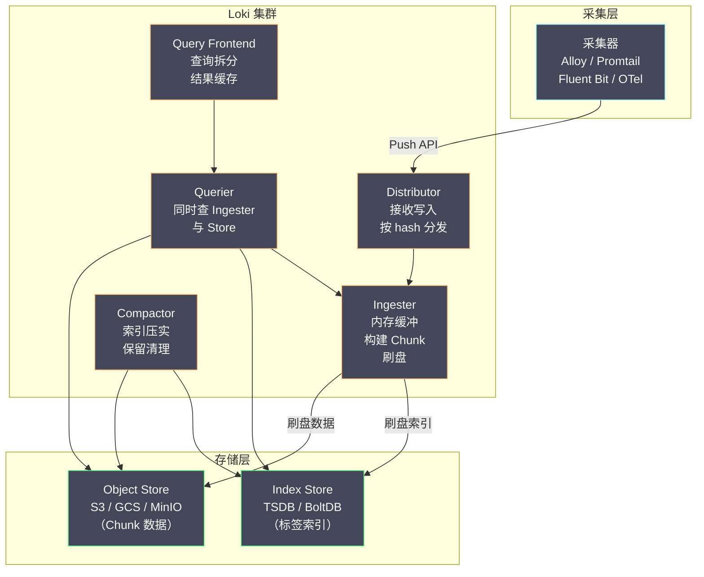

# 03 Loki 架构与设计哲学——只索引标签

**摘要：**

[[可观测/日志/02 日志采集架构——Grafana Alloy、Promtail 与 Vector|采集器]]把日志送进后端之后，真正决定"这套日志系统能用多久、要花多少钱"的，是存储层的设计。Elasticsearch 用十年时间证明了"给日志的每个字段建倒排索引"能带来毫秒级的全文检索，也暴露了这种做法的代价：索引体积常常与原始数据等大甚至更大，写入时要分词、要构建索引，账单随日志量线性膨胀。2018 年，Grafana 团队发布了 **Grafana Loki**，提出一个近乎反直觉的主张——**只索引标签，不索引正文**。本文先追溯 Loki 从 [[可观测/指标/00 专栏导览|Prometheus]] 借来的"标签世界观"，再逐层拆解这个成本决策的两笔收益与一笔代价，随后给出 Loki 的六个核心组件、读写两条路径与三种部署形态，最后落到它真正的生命线——标签基数与标签设计。读完之后，你应当能回答两个问题：**"只索引标签"到底省下了什么、又牺牲了什么；以及为什么在 Loki 里，一个错误的标签就能拖垮整个集群**。

---

## 第 1 章 从 Prometheus 借来的世界观

### 1.1 2018 年的一次反向思考

在 Loki 出现之前，日志存储的默认答案是 Elasticsearch。它对每个字段建倒排索引，因此"任意关键词都能毫秒级搜到"；但这份能力有明确的价格：索引通常与原始数据一样大（甚至更大），写入时要分词、要构建索引结构，查询时要在 JVM 堆与 Page Cache 之间反复腾挪。日志量一旦上到每天几百 GB、TB，集群规模与账单会同步膨胀，而其中绝大多数索引在绝大多数时间里从未被查询过。

2018 年，Grafana Labs 发布 Loki，做的事情本质上是一次**反向思考**：如果日志的大部分价值在于"需要时能查到"，而不是"任何时候都毫秒级可查"，那么能不能**不索引正文**，只索引一小部分元数据，把成本压下一个数量级？这个提问方式，与当年 Prometheus 面对 Graphite 时"用标签替代命名空间"的取舍如出一辙——都是先质疑"大家习以为常的做法是否真的必要"，再重新设计。

### 1.2 "Like Prometheus, but for logs"

Loki 对自己的定位，最著名的一句话是 "**Like Prometheus, but for logs**"。这句话不是营销口号，而是精确的架构描述——Loki 的许多核心设计，都能在 Prometheus 里找到原型：

| 维度 | Prometheus | Loki |
|---|---|---|
| 身份标识 | 标签集（label set） | 标签集（label set） |
| 索引对象 | 标签（series 的倒排索引） | 标签（stream 的倒排索引） |
| 数据本体 | 时间序列数据点 | 日志正文（压缩块） |
| 查询语言 | PromQL | LogQL |
| 采集方式 | Pull（vmagent / Prometheus） | Push（Promtail / Alloy） |
| 存储成本取向 | 极低的每点开销 | 极低的每字节开销 |

这张表揭示了一条关键线索：**Loki 把"标签索引 + 廉价存储"这套 Prometheus 已经验证过的模型，从数值搬到了文本**。Prometheus 用标签索引快速定位时间序列，再廉价地存储数据点；Loki 用标签索引快速定位日志流，再廉价地存储压缩后的文本。两者共享同一批设计者、同一套哲学——Loki 的发起人之一 Tom Wilkie 正是 Prometheus 的核心贡献者。

### 1.3 标签：从指标到日志的迁移

要理解 Loki，先理解 Prometheus 里的**标签（label）**。在 Prometheus 中，一条时间序列由度量名加一组标签唯一确定：

```text
http_requests_total{service="order-service", method="POST", status="200"}
```

标签的组合唯一标识一条序列，Prometheus 对标签建立索引（能快速找到"所有 service=order-service 的序列"），而序列上的数据点则用高效的压缩编码存储。Loki 把这套思路原样搬到日志上，用标签标识一条**日志流（Log Stream）**：

```text
{service="order-service", namespace="production", level="ERROR"}
```

标签的组合唯一确定一条日志流。Loki 对标签建立索引（能快速找到"所有 service=order-service 且 level=ERROR 的日志流"），而日志流里的每一条日志（时间戳 + 文本）则以压缩块存储，**不建倒排索引**。这里最本质的迁移是：**"身份"从"数值序列"变成了"日志流"，而"索引"始终只作用在身份上，不作用在内容上**。

> [!info] 为什么"日志流"这个概念如此重要
> 在 Loki 里，标签不是"附加信息"，而是数据的**组织维度**。同一个标签组合的所有日志，会被连续地、按时间顺序地写进同一个 Chunk。这意味着"按标签过滤"不只是"筛选出匹配的行"，而是"直接定位到少数几个物理数据块"——这正是标签索引能带来毫秒级过滤的原因。理解了这一点，后面关于 Chunk、Ingester、查询执行的所有设计才有立足点。

### 1.4 Loki 不是"轻量版 ES"

一个常见的误解，是把 Loki 当成"为了省钱而牺牲能力的轻量版 Elasticsearch"。这个理解并不准确，因为它忽略了 Loki 并不是在"做同样的搜索、只是做得更省"，而是在**做一件不同的事**。

Elasticsearch 的模型是"**文档 + 全文索引**"：它把每条日志当作一篇可以全文检索的文档，代价是为每篇文档建索引。Loki 的模型是"**日志流 + 标签**"：它把日志按标签组织成流，索引的是流的身份，而不是流的内容。两者在"查询"这个动作上的语义并不相同——ES 问的是"哪些文档包含这个词"，Loki 问的是"哪条日志流在某个时间段里包含这个模式"。

这个差异带来的直接后果是**Loki 的强项在"范围收敛后的检索"，弱项在"无差别全文搜索"**。如果你的查询总是"在某个服务的某个级别里找关键字"，Loki 又快又省；如果你的查询是"在全部日志里搜一个罕见词"，Loki 会退化成全量扫描。因此正确的判断不是"Loki 比 ES 省多少"，而是"**我的查询模式更接近哪一种**"。**把 Loki 当成"轻量版 ES"去用，是很多团队迁移后失望的根源**——他们带着 ES 的查询习惯，却用上了为不同查询模式设计的系统。

### 1.5 三种日志存储范式

放到更长的历史里看，日志存储其实有几种不同的范式，Loki 只是其中一种。理解这些范式的差异，有助于把 Loki 放到正确的坐标系里。

**范式一：文档 + 倒排索引（ELK）**。原始数据存成文档，为每个字段建倒排索引，查询走索引。能力最强、成本最高，适合"查询模式高度多样化"的场景。

**范式二：列式存储（如 ClickHouse）**。把日志按列存储，对每个列独立压缩，查询时只读需要的列。它在"结构化日志 + 聚合分析"场景里表现优异，成本介于 ES 与 Loki 之间，代价是要求日志有较稳定的结构。

**范式三：标签索引 + 对象存储（Loki）**。只索引标签，正文压缩存对象存储，查询时流式扫描。成本最低，适合"写多读少 + 查询以标签过滤为主"的场景。

这三种范式没有优劣之分，而是**为不同的查询模式与成本约束设计的**。选择哪一种，取决于你的日志主要被"怎么查"、以及你能承受多少成本。**把日志存储选型当成一道"成本与查询模式"的匹配题，而不是"谁更先进"的排名题**，是这一章最想传达的判断方式。

---

## 第 2 章 只索引标签：一个成本决策

### 2.1 全文索引的代价

要理解 Loki 为什么选择"只索引标签"，得先看清全文索引的成本到底花在哪。Elasticsearch 的倒排索引结构由三部分组成：**词典（Term Dictionary）** 存储所有不重复的词，**倒排列表（Posting List）** 记录每个词出现在哪些文档里，**词典索引（Term Index）** 是常驻内存的前缀树，用于快速定位词在词典中的位置。

这套结构的成本体现在三处：**存储**上，倒排索引的体积常常与原始数据相当甚至更大，也就是说存 1 TB 日志要占 2~3 TB 磁盘；**写入**上，每来一条日志都要分词、构建索引、写 Translog，CPU 开销显著；**运维**上，JVM 堆要调优、分片要管理、Segment 要合并。这些成本都随日志量线性增长，而它们换来的是"任意字段都能毫秒级检索"。

### 2.2 一次关于"查询频率"的赌注

Loki 的设计者观察到一个被忽视的事实：**在真实的日志查询里，绝大多数查询都是"先按标签过滤，再在小范围内看正文"**。工程师的典型动作是 `service=order-service AND level=ERROR` 缩小范围，然后在这几千行里找关键字——而不是"在整个集群里搜任意一个词"。也就是说，真正高频使用的索引维度，只有少数几个（service、level、namespace 等），而正文的全文索引虽然能力强大，使用频率却低得多。

于是 Loki 做了一个**关于查询频率的赌注**：既然日志正文大部分时间不被查询，就不值得为所有日志建完整索引。它把索引范围收窄到标签，把正文以压缩文本块存储，查询时先按标签过滤出候选日志流，再在候选范围内逐块扫描正文。**这是一个用"查询时间"换"存储成本"的决策**——把毫秒级的正文搜索降为秒级，换来一个数量级的成本下降。

### 2.3 两笔省下的账

Loki 的成本优势来自两处相互独立的节省，理解它们的区别很重要：

**第一，省去了正文索引的存储开销。** Elasticsearch 要存原始数据加倒排索引，Loki 只存压缩后的原始数据（压缩比通常 5:1 到 10:1）。同样 1 TB 的日志，ES 可能需要 2~3 TB 磁盘，而 Loki 只需要 100~200 GB。

**第二，用对象存储替代本地磁盘。** Elasticsearch 的数据必须放在本地磁盘（SSD/HDD），因为倒排索引的随机读取模式需要低延迟的本地 I/O。而 Loki 的日志数据是顺序读取的压缩块，可以放在 S3、GCS、MinIO 这类对象存储上——对象存储的每 GB 成本大约是 SSD 的二十分之一、HDD 的五分之一。

| 维度 | Elasticsearch | Loki |
|---|---|---|
| 索引范围 | 所有字段（标签 + 正文） | 只有标签 |
| 索引存储开销 | 与原始数据等大甚至更大 | 极小（只有标签索引） |
| 正文存储方式 | JSON 文档 + 倒排索引 | 压缩文本块（gzip/snappy/zstd） |
| 正文搜索方式 | 倒排索引查找（毫秒级） | 流式扫描（秒级） |
| 写入 CPU 开销 | 高（分词 + 建索引） | 低（主要是一次压缩） |
| 存储介质 | 本地 SSD/HDD | 对象存储 |

这两笔账叠加，正是"Loki 比 ES 便宜一个数量级"这句话的量化依据。**注意这里的顺序：先省索引，再省介质**——如果只是把 ES 的数据搬到对象存储上而不改索引策略，成本并不会降下来，因为倒排索引本身就不适合对象存储的访问模式。

### 2.4 付出的代价：从毫秒到秒

天下没有免费的午餐。不索引正文的代价，是**正文搜索变慢**。当工程师搜索"包含 timeout 的日志"时：

- **Elasticsearch**：在倒排索引里查 "timeout"，直接拿到文档 ID 列表，毫秒级返回。
- **Loki**：先按标签过滤出候选日志流，再逐一从对象存储下载 Chunk、解压、在文本里做字符串匹配，秒级返回。

这个代价之所以可以被接受，有两个现实原因。**其一，标签过滤大幅缩小了扫描范围**：查询 `{service="order-service", level="ERROR"} |= "timeout"` 时，Loki 先借标签索引锁定 order-service 的 ERROR 日志流（可能只占总量的千分之一），只在这个子集里做正文搜索，实际扫描的数据量远小于全量。**其二，日志查询的 SLA 要求本就不高**：排查故障、查看上下文时，"几秒内返回"完全够用，工程师并不会因为从 200 毫秒变成 2 秒就抱怨——除非这个查询的范围本身就没被标签收窄。

> [!note] Loki 的核心赌注
> Loki 赌的是：**日志的大部分价值在于"能查到"，而不是"能毫秒级查到"**。它把"毫秒级"降为"秒级"，换来十倍以上的成本下降。对绝大多数团队来说，这是一笔非常划算的交易。但要注意，这笔交易成立的前提是**标签设计得足够好**——如果标签没把范围收窄，正文搜索就退化成"全量扫描"，秒级会变成分钟级甚至超时。这也是为什么第 7 章要专门讲标签设计。

### 2.5 一次量化的成本推演

把上面的定性描述换成一个粗略的量化推演，会更有体感。假设一个团队每天产生 500 GB 原始日志（压缩前），保留 30 天。

**如果全量索引（ES 式）**：原始数据加倒排索引按 1.5 倍估算，再考虑副本，30 天的逻辑存储约为 `500 GB × 1.5 × 30 = 22.5 TB`。这部分必须放在本地磁盘，且需要 SSD/HDD 分层来平衡查询性能与成本。

**如果只索引标签（Loki 式）**：正文压缩后按 8:1 估算，30 天的正文约为 `500 GB ÷ 8 × 30 ≈ 1.9 TB`，放在对象存储上；标签索引极小，通常只占正文的百分之几。于是同样的日志量，存储从二十多 TB 的本地磁盘，变成不到两 TB 的对象存储。

这个推演的结论有两层。**第一层是显性的成本差异**：对象存储的每 GB 单价远低于本地 SSD，再叠加"省掉索引"这一项，总成本差出一个数量级并不夸张。**第二层是隐性的运维差异**：ES 需要管理分片、调优 JVM、维护冷热分层；Loki 的存储后端是托管的对象存储，运维面小得多。**成本不只有账单，还有人力**——后者常常才是长期更贵的那一项。

需要说明的是，上面的数字是量级估算，用于说明趋势，而非精确的成本模型；真实的成本高度依赖压缩率、查询频率与保留策略。

### 2.6 为什么"写多读少"适合这种设计

Loki 的成本模型，与日志负载的"读写比"高度契合，值得单独说清。日志是一种典型的**写多读少**负载：每条日志都会被写入一次，但其中绝大多数行在写入之后，永远不会被任何人查询。一个粗略的经验是，被真正查询过的日志行占比可能不到百分之一。

在这种负载下，"为所有数据付出等量的索引成本"是一种浪费——你为百分之九十九不会被查的数据，付出了与百分之一同样高的索引代价。Loki 的做法是**把成本从"写入时"挪到"查询时"**：写入时只做最便宜的事（压缩、按标签归类），查询时才为"真正要看的数据"付出解压与扫描的代价。

这是一种**把固定成本转化为变动成本**的思路。它的好处是成本随"实际查询量"而非"总日志量"增长——对写多读少的负载，这几乎必然更省。它的风险是**查询成本可能失控**：如果没有查询限制，一个昂贵的查询就能消耗掉大量资源。因此 Loki 必须配合查询限流（第 6 章）与标签治理（第 7 章）一起使用——**把成本挪到查询端，就必须在查询端装上刹车**。

---

## 第 3 章 Loki 的整体架构

### 3.1 六个核心组件

Loki 的架构由几个职责清晰的组件构成，它们各管一段数据流：



**Distributor（分发器）**：接收来自采集器的写入请求（HTTP Push），对日志条目做验证（时间戳是否合理、标签是否合规、速率是否超限），然后按标签组合的 hash 值把日志路由到对应的 Ingester。这个路由使用**一致性哈希环（consistent hash ring）**，保证同一个标签组合的日志始终落到同一个 Ingester。

**Ingester（摄入器）**：Loki 最核心的组件。它在内存中为每条日志流维护一个**活跃 Chunk**，新到的日志追加进去；当 Chunk 达到切分条件（大小、时间或空闲阈值），Ingester 把它压缩后刷写到对象存储，同时把 Chunk 的索引信息（标签集 + 时间范围 + 存储位置）写入 Index Store。

**Querier（查询器）**：执行 LogQL 查询。它同时从两个来源取数——**Ingester**（尚未刷盘的最新数据）与 **Object Store**（已刷盘的历史数据，通过 Index Store 定位 Chunk 位置），合并后返回。

**Query Frontend（查询前端）**：可选组件，负责查询优化——把大时间范围的查询拆成多个小范围的子查询并行执行，并缓存子查询结果。

**Compactor（压实器）**：后台进程，合并小索引文件、去重、清理过期数据。

**Index Gateway（索引网关）**：在微服务模式下，让 Querier 不必直接访问索引存储，而是通过网关代理，减少对索引后端的连接压力。

### 3.2 读写两条路径

把这几个组件按数据流向排一遍，就得到 Loki 的两条主路径：

**写入路径**：采集器 → Distributor（验证 + 分发）→ Ingester（内存缓冲 → 构建 Chunk）→ 定期刷盘到 Object Store 与 Index Store。

**读取路径**：客户端 → Query Frontend（拆分 + 缓存）→ Querier（查 Ingester + 查 Store）→ 合并结果返回。

理解这两条路径的关键，在于看清 **Ingester 同时服务于读和写**：写入时它是缓冲区，读取时它是"最新数据的来源"。这也意味着 Ingester 一旦重启，尚未刷盘的数据会丢失（Loki 靠多副本缓解这一点），而"新写入的数据"和"已刷盘的数据"在查询时需要被无缝拼接起来——这正是 Querier 要同时查两个来源的原因。

### 3.3 索引与 Chunk 的分工

Loki 的存储层被刻意拆成两半，这个拆分是理解它一切成本特性的钥匙：

- **Index Store 存"标签索引"**：记录"某个标签组合在某个时间范围内，对应哪些 Chunk（以及它们在对象存储里的位置）"。它很小，因为它只描述元数据，不存正文。
- **Object Store 存"Chunk 数据"**：存压缩后的日志正文。它很大，但很便宜，因为用的是对象存储。

这个分工带来一个优雅的性质：**查询的"定位"与"取数"被分离开**。定位走廉价的索引（毫秒级），取数走廉价的对象存储（按需下载，不需要全量）。**Loki 的整个成本模型，就建立在这条"小索引 + 大对象"的分工上**。

### 3.4 多租户与隔离

Loki 从设计之初就是**多租户（multi-tenant）** 的。每个写入请求都要带一个租户标识（HTTP 头 `X-Scope-OrgID`），Loki 用它把不同租户的数据在逻辑上完全隔离——不同的标签索引、不同的 Chunk、不同的速率限制与查询限制。这意味着一个 Loki 集群可以同时服务多个团队或多个环境，而它们互相看不到对方的数据。

多租户带来的价值有两点。**其一是资源隔离**：每个租户有独立的写入速率上限，一个租户的日志风暴不会拖垮其他租户。**其二是治理抓手**：限流、配额、保留策略都可以按租户粒度设置，这对"多个业务共用一套日志平台"的组织尤其重要。

但多租户也带来一个容易被忽视的运维问题：**"热租户"现象**。如果某个租户的日志量或查询量远高于其他租户，它可能独占某个 Ingester 或 Querier 的资源。Loki 用租户限流来缓解这一点，但限流的阈值需要结合真实负载调优——**限得太松，热租户仍会挤占资源；限得太紧，正常租户会被误伤**。理解租户隔离的边界，是运营一个共享日志平台的前提。

### 3.5 索引的类型：从 BoltDB 到 TSDB

Loki 的标签索引本身也有多种实现，它们的选择直接影响运维。早期的 Loki 用 **BoltDB-shipper** 作为索引后端——把索引写成一个个小的 BoltDB 文件，再上传到对象存储，由 Querier 下载后查询。这种方式简单，但在索引量增长后，"下载大量小索引文件"的开销变得可观。

Loki 后续引入了 **TSDB 索引**，并把它作为推荐方案。TSDB 索引借鉴了 Prometheus 的索引格式，把索引组织得更紧凑、查询更高效，同时天然适配对象存储；官方从 Loki 2.x 起推荐 TSDB，并在 schema v13 中把它作为主流选择。

这个演进给出一条通用经验：**当系统的"索引后端"成为瓶颈时，往往不是加硬件就能解决，而是需要重新设计索引的格式与组织方式**。BoltDB-shipper 的问题不在于它"慢"，而在于它的"一个索引文件对应一段时间"的组织方式，在大规模下产生了过多的元数据操作。**索引设计的优劣，常常要等到数据量足够大才显现出来**——这也是为什么 Loki 的索引方案经历了从 BoltDB 到 TSDB 的更替。

---

## 第 4 章 三种部署形态

### 4.1 单体模式（Monolithic）

所有组件跑在一个进程里，一个二进制即可运行。它适合小规模场景（日志量大约每天 100 GB 以下），配置最简单，没有微服务之间的网络开销。它的局限是**无法单独扩缩某个环节**——写入压力大时，整个进程一起承压；而且单进程的故障域就是整个 Loki。

### 4.2 简单可扩展模式（Simple Scalable）

Loki 2.9 引入了 **Simple Scalable Deployment（SSD）** 模式，把组件分成三组，每组可以独立扩缩容：

- **Write 组**：Distributor + Ingester，负责写入。
- **Read 组**：Query Frontend + Querier，负责查询。
- **Backend 组**：Compactor + Index Gateway + Ruler，负责后台任务。

它的定位介于单体与微服务之间——比单体可扩展，又比微服务好运维。**对大多数中型规模（每天 100 GB 到几 TB）的团队来说，这是性价比最高的选择**：读写可以独立扩，但不必为每个组件单独写部署清单。

### 4.3 微服务模式（Microservices）

每个组件独立部署、独立扩缩容、独立滚动升级。它适合大规模场景（每天数 TB 以上），可以精细地为每个组件配置资源——写入吃 CPU 就给 Ingester 多配，查询吃内存就给 Querier 多配。代价是运维复杂度显著上升：组件多、部署清单多、组件之间的调用关系需要仔细调优。

| 形态 | 适合规模 | 优点 | 缺点 |
|---|---|---|---|
| Monolithic | 每天 < 100 GB | 极简，单二进制 | 无法分环节扩缩，故障域大 |
| Simple Scalable | 每天 100 GB ~ 几 TB | 读写独立扩缩，运维简单 | 组内仍是耦合 |
| Microservices | 每天数 TB 以上 | 精细扩缩，隔离性好 | 运维复杂度高 |

### 4.4 一个选择原则

三种形态并非"越新越好"，而是**与规模匹配**。一个常见的错误是"小规模上微服务"——为了未来的规模，提前承担了本可推迟的运维复杂度；另一个常见错误是"大规模硬撑单体"——该拆分时不分，导致写入和查询互相拖累。**部署形态的选择，本质上是在"运维复杂度"与"扩缩自由度"之间，找一个与当前规模相称的点**，而不是一步到位。

### 4.5 容量规划：从日志量推导集群规模

部署形态的选择，最终要落到"需要多少资源"这个具体问题上。Loki 的容量规划可以从几个关键量推导。

**Ingester 的内存**是首要约束，因为它决定了能同时维护多少活跃日志流。一个常用的估算关系是：

```text
Ingester 内存 ≈ 活跃日志流数 × Chunk 目标大小 × 缓冲系数
```

举例来说，若活跃流数为 10,000、Chunk 目标大小约 1.5 MB、缓冲系数取 2，那么内存需求约为 `10,000 × 1.5 MB × 2 ≈ 30 GB`，需要分摊到多个 Ingester 上。**这个公式里最不确定的量是"活跃日志流数"**——它由标签基数决定，而不是由日志量决定。也就是说，两个日志量相同的集群，如果标签基数差十倍，Ingester 的内存需求也会差十倍。这正是"标签基数比日志量更影响容量"的量化依据。

**对象存储的容量**则相对容易估算：原始日志量除以压缩比（通常 5:1 到 10:1），再乘以保留天数。它随日志量线性增长，且几乎不需要调优。

**查询端的资源**最难估算，因为它取决于查询模式——标签选择器是否收敛、时间范围是否合理、是否命中缓存。一个实用的做法是：先用中等规模的真实查询压测，测出"单位时间范围、单位流数"的扫描开销，再据此推算。

> [!info] 容量规划的顺序
> 规划 Loki 集群时，正确的顺序是：**先估对象存储（最容易）→ 再估 Ingester 内存（受基数主导）→ 最后估查询端（受查询模式主导）**。而在这三者之前，还有一件更该先做的事——**把标签基数控制住**。因为无论按哪个公式估算，基数一旦失控，所有估算都会失效。

---

## 第 5 章 写入路径：一条日志如何进入 Loki

### 5.1 Push API 与 Distributor 的验证

一条日志进入 Loki，第一步是打到 **Push API**（`/loki/api/v1/push`），由 Distributor 接住。Distributor 在这一步做的事情不多，但每一件都关乎集群的稳定：

- **时间戳校验**：拒绝"太老"的日志（默认超过一定时限的会被拒），避免迟到数据打乱 Chunk 的时间有序性。
- **标签校验**：检查标签名与标签值是否合法，标签名是否符合规范。
- **速率限制**：按租户限制每秒可写入的字节数与突发量，防止某个租户的日志风暴拖垮整个集群。
- **条目数限制**：限制单次请求的行数，防止超大请求。

这一步的设计哲学是"**入口做减法**"——把不合规、超量、异常的数据挡在系统之外，而不是让它们进入 Ingester 之后再想办法处理。**在入口处拒绝，永远比在系统内部救火便宜**。

### 5.2 一致性哈希与 Ingester 的归属

验证通过后，Distributor 要决定"这条日志该发给哪个 Ingester"。它把标签组合序列化后计算 hash，再在一致性哈希环上找到对应的 Ingester。**一致性哈希的价值在于"扩容时迁移最少"**：当新增一个 Ingester 时，只有环上相邻区间的数据需要迁移，而不是全量重分布。这对"日志流始终落到同一个 Ingester"这个约束至关重要——因为同一条日志流的 Chunk 必须由同一个 Ingester 连续构建，否则 Chunk 会被切得支离破碎。

为了容忍 Ingester 故障，Loki 通常配置**多副本（replication factor）**：同一条日志流被写到多个 Ingester 上。这样某个 Ingester 挂掉时，副本仍能提供数据。**副本是 Loki 在"内存缓冲"这个易失设计上的第一道保险**。

### 5.3 从内存到对象存储

日志到达 Ingester 后，会追加到对应日志流的活跃 Chunk 里。Chunk 在内存中以未压缩形式存在，直到触发切分条件：

```text
1. 追加（Append）：同一条日志流的日志持续追加到活跃 Chunk
2. 切分（Cut）：达到大小阈值（默认约 1.5 MB 未压缩）、
                时间跨度阈值（默认 1 小时）、或空闲阈值（默认 30 分钟）
3. 压缩（Compress）：对切分后的 Chunk 压缩（gzip / snappy / zstd）
4. 刷盘（Flush）：上传到对象存储，同时把索引写入 Index Store
```

这条路径里最值得注意的是"**内存缓冲**"这个设计。日志先待在 Ingester 内存里，等 Chunk 攒够了才落盘——这样做的好处是**把大量小写入合并成少量大对象**，对象存储对这种批量写入友好得多，也能获得更好的压缩率（同类日志聚在一起压缩效果更好）。代价是"内存里的数据在刷盘前是易失的"，因此需要副本与优雅关闭来兜底。**这正是 Loki 用"可靠性设计"换"存储效率"的一处典型取舍**——Chunk 层面的存储细节会在第 04 篇展开。

### 5.4 写入路径的可靠性设计

"日志先待在内存里"这个设计，把可靠性的担子压在了几个具体机制上，值得逐一说明。

**多副本（Replication）**：同一条日志流被写入多个 Ingester。当某个 Ingester 故障时，Querier 可以从副本继续读取未刷盘的数据。副本数通常是 3，这直接决定了"能容忍几个 Ingester 同时故障而不丢数据"。

**优雅关闭（Graceful Shutdown）**：Ingester 在被下线前，会先把内存里的 Chunk 刷盘，或把数据转移给其他 Ingester。这使得滚动升级不会丢数据——但前提是升级流程尊重了优雅关闭的时序（给足等待时间，而不是直接 kill）。

**WAL（Write-Ahead Log）**：Loki 的 Ingester 支持把收到的日志先写入本地 WAL，再放进内存 Chunk。这样即使 Ingester 崩溃，重启后也能从 WAL 恢复尚未刷盘的数据。WAL 把"内存易失"的风险，收敛到"本地磁盘故障"这个更小、更可控的范围。

这三个机制共同回答了一个问题：**"写入路径承诺了什么可靠性？"** 答案是"在副本数减一的前提下不丢，且能容忍单个 Ingester 崩溃"。理解这份承诺的边界很重要——它意味着如果两个以上 Ingester 同时故障，或者本地磁盘损坏，未刷盘的数据仍可能丢失。**任何"内存缓冲"的设计，其可靠性上限都由它的兜底机制决定**，Loki 也不例外。

### 5.5 无状态与有状态：Distributor 与 Ingester 的分工

Distributor 与 Ingester 的分工，体现了一个重要的架构原则：**把"无状态的分发"与"有状态的缓冲"分开**。Distributor 本身不保存数据，它只做验证与路由，因此可以随时横向扩容、随时重启——加一个 Distributor 实例，写入能力就多一份。而 Ingester 是有状态的，它持有内存中的 Chunk，因此它的扩缩容必须谨慎：新增 Ingester 会触发哈希环的重新分布，带来数据迁移；下线 Ingester 则要先把它持有的数据刷盘或转移。

这种"无状态层随便扩、有状态层谨慎动"的分工，是所有分布式系统的通用模式。它的价值在于**把"高频、廉价、可随意伸缩"的能力（路由）与"低频、昂贵、需要小心维护"的能力（状态）解耦**。理解了这一点，就能理解为什么 Loki 的扩容往往是"先加 Distributor，再看情况加 Ingester"——前者便宜且安全，后者昂贵且需要规划。

---

## 第 6 章 读取路径：一次查询如何执行

### 6.1 Query Frontend 的拆分与缓存

一次 LogQL 查询到达后，**Query Frontend** 先做两件事：**拆分**与**缓存**。拆分是把大时间范围（如过去 24 小时）切成若干小段（如每 30 分钟一段），让 Querier 并行处理，从而缩短整体延迟。缓存则是把子查询的结果存起来，相同的查询（如仪表盘定时刷新）不必每次重新扫描。

这一步的价值，在"重复查询"场景里尤其明显：仪表盘每 15 秒刷新一次，如果每次都全量重扫，成本会高得离谱；而一旦子查询结果被缓存，命中缓存的查询几乎是零成本的。**查询前端的存在，本质上是把"昂贵的扫描"变成"可复用的结果"**。

### 6.2 Querier 的两路取数

Querier 接到子查询后，要同时从两个来源取数：

- **从 Ingester 取"最新数据"**：这部分数据还在内存里，尚未刷盘，但它是查询时间范围内"最近"的一段，不能漏。
- **从 Object Store 取"历史数据"**：Querier 先查 Index Store 定位相关 Chunk，再从对象存储下载这些 Chunk。

这两路数据在时间上是连续的（一个管"刚写的"，一个管"已落盘的"），因此可以拼接成完整的查询结果。**"同时查内存与存储"是 Loki 区别于传统"先落盘再查询"系统的一个特征**——它必须保证"刚写进去的日志，几秒内就能被查到"，否则实时排障就无从谈起。

### 6.3 结果合并与查询限制

Querier 拿到两路数据后，会按时间戳合并、排序，再应用 LogQL 的管道操作（过滤、解析、聚合），最后返回结果。这一步里，Loki 有一组**查询限制**来保护自身：

- **最大扫描范围**：一次查询最多扫描多少时间跨度，防止"查一年日志"这类请求拖垮集群。
- **最大返回行数**：单次查询最多返回多少行，防止把海量结果塞进客户端。
- **最大并行度**：限制并发执行的子查询数，防止查询压垮 Ingester 与对象存储。

这些限制的存在，说明了一件很重要的事：**Loki 的性能是"可预测地差"，而不是"不可预测地崩"**。它通过明确的限制，把"慢查询"框定在一个可控范围内，而不是任由一个错误查询把整个集群拖下水。**工程系统里，"有边界地慢"通常比"偶尔极快、偶尔全崩"更可靠**。

### 6.4 查询的代价模型

理解 Loki 查询的性能，关键在于建立一个**代价模型**：一次查询的开销，大致由"命中的日志流数 × 时间范围 × 每流的数据量"决定。这个模型解释了为什么同样的查询语句，性能可能差出几个数量级。

- **命中的日志流数**由标签选择器决定。`{service="order"}` 命中几条流，`{env="prod"}` 可能命中上万条——**标签越宽泛，扫描的流越多**。
- **时间范围**决定每个流要扫描多少个 Chunk，范围翻倍，扫描量大致翻倍。
- **每流的数据量**由该流的日志密度决定，日志越密的流，单位时间的数据越多。

从这个模型可以推导出几条实用结论。**其一，先收窄标签、再收窄时间**：`{service="order", level="ERROR"}` 比 `{env="prod"}` 好得多，因为前者命中的流少。**其二，行过滤应当尽早出现**：`|= "timeout"` 是纯字符串匹配，比 `| json` 解析快得多，放在前面能大幅减少后续处理量。**其三，警惕"全流扫描"**：如果标签选择器几乎匹配了所有流，无论正文过滤多精确，都要先把所有 Chunk 拉下来解压——这时候成本与"全量扫描"无异。**写 LogQL 时心里装着这个代价模型，比记住一堆"优化技巧"更有用**。

### 6.5 读放大：一个容易被忽视的成本

Loki 查询里还有一个容易被忽视的现象：**读放大（read amplification）**。为了返回少数几条匹配的日志，系统可能要下载并解压远多于这几条的 Chunk 数据——因为匹配是"在解压后的文本里做字符串比较"，而解压必须以 Chunk 为单位。

举例来说，若某个 Chunk 压缩后是 200 KB、解压后是 1.5 MB，而你只想要其中一行，那么你仍然付出了"下载 200 KB、解压 1.5 MB"的代价。如果这个查询命中了 1000 个这样的 Chunk，读放大就是上千倍。**这就是为什么"行过滤越早越好"**——早一步淘汰，就少解压一批 Chunk；也是为什么"标签要收敛"——少命中一条流，就少一批 Chunk。

读放大还有一层隐含的约束：**它把查询性能与"数据在物理上如何组织"绑定在了一起**。同样的逻辑查询，如果命中的 Chunk 少而精，就快；如果命中的 Chunk 多而杂，就慢。因此 Loki 的查询优化，很大程度上是"**减少需要触碰的 Chunk 数量**"，而不是"让单次计算更快"。理解了这一点，就能理解为什么标签设计、时间范围、行过滤位置这三件事，对 Loki 查询性能的影响远大于任何微观层面的优化。

---

## 第 7 章 标签模型：Loki 的生命线

### 7.1 什么是标签基数

**标签基数（Cardinality）** 是指标签值的不同组合数量。举例来说：

```text
{service="order-service", level="INFO"}
{service="order-service", level="ERROR"}
{service="payment-service", level="INFO"}
{service="payment-service", level="ERROR"}
→ 标签基数 = 2（service）× 2（level）= 4
```

每个唯一的标签组合对应一条日志流，每条日志流至少要有一个活跃 Chunk。**标签基数直接决定了 Ingester 要同时维护多少个活跃 Chunk，也决定了索引的大小**。因此它不是一个抽象概念，而是 Loki 集群最核心的容量指标。

### 7.2 高基数：Loki 的头号杀手

如果给日志打上高基数的标签，后果是灾难性的。设想把 `user_id` 作为标签：

```text
{service="order-service", user_id="user_001"}
{service="order-service", user_id="user_002"}
...
{service="order-service", user_id="user_999999"}
→ 标签基数 = 999,999 条日志流
→ Ingester 要同时维护近百万个活跃 Chunk
→ 内存爆炸，写入失败，查询超时
```

问题在于，这个过程往往是**渐进且不易察觉的**：一开始用户少，基数不高，系统跑得挺好；随着用户增长，基数悄悄攀升，直到某个时刻内存耗尽、集群崩溃。而崩溃发生时，根因往往藏在"几个月前某次发版引入了一个高基数标签"里。**高基数最危险的地方，不是它有多难懂，而是它的后果有很长的延迟**。

### 7.3 标签设计的黄金法则

对抗高基数的办法，是**只把低基数的维度作为标签**。低基数意味着该维度的取值数量有限（经验上控制在几十以内）：

| 适合做标签（低基数） | 不适合做标签（高基数） |
|---|---|
| `service`（几十个值） | `user_id` |
| `namespace`（几个值） | `order_id` |
| `level`（几个值） | `trace_id` |
| `env`（两三个值） | `ip_address` |
| `region`（几个值） | `request_path`（含 ID 时） |

高基数的维度应当放在**日志正文**里，查询时用 LogQL 的 `|=` 或 `| json | user_id="xxx"` 过滤，而不是把它们提升为标签。**"记录上下文"与"索引上下文"是两件不同的事**——前者几乎不要钱（正文本来就要存），后者很贵（会制造日志流）。

> [!warning] 一条比高基数更隐蔽的坑：标签漂移
> 比"一开始就用高基数标签"更难排查的，是**标签漂移（label churn）**——标签的取值在运行中悄悄变化，每次都产生一批新日志流，而旧流并不会立即消失。典型来源有：Pod 重启后 `pod` 标签从 `order-7d9f-abc` 变成 `order-7d9f-xyz`；某中间件把连接 ID 写进了标签，连接一重建就换一批。这些日志流单看都"合法"，但合起来的效果是**活跃流数只增不减**。对抗漂移的手段是"在采集入口做减法"：用 relabel 规则把易漂移的标签丢弃或收敛（如把 `pod` 收敛为 `deployment`），在数据进入存储之前就切断泄漏源。

### 7.4 Structured Metadata：一个折中

高基数标签不能做索引，但工程师又确实需要"按 `trace_id` 精确查一条日志"。Loki 3.0 引入了 **Structured Metadata（结构化元数据）** 来填补这道缝隙：它允许在不增加标签基数的前提下，为日志条目附加键值对（如 `trace_id`、`user_id`），这些元数据**存储在 Chunk 内部、不参与标签索引**，但可以在查询时被高效过滤。

这本质上是一个折中：**把"高基数字段"从"标签"这个昂贵的位置，挪到"正文旁的元数据"这个便宜的位置**，同时保留"可被结构化过滤"的能力。它的价值在于让工程师不必为了查一个 `trace_id` 而在正文里做字符串匹配。理解 Structured Metadata 的关键，是看清它没有改变 Loki 的根本约束——**索引依然只作用在低基数维度上**，只是让"高基数维度的过滤"变得比纯正文扫描更高效一些。

### 7.5 标签治理的工程落地

知道了"标签要高基数"，落到工程上还需要几条具体的抓手：

**在采集入口收敛**：用采集器的 relabel 规则丢弃无用标签、把易漂移的标签收敛（`pod` → `deployment`）。这是性价比最高的一招，因为它在数据进入 Loki 之前就切断了泄漏源。

**建立字段字典**：把"哪些维度可以做标签"写成团队约定，并在代码评审中执行。新增标签应当被视为一次"架构变更"，而不是随手一加。

**监控标签基数**：把"活跃日志流数"作为一等指标来监控，并设置增长告警。**基数事故的特点是"缓慢累积、突然爆发"**，只有持续监控才能在爆发前发现趋势。

**用 Structured Metadata 承接高基数字段**：对于确实需要结构化过滤的高基数字段（如 `trace_id`），用 Structured Metadata 而不是标签，既保留了过滤能力，又不增加基数。

**定期审计与清理**：随业务演进，一些曾经有用的标签会变成历史包袱。定期回看"哪些标签真的在被查询使用"，把没人用的标签删掉——**标签的维护成本在事后，收益在事前，因此审计要定期做**。

---

## 第 8 章 Loki 的定位与边界

### 8.1 Loki 擅长什么

Loki 在以下场景里几乎是最优解：**日志量大、查询以标签过滤为主、已有 Grafana 展示层、成本敏感**。应用日志、容器日志、访问日志都属于这类——它们的共同特征是"量大、查询模式固定（先按服务/级别过滤）、对毫秒级延迟不敏感"。在这些场景里，Loki 用一个数量级的成本下降换来了完全够用的查询体验。

### 8.2 Loki 不擅长什么

反过来，Loki 在两类场景里会明显乏力。**第一类是需要复杂全文检索或字段聚合的场景**：比如"在所有日志里搜一个 SQL 片段"、"统计每个 URL 的 ERROR 数量 Top10"——这类需求要么扫描范围极大，要么需要结构化聚合，Loki 的成本优势会迅速消失。**第二类是高基数分析场景**：想按 `user_id` 做维度分析，无论用标签还是 Structured Metadata，都会撞上基数天花板。

### 8.3 与 ES 的分工

因此，Loki 与 Elasticsearch 并非"谁替代谁"，而是**按日志类型分工**：

| 日志类型 | 推荐后端 | 理由 |
|---|---|---|
| 应用日志 | Loki | 量大、查询以标签过滤为主 |
| 容器 / 访问日志 | Loki | 量大、格式固定、按状态码过滤 |
| 安全 / 审计日志 | Elasticsearch | 需要复杂全文搜索与聚合 |
| 业务分析日志 | Elasticsearch | 需要对字段做聚合分析 |

这种混合架构可以通过采集层的路由实现：不同标签的日志发往不同后端。**理解了"Loki 只索引标签"这个根本取舍，就能推导出它适合什么、不适合什么，而不必去背一张"最佳实践"清单**——这正是设计哲学比功能列表更有价值的地方。

### 8.4 一个反例：当 Loki 被用错

反过来看一个常见的失败案例：某团队把 Loki 当作"便宜的 ES"来用，把原本在 ES 里做的"日志分析"整体搬了过来——他们希望"在全部日志里做关键词统计""按 URL 聚合错误率""对日志正文做正则抽取后再聚合"。结果查询频繁超时，集群负载飙升，最后得出"Loki 不好用"的结论。

问题的根源不在 Loki，而在于**这些查询模式恰好落在 Loki 的弱项上**。全文关键词统计与字段聚合，本质上需要"对所有数据做结构化处理"，而这正是 Loki 刻意不做的事——它只索引标签、不索引正文，因此"全量正文扫描"的成本无法被标签收敛掉。把这些需求交给 Loki，等于让一个为"范围收敛后的检索"设计的系统，去干"全量聚合"的活。

这个反例的教训是：**迁移后端之前，先分析自己的查询模式**。如果查询以"标签过滤 + 小范围看正文"为主，Loki 是极优解；如果以"全文搜索 + 字段聚合"为主，那么要么保留 ES，要么把这类需求分流到分析型数据库。**工具没有对错，只有匹配与否**——而判断匹配与否的依据，是查询模式，不是价格标签。

### 8.5 一个正例：Loki 的高光场景

反过来看 Loki 最闪光的场景：某团队的容器日志每天上百 GB，查询以"按服务、按级别过滤后看上下文"为主，展示层是 Grafana，预算有限。他们用 Loki 承接全部应用日志，把需要复杂检索的审计日志单独放在 ES。结果是：容器日志的存储成本降到原来的十分之一，查询体验对排障完全够用，而 Grafana 里"从指标到日志"的跳转因为同属一个生态而变得顺滑。

这个正例的要点不是"Loki 便宜"，而是**"用对了地方的 Loki"同时满足了成本、体验与联动三个诉求**。它说明了一个判断方法：**先问"我的日志主要怎么被查"，再问"我能承受多少成本"，两个答案的交集，就是最适合的存储方案**。

---

## 小结

Loki 的全部设计，可以归结为一个取舍：**用查询时间换存储成本**。它从 Prometheus 借来"标签索引 + 廉价存储"的世界观，把索引范围从"所有字段"收窄到"只有标签"，把存储介质从"本地磁盘"换成"对象存储"，从而换来一个数量级的成本下降——代价是正文搜索从毫秒级降到秒级。

这个取舍背后是一条更普遍的工程判断：**成本应当花在"真正会被使用的能力"上**。Elasticsearch 为"任意字段随时可搜"这个能力付出了全量索引的代价，而这个能力在日志场景里的实际使用频率远低于它的成本占比。Loki 把这份"为低频能力付出的常态成本"砍掉，只在查询发生时才付出扫描成本。**这是一种把"固定成本"转化为"变动成本"的思路**——对"写多查少"的日志负载而言，它几乎是必然更优的。

但这份优势有一个不可动摇的前提：**标签设计必须正确**。Loki 的成本模型建立在"标签能把扫描范围收窄"这个假设上，一旦标签基数失控，收窄失效，Loki 就会从一个便宜的系统退化成一个又慢又贵的系统。这也解释了为什么本专栏把标签模型单独放在一章——**在 Loki 里，标签设计不是"配置细节"，而是"架构决策"**。理解了这一点，后面的存储引擎（04）、查询语言（05）与运维调优（06）才有共同的地基。

而这份地基的真正检验，不在于"搭建时配置得多漂亮"，而在于"运行半年后，活跃流数是不是还在可控范围内"。**标签设计的好坏，最终要用时间来证明**——这也是为什么第 06 篇会把"标签治理"列为运维的第一优先级。换句话说，Loki 的设计哲学决定了它"上手容易、用久见真章"——真正的考验不在搭建的那一刻，而在日复一日的运营之中。

---

## 参考资料

1. Grafana Loki Documentation: https://grafana.com/docs/loki/latest/
2. Loki Architecture: https://grafana.com/docs/loki/latest/get-started/architecture/
3. Loki Best Practices (Label Design): https://grafana.com/docs/loki/latest/get-started/labels/bp-labels/
4. Tom Wilkie (2018). *Introducing Loki: Like Prometheus, but for Logs*. Grafana Labs Blog.
5. Cyril Tovena (2019). *Grafana Loki: Like Prometheus, but for Logs*. GrafanaCon LA.
6. Grafana Loki 3.0 Release Notes (Structured Metadata): https://grafana.com/docs/loki/latest/release-notes/v3-0/
7. Loki Deployment Modes: https://grafana.com/docs/loki/latest/get-started/deployment-modes/

---

> [!note] 思考题
> 1. 用一句话向同事解释"Loki 只索引标签"这个决策：它省下了什么，又牺牲了什么？如果对方追问"那还能不能搜正文"，你如何回答？
> 2. 你们的日志查询里，有多少比例是"先按标签过滤再找正文"，有多少是"在全文里搜一个词"？后者是否真的需要一个全索引后端？
> 3. 列出你们当前用作日志标签的所有维度，逐一判断它是低基数还是高基数。有没有哪个标签的取值可能无界增长？
> 4. 如果要把"按 trace_id 精确查一条日志"做得更快，你会选择 Structured Metadata，还是把它作为标签？为什么后者通常是错的？
> 5. 在什么规模下，你会从单体模式升级到 Simple Scalable，又从 Simple Scalable 升级到微服务？升级的触发信号应该看哪个指标？
