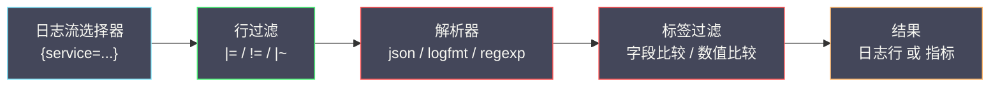

# 05 LogQL 深度解析

**摘要：**

如果说 Chunk 与索引决定了 Loki 能存多少、多便宜，那么 **LogQL** 决定了你能从这些数据里问出什么问题。LogQL 是 Loki 的查询语言，它的语法直接继承了 [[可观测/指标/03 MetricsQL 深度解析|PromQL]] 的血统——同样的标签选择器、同样的聚合算子、同样的"用表达式描述意图"的哲学。但它多做了一件 PromQL 做不到的事：**把日志行本身当作一等公民**，允许你先按标签筛出日志流，再在管道里逐层过滤、解析、聚合，最后既可以把结果当作日志行返回，也可以把日志里的数值抽取出来、当作指标来聚合。本文从 LogQL 的设计基因出发，逐层拆解日志流选择器、管道与解析器、指标查询与 unwrap，再落到查询的执行顺序与代价模型、常见反模式，以及如何用 LogQL 直接驱动日志告警。读完之后，你应当能回答两个问题：**为什么"日志即指标"是一个被低估的能力；以及一条 LogQL 写得好不好，为什么在写下的那一刻就已经决定了它的性能**。

---

## 第 1 章 LogQL 的设计基因

### 1.1 一段借来的语法

LogQL 的语法几乎可以直接从 PromQL 推导出来。如果你写过 PromQL，那么 LogQL 的第一印象会是"似曾相识"：

```text
PromQL：  http_requests_total{service="order", status="500"}
LogQL：   {service="order", level="ERROR"}

PromQL：  sum by (service) (rate(http_requests_total[5m]))
LogQL：   sum by (service) (rate({level="ERROR"}[5m]))
```

标签选择器的写法一样，聚合算子的写法一样，甚至 `rate()` 与时间窗口 `[5m]` 的用法都一样。这不是巧合——Loki 与 Prometheus 共享同一批设计者，也共享同一套"用标签描述身份、用表达式描述意图"的世界观。**LogQL 借来的不只是语法，更是"查询是一种声明式表达"这个理念**：你描述"想要什么"，而不是"怎么一步步算出来"。

### 1.2 两类查询：日志查询与指标查询

LogQL 最重要的一个设计，是它同时支持**两类语义截然不同的查询**：

**日志查询（Log Query）**：返回日志行本身，类似一个分布式的 `grep`。

```text
{service="order-service"} |= "timeout"
```

**指标查询（Metric Query）**：从日志中抽取数值，聚合成时间序列，类似 PromQL。

```text
rate({service="order-service"} |= "ERROR" [5m])
```

这两类查询共用同一套"选择器 + 管道"的前半段，只在最后一步分岔：日志查询把结果当行返回，指标查询把结果当数值聚合。**这个设计的意义，在于它把"日志"与"指标"从两种割裂的信号，变成了同一条流水线的两种出口**——你可以先按标签筛日志流，再解析出字段，最后选择"给我看行"还是"给我算指标"。这就是"日志即指标"的语法基础。

### 1.3 为什么"日志即指标"被低估

很多团队把 Loki 当成"便宜的日志存储"，只用了它的日志查询能力，却忽略了指标查询。这是一个巨大的浪费，因为**日志里藏着大量指标无法采集的"业务级"数据**：订单金额、支付渠道、错误码分布、响应时间的原始分布——这些数据往往只存在于日志里，而 LogQL 能直接从日志里把它们抽出来聚合成曲线。

举例来说，一个服务在日志里记录了每笔订单的 `amount` 与 `channel`。用 LogQL，你可以不写一行采集代码，就直接得到"按渠道分的订单金额速率"这样一条曲线：

```text
sum by (channel) (
  rate({service="order-service"} | json | unwrap amount [5m])
)
```

**这正是"日志即指标"的威力——它让"从日志里临时算一个指标"变得几乎零成本**。传统的做法是"想加一个指标 → 改代码 → 埋点 → 发版 → 等生效"，而在 Loki 里，只要日志里有这个字段，你就能立刻把它聚合成指标。**它把"指标的定义权"从"发版前"挪到了"查询时"**，这是一种此前很难实现的能力。

### 1.4 LogQL 的坐标：与 grep、KQL、PromQL 对照

把 LogQL 放到它同时代的查询语言之间，能更清楚地看到它的位置。

**与 grep 相比**，LogQL 多了"标签"这一层。grep 是在一堆文本里找匹配的行，它对"这些文本属于哪个服务、哪个环境"一无所知；LogQL 先用标签把范围收敛到少数几条流，再做文本匹配。**这一层标签，是 grep 与 LogQL 最本质的差别**——它让"在十亿行日志里找一行"从"全量扫描"变成了"先收敛再扫描"。

**与 Kibana 的 KQL 相比**，LogQL 多了"聚合与告警"。KQL 擅长"找出满足条件的日志行"，但它本身不提供"把日志聚合成曲线"的能力；LogQL 则在同一个语法里内建了 `rate()`、`sum by`、`unwrap` 这些聚合能力，让"日志查询"与"指标查询"共用一套语言。**这让 LogQL 的表达半径，比 KQL 更大一圈**。

**与 PromQL 相比**，LogQL 多了"处理文本"。PromQL 操作的对象是数值时间序列，它无法"在文本里找关键词"，也无法"把一段文本解析成字段"；LogQL 则把"文本"当作一等公民，允许你在管道里逐层处理。**这让 LogQL 能回答 PromQL 回答不了的问题**——比如"这些错误日志里，有多少条提到了某个特定的第三方服务名"。

一句话概括 LogQL 的位置：**它站在 grep、KQL、PromQL 三者的交集上，用一套语言覆盖了"找行""解析""聚合"三件事**。它的代价是每一件事都不是同类里最强的——但它把三件事缝在了一起，这个"缝"本身，就是它最大的价值。

### 1.5 声明式：写"要什么"，不写"怎么算"

LogQL 与 PromQL 一样，是**声明式（declarative）** 语言——你描述"想要什么结果"，而不是"如何一步步算出它"。这一点在指标查询里尤其明显：`sum by (service) (rate({level="ERROR"}[5m]))` 只表达了"按服务汇总错误日志速率"这个意图，而"如何找到匹配的流、如何下载 Chunk、如何解压、如何分组求和"这些步骤，全部由 Loki 的查询引擎决定。

声明式带来两个好处。**其一，写法简单**：你不必关心数据在物理上怎么组织、怎么分片、怎么并行。**其二，优化空间留给了引擎**：引擎可以根据数据的实际分布，选择更优的执行计划——比如把大查询拆成并行的子查询、命中缓存、跳过不相关的 Chunk。这些优化，在"命令式"的查询语言里必须由使用者自己操心。

但声明式也有代价：**使用者对"执行代价"缺乏直接控制**。你写下 `{env="prod"}` 时，无法直观地知道它要扫描多少数据——这正是为什么本文要花大量篇幅讲"代价模型"。**声明式语言的使用者，必须靠"对执行模型的理解来决定写法"，而不是靠"手写的执行步骤"**。理解了这一层，就能理解为什么 LogQL 的性能优化，几乎全部落在"选择器与管道顺序"这两件事上——因为那正是你唯一能影响执行计划的地方。

---

## 第 2 章 日志流选择器

### 2.1 选择器的三种匹配

LogQL 的每一个查询都从一个**日志流选择器（Log Stream Selector）** 开始，它用花括号里的标签匹配条件确定"要看哪些日志流"。匹配方式有三种：

```text
{service="order-service"}                     # 精确匹配（等于）
{service=~"order-.*"}                          # 正则匹配
{service!="health-check"}                      # 不等于
{env="prod", service=~"order|payment"}         # 多条件组合
```

选择器的作用，是**把查询范围从"全部日志"收敛到"少数几条日志流"**。这一步决定了后续所有操作要处理的数据量，因此它是 LogQL 性能的第一道、也是最关键的一道闸门。**选择器写得越精确，后面越省**——`{service="order"}` 与 `{env="prod"}` 在代价上可能相差几个数量级。

### 2.2 精确匹配与正则匹配的代价差异

选择器里，**精确匹配（`=`）比正则匹配（`=~`）便宜得多**，这个差异值得单独说明。精确匹配的标签值是一个确定的字符串，Loki 可以直接在索引里定位到对应条目；而正则匹配需要遍历候选标签值，逐个做匹配。因此：

- `{service="order-service"}` 能直接命中索引，是最快的。
- `{service=~"order-.*"}` 需要枚举并匹配，稍慢。
- `{service=~".*"}` 等于"匹配所有"，几乎退化成全表扫描。

> [!warning] 一个常见的性能陷阱
> `{service=~".*"}` 或 `{job=~".+"}` 这类"匹配一切"的选择器，看起来无害，实际上等同于放弃标签过滤——Loki 必须扫描所有日志流。**这类写法在仪表盘里尤其危险**，因为它每次刷新都会全量扫描。正确的做法是尽量用精确匹配，或者用更具体的正则收窄范围。**在选择器里"偷懒"，代价会在查询时成倍偿还**。

### 2.3 选择器里的时间与偏移

除了标签，LogQL 还支持在查询级别指定**时间范围**与**偏移（offset）**：

```text
# 时间范围由查询请求的 start/end 决定，也可以在表达式里指定窗口
rate({service="order"}[5m])

# offset 用于"对比上一周期"
sum(rate({service="order"}[5m] offset 1d))
```

`offset` 的价值在于**同环比对比**：把"当前 5 分钟的速率"与"一天前同一时刻的速率"放在一起，就能判断"这个异常是不是每天都会发生"。**这是排查"周期性异常"的关键工具**——很多看起来严重的告警，其实只是每天凌晨的定时任务。**把 offset 用起来，能过滤掉大量"假故障"**。

### 2.4 选择器、标签基数与"最左收敛"

选择器写得好不好，直接决定了查询要"触碰"多少条日志流——而日志流的数量，又由标签基数决定。这两件事之间有一条容易被忽视的因果链：

```text
标签基数高 → 日志流多 → 选择器能收敛的范围有限 → 命中的流多 → 扫描的 Chunk 多 → 查询慢
```

因此，"写一条高效的 LogQL"，很多时候并不是"查询技巧"的问题，而是"标签设计"的问题。**如果某个维度是高基数的，那么无论选择器写得多精确，它都无法有效收敛范围**——因为高基数标签本身就不该被用作过滤入口。这也是为什么第 03、04 篇反复强调标签基数：**选择器的表达能力，上限由标签设计决定**。

这里还有一条实用原则，可以称为"**最左收敛**"：选择器里应当尽量包含"基数最低、区分度最高"的标签。`{service="order", pod="order-abc123"}` 里的 `pod` 虽然是精确匹配，但它是高基数标签，用它收敛不仅不高效，还会因为标签基数本身而拖累系统。**正确的做法是：用低基数标签（service、level、env）做收敛，把高基数维度（pod、trace_id）留到正文或 Structured Metadata 里过滤**。**选择器的"最左"，应当放最擅长收敛的标签**。

### 2.5 选择器与 Grafana 变量的配合

选择器在 Grafana 里有一个非常实用的用法：**用仪表盘变量（template variable）动态填充标签值**。例如定义一个变量 `$service`，查询写成 `{service="$service"} |= "error"`，用户就能在下拉框里切换服务，而查询随之变化。

这个用法的价值在于**"一份查询，多个视角"**——不必为每个服务各写一条查询，而是用变量把"选择器的一部分"参数化。它把"查询"变成了"可复用的模板"，大幅降低了维护仪表盘的成本。

但变量也带来一个常见陷阱：**变量的取值可能很宽**。如果 `$service` 支持"All"选项，而实现方式是 `service=~".*"`，那么"选了 All"的查询就会退化成全量扫描——**这正是前面讲的"匹配一切"陷阱在仪表盘里的表现形式**。因此使用变量时，要留意"All 选项"背后的实际查询，必要时限制变量的取值范围，或对"All"做特殊处理。**变量的便利，不能以牺牲查询效率为代价**。

---

## 第 3 章 管道：从筛选到解析

### 3.1 管道的结构

选择器之后，LogQL 用一串**管道操作（Pipeline）** 逐步处理日志行：

```text
{选择器} | 操作1 | 操作2 | 操作3 | ...
```

管道操作大致分三类：**行过滤（Line Filter）**、**解析器（Parser）**、**标签过滤（Label Filter）**。它们的排列顺序，直接决定了查询的性能——因为管道是"从左到右、逐级淘汰"的：**越早的操作，越能减少后续要处理的数据量**。



这张图里，绿色（行过滤）是"最便宜"的操作，红色（解析与标签过滤）是"较贵"的操作。**因此最优的管道顺序，是把最便宜、淘汰率最高的操作放在最前面**——这正是本章后面反复强调的那条黄金法则。

### 3.2 行过滤：最便宜的淘汰

**行过滤**直接在日志文本里做字符串或正则匹配，不涉及任何解析，是管道里最便宜的操作：

```text
|= "timeout"       # 包含 "timeout"（大小写敏感）
!= "health"        # 不包含 "health"
|~ "error|fail"    # 正则匹配
!~ "debug|trace"   # 正则不匹配
```

行过滤的关键价值，在于**它能在解析之前淘汰大部分日志行**。假设一个查询是"在 order 服务的日志里找含 timeout 的、且 status >= 500 的行"：

```text
{service="order"} |= "timeout" | json | status >= 500
```

这里 `|= "timeout"` 会先淘汰掉绝大部分不含 "timeout" 的行，只有剩下的少数行才需要进入 `| json` 解析。如果反过来把 `| json` 放在前面，那么**所有行都要被解析一遍**——而解析比字符串匹配昂贵得多。

> [!info] 管道顺序的黄金法则
> **把最便宜、淘汰率最高的操作放在最前面**。行过滤（纯字符串匹配）< 简单解析（json/logfmt）< 正则解析 < 数值运算。如果一条查询很慢，第一个该检查的就是"管道顺序对不对"——**很多时候，把 `|= "keyword"` 提前，就能让查询快一个数量级**。

### 3.3 标签过滤：对解析结果的筛选

**标签过滤**作用于解析器抽取出来的字段（或结构化元数据），支持字符串与数值比较：

```text
# 字符串匹配
| level="ERROR"
| service=~"order|payment"

# 数值比较
| status >= 500
| duration_ms > 1000
```

标签过滤的价值在于**精确**：行过滤是"文本里包含这个子串"，而标签过滤是"这个字段等于这个值"。前者可能误伤（"timeout" 可能出现在一条正常日志的说明文字里），后者是精确的字段比较。**能用标签过滤解决的，就不要用行过滤**——这是精度上的取舍。

不过标签过滤有个前提：**必须先解析出字段**。因此它总是出现在解析器之后。这也意味着它的成本包含了解析的成本——所以"行过滤提前"依然是首要优化。

### 3.4 解析器：把文本变成字段

解析器是 LogQL 里最"重"的操作，它把非结构化的日志文本变成可被过滤的字段。LogQL 支持多种解析器：

```text
| json        # 解析 JSON 日志，字段直接映射
| logfmt      # 解析 key=value 格式
| regexp `(?P<ip>\d+\.\d+\.\d+\.\d+) - (?P<method>\w+)`   # 正则抽取
| pattern `<ip> - <method> <path> <status>`                 # 模式匹配
| unpack      # 展开 Loki 的 packed 格式
```

选择哪种解析器，取决于日志的格式与性能要求。**JSON 与 logfmt 是"结构化解析"，性能高**（一次扫描即可映射字段）；**正则与 pattern 是"模式解析"，表达力强但更慢**。因此一条通用的优化原则是：**能让应用输出 JSON 的，就不要在查询端写正则**——把解析的成本挪到写入端（甚至挪到"应用直接输出结构化日志"这一层），是最彻底的优化。

### 3.5 管道的"再加工"：line_format 与 label_format

除了过滤与解析，LogQL 还提供了两个"改写"操作，用于把日志行或标签"重新组织"成想要的形态：

```text
# line_format：改写日志行的显示内容
{service="order"} | json | line_format "{{.level}} | {{.message}}"

# label_format：基于已有字段生成新标签
{service="order"} | json | label_format channel_alias="{{.channel}}"
```

`line_format` 的价值在于**让查询结果更可读**——原始日志可能是冗长的 JSON，用它只保留关心的字段，阅读效率大幅提升。`label_format` 的价值在于**在查询结果上做轻量的字段重命名或组合**，让后续的聚合或展示更方便。

但要注意，这两个操作都发生在"管道后段"，它们**不会减少扫描的数据量**，只影响"输出长什么样"。因此它们不是性能优化手段，而是**展示优化手段**。一个常见的误解是"用 `line_format` 精简输出能加快查询"——事实上，精简的是"结果"，不是"扫描"，对性能几乎没有影响。**要加速查询，永远回到"选择器收敛"与"行过滤提前"这两件事上**。

### 3.6 多行日志在 LogQL 里的处理

LogQL 的管道天然是"逐行"的——它处理的是日志行，而不是"一条跨多行的事件"。这带来一个与采集端呼应的约束：**如果一个 Java 异常堆栈被拆成了几十行独立日志，那么 LogQL 无法把它们当作一条事件来处理**。

正确的做法是**在采集端就把多行合并成一条**（见 [[可观测/日志/02 日志采集架构——Grafana Alloy、Promtail 与 Vector|采集架构]] 里的多行合并），让进入 Loki 的每条日志都是"一个完整事件"。这样 LogQL 的逐行处理才能正确工作——`|= "Exception"` 能命中那条包含堆栈的日志，而不是命中堆栈里的某一行。

如果多行日志已经以"拆散"的形式进了 Loki，LogQL 侧的补救手段有限——你只能用 `|~` 匹配多行中的某一行，却无法把它们"重新拼起来"。**这再次印证了那条原则：能在地基（采集端）解决的问题，不要留到查询端**。多行合并属于采集端的职责，LogQL 假设"一条日志就是一个事件"。

### 3.7 解析出的字段与"标签"的区别

一个容易混淆的点：解析器抽出来的字段，与"日志流的标签"是两回事。**标签（label）** 是日志流的身份，参与索引，决定日志流如何被切分；**解析出的字段（extracted label）** 只是查询过程中的临时产物，不参与索引，也不改变日志流的归属。

这个区别有一个重要的实践含义：**解析出的字段不能被用来"跨查询复用"**。你在一条查询里 `| json` 抽出了 `user_id`，它只在这条查询的管道里有效；下一条查询若想用它，必须重新 `| json` 一遍。**这与标签形成鲜明对比**——标签是持久的、全局的、被索引的。

因此有一条判断准则：**如果一个字段会被反复用于"过滤入口"，它应当被考虑做成标签（若低基数）或 Structured Metadata（若高基数）；如果只是偶尔在管道里用一下，就让它留在正文里、按需解析**。**把"临时字段"和"持久身份"混为一谈，是 LogQL 使用中一个常见的概念混淆**。

---

## 第 4 章 解析器的细节

### 4.1 json 解析器

`| json` 把 JSON 日志的顶层字段映射为标签。如果日志的字段嵌套，还可以指定路径：

```text
| json level="level", msg="message", user="user.id"
```

这里 `user="user.id"` 表示"从 JSON 的 `user.id` 路径取值，命名为 `user`"。**显式指定字段名，比 `| json` 全量解析更高效**——因为它只解析需要的字段，减少了不必要的开销。这是一个容易被忽视的性能优化：**全量 `| json` 会解析所有字段，而字段多时开销显著**。

### 4.2 logfmt 解析器

`| logfmt` 解析 `key=value` 格式的日志，是 Go 生态服务最常用的格式：

```text
# 日志：level=info msg="user login" user_id=456 duration_ms=23
{service="auth"} | logfmt | duration_ms > 100
```

logfmt 的解析比 JSON 轻，因为它不需要处理嵌套与转义（在多数情况下）。**如果应用能输出 logfmt，它在"人类可读性"与"机器可解析性"之间的平衡，往往优于 JSON**。

### 4.3 regexp 与 pattern 解析器

当日志既不是 JSON 也不是 logfmt 时，就需要用正则或 pattern 来抽取字段：

```text
# 正则解析（命名捕获组）
| regexp `(?P<ip>\d+\.\d+\.\d+\.\d+) - (?P<method>\w+) (?P<path>\S+) (?P<status>\d+)`

# pattern 解析（更直观的模式语法）
| pattern `<ip> - <method> <path> <status>`
```

两者都用于非结构化文本，但 `pattern` 的语法更直观（用 `<字段名>` 占位），`regexp` 表达力更强（支持任意正则）。**pattern 适合"格式固定、位置明确"的日志，regexp 适合"格式多变、需要复杂匹配"的场景**。它们的共同代价是**比结构化解析慢**——正则引擎需要逐字符尝试匹配，是 CPU 密集的操作。

### 4.4 解析器的组合与顺序

多个解析器可以串联，用于处理"部分结构化"的日志——比如"外层是 JSON，某个字段里又嵌了一段 logfmt"：

```text
| json | line_format "{{.message}}" | logfmt
```

这里先 `| json` 解析外层，取出 `message` 字段，再用 `| logfmt` 解析 `message` 的内容。**解析器的组合能力，让 LogQL 能处理各种"嵌套结构"的日志**。但要记住，每多一层解析，成本就多一分——**能一层解决，就不要叠两层**。

### 4.5 解析器的选择策略

面对一条日志，如何选择解析器？一条实用的决策顺序是：

**第一步，问"应用能不能输出结构化日志"**。如果能，那么最彻底的优化是让应用直接输出 JSON 或 logfmt，查询端就只需要 `| json` 或 `| logfmt`。这是"治本"的做法——把解析的成本挪到写入端，且一次解析、处处可用。

**第二步，问"日志是哪种结构化格式"**。JSON 用 `| json`，`key=value` 用 `| logfmt`，都是高效的直接映射。

**第三步，只有在"既非 JSON 也非 logfmt"时，才用正则或 pattern**。这一步应当谨慎，因为正则解析是 CPU 密集的。此时还要再问："我真的需要解析它吗？"——如果只是想找关键词，用行过滤就够了，根本不需要解析。**很多"需要解析"的错觉，其实是"用行过滤就能解决"**。

**第四步，如果必须解析，优先用 `pattern` 而非 `regexp`**。`pattern` 的语法更简单、实现通常更快，只要日志格式固定，它是更优选择。

这个决策顺序的核心思想，与整个 LogQL 的优化哲学一致：**先把成本推给写入端（应用输出结构化日志），再在查询端用最便宜的方式处理**。**解析器是"退而求其次"的工具，而不是"默认使用"的工具**——能用行过滤解决的，不要解析；能结构化输出的，不要正则。

### 4.6 解析失败时会发生什么

一个容易被忽视的细节是：**当解析器遇到不符合预期的日志时，会发生什么？** 不同解析器的行为不同，理解它们有助于避免"静默丢数据"。

对于 `| json` 与 `| logfmt`，如果某一行不是合法的 JSON / logfmt，**这一行通常会被解析器丢弃**——不进后续管道，也不出现在结果里。对于 `| regexp` 与 `| pattern`，如果不匹配，同样会被丢弃。

这个行为带来一个隐蔽的陷阱：**一条查询看起来"返回了结果"，但可能已经悄悄丢弃了一部分不符合格式的日志**。如果这部分日志恰好是"格式异常的那批"（往往正是你想要的），那么查询结果会有偏差却不报错。**这是"静默失败"在 LogQL 层的又一表现**。

对抗它的手段是**用行过滤先确认"这类日志存在"**，或者**对解析结果做存在性校验**（如先 `| json` 再检查某字段是否为空）。**一条严谨的 LogQL，应当对"解析可能失败"这件事有预案**——尤其是在用日志做告警或统计时，静默丢行会让结论失真。

---

## 第 5 章 指标查询：日志即指标

### 5.1 从日志到数值

指标查询的核心动作，是把日志行**聚合成时间序列**。最基本的两个函数是 `rate()` 与 `count_over_time()`：

```text
# 过去 5 分钟内，每秒的 ERROR 日志数量
rate({service="order-service", level="ERROR"}[5m])

# 过去 1 小时内，ERROR 日志的总数
count_over_time({service="order-service", level="ERROR"}[1h])
```

`rate()` 给出"每秒速率"，适合看趋势；`count_over_time()` 给出"窗口内总数"，适合看绝对量。**它们把"日志行"变成了"数值曲线"，从此日志也能像指标一样被画图、被聚合、被告警**。

### 5.2 聚合算子

指标查询支持 PromQL 风格的聚合算子：

```text
# 按服务分组的 ERROR 日志速率
sum by (service) (rate({level="ERROR"}[5m]))

# 找出 ERROR 最多的前 5 个服务
topk(5, sum by (service) (rate({level="ERROR"}[5m])))

# 计算 ERROR 占比
sum(rate({level="ERROR"}[5m])) / sum(rate({}[5m]))
```

这些算子的语义与 PromQL 完全一致——`sum by`、`topk`、除法运算，都是同一套。**这带来一个巨大的好处：如果你已经会写 PromQL，那么写 LogQL 的指标查询几乎是零学习成本**。而 Loki 与 Prometheus 在 Grafana 里可以放在同一个面板里对比，进一步降低了使用门槛。

### 5.3 unwrap：把字段变成数值

`unwrap` 是 LogQL 里一个关键操作——它把解析出来的**字符串字段转换成数值**，从而参与数值聚合：

```text
# 从日志里提取响应时间，计算平均值
{service="order-service"} | json | unwrap response_time_ms | avg_over_time([5m])

# 计算响应时间的 P99
{service="order-service"} | json | unwrap response_time_ms | quantile_over_time(0.99, [5m])

# 计算响应时间总和
{service="order-service"} | json | unwrap response_time_ms | sum_over_time([5m])
```

`unwrap` 之后，可以使用 `avg_over_time`、`quantile_over_time`、`sum_over_time`、`max_over_time` 等一系列聚合函数。**这是"日志即指标"能力的真正落地**——它让"从日志里算一个 P99 延迟"成为可能，而不需要预先埋一个 Histogram 指标。

> [!note] unwrap 的能力与代价
> `unwrap` 让日志里的任意数值字段都能变成指标，这是它最大的价值。但它的代价也不小：**它需要对每条日志行做解析与数值转换**，因此比单纯的 `rate()` 昂贵得多。此外，`quantile_over_time` 这类分位数计算需要在内存里保留窗口内的所有数值，对内存有额外要求。**用 unwrap 时，务必先收窄选择器与时间窗口**——否则"从日志里算 P99"会变成一个昂贵的全量操作。

### 5.4 与原生指标的分工

既然 LogQL 能从日志算指标，那还需要原生指标（Prometheus/VictoriaMetrics）吗？答案是**需要，而且分工清晰**：

| 需求 | 更适合 | 原因 |
|---|---|---|
| 高频、低成本的常规指标 | 原生指标 | 采集成本低、查询毫秒级 |
| 日志里才有的业务数据 | LogQL 指标查询 | 无需埋点，随用随查 |
| 长期趋势（数月到数年） | 原生指标 | 存储成本低、保留期长 |
| 临时性的、探索式的分析 | LogQL | 零成本定义，用完即弃 |

核心判断是：**如果这个指标会被长期、高频地查询，就应当把它"固化"为原生指标；如果只是临时探索，就用 LogQL 现算**。**LogQL 的指标查询不是要替代原生指标，而是补上"临时定义指标"这个此前缺失的能力**。

### 5.5 窗口与对齐：rate 的时间语义

指标查询里最容易出错的，是**时间窗口的语义**。`rate({...}[5m])` 里的 `[5m]` 是"计算速率的时间窗口"，而查询本身还有一个"时间范围"与"步长（step）"。理解这三者的关系，才能读懂查询结果。

- **时间范围（start / end）**：查询覆盖的总时段。
- **步长（step）**：结果序列上相邻数据点之间的间隔。
- **窗口（range，如 `[5m]`）**：每个数据点"回看"多长时间来计算。

举例来说，`rate({...}[5m])` 在时间范围"过去一小时、步长 30 秒"下，会产生约 120 个数据点，每个点计算的是"该点往前 5 分钟内的平均速率"。**这意味着相邻数据点之间是重叠的**——因为它们各自的 5 分钟窗口有大量交叠。这是设计使然：**窗口比步长大，是为了让曲线更平滑、避免因采样抖动而剧烈跳动**。

这条语义有一个实用后果：**窗口设置得比步长小，曲线会变得毛刺**；**窗口设置得远大于步长，曲线会变得非常平滑，但对突发尖峰的响应变慢**。因此"窗口该设多大"没有标准答案，它取决于你想看"趋势"还是"尖峰"。**这是 LogQL 与 PromQL 共享的一处语义细节，理解它能让你的日志指标曲线更符合预期**。

### 5.6 日志指标与原生指标的一致性挑战

用 LogQL 从日志算出的指标，与用原生埋点算出的同名指标，常常对不上——这是一个值得警惕的现象。差异通常来自几处：

**其一，采样与丢失**。日志可能被采集器采样或丢弃，而原生指标是"每次调用都计数"。因此"日志里的请求数"往往小于"指标里的请求数"。

**其二，口径不一致**。日志里的"成功"可能是"业务码为 0"，而指标里的"成功"可能是"HTTP 200"——两者混在一起时，比例自然不同。

**其三，时间窗口与对齐**。日志指标的窗口计算与指标系统的窗口计算可能有细微差异，导致曲线在边界处不一致。

这些差异本身不是错误，但它们会带来一个真实的风险：**当"日志告警"与"指标告警"对同一现象给出不同结论时，团队会陷入"该信哪个"的困惑**。避免这种困惑的办法是**明确口径、写进文档**——就像 [[可观测/指标/00 专栏导览|指标专栏]] 里强调的"口径必须在采集之前想清楚"一样，**日志指标的口径同样需要被显式定义，而不是靠两条查询各自"看起来对"**。

### 5.7 常用聚合函数的语义速查

LogQL 提供了多个"窗口聚合函数"，它们的语义差异值得一张速查表：

| 函数 | 语义 | 典型用途 |
|---|---|---|
| `rate(log-range)` | 每秒的日志条数 | 日志速率曲线、告警 |
| `count_over_time(log-range)` | 窗口内日志条数 | 绝对量统计 |
| `bytes_rate(log-range)` | 每秒的字节数 | 日志量监控 |
| `avg_over_time(unwrapped-range)` | 窗口内数值的平均 | 平均延迟、平均金额 |
| `sum_over_time(unwrapped-range)` | 窗口内数值的和 | 总额、总量 |
| `quantile_over_time(φ, range)` | 窗口内数值的 φ 分位 | P95 / P99 延迟 |
| `max_over_time` / `min_over_time` | 窗口内极值 | 峰值检测 |

使用这张表时要注意两点：**其一，`rate` 与 `count_over_time` 作用在"日志条数"上，不需要 `unwrap`；而 `avg_over_time`、`quantile_over_time` 等作用在"数值"上，必须先 `unwrap`**。其二，`quantile_over_time` 需要保留窗口内的所有数值，是这几者里最贵的——用它时更要收窄范围。**把"函数语义"与"代价"一起记，才能用得既对又快**。

---

## 第 6 章 查询的执行与代价

### 6.1 一条查询的执行顺序

理解 LogQL 的执行顺序，是写出高效查询的前提。以这条查询为例：

```text
{service="order-service", level="ERROR"} |= "timeout" | json | status >= 500
```

它的执行过程是：

```text
1. 标签过滤（Index Lookup）
   → 从索引里找出匹配 {service="order-service", level="ERROR"} 的 Chunk 列表
   → 这一步是毫秒级的（只读元数据）

2. Chunk 下载与解压
   → 从对象存储下载这些 Chunk，并解压
   → 这一步是耗时的大头

3. 行过滤（|= "timeout"）
   → 在解压后的文本里逐行匹配，淘汰不匹配的行
   → 纯字符串匹配，很便宜

4. 解析（| json）
   → 对通过行过滤的日志行做 JSON 解析
   → 只有少数行进入这一步

5. 标签过滤（status >= 500）
   → 过滤 status >= 500 的行

6. 返回结果
```

这个顺序揭示了 Loki 查询性能的两条规律：**第一，"下载与解压 Chunk"是固定成本，取决于命中多少 Chunk；第二，"管道操作"是变动成本，取决于有多少行进入管道**。因此优化查询有两个方向——**减少命中的 Chunk（收窄标签与时间）**，以及**减少进入管道的行（把行过滤提前）**。

### 6.2 一个代价模型

把上面的分析抽象成一个代价模型，可以更清晰地指导优化：

```text
总代价 ≈ Chunk 数 × 每 Chunk 的下载解压代价
       + 进入管道的行数 × 每行的管道处理代价
```

其中 `Chunk 数` 由"命中流数 × 时间范围"决定，`进入管道的行数` 由"行过滤的淘汰率"决定。这个模型给出三条优化路径：

- **减少命中流数**：把标签选择器写得更精确，避免"匹配一切"。
- **减少时间范围**：把查询窗口收窄到必要的最小范围。
- **提高行过滤淘汰率**：把 `|=` 放在管道最前面，并选择"区分度高"的关键词。

**这三条路径里，前两条的杠杆最大**——因为它们减少的是"固定成本"（Chunk 数），而第三条减少的是"变动成本"（管道处理）。**先砍固定成本，再优化变动成本**，是 LogQL 优化的正确顺序。

### 6.3 查询限制：Loki 的自我保护

Loki 对 LogQL 查询施加了一组限制，理解它们有助于判断"为什么我的查询被拒绝了"：

- **最大条目数**：单次查询返回的行数上限，防止把海量结果塞进客户端。
- **最大扫描范围**：一次查询最多扫描多长时间跨度。
- **最大并行度**：限制并发执行的子查询数。
- **查询超时**：超过时限的查询被终止。

这些限制的存在，是 Loki"可预测地慢"而非"不可预测地崩"的保障。**当查询被限制拒绝时，正确的反应不是"调大限制"，而是"先想清楚这条查询为什么需要扫描这么多数据"**——因为调大限制往往只是把问题从"查询失败"变成"集群过载"。

### 6.4 查询的拆分与并行

Loki 在执行查询时，会做一层"拆分"：Query Frontend 把大时间范围的查询切成若干小段，分发给多个 Querier 并行执行。理解这层拆分，有助于判断"为什么同一个查询有时快有时慢"。

拆分的粒度由配置决定。**切得越细，并行度越高、单段越小，但"任务数量"越多**（每个子查询都要经历调度、结果合并的开销）；**切得越粗，并行度越低，但任务开销越小**。这是一个典型的"并行度与调度开销"的权衡——切得太细，调度开销反超收益；切得太粗，无法充分利用并行。

对使用者的实用含义是：**一个查询的延迟，不只看"总扫描量"，还看"能不能被有效并行"**。如果一个查询命中的流极度集中在少数几个 Chunk 上，那么拆分也帮不上忙——因为总工作量就那么点，拆开也不能更快。反过来，如果一个查询命中大量分散的 Chunk，拆分能显著缩短延迟。**这也是为什么"标签收敛"不仅能减少总工作量，还能让工作更容易被并行**——分散的数据更适配并行执行。

### 6.5 查询结果的缓存

Loki 的 Query Frontend 支持对查询结果做缓存，这是"重复查询"能便宜的关键。理解缓存的粒度与失效条件，有助于判断"为什么第二次查同一个东西变快了"。

缓存的粒度通常是**子查询**（拆分后的小段时间范围）的结果。当一条查询再次执行时，如果它的某个子查询与之前完全相同（相同的选择器、相同的时间段、相同的管道），就可以直接命中缓存，跳过 Chunk 的下载与解压。**这就是为什么"仪表盘定时刷新"这类重复查询，第一次慢、之后快**。

缓存带来的一个实用影响是：**查询的"写法"会影响缓存命中率**。如果两条查询逻辑等价但写法不同（如 `{service="a"}` 与 `{service=~"a"}`），它们可能无法共享缓存——因为缓存以"查询表达式"为键。因此在仪表盘与告警里，**保持查询写法的一致性，能提高缓存命中率、降低整体负载**。**在 Loki 里，"怎么写"不仅影响性能，还影响缓存**——这是它比传统数据库更"语法敏感"的一个体现。

### 6.6 查询超时：一个"写法问题"的信号

当一次查询超过时限，Loki 会终止它并返回错误。理解这个行为对排障很重要：**查询超时通常不是"系统坏了"，而是"这条查询本身太重"**。正确的反应是去分析"它为什么这么重"，而不是重试——重试一条本来就超时的查询，只会让集群更过载。

一个常见的误区是"把超时时间调大就能解决"。事实上，如果一条查询需要扫描的数据量本来就超出了合理范围，那么调大超时只是把"快速失败"变成"长时间占用资源"——**它不会让查询变快，只会让集群在更长时间里被拖住**。

正确的排查顺序是：**先看这条查询扫描了多少 Chunk（选择器是否收敛）→ 再看时间范围是否过大 → 再看管道顺序是否合理 → 最后才考虑"是不是真的需要调大限制"**。**在 Loki 里，"查询超时"几乎总是一个"写法问题"的信号，而不是一个"配置问题"**。

---

## 第 7 章 LogQL 的边界与反模式

### 7.1 反模式一：选择器偷懒

最常见的反模式，是用"匹配一切"的选择器：

```text
# 反模式：等价于全量扫描
{job=~".+"} |= "error"
```

这类查询会在每次执行时扫描所有日志流，无论正文过滤多精确，都要先把所有 Chunk 拉下来解压。**正确的做法是尽量精确地指定标签**——`{service="order", level="ERROR"} |= "error"` 比上面那条快几个数量级。

### 7.2 反模式二：管道顺序颠倒

```text
# 反模式：先解析再过滤，所有行都要被解析
{service="order"} | json | status >= 500

# 正确：先过滤再解析，只有少数行被解析
{service="order"} |= "status" | json | status >= 500
```

如果日志里有一个稳定的关键词能标识目标行，把它作为行过滤放在最前面，能大幅减少解析量。**"先解析再过滤"是 LogQL 里最常见、也最容易修复的性能问题**。

### 7.3 反模式三：用日志做重聚合

```text
# 反模式：对海量日志做复杂聚合
sum by (user_id) (count_over_time({service="order"} | json [1h]))
```

按 `user_id` 聚合会产生高基数结果，同时 `[1h]` 的窗口意味着要扫描大量 Chunk。这类需求本质上更适合"结构化日志 + 分析型数据库"，而不是 LogQL。**LogQL 的指标查询适合"低基数、小窗口、探索式"的聚合，不适合替代数据分析平台**。

### 7.4 反模式四：忽视 unwrap 的成本

```text
# 反模式：全量 unwrap 再算分位数
quantile_over_time(0.99, {env="prod"} | json | unwrap latency [1h])
```

`unwrap` 加上 `quantile_over_time` 需要保留窗口内所有数值，对内存与 CPU 的压力都很大。如果选择器还很宽（`{env="prod"}`），这个查询几乎必然超时。**用 unwrap 时，务必先收窄选择器与时间窗口**。

### 7.5 一个正例：用 LogQL 做临时指标

反过来看 LogQL 最闪光的用法：某天，业务方问"过去一周，不同支付渠道的成功率是多少"。这个指标此前没有埋点，而 LogQL 让答案唾手可得：

```text
sum by (channel) (rate({service="payment"} | json | event="pay_result" | unwrap success [5m]))
```

只要日志里记录了 `channel` 与 `success`，这条查询就能立刻给出按渠道分的成功率曲线。**这就是"日志即指标"的核心价值——它把"想加一个指标"的门槛，从"改代码发版"降到了"写一条查询"**。**在没有 LogQL 的世界里，这个问题要么等待下一次发版，要么只能靠人工翻日志**。

### 7.6 反模式五：把 LogQL 当 SQL 用

最后一个反模式，是把 LogQL 当成一个通用的查询语言来用——期待它能做 JOIN、能对多源数据做复杂关联、能像 SQL 一样灵活地"从任意角度切数据"。

LogQL 不是 SQL，它没有 JOIN，没有子查询，也没有事务语义。它的模型是"**在一组日志流上做过滤与聚合**"，这个模型很强大，但边界也很清楚。当你的需求开始需要"把日志 A 与日志 B 关联起来"或"对多个字段做多表式的组合分析"时，正确的工具是**分析型数据库**（如 ClickHouse）或**离线数仓**，而不是硬用 LogQL 去模拟 SQL。

**认清 LogQL 的边界，比挖掘它的极限更重要**。它擅长的是"在日志里找行、解析、做低基数的聚合"；它不擅长的是"复杂关联、多表分析、高基数聚合"。**把 SQL 的期待投射到 LogQL 上，只会得到一个又慢又不准的查询**——而正确的做法，是把这类需求分流到它该去的工具那里。**工具的分工，从来不是"谁更强大"，而是"谁更匹配"**。

### 7.7 反模式六：用 unwrap 替代原生数值指标

最后一个反模式，是把 `unwrap` 当成"免费的原生指标"来用——对每一条需要长期观测的数值指标，都用 `unwrap` 从日志现算，而不是埋一个原生指标。这在"临时探索"时没问题，但在"长期、高频"场景下会迅速变成负担：**每次查询都要解析日志、抽取数值、做窗口聚合，成本远高于直接读一条时间序列**。

正确的做法是**分层**：**临时的、探索式的数值统计用 `unwrap`（零成本定义）；一旦某个数值统计被证明是长期需要的，就把它"固化"为原生指标**（在应用里埋点，或用定期任务把日志转成指标）。这与前文"把日志告警固化为指标告警"是同一条演化路径。

**这条"先现算、后固化"的路径，其实是所有可观测性系统的通用模式**：先用灵活但昂贵的手段发现信号，再把被证明重要的信号固化成廉价而稳定的形式。**把"发现"与"守护"分成两个阶段，分别用最适合的工具，才是可持续的做法**。

---

## 第 8 章 用 LogQL 驱动日志告警

### 8.1 日志告警的价值

除了指标告警，Loki 支持直接**基于日志的告警（Log-based Alerting）**：当某类日志的出现频率越过阈值时触发告警。这类告警填补了指标告警的一个盲区——**有些问题在指标上不明显，但在日志里很明确**。例如"某个特定的错误码开始出现"、"某个第三方接口的异常日志突然增多"，这些信号可能在聚合指标里被稀释掉，却能在日志里被精确捕捉。

### 8.2 一条日志告警规则

Loki 的告警规则使用 LogQL 表达式：

```yaml
groups:
  - name: order-service-alerts
    rules:
      - alert: HighPaymentErrorRate
        expr: |
          sum by (channel) (
            rate({service="payment"} |= "payment failed" [5m])
          ) > 10
        for: 5m
        labels:
          severity: warning
        annotations:
          summary: "支付渠道 {{ $labels.channel }} 失败率异常"
```

这条规则的含义是：**过去 5 分钟内，某个支付渠道的"payment failed"日志速率超过每秒 10 条，并持续 5 分钟，就触发告警**。`for: 5m` 的作用与指标告警一致——避免被瞬时抖动误触发。

### 8.3 日志告警的取舍

日志告警并非"越多越好"，它有自己的边界。**优点**是**零埋点、定义灵活**：任何在日志里出现过的模式，都能变成告警，不需要提前埋指标。**代价**是**成本更高、延迟更大**：日志告警要扫描 Chunk、解析文本，比指标告警昂贵；而且它依赖日志链路，如果日志采集延迟，告警也会延迟。

因此日志告警的合理定位是**"补充"而非"主力"**：**核心的、长期关心的告警用指标**（快、便宜、稳定），**边缘的、临时的、日志特有的告警用 LogQL**（灵活、零成本定义）。**把每一条告警都做成日志告警，会让 Loki 的查询层长期承压**；反过来，把每一条告警都做成指标告警，则会让"想加一个告警"变得笨重。**两者分工，才是可持续的告警体系**。

> [!info] 一条实用建议：把日志告警"固化"为指标
> 如果某条日志告警被长期保留下来，说明它对应的信号是长期重要的——这时候应当考虑**把它从"日志告警"升级为"指标告警"**：在应用里埋一个计数器，或用一个定期跑的 LogQL 指标查询把日志转成原生指标，再基于原生指标告警。**日志告警适合"发现"，指标告警适合"长期守护"**——这条演化路径，与"临时查询固化为仪表盘"是同一种思路。

### 8.4 日志告警的降噪与测试

日志告警有一个比指标告警更棘手的降噪问题，值得单独讨论。指标通常是"预先定义好的、稳定的"——你知道 `http_requests_total` 的含义不会变；而日志是"自由文本"——一条 `|= "error"` 的规则可能匹配到各种不同的错误，其中大部分是无关紧要的。

降噪的几条实用手段：**其一，用更精确的匹配**。`|= "connection refused"` 比 `|= "error"` 精确得多，能过滤掉大量"只是提到 error 这个词"的日志。**其二，用标签过滤收窄来源**。`{service="payment", level="ERROR"}` 比 `{env="prod"} |= "error"` 收敛得多。**其三，设置合理的 `for` 与阈值**，避免瞬时抖动触发告警。**其四，用 `count_over_time` 而非单纯的存在性判断**——"出现了一条错误日志"通常不值得告警，"错误日志速率持续超过阈值"才值得。

与降噪同等重要的，是**对告警规则本身做测试**。日志告警的表达式同样可能写错（选择器太宽、正则写错、字段名拼错），而"写错的告警"往往不是"不触发"，就是"疯狂触发"。因此上生产之前，应当在测试环境用真实日志验证："这条规则在正常时段会不会误触发？在真实故障时能不能触发？"**一条未经测试的日志告警规则，本质上是一条"薛定谔的告警"**——你不知道它到底会不会在关键时刻响起来。

### 8.5 从日志告警到"日志 SLO"

日志告警的进阶用法，是把它当作 **SLO（服务等级目标）** 的度量来源。当某个服务的成功与否只体现在日志里（而非一个现成的指标）时，可以用 LogQL 直接从日志算出"成功率"这一 SLO 指标：

```text
sum(rate({service="payment"} | json | status="success" [5m]))
/
sum(rate({service="payment"} | json [5m]))
```

这条查询给出"支付成功率"，它可以直接作为 SLO 的度量口径。**它的价值在于：当业务指标只存在于日志里时，SLO 依然可以被建立**——而不必等待"埋一个指标"。

不过用日志算 SLO 有几个必须注意的点。**其一，日志的完整性是前提**：如果日志被采样或丢弃，成功率就会失真，而 SLO 的失真会直接误导决策。**其二，成本更高**：日志 SLO 要持续扫描日志，比指标 SLO 昂贵得多，因此更适合"验证阶段"或"日志特有指标"，而非长期主力。**其三，口径要与业务对齐**：正如本文反复强调的，"成功率"的分子分母必须被明确定义，否则会得出"日志说达标、用户说不好用"的荒诞结论。**用日志算 SLO 是一个有力的补充手段，但它不能替代"把关键指标埋成原生指标"这条长期路线**。

---

## 小结

LogQL 的设计，可以概括为"**一半是 PromQL，一半是 grep**"：它继承了 PromQL 的标签选择器与聚合算子，又加入了 grep 式的行过滤与管道解析。这个组合让它在两类场景里都游刃有余——既要"像查日志一样查日志"（按标签筛、按关键词找），又要"像查指标一样查日志"（聚合、画图、告警）。

但它所有的能力，都建立在同一个前提上：**先收敛范围，再处理内容**。选择器决定"看哪些流"，管道顺序决定"处理哪些行"，两者的组合决定了一条查询的代价。**一条 LogQL 写得好不好，在你敲下选择器的那一刻就已经决定了大部分**——后面的管道操作只是在这个基础上做加减。理解了这一点，就能理解为什么本文花了大量篇幅讲"管道顺序"与"代价模型"：它们不是技巧，而是写出可用 LogQL 的基本功。

最后回到"日志即指标"这个被低估的能力。它把"定义一个指标"的门槛从"发版"降到了"写一条查询"，从而让"临时性的、探索式的指标需求"第一次变得可行。**在传统的指标体系里，一个没有被提前埋点的数据，就等于不存在；而在 LogQL 里，只要日志里有这个字段，它就随时可以被变成一条曲线**。这不是要替代原生指标，而是补上了一块长期缺失的拼图——**让"发现值得长期观测的信号"这件事，从"事先猜到"变成了"事后固化"**。

而这条"先发现、后固化"的路径，也解释了为什么 LogQL 与原生指标不是竞争关系——它们服务的是同一个目标的两端：**LogQL 负责"广撒网地发现"，原生指标负责"长期地守护"**。理解了这层分工，就不会再纠结"该用哪个"，而会问"这个信号现在处在哪个阶段"。

---

## 参考资料

1. Grafana Loki Documentation - LogQL: https://grafana.com/docs/loki/latest/query/
2. LogQL - Log queries: https://grafana.com/docs/loki/latest/query/log_queries/
3. LogQL - Metric queries: https://grafana.com/docs/loki/latest/query/metric_queries/
4. LogQL - Label extraction (Parsers): https://grafana.com/docs/loki/latest/query/log_queries/#parser-expression
5. Loki Alerting Rules: https://grafana.com/docs/loki/latest/alert/
6. Prometheus Query Basics (PromQL): https://prometheus.io/docs/prometheus/latest/querying/basics/

---

> [!note] 思考题
> 1. 你们的日志查询里，有没有 `{job=~".+"}` 这类"匹配一切"的选择器？把它们改成精确匹配，能省多少扫描量？
> 2. 挑一条你们常用的查询，检查它的管道顺序：行过滤是不是在最前面？如果 `| json` 排在 `|=` 之前，调整一下能快多少？
> 3. 用 LogQL 的 `unwrap`，你能从现有日志里"现算"出哪三个此前没有埋点的指标？这些指标里，有哪些值得固化成原生指标？
> 4. 如果某条日志告警已经稳定运行了半年，你会把它升级为指标告警吗？升级的收益与代价分别是什么？
> 5. 用一条 `offset` 查询，对比"今天的错误率"与"昨天的同一时刻"，看看有多少"告警"其实是每天都会发生的周期性现象。
