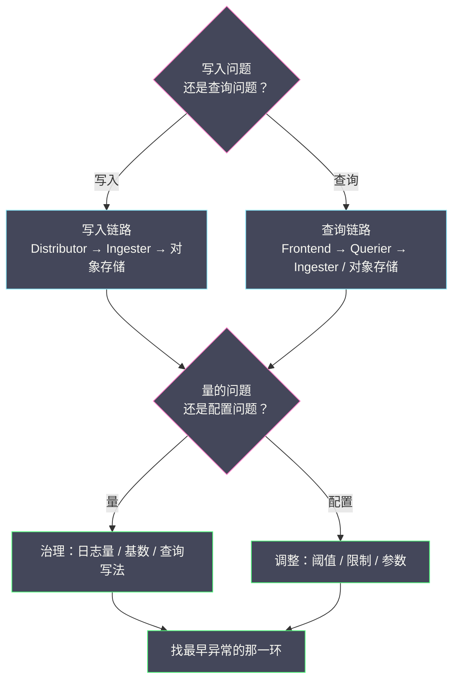

# 06 Loki 运维与性能调优

**摘要：**

前面几篇讲了 Loki 的设计哲学、架构与存储引擎，但它们回答的是"它为什么这样工作"；真正把一个 Loki 集群跑稳，还需要回答另一组问题：**标签基数失控了怎么办、Ingester 内存什么时候会爆、查询为什么偶尔超时、日志突然写不进去是哪里出了问题**。本文从"运维 Loki 的三条主线"出发，先把标签治理当作第一优先级讲透，再依次展开容量规划与扩缩容、查询性能调优、写入限流与背压、可靠性运维（副本、WAL、升级），随后给出"监控 Loki 自身"的关键指标清单与一套常见故障的排查手册，最后落到成本优化的抓手。读完之后，你应当能回答两个问题：**为什么在 Loki 的运维里，"治理标签"比"加机器"更有效；以及当一条告警说"Loki 出问题了"时，你应该按什么顺序去定位它**。

---

## 第 1 章 运维 Loki 的三条主线

### 1.1 从"它能工作"到"它能长期工作"

搭建一个 Loki 集群并不难——一个二进制、一份配置、一个对象存储桶，几十分钟就能跑起来。难的是让它**在日志量持续增长、查询模式不断变化的情况下，长期稳定且成本可控**。这两件事之间的差距，就是"运维"的全部内容。

Loki 的运维可以归纳为三条主线，它们对应三类不同的风险：

**主线一：容量（Capacity）**。日志量在涨、标签基数在涨、保留期在拉长，容量迟早会成为瓶颈。容量运维的目标是"**在瓶颈到来之前，知道它会在哪、什么时候到**"。

**主线二：性能（Performance）**。写入会变慢、查询会超时、Ingester 会 OOM。性能运维的目标是"**在用户抱怨之前，发现并消除性能退化**"。

**主线三：可靠性（Reliability）**。Ingester 会挂、对象存储会抖动、升级会出错。可靠性运维的目标是"**在故障发生时，数据不丢、服务可恢复**"。

这三条主线并非并列，而是有明确的主次：**容量与性能的绝大多数问题，根因都在"标签基数"上；而可靠性问题的兜底机制（副本、WAL），则是容量规划的前提**。因此本文把"标签治理"放在最前面——它是三条主线共同的第一抓手。

### 1.2 一个贯穿全篇的判断

在展开细节之前，先给出一条贯穿全篇的判断：**在 Loki 的运维里，"治理标签"的杠杆，远大于"加机器"**。原因是标签基数同时作用于三条主线——它决定 Ingester 的内存（容量）、决定查询要扫描的 Chunk 数（性能）、决定索引与流的状态规模（可靠性）。**把基数控制住，等于同时改善三条主线；而加机器只能缓解其中一条，且是治标**。

因此本文的许多"调优手段"，最终都会指向同一件事：**减少活跃日志流的数量，或减少每次查询命中的流数**。理解了这一点，后面的具体技巧才有共同的落点。

### 1.3 运维的三个层次

运维一个 Loki 集群，可以分成三个由低到高的层次，它们对应"成熟度"的不同阶段：

**层次一：可用（Availability）**。集群能收日志、能查日志、不崩溃。这是最低要求，也是"搭起来"就能达到的层次。很多团队长期停在这一层——直到某天基数失控或查询爆炸。

**层次二：可用且快（Performance）**。写入不积压、查询在可接受的延迟内返回。这需要理解"代价模型"，并持续优化查询写法与容量配置。

**层次三：可用、快且省（Cost Efficiency）**。在满足前两层的前提下，把成本压到合理范围。这需要从"数据的源头"入手——减少日志量、治理基数、优化保留。

**这三个层次的难度是递增的，但收益也是递增的**。层次一靠"配置"，层次二靠"理解"，层次三靠"治理"。**很多团队的运维投入停在层次一，却期待层次三的成本——这中间的差距，就是本文要补的内容**。

---

## 第 2 章 标签治理：运维的第一优先级

### 2.1 为什么标签治理是"运维"而非"开发"

一个常见的误解，是把标签设计当作"开发阶段的一次性决策"——发布前定好标签，之后就不用管了。事实恰恰相反：**标签基数是一个会随时间增长的动态量**，新服务上线、Pod 频繁重启、业务维度增加，都会让活跃日志流数悄悄上涨。因此标签治理不是一次性动作，而是一项**持续运行的运维职责**。

把它归入"运维"而非"开发"，意味着三件事：**要有监控**（持续观测基数）、**要有告警**（基数异常时通知）、**要有流程**（新增标签需评审）。缺了任何一项，基数事故都会以"缓慢累积、突然爆发"的方式出现——而等到爆发时，往往已经很难回滚。

### 2.2 基数监控：看什么指标

监控标签基数，核心是看"**活跃日志流数**"以及它的增长趋势。Loki 自身暴露了相关指标，可以据此建立监控：

- **活跃流数**：当前有多少条日志流正在被跟踪。这是最直接的一个数。
- **每秒新建流数**：新日志流的产生速率。如果它长期大于零且不稳定，说明有标签在漂移。
- **每个租户的流数**：多租户环境下，能定位到"是哪个租户在制造基数"。
- **Ingester 内存占用**：基数最终会反映到内存上，它是"结果指标"。

监控的关键不是"某个瞬间的值"，而是**趋势与突变**。一个健康的集群，活跃流数应当相对稳定；如果它呈现"只涨不跌"的曲线，或者某天突然跳升，那就是一个明确的信号。**基数事故几乎总有前兆，问题在于有没有人在看**。

> [!warning] 一个容易被忽视的信号：新建流速率
> "活跃流数"是一个存量指标，它上涨得可能很慢，不容易引起警觉。而"**每秒新建流数**"是一个流量指标，它对"标签漂移"极其敏感——如果某个标签开始漂移，新建流速率会立刻上升，而活跃流数要过一段时间才明显。**盯住"新建流速率"，能比"盯住活跃流数"更早发现问题**。这也是监控任何"缓慢累积型"故障时的通用经验：存量指标看趋势，流量指标看突变。

### 2.3 在采集端收敛：最有效的一招

标签治理里性价比最高的一招，是**在采集端就切断泄漏源**。因为数据一旦进入 Loki、成为一条日志流，它就已经占用了内存与索引；而如果它在采集端就被丢弃或收敛，成本为零。

具体手段包括：用 relabel 规则丢弃无用的标签、把高基数标签"收敛"为低基数标签（如把 `pod` 收敛为 `deployment`、把完整的 `path` 收敛为"路由模板"）、以及限制"哪些 Pod 才被采集"。这些规则应当作为采集配置的一部分被版本化管理，而不是散落在各处的临时补丁。

**这里有一条判断准则：任何"取值可能无界增长"的维度，都不应该成为标签**。用户 ID、请求 ID、会话 ID、带自增 ID 的路径、Pod 名——它们都属于"看起来有用、实则是基数杀手"的维度。把它们留在正文里，需要时用 LogQL 过滤，而不是提升为标签。**"记录上下文"与"索引上下文"的区别，在运维阶段会以"内存是否够用"的形式显现出来**。

### 2.4 定期审计：把历史包袱清掉

随业务演进，一些曾经有用的标签会变成历史包袱。某个标签可能当初是为了某个已下线的功能加的，如今没有任何查询在用它，却仍在制造日志流。**标签的成本是持续的（每次写入都在产生流），而它的收益可能早已消失**。

因此应当定期做一次"标签审计"：列出当前所有的标签维度，逐一回答"它被哪些查询/仪表盘/告警使用？"、"它的取值数量是多少？"、"如果删掉它，会有什么影响？"。对于"没有使用者且基数不低"的标签，果断删除。**这类审计不需要很频繁（每季度一次即可），但它能防止基数随时间无意识地膨胀**。

> [!info] 一个类比：标签治理就像"整理仓库"
> 一个仓库最初只放必要的东西，但如果不定期清理，就会堆满"当初也许有用"的杂物，最终连必要的货物都放不进去。标签治理也是如此——**基数的增长往往不是某个错误决策造成的，而是许多"顺手加一个"的累积**。定期审计，就是给这个仓库做一次断舍离。

### 2.5 标签治理的组织抓手

标签治理要长期有效，光有技术手段不够，还需要几项组织上的抓手：

**抓手一：把"新增标签"纳入变更评审**。新增一个标签，本质上是在增加系统的长期成本，因此它应当被视为一次"架构变更"而非"随手一改"。评审时要问三个问题：这个维度是低基数吗？它会被哪些查询使用？能不能用正文或 Structured Metadata 替代？

**抓手二：建立"标签字典"**。把团队认可的低基数标签列成一份文档，注明每个标签的语义、取值范围、以及"谁在用它"。这份字典是评审的依据，也是新成员理解日志结构的入口。

**抓手三：把基数指标纳入"服务健康度"**。让每个服务 owner 能看到"自己贡献了多少日志流"，从而形成"谁制造基数谁负责"的机制。**把成本与责任绑定到人，是治理能持续的关键**。

这三项抓手共同回答一个问题：**如何让"控制基数"从一个技术建议，变成一个组织习惯**。技术手段能"发现"和"收敛"基数，但只有组织抓手才能防止它"再次膨胀"。

---

## 第 3 章 容量规划与扩缩容

### 3.1 三个需要规划的容量

容量规划要回答"需要多少资源"，而 Loki 的容量分三块，它们的增长驱动因素各不相同：

| 容量 | 驱动因素 | 增长形态 |
|---|---|---|
| **Ingester 内存** | 活跃日志流数 × Chunk 大小 | 受标签基数主导，可能突变 |
| **对象存储** | 日志量 ÷ 压缩比 × 保留期 | 随日志量线性增长 |
| **查询端资源** | 查询的标签收敛度 × 时间范围 | 受查询模式主导，波动大 |

这三块里，**对象存储最容易规划**（线性、可预测），**Ingester 内存最需要警惕**（受基数主导、可能突变），**查询端最难规划**（取决于人的查询习惯）。因此容量规划的正确顺序是：先把对象存储估准，再把 Ingester 内存估准，最后用压测来估查询端。

### 3.2 Ingester 内存：最需要提前规划的一块

Ingester 的内存需求可以用一个粗略的公式估算：

```text
Ingester 内存 ≈ 活跃日志流数 × Chunk 目标大小 × 缓冲系数
```

这个公式里最敏感的量是"**活跃日志流数**"——它由标签基数决定，而不是由日志量决定。这意味着一个"日志量不大但标签很杂"的集群，可能比一个"日志量很大但标签很干净"的集群更早遇到内存问题。**这也是为什么本文反复强调：容量规划的第一步不是算日志量，而是算活跃流数**。

在规划时，还有两个容易被忽略的细节。**其一，要留出切分时的内存峰值**——当大量 Chunk 同时被切分、压缩时，内存占用会短暂高于稳态。**其二，要为副本预留空间**——如果配置了多副本，同一份数据会同时存在于多个 Ingester 上，内存需求要乘以副本数。**把这两个细节算进去，才能避免"规划时够用、运行时不够"**。

### 3.3 扩缩容的顺序

当容量接近瓶颈时，扩缩容的顺序值得讲究。**对于写入压力**：先考虑加 Distributor（无状态、随便加），再看是否需要加 Ingester（有状态、需要迁移）。**对于查询压力**：先考虑加 Querier（无状态、可扩），再考虑优化查询本身。**对于存储压力**：对象存储本身通常是可无限扩展的，问题往往在"请求数"而不是"容量"——这时候要优化的是 Chunk 大小与索引组织，而不是"加硬盘"。

有一条通用原则：**优先扩"无状态、廉价、可随意伸缩"的组件，谨慎扩"有状态、昂贵、需要迁移"的组件**。Distributor 与 Querier 属于前者，Ingester 属于后者。**很多扩容请求，其实可以通过"先加无状态组件"来满足，而不必去动有状态的 Ingester**。

### 3.4 一个容量规划的实例

把容量规划走一遍具体流程，会更有操作性。假设一个团队要为一个新集群做规划，已知：

- 每天产生 **300 GB** 原始日志；
- 保留 **14 天**；
- 预期活跃日志流数约 **8,000**（基于标签设计估算）；
- Chunk 目标大小 **1.5 MB**，缓冲系数取 **2**。

**第一步，估对象存储**：`300 GB ÷ 7（压缩比）× 14 ≈ 600 GB`。这是稳态容量，加上刷盘时的临时峰值，预留一倍冗余，约 1.2 TB。

**第二步，估 Ingester 内存**：`8,000 × 1.5 MB × 2 ≈ 24 GB`。若配置 3 副本、3 个 Ingester，则总内存需求要乘以副本数，再分摊到各 Ingester。规划时应当按"总需求 = 流数 × Chunk 大小 × 缓冲系数 × 副本数"来算，避免低估。

**第三步，估查询端**：无法用公式，只能用压测。取几条代表性的真实查询（仪表盘上的、告警用的），在中规模数据集上测出"单位时间范围 × 单位流数"的扫描开销，再据此推算。

**第四步，留出增长余量**：日志量、基数、查询量都会增长，规划时应当按"当前值的 1.5 到 2 倍"来预留。**容量规划的目的不是"精确预测"，而是"在增长到来之前，知道该往哪个方向扩"**。

这个实例里最值得注意的，是"副本对内存的影响"——它很容易被漏算，导致规划时内存估得偏低。

### 3.5 扩容的时机：看"趋势"而不是"瞬间"

什么时候该扩容？一个常见的错误是"看到某个指标高就扩"——看到内存到 80% 就加 Ingester，看到查询慢就加 Querier。这种"看瞬间值"的扩容，往往是反应式的、被动的，而且可能扩错了地方。

更好的做法是**看趋势与余量**：不看"现在用了多少"，而看"按当前增长速度，多久会用完"。如果某个容量预计在两周内触顶，那么现在就该规划扩容；如果按趋势要半年才触顶，那可以先观察。**扩容应当由"趋势"驱动，而不是由"瞬间的告警"驱动**。

同时，扩容前应当先问一句："**这个增长是正常的，还是异常的？**"如果内存上涨是因为"日志量正常增长"，那扩容合理；如果是因为"某个标签突然漂移"，那扩容只是掩盖问题——治本的做法是治理那个标签。**区分"正常的增长"与"异常的增长"，是决定"该扩还是该治"的关键**。

---

## 第 4 章 查询性能调优

### 4.1 调优的四个抓手

查询性能的调优，可以归纳为四个抓手，按杠杆从大到小排列：

**抓手一：收窄标签选择器**。把"匹配一切"的选择器换成精确匹配，能减少命中的日志流数，这是杠杆最大的一档。

**抓手二：收窄时间范围**。把"查一个月"改成"查一天"，扫描量成比例下降。这一档的杠杆也很大，且最容易被忽视——很多慢查询的根因就是"时间范围开得太大"。

**抓手三：调整管道顺序**。把行过滤放在解析之前，能减少进入解析的行数。这一档的杠杆中等，但改动成本最低。

**抓手四：利用缓存**。保持查询写法一致、让仪表盘的重复查询命中缓存。这一档不改变单次查询的代价，但能降低整体负载。

**调优的顺序应当是"一、二、三、四"**——先看看能不能收窄范围，再看看能不能调整写法，最后才考虑缓存。**跳过前两步直接谈缓存，往往是在给一个本就不该那么重的查询"打补丁"**。

### 4.2 识别"慢查询"

调优的前提是"知道哪些查询慢"。Loki 提供了查询相关的指标与日志，可以用来识别慢查询：

- **查询延迟分布**：哪些查询进入了 P99？它们的共同点是什么（选择器太宽？时间范围太大？）。
- **单次查询的扫描量**：一次查询扫描了多少 Chunk、多少字节。这是判断"查询重不重"的最直接指标。
- **被限制拒绝的查询**：哪些查询因为超出限制而失败？它们代表了"最需要被优化"的那一批。
- **每租户的查询量**：多租户环境下，能定位到"是哪个租户在压查询"。

**"识别慢查询"比"优化慢查询"更重要**——因为大多数慢查询是"写法的系统性错误"，而不是"个别查询的偶发问题"。找到这个系统性错误（比如"所有仪表盘都用了 `{env="prod"}` 的选择器"），一次修复就能解决一大批。

### 4.3 一个常见反模式：仪表盘拖垮查询层

查询层最典型的事故，是**仪表盘**。一个仪表盘可能有几十个面板，每个面板每 15 秒刷新一次，每次刷新都跑一条查询。如果这些查询的选择器很宽、时间范围很大，那么单个仪表盘就可能持续给查询层施加巨大压力——而用户看到的只是"页面有点卡"。

这类问题的治理手段有几条：**降低刷新频率**（不是所有面板都需要 15 秒刷新）、**收窄每个面板的查询范围**、**利用缓存**、以及**给仪表盘查询设置更严格的限制**。**"仪表盘是查询层最大的负载来源"这一点，常常被低估**——因为它看起来只是"看看图"，实际上背后是持续的、并发的重查询。

### 4.4 查询限制的调优

Loki 有一组查询限制（最大条目数、最大扫描范围、查询超时等）。运维时需要理解：**这些限制既是"保护"，也是"约束"**——设得太松，一个错误查询就能拖垮集群；设得太紧，正常查询会被误伤。

调优查询限制的正确方法，是**从"业务需求"反推**：先明确"用户最长的合理查询范围是多久"、"一次查询最多返回多少行才够用"，再据此设定限制，并留一点余量。**不要凭感觉设一个数字，也不要因为"某个查询被拒了"就无脑调大**。

还有一个常被忽视的点：**限制应当按租户区分**。核心业务的租户可以给更宽松的限制，探索性的租户则更严格。**一刀切的限制，往往让"该宽松的没宽松、该严格的没严格"**。多租户环境里，限制的"分级"本身就是一种治理手段。

### 4.5 并行度：一个容易被忽视的调优维度

除了"查询写法"，还有一个运维侧的调优维度：**查询的并行度**。Loki 会把大查询拆成小段并行执行，而"拆多细"是一个可调参数。它直接决定了"一个重查询能不能被更快地消化"，也决定了"查询层的并发压力"。

拆得太细，任务数量多、调度与合并开销大，且并发任务多会挤占其他查询的资源；拆得太粗，单个任务重、并行度低，长查询的尾延迟高。**因此并行度的调优，本质是在"单查询速度"与"整体吞吐"之间取舍**——对"查询量不大、偶尔有长查询"的场景，可以拆细一点追求速度；对"查询量大、追求稳定吞吐"的场景，则应拆粗一点、避免过度并发。

这条维度容易被忽视，是因为它不像"选择器"那样天天被写，也不像"内存"那样天天被看。**但当一个集群"查询量没涨、却整体变慢"时，并行度与拆分粒度往往是被忽略的那个变量**。

---

## 第 5 章 写入性能与限流

### 5.1 写入链路上的三个瓶颈

写入慢或写入失败，可能出在链路的三个位置：

**采集端**：采集器读文件的速度跟不上写入，或缓冲溢出导致丢弃。表现为"日志延迟到达"或"部分缺失"。

**Distributor / Ingester**：写入速率超过限流阈值被拒（HTTP 429），或 Ingester 内存不足无法接受新数据。表现为"写入请求被拒绝"。

**对象存储**：刷盘时对象存储响应慢，导致 Chunk 堆积在内存。表现为"Ingester 内存持续上涨"。

定位写入问题，首先要区分"是采集端的问题"还是"Loki 侧的问题"——看采集器的指标（发送成功率、缓冲水位）与 Loki 的指标（429 计数、Ingester 内存）哪一侧先异常。**把"采集端"与"Loki 侧"的指标放在一起看，是定位写入问题的第一步**。

### 5.2 限流：一个需要被理解的机制

Loki 对每个租户施加写入限流（每秒可写入的字节数、突发量、条目数等）。当超过阈值时，写入请求会被拒绝（返回 429）。这个机制的目的是**保护集群不被单个租户的日志风暴拖垮**，但它也常常是"日志写不进去"的直接原因。

面对 429，有两种截然不同的反应，需要分清：

- **如果限流阈值设置得太保守**（正常业务量就触发了），那么应当调高阈值。
- **如果限流是因为某个异常**（某服务进入错误循环，疯狂打日志），那么**不应该调高阈值，而应该去修复那个异常**。

**这里有一条重要的判断：429 本身不是故障，它是"保护机制在起作用"的信号**。正确的做法是看"是什么导致了超量"——是正常增长，还是一次异常。**盲目调高限流阈值，等于拆掉安全阀，可能让一个小问题演变成全集群故障**。

> [!warning] 限流与"日志风暴"的正反馈
> 有一种危险的情况：某个服务出错后进入"错误日志循环"——每次失败都打日志，日志写入失败又触发重试，重试又产生更多日志。这会形成**正反馈**，在几秒内把写入量推高几个数量级。限流正是为了切断这个正反馈。**因此面对 429 时，除了看阈值，还要警惕"是不是有服务正在自我放大"**——如果有，修复那个服务比调整阈值重要得多。

### 5.3 背压：从"拒绝"到"减速"

除了硬性拒绝（429），更优雅的处理是**背压（Backpressure）**：当后端压力大时，让上游"减速"，而不是"失败"。在 Loki 的写入链路里，背压体现在采集端的缓冲与重试——当 Loki 返回 429，采集器应当把数据暂存到本地缓冲，稍后重试，而不是直接丢弃。

因此一个健康的日志链路，需要"限流"与"背压"配套：**限流保护后端，背压保护数据不丢**。缺了限流，后端会被拖垮；缺了背压，限流一来数据就丢。**配置 Loki 的写入限制时，必须同步确认采集端的缓冲与重试策略**——两者是一套机制的两半。

### 5.4 采集器与 Loki 的协同调参

采集端与 Loki 侧的参数是耦合的，需要一起调。几个典型的耦合点：

**批量大小**：采集器一次发送的批量越大，Loki 侧的单次请求越大。批量太小会增加请求数（元数据开销），批量太大可能触及 Loki 的单请求限制。两者要匹配。

**重试策略**：采集器的重试间隔与次数，要与 Loki 的限流窗口匹配。如果 Loki 的限流是"每秒恢复一点"，而采集器是"立刻重试"，就会形成"重试风暴"——反而加剧限流。

**超时设置**：采集器的请求超时要略大于 Loki 的正常写入延迟，否则会在"Loki 只是稍慢"时误判为失败并重试。

**缓冲容量**：采集器的本地缓冲要能覆盖"Loki 限流或短暂不可用"的时长。缓冲太小，限流一来就丢数据。

**这些参数单独看都是"采集器配置"或"Loki 配置"，但它们的效果只在"两者匹配"时才正确**。运维时应当把它们放在一张表里一起管理，而不是各调各的。**"系统边界上的参数"，永远是两边一起看的**。

---

## 第 6 章 可靠性运维

### 6.1 写入路径的可靠性兜底

前面讲过，Loki 的写入路径依赖三个兜底机制：**多副本、WAL、优雅关闭**。运维层面的职责，是确认这三个机制都被正确配置并验证过：

- **副本数**是否配置为 3（或与可用区数量匹配）？
- **WAL** 是否启用？本地磁盘是否足够容纳 WAL？
- **升级流程**是否尊重优雅关闭的时序（给足等待时间）？

**这三个机制的价值，只有在故障真正发生时才会显现**——因此它们必须被"演练"过，而不是"配置了就算数"。一次真正的 Ingester 故障演练，比读十遍文档更能暴露配置的漏洞。**可靠性不是"配置项"，而是"被验证过的行为"**。

### 6.2 升级与滚动重启

Loki 的升级需要谨慎对待，因为它涉及有状态组件。一个安全的升级流程大致是：

1. **先升级无状态组件**（Distributor、Querier、Query Frontend），它们的重启不影响数据。
2. **再升级有状态组件**（Ingester），逐个进行，确保每个 Ingester 在重启前完成数据刷盘或转移。
3. **最后升级后台组件**（Compactor），它对可用性影响最小。

这个顺序的原则是**"先动影响小的，再动影响大的"**。Ingester 的升级尤其需要小心——如果多个 Ingester 同时下线，副本可能不足以覆盖，导致数据丢失。**滚动升级的"滚动"，对有状态组件而言不是"并行重启"，而是"一个一个来，且每个都确认安全后再进行下一个"**。

### 6.3 对象存储的依赖

Loki 的可靠性，很大程度上依赖对象存储的可靠性。对象存储通常是高可用的托管服务，但它仍可能"慢"或"短暂不可用"。Loki 对此的兜底是**Ingester 的内存缓冲**——对象存储短暂抖动时，Chunk 先在内存里等着，等对象存储恢复再刷盘。

但内存缓冲的容量是有限的。如果对象存储长时间不可用，内存会堆积、最终触发限流或拒绝写入。**因此对象存储的可用性，实际上是 Loki 可用性的一个上游约束**。运维时需要监控"刷盘延迟"与"Ingester 内存"，它们能提前反映对象存储的健康状况。**不要把对象存储当作"永远在线"的假设**——它是链路的一环，也会出问题。

### 6.4 演练：让"兜底机制"被验证

前面说"可靠性不是配置项，而是被验证过的行为"。落到实践上，就是**故障注入演练（Chaos Engineering）**。对 Loki 而言，值得演练的场景有几个：

**场景一：随机 kill 一个 Ingester**。验证副本是否生效、查询是否仍能返回完整数据、重启后 WAL 是否能恢复。

**场景二：模拟对象存储延迟**。验证刷盘延迟上升时，Ingester 内存是否被正确监控、限流是否按预期触发。

**场景三：触发一次限流**。验证采集端是否按预期缓冲与重试、数据是否丢失。

**场景四：滚动升级**。验证升级流程是否尊重优雅关闭、是否有数据丢失窗口。

演练的价值，不在于"证明系统不会坏"，而在于**"发现兜底机制没按预期工作"**——而这恰恰是演练最常发现的东西。**很多团队以为自己的副本配置生效了，直到演练时才发现"副本数配了但环没配好"**。**相信配置，不如相信演练**。

### 6.5 运维债：那些"先跳过、以后再补"的事

运维 Loki 时，总有一些"眼下不做也不影响、但迟早要还"的事——可以把它们称为**运维债**。典型的几笔：

- **没配置副本或副本数不足**：能跑，但一次故障就可能丢数据。
- **没启用 WAL**：能跑，但 Ingester 崩溃就丢未刷盘的数据。
- **没监控基数**：能跑，但基数事故会以"突然爆发"的方式出现。
- **没演练过故障恢复**：能跑，但真出事时手忙脚乱。
- **没设保留策略**：能跑，但存储成本会无限增长。

这些债的共同特征是**"不还的代价有延迟，且往往在最坏的时机爆发"**。因此它们应当在"系统还健康"的时候主动偿还——**运维债和金融债一样，越晚还，利息越高**。而在这些债里，"没监控基数"是最该优先偿还的一笔，因为它同时是其他几笔债的触发器。

---

## 第 7 章 监控 Loki 自身

### 7.1 关键指标清单

要运维 Loki，先要能观测 Loki。一套够用的监控清单大致如下：

**写入侧**：
- 每秒接收的日志字节数与行数（判断写入压力）。
- 被限流拒绝的请求数（429 计数，判断是否触顶）。
- Ingester 的活跃流数与内存占用（判断基数健康度）。

**读取侧**：
- 查询延迟分布（P50 / P95 / P99）。
- 每查询扫描的 Chunk 数与字节数（判断查询是否过重）。
- 被限制拒绝的查询数（判断哪些查询需要优化）。
- 缓存命中率（判断缓存是否有效）。

**存储侧**：
- 对象存储的写入延迟与错误率。
- Chunk 的刷盘速率与积压量。
- Compactor 的运行状态与保留清理进度。

**组件健康**：
- 各组件实例的存活状态。
- Ingester 的 WAL 状态与恢复情况。
- 各组件之间的调用错误率。

### 7.2 四条必须配置的告警

监控指标很多，但真正"必须配置"的告警不多。以下四条覆盖了 Loki 最容易出事、且后果最严重的场景：

1. **Ingester 内存接近上限**：这是基数失控或对象存储变慢的最直接信号，后果是写入失败。
2. **写入限流频繁触发**：说明有租户在超量写入，或阈值设置不当。
3. **查询延迟持续超标**：说明查询层正在承压，通常是"某个仪表盘或告警在跑重查询"。
4. **Chunk 刷盘延迟上升**：说明对象存储变慢，是"Ingester 内存上涨"的上游原因。

这四条告警的共同点是**"提前量"**——它们都指向"即将发生的问题"，而不是"已经发生的问题"。**好的告警应当给你时间去处理，而不是通知你"已经来不及了"**。

### 7.3 监控的"自举"问题

这里有一个略带哲学意味的问题：**Loki 的监控，应该存在哪里？** 如果把 Loki 自身的指标与告警也放进 Loki 里，那么当 Loki 出问题时，监控也一起瞎了——这就是"自举"问题。这与"日志系统自身也需要被观测"（见 [[可观测/日志/01 日志的本质与演进|01 篇]]）是同一类困境。

合理的做法是**把"Loki 的监控"放在一个独立于 Loki 的通道里**：Loki 的指标交给独立的指标系统（如 VictoriaMetrics），Loki 的关键告警交给独立于 Loki 的告警系统。这样即使 Loki 完全不可用，运维者仍能收到"Loki 挂了"的告警。**一个监控系统的"自监控"，绝不能只依赖它自己**——这是可观测性基础设施的一条底层原则。

### 7.4 指标很多，但"会看"更重要

一套完整的 Loki 监控指标可能有几十上百个，但运维的质量并不取决于"监控了多少指标"，而取决于"**能不能在出事时，用最快的速度找到那几个关键指标**"。这带来一个反直觉的建议：**与其把指标堆满，不如把"最关键的几个"放在最容易看到的地方**。

具体做法是把指标组织成"**入口 → 分叉 → 细节**"的三层结构：第一层是一个"Loki 健康总览"看板，用几个红绿灯式的指标回答"它现在健康吗"；第二层按"写入 / 查询 / 存储"分叉，回答"哪一块不健康"；第三层才是各组件的详细指标。**出事时，人先看第一层，确认异常，再顺着第二、第三层定位**——而不是从上百个指标里大海捞针。

**监控的价值不在于"数据齐全"，而在于"路径清晰"**。一个堆满了指标却没人知道从哪看起的看板，其实际价值可能低于一个只有十个指标、但层次分明的看板。**组织监控，本质上是在组织人的注意力**。

---

## 第 8 章 常见故障排查手册

### 8.1 症状到根因的对照

把常见症状与可能的根因整理成一张表，便于快速定位：

| 症状 | 可能的根因 | 排查入口 |
|---|---|---|
| 写入被拒（429） | 租户超量 / 阈值过保守 / 日志风暴 | 限流指标、租户写入量 |
| Ingester OOM | 标签基数失控 / 对象存储变慢 | 活跃流数、刷盘延迟 |
| 查询超时 | 选择器太宽 / 时间范围太大 / 管道顺序不当 | 单查询扫描量 |
| 日志缺失 | 采集器丢数据 / 轮转快于读取 | 采集器指标、丢弃计数 |
| 日志延迟到达 | 采集器缓冲堆积 / 写入限流 | 采集器缓冲水位 |
| 对象存储写入慢 | 对象存储侧问题 / 请求数过多 | 对象存储延迟、Chunk 数 |
| Compactor 卡住 | 保留清理配置错误 / 权限问题 | Compactor 日志与指标 |

### 8.2 一条通用排查路径

面对"Loki 出问题了"这样一个模糊的告警，有一条通用的排查路径：



**第一步，判断是"写入问题"还是"查询问题"**。看是"数据进不来"还是"数据查不出"。两者的排查方向完全不同。

**第二步，看"是哪个组件"**。写入走 Distributor → Ingester → 对象存储；查询走 Query Frontend → Querier → Ingester / 对象存储。沿着链路找"第一个异常"的组件。

**第三步，问"是量的问题还是配置的问题"**。量的问题（日志量、查询量、基数）需要通过治理解决；配置的问题（阈值、限制、参数）需要通过调整解决。**先分清这两类，能避免"用调参去解决本该治理的问题"**。

**第四步，找到"最早异常的那个指标"**。Loki 的故障往往是一条链——对象存储变慢 → 刷盘延迟上升 → Ingester 内存上涨 → 写入失败。**沿着这条链找到最上游的那一环，才是根因**。只处理下游症状（如重启 Ingester），故障会很快复发。

> [!info] 一条经验：先看"基数"，再看其他
> 因为标签基数同时作用于容量、性能、可靠性三条主线，**在排查任何 Loki 故障时，先看一眼"活跃流数"与"新建流速率"，往往能直接命中根因**。如果基数异常，那么内存、查询、写入的很多问题都能得到解释；如果基数正常，再往其他方向排查。**这是一个"低成本、高命中"的排查起点**。

### 8.3 一次完整的排查复盘

把上面的路径串成一个完整的例子。某天，告警"Loki 查询延迟 P99 超标"响起，值班工程师按路径排查：

**第一步，判断写入还是查询**：写入指标正常，是查询侧问题。

**第二步，定位组件**：Querier 的 CPU 与延迟都在高位，Query Frontend 正常——问题出在 Querier。

**第三步，问量还是配置**：查看"每查询扫描的 Chunk 数"，发现最近一天这个数字显著上升，说明**查询的扫描量在涨**，属于"量"的问题。

**第四步，找最早异常**：继续往前看，发现"活跃日志流数"在两天前开始上涨——根因是**基数增长**，导致同样的查询命中了更多流、扫描了更多 Chunk。

**结论与改进**：根因是"某个服务发版时新增了一个高基数标签"，导致活跃流数上涨，进而拖慢了所有查询。改进措施包括：回滚该标签、在采集端加 relabel 规则收敛它、以及为"活跃流数"配置告警（这样下次能更早发现）。

这个例子的关键，是**没有停在"Querier 慢"这个症状上，而是顺着链找到了"基数上涨"这个根因**。如果只处理症状（如给 Querier 扩容），问题会在几天后以更大的规模复发。**排查的价值，在于找到"最早异常的那一环"，而不是"最快能恢复服务的那一环"**。

### 8.4 排查的三个反模式

排查 Loki 故障时，有三个常见的反模式会让问题变得更糟：

**反模式一：一上来就重启**。"重启能解决 90% 的问题"在 Loki 里是一个危险的迷信——重启 Ingester 可能丢失未刷盘的数据，重启 Distributor 可能中断正在进行的写入。**重启应当是在"确认了根因、且重启是安全的恢复手段"之后才做的动作，而不是第一步**。

**反模式二：只看下游症状**。看到"查询超时"就去扩容 Querier，看到"内存高"就去重启 Ingester——这些都是处理症状。如果不顺着链找到"最早异常的那一环"（往往是基数或对象存储），故障会反复出现。**处理症状能让服务暂时恢复，但只有处理根因才能让它不再复发**。

**反模式三：在没有基线的情况下判断"异常"**。"今天的查询延迟是 3 秒"——这算慢吗？如果没有历史基线，你无法回答。因此**建立基线（"正常时的延迟、内存、基数是多少"）比建立告警更重要**，因为告警的阈值本身就需要基线来定。**没有基线的监控，只是数字的堆砌**。

---

## 第 9 章 成本优化

### 9.1 成本从哪里来

Loki 的成本分三块：**对象存储容量**（最大）、**计算资源**（Ingester / Querier 的 CPU 与内存）、**请求与元数据开销**（对象存储请求、索引操作）。优化的顺序，应当按"成本占比"与"优化难度"来排。

### 9.2 四个抓手

**抓手一：减少日志量**。这是杠杆最大的一档——砍掉一半无用日志，对象存储成本直接减半，且不损失信息。手段包括：降低不必要的日志级别、去掉循环里的 INFO、对调试日志采样。

**抓手二：治理标签基数**。基数决定了 Ingester 的内存与索引的规模，治理它同时降低计算成本与索引成本。

**抓手三：优化保留策略**。保留期每延长一倍，存储成本大致翻倍。应当结合"数据的实际价值"来定，而不是"越多越好"。

**抓手四：优化查询**。收窄选择器与时间范围，降低查询层的负载，从而可以用更少的 Querier 支撑同样的查询量。

**这四档里，第一档与第二档的杠杆最大**，也最容易被忽视——因为它们的收益不在"Loki 的配置"里，而在"应用怎么打日志"里。**Loki 的成本优化，一半是运维问题，一半是开发问题**。

### 9.3 一个反直觉的结论

最后强调一个反直觉的结论：**在 Loki 里，"加机器"往往是最后才该考虑的手段**。因为 Loki 的成本大头是对象存储（可无限扩展），而计算资源的瓶颈大多源于"基数"与"查询写法"这两个可以治理的因素。**加机器只能缓解计算压力，不能减少存储成本，也不能修复查询写法**。

正确的顺序是：**先治理数据（减少日志量、控制基数），再优化写法（查询收敛），最后才考虑扩容**。**这个顺序与"先优化、后扩容"的通用工程原则一致**——扩容是把问题"推给资源"，而治理是把问题"真正解决"。**在资源有限的前提下，先做那些"不花钱就能省"的事，永远是对的**。

### 9.4 成本本身也需要被观测

最后一点常被忽视：**成本本身也应当被监控**。如果不知道"当前每月花多少、花在哪、趋势如何"，就谈不上优化。Loki 的成本可观测性包括几项：

- **每租户的日志量**：谁在产生最多数据？
- **每租户的存储占用**：谁占用了最多对象存储？
- **对象存储的请求数**：元数据开销有多大？
- **活跃流数的趋势**：基数是在涨还是在降？

**把这些做成一个简单的看板，能让"成本"从一个抽象的月度账单，变成一个可以日常观察、可以归因、可以行动的指标**。有了它，成本优化才有依据——否则你只能凭感觉去"砍"，既不知道砍哪里，也不知道砍了有没有用。**可观测性的原则同样适用于成本：能被观测的，才能被管理**。

### 9.5 一个降本的案例

把降本的四档抓手串成一个案例。某团队的 Loki 集群月成本持续上涨，他们的降本过程分四步：

**第一步，看清成本构成**：发现对象存储占七成、计算占三成。存储是大头。

**第二步，治理日志量**：与各服务团队一起排查，发现三个服务在循环里打了 INFO、一个服务把整个响应体都打进了日志。修复后，日志量下降约四成——**存储成本直接跟着降了四成，且没有损失任何有用信息**。

**第三步，治理标签基数**：发现某个服务把 `request_id` 打成了标签，导致活跃流数远超预期。改为 Structured Metadata 后，Ingester 内存下降，可以用更少的实例支撑同样负载。

**第四步，优化保留**：把"所有日志保留 30 天"改成"ERROR 保留 30 天、INFO 保留 7 天"，进一步压缩存储。

最终，成本下降了一半以上，而系统的可观测性并未受损。**这个案例的关键，是四步都发生在"数据源头"，而不是"加机器"或"砍保留期"**。它印证了本文反复强调的那条判断：**在 Loki 里，降本的正确方向是"治理数据"，而不是"扩充或削减资源"**。

### 9.6 什么时候该"接受成本"

降本很重要，但**不是所有成本都该被削减**。有一条容易被忽视的判断：**有些数据的价值，恰恰体现在"你很少查、但出事时必须有"**。审计日志、关键业务的操作记录、故障复盘需要的完整上下文——它们平时几乎不被查询，成本占比却不低。但如果为了省钱把它们删掉或大幅采样，一旦出事，你会为"省下的那点存储"付出大得多的代价。

因此降本的正确态度是**"分层"而非"一刀切"**：对"高频查询、低价值密度"的数据（如调试日志）大胆削减；对"低频查询、高价值密度"的数据（如审计、ERROR）优先保留。**判断标准不是"它占了多少存储"，而是"删掉它，最坏情况下会失去什么"**。

这也回到本文反复出现的那条主线：**Loki 的运维，本质是一系列关于"取舍"的判断**——省与留、扩与治、快与省。没有放之四海皆准的答案，只有与你的业务、你的风险偏好相匹配的答案。**而做出这些判断的前提，是先看清每一项选择的代价**。

---

## 小结

Loki 的运维，可以概括为"**三条主线、一个抓手、一套监控**"。三条主线是容量、性能、可靠性；一个抓手是"治理标签基数"——因为它同时作用于三条主线；一套监控则是"能提前发现问题"的眼睛，尤其是那四条覆盖最严重场景的告警。

贯穿全篇的是一个反复出现的判断：**在 Loki 里，"治理"的杠杆大于"扩容"**。基数失控、日志过量、查询太宽——这些都不是"资源不够"的问题，而是"用法不当"的问题。加机器能暂时缓解症状，但成本会随规模一起涨；而治理能从根上把需求降下来，让同样的资源服务更多的负载。**这与可观测性领域的一条通用经验一致：可观测性系统的成本，最终由"数据的质量"而不是"硬件的数量"决定**。

如果只能从本文带走一句话，那应当是：**运维 Loki 时，先看"活跃流数"与"新建流速率"这两个指标**。它们是基数健康的晴雨表，也是容量、性能、可靠性三条主线共同的、最早的那个信号。**把这两个指标盯住，你就抓住了 Loki 运维的大半**。

而这背后是一条更底层的逻辑：**Loki 的成本与稳定性，主要取决于"数据治理"，而不是"系统调优"**。这也意味着，运维 Loki 的工程师需要同时具备"懂数据"与"懂系统"两种能力——前者决定了数据进不进得来、进得对不对，后者决定了系统扛不扛得住。**两者之中，"懂数据"往往更稀缺，也更关键**。

---

## 参考资料

1. Grafana Loki Documentation - Best Practices: https://grafana.com/docs/loki/latest/best-practices/
2. Grafana Loki Documentation - Label best practices: https://grafana.com/docs/loki/latest/get-started/labels/bp-labels/
3. Grafana Loki Documentation - Limits and configuration: https://grafana.com/docs/loki/latest/configuration/
4. Grafana Loki Documentation - Retention: https://grafana.com/docs/loki/latest/operations/storage/retention/
5. Grafana Loki Documentation - Alerting: https://grafana.com/docs/loki/latest/alert/
6. Grafana Loki Documentation - Operational best practices: https://grafana.com/docs/loki/latest/operations/
7. Grafana Labs Blog - Loki performance tuning: https://grafana.com/blog/

---

> [!note] 思考题
> 1. 你们的 Loki 集群当前活跃日志流数是多少？它过去一个月是稳定的，还是只涨不跌？如果是后者，你能找出是哪个标签在制造基数吗？
> 2. "新建流速率"这个指标，你们有监控吗？如果它某天突然上升十倍，你会怎么定位是哪个服务、哪个标签导致的？
> 3. 面对一次写入 429，你的第一反应是"调高阈值"还是"查是什么超量了"？这两种反应分别对应什么风险？
> 4. 你们的仪表盘有多少个面板？如果把它们全部改成 15 秒刷新，查询层会承受多大的额外负载？
> 5. 如果要给 Loki 降本 30%，你会先动"日志量""标签基数""保留期"还是"查询写法"？依据是什么？
> 6. 你上一次真正演练"某个 Ingester 挂掉"是什么时候？如果不演练，你凭什么相信副本与 WAL 会按预期工作？
