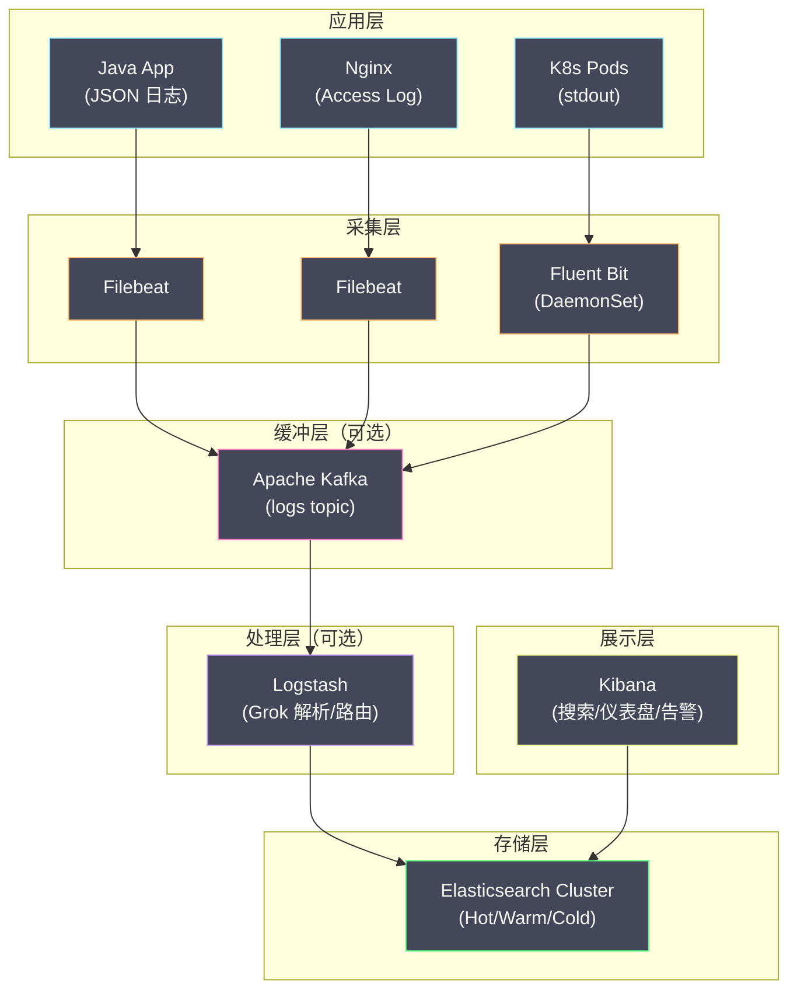
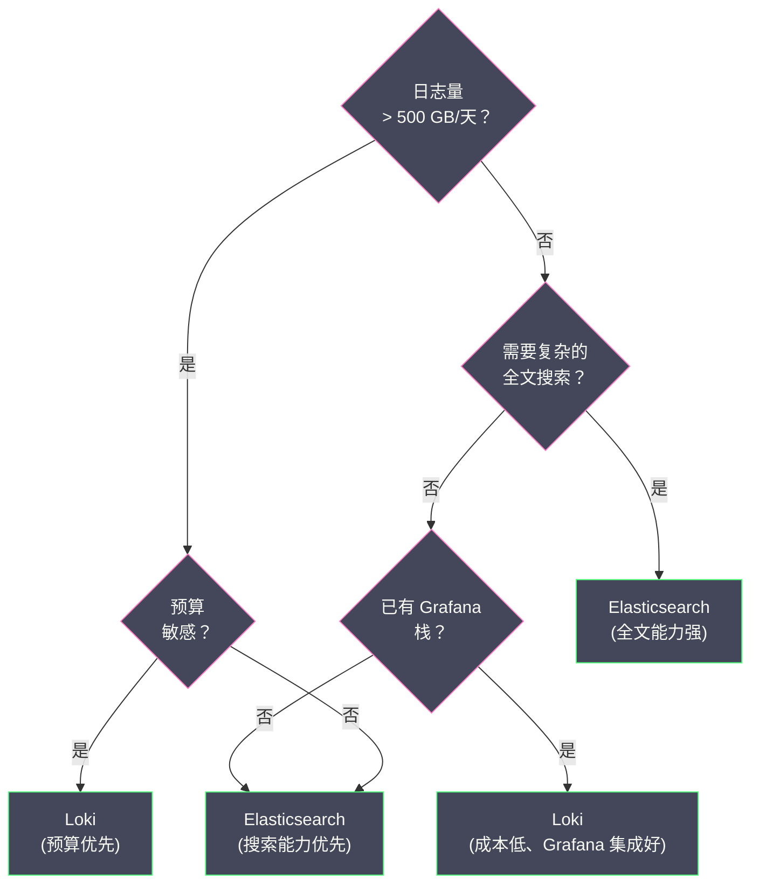

# 07 Elasticsearch 对照——Loki 的边界与选型

**摘要：**

本专栏前几篇把 [[可观测/日志/03 Loki 架构与设计哲学——只索引标签|Loki]] 讲透了——它的设计哲学、存储引擎、查询语言与运维。但理解一个工具的最好方式，往往是把它放到"竞争对手"旁边看。**Elasticsearch（ES）** 是日志存储领域统治了十年的事实标准，它的**倒排索引（Inverted Index）** 让"任意字段毫秒级全文检索"成为可能，也因此支撑起了整个 ELK 生态。本文从倒排索引的数据结构出发，解释 ES 如何把一条 JSON 日志变成可检索的索引，再依次剖析它的分片策略、生命周期管理（ILM）、完整数据流与成本结构，然后把它与 Loki 放在同一张表上做正面比较，最后落到一个具体的问题——**面对一个真实的日志场景，到底该选谁**。读完之后，你应当能回答两个问题：**ES 的成本究竟花在了哪里，为什么这个成本催生了 Loki；以及当有人问"我们该用 ES 还是 Loki"时，你应该反问哪几个问题才能给出负责任的答案**。

---

## 第 1 章 倒排索引：ES 的核心数据结构

### 1.1 从"正排"到"倒排"

理解 ES，必须先理解倒排索引，而理解倒排索引，最好从它的反面——正排索引——开始。

**正排索引（Forward Index）** 是最直觉的存储方式：按文档 ID 存储文档内容。

```text
文档 1 → "订单创建成功 orderId=789 userId=456"
文档 2 → "支付超时 orderId=789 timeout=3000ms"
文档 3 → "订单创建成功 orderId=790 userId=457"
```

用正排索引搜索"包含'超时'的文档"，需要**全表扫描**——逐一读取每个文档，检查是否包含"超时"。当文档量达到 TB 级，全表扫描的耗时无法接受。

**倒排索引（Inverted Index）** 反过来：按词（Term）存储包含该词的文档列表。

```text
"订单"    → [文档1, 文档3]
"创建"    → [文档1, 文档3]
"成功"    → [文档1, 文档3]
"支付"    → [文档2]
"超时"    → [文档2]
"orderId" → [文档1, 文档2, 文档3]
"789"     → [文档1, 文档2]
"timeout" → [文档2]
```

用倒排索引搜索"包含'超时'的文档"，只需一次查找——直接从索引里拿到 `[文档2]`，复杂度 O(1)。搜索"包含'订单'且包含'789'的文档"，只需两次查找加一次集合交集：`[文档1, 文档3]` ∩ `[文档1, 文档2] = [文档1]`。**"搜索"被转化成了"集合运算"——这就是倒排索引的全部魔法**。

### 1.2 倒排索引的内部结构

ES 的倒排索引基于 [[中间件/Elasticsearch/00 专栏导览|Apache Lucene]]，内部由三部分组成：

**Term Dictionary（词典）**：存储所有不重复的 Term，按字典序排列，支持二分查找或前缀树查找。

**Posting List（倒排列表）**：每个 Term 对应一个 Posting List，记录包含该 Term 的所有文档 ID。它使用压缩编码（如 Frame of Reference、Roaring Bitmap），压缩比通常在 5:1 到 10:1。

**Term Index（词典索引）**：词典可能非常大（百万级 Term），无法全部载入内存。Term Index 是词典的前缀树索引，常驻内存，用于快速定位 Term 在词典中的位置。

```text
查找过程：
  搜索词 "timeout"
    ↓
  Term Index（内存中，前缀树）
    → 定位到词典的磁盘块 #47
    ↓
  Term Dictionary（磁盘块 #47，二分查找）
    → 找到 "timeout" 的 Posting List 偏移量
    ↓
  Posting List（磁盘读取 + 解压缩）
    → [文档2, 文档15, 文档89, ...]
```

这个结构揭示了一个关键点：**倒排索引为了"毫秒级搜索"，付出了"三份数据结构"的代价**——词典、倒排列表、词典索引，它们都要存储、都要维护。**索引的体积，往往比原始数据还大，这不是浪费，而是"搜索能力"的价格**。

### 1.3 分词器：从文本到 Term

倒排索引的前提，是把文本拆成 Term——这个过程叫**分词（Tokenization）**，由**分词器（Analyzer）** 完成。ES 的 Analyzer 由三段串联组成：

```text
原始文本 → Character Filter → Tokenizer → Token Filter → Terms
```

**Character Filter（字符过滤器）**：预处理原始文本，如去除 HTML 标签。

**Tokenizer（分词器）**：把文本切分为 Token。常见的有按 Unicode 规则切分的 Standard Tokenizer、纯按空格切分的 Whitespace Tokenizer，以及中文分词器（如 IK，需插件）。

**Token Filter（词元过滤器）**：对 Token 后处理，如转小写、去停用词、词干提取。

**日志场景的分词策略**很关键：日志文本里满是专有名词、ID、路径、URL，Standard Analyzer 会把 `order-service` 拆成 `order` 和 `service` 两个 Term，反而破坏了语义。因此日志场景通常这样映射：

| 字段类型 | 推荐映射 | 说明 |
|---|---|---|
| message（正文） | `text` + Standard | 支持全文搜索 |
| service_name | `keyword` | 精确匹配，不分词 |
| trace_id | `keyword` | 精确匹配 |
| level | `keyword` | 精确匹配 |
| timestamp | `date` | 时间范围查询 |
| response_time | `long` / `float` | 数值范围查询 |

`keyword` 类型不经过分词——整个字段值作为一个 Term 存入索引。**这正是 Loki 的"标签"在 ES 里的对应物**：ES 用 `keyword` 字段实现了类似"标签"的精确匹配，区别在于 ES 对 `keyword` 字段**也建了索引**（只是不分词），而 Loki 只对标签建索引、对正文完全不管。

> [!info] 一个关键的对照点
> ES 的 `keyword` 字段与 Loki 的标签，在"精确匹配"这个能力上是对等的。真正的差异在于**正文**：ES 对 `text` 字段建全文倒排索引，Loki 对正文只做压缩存储。**这一处差异，决定了两个系统在成本与查询能力上的全部分野**——也是后文一切对比的原点。

### 1.4 keyword 与 text：两种字段的代价差异

ES 里，同一个字符串既可以映射为 `text`（分词、全文索引），也可以映射为 `keyword`（不分词、精确匹配）。这两种映射的代价差异巨大，值得单独说明，因为它正是"ES 昂贵"与"Loki 便宜"之间那道分水岭的微观体现。

**`text` 字段**会经过分词器，把字符串拆成多个 Term，每个 Term 都进入倒排索引。一条 `"支付回调超时 orderId=789"` 的日志，会被拆成"支付""回调""超时""orderId""789"等多个 Term——**每个 Term 都占索引空间，都增加写入的 CPU**。

**`keyword` 字段**不分词，整个字段值作为一个 Term 存入索引。它只支持精确匹配与前缀匹配，但代价远低于 `text`。

关键在于：**一个日志文档可能有几十个字段，如果全部映射为 `text`，索引体积与写入开销会成倍放大**。而真实查询里，真正需要"全文搜"的往往只有 `message` 一个字段，其余字段（service、level、trace_id）都只需要精确匹配。**ES 的成本困境，很大程度上就是"把本该是 keyword 的字段也建了全文索引"**。

Loki 的选择更极端：**它把所有"精确匹配"的需求都收敛为标签（相当于 keyword），并且完全不提供正文的全文索引**。这样做的代价是失去"任意字段全文搜索"，收益是把索引体积压到极小。**从"全字段 text"到"只索引标签"，是一个连续的成本光谱**——ES 站在一端，Loki 站在另一端，而"全部 keyword、只索引 message"的 ES 配置，其实正处在中间。

### 1.5 为什么日志不适合"默认分词"

ES 的默认分词器（Standard Analyzer）是为自然语言设计的——它按 Unicode 规则切分，会去掉标点、转小写。这套规则处理"一篇英文文章"很好，但处理日志时会出问题。

日志里满是**不属于自然语言"词"的东西**：`order-service`（会被拆成 order 和 service）、`/api/v1/orders/789`（会被拆得七零八落）、`2026-01-01T10:00:00Z`（时间戳会被切成数字碎片）、`trace_id=abc123def456`（十六进制串）。默认分词会把它们"切碎"，导致两个后果：**索引膨胀**（切出的碎片都进索引）、**语义破坏**（搜 `order-service` 可能匹配到不相关的 `service` 日志）。

因此日志场景的分词策略应当是"**该分词的才分词，其余一律 keyword**"：只有 `message` 这类真正需要全文搜索的字段用 `text`，其余全部用 `keyword`。**这是一条配置纪律，而不是默认行为**——ES 不会自动帮你做对，需要显式配置 mapping。

对照 Loki：它干脆**不提供正文分词**——日志的正文就是一个整体字符串，要么被行过滤（子串匹配）命中，要么不命中。这省去了"分词策略"这个配置负担，代价是失去"按词检索"的能力。**ES 的分词是一把双刃剑：用对了增强检索，用错了膨胀索引**；而 Loki 直接放弃了这把剑。

---

## 第 2 章 文档存储与分片

### 2.1 一条日志的写入过程

一条日志通过 Bulk API 写入 ES 时，经历以下过程：

```text
1. 客户端把文档发给协调节点（Coordinating Node）
2. 协调节点按 _id 计算 hash：shard = hash(_id) % 主分片数
   → 确定文档应写入哪个主分片
3. 文档被路由到主分片所在的数据节点
4. 主分片执行写入：
   a. 写入内存中的 Index Buffer
   b. 同时写入 Translog（事务日志，用于崩溃恢复）
   c. 对每个字段分词，构建倒排索引（在内存中）
5. Index Buffer 满或达到 refresh_interval（默认 1 秒）：
   a. 内存中的倒排索引写入磁盘，生成一个新的 Segment
   b. 新 Segment 变为可搜索（"近实时搜索"——写入后最多 1 秒可搜）
6. 主分片把文档复制到副本分片
7. 所有副本确认后，返回成功
```

这个过程里，"**构建倒排索引**"是写入端 CPU 开销的主要来源——**每一条日志都要被分词、被索引**。这与 Loki"写入时只压缩"形成鲜明对比：ES 把成本花在写入，Loki 把成本挪到查询。

### 2.2 Segment 与合并

ES（准确说是 Lucene）的磁盘存储单元是 **Segment**——每次 refresh 生成一个新的 Segment。Segment 一旦写入就**不可变（immutable）**，不能修改，只能合并或删除。

**为什么 Segment 要设计为不可变？** 不可变性带来三个好处：**无锁并发读**（搜索不需要加锁就能安全读取）、**文件系统缓存友好**（不可变 Segment 能被 Page Cache 长期缓存）、**压缩友好**（不可变数据可以用更激进的压缩）。这与 Loki 的 Chunk 不可变性是同一个道理——**"不可变"是日志与搜索系统共同的底层选择**。

**Segment 合并（Merge）**：随 refresh 持续进行，Segment 数量不断增加。过多的 Segment 会拖慢搜索（每次搜索要遍历所有 Segment 并合并结果）。后台的 Merge Policy 会定期把多个小 Segment 合并为大 Segment，同时物理删除标记为"已删除"的文档。**合并是一个持续的、消耗 CPU 与 I/O 的后台过程**——它是 ES 运维里一笔常被忽视的隐性成本。

### 2.3 分片策略

**分片（Shard）** 是 ES 数据分布与并行查询的基本单位。日志场景的分片策略要考虑两点：

**分片大小**：官方建议每个分片 10 到 50 GB。太小（小于 1 GB）会导致集群元数据膨胀、合并开销增加；太大（大于 100 GB）会导致恢复时间过长。

**按时间分索引**：日志天然按时间排列，通常按天或按周分索引：

```text
logs-2026.01.01
logs-2026.01.02
logs-2026.01.03
...
```

按时间分索引带来三个好处：**查询效率**（搜"过去一小时"只查当天索引）、**生命周期管理**（过期数据只需删除整个索引，O(1) 操作）、**冷热分离**（新索引放 SSD 节点，旧索引迁到 HDD 节点）。**这与 Loki 按时间分区索引、按时间淘汰数据的思路是一致的**——两者都在用"时间"作为最自然的数据分区维度。

### 2.4 过度分片：一个隐形的问题

ES 的分片不是越多越好。一个常见的错误是"为了并行度而把分片数设得很大"，结果掉进"**过度分片（over-sharding）**"的陷阱。

每个分片都是一个 Lucene 索引，它有自己的元数据、自己的 Segment、自己的合并过程。分片数过多会带来连锁的代价：**集群元数据膨胀**（每个分片的状态都要在主节点间同步）、**合并开销放大**（每个分片都要独立合并）、**查询的固定开销上升**（每次查询都要在所有分片上扇出、再合并结果，分片越多，扇出与合并的开销越大）。

因此 ES 的官方建议是"**单个分片 10 到 50 GB**"，并据此反推分片数。这与 Loki 的"Chunk 大小"是同类问题——**存储单元的粒度，永远是在"并行度"与"固定开销"之间取平衡**。粒度太粗，并行不足；粒度太细，开销反超收益。**两种系统用不同的名字（分片、Chunk），在解同一道题**。

### 2.5 "近实时"：一个容易被误解的语义

ES 常被称为"近实时（Near Real-Time，NRT）"搜索——写入的文档最多 1 秒后可被搜到。这个"1 秒"来自 `refresh_interval`：文档先写入内存的 Index Buffer，达到 refresh 间隔才生成一个可搜索的 Segment。

这个设计有一个重要的运维含义：**`refresh_interval` 是"写入吞吐"与"可搜索延迟"之间的调节阀**。调小它（如 1 秒），日志更快可搜，但 Segment 生成更频繁、合并压力更大；调大它（如 30 秒），写入更高效，但"刚写的日志要等更久才能搜到"。对日志场景，通常会在"批量导入"时临时调大它，在"实时排障"时调小。

**对照 Loki**：Loki 的"新写入数据"因为还在 Ingester 内存里，几乎立即可查；而"已刷盘数据"的可见性取决于刷盘时机。**两者都有"写入到可查"的延迟，只是来源不同**——ES 的延迟来自 refresh，Loki 的延迟来自刷盘。**理解"延迟从哪来"，才能对症下药地调它**。

### 2.6 副本与一致性

ES 的每个索引可以配置副本数（`number_of_replicas`）。副本提供两个作用：**高可用**（主分片所在节点故障时，副本可接管）与**读扩展**（搜索可以并行地读主分片与副本）。

但副本也带来成本与语义上的取舍。**成本上**，每个副本都占用等量的存储与写入带宽——副本数从 1 加到 2，存储与写入开销就翻倍。**语义上**，ES 默认的写入是"主分片写成功后，同步到副本，副本确认后才返回"，这是一种"写一致性"的保证，但它也意味着"副本越多，写入延迟越高"。

日志场景里，一个常见的做法是"**Hot 阶段配副本，Warm/Cold 阶段不配**"——因为热数据的可用性最重要，冷数据即使短暂不可用也可接受。**这与 Loki 的副本策略思路一致**（副本数决定"能容忍几个 Ingester 故障"），只是 ES 把副本做在了索引层，Loki 做在了日志流层。**"用副本换可用性"是所有分布式存储的通用手段**，区别只在"副本的粒度"。

---

## 第 3 章 生命周期管理（ILM）

### 3.1 日志数据的价值衰减

日志数据有明显的"价值衰减"特性：最近几小时的日志最有价值、需要最快查询；最近几天的偶尔查询、可接受稍慢；几周前的很少查询、主要用于审计；几个月前的几乎不查、可归档到廉价存储。

ES 的 **ILM（Index Lifecycle Management）** 允许为索引定义在不同阶段的行为：


### 3.2 Hot 到 Warm 的关键动作

ILM 里最典型的迁移是 Hot → Warm，它包含三个关键动作：

- **Shrink（收缩）**：把多个主分片合并为 1 个，减少分片数量、降低集群元数据开销。
- **Force Merge（强制合并）**：把分片内的多个 Segment 合并为 1 个，减少 Segment 数量、提高查询效率、释放被删除文档占用的空间。
- **Allocate（分配）**：把索引迁移到 Warm 节点（HDD 存储，成本更低）。

这三个动作背后是同一个思路：**随着数据价值衰减，逐步降低它的"配置"**——分片变少、Segment 变少、介质变便宜。**ILM 的本质，是让"存储的昂贵程度"随"数据的价值"一起下降**。

### 3.3 Searchable Snapshots：冷数据的极致降本

ES 7.x 引入了 **Searchable Snapshots**——把冷数据以快照形式存储在对象存储（如 S3、MinIO）中，查询时按需加载到本地缓存。

```text
传统冷数据存储：
  Cold 节点（HDD）→ 数据完整存在本地磁盘 → 成本 = HDD 价格

Searchable Snapshots：
  S3（对象存储）→ 数据存在 S3 → 查询时按需下载到本地 SSD 缓存
  成本 = S3 价格（HDD 的 1/5 ~ 1/10）+ 少量本地 SSD 缓存
```

对于日志场景（冷数据查询频率极低），Searchable Snapshots 可以把冷数据的存储成本降低 80% 以上。**这一步其实是在向 Loki 的"对象存储"思路靠拢**——当数据足够冷时，连 ES 也承认"把数据放进对象存储"是更优的选择。**两个系统的架构在"最冷的那一层"上，反而殊途同归**。

### 3.4 ILM 的运维成本

ILM 是一个强大的机制，但它本身也需要运维——而这份运维成本常常被低估。配置一套 ILM 策略，需要考虑：rollover 的触发条件（大小还是时间）、各阶段的分片数、force merge 的时机（它对 I/O 压力很大）、allocate 的目标节点、以及删除的保留期。**任何一项配错，都可能导致"该滚动的没滚动""该迁移的没迁移""该删的没删"**。

更重要的是，ILM 的很多动作（force merge、shrink）是**重 I/O 操作**，如果时机不当（如业务高峰期），会显著影响集群性能。因此 ILM 的策略需要与业务负载错峰，并在变更前充分测试。

**对照 Loki 的保留**：Loki 的保留策略简单得多——到期的数据整段删除，没有"降配"的多个阶段。这个简单性来自它的架构选择（数据一开始就在对象存储上，没有更便宜的介质可降）。**"更少的阶段"意味着"更少的运维"**——这也解释了为什么 Loki 的运维门槛总体上低于 ES：它把复杂度前置到了"架构选择"里，从而简化了"日常运维"。

### 3.5 ILM 之上：数据流（Data Stream）

较新版本的 ES 引入了**数据流（Data Stream）** 概念，用来管理"只追加、按时间滚动"的数据——日志正是典型。一个数据流背后是一串按时间排列的隐藏索引（backing indices），写入永远打到"当前写索引"，而查询会自动覆盖整个数据流的所有索引。

数据流的价值在于**把"按时间分索引"的复杂度封装起来**：用户只看到一个逻辑名称（如 `logs-app`），不必手动管理 `logs-app-2026.01.01`、`logs-app-2026.01.02` 这些物理索引。它与 ILM 配合，自动完成 rollover 与生命周期迁移。

**对照 Loki**：Loki 的"按时间分区索引"是内建的、不可见的——用户从不接触"某天的索引文件"这个概念。**两个系统在这一点上殊途同归：都在用"时间"作为分区维度，只是 ES 把它暴露成用户可见的索引名，Loki 把它藏在了存储层内部**。**抽象层次的差异，反映的是两个系统的设计取向：ES 让用户参与管理，Loki 让用户不操心**。

---

## 第 4 章 ELK 栈的完整数据流

### 4.1 现代 ELK 栈架构

经典的 ELK 栈（Elasticsearch + Logstash + Kibana）在现代部署中通常演进为更完整的多层结构：



**Kafka 缓冲层的作用**：在大规模部署中，Filebeat 直连 ES 可能出问题——ES 集群维护期间，采集器的本地缓冲可能不足以暂存积压数据；突发日志量可能导致 ES 写入过载。引入 Kafka 作为中间缓冲可以解耦采集端与存储端：采集器只需把数据写入 Kafka（吞吐远高于 ES），Logstash 或 ES 按自身能力从 Kafka 消费。**这一层缓冲的存在，本身就说明"ES 的写入能力是链路上的瓶颈"**——这也是 Loki 把写入成本大幅降低后，链路可以更简单的原因。

### 4.2 Kibana 的查询能力

Kibana 的 Discover 提供了强大的日志搜索界面，核心是 **KQL（Kibana Query Language）**：

```text
level: "ERROR" and message: "timeout"
service_name: "order-service" and level: "ERROR"
trace_id: "abc123def456"
response_time > 1000
```

KQL 的表达力与 Loki 的日志流选择器加行过滤相当，但有一个根本区别：**KQL 可以"在任意字段上做全文搜索"**，因为它背后是全字段倒排索引；而 LogQL 的正文搜索是"在标签收敛后的范围内做流式扫描"。**这个区别在查询体验上表现为：ES 的全文搜索"随时随地都能快"，Loki 的全文搜索"收敛得好就快、收敛不好就慢"**。

### 4.3 Kibana 的仪表盘与告警

Kibana 除了 Discover（日志搜索），还提供 Dashboard（仪表盘）与 Alerting（告警）。Dashboard 允许把多个可视化面板拼在一个页面，Alerting 允许基于查询结果触发告警。这两者与 Grafana 的对应功能在能力上各有千秋。

Kibana 的优势在于**与 ES 数据深度集成**——它能直接对任意字段做聚合可视化，因为字段都被索引了；Grafana 连 Loki 时，可视化能力受限于"标签能提供哪些维度"。**这是"索引能力"在可视化层的直接延伸**：ES 的字段索引让可视化更自由，Loki 的标签限制让可视化更克制。

但 Kibana 的劣势也在这里：**它的灵活性建立在"数据已被索引"的前提上，而这个前提是要付费的**。Grafana 连 Loki 的可视化虽然维度少，但成本低。**可视化的自由度与存储的成本，在日志场景里是一对此消彼长的关系**——这也再次印证了本文的核心判断：ES 与 Loki 的差异，最终都会回到"索引多少"这个根本取舍上。

### 4.4 从 ELK 到"可观测性平台"

ELK 最初是一个"日志栈"，但随可观测性概念兴起，ES 生态也在向"多信号平台"扩展——Elastic APM 采集链路、Metricbeat 采集指标、以及统一的 Kibana 界面。这一步的动机，与 Grafana 栈"用 Alloy 统一采集"的动机是一样的：**当信号越来越多，把它们的采集与展示收敛到一个平台，能降低运维复杂度、提升联动能力**。

但 ES 系的"多信号"与 Grafana 系的"多信号"有一条根本差异：**ES 系倾向于"把所有信号都存进 ES"**（APM 数据、指标数据都进 ES 索引），而 Grafana 系倾向于"每种信号用最合适的后端"（指标进 Prometheus/VictoriaMetrics、日志进 Loki、链路进 Tempo），再用 Grafana 统一展示。

这两种取向的差别，又是"索引一切"与"分而治之"在平台层的延伸。**ES 系追求"一个后端、一种查询体验"，代价是让指标与链路也背上日志那样的索引成本；Grafana 系追求"各用所长"，代价是维护多个后端**。**没有绝对优劣，只有与团队的技术栈和运维偏好匹配与否**。

---

## 第 5 章 ES 的成本结构

### 5.1 三笔成本

ES 集群的成本来自三个维度：

**计算成本（CPU）**：写入时——分词、构建倒排索引、Segment 合并；查询时——遍历倒排索引、解压 Posting List、合并结果。

**内存成本**：**JVM Heap** 是 ES 的核心运行时内存，建议不超过 32 GB（超过后 JVM 的压缩指针失效，反而降低效率）；**OS Page Cache** 用于缓存 Segment 文件，对查询性能至关重要。经验法则是"**节点总内存的 50% 给 JVM Heap，50% 给 Page Cache**"。

**存储成本**：原始日志数据、倒排索引数据（通常与原始数据等大甚至更大）、Translog、副本数据。

### 5.2 一个成本估算

假设日均日志 500 GB（压缩前）、保留 30 天、Hot 阶段 1 副本：

```text
存储估算（原始 + 索引按 1.5 倍）：
  Hot：  500 GB × 1.5 × 2（副本）× 1 天  = 1.5 TB
  Warm： 500 GB × 1.5 × 1 × 7 天          = 5.25 TB
  Cold： 500 GB × 1.5 × 1 × 30 天         = 22.5 TB
  总存储：≈ 29 TB

节点估算：
  Hot 节点：  3 × (8C32G + 2TB SSD)
  Warm 节点： 3 × (4C16G + 8TB HDD)
  Cold 节点： 2 × (2C8G + 16TB HDD)
  Master：    3 × (2C8G)
  Kibana：    1 × (2C4G)
```

这样的集群月成本通常在数千美元量级，且随日志量近乎线性增长——因为 ES 对每条日志都建完整倒排索引，不存在"随规模增长而边际成本递减"的效应。**与之对照，同样 500 GB/天的日志量，Loki 的对象存储需求会小一个数量级**（因为省掉了索引、又用了对象存储）。

### 5.3 成本困境：为什么催生了 Loki

ES 的成本困境可以用一句话概括：**它为日志的每个字段都建了倒排索引，但大部分索引在大部分时间里不被使用**。

真实的日志查询里，八成以上的模式是：按时间范围加服务名过滤、按级别过滤、按 Trace ID 精确查找、然后在结果里做关键词搜索。这意味着真正高频使用的索引字段只有 `timestamp`、`service_name`、`level`、`trace_id` 这几个；`message` 的全文索引虽然强大，使用频率却远低于上述结构化过滤。

**Loki 正是抓住了这个洞察**——只索引少数几个标签字段（相当于 ES 的 `keyword`），不索引正文，把存储成本降低一个数量级。**理解 ES 的成本结构，就能理解 Loki 不是"投机取巧"，而是"针对真实查询分布做的重新优化"**。

> [!note] ES 仍然不可替代的场景
> 尽管 Loki 在成本上有巨大优势，ES 在以下场景仍然不可替代：需要对日志正文做复杂全文搜索（如搜一个 SQL 片段）；需要对日志字段做聚合分析（如每个 URL 的 ERROR 数 Top10）；需要与其它 ES 数据（APM、安全事件）在同一平台关联查询；已有成熟的 ELK 运维体系与 Kibana 仪表盘。

### 5.4 一个并排的成本对比

把 ES 与 Loki 的成本放在同一个场景里对比，会更有体感。同样假设日均 500 GB 原始日志、保留 30 天。

**ES 侧**：原始数据加索引按 1.5 倍、保留 30 天，逻辑存储约 `500 × 1.5 × 30 = 22.5 TB`，其中大部分必须放在本地磁盘（SSD/HDD 分层）。加上 JVM 内存、合并 CPU、以及运维人力，月成本在数千美元量级。

**Loki 侧**：正文压缩按 8:1、保留 30 天，对象存储约 `500 ÷ 8 × 30 ≈ 1.9 TB`，放在对象存储上；索引极小。计算侧主要是 Ingester 内存与查询 CPU，规模远小于 ES 的 JVM 集群。

两相对照，**Loki 的存储需求不到 ES 的十分之一，且介质更便宜**。这个差距不是"优化出来的"，而是"架构选择带来的"——它来自"不索引正文"与"用对象存储"这两个根本决策。

当然，这个对比有一个前提：**Loki 的查询能力上限低于 ES**。如果业务需要 ES 的全文搜索能力，那么这个成本差就不是"省下来的钱"，而是"为能力付的费"。**成本对比只有配上能力对比才有意义**——单独说"Loki 便宜十倍"，是不完整的。

### 5.5 为什么"索引一切"曾经是合理的

在批评 ES 的"全量索引"昂贵之前，值得先问一句：**为什么这个选择在当年是合理的？** 理解这一点，才能避免把 ES 的取舍简单地归结为"设计失误"。

ES 诞生于 2010 年前后，那个时代的主流用途是**全文搜索**（如站内搜索、商品搜索），而不是日志。全文搜索的核心需求恰恰是"用户输入任意关键词，都要能快速搜到相关文档"——这正是全字段倒排索引要解决的问题。ES 的索引模型是为这个场景设计的，而它在日志领域的成功，某种程度上是"这个模型恰好也适用于日志"的结果。

换句话说，**ES 的"全量索引"不是为日志量身定制的，而是为搜索场景设计的**。当日志成为主要用途后，这个模型的两面性就显现出来：它带来了"任意字段可搜"的便利，也带来了"索引体积膨胀"的成本。而 Loki 恰恰是**专为日志重新设计**的系统——它从一开始就问"日志的真实查询分布是什么"，并据此把索引收窄到标签。

这个历史视角给出一条通用经验：**一个工具的"特性"，往往是它的"出身"决定的**。评价一个工具时，先理解它"为谁而生"，才能理解它"为什么长成这样"。**ES 不是"浪费"，Loki 也不是"取巧"——它们只是为不同的原始问题做了优化**。

### 5.6 ES 的隐性成本清单

除了显性的硬件与存储，ES 还有一批容易被忽略的隐性成本，值得单独列出：

- **JVM 调优与 GC**：ES 的性能高度依赖 JVM，GC 停顿会直接影响查询延迟，需要持续调优。
- **Segment 合并**：这是持续消耗 CPU 与 I/O 的后台过程，在写入量大时尤为显著。
- **分片管理**：分片数、分片大小、rebalance，都需要人工规划与监控。
- **集群脑裂与恢复**：主节点选举、分片恢复，在故障时是复杂而耗时的过程。
- **运维人力**：以上每一项都需要有经验的工程师。

**这些成本不进账单，却进人力**。当人们比较"ES 与 Loki 谁便宜"时，往往只比硬件与存储，忽略了"运维一个人一年要花多少钱"。**在日志量中等、但团队人力紧张的场景里，Loki 的"运维简单"本身就是一笔巨大的节省**——这与第 6 章讲的"运维门槛"是同一件事的两面。

### 5.7 一个不对称：写入成本与查询成本

ES 与 Loki 的成本结构，还有一个不对称之处值得点出：**ES 的成本偏向"写入时"（建索引），Loki 的成本偏向"查询时"（扫描正文）**。

这意味着两件事。**其一，对"写多读少"的负载，Loki 更划算**——因为绝大部分写入的数据永不被查，为它们付索引成本是浪费。**其二，对"读多写少"的负载，ES 可能更划算**——因为如果数据会被反复查询，那么"一次建索引、多次快查询"的摊销效果更好，而 Loki 的"每次查询都要扫描"会在高频查询下累积成本。

这个不对称给出一个判断准则：**评估该用哪个，先算"读写比"**。日志通常是"写多读少"，所以 Loki 常占优；但如果你的日志会被大量、频繁地查询（如做实时分析、频繁告警），那么"读"这一侧的权重就上升，ES 的摊销优势可能显现。**"日志量"只是分母，"查询频率"才是决定成本天平的关键变量**。

---

## 第 6 章 Loki 与 ES 的正面比较

### 6.1 架构层面的对比

把两个系统并排放在架构层面比较，差异一目了然：

| 维度 | Elasticsearch | Grafana Loki |
|---|---|---|
| **索引策略** | 全字段倒排索引 | 只索引标签 |
| **正文搜索速度** | 毫秒级 | 秒级（取决于收敛度） |
| **存储后端** | 本地磁盘（SSD/HDD） | 对象存储（S3/GCS/MinIO） |
| **存储成本** | 高 | 低（约 ES 的 1/5 到 1/10） |
| **写入开销** | 高（分词 + 建索引） | 低（主要是一次压缩） |
| **查询能力** | 强（全文 + 聚合） | 中（标签过滤 + 流式扫描） |
| **运维复杂度** | 高（JVM 调优、分片管理、合并） | 中（Ingester 内存管理） |
| **生态集成** | Kibana、Elastic APM | Grafana、Prometheus、Tempo |
| **适合的日志量** | 中（每天 1 TB 以内最佳） | 大（TB 级优势明显） |
| **多租户** | 需自行设计 | 原生支持 |

### 6.2 一个"能力—成本"的坐标

把两者放在"能力—成本"的坐标里，能看清它们各自的位置。ES 在"能力"这一端更靠上——它能回答的问题类型更多（全文搜索、字段聚合、跨数据关联）；Loki 在"成本"这一端更靠下——同样的数据量，它花更少的钱。**两者不是"谁替代谁"，而是"谁更适合哪一类查询分布"**。

这个坐标给出一个直观的选型直觉：**如果你的查询"什么类型都有、而且都要求快"，那 ES 的能力上限更匹配；如果你的查询"以标签过滤为主、能接受秒级延迟"，那 Loki 的成本优势更值得**。**选型的本质，是在"能力"与"成本"之间，找一个与你的查询分布相称的点**。

### 6.3 一个常被忽视的维度：迁移成本

除了能力与成本，还有第三个维度常被忽视——**迁移成本**。如果团队已经有一套成熟的 ELK 体系、几十个 Kibana 仪表盘、完善的 ILM 策略与运维经验，那么"迁到 Loki"的代价不只是"换个后端"，还包括重写所有查询、重建所有仪表盘、重新培训团队。**这些成本往往是隐性的，却可能超过"省下的存储费"**。

因此"该不该迁移"的判断，应当把迁移成本也纳入。一个实用的经验是：**只有当"现有方案的痛点"（成本、性能、EOL）已经大到"不迁不行"时，迁移才划算**。这与 [[可观测/日志/02 日志采集架构——Grafana Alloy、Promtail 与 Vector|采集架构]] 里"Promtail 因 EOL 而迁移到 Alloy"的判断是同一逻辑——**迁移的驱动力应当是"硬约束"，而不是"理论上更优"**。

### 6.4 从"能问什么"到"问得快不快"

两个系统的差异，最终都落在"能问什么"与"问得快不快"这两件事上。把它们展开：

**ES 能问的**：任意字段的全文搜索、任意字段的组合过滤、任意字段的聚合分析（如按 URL 分组统计）、跨索引关联。**它几乎能回答"任何关于日志的问题"**，且多数情况下都很快。

**Loki 能问的**：标签过滤、收敛范围内的正文搜索、从日志抽取数值做低基数聚合。**它擅长"先收敛再检索"，不擅长"无差别全量分析"**。

**在"问得快不快"上**：ES 的"快"是普遍的——只要字段被索引，查询就快；Loki 的"快"是有条件的——取决于标签是否收敛。**这个差异决定了运维的形态**：运维 ES 主要关心"索引是否健康、分片是否合理"；运维 Loki 主要关心"标签是否收敛、查询是否收窄"。

一句话概括：**ES 把"查询的难度"承担在了写入端（索引一切），Loki 把"查询的难度"转移给了使用者（你得会收敛）**。**这个转移，就是"便宜"的真正代价**——它不是"免费的能力"，而是"把一部分责任交给了使用者"。

### 6.5 运维门槛的对比

两个系统对运维能力的要求不同，这也是选型时值得考虑的维度。

**ES 的运维门槛较高**：需要理解 JVM 堆与 Page Cache 的配比、分片数与分片大小、Segment 合并、ILM 策略、以及集群的脑裂与恢复。一个配置不当的 ES 集群，可能在运行数月后才暴露出问题（如分片过大导致恢复缓慢）。

**Loki 的运维门槛相对较低**：它的组件模型更简单（尤其是单体或 SSD 模式），存储后端是托管的对象存储，不需要 JVM 调优。它的运维重点集中在"标签基数"与"查询收敛"这两件事上——这两件事更接近"数据治理"而非"系统调优"。

**因此有一个实用的判断**：**如果团队的运维力量有限，Loki 往往更容易上手**；而如果团队已有深厚的 ES 运维经验，那么这份经验本身就是 ES 的一项"隐性资产"。**选型时，"团队更擅长哪个"有时比"哪个理论上更好"更值得考虑**——因为一个不擅长运维的系统，再好也会被用坏。

### 6.6 一个混合架构的落地示例

把混合架构落到一个具体场景，会更清晰。假设一个电商团队：应用与容器日志每天 800 GB，另有安全审计日志每天 20 GB、业务分析日志每天 50 GB。

**分工方案**：

- **应用与容器日志 → Loki**：量最大，查询以"按服务、按级别过滤后看上下文"为主，Loki 的成本优势最大。
- **安全审计日志 → ES**：量小，但需要"按用户、按操作、按时间段做复杂组合查询"，且要求长期留存、可审计。
- **业务分析日志 → ES**：需要对字段做聚合（如按渠道、按品类统计），ES 的聚合能力更合适。

**路由方式**：在采集层按日志来源或标签分流——应用的 stdout 进 Loki，审计服务的日志进 ES，业务埋点日志进 ES。**关键在于"分流规则是显式的、可审计的"，而不是"随手决定"**。

这个方案的收益是：**80% 的日志量（应用日志）走了低成本通道，而 20% 的高复杂度需求走了能力更强的通道**。两者各得其所，总成本远低于"全部进 ES"，能力也远强于"全部进 Loki"。**这就是混合架构"按数据特征分工"的典型价值**。

### 6.7 一个"何时该重新评估"的提醒

选型不是一次性的决定。今天合适的后端，可能因为日志量的增长、查询模式的变化、或新技术的出现而变得不再合适。因此**选型应当有"定期重新评估"的机制**。

重新评估的触发信号可以是：**成本占比显著上升**（说明当前方案的性价比在下降）、**查询性能持续恶化**（说明查询模式已经偏离了当前方案的设计假设）、**现网方案 EOL 或停止演进**（如 Promtail 的 EOL）、**出现明显更匹配的新方案**。

但"重新评估"不等于"频繁迁移"。**评估的目的是"确认当前选择仍然合适"，而不是"寻找更好的选择"**——因为迁移成本是真实的，频繁迁移本身就是一种浪费。**好的选型机制，是"稳定的当前方案 + 定期的合理性检查"，而不是"永远在追新"**。

---

## 第 7 章 选型决策

### 7.1 决策树

面对"该用 ES 还是 Loki"这个问题，可以用一棵简单的决策树：



### 7.2 场景化推荐

**场景一：日志量巨大、查询以标签过滤为主、展示层是 Grafana**
→ **Loki**。这是 Loki 的主场：成本优势明显，且与 Grafana 生态天然集成。

**场景二：需要复杂全文搜索或字段聚合分析**
→ **Elasticsearch**。Loki 在全量正文扫描与高基数聚合上会明显乏力。

**场景三：已有成熟 ELK 体系与 Kibana 资产**
→ **维持 ES**，除非痛点已经大到必须迁移。迁移成本往往被低估。

**场景四：新建可观测性体系、信号类型多（指标/日志/链路）**
→ **Loki + Grafana 栈**。与指标（Prometheus/VictoriaMetrics）、链路（Tempo）在同一个展示层联动最顺滑。

### 7.3 混合架构：两者共存

在很多团队里，ES 与 Loki 并非互斥——它们可以共存，各自处理不同类型的日志：

| 日志类型 | 存储后端 | 理由 |
|---|---|---|
| 应用日志 | Loki | 量大、查询以标签过滤为主 |
| 容器 / 访问日志 | Loki | 量大、格式固定、按状态码过滤 |
| 安全 / 审计日志 | Elasticsearch | 需要复杂全文搜索与聚合 |
| 业务分析日志 | Elasticsearch | 需要对字段做聚合分析 |

这种混合架构通过采集层的路由规则实现：不同标签的日志发往不同后端。**它的价值在于"让每一种日志去它最适合的地方"**——而不是"用一个系统承接所有日志，然后忍受它在某些场景下的低效"。**在工具选型上，"混合"往往比"二选一"更务实**，因为真实的需求从来不是单一的。

> [!note] 混合架构的代价
> 混合架构并非没有成本——它意味着两套系统的运维、两套查询语言、两个展示入口。因此它适合"日志类型分化明显、且两类需求都真实存在"的团队；如果日志类型单一，强行混合只会增加复杂度。**判断标准是"分化是否真实"**：如果大部分日志都是同一种类型、同一种查询模式，那么单一后端更简单。

### 7.4 一份选型决策清单

把前文的判断收敛成一份可操作的清单。面对"该用哪个"的问题，依次问以下问题：

1. **日志量有多大？** 每天 1 TB 以上，Loki 的成本优势会非常显著。
2. **查询模式是什么？** 以标签过滤为主 → Loki；以全文搜索/聚合为主 → ES。
3. **延迟要求是什么？** 需要毫秒级全文搜索 → ES；秒级可接受 → Loki 足够。
4. **现有栈是什么？** 已有 ELK 资产 → 迁移成本高；已有 Grafana 栈 → Loki 更顺。
5. **日志类型是否分化？** 分化明显 → 考虑混合架构。
6. **团队运维能力如何？** ES 的运维门槛更高（JVM、分片、ILM），Loki 相对低。

这六个问题的答案，基本能确定选型方向。**其中第 1、2 两个问题权重最大**——它们决定了"成本差异"与"能力匹配"这两个最核心的变量。

**这份清单的价值，不在于"给出答案"，而在于"给出该问的问题"**。因为选型讨论之所以常常陷入"谁更好"的争论，正是因为双方在回答不同的问题——有人关心成本，有人关心能力，有人关心迁移成本。**先把问题问清楚，答案往往就浮现了**。

### 7.5 一个"最小成本"的起步建议

如果团队暂时无法决定"该用哪个"，一个务实的最小成本起步是：**先把日志结构化**。因为无论最终选 ES 还是 Loki，结构化日志都是收益的——它让 ES 的字段映射更简单，也让 Loki 能借 `| json` 提取字段。**"结构化"是唯一一个"无论选谁都不亏"的投入**。

等到查询模式、日志量、成本约束都清晰之后，再决定后端——而那时候，你的日志已经具备了迁移到任何后端的条件。**这个建议背后的逻辑是：把"不可逆的投入"（选后端）尽量推迟，把"可逆的投入"（结构化日志）尽量提前**。**在技术决策里，"推迟不可逆的选择"往往是最稳妥的策略**——因为它保留了未来根据新信息重新决策的空间。

---

## 第 8 章 边界与反例

### 8.1 反例一：把 Loki 当 ES 用

一个常见的失败，是团队带着 ES 的查询习惯迁到 Loki——他们习惯"在全部日志里搜一个关键词""按任意字段聚合"，于是写出大量"选择器很宽、依赖全文扫描"的查询。结果是查询频繁超时、集群负载飙升，最后归咎于"Loki 不好用"。

**问题不在 Loki，而在查询模式的错配**。Loki 的性能前提是"标签先收敛"，一旦放弃这个前提，它就退化成"全量扫描一个压缩文本库"。**迁移后端之前，先审视自己的查询模式**——这是本文最想传达的一条经验。

### 8.2 反例二：为了省钱盲目迁移

反过来，也有团队看到"Loki 便宜一个数量级"就盲目迁移，忽略了迁移成本与能力差距。结果发现：原有的全文搜索查询在新系统上慢得无法接受、几十个 Kibana 仪表盘要全部重写、团队需要重新学习一套查询语言。**省下的存储费，被迁移的人力成本吞掉了**。

**"便宜"只在"能力够用"的前提下才有意义**。如果一个团队的核心查询需求恰好落在 Loki 的弱项上，那么它再便宜也不该被选——**因为一个"便宜但答不出问题"的系统，比一个"贵但能答"的系统更糟**。

### 8.3 一个正例：按日志类型分工

最务实的做法，往往是本文第 7 章讲的混合架构：**应用日志与容器日志进 Loki（量大、查询简单），审计与业务分析日志进 ES（量小、查询复杂）**。这个分工的妙处在于，它让两个系统各自发挥所长——Loki 承接"量"的压力，ES 承接"复杂度"的压力。

**这类"按数据特征分工"的架构，是成熟可观测性体系的共同特征**。它承认"没有一种存储适合所有日志"，并用采集层的路由把这个认识落地。**选型的最高境界，不是"选出唯一正确的那个"，而是"让每种数据都流到最适合它的地方"**。

### 8.4 反例三：把两者都用成"半吊子"

混合架构不是没有风险。一个常见的失败是：团队同时部署了 ES 与 Loki，却没有清晰的"分工标准"——结果日志被随意地分散在两个系统里，查询时不知道该去哪个系统找，两个系统的数据都对不上、都无法形成完整的视图。**"混合"没有带来"各取所长"，反而带来了"两套都不完整"**。

避免这个失败的关键，是**把"分工标准"明确下来并写进采集路由**：哪类日志进哪个后端，依据是什么（日志类型？查询模式？保留要求？）。这个标准应当像"标签字典"一样被文档化、被评审，而不是靠"当时谁方便就放哪"。

**混合架构的成功前提，是"分工的清晰"**。如果两个系统的边界模糊，那么混合就只是把"一个系统的复杂度"换成了"两个系统的复杂度加上协调成本"。**只有当分工标准清晰到"任何一条日志都能被立刻判断该去哪"时，混合才真正划算**。

### 8.5 三个反例的共性

回顾本章的三个反例——"把 Loki 当 ES 用""为了省钱盲目迁移""把两者都用成半吊子"——它们有一个共同的根因：**决策时只看了"工具的一个侧面"，而没有看"自己的完整需求"**。

第一个反例只看了"Loki 便宜"，忽略了"自己的查询是全文搜索"；第二个反例只看了"Loki 便宜"，忽略了"迁移成本与能力差距"；第三个反例只看了"两个工具各有所长"，忽略了"分工需要清晰的标准"。

**它们共同的教训是：选型不是"比较工具"，而是"匹配需求"**。工具的参数（价格、能力、性能）是客观的，而"需求"是主观的、需要被梳理的。**如果连自己的查询模式、迁移成本、分工标准都没想清楚，那么无论选哪个工具，都可能踩坑**。

这也是本文反复回到"先问自己的需求"这个主题的原因：**在可观测性选型里，"了解自己"比"了解工具"更难，也更关键**。

---

## 小结

把 ES 与 Loki 并排看完，会发现它们其实是同一个问题的两种答案。问题都是"如何低成本地存储并检索海量日志"，答案的分野在于一个关键取舍：**索引一切，还是只索引标签**。ES 选择了前者——用全字段倒排索引换来"随时随地毫秒级搜索"，代价是索引体积、写入 CPU 与本地磁盘；Loki 选择了后者——用标签索引加对象存储换来一个数量级的成本下降，代价是正文搜索依赖收敛。

这个取舍没有对错，只有匹配与否。**ES 的成本不是"浪费"，而是为"查询能力上限"付的费；Loki 的便宜也不是"取巧"，而是对"真实查询分布"的重新优化**。理解了这一点，就能理解为什么两者会长期共存——因为它们服务的是不同形状的查询需求。

如果要从这一篇带走一句话，那应当是：**面对"该选谁"的问题，不要先看价格，也不要先看 benchmark，而要先问"我的日志主要怎么被查"**。这个问题的答案，比任何对比表都更能决定选型的正确性。**工具的价值不在它本身有多强，而在它与你的问题有多匹配**——这也是本专栏从第 01 篇讲到这里的、一以贯之的判断方式。

而"匹配"这件事，只有在你看清自己的需求之后才谈得上。因此，**比"选哪个后端"更值得投入的，是先把自己的查询模式、日志类型、成本约束梳理清楚**——这正是本文希望留下的、比任何对比表都更有用的东西。

---

## 参考资料

1. Elasticsearch: The Definitive Guide: https://www.elastic.co/guide/en/elasticsearch/guide/current/index.html
2. Apache Lucene: https://lucene.apache.org/core/
3. Elasticsearch Index Lifecycle Management: https://www.elastic.co/guide/en/elasticsearch/reference/current/index-lifecycle-management.html
4. Elasticsearch Searchable Snapshots: https://www.elastic.co/guide/en/elasticsearch/reference/current/searchable-snapshots.html
5. Kibana Discover: https://www.elastic.co/guide/en/kibana/current/discover.html
6. Grafana Loki Documentation: https://grafana.com/docs/loki/latest/
7. Clinton Gormley, Zachary Tong (2015). *Elasticsearch: The Definitive Guide*. O'Reilly Media.

---

> [!note] 思考题
> 1. 用一句话说清 ES 与 Loki 的成本差异来自哪里。如果对方追问"那 ES 是不是就是浪费"，你会怎么回答？
> 2. 列出你们当前的日志查询，按"标签过滤为主"和"全文搜索为主"分类。这个比例更接近哪一种后端？
> 3. 如果要把现网从 ES 迁到 Loki，除了存储费，还有哪些隐性成本？这些成本加起来，还值得迁吗？
> 4. 你们的日志里，有没有"应该去 ES、却留在 Loki"或"应该去 Loki、却留在 ES"的类型？用采集层的路由能不能把它们分开？
> 5. 在什么规模或什么痛点下，你会认为"迁移"这件事从"可选"变成了"必须"？
