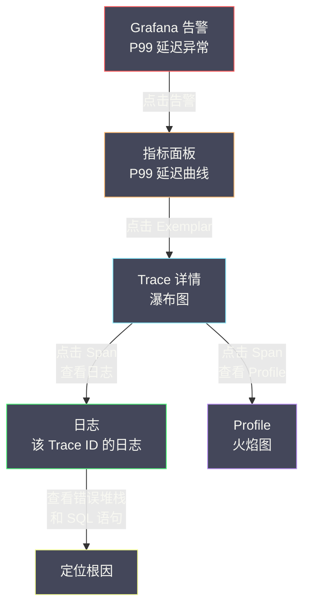
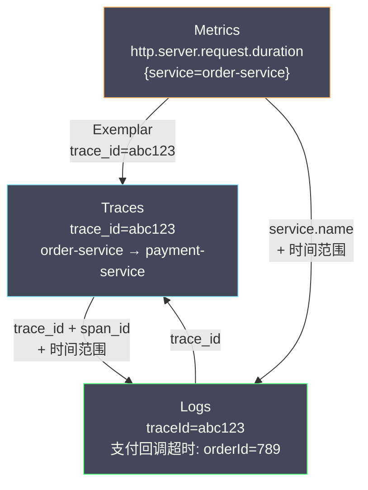
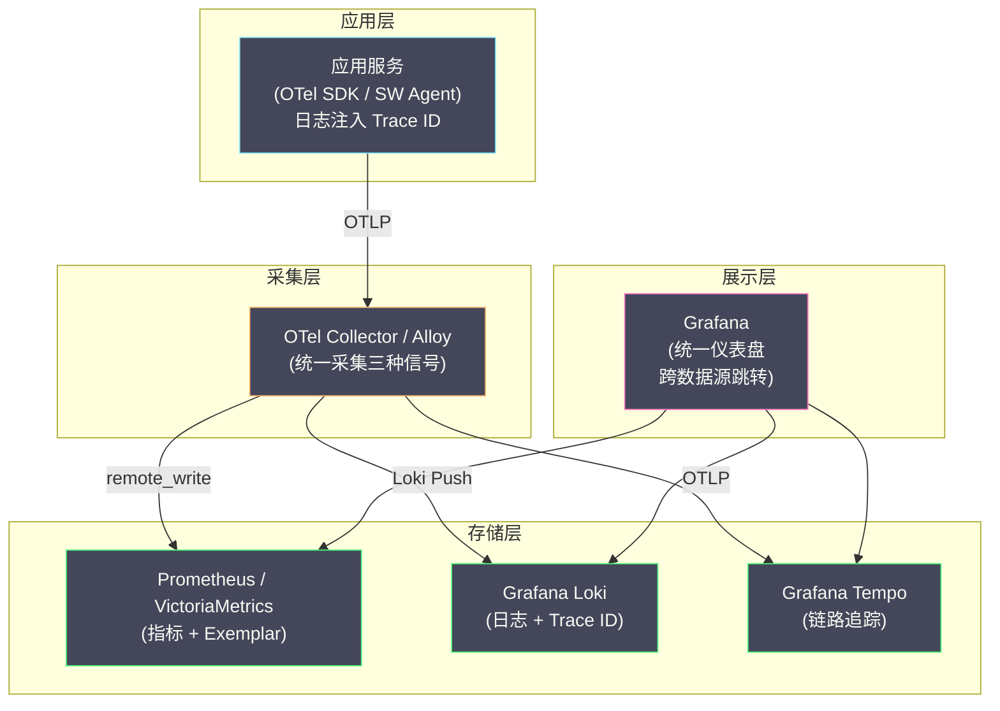

# 08 日志与链路追踪的联动

**摘要：**

可观测性的几种信号各有擅长，但它们真正的威力在于**联动**——从指标告警发现异常，跳转到链路追踪定位慢服务，再跳转到日志查看具体的错误上下文。如果这些信号彼此孤立，工程师就得在多个工具之间手动切换、手动关联，排查效率大打折扣。本文聚焦日志与链路追踪之间的联动：先用一个真实的排查场景说明"孤立信号"的困境，再深入 Trace ID 注入的三种实现（SkyWalking Toolkit、OpenTelemetry 自动注入、结构化日志字段），然后拆解 Grafana 的跨数据源联动机制（Exemplar 与 Derived Fields），以及 OpenTelemetry 在协议层面如何统一三种信号的关联标识，最后落到实施联动的工程清单与几类典型的失败场景（采样不一致、上下文传播中断、异步调用丢失上下文）。读完之后，你应当能回答两个问题：**为什么"联动"是可观测性从"能看"到"好用"的关键一跃；以及当联动在某些请求上失效时，问题最可能出在哪一环**。

---

## 第 1 章 为什么需要联动

### 1.1 孤立信号的排查困境

设想一个再真实不过的线上排查场景：

```text
14:00  Grafana 告警：order-service 的 P99 延迟从 200ms 飙升到 5000ms
14:02  工程师打开 Grafana 仪表盘，确认 P99 延迟异常
14:03  他想知道"哪些请求慢了"——但 Prometheus 指标只有聚合值，没有单个请求的信息
14:05  他打开链路追踪系统，搜索 order-service 过去 10 分钟的慢请求
14:07  找到一条 5 秒的 Trace，发现瓶颈在 payment-service 的数据库查询
14:08  他想知道"这个查询具体执行了什么 SQL"——但 Span 只记录了"MySQL Query"和耗时
14:10  他需要去日志系统里找对应的日志——但如何找到"这条 Trace 对应的日志"？
14:12  如果日志里没有 Trace ID，他只能按时间范围加服务名粗略搜索，结果可能有几千条
14:15  在几千条日志里肉眼搜索，终于找到那条 SQL 日志
```

整个过程花了 15 分钟，其中**大部分时间浪费在跨系统的手动关联上**——不是"分析问题"慢，而是"把信息凑到一起"慢。这正是孤立信号的代价：**每个信号都看到了问题的一部分，却没有一条线索把它们串起来**。

### 1.2 联动后的理想流程

如果日志、链路追踪、指标三者通过 Trace ID 联动起来，同一个故障的排查会变成这样：

```text
14:00  Grafana 告警：order-service 的 P99 延迟异常
14:01  工程师点击告警中的 Exemplar 链接 → 直接跳到一条慢请求的 Trace 详情
14:02  在 Trace 瀑布图中看到 payment-service 的数据库查询耗时 4.8 秒
14:02  点击该 Span 旁的"查看日志" → 直接跳到该 Trace ID 在该时间段的日志
14:03  在日志中看到完整 SQL：SELECT * FROM orders WHERE user_id = 'xxx' 全表扫描
14:03  定位根因：缺少索引
```

**3 分钟完成排查**，全程在 Grafana 一个界面里完成，不需要切换工具、不需要手动关联。**这就是联动的威力——它不改变"有多少信息",只改变"获取信息的路径有多短"**。而排查效率的提升，本质上就是"缩短路径"。

### 1.3 联动的前提：一个共享的标识

联动之所以能成立，靠的是一个朴素的约定：**所有信号在描述同一个请求时，使用同一个标识**。这个标识就是 **Trace ID**——它在请求进入系统时被创建，随后贯穿整个调用链，被写进每一个服务的日志、每一个 Span、以及（通过 Exemplar）每一个相关的指标数据点。

因此"联动"在技术上并不神秘，它只是"**让所有信号都带上同一个 Trace ID**"，然后"**让工具能在信号之间按这个 ID 跳转**"。难点不在"跳转"（那只是 UI 配置），而在"**如何让 Trace ID 稳定地出现在每一条日志、每一个 Span 里**"——这涉及注入、传播、以及那些容易丢失上下文的边界场景（异步、线程池、消息队列）。**本文的很大篇幅，都在讲这个"如何"**。

### 1.4 联动的三个层次

联动不是"有或没有"的二值状态，而是一个有三个层次的能力。理解这三个层次，有助于判断"我们目前做到哪了"。

**层次一：手动关联**。日志里有 Trace ID，工程师可以手动复制它，粘贴到链路系统里查询。这是最低层次，成本几乎为零（只要注入 Trace ID），但每次排查仍需要"复制粘贴"。

**层次二：一键跳转**。工具之间建立了链接——从日志里的 Trace ID 点一下就能跳到 Trace，从 Trace 点一下就能跳到日志。这需要配置 Derived Fields、Exemplar 等。它把"复制粘贴"变成了"点击"。

**层次三：上下文自动注入**。跳转时不仅带上 Trace ID，还自动带上时间范围、服务名、Span ID 等上下文，让目标界面"一打开就是你想看的那段"。这是最高层次，它把"跳过去之后再筛选"也省掉了。

**这三个层次的成本是递增的，收益也是递增的**。很多团队停在层次一，然后抱怨"联动不好用"——其实他们只是还没走到层次二、三。**而层次二、三的成本并不高，却常被"看起来只是 UI 配置"的错觉耽误**。

### 1.5 为什么"联动"比"信号齐全"更难

一个值得思考的问题是：为什么"采集齐三种信号"相对容易，而"把它们联动起来"却很难？

原因在于：**采集是"各自为战"，联动是"协同一致"**。采集指标，只需要装一个采集器；采集日志，只需要装一个日志采集器。它们彼此独立，各做各的就行。而联动要求它们在"描述同一个请求"这件事上**用同一套约定**——同一个 Trace ID、同一套服务命名、同一个时间语义。**任何一处不一致，联动就在那里断掉**。

**这解释了联动建设的一个规律：它的难点不在"技术"，而在"一致性"**。而一致性是分布式系统里最难保证的东西——它需要跨团队、跨语言、跨服务地协调。**因此联动的推进，往往不是"技术攻坚"，而是"约定落地"**。这也是为什么本文反复强调"统一标签命名""采样策略对齐"这些看起来"不像技术"的事——它们恰恰是联动能否成立的真正关键。

### 1.6 联动的收益与成本

联动不是"没有代价的"——它需要投入，也应当被理性地评估。它的收益是**排查效率的提升**（MTTD 下降），成本则包括：注入与传播的改造、跳转的配置、以及持续的维护（见第 5 章的分期路线）。

那么"值不值得做"？一个实用的判断是：**看"跨服务排查"在你们故障中的占比**。如果大部分故障是单服务内的（看一眼日志就够了），联动的收益有限；如果大部分故障是跨服务的（要在指标、Trace、日志之间反复横跳），那么联动的收益会非常显著。

**因此联动建设应当"按需推进"**——核心链路、跨服务调用密集的服务优先接入；边缘的、独立的服务可以晚一点。**把有限的改造资源投在"最需要跨服务排查"的地方，是联动建设最务实的策略**。

---

## 第 2 章 Trace ID 注入：联动的基础

### 2.1 注入原理

日志与链路追踪联动的基础，是**在每条日志中嵌入当前请求的 Trace ID**。当请求经过链路追踪系统时，Trace ID 存储在线程的上下文中（如 Java 的 `ThreadLocal`）；日志框架在输出日志时，从上下文中取出 Trace ID，作为日志的一个字段输出。

```text
请求到达 → Agent 创建 Trace Context → 上下文存储 Trace ID
                                          ↓
                                  日志框架输出日志时
                                  从上下文读取 Trace ID
                                  写入日志行
                                          ↓
                                  日志：{"traceId": "abc123", "message": "处理订单"}
```

这个流程里，最关键的组件是**上下文存储**。在 Java 里，它通常是 **MDC（Mapped Diagnostic Context）**——SLF4J/Logback/Log4j2 提供的线程级键值对存储，本质是一个 `ThreadLocal<Map<String, String>>`。日志框架在输出时，从 MDC 读取指定 key 的值。**理解了 MDC，就理解了"为什么 Trace ID 能自动出现在日志里"，也理解了"为什么在异步场景里它会丢"**（因为 `ThreadLocal` 不跨线程）。

### 2.2 SkyWalking Toolkit 集成

[[可观测/链路追踪/04 SkyWalking 整体架构深度解析|Apache SkyWalking]] 提供了 Toolkit 库，支持把 Trace ID 注入到主流 Java 日志框架。以 Logback 为例：

```xml
<!-- pom.xml 添加依赖 -->
<dependency>
    <groupId>org.apache.skywalking</groupId>
    <artifactId>apm-toolkit-logback-1.x</artifactId>
    <version>${skywalking.version}</version>
</dependency>
```

```xml
<!-- logback.xml 使用 TraceIdPatternLogbackLayout -->
<layout class="org.apache.skywalking.apm.toolkit.log.logback.v1.x.TraceIdPatternLogbackLayout">
    <pattern>%d [%tid] [%thread] %-5level %logger{36} - %msg%n</pattern>
</layout>
```

`%tid` 占位符会被替换为当前请求的 Trace ID；如果当前线程没有 Trace Context（如应用启动阶段），输出 `TID: N/A`。Log4j2 的集成类似，用 `%traceId` 占位符。

**SkyWalking 的这套方案，是"侵入式但精确"的**——它通过字节码增强把 Trace ID 写进 MDC，业务代码完全不需要感知。它的前提是应用挂载了 SkyWalking Agent，因此它天然与 SkyWalking 的链路体系绑定。

### 2.3 OpenTelemetry 的自动注入

[[可观测/链路追踪/03 OpenTelemetry 统一标准|OpenTelemetry]] Java Agent 支持**自动把 Trace ID 与 Span ID 注入日志的 MDC**，同样不需要修改日志配置。Agent 启动时自动向 MDC 注入以下字段：

| MDC Key | 值 | 说明 |
|---|---|---|
| `trace_id` | 32 位十六进制字符串 | W3C Trace Context 的 Trace ID |
| `span_id` | 16 位十六进制字符串 | 当前 Span ID |
| `trace_flags` | `01` 或 `00` | 是否被采样 |

在 Logback 配置中使用 `%X{trace_id}` 即可输出：

```xml
<pattern>%d [%X{trace_id}] [%X{span_id}] [%thread] %-5level %logger{36} - %msg%n</pattern>
```

> [!info] 为什么 OTel 用 `%X{}` 而 SkyWalking 用 `%tid`？
> 因为 OTel 走的是"**标准 MDC**"——它把 Trace ID 作为一个普通的 MDC 键值对写入，因此用 SLF4J 通用的 `%X{key}` 语法就能取到。而 SkyWalking 提供了专用的 `TraceIdPatternLogbackLayout`，用 `%tid` 这个自定义占位符。**两者的差别，反映了"标准 vs 专有"的取向**：OTel 追求"用通用机制实现"，SkyWalking 追求"用专用组件实现得更顺手"。对使用者而言，前者更可移植，后者更省心。

### 2.4 结构化日志中的 Trace ID

如果应用使用结构化日志（JSON），Trace ID 会作为 JSON 的一个独立字段输出：

```json
{
    "timestamp": "2026-01-01T10:00:00.150Z",
    "level": "ERROR",
    "logger": "com.example.PaymentService",
    "message": "支付回调超时",
    "orderId": "789",
    "traceId": "abc123def456789012345678",
    "spanId": "1234567890abcdef",
    "service": "payment-service"
}
```

结构化日志中的 `traceId` 字段可以被日志存储系统直接处理——在 [[可观测/日志/07 Elasticsearch 对照——Loki 的边界与选型|Elasticsearch]] 里映射为 `keyword` 支持精确查询；在 [[可观测/日志/03 Loki 架构与设计哲学——只索引标签|Loki]] 里作为 Structured Metadata，既不增加标签基数、又能被高效过滤。**这是联动的关键：Trace ID 必须"可被精确查询"，而不是"藏在正文里"**。

> [!warning] 一个常见的错误：把 traceId 做成 Loki 标签
> 在 Loki 里，把 `traceId` 作为标签是**高基数灾难**——每个请求一个不同的 Trace ID，会导致日志流数爆炸。正确做法是用 Loki 3.0 的 **Structured Metadata**，或者干脆放在正文里用 `| json | traceId="xxx"` 查询。**"能查到"与"能被索引"是两回事**——Trace ID 需要的是"精确过滤能力"，而不是"标签索引能力"，Structured Metadata 恰好提供了前者。

### 2.5 上下文传播：联动最脆弱的环节

注入只是第一步，更难的第二步是**传播（Propagation）**——让 Trace ID 在请求的整个生命周期里"一直跟着走"。它脆弱的根源，是**上下文默认不跨越边界**，而真实请求的执行充满了边界。

**线程边界**：Java 的 MDC 基于 `ThreadLocal`，它只在当前线程有效。一旦把任务提交到线程池（`ExecutorService`、`@Async`、CompletableFuture 的默认线程池），新线程就看不到原线程的 MDC——那段代码的日志会丢掉 Trace ID。解决办法是"**包装任务**"：在提交任务时捕获当前上下文，在新线程执行前恢复它（如 SkyWalking 的跨线程注解、OTel 的 Context 传递工具）。

**进程边界**：当请求从一个服务调用到另一个服务（HTTP、gRPC），Trace ID 必须通过**请求头**传递。W3C Trace Context 定义了标准的 `traceparent` 头，OTel 与 SkyWalking 都支持。如果两边用的传播格式不一致，Trace ID 就传不过去，调用链会在这里断开。

**消息边界**：当请求通过消息队列异步处理（Kafka、RabbitMQ），Trace ID 必须被放进**消息头**，由生产者写入、消费者读取。这一步常被忽略，导致"消息消费端的所有日志都没有 Trace ID"。

**这三类边界，是联动最常断的地方**。而它们的共同解法是同一个：**在跨越边界的那一刻，显式地把上下文带过去**。**联动做得好不好，很大程度上就是"有没有把每一个边界都照顾到"**。

### 2.6 非 Java 生态的注入

前面讲的注入方案以 Java 为例（因为 Java 生态的日志框架与 MDC 最成熟）。但在多语言栈里，其他语言的注入方式有所不同。

**Go**：Go 没有 MDC 这样的"隐式上下文"，上下文必须**显式传递**——通过 `context.Context` 一路传下去，写日志时从 context 里取出 Trace ID 写进日志字段。这比 Java 更"显式"，好处是不会"莫名其妙丢失"（因为编译器会提醒你没传 context），代价是每个函数签名都要带 context。

**Python**：可以用 `contextvars` 或线程局部存储保存 Trace ID，再通过日志 Formatter 注入；OTel 的 Python SDK 提供了自动注入。

**Node.js**：Node 是单线程事件循环模型，`AsyncLocalStorage` 提供了跨异步边界的上下文存储，OTel 的 Node SDK 基于它实现注入。

**这些差异带来一个实际影响**：**不同语言的注入可靠性不同**。Go 因为必须显式传递，反而最少"意外丢失"；Java 因为依赖 `ThreadLocal`，最容易在异步/线程池处丢失。因此在一个多语言团队里，**Java 服务往往是"联动断点"的高发区**，值得重点检查。

### 2.7 结构化日志与文本日志的注入差异

Trace ID 注入的效果，在结构化日志与文本日志里有明显差异。

**结构化日志（JSON）** 里，Trace ID 是一个**独立的字段**（`"traceId": "abc123"`）。这带来两个好处：存储端可以对它建索引或作为元数据，查询时能精确过滤；跳转配置时正则简单、不易出错。

**文本日志** 里，Trace ID 混在正文里（如 `[abc123] INFO ...`）。这带来两个麻烦：存储端只能把它当普通文本（难以精确查询）；跳转配置要靠正则从文本里"抠"出来，脆弱且易错。

**因此，"联动做得好"往往有一个前置条件——日志是结构化的**。这也是本专栏第 01 篇反复强调"结构化是一切收益的起点"的原因之一：**结构化不仅让检索更快，也让联动更可靠**。**把 Trace ID 从"正文里的一段文本"变成"一个字段"，是联动从"能用"到"好用"的一步**。

### 2.8 Trace ID 的生成与格式

一个容易被忽略的细节是 Trace ID 本身的格式。不同系统生成的 Trace ID 格式不同，而这会影响联动的"能否识别"。

**格式**：W3C Trace Context 规定 Trace ID 是 128 位（32 个十六进制字符），Span ID 是 64 位（16 个十六进制字符）。但一些老系统（如早期的 Zipkin）用 64 位 Trace ID，一些系统会加上前缀或做 Base64 编码。**如果生产端与消费端的格式不一致，跳转时就会"对不上"**。

**生成**：Trace ID 通常由"入口"生成——第一个接收到请求的服务（网关、或第一个被 Agent 增强的服务）。如果请求入口没有生成，而下游服务各自生成，就会产生"一个请求多个 Trace ID"的混乱，调用链被切成好几段。

**因此有一条实践准则**：**Trace ID 必须在"请求进入系统的第一站"生成，并通过标准头（`traceparent`）一路传播**。这样整条链路上的所有服务、所有日志、所有 Span 才会共享同一个 ID。**"在哪生成"这个决定，决定了联动的"起点"是否唯一**。

### 2.9 一个"最小可用"的注入清单

如果要给"让日志带上 Trace ID"这件事列一份最小清单，它大概是这样：

1. **确认请求入口生成 Trace ID**（网关或第一个服务），并通过标准头传播。
2. **应用挂载 Agent**（OTel 或 SkyWalking），让 Agent 自动注入 Trace ID 到日志上下文。
3. **日志配置加占位符**（Java 用 `%X{trace_id}` 或 `%tid`），输出到日志行。
4. **确认日志是结构化的**（JSON 或 logfmt），让 Trace ID 成为一个字段。
5. **验证异步 / 线程池 / 消息队列场景**，确保这些边界也带上了 Trace ID。

这五步里，前三步是"基本动作"，第四步是"让联动好用的前提"，第五步是"最容易被跳过、却最容易出问题的一环"。**很多团队做到第三步就停了，然后在异步场景里发现 Trace ID 时有时无**——这正是清单的价值：**它把"容易忘的那一步"显式列了出来**。

---

## 第 3 章 Grafana 的跨数据源联动

### 3.1 Grafana 的数据源架构

Grafana 的核心设计理念是**统一可视化层**——它本身不存储数据，而是通过**数据源插件（Data Source Plugin）** 连接各种后端：

| 数据源 | 信号类型 | 典型后端 |
|---|---|---|
| Prometheus | 指标 | Prometheus、Thanos、VictoriaMetrics |
| Loki | 日志 | Grafana Loki |
| Tempo | 链路追踪 | Grafana Tempo |
| Elasticsearch | 日志 / 指标 | Elasticsearch |
| Jaeger | 链路追踪 | Jaeger |

Grafana 的联动能力，建立在"**所有信号都在同一个平台中可查询**"这个基础上。当所有数据源都配置在 Grafana 中时，Grafana 就能在不同数据源之间建立跳转链接。**这也是为什么 Grafana 栈（Prometheus/Loki/Tempo）的联动体验，往往优于"ELK + SkyWalking"这类异构组合**——同源的工具，联动是"内建"的，而非"拼装"的。

### 3.2 Exemplar：从指标到链路

**Exemplar（示例）** 是 Prometheus 与 OpenTelemetry 引入的概念——在指标数据点上附加一个**具体请求的 Trace ID**，使工程师能从聚合指标直接跳转到一条具体 Trace。

工作原理是：应用记录 Histogram 指标时，同时附加当前请求的 Trace ID 作为 Exemplar：

```java
// Prometheus Java 客户端 + OTel 集成
requestDuration
    .labels("POST", "/api/orders", "200")
    .observeWithExemplar(duration, "trace_id", Span.current().getSpanContext().getTraceId());
```

Prometheus 在 scrape 时采集 Exemplar 数据，存入 TSDB。Grafana 查询指标时，可以显示 Exemplar 点——每个点代表一个具体请求，点击后跳转到对应的 Trace。

```text
Grafana 指标面板：

P99 延迟曲线
  │
  │     ○ ← Exemplar 点（trace_id=abc123）
  │   ●───●───●───●
  │ ●                ●───●
  └─────────────────────── 时间

点击 ○ → 跳转到 Tempo/Jaeger 中查看 trace_id=abc123 的完整链路
```

**Exemplar 的价值，是"从聚合回到个体"**。指标告诉你"P99 涨了"，但无法告诉你"是哪一类请求涨了"；Exemplar 让你能从一个聚合数据点，直接跳到一条真实的慢请求。**这是"聚合"与"个体"之间最直接的一座桥**。

### 3.3 Derived Fields：从日志到链路

Grafana 的 Loki 数据源支持 **Derived Fields（派生字段）**——从日志行中提取特定字段（如 Trace ID），并生成跳转到链路追踪系统的链接。配置方式（在 Loki 数据源设置中）：

```text
Derived Fields:
  Name: TraceID
  Regex: "traceId":"([a-f0-9]+)"
  Internal Link:
    Data Source: Tempo
    URL: ${__value.raw}
```

配置后，Grafana 在显示 Loki 日志时，会自动把匹配正则的 Trace ID 转成**可点击的链接**——点击后跳转到 Tempo 查看该 Trace 的完整调用链。同样的配置也适用于 Elasticsearch 数据源。

**Derived Fields 的关键在于"正则要写对"**。它是在日志文本里做正则提取，因此必须精确匹配你实际的日志格式。如果日志格式变了而正则没更新，链接会静默失效——**这正是"日志即契约"在联动层的一个体现**（见 [[可观测/日志/01 日志的本质与演进|01 篇]]）。

### 3.4 完整的排查工作流

把上述机制组合起来，就形成了 Grafana 中的**统一排查工作流**：



这个工作流中每一步跳转都是**一键完成**的，前提是三个条件都满足：**应用日志中注入了 Trace ID**、**Prometheus 指标中携带了 Exemplar**、**Grafana 中配置了所有相关数据源的 Derived Fields 与 Internal Links**。**三者缺一，工作流就会在某一环断掉**——而断掉的那一环，往往就是排查时"又要手动切换工具"的地方。

### 3.5 跳转配置的几个细节

配置跨数据源跳转时，有几个细节决定了它"好用"还是"能用"。

**其一，正则要精确**。Derived Fields 靠正则从日志文本里提取 Trace ID。如果正则太宽（如匹配任意十六进制串），可能误匹配到别的内容；如果太窄，又可能漏掉。**正则必须对着真实日志反复验证**。

**其二，时间范围要传递**。从日志跳到 Trace 时，如果不带时间范围，Trace 系统可能默认查"最近 1 小时"，而你要看的那条 Trace 在 3 小时前——跳过去是空的。因此跳转 URL 应当带上时间范围参数。

**其三，Trace ID 格式要匹配**。不同系统的 Trace ID 格式可能不同（32 位十六进制 vs 16 位、带前缀 vs 不带）。跳转时要做格式转换，否则目标系统认不出来。

**这些细节看起来琐碎，但它们决定了联动是"真的能用"还是"偶尔能用"**。一个"偶尔能用"的联动，比"没有联动"更让人沮丧——因为它给了你希望，又在关键时刻掉链子。**联动的价值在于可靠性，而不是功能的存在**。

### 3.6 从"跳转"到"上下文注入"

联动的高级形态，不只是"跳过去"，而是"跳过去时带上完整的上下文"。Grafana 支持通过 URL 参数传递上下文——你可以让一个跳转链接不仅带 Trace ID，还带上时间范围、服务名、甚至具体的查询。

这样做的价值是**"目标界面一打开，就是你想看的那一段"**。不需要跳过去之后再手动调时间范围、再筛服务——因为上下文已经通过 URL 带过去了。**它把"跳转"从"换个地方看"升级为"直接看到答案"**。

实现这一点的关键，是**跳转 URL 的模板化**。Grafana 的 Derived Fields 与 Internal Link 支持在 URL 里插入变量（如 `${__value.raw}`、`${__from}`、`${__to}`），从而把当前视图的上下文编码进目标链接。**理解这些变量，才能把联动配置得"聪明"**——否则你只能做出"跳过去但还要手动找"的半成品。

### 3.7 双向跳转：不只是"日志→Trace"

联动常常被误解为"单向"的——从日志跳到 Trace。但真正好用的联动是**双向**的：既能从日志跳 Trace，也能从 Trace 跳日志。

**日志 → Trace** 靠的是 Derived Fields（从日志文本里提取 Trace ID 生成链接）。**Trace → 日志** 靠的是 Trace 系统把"该 Span 的 trace_id + span_id + 时间范围"作为查询条件，拼成一条日志查询。后者往往需要更多配置——因为日志系统要能"按 Trace ID 查询"，而这又回到了前面讲的"Trace ID 必须可精确查询"这个前提。

**双向的价值在于"排查方向是自由的"**：有时你先看到一条错误日志（想知道它属于哪次请求），有时你先看到一条慢 Trace（想知道它打了什么日志）。**只有双向可用，工程师才能"顺着信息流走"，而不是"被迫从某一端开始"**。

### 3.8 联动与"统一查询入口"

联动的终极形态，是"**统一查询入口**"——工程师不必先决定"去哪个系统查"，而是从一个入口出发，由系统根据查询内容自动路由或聚合。Grafana 的 Explore 就在朝这个方向走：它允许在同一个界面里切换数据源，且切换时自动带上时间范围与标签。

这一步的价值在于**消除"该去哪个系统"这个决策负担**。在孤立的信号体系里，工程师排查时首先要判断"这个问题该看日志还是看 Trace"，这个判断本身就要消耗认知；而统一入口让"看什么"变得连续——你可以先看指标，再滑到日志，再跳到 Trace，全程不用"重新开始"。

**因此，联动建设的一个隐含目标，是"让信号之间的边界对使用者透明"**。用户不该关心"这条数据存在哪个系统里"，他只关心"我能不能快速看到它"。**当工具让"跨系统"变得像"翻页"一样自然时，联动就真正融入了工作流**。

---

## 第 4 章 OpenTelemetry 的统一关联模型

### 4.1 Resource：信号关联的锚点

OpenTelemetry 在协议层面定义了 **Resource** 概念——描述产生遥测数据的实体（通常是一个服务实例）。所有信号（Traces、Metrics、Logs）共享相同的 Resource 属性：

```text
Resource:
  service.name: "order-service"
  service.version: "2.1.0"
  service.instance.id: "order-service-pod-abc123"
  host.name: "worker-node-03"
  deployment.environment: "production"
```

当三种信号携带相同的 Resource 时，即使它们存储在不同后端（指标在 Prometheus、日志在 Loki、链路在 Tempo），也可以通过 `service.name` 与 `service.instance.id` 关联。**Resource 是"粗粒度关联"的基础**——它回答"这条数据属于哪个服务实例"，而 Trace ID 回答"这条数据属于哪一次请求"。

### 4.2 Trace Context：日志与 Trace 的精确关联

OTel 的 Log Data Model 中包含 `trace_id` 与 `span_id` 字段：

```text
LogRecord:
  timestamp: 2026-01-01T10:00:00.150Z
  severity_number: 17 (ERROR)
  body: "支付回调超时: orderId=789"
  attributes:
    orderId: "789"
  resource:
    service.name: "payment-service"
  trace_id: "abc123def456789012345678"   ← 关联到 Trace
  span_id: "1234567890abcdef"             ← 关联到具体的 Span
```

这种关联是**双向的**：从日志到 Trace——日志中的 `trace_id` 可直接查询对应的 Trace；从 Trace 到日志——查看某个 Span 时，可按 `trace_id + span_id + 时间范围` 查询该 Span 执行期间产生的所有日志。**`span_id` 的加入，让关联从"请求级"细化到了"操作级"**——你能精确定位"是这一次数据库调用产生的日志"，而不是"这条请求的全部日志"。

### 4.3 Exemplar：指标与 Trace 的精确关联

OTel 的 Metrics Data Model 中的 Histogram 数据点可以携带 Exemplar：

```text
Metric:
  name: "http.server.request.duration"
  type: HISTOGRAM
  data_points:
    - attributes: {method: "POST", path: "/api/orders", status: 200}
      count: 10
      exemplars:
        - value: 4.8                            ← 一个具体的请求耗时
          trace_id: "abc123def456789012345678"  ← 该请求的 Trace ID
          span_id: "1234567890abcdef"
          timestamp: 2026-01-01T10:00:00.150Z
```

### 4.4 三种信号的关联关系图



这张图揭示了联动的两个层次：**Trace ID 提供"请求级"的精确关联**（指标↔Trace↔日志），**Resource 提供"服务级"的粗粒度关联**（在缺少 Trace ID 时，至少能按服务名加时间范围关联）。**两个层次配合，才能在各种场景下都"有路可走"**——精确关联可用时用精确的，不可用时退回到粗粒度的。

### 4.5 Resource 属性与语义约定

Resource 之所以能作为"粗粒度关联的锚点"，前提是**不同服务、不同信号的 Resource 属性命名一致**。如果指标里的服务名是 `service`、日志里是 `app`、链路里是 `service.name`，那么"按服务名关联"就无从谈起。

OpenTelemetry 的 **Semantic Conventions（语义约定）** 正是为此而设——它规定了一套跨信号的统一属性名：`service.name`、`service.version`、`deployment.environment`、`host.name` 等。遵循这套约定，意味着"同一个语义在所有信号里叫同一个名字"。

**这是一条容易被低估的规范**。因为关联的价值，恰恰建立在"命名一致"这个朴素的前提上。如果每个团队、每种信号各用各的名字，那么联动就会退化成"每次都要人工翻译"。**统一命名是联动的"隐性基础设施"**——它不显眼，但缺了它，再好的跳转配置也是空中楼阁。这与 [[可观测/指标/00 专栏导览|指标专栏]] 里"标签是跨信号的通用货币"是同一个道理。

### 4.6 从"关联标识"到"关联语义"

Trace ID 解决了"这些数据属于同一次请求"的问题，但它不解决"这些数据之间的关系是什么"的问题。后者需要**关联语义**——即数据之间的因果与层级关系。

举例来说，一条 Trace 里，`order-service` 调用了 `payment-service`，又调用了数据库。Trace ID 让你知道"这三段数据属于同一次请求"，而 **Span 的父子关系** 让你知道"是 order 调用了 payment，payment 又调用了数据库"。**只有带上层级关系，你才能回答"瓶颈在哪一跳"**，而不只是"这次请求涉及的日志都在这"。

这也是为什么"只注入 trace_id"是不够的，`span_id` 与父子关系同样重要。**Trace ID 提供"横向"的关联（同一次请求跨服务），Span 关系提供"纵向"的关联（同一请求内的调用层级）**。两者结合，才能还原出完整的"请求旅程"——而这正是链路追踪相对日志的结构性优势（见 [[可观测/日志/01 日志的本质与演进|01 篇]] 里"日志不能替代链路追踪"的讨论）。

---

## 第 5 章 实施联动的工程清单

### 5.1 最小可行方案（MVP）

如果团队刚开始建设联动，推荐以下最小可行方案，它成本最低、收益最高：

**Step 1：日志中注入 Trace ID**。这是成本最低、收益最高的一步。只需在日志框架配置里加一个 Trace ID 占位符，不需要改业务代码。

```text
工作量：每个服务约 30 分钟（改日志配置 + 验证）
收益：可以手动复制 Trace ID 在日志与链路系统之间关联
```

**Step 2：在日志存储中对 Trace ID 建立可精确查询的能力**。在 ES 里把 `traceId` 映射为 `keyword`；在 Loki 里把它作为 Structured Metadata，或用 `| json | traceId="xxx"` 查询。

```text
工作量：配置调整约 1 小时
收益：可以按 Trace ID 精确搜索日志（秒级）
```

**Step 3：在 Grafana 中配置 Derived Fields**。把日志数据源的 Trace ID 转为跳转到链路系统的链接。

```text
工作量：Grafana 配置约 30 分钟
收益：从日志一键跳转到 Trace 详情
```

### 5.2 进阶方案

**Step 4：配置 Exemplar**。在指标中携带 Exemplar，实现从指标图表到 Trace 的跳转。需要：应用端使用支持 Exemplar 的客户端库、Prometheus 启用 Exemplar 存储（`--enable-feature=exemplar-storage`）、Grafana 面板启用 Exemplar 显示。

**Step 5：统一使用 OTel Collector（或 Grafana Alloy）**。把所有信号通过统一采集器路由，确保 Resource 属性一致——**这是"关联不靠运气"的前提**。

**Step 6：构建统一排查仪表盘**。把指标面板、日志面板、Trace 列表放在同一个页面，让"某个服务的所有信号"一屏可见。

### 5.3 联动效果的验证

实施联动后，用以下场景验证效果：

| 验证场景 | 操作步骤 | 预期结果 |
|---|---|---|
| 日志 → Trace | 在日志中搜一条 ERROR，点 Trace ID 链接 | 跳转到 Trace 瀑布图 |
| Trace → 日志 | 在 Trace 详情中点某 Span 的"查看日志" | 显示该 Span 时间段的日志 |
| 指标 → Trace | 在 P99 图表上点 Exemplar 点 | 跳转到一条具体慢请求 |
| 端到端 | 从告警出发，经指标→Trace→日志定位根因 | 全程在 Grafana 完成，数分钟内 |

> [!info] 验证的关键：用"真实故障"而不是"构造场景"
> 联动的验证，最好用一次**真实的、已经发生过的故障**来跑——因为构造的场景往往太"干净"，不会暴露那些真实故障里才会出现的问题（如某条链路丢了 Trace ID、某个服务的日志格式不一样）。**联动最有价值的检验，是"能不能用它复现上一次故障的排查过程"**。如果能，说明联动真的可用；如果不能，说明某条链路还有断点。

### 5.4 联动建设的分期路线

联动建设不应当一步到位，而应当分期推进，每期都交付可用的能力。

**第一期：注入 Trace ID**。让日志里有 Trace ID，具备"手动关联"能力。这一期成本最低，收益立竿见影。

**第二期：配置跳转**。在 Grafana 里配 Derived Fields，把"手动复制粘贴"变成"一键跳转"。这一期让日常排查的效率明显提升。

**第三期：补齐边界**。系统性地检查异步、线程池、消息队列等边界，把"部分请求有 Trace ID"变成"所有请求都有"。这一期工作量大，但它是"联动可靠"的前提。

**第四期：加上 Exemplar**。打通"指标→Trace"这一跳，让联动覆盖从告警到根因的完整路径。

**分期的意义，是让每一期都"可交付、可验证、有价值"**。而不是"憋一个大招，做半年才见效"。**在可观测性建设里，"渐进地可用"永远优于"彻底地完美"**——因为排查需求是持续的，早一天可用就早一天受益。

### 5.5 联动的"运维"：如何让它长期可用

联动不是"配一次就完事"的——它会随着系统演进而退化，需要持续维护。几项常见的维护工作：

**字段变更的同步**。如果日志格式改了（字段名变了、结构变了），Derived Fields 的正则就会失效。因此"日志字段变更"应当触发"联动配置的复查"。

**新服务的接入**。新服务上线时，要确认它注入了 Trace ID、遵循了统一的 Resource 命名。否则它会成为新的"联动断点"。

**格式的定期验证**。定期挑几条链路，端到端验证"跳转是否仍然可用"，而不是"假设它一直好用"。

**联动的退化是"静默"的**——它不会报错，只会让你在某次排查时发现"跳过去是空的"。**因此它需要被主动地、定期地验证**，而不是等到出问题才发现。这与"日志管道健康度"需要独立监控是同一类问题：**任何被依赖的基础设施，都需要被观测**。

### 5.6 联动的"隐性成本"

联动并非完全没有代价，它有两笔常被忽视的隐性成本。

**其一，日志体积的增加**。每条日志都要携带 `trace_id`（32 字符）与 `span_id`（16 字符），加上字段名，每条日志可能多出几十到上百字节。对日志量巨大的系统，这是一笔可观的存储增量——**一次发版给所有日志加上 Trace ID，日志总量可能上涨几个百分点**。

**其二，注入与传播的开销**。Agent 的字节码增强、上下文的读写、跨线程的传递，都会带来微小的性能开销。在绝大多数场景下这可以忽略，但在极高频、超低延迟的路径上，需要留意。

**评估这两笔成本，是为了做出知情的选择**：如果日志量极大，可以考虑"只对 ERROR/WARN 级别的日志注入 Trace ID"（INFO 级别不注入），在联动价值与存储成本之间取一个平衡。**"要不要全量注入"本身就是一个取舍**——而不是一个"当然要"的默认选项。

---

## 第 6 章 联动架构的全景视图

### 6.1 基于 Grafana 栈的推荐架构

对新建可观测性体系的团队，以下是一个经过验证的联动架构：



这个架构的关键特征是：**统一采集入口**（所有信号通过 OTel Collector/Alloy，确保 Resource 一致）、**Grafana 栈存储**（Prometheus/Loki/Tempo 天然集成，联动配置最简单）、**Trace ID 贯穿所有信号**（指标中的 Exemplar、日志中的 traceId、Trace 本身共享同一个 ID）。

### 6.2 基于 SkyWalking + ELK 的联动

如果团队已有 [[可观测/链路追踪/04 SkyWalking 整体架构深度解析|Apache SkyWalking]] 与 ELK 栈，联动方式略有不同：**SkyWalking Agent** 在日志中注入 Trace ID（通过 Toolkit）；**Filebeat** 采集日志发送到 Elasticsearch；**Kibana** 中配置 URL 跳转到 SkyWalking UI（按 Trace ID）；**SkyWalking UI** 中可以查看与 Trace 关联的日志（如果通过 log receiver 接入）。

这种方案的联动不如 Grafana 栈紧密（需要在 Kibana 与 SkyWalking UI 之间手动跳转），但对于已有基础设施的团队来说，改造成本最低。**它体现了联动建设的一条务实原则：不必推倒重来，先把"已有的工具"用 Trace ID 串起来**——哪怕跳转是手动的，也比"完全没有关联"好得多。

### 6.3 联动与"统一标签命名"的关系

有一个常被忽视的事实：**联动的可靠性，很大程度取决于"标签命名是否统一"**，而不是"跳转配置是否漂亮"。

设想一个反例：指标里服务叫 `order`，日志里叫 `order-service`，链路里叫 `order_service`。那么当你从指标告警出发时，Grafana 无法自动把它们关联起来——因为"它不知道这三个名字指的是同一个服务"。结果是每个跳转都要人工"翻译"一次。

因此，**统一标签命名是联动的先决条件**。它要求团队在"打标签"这件事上达成一致：服务名用哪个字段、环境用哪个字段、实例用哪个字段。这套约定应当像"日志字段字典"一样被文档化、被执行。

**换句话说，联动不是"配置出来的"，而是"约定出来的"**。跳转配置只是把约定变成可点击的链接；而约定本身，需要在数据产生的那一刻就遵守。**这解释了为什么"联动的建设"常常要先从"统一标签命名"这件看起来不相关的事做起**。

### 6.4 一个"分层"的联动架构

对于大型、多团队的组织，联动架构往往需要"分层"——因为不可能要求全公司统一到一个技术栈。一个可行的分层是：

**核心链路层**：最关键的几十个服务，接入完整的联动（Trace ID + span_id + Exemplar），用统一的 Grafana 栈。这一层承载了大部分故障排查。

**外围服务层**：其余服务至少注入 Trace ID，保证"调用链不断"。它们的日志可以进不同的后端，但 Trace ID 必须一致。

**边界适配层**：在"异构后端"之间做适配——如把 SkyWalking 的 Trace ID 转成 W3C 格式，让它们能跨系统关联。

**分层的思路，是"承认异构，但保证关键路径的一致性"**。它不追求"全公司一套栈"（那往往不现实），而是追求"关键链路上的联动是完整的"。**这是一种务实的取舍：把有限的改造资源，投在最重要的那几十个服务上**。

---

## 第 7 章 联动的边界与反例

### 7.1 反例一：采样不一致导致"查不到"

联动最典型的失败，是**采样不一致**：链路追踪系统对请求做了采样（如只保留 1% 的 Trace），而日志是全量的（或采样率不同）。结果就是"从日志跳 Trace"时，很多日志对应的 Trace 根本没被采样，跳过去是空的；或者"从 Trace 跳日志"时，那条 Trace 的日志恰好被日志采样丢掉了。

**解决的关键，是让日志采样与 Trace 采样对齐**——要么都全量、要么用"按 Trace ID 采样"（同一条请求的日志与 Trace 要么都留、要么都丢）。**这再次说明：联动的可靠性，取决于"两侧采样策略的一致性"，而不是"跳转配置得多漂亮"**。

### 7.2 反例二：上下文传播中断

第二个典型的失败，是**上下文传播（Context Propagation）中断**——Trace ID 在某些环节丢了，导致那段代码产生的日志没有 Trace ID。

常见的丢失场景有几处：**异步调用**（`ThreadLocal` 不跨线程，线程池里的任务拿不到原线程的 MDC）、**消息队列**（生产者的 Trace ID 没有随消息传给消费者）、**定时任务**（没有"进入请求"这个动作，自然没有 Trace Context）、**跨语言调用**（如果传播协议没对齐，Trace ID 传不过去）。

**这些场景的共同点，是"请求的执行跨越了一个边界"**（线程边界、进程边界、协议边界），而上下文默认不跨边界。解决的办法是**在跨越边界时显式传递上下文**——异步任务包装、消息头携带 Trace ID、跨服务用 W3C Trace Context 传播。**联动的"断点"，几乎总出现在"边界"处**。

### 7.3 反例三：只有"请求级"没有"操作级"

第三个失败，是只注入了 `trace_id` 而没有 `span_id`。这样从 Trace 跳到日志时，只能按"整条请求"过滤，无法定位到"是哪一个 Span（哪一次数据库调用、哪一次下游请求）产生的日志"。结果是：**跳过去之后，你看到的是一条请求的全部日志，还得再手动筛选**。

**`span_id` 的加入，把关联从"请求级"提升到"操作级"**。它的实现成本不高（Agent 通常同时注入两者），但收益显著——它让"从某一个慢 Span 直接跳到该 Span 的日志"成为可能。**联动做得越细，排查路径就越短**。

### 7.4 一个正例：一次真正的"3 分钟定位"

反过来看一个成功的例子。某团队完成了完整的联动建设：日志注入 trace_id 与 span_id、指标携带 Exemplar、Grafana 配置了 Derived Fields。某天，订单服务的延迟告警触发，工程师的操作是：

1. 打开告警对应的 Grafana 面板，看到 P99 曲线在 14:02 突然抬头。
2. 点击曲线上的一个 Exemplar 点，跳转到一条耗时 5 秒的 Trace。
3. 在瀑布图里看到 `payment-service` 的一次数据库查询耗时 4.8 秒。
4. 点击该 Span 的"查看日志"，直接跳到这条 Span 的日志。
5. 日志里是完整的 SQL——`SELECT * FROM orders WHERE user_id = 'xxx'`，全表扫描。

**从告警到根因，3 分钟，全程一键跳转**。这个例子的价值不在于"3 分钟"这个数字，而在于**它证明了一条完整的联动链路是可行的**——只要注入、传播、存储、跳转四个环节都做对。**而前面三个反例，正是这条链路上最容易断的三个点**。

### 7.5 反例四：只有部分服务接入了联动

第四个典型的失败，是**只有部分服务接入了联动**——比如新服务都注入了 Trace ID，老服务没有；或者核心服务有，边缘服务没有。结果是：一条跨多个服务的调用链，在"没接入的服务"那里断掉了。

这类问题的棘手之处，在于它**不影响"单服务内部"的排查**——在已接入的服务里，联动工作得很好；只有当问题涉及未接入的服务时，才会发现"链断了"。因此它容易被长期忽视，直到某次跨服务故障才暴露。

**解决的办法是"按链路而不是按服务"来检查**：挑几条真实的核心调用链，逐跳验证"每一跳的服务都有 Trace ID"。而不是"逐个服务检查"——因为单看一个服务"接入了"，并不能保证它在整条链路上都不断。**联动的完整性，是"链路级"的属性，不是"服务级"的属性**。

### 7.6 联动效果的量化：MTTR

联动做得好不好，可以用一个指标来衡量：**MTTR（平均故障恢复时间）**。更细一点，可以拆成"从告警到定位根因的时间"（MTTD，平均检测/定位时间）。

联动的价值，最终体现在这个数字上：**如果联动有效，MTTD 会显著下降**——因为工程师不必再在多个系统间手动关联，路径被缩短了。反之，如果 MTTD 长期不变，那么"配置了联动"这件事就没有产生实际价值。

因此，**验证联动是否成功，最直接的办法是"对比联动前后的 MTTD"**。这比"检查跳转链接是否可点"更有意义——因为链接能点，不代表排查真的更快了。**可观测性建设的所有投入，最终都应当能被折算成"更快地发现与恢复"**——否则它就只是"看起来更完整"而已。

### 7.7 反例五：Trace ID 存在但不可查

第五个失败很隐蔽：**日志里确实有 Trace ID，但它"不可精确查询"**。比如 Trace ID 只存在于正文文本里，没有被结构化；或者日志系统没有对它建立可过滤的机制。结果是：虽然能看到 Trace ID，却无法用它来"搜出该请求的全部日志"。

**"能看到"与"能查到"是两回事**。联动的很多环节，需要的不是"Trace ID 出现在日志里"，而是"Trace ID 能被作为查询条件"。这正是结构化日志（Trace ID 作为字段）与 Loki 的 Structured Metadata（Trace ID 可被结构化过滤）的价值所在。

这个反例的教训是：**联动建设要"以查询为中心"来检查，而不是"以显示为中心"**。检查的标准不应当是"日志里有没有 Trace ID 这个字样"，而应当是"我能不能用它一条查询，把该请求的所有日志拉出来"。**前者是"看起来做了"，后者是"真的能用"**。

### 7.8 反例六：联动配置了但没人用

最后一个失败，是**技术上都做对了，但团队不用**。联动配置齐全、跳转都能点，但工程师排查时还是习惯"打开日志系统、grep 一下、打开另一个系统、再 grep 一下"——因为"这是他们一直以来的习惯"。

**联动的价值，只有在"被用"时才兑现**。而"被用"需要两个条件：**其一，它足够好用**（跳转可靠、上下文完整，前面讲的一切）；**其二，团队知道它存在、并且被鼓励使用**。

第二个条件常被忽视。因此联动建设应当配上一件事：**把"联动的排查路径"写进团队的排障手册（Runbook）**。当故障发生、大家翻手册时，看到的应当是"从告警点 Exemplar → 看 Trace → 点日志 → 定位根因"这样一条清晰路径，而不是"先去日志里 grep 看看"。**工具的价值，一半在它本身，一半在"它被纳入了工作习惯"**。

### 7.9 一个"联动成熟度"的自评表

把本文的讨论收敛成一张自评表，团队可以据此判断自己处在哪个阶段：

| 能力 | 未做 | 部分 | 完整 |
|---|---|---|---|
| 日志注入 Trace ID | 无 | 部分服务 | 全部服务 |
| Trace ID 可精确查询 | 藏在正文 | 部分可查 | 结构化可查 |
| 跨边界传播（异步/消息） | 未处理 | 部分处理 | 全覆盖 |
| 日志 → Trace 跳转 | 无 | 手动复制 | 一键跳转 |
| Trace → 日志 跳转 | 无 | 手动 | 带 span_id |
| 指标 → Trace（Exemplar） | 无 | 部分 | 覆盖关键指标 |
| 采样策略对齐 | 未考虑 | 部分对齐 | 全对齐 |

这张表的价值，是让"联动做得好不好"从"感觉"变成"可对照"。**大多数团队会发现自己卡在"部分"这一列**——比如 Trace ID 注入了，但异步场景没处理；跳转配了，但采样没对齐。**而正是这些"部分"，决定了联动在关键时刻是否可靠**。

**联动的成熟度，不由"最强的那一环"决定，而由"最弱的那一环"决定**。因为一条链路只要有断点，整个排查路径就会在断点处停下。**因此自评之后，应当优先补齐"最短的那块木板"**，而不是继续加固已经够用的部分。

---

## 小结

联动看起来是一个"UI 配置"问题——配几个跳转链接而已。但真正做起来，它是一次贯穿全链路的工程：**注入**（让每条日志带上 Trace ID）、**传播**（让 Trace ID 跨越线程、进程、协议的边界）、**存储**（让 Trace ID 可被精确查询）、**跳转**（让工具能按 Trace ID 关联）。四个环节任何一环没做好，联动就会在对应的地方断掉。

而这些断点里，最值得投入的不是"UI 多漂亮"，而是"**上下文传播有多可靠**"。因为注入、存储、跳转都有成熟的方案，唯独"跨边界传播"是工程上的硬骨头——异步、线程池、消息队列，每一个都是上下文容易丢失的地方。**联动的可靠性，最终取决于最薄弱的那个环节**。

回到本文开头的那个对比：孤立信号的排查要 15 分钟，联动之后只要 3 分钟。这 12 分钟的差距，不是"工具更好了"，而是"**信息之间的路径被缩短了**"。可观测性建设的一条底层经验是：**信息的价值，与"获取它的路径长度"成反比**——再完整的信号，如果需要手动关联、跨系统查找，它的实际价值都会大打折扣。**而联动，正是把"完整的信息"变成"好用的信息"的那一步**。

最后补一句关于"顺序"的话。联动建设最容易犯的错，是先追求"工具齐全"（把 Grafana、Tempo、Loki 都搭起来），再回头补"数据一致"（Trace ID、标签命名、采样对齐）。而正确的顺序恰恰相反——**先保证数据层面的一致性，再谈工具层面的跳转**。因为跳转只是"把约定变成链接"，而如果约定本身不成立，再漂亮的链接也指不到正确的地方。**联动的根基在数据，不在界面**。

而"数据一致性"这件事，恰恰不是某个工具能替你解决的——它需要跨团队、跨语言的约定，需要写进规范、需要被验证。**这也是联动建设中最"不像技术"、却最决定成败的部分**。

---

## 参考资料

1. OpenTelemetry Logs Data Model: https://opentelemetry.io/docs/specs/otel/logs/data-model/
2. OpenTelemetry Context Propagation: https://opentelemetry.io/docs/concepts/context-propagation/
3. Grafana Derived Fields: https://grafana.com/docs/grafana/latest/datasources/loki/configure-loki-data-source/#derived-fields
4. Prometheus Exemplars: https://prometheus.io/docs/prometheus/latest/feature_flags/#exemplars-storage
5. Grafana Tempo + Loki Correlation: https://grafana.com/docs/tempo/latest/getting-started/tempo-in-grafana/
6. SkyWalking Log Integration: https://skywalking.apache.org/docs/skywalking-java/latest/en/setup/service-agent/java-agent/application-toolkit-log/
7. W3C Trace Context: https://www.w3.org/TR/trace-context/

---

> [!note] 思考题
> 1. 你们的日志里有没有 Trace ID？如果有，它是"能被精确查询"的（keyword / Structured Metadata），还是"藏在正文里"的？
> 2. 挑一个你们系统里的异步调用或消息消费场景，验证一下：那段代码产生的日志，有没有带上原请求的 Trace ID？如果没有，断点在哪？
> 3. 你们的日志采样与 Trace 采样，策略一致吗？如果不一致，"从日志跳 Trace"时会不会经常跳到空？
> 4. 从一条慢 Span 出发，你能否直接跳到"这次数据库调用"的日志，而不是"整条请求"的全部日志？如果不能，缺的是 span_id 还是别的？
> 5. 如果只能用一次真实故障来验证你们的联动是否可用，你会选哪一次？它能不能在数分钟内被复现排查？
