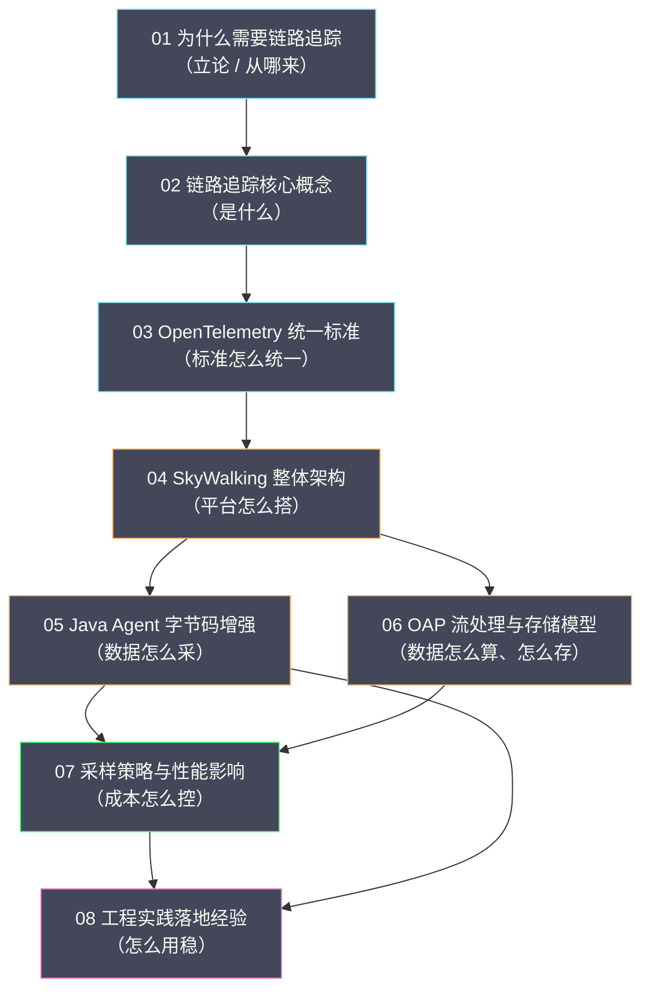

# 链路追踪专栏导览

## 专栏定位

链路追踪（Distributed Tracing）是可观测性几种信号里**唯一能还原"一个请求在系统里走了哪条路"**的一种。指标告诉你"哪个服务慢了"，日志告诉你"那一刻发生了什么"，但它们都无法直接回答"这一个请求，从入口到落库，究竟在哪个环节、哪一次调用上卡住了"。当系统从单体拆成几十个微服务，一次用户操作要穿过网关、订单、库存、支付、消息队列之后，这种"端到端的因果还原"能力就从奢侈品变成了必需品。

本专栏的目标，是让你既能理解链路追踪的**原理**（数据模型、上下文传播、采样理论），也能掌握它的**工程**（Agent 埋点、OAP 存储、采样调优、生产落地）。原理部分讲"为什么这样设计"，工程部分讲"怎么用好它"。

## 为什么以 SkyWalking 为主线

链路追踪的生态里，标准是 OpenTelemetry，产品则有一长串：Jaeger、Zipkin、Grafana Tempo、SkyWalking。本专栏并不回避这种多样性——第 03 篇专门讲 OTel 标准，第 01、02 篇也会把 Zipkin、Jaeger 拉进来对比。但全篇的主线放在 **Apache SkyWalking** 上，理由有三条。

第一，**它是一站式的 APM（Application Performance Management）平台**。Jaeger 与 Zipkin 更接近"纯粹的追踪后端"——负责接收、存储、查询 Span；而 SkyWalking 把 Agent、OAP（观测分析平台）、UI、告警、Profiler 都收进了一个项目，追踪、指标、拓扑、告警开箱即用。对"不想自己拼装一整套可观测栈"的团队，这是最省心的形态。

第二，**它的无侵入能力最成熟**。SkyWalking 的 Java Agent 基于字节码增强（Bytecode Instrumentation），不改一行业务代码就能给主流框架（Spring、Dubbo、Kafka、gRPC、数据库驱动）埋点。这条"零侵入"的技术路径，值得单独用两篇（第 05 篇与第 08 篇）来讲透——它也是很多团队选择 SkyWalking 的第一理由。

第三，**它的设计取舍足够典型**。SkyWalking 的数据模型（Segment、Span、Endpoint）、存储抽象（ES / BanyanDB 可切换）、采样机制（Agent 侧采样），都是理解"一个追踪系统如何在能力、性能与成本之间取舍"的绝佳样本。理解了它，再看别的系统，就能很快抓住各自的设计主线。

需要说明的是，本专栏讲 SkyWalking，**不是要否定 Jaeger、Zipkin 或 Grafana Tempo**。它们在特定场景里各有优势，第 01 篇会给出"什么场景适合谁"的对照框架。把 SkyWalking 当主线，是因为它把"标准 + 实现 + 平台"这几件事整合得最完整，作为认知锚点最合适。

## 目录

| 序号 | 文章 | 核心内容 |
|---|---|---|
| 01 | [[01 为什么需要链路追踪]] | 从单体到微服务的调试困境、Dapper 论文与 Google 的实践、追踪与指标日志的分工、四种追踪产品的定位差异 |
| 02 | [[02 链路追踪核心概念]] | Trace / Span / SpanContext 的精确定义、上下文传播机制、Baggage、头部采样与尾部采样的本质区别 |
| 03 | [[03 OpenTelemetry 统一标准]] | OpenTracing 与 OpenCensus 的分裂、OTel 三层架构（API / SDK / Collector）、OTLP 协议、与 SkyWalking 的协作 |
| 04 | [[04 SkyWalking 整体架构深度解析]] | Agent / OAP / UI 三层架构、数据流、存储抽象、集群部署形态与可扩展性设计 |
| 05 | [[05 SkyWalking Java Agent 字节码增强原理]] | Byte Buddy 与类加载机制、插件化的增强流程、跨线程与跨进程的上下文传递实现 |
| 06 | [[06 SkyWalking OAP 流处理与存储模型]] | OAP 的流式聚合、Segment / Endpoint / Service 多级指标推导、拓扑发现、ES 与 BanyanDB 存储引擎 |
| 07 | [[07 SkyWalking 采样策略与性能影响]] | 头部采样与尾部采样、概率与自适应采样、Agent 开销的量化、不同业务场景的采样配置 |
| 08 | [[08 链路追踪工程实践落地经验]] | 跨线程与异步传播的坑、采样与告警联动、与指标日志的联动、容量规划与故障排查 |

## 知识图谱

本专栏各篇之间的关系，可以用一张图概括——从"为什么"到"是什么"，再到"怎么实现"与"怎么落地"：

## 主线与阅读路径

本专栏的主线可以概括为一条"从问题到方案"的链路：**为什么要追踪（01）→ 追踪的基本概念是什么（02）→ 标准如何统一（03）→ SkyWalking 平台怎么搭（04）→ 数据怎么采进来（05）→ 数据怎么算、怎么存（06）→ 成本怎么控（07）→ 生产上怎么用好（08）**。第 01 篇是全篇的立论基础，第 02 篇是全篇的认知枢纽——后面的所有实现，都是这套概念在不同工程约束下的落地。

按需求选择路径：

- **快速建立认知**：01 → 02 → 03。
- **SkyWalking 使用者**：02 → 04 → 05 → 06 → 07。
- **架构与选型**：01 → 03 → 04 → 08。
- **完整通读**：01 → 02 → 03 → 04 → 05 → 06 → 07 → 08。

## 贯穿全篇的四条判断

本专栏不追求罗列知识点，而是围绕四条判断展开，先在这里点出，便于阅读时留意：

1. **追踪解决的是"因果还原"，不是"性能统计"**。指标能告诉你 P99 涨了，但只有追踪能告诉你"涨在了哪一个调用、哪一次重试、哪一个下游"。指标负责发现异常，追踪负责定位异常。
2. **标准与实现要分开看**。OpenTelemetry 是标准，SkyWalking、Jaeger 是实现。理解了这层分离，就能明白为什么"换后端不改代码"是可能的，也就能理解 OTel 为什么把 API、SDK、Collector 拆成三层。
3. **采样是追踪的第一成本杠杆**。全量追踪的存储与传输开销会随 QPS 线性膨胀，因此采样不是"可选项"而是"必需品"；而头部采样与尾部采样的取舍，本质上是在"成本"与"关键链路完整率"之间做权衡。
4. **没有银弹，只有权衡**。零侵入与灵活性、采样率与完整率、存储成本与查询能力，都是取舍；选择哪一种，取决于你的瓶颈在哪一端，而不是"哪个产品更先进"。

## 关联专栏

- [[可观测/指标/00 专栏导览|指标与 VictoriaMetrics]]：指标发现异常，追踪定位到具体请求；Exemplar 把两者串起来。
- [[可观测/日志/00 专栏导览|日志与 Grafana Loki]]：Trace ID 注入日志，实现"从链路跳日志"的联动。
- [[可观测/Profiler/00 专栏导览|持续剖析]]：从"哪个服务慢"下钻到"哪行代码慢"。
- [[可观测/00 可观测性全景导览|可观测性全景导览]]：追踪在可观测性体系中的位置与协作机制。
- [[云原生/服务网格/00 专栏导览|服务网格]]：网格侧的分布式追踪与应用侧追踪的互补（第 06 篇）。
- [[Java/Netty/00 专栏导览|Netty]]：SkyWalking Agent 对 Netty 等异步框架的字节码增强（第 05 篇）。
- [[中间件/Dubbo/00 专栏导览|Dubbo]]：Dubbo Filter 与分布式追踪的集成。
