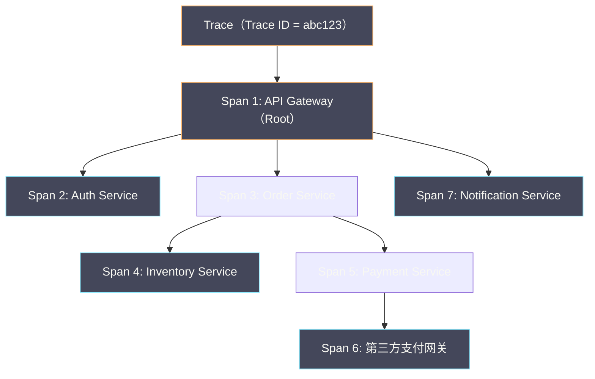
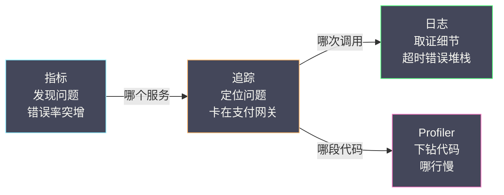

# 01 为什么需要链路追踪

**摘要：**

在单体架构里，一次性能问题的定位往往只需要一个 profiler、一条 grep 命令；可一旦系统被拆成几十个微服务，请求散落在十几个进程、几十台机器上，"这 5 秒到底花在哪"就成了一个需要侦探式排查的问题。链路追踪（Distributed Tracing）正是为回答这个问题而生。本文从微服务带来的"调试困境"讲起，用一次真实的排查现场说明日志与指标为何各自存在盲区，再回溯 2010 年 Google Dapper 论文奠定的三条设计原则与 Trace/Span 数据模型，随后梳理从 Zipkin、SkyWalking、Jaeger 到 OpenTelemetry 的十五年演进，最后落到追踪与指标、日志的分工边界。读完之后，你应当能回答两个问题：**为什么有了日志和指标，仍然需要追踪；以及追踪究竟能回答、又不能回答哪些问题**。

---

## 第 1 章 单体时代的调试，为什么在微服务里失灵了

### 1.1 三件趁手工具与它们共同的前提

在单体架构（Monolithic Architecture）里，所有业务逻辑跑在同一个进程中，工程师手边有三件极其趁手的工具。

**其一是本地日志**。所有模块把日志写进同一个文件，按时间自然排序，一个请求从进入到返回的所有痕迹就集中在一起。用 `grep` 按请求 ID 一筛，完整的执行路径立刻浮现出来：

```text
2024-01-01 10:00:00.100 [req-123] AuthModule:      用户认证成功，耗时 5ms
2024-01-01 10:00:00.105 [req-123] OrderModule:     创建订单，耗时 50ms
2024-01-01 10:00:00.155 [req-123] InventoryModule: 扣减库存，耗时 30ms
2024-01-01 10:00:00.185 [req-123] PaymentModule:   发起支付，耗时 100ms
2024-01-01 10:00:00.285 [req-123] Response:        返回成功，总耗时 185ms
```

耗时最长的一环（支付模块，100ms）一眼可见，排查方向随之确定。更妙的是，这份日志是"同一个时钟、同一个文件"，模块之间的先后顺序不需要推断，直接就是文件里的行序。

**其二是进程内 Profiler**。[[Java/JVM/00 专栏导览|JVM]] 上的 async-profiler、VisualVM，或者 Python 的 `cProfile`，都能在进程级别生成火焰图或调用栈统计，把 CPU 与内存消耗精确到函数级。当一个接口"自己就很慢"时，Profiler 能一路下钻到具体的方法与代码行。

**其三是本地调试器**。在 IDE 里打断点、单步执行、查看变量，是最直接的调试手段——而在单体架构里，这套手段完全可行，因为被调试的进程就在你手边。

这三件工具有一个共同的前提：**被观测的对象是"一个进程、一份日志、一条调用栈"**。无论是日志、Profiler 还是调试器，它们都默认"这次请求的全部执行痕迹，都发生在同一个可访问的时空里"。微服务把这个前提打碎了——请求的痕迹被切分到不同的进程、不同的机器、不同的时钟上，而这三件工具没有一件能跨越这个边界。

### 1.2 一个 5 秒的排查现场

设想一个再普通不过的故障：用户反馈"下单页面很慢，加载要 5 秒"。在没有追踪的情况下，工程师的排查过程大致是这样的：

```text
1. 查 API 网关日志：请求 10:00:00.000 到达，10:00:05.000 返回
   → 问题确认，但 5 秒花在哪里，一无所知
2. 查认证服务日志：耗时 10ms → 不是瓶颈
3. 查订单服务日志：耗时 50ms → 不是瓶颈
4. 查库存服务日志：耗时 30ms → 不是瓶颈
5. 查支付服务日志：没有找到对应的请求
   → 是支付服务没收到请求？还是日志还没落盘？
   → 还是订单服务到支付服务之间的网络延迟？
6. 查订单服务的出站调用日志：调用支付服务时等待了 4.8 秒
   → 但为什么等这么久？支付服务处理慢，还是网络抖动？
7. 终于在支付服务的另一个日志文件里发现：调用第三方支付网关超时，4.5 秒
```

整段排查耗时 30 分钟到 2 小时不等。而如果系统有链路追踪，同样的定位只需打开 Trace 详情页，一眼就能看到那个耗时 4.5 秒的支付网关 Span。

这个对比揭示了一个关键事实：**微服务把"调试"从"读一份日志"变成了"跨机器拼一张图"**。请注意第 5 步的犹豫——"是没收到请求，还是日志没落盘，还是网络延迟"——这三者对应的排查动作完全不同，而日志本身无法把它们区分开。工程师消耗掉的时间，很大一部分不是花在"读数据"上，而是花在"猜测缺失的数据意味着什么"上。

### 1.3 排查成本为什么会组合爆炸

值得单独说的是，微服务带来的不只是"要登录的机器变多了"，而是排查成本在数量级上的膨胀。

在单体里，模块之间的调用关系是"代码里写死的"，你可以直接读源码确认 A 调用了 B。而在微服务里，调用关系是"运行时动态形成"的——服务 A 可能通过服务发现调用 B 的某个实例，也可能通过消息队列异步触发 C，还可能因为重试机制在失败后调用了 D。**调用路径不是设计出来的，而是运行时涌现出来的**，任何静态的架构图都只是它的一个近似。

更麻烦的是并发。每秒数千个请求同时穿过这套系统，日志文件被搅在一起，按时间排序已经不足以还原"哪一个请求先调用了谁"。要在这样的数据里定位一个特定的慢请求，等价于在一堆交织的毛线里抽出一根特定颜色的线——而这根线在抽取的过程中还在不断变化。

于是排查成本的膨胀来自两处：**其一是空间上的分散**（痕迹散在 N 个进程、M 台机器上），**其二是时间上的交织**（并发请求的痕迹互相缠绕）。两者叠加，使得"服务数量"每增加一个，排查难度不是线性上升，而是近似指数上升。这正是为什么"微服务化"几乎必然伴随着"可观测性建设"——不是出于审美，而是出于生存。

### 1.4 日志的盲区：有事件，无因果

有人会问：如果在所有服务里统一加上结构化日志（每条都带请求 ID），再配上 Prometheus 指标，是不是就够了？

先看日志。带请求 ID 的日志确实解决了"跨机器聚合"的一部分问题——但它的盲区仍然明显。

**日志是事件级别的，不是请求级别的。** 即使每条日志都带了请求 ID，要还原一个请求的完整链路，仍要从多个服务的日志系统里按 ID 聚合，这个查询本身既慢又脆。更关键的是，日志按"发生的时刻"记录，而不是按"请求的层级"组织，因此它天然缺少"谁是谁的父亲"这个维度。

**日志不携带耗时分布。** 一条日志可以写"本服务处理耗时 50ms"，却很难自然表达"这 50ms 里，30ms 在数据库、15ms 在调下游、5ms 在序列化"——因为日志的粒度是"一件事发生了"，而不是"一段时间花在了哪"。要表达后者，需要的是"有明确起止的结构化单元"，而这正是 Span 的形态。

**日志不携带父子关系。** 看到订单服务和支付服务的日志，你能推断它们"可能有调用关系"，但不知道确切的层级——是订单服务直接调了支付服务，还是中间还隔着一个风控服务？日志没有天然回答这个问题，而这个问题的答案，恰恰决定了"该改哪一段代码"。

### 1.5 指标的盲区：有聚合，无个体

再看指标。指标（Metrics）以极低的成本持续记录系统的整体状态，它的盲区与日志恰好互补，也同样致命。

**指标是聚合数据，不是个体数据。** 指标会告诉你"支付服务的 P99 延迟是 500ms"，但不会告诉你"某一个具体请求为什么花了 5 秒"。P99 涨了是一个信号，而信号背后是哪一个请求、哪一次调用出了问题，指标答不上来。它把成千上万个请求压成了一个分位数，这个压缩正是它低成本的原因，也正是它无法定位个体的原因——**压缩掉的信息，事后是找不回来的**。

**指标不携带因果关系。** 你常常会看到"订单服务延迟升高"和"支付服务延迟升高"同时发生，但无从判断是"支付服务慢拖累了订单服务"，还是"它们各自独立地出了问题"。聚合曲线把因果压平成了相关性，而相关不等于因果。

这两条盲区合起来说明了一件事：**指标擅长"发现问题"，不擅长"定位问题"**。它能以极低成本告诉你"系统整体不对劲了"，却无法指出"不对劲出在哪一次调用上"。定位这件事，需要一个能保留"个体请求"的维度——这正是追踪的立足点。

### 1.6 追踪补上的那块拼图

把上面的分析收拢，追踪填补的空白可以概括为四点：

- **请求级别**：每条 Trace 对应一个完整的用户请求，从入口到出口，不聚合、不丢失个体（未采样时除外）。
- **层级关系**：Span 的父子关系天然表达了"谁调用了谁"，无需从日志里推断。
- **耗时分布**：每个 Span 有精确的开始与结束时间，延迟被分解到每一次调用上。
- **跨服务关联**：通过一个全局的 Trace ID，把散落在不同进程里的 Span 串成一棵调用树。

用一个比喻来说：**日志是散落各地的行车记录仪，指标是全城路况的热力图，而追踪是一张带时间戳的导航轨迹**。行车记录仪告诉你某辆车当时发生了什么，热力图告诉你哪条路堵了，只有导航轨迹能告诉你"这一趟从起点到终点，具体在哪一段、被什么拖慢了"。三者缺一不可，但只有追踪同时具备"个体"与"因果"这两个属性。

---

## 第 2 章 追踪要回答的三个问题

在进入 Dapper 之前，不妨先把"追踪到底要回答什么"讲清楚。任何一个追踪系统，无论实现如何、后端选谁，最终都要回答三个问题。

### 2.1 请求走了哪条路

也就是服务之间的调用拓扑：请求经过了哪些服务、哪些接口、哪些中间件。这是"因果还原"最基础的形态，也是 SkyWalking 服务拓扑图的来源。

这个问题的价值在故障时最明显。当一个请求报错，工程师第一件事往往是问"它到底调了谁"——如果答案是"它调了一个你以为早已下线的服务"，那么问题立刻缩小到"为什么这个调用还在发生"。**拓扑不是一张静态的架构图，而是运行时的事实**，而追踪是唯一能给出这个事实的信号。

### 2.2 时间花在了哪

把一次请求的总耗时，分解到每一个环节——哪个下游调用慢、哪次数据库查询慢、哪段序列化慢。这是"性能定位"的核心，也是追踪最常被使用的能力。

这里的关键词是"分解"。指标能告诉你"总耗时 5 秒"，追踪能告诉你"这 5 秒里，4.5 秒在支付网关、0.3 秒在订单服务、0.2 秒在网络"。分解的价值在于，它把一个"5 秒"的模糊问题，变成了一个"支付网关"的精确问题。**没有分解，就没有优化的靶子**。

### 2.3 为什么会失败

当请求报错时，错误是在哪一环产生的、如何沿着调用链向上传播、最终如何变成用户看到的那个错误码。这是"故障归因"的核心。

一个常见的现象是"错误在链路上变形"：底层的数据库返回了超时，中间的服务把它包装成一个业务异常，网关又把它翻译成一个 HTTP 500。用户在页面上看到的"系统繁忙"，其根因可能是几跳之外的一次慢查询。追踪的价值在于，它把这几次"包装"沿着调用链摊开，让你能顺藤摸瓜地找到最初的源头。

这三个问题看似朴素，但要在大规模、高并发的分布式系统里持续、低成本地回答它们，就牵扯出一整套工程约束——而 Dapper 论文的价值，正在于它把这套约束提炼成了几条可复用的设计原则。

---

## 第 3 章 Dapper：一篇被引用了一万次的论文

### 3.1 论文诞生的背景

2010 年，Google 发表了论文 *Dapper, a Large-Scale Distributed Systems Tracing Infrastructure*。这篇论文几乎奠定了此后所有分布式追踪系统的理论基础——Zipkin、Jaeger、SkyWalking、OpenTelemetry，都直接或间接地继承了它的设计思想。直到今天，你在任何一篇追踪系统的设计文档里，几乎都能看到对它的引用。

Dapper 诞生于 Google 内部真实的规模压力：一个典型的搜索请求会触发成百上千次 RPC 调用，涉及数百个服务。在这样的规模下，传统的日志分析和指标监控根本无法有效定位性能问题。Google 需要的，是一个**能以极低开销记录每个请求完整链路、并支持实时查询**的系统。这个需求里的"极低开销"四个字，是理解 Dapper 全部设计的关键——它决定了后面几乎所有的取舍。

### 3.2 三条设计原则

Dapper 论文提出了三条核心原则，它们至今仍是追踪系统的设计基石。

**原则一：低开销（Low Overhead）。** 追踪系统本身不能显著影响业务性能。Dapper 给出的目标是：对 CPU 的影响小于 0.3%，对延迟的影响可以忽略。这条原则直接催生了两个关键设计——**采样**（只记录一部分请求，而非全量）与**异步上报**（Span 不阻塞请求路径，先写本地缓冲区、由后台线程批量发送）。

不妨反过来想：如果不做采样、全量上报，会发生什么？在 Google 那样的规模下，追踪数据的产生速率会逼近业务数据本身，存储与传输成本随之爆炸；而如果上报是同步的，每一次 Span 上报都会给请求路径增加一次网络往返，延迟直接劣化。**正是"低开销"这条原则，逼出了"采样 + 异步"这两个此后所有系统都绕不开的设计**。后面所有关于"采样策略"的讨论，源头都在这里。

**原则二：应用透明（Application Transparency）。** 追踪不应要求开发者修改业务代码。Dapper 的做法是在 Google 内部的 RPC 框架（Stubby）和线程库中植入追踪逻辑，对应用完全透明——开发者既不手动创建 Span，也不手动传递 Trace ID，全由框架层代劳。

这条原则深刻影响了后续生态：SkyWalking 的 Java Agent 用字节码增强实现无侵入埋点，OpenTelemetry 的 Auto-Instrumentation 用语言级自动注入实现类似效果；而 Zipkin 的 Brave 库需要手动埋点，本质上是对这条原则的一次妥协——它用灵活性换取了"框架无法覆盖所有语言与场景"这一现实的妥协。**无侵入与灵活性是一对天然矛盾**：框架帮你做得越多，你能自定义的空间就越小，这条张力会在第 05 篇反复出现。

**原则三：广泛部署（Ubiquitous Deployment）。** 追踪必须覆盖整条调用链——链路中只要有一个服务没被追踪，这棵调用树就会"断裂"，看不到完整关系。Dapper 靠统一的 RPC 框架层植入，几乎覆盖了 Google 内部所有服务。

这条原则在开源社区里要难得多：不同团队用不同语言、不同框架，统一覆盖的难度远大于一家公司的内部环境。OpenTelemetry 用"多语言 SDK + 统一协议 OTLP"来应对这个难题，也正是这一原则的延续。**追踪的完整性是一个"木桶效应"——链路的完整度取决于最薄弱的那一环**，这也是为什么"混合部署、渐进迁移"阶段最容易出现断链。

### 3.3 数据模型：Trace 与 Span

Dapper 定义了两个核心概念，成为此后所有追踪系统的基本数据模型。

**Trace（追踪）**：一个 Trace 代表一个完整的请求生命周期，由一组 Span 组成，全局唯一标识是 Trace ID。

**Span（跨度）**：一个 Span 代表一个"工作单元"，通常对应一次 RPC 调用、一次数据库查询或一次 HTTP 请求。每个 Span 包含：Span ID（自身唯一标识）、Parent Span ID（父 Span 的 ID，根 Span 没有父）、操作名（如 `GET /api/orders`）、开始时间与持续时间、标签（Tags/Attributes，键值对元数据，如 `http.status_code=200`），以及事件（Events/Logs，Span 执行中的离散事件）。

Span 之间通过 Parent Span ID 形成一棵树——根 Span 代表请求入口，子 Span 代表被调用的下游：



这棵树天然表达了"谁调用了谁"与"每个环节花了多久"，是追踪回答"请求在哪里慢了"的核心数据结构。值得注意的是，**这棵树不是被某个中心组件"构建"出来的，而是由每个服务各自上报自己的 Span、再按 Parent ID 拼装出来的**——这个去中心化的特性，正是追踪能在 Google 那样的规模上工作的原因：没有任何一个节点需要掌握全局，全局是事后拼出来的。

### 3.4 Span 的三种记录形式

Dapper 把 Span 里附带的信息分为三类，这个划分至今仍影响着 OpenTelemetry 的数据模型。

**其一是时间戳事件（Timestamped Events）**，也叫注解。比如 `cs`（client send）、`sr`（server receive）、`ss`（server send）、`cr`（client receive）——四个事件把一次 RPC 拆成了"客户端发出、服务端收到、服务端返回、客户端收到"四段，中间的差值分别对应网络耗时与服务端处理耗时。这是追踪能"分解耗时"的微观基础。

**其二是键值对标签（Tags）**。它们承载请求的元数据，如 `http.method=POST`、`http.status_code=200`、`db.instance=orders`。标签的价值在于**可检索**——你想找"所有 status_code=500 的请求"，靠的就是标签。

**其三是 Span 内日志**。它们是附着在某个 Span 上的、带时间戳的补充信息，比普通日志更"上下文明确"，因为它们天然知道"自己属于哪一个请求、哪一个环节"。

这个三分法揭示了一个重要的设计直觉：**追踪不是"更详细的日志"，而是"带结构的事件"**。日志是自由文本，追踪是把关键事件结构化地挂在调用树上——结构化带来了可查询、可聚合、可分解的能力，而这些正是自由文本给不了的。

### 3.5 上下文传播：追踪的血液循环

追踪最核心的技术难点，不是"如何记录 Span"，而是**如何在跨服务调用时把 Trace ID 与 Parent Span ID 传递下去**，让下游服务知道"我属于哪个 Trace、我的父 Span 是谁"。这套机制叫**上下文传播（Context Propagation）**。

**进程内传播**：在同一进程里，追踪上下文通常存在 ThreadLocal（Java）、Context（Go）、AsyncLocalStorage（Node.js）这类线程/协程本地存储中。当代码执行到新的 Span 创建点时，从本地存储里读出父 Span 的信息。

**跨进程传播**：服务 A 调用服务 B 时，A 需要把上下文通过某种载体传给 B，最常见的是 HTTP Header 或 RPC Metadata：

```text
服务 A 发起 HTTP 请求到服务 B：

GET /api/inventory HTTP/1.1
Host: inventory-service:8080
traceparent: 00-abc123-span3id-01     ← W3C Trace Context 标准
sw8: 1-abc123-span3id-...             ← SkyWalking 自定义格式
x-b3-traceid: abc123                  ← Zipkin B3 格式
x-b3-spanid: span3id
x-b3-parentspanid: span1id

服务 B 收到后：
  1. 从 Header 中提取上下文
  2. 创建新 Span（Parent = span3id）
  3. 把新 Span 存入本地 ThreadLocal
  4. 处理业务逻辑
  5. 调用下游时，把更新后的上下文注入新的 Header
```

一个形象的比喻是：**上下文传播就是接力赛里的交接棒**。每个服务跑完自己那一棒，要把棒递给下一个选手；只要有一次交接失误——异步线程切换时忘了传递、消息队列收发时漏了注入——下游就会"自立门户"开出一条新的 Trace，链路从此断成两截。**"追踪图断成一截一截"的头号根因，正是应用侧漏传上下文**，尤其是线程池切换、消息队列收发这类异步边界。这一点会在第 08 篇展开。

> [!note] W3C Trace Context：把"交接棒"标准化
> 2020 年，W3C 发布了 Trace Context 标准（https://www.w3.org/TR/trace-context/），定义了统一的 HTTP Header 格式 `traceparent` 与 `tracestate`，终结了此前各家自定义 Header 的混乱局面——Zipkin 用 B3、SkyWalking 用 sw8、Jaeger 用 uber-trace-id，互不兼容。OpenTelemetry 默认使用 W3C Trace Context 标准，这也让"跨厂商、跨语言的链路拼接"第一次成为现实。

### 3.6 Dapper 的采集与存储

Dapper 的工程实现里，还有两个细节值得单独一提，因为它们同样是"低开销"原则的产物。

**采集是"带外"的。** Dapper 的埋点库把 Span 数据先写到**进程内的本地日志文件**，再由一个**带外的守护进程（out-of-process daemon）**去读取并转发到后端。这样做的妙处在于：业务线程只做"写本地文件"这一件极廉价的事，真正昂贵的网络传输与序列化被挪到了业务路径之外。这是一个典型的"**把昂贵操作移出关键路径**"的手法，与消息队列的异步化思路一脉相承。

**存储做了冷热分层。** 刚产生的 Trace 写入低延迟的存储，供实时查询；超过一定时限后转入廉价的批量存储（Bigtable），供事后分析。这个"热数据要快、冷数据要省"的分层，如今在几乎所有追踪后端里都能看到影子——Grafana Tempo 把数据放到对象存储、SkyWalking 用 ES 或 BanyanDB，本质上都是这一分层思想在不同技术栈下的实现。

这两个细节合起来说明：**追踪系统本身也是一个分布式系统，它的设计要同时照顾"采集的低开销"与"存储的低成本"**，而这两者都不在业务路径上，因此可以尽情地做工程优化。

### 3.7 采样：低开销的兑现方式

最后回到"低开销"这条原则的兑现方式——采样（Sampling）。Dapper 并不记录每一个请求，而是按一定比例（如 1/1024）记录。这个比例的选择，是"数据完整性"与"开销"之间的一个显式权衡：比例越高，能看到的样本越全，成本越高；比例越低，越省，但越容易漏掉罕见的故障。

这里有一个容易被忽视的要点：**采样决策必须在整条链路上保持一致**。如果入口决定采这个请求、下游却决定不采，那么这棵调用树就会"缺胳膊少腿"。因此采样决策通常由入口做出，并通过上下文传播给下游——这被称为**一致性采样（Consistent Sampling）**。头部采样与尾部采样的差别、如何用尾部采样提高"关键链路完整率"，会在第 02 篇与第 07 篇展开。

### 3.8 Dapper 之后：什么变了，什么没变

Dapper 本身是 Google 的内部系统，从未开源；但它公开的论文，成了一切后来者的"母版"。把此后十五年的变化梳理一遍，你会发现**变的都是技术栈，不变的是骨架**。

变的部分有三处。**其一是存储**：Dapper 用 Google 自研的 Bigtable，如今的开源实现则用 Elasticsearch、Cassandra、Kafka 或对象存储——存储介质换了，但"热数据要快、冷数据要省"的分层思路没换。**其二是采集**：Dapper 在 C++ 的 RPC 框架里植入代码，如今的系统则用字节码增强（Java）、语言级自动注入（OTel）甚至内核态观测（eBPF）——手段换了，但"应用透明"的目标没换。**其三是传播协议**：从 Google 的内部格式，到各家自定义，再到 W3C Trace Context——格式换了，但"跨进程传递 Trace ID"的机制没换。

不变的部分同样有三处：**Trace/Span 的数据模型**（一棵带父子关系的树）、**采样**（为控制开销而只记录一部分请求）、**上下文传播**（把身份沿调用链传下去）。这三样东西，在 Zipkin、Jaeger、SkyWalking、OTel 里都能一一对应地找到。

这个"变与不变"的对照很有用：它意味着你不必每换一个追踪系统就重新学习一遍——**只要抓住那三样不变的东西，剩下的都只是"它们在某个技术栈里的具体实现"**。本专栏后续拆解 SkyWalking 时，也会反复回到这三个骨架上来。

---

## 第 4 章 从 Dapper 到开源生态：十五年演进

Dapper 论文发表后，开源社区迅速跟进。理解这几个代表性系统的差异，有助于把握整个领域的技术路线分野。

### 4.1 Zipkin（2012）：第一个被广泛使用的开源实现

Twitter 在 2012 年基于 Dapper 论文实现了 Zipkin，它是第一个被广泛使用的开源追踪系统。Zipkin 采用"库埋点"的方式——通过 Brave 库在应用代码里手动或半自动地创建 Span，数据存到 Cassandra 或 Elasticsearch。它的架构简洁、概念清晰，但需要侵入应用代码，且只做链路追踪，不提供指标聚合与拓扑发现。**Zipkin 的定位是一块"干净的积木"**——它不试图解决所有问题，只把追踪这一件事做扎实，剩下的交给使用方自己拼装。

### 4.2 SkyWalking（2015）：无侵入的 APM 全栈方案

SkyWalking 由吴晟发起，是国内最流行的 APM 系统。它最大的差异化优势是**基于 Java Agent 的无侵入埋点**——通过 Java Instrumentation API 与 Byte Buddy 字节码增强，在类加载时自动改写目标类的字节码、注入追踪逻辑，业务代码一行不改。除了链路追踪，它还提供服务拓扑发现、性能指标聚合、告警、Profiler 等完整能力，是一个"开箱即用的一站式 APM"。本专栏以它为主线，第 04 至 07 篇会逐层拆解它的实现。

SkyWalking 的这条路线，本质上是把 Dapper 的"应用透明"原则做到了极致——它不只覆盖 Google 自有的 RPC 框架，而是试图用字节码增强"兜住"开源世界里几乎所有主流框架。这条路线很重、很复杂，但它换来的"零侵入"体验，恰恰是 Java 团队最看重的东西。

### 4.3 Jaeger（2017）：Uber 的云原生答卷

Jaeger 由 Uber 开源，2019 年从 CNCF 毕业。它最初基于 OpenTracing 标准，架构上与 Zipkin 类似，但在采样策略与存储扩展性上做了增强——它支持自适应采样（Adaptive Sampling），能根据流量自动调整采样率。Jaeger 的定位更接近"纯粹的追踪后端"，与云原生生态（Kubernetes、OpenTelemetry）结合紧密。**如果说 Zipkin 是"简洁的积木"，Jaeger 就是"为云原生重写的积木"**——它把分布式部署、存储后端可插拔、采样自适应这些大规模场景的需求，直接做进了架构。

### 4.4 OpenTelemetry（2019）：标准的终局

OpenTelemetry（OTel）由 OpenTracing 与 OpenCensus 两个标准合并而来，成为 CNCF 的官方可观测性标准项目。需要特别注意的是：**OTel 不是一个后端系统**——它不存储数据、不提供 UI，而是一套"标准 + SDK + Collector"：定义统一的数据模型与传输协议（OTLP），提供多语言 SDK 用于埋点，通过 Collector 把数据转发到各种后端（SkyWalking、Jaeger、Zipkin、Grafana Tempo 等）。第 03 篇会专门展开它的三层架构。

OTel 的出现改变了整个领域的格局：在此之前，选追踪系统等于"选后端"；在此之后，"采集"与"存储"可以分开决策——你可以用 OTel 的 SDK 埋点，却把数据发往 SkyWalking 或 Tempo。**这种"解耦"是 OTel 最大的价值，也是它被称为"终局"的原因**——它不取代任何后端，而是让后端之间的竞争回归到"存储与查询"这个更本质的维度。

### 4.5 一张对比表

把四个代表性系统放在一起，各自的取舍就清楚了：

| 维度 | Zipkin | Jaeger | SkyWalking | OTel + Tempo |
|---|---|---|---|---|
| 埋点方式 | Brave 库（半侵入） | OTel SDK / Jaeger Client | Java Agent（无侵入） | OTel SDK / Auto-Instrumentation |
| 数据模型 | Zipkin 自定义 | OpenTracing → OTel | SkyWalking 自定义（兼容 OTel） | OTel 标准 |
| 传播格式 | B3 Header | uber-trace-id → W3C | sw8 Header（兼容 W3C） | W3C Trace Context |
| 存储后端 | Cassandra / ES / MySQL | Cassandra / ES / Kafka | ES / BanyanDB / MySQL | 对象存储（S3/GCS） |
| APM 能力 | 仅链路追踪 | 追踪 + 基础指标 | 完整 APM（追踪+指标+拓扑+告警+Profiler） | 取决于后端选型 |
| 语言支持 | Java 为主 | Go / Java / Python / Node | Java 为主（Agent）+ 多语言 SDK | 全语言覆盖 |
| 适用场景 | 轻量级追踪 | 云原生环境 | Java 生态全栈 APM | 标准化、多后端灵活选型 |

这张表里没有"更好"，只有"更适合"。**选型的第一步不是比功能，而是先看清自己最缺的是哪一环**——是缺一个开箱即用的全栈平台，还是缺一个可自由组合的标准底座。

### 4.6 四条技术路线的分野

跳出产品层面，这四个系统其实代表了四条不同的技术路线，理解它们的分野，比记住功能差异更有用。

**第一条是"埋点方式"的分野**：库埋点（Zipkin、Jaeger 客户端）vs 字节码增强（SkyWalking）vs 语言级自动注入（OTel Auto-Instrumentation）。前者的灵活性最高但侵入性强，后者零侵入但覆盖面受限于框架适配的进度。

**第二条是"标准与实现"的分野**：SkyWalking、Zipkin 是"标准 + 实现"一体的，OTel 则是"只做标准与采集、不做存储"的。这条分野决定了你是"选一个完整方案"还是"自己拼装一套"。

**第三条是"能力边界"的分野**：只做追踪，还是把追踪、指标、拓扑、告警、Profiler 都做进来。前者轻，后者重；前者需要你补齐其余能力，后者开箱即用但可能"你不想要的功能也得一起装"。

**第四条是"存储策略"的分野**：本地磁盘 + 索引（ES、Cassandra），还是对象存储（Tempo）。这条分野直接决定了长期成本，也是第 04、06 篇会反复回到的主题。

### 4.7 选型不是选产品，而是选路线

把 4.6 的四条分野合起来看，会得到一个反直觉的结论：**追踪系统的选型，本质上不是"选哪个产品"，而是"选哪条路线"**。产品只是路线的一个具体表达，路线选错了，产品再好也难用。

举个具体的例子。一个以 Java 为主、已有 Grafana 展示层、成本敏感的团队，它的最优路线大概率是"OTel 自动埋点 + 对象存储后端（Tempo）"——因为它的语言单一、已有展示层、且成本是主要矛盾。而一个同样以 Java 为主、但故障频发、又不想自己拼装整套栈的团队，最优路线则可能是"SkyWalking 一体化平台"——因为它最缺的是"开箱即用的完整能力"，而不是"极致低成本"。

再看一个多语言、云原生的团队：它的路线更可能是"OTel SDK 全语言覆盖 + Collector 汇聚 + Jaeger 或 Tempo 后端"。这里"多语言"这个约束，直接排除了"单一 Java Agent"的路线。

所以选型的第一步，是先把自己的约束写下来——**语言栈是什么、现有展示层是什么、团队更缺能力还是更缺成本控制、能承受多少运维负担**。约束一旦明确，路线就基本确定了，剩下的只是在这条路线上挑一个成熟度最高的产品。**先定路线、再选产品，比"拉一张功能对比表逐项打分"要可靠得多**。

---

## 第 5 章 从"各自为战"到"标准统一"

### 5.1 分裂期：2015 至 2019

这段时期，追踪领域同时存在好几套互不兼容的事实标准：OpenTracing（CNCF 标准，只定义 API 不提供实现）、OpenCensus（Google 主导，提供 SDK 实现）、SkyWalking 的自定义协议、Zipkin 的 B3 格式、Jaeger 的 uber-trace-id 格式。

标准一多，麻烦就来了。库的开发者不知道该适配哪个标准，用户不知道该选哪个，而不同标准的数据模型与传播格式又不兼容——**本想终结碎片化的标准化努力，反而把水搅得更浑**。这一幕在软件史上反复上演：CORBA 如此，Web Service 如此，可观测性领域也没能免俗。

### 5.2 统一期：2019 至今

转机出现在 2019 年：OpenTracing 与 OpenCensus 宣布合并为 OpenTelemetry；2020 年 W3C Trace Context 成为 HTTP 传播的标准格式；SkyWalking、Jaeger、Zipkin 纷纷增加 OTel 兼容；新的追踪后端（如 Grafana Tempo）则原生支持 OTel。

这条演进主线的方向很清晰：**从各家自定义，走向一个统一标准**。而推动统一的，不只是技术共识，更是实实在在的痛点——当团队同时用着 Jaeger 和 Zipkin、数据却无法互通时，"统一"就从理想变成了刚需。

### 5.3 统一为什么这么难

标准的统一从来不是一蹴而就的，追踪尤其如此，原因有三。

**其一，追踪横跨采集、传输、存储三段**。只统一采集端不够，还要统一传输协议（OTLP）与数据模型，任何一段不统一，链路都会断在中间。**标准必须"端到端"地统一才有意义**，而端到端统一涉及的参与方远比统一一个 API 要多。

**其二，厂商中立与商业利益天然紧张**。OTel 的核心理念是 vendor-neutral——采集的数据可以发往任何后端，这降低了厂商锁定，却也意味着各商业 APM 厂商必须重新找到自己的价值定位。中立性降低了用户的风险，但也要求用户承担更多"自己拼装"的成本。**中立是有代价的，代价就是"没有人为整条链路的体验负全责"**。

**其三，旧系统不可能一夜迁移**。生产环境里总有使用 B3 格式的旧服务，也总有还在用 OpenTracing 的老应用。OTel 用 Propagator（传播器）机制支持多种格式并存，本质上是对"渐进迁移"这个现实的让步——**标准可以一步到位地设计，但落地永远只能是渐进的**。

---

## 第 6 章 追踪与指标、日志的分工

### 6.1 一张对比表

追踪不是要取代指标和日志，三者是互补的。把它们的差异做成一张表，分工一目了然：

| 维度 | 指标（Metrics） | 日志（Logs） | 追踪（Traces） |
|---|---|---|---|
| 数据粒度 | 聚合（时间序列） | 事件（单条记录） | 请求（调用树） |
| 存储成本 | 极低 | 高 | 中到高 |
| 擅长 | 发现问题、看趋势 | 看上下文、看细节 | 定位问题、看因果 |
| 短板 | 无个体、无因果 | 无层级、聚合慢 | 采样后有盲区、存储有成本 |
| 典型查询 | "P99 涨了吗" | "那一刻发生了什么" | "这个请求慢在哪一环" |

### 6.2 一次故障排查的时间线

一次典型的故障排查，三者的协作顺序是这样的：**指标最先报警**（"订单服务错误率突增"）→ **追踪定位到具体请求**（"是一批特定的慢请求，卡在支付网关"）→ **日志查看现场细节**（"那批请求的日志里，支付网关返回了超时错误"）。指标负责"发现"，追踪负责"定位"，日志负责"取证"，各司其职。



### 6.3 信号联动为什么重要

理解了这张图，就能理解为什么现代可观测性平台都在强调"信号联动"——**单一信号能回答的问题是有边界的，真正的定位能力来自信号之间的相互跳转**。

具体来说，有三条关键的联动线。**其一是指标到追踪**：当某个指标异常时，能一键跳到"造成这次异常的那几条 Trace"，这靠的是 Exemplar（样本点）机制。**其二是追踪到日志**：当看到一条慢 Trace 时，能一键跳到"这条请求对应的全部日志"，这靠的是 Trace ID 注入日志。**其三是追踪到 Profiler**：当定位到"某个接口慢"时，能一键采集"那段时间该接口的代码级火焰图"。

这三条联动线会在第 08 篇逐一展开。它们背后的共同思想是：**把不同信号用同一个标识（Trace ID）串起来，让排查过程不必在多个系统间手动搬运上下文**。

### 6.4 四大信号：为什么是四个而不是三个

业界常说"可观测性三大支柱"——指标、日志、追踪。但本系列讲了四种信号，第四种是持续剖析（Profiler）。为什么把它单列出来？

原因在于它的两个"不同"。**其一是粒度不同**：指标、日志、追踪的观测粒度是"服务/请求/调用"，而 Profiler 的粒度是"代码行"——它回答的是"哪一行代码在烧 CPU"，这是前三种信号都到不了的深度。**其二是触发方式不同**：前三种信号是"持续采集、事后查询"的，而 Profiler 常常是"按需触发、采集一小段时间"的——因为持续采集代码级栈样本的开销太高。这两个不同，使得 Profiler 无法被简单地归入前三者中的任何一个。

不过，把信号分成几种并不重要，重要的是它们**能否联动**。一个"四种信号俱全、但彼此不通"的体系，实际价值远低于一个"只有三种信号、但能互相跳转"的体系。这也是为什么本专栏会花相当篇幅讲"追踪到日志、追踪到 Profiler、指标到追踪"这几条联动线——**可观测性的能力，最终体现在"从一个信号跳到另一个信号"的顺畅程度上**。

### 6.5 RED 与 USE：指标方法论如何与追踪配合

指标侧有两个经典的方法论，值得与追踪放在一起理解。**RED**（Rate、Errors、Duration）面向请求，关注"每秒多少请求、多少出错、耗时多少"；**USE**（Utilization、Saturation、Errors）面向资源，关注"资源用了多少、饱和度多高、有没有报错"。

这两套方法论都从指标出发，但它们真正的价值，往往体现在"指标的下一步"。当 RED 告诉你"订单服务错误率涨了"，下一步该做什么？——去追踪里找到那些出错的具体请求，看它们共同的失败点在哪。当 USE 告诉你"某台机器的 CPU 饱和度高了"，下一步呢？——去追踪里看看到底是哪些请求、哪类调用在打这台机器，是流量涨了，还是某个慢查询把资源占住了。

换句话说：**方法论解决的是"看什么指标"，而追踪解决的是"然后去哪看"**。只有方法论、没有追踪，你会停在"知道出事了"这一步；只有追踪、没有方法论，你会在海量数据里失去方向。**指标给出"哪里可疑"，追踪给出"为什么可疑"**，两者配合，排查才走得通。

---

## 第 7 章 边界与反例：追踪不能解决什么

任何技术都有边界，把边界讲清楚，比罗列优点更有价值。追踪至少有三处容易被高估的地方。

### 7.1 采样带来的"看不见"

出于低开销的考虑，追踪默认只记录一部分请求。这就意味着：当你想复盘"那一次恰好出错的请求"时，它很可能因为没被采样而无迹可循。头部采样（在请求入口就决定采不采）尤其如此——它在请求还不知道自己会不会失败时就做了决定。

这是追踪固有的代价，也是头部采样的根本局限。第 07 篇会讲如何用尾部采样（等请求结束后，根据它是否失败来决定是否保留）来缓解——**尾部采样的本质，是"把采样决策推迟到信息更充分的时刻"**，代价是需要先缓存整条链路的数据。

### 7.2 追踪回答不了"为什么慢"

追踪能告诉你"支付网关这一跳花了 4.5 秒"，但它不会告诉你"网关内部是哪行代码慢"。要回答后者，需要 Profiler 下钻到代码级——这也是本系列单独设一个 Profiler 子专栏的原因。

这个边界的本质是**观测粒度**：追踪的粒度是"调用"，Profiler 的粒度是"代码行"。前者回答"哪个服务/哪次调用慢"，后者回答"哪段代码慢"。**两者是接力关系，不是替代关系**——追踪把范围收窄到"某个接口"，Profiler 再在这个范围内下钻。

### 7.3 追踪不等于性能优化

有的团队误以为"上了追踪，性能就好了"，这混淆了"度量"与"优化"。追踪是诊断工具，它让问题可见，但解决问题仍需工程师的判断与改动。**把追踪当成万能药，是很多团队落地后的第一重失望**。

更微妙的是，追踪本身也有开销——Agent 的字节码增强会带来额外的 CPU 与内存消耗，高频采样会带来额外的网络与存储开销。如果对追踪本身的成本不加治理，它甚至可能成为新的性能问题来源。第 07 篇会量化这部分开销。

### 7.4 把追踪当指标用

还有一个常见的误区：**把追踪当指标用**。追踪数据里确实能聚合出很多指标（如某个接口的 P99），但用它来替代指标是得不偿失的——追踪的存储成本远高于指标，而指标的连续性与低成本恰恰是追踪给不了的。

正确的做法是"**追踪数据向下聚合出指标**"，而不是"用追踪顶替指标"。这也是 SkyWalking 这类 APM 平台的设计方式：它从追踪数据里推导出服务级、Endpoint 级的指标，让工程师既能看到追踪明细，也能看到趋势曲线。**分工的依据是成本结构，而不是"哪个信号更全"**。

### 7.5 追踪不能替代告警

还有一处容易被混淆的边界：追踪与告警的分工。

追踪是一种"拉（pull）"的工具——你主动去查，它才给你答案；告警是一种"推（push）"的工具——系统主动告诉你"出事了"。二者的触发方向相反，职责也不同。**告警负责"在你没注意的时候叫醒你"，追踪负责"在你被叫醒之后帮你定位"**。

因此，正确的分工是"告警从指标来，定位从追踪来"，而不是"靠人工去盯追踪页面发现问题"。如果你发现团队的故障是"用户先投诉、工程师才去查追踪"，那么缺的其实不是追踪，而是**基于指标的告警**——追踪再强，也不会主动告诉你"出事了"。反过来说，如果团队有一堆告警却定位困难，那才是追踪该补位的地方。

理解这条边界，能帮你在"该先建告警还是先建追踪"这个问题上做出判断：**先让系统能"叫醒你"（告警），再让它能"帮你定位"（追踪）**——顺序反了，就会得到一个"能看到一切、却没人看"的系统。

---

## 第 8 章 该不该上追踪：一个判断框架

讲完原理，回到最实际的问题：什么时候该上追踪，什么时候可以先缓缓。

### 8.1 优先上追踪的信号

服务数量超过个位数、一次用户操作跨三个以上服务、出现过"排查两小时找不到瓶颈"的经历、有跨团队的调用关系需要厘清。只要中了其中两条，追踪的收益就会迅速超过它的成本。

尤其值得注意的是第二条——"跨三个以上服务"。当调用链只有两跳时，看日志通常还够用；一旦超过三跳，日志的"拼接成本"就开始超过它的信息价值，而追踪的"一次查询看到全貌"就开始体现出压倒性优势。

### 8.2 可以缓一缓的场景

仍是单体或只有两三个服务的早期系统、调用关系简单到看日志就能定位、团队还没有基本的指标与日志能力。**在指标和日志都没做好的情况下先上追踪，往往会得到一个"有数据但没人看"的系统**——因为没有指标来"发现问题"，追踪就失去了它的入口。

### 8.3 落地的顺序建议

先把指标与日志的基础打牢（发现问题、看上下文），再引入追踪（定位因果），最后按需补上 Profiler（下钻代码）。这条顺序不是教条，而是因为**追踪的价值要在"已经能发现问题"的前提下才能兑现**。

当然，这条顺序也有例外：如果你的团队是"Java 为主、故障频发、急需一个开箱即用的 APM"，那么直接上 SkyWalking 这类一体化平台，用它的"追踪 + 指标 + 拓扑"一次性补齐，也是完全合理的。**顺序服务于目标，而不是反过来**。

### 8.4 自建、开源与商业 APM

最后补一个绕不开的问题：追踪系统是自建、用开源平台，还是买商业 SaaS？

**自建**（OTel SDK + 自选存储）：可控性最高、长期成本可能最低，但运维负担最重，且需要团队对存储与查询有足够的理解。它适合"有专门的可观测性团队、且规模足以摊薄自研成本"的组织。

**开源平台**（SkyWalking、Jaeger 自部署）：开箱即用程度高、无厂商锁定，但仍需自己承担部署、扩容与运维。它是绝大多数中型团队的现实选择。

**商业 SaaS**（Datadog、Grafana Cloud 等）：上手最快、运维最省，但成本随数据量线性上升，且存在数据出域与厂商锁定的顾虑。它适合"快速起步、规模尚小、或不愿投入运维人力"的团队。

这三条路没有绝对优劣，判断的依据还是那几个约束：**团队有没有可观测性专职人力、数据规模有多大、对数据主权的要求有多高、预算是按人力算还是按账单算**。一个常见的现实路径是"先用开源平台快速起步，规模大了再评估是否迁移到自建或商业方案"——**架构不是一次选定的，而是随规模演进的**。

---

## 小结

追踪解决的核心问题，可以用一句话概括：**在分布式系统里，把"一个请求的因果链"从散落各处的碎片，还原成一张可查询的图**。日志给了事件、指标给了聚合，唯独缺少"个体 + 因果"这个维度，而追踪恰好补上了它。

回看整条演进脉络，有一条清晰的主线：Dapper 在 2010 年用三条原则（低开销、应用透明、广泛部署）定下了基调，此后十五年的所有系统——Zipkin、SkyWalking、Jaeger、OpenTelemetry——都在这三条原则的框架内做各自的取舍。低开销催生了采样，应用透明催生了字节码增强与 Auto-Instrumentation，广泛部署催生了统一标准。**理解了这个"原则决定取舍"的关系，再看任何一个追踪系统的设计，就都能找到它的出发点**。

这也是本专栏的写作方式：不满足于"介绍某个产品有什么功能"，而是追问"它为什么长成这样"。下一篇（第 02 篇）会进入概念的精确定义——Trace、Span、SpanContext、Baggage、采样，把这些词的确切语义与设计动机讲透，为后面所有实现篇打下共同的语言基础。

---

## 参考资料

1. Sigelman, B., et al. (2010). *Dapper, a Large-Scale Distributed Systems Tracing Infrastructure*. Google Technical Report. https://research.google/pubs/pub36356/
2. W3C Trace Context Specification. https://www.w3.org/TR/trace-context/
3. Apache SkyWalking 官方文档：https://skywalking.apache.org/docs/
4. OpenTelemetry 官方文档：https://opentelemetry.io/docs/
5. Zipkin 官方文档：https://zipkin.io/
6. Jaeger 官方文档：https://www.jaegertracing.io/docs/
7. Shkuro, Y. (2019). *Mastering Distributed Tracing*. Packt Publishing.
8. Sridharan, C. (2018). *Distributed Systems Observability*. O'Reilly Media.

---

> [!note] 思考题
> 1. 用一句话向同事解释"为什么有了日志和指标，还需要追踪"。如果对方说"我给日志加了请求 ID 不就行了吗"，你如何回应？
> 2. Dapper 的三条原则里，哪一条在开源社区的落地最难？OpenTelemetry 用哪些机制来应对这个难点？
> 3. 上下文传播被称为"追踪的血液循环"。请举出两个你们系统里最可能漏传上下文的异步边界，并说明如何排查。
> 4. 追踪"能告诉你哪里慢，但不能告诉你为什么慢"。这句话对你理解追踪与 Profiler 的分工有什么启发？
> 5. 在什么阶段上追踪是"过早"的？如果团队连指标都还没建好，先上追踪会带来什么问题？
