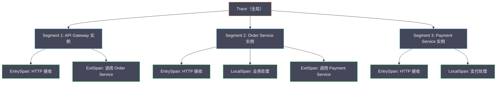
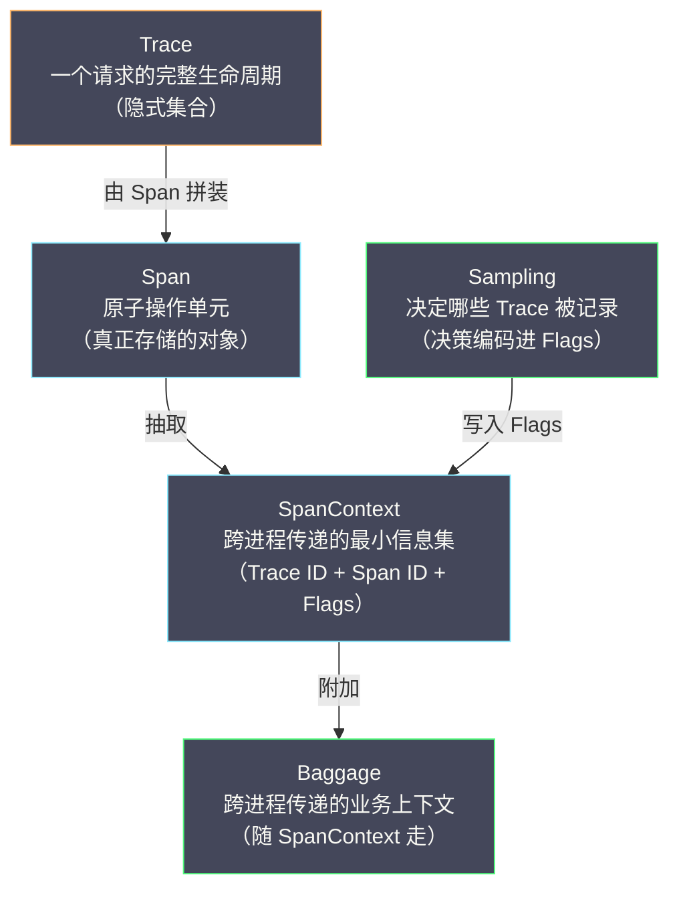

# 02 链路追踪核心概念

**摘要：**

上一篇从"为什么"的角度论证了链路追踪的必要性，这一篇进入"是什么"的精确定义。Trace、Span、SpanContext、Baggage、Sampling 这几个词，几乎每一份追踪文档都会出现，但它们的语义边界常常被含糊带过——Trace 到底是不是一个对象？Span Kind 为什么必须存在？Baggage 和 Span Attributes 究竟差在哪？为什么采样决策必须与上下文一起传播？本文以 OpenTelemetry 的数据模型为基准，同时对照 SkyWalking 的 Segment 模型与 Zipkin 的注解模型，把这些概念逐一拆开，讲清它们"为什么这样设计"以及"不这样设计会怎样"。读完之后，你应当能回答两个问题：**这几个概念之间是什么关系；以及为什么理解数据模型，是理解一切追踪实现的前提**。

---

## 第 1 章 从"一个请求"说起：Trace 到底是什么

### 1.1 Trace 不是对象，而是隐式集合

**Trace（追踪）** 是追踪系统中的顶层概念，它代表一个**端到端的请求**在分布式系统中的完整执行路径。

但这里有一个关键的、常被误解的细节：**Trace 并不是一个被显式创建和传递的对象**。形式化地说，一个 Trace 是一组**有因果关系的 Span 的集合**，通过一个全局唯一的 Trace ID 关联在一起。系统存储的最小单元是 Span，而"Trace"是查询时**按 Trace ID 聚合所有相关 Span、再按父子关系重建出的调用树**。

这个"隐式"的特性，带来两个必须理解的后果。

**其一，链路会因缺失而断裂。** 如果调用链中某个服务没有上报 Span（未接入追踪），这棵调用树就会出现断口——某个子 Span 找不到父 Span，在界面上显示为孤立节点。断裂不是"数据错了"，而是"数据本来就不全"。

**其二，链路会因延迟而不完整。** Span 是异步上报的，不同服务的上报时间不一致。如果你在一个 Trace 刚产生几毫秒后就去查询，很可能只看到半棵树——后到的 Span 还没落库。**理解"Trace 是拼出来的"这一点，是理解追踪系统一切"数据看起来不对"现象的基础**。

### 1.2 Trace ID 的设计

**Trace ID** 是关联同一个请求所有 Span 的全局唯一标识。不同系统的格式并不统一：

| 系统 | Trace ID 格式 | 长度 | 示例 |
|---|---|---|---|
| OpenTelemetry / W3C | 32 位十六进制字符串 | 128 bit | `4bf92f3577b34da6a3ce929d0e0e4736` |
| Zipkin（旧版） | 16 位十六进制字符串 | 64 bit | `463ac35c9f6413ad` |
| Zipkin（新版） | 32 位十六进制字符串 | 128 bit | 与 OTel 格式兼容 |
| SkyWalking | 自定义格式（含服务实例信息） | 变长 | `uuid.thread_id.timestamp` |

### 1.3 为什么是 128 bit 而不是 64 bit

这个问题值得单独算一笔账，因为它解释了"标准为什么统一到 128 bit"。

64 bit 的 ID 在大规模系统里存在碰撞风险。根据生日悖论（Birthday Paradox），当随机生成的 ID 数量达到 `2^32` 量级时，出现重复的概率就逼近 50%。假设一个系统每秒生成 100 万个 Trace ID，那么大约 43 亿个 ID、也就是约 72 分钟后，碰撞概率就过半。对于需要长期保留数据、并在事后按 Trace ID 检索的系统来说，这个风险不可接受。

128 bit 把这个"危险点"推到了天文数字量级——即使每秒生成十亿个 ID，也需要成千上万年才可能碰撞。**代价只是多了 16 个字节的存储与传输**，这笔交易在任何实际系统里都划算。于是 128 bit 成了 W3C 标准的选择，Zipkin 也从 64 bit 迁移到了 128 bit。

### 1.4 SkyWalking 的 Trace ID：把上下文编进 ID

SkyWalking 的 Trace ID 设计比较特殊——它不是纯随机数，而是**把服务实例 ID、线程 ID、时间戳等信息编进了 ID**。这样做的动机很直接：**让 Trace ID 本身携带一部分上下文**。

它的好处是在没有后端查询界面时，光看一个 Trace ID 就能判断"这是哪个实例、哪个线程、大概什么时候产生的"，调试时更友好。代价是 ID 变长、格式不固定，与 W3C 标准不兼容——SkyWalking 通过一个额外的兼容层来解决这个问题，把内部的 Trace ID 映射到符合 W3C 格式的外部表示。

这个取舍本身很典型：**SkyWalking 优先考虑了"自洽与信息量"，而 W3C 优先考虑了"互操作"**。两者没有对错，只是服务的目标不同——一个服务于自家平台内的体验，一个服务于跨厂商的互通。

### 1.5 Trace 的生命周期：从创建到落库

把 Trace 的生命周期走一遍，能串起后面所有的概念。

**第一步，入口创建。** 请求到达第一个服务（通常是网关），Agent 生成一个全局唯一的 Trace ID，并创建一个 Root Span。此时采样决策也一并做出，结果写进 SpanContext 的 Flags 里。

**第二步，上下文传播。** 服务在处理过程中调用下游时，把 SpanContext 注入出站请求的 Header。下游服务收到后提取上下文，以"父 Span"的身份创建自己的 Span，如此逐跳传递。

**第三步，异步上报。** 每个服务在 Span 结束时，把数据写进本地缓冲区，由后台线程批量上报到后端。上报是异步的，不阻塞业务请求。

**第四步，后端聚合。** 后端收到来自各服务的 Span 后，按 Trace ID 分组、按 Parent ID 重建调用树，再按查询请求返回。

走完这四步，一条 Trace 才算"完整可用"。理解这个生命周期，就能理解为什么查询结果可能不完整——**它可能是断链（第二步漏了）、可能是不全（第三步还没到）、也可能是采样丢弃（第一步就没采）**。这三种"不完整"的成因与修复方式完全不同，混淆它们，排查就会南辕北辙。

### 1.6 Trace ID 与 Request ID：一对容易混淆的标识

工程实践里，很多团队其实早就在日志里打了一个"请求 ID"（Request ID）。它和 Trace ID 是什么关系？值得单独厘清，因为混淆二者是常见误区。

**Request ID 是应用自定义的请求标识**，通常由入口服务生成、写进日志，用于"把同一次请求在同一个服务里的多条日志串起来"。它没有统一格式，没有配套的传播机制，也没有配套的数据模型——它就是一个日志字段。

**Trace ID 是跨服务的标准标识**，有固定的 128 bit 格式，有 W3C 定义的传播机制（`traceparent`），有完整的 Span 数据模型与之配套。它不仅能串起日志，还能还原整棵调用树、分解耗时、发现拓扑。

二者的差别，本质是"**一个字段**"与"**一整套机制**"的差别。有些团队误以为"我们已经有 Request ID 了，就等于有追踪了"，于是在排查跨服务问题时屡屡碰壁——因为 Request ID 不会自动跨服务传播，下游拿不到它，链路自然拼不起来。

一个务实的演进路径是：**把 Request ID 升级为 Trace ID**——即引入真正的追踪上下文，让原有的日志字段改为写入 Trace ID。这样既不浪费既有的日志设施，又能平滑地获得跨服务关联的能力。**标识的价值不在它叫什么名字，而在它是否有一套机制支撑它跨服务流动**。

---

## 第 2 章 Span：原子单元的精确定义

### 2.1 Span 是什么

**Span（跨度）** 是追踪系统中的原子数据单元，代表一个**有名字、有时间范围的操作**。一个 Span 通常对应以下操作之一：一次 HTTP 请求的处理、一次 RPC 调用、一次数据库查询、一次消息队列的发送或消费，或者一段有意义的业务逻辑。

关键词是"有名字、有时间范围"。前者让 Span 可被检索（"所有名字为 `GET /api/orders` 的 Span"），后者让 Span 可被分解（"这一段花了 200ms"）。**没有名字，Span 就无法定位；没有时间范围，Span 就无法度量**——这两者合起来，才构成了追踪回答"哪里慢"的能力。

### 2.2 Span 的核心字段

以 OpenTelemetry 的数据模型为基准，一个 Span 的必需字段如下：

| 字段 | 类型 | 说明 |
|---|---|---|
| Trace ID | 128-bit | 所属 Trace 的唯一标识 |
| Span ID | 64-bit | 本 Span 的唯一标识 |
| Parent Span ID | 64-bit（可选） | 父 Span 的 ID，根 Span 为空 |
| Operation Name | string | 操作名，如 `GET /api/orders`、`MySQL SELECT` |
| Start Timestamp | uint64（微秒） | 操作开始的绝对时间 |
| Duration | uint64（微秒） | 操作持续时间 |
| Span Kind | enum | Span 类型（见 2.3） |
| Status | enum + string | 结果状态（OK / Error + 错误信息） |

可选字段则承载更丰富的上下文：

| 字段 | 类型 | 说明 |
|---|---|---|
| Attributes | key-value map | 标签/属性（如 `http.method=GET`、`db.system=mysql`） |
| Events | timestamped list | 时间线事件（如异常发生、重试发生的时刻） |
| Links | list of SpanContext | 指向其他 Trace/Span 的引用（批处理场景） |

这个字段划分里有一条隐含的设计线索：**必需字段都是"结构性"的（ID、时间、类型、状态），可选字段都是"描述性"的（属性、事件、链接）**。结构性字段让调用树能被拼装、被度量；描述性字段让问题能被追溯、被解释。追踪系统在后端存储时，通常也会对这两类字段区别对待——结构性字段进索引，描述性字段进压缩存储。

### 2.3 Span Kind：为什么必须区分类型

**Span Kind（Span 类型）** 是一个容易被忽视却极其重要的字段，它描述当前 Span 在调用关系中的"角色"：

| Span Kind | 含义 | 示例 |
|---|---|---|
| CLIENT | 发起远程调用的一方 | 订单服务调用支付服务的 HTTP Client |
| SERVER | 接收远程调用的一方 | 支付服务接收 HTTP 请求的 Handler |
| PRODUCER | 异步消息的发送方 | 向 Kafka Topic 发送消息 |
| CONSUMER | 异步消息的消费方 | 从 Kafka Topic 消费消息 |
| INTERNAL | 进程内部的操作 | 本地业务逻辑处理、内存计算 |

**为什么必须区分？** 因为一次 RPC 调用里，调用方与被调用方**各自创建一个 Span**，一共两个。如果不区分 Kind，调用树里就会出现两个看起来一模一样的 Span（都叫 `GET /api/payment`），既分不清谁调用谁，也无法正确算出网络延迟：

```text
时间线：
CLIENT Span:  |-------- 网络 -------->|---- 等待服务端处理 ----|<-- 网络 --|
                                      |                      |
SERVER Span:                          |--- 服务端处理 --------|

CLIENT duration = 网络 RTT + 服务端处理时间
SERVER duration = 服务端处理时间
网络延迟 ≈ CLIENT duration - SERVER duration
```

这张时间线揭示了一个优雅的性质：**CLIENT 与 SERVER 的 duration 之差，恰好是网络往返时间**。这是追踪能"把延迟拆成网络与服务两部分"的数学基础。如果两个 Span 不区分 Kind，这个差值就无从计算。

对消息队列场景，区分 PRODUCER 与 CONSUMER 就更必要了——两者之间可能有**分钟到小时级别**的延迟（消息在队列里等待被消费），这与同步 RPC 的毫秒级延迟完全不同。若把消息队列也按同步 RPC 处理，追踪给出的"调用耗时"会荒谬地巨大，完全失去意义。

### 2.4 Attributes：结构化的上下文

**Attributes（属性）** 是附加在 Span 上的键值对，用于提供操作的上下文。OpenTelemetry 定义了一套**语义约定（Semantic Conventions）**，把常见操作的属性名标准化：

**HTTP 相关**：`http.method`（GET/POST）、`http.url`（完整 URL）、`http.status_code`（响应码）、`http.request_content_length`（请求体大小）。

**数据库相关**：`db.system`（mysql/redis/postgresql）、`db.statement`（SQL 语句，需脱敏）、`db.operation`（SELECT/INSERT/UPDATE）。

**消息队列相关**：`messaging.system`（kafka/rabbitmq/rocketmq）、`messaging.destination`（Topic 或 Queue 名）、`messaging.operation`（publish/receive）。

语义约定的价值在于**让不同团队、不同语言采集的数据"长得一样"**——只有这样，跨团队的查询、聚合与看板才能复用。没有约定，每个团队都自定义属性名，追踪数据就会退化成"各说各话"。

> [!warning] 生产避坑：Attribute 的大小控制
> Attributes 是 Span 中数据量最大的部分。若不加控制地把完整 SQL、完整请求体放进 Attributes，单个 Span 可能达到几十 KB，乘以海量请求后，存储与传输压力会急剧放大。实践中的做法是：SQL 语句截断到 500 字符以内；请求体只记录摘要或 hash，不记录完整内容；对敏感信息（密码、Token、身份证号）做脱敏。**属性是给"排查"用的，不是给"备份"用的**——把整个请求体塞进 Span，既昂贵又危险。

### 2.5 Events：Span 内部的时间线

**Events（事件）** 是附加在 Span 上的**带时间戳的记录**，用于标注 Span 执行过程中的关键时刻。最典型的是**异常事件**：当 Span 内部发生异常时，把异常信息作为 Event 记下来：

```text
Span: "POST /api/orders"（Duration: 500ms, Status: Error）
├── Event: "exception" at T+200ms
│   ├── exception.type: "java.sql.SQLTimeoutException"
│   ├── exception.message: "Query timed out after 200ms"
│   └── exception.stacktrace: "at com.mysql.jdbc.MysqlIO..."
└── Event: "retry" at T+300ms
    └── message: "Retrying database query, attempt 2"
```

Events 与 Attributes 的区别在于时间维度：**Attributes 是 Span 整体的属性（贯穿整个生命周期），Events 是某个时刻发生的事**。前者回答"这个操作是什么"，后者回答"这个操作过程中发生了什么"。比如"重试了两次"这件事，用 Attributes 只能表达"重试次数=2"，用 Events 才能表达"第一次重试发生在 T+300ms、第二次在 T+600ms"——后者对排查"重试是不是拖慢了请求"至关重要。

### 2.6 Links：跨 Trace 的关联

**Links（链接）** 是一个少用但重要的概念：它允许一个 Span 引用**其他 Trace 中的 Span**，建立跨 Trace 的因果关系。

最典型的场景是**批处理**。假设一个批处理任务一次性处理 1000 条消息，每条消息对应一个独立的 Trace（由各自的生产者创建）。批处理任务本身会创建一个新 Trace，但它需要引用这 1000 条消息各自的 Trace ID，以便事后追溯"这条消息是被哪个批处理任务处理的"。

这种情况下，父子关系不适用——难道要给 1000 个 Span 都当父 Span？Links 才是正确的语义：

```text
批处理 Trace (Trace ID = batch-001):
└── Span: "BatchProcess 1000 messages"
    ├── Link → Trace msg-001, Span producer-001
    ├── Link → Trace msg-002, Span producer-002
    ├── ...
    └── Link → Trace msg-1000, Span producer-1000
```

Links 的存在说明了一个事实：**调用关系不只有"树"这一种形态**。同步调用是树，批处理是"多对一"的汇聚，而 Links 正是为这种非树形的因果提供了表达方式。理解了这一点，就能理解为什么 OTel 的数据模型里，Parent 和 Link 是并存的两套关联机制。

### 2.7 时钟偏移：追踪绕不开的精度问题

Span 记录了开始与结束的**绝对时间**，但这里埋着一个分布式系统的老问题：**不同机器的时钟并不完全同步**。

NTP 同步通常有毫秒级的误差，虚拟化环境下误差可能更大。这意味着：如果服务 A 与服务 B 的时钟差了 50ms，那么把两者的 Span 按绝对时间叠在一张图上，就可能出现"子 Span 看起来比父 Span 还早开始"的荒谬现象。

追踪系统应对这个问题有两条思路。**其一是用相对时间而非绝对时间做分解**：CLIENT 与 SERVER 的 duration 差值（网络延迟）只依赖各自的计时器，不依赖两台机器的时钟对齐，因此可靠。**其二是用父子关系而非绝对时间来重建树**：调用树的层级由 Parent ID 决定，不由时间戳决定，因此即使时钟有偏差，树的结构依然正确。

这条约束给使用者也提了个醒：**当你用追踪界面上的"时间瀑布"做判断时，跨服务的绝对对齐要打折扣**，但"某一跳自身的耗时"是可信的。理解了这一点，就不会被"看起来时间对不上"的假象误导。**追踪的精度优势在"分解"，而不在"对齐"**。

### 2.8 Span 命名与语义约定

Span 的 Operation Name 是它被检索的第一入口，因此命名不是"随便起个名字"的小事，而是"能不能用好追踪"的前提。

好的命名有两个特征：**稳定**与**可聚合**。稳定意味着同一个操作的 Span 名字不随时间、不随请求变化；可聚合意味着同类操作的 Span 能按名字归到一起统计。OpenTelemetry 的语义约定给出了模板：HTTP 用 `METHOD /path`（如 `GET /api/orders`），数据库用 `SELECT table`，消息队列用 `Topic 名 + 操作`。

一个必须避开的反模式是**把高基数的值放进 Span 名**。比如把订单号写进名字——`GET /api/orders/12345`、`GET /api/orders/12346`……这样每一个请求都会产生一个"独一无二"的 Span 名，后续既无法按名字聚合，也无法从名字看出规律，索引还会因此膨胀。**正确的做法是把订单号放进 Attributes，把名字留给"可枚举的模式"**。

这条约定与日志、指标领域的经验是一致的：**任何用于聚合的维度，都必须是低基数的**。Span 名本质上就是一种"用于聚合的维度"，因此它必须低基数。理解了这一点，命名就从"风格问题"变成了"数据模型问题"。

---

## 第 3 章 SpanContext 与上下文传播

### 3.1 SpanContext：跨进程传递的最小信息集

**SpanContext（Span 上下文）** 是 Span 中需要跨进程传递的**最小信息子集**。它不含 Span 的全部信息（Attributes、Events 等），只含下游创建子 Span 所需的最小信息：

| 字段 | 说明 |
|---|---|
| Trace ID | 当前 Trace 的全局唯一 ID |
| Span ID | 当前 Span 的 ID（下游用它作为 Parent Span ID） |
| Trace Flags | 追踪标志位（最重要的是 `sampled`，表示此 Trace 是否被采样） |
| Trace State | 厂商特定的扩展信息（如 SkyWalking 的服务实例信息） |

为什么只传这个子集，而不传整个 Span？因为跨进程传递的载体（HTTP Header、gRPC Metadata）带宽有限。一个完整 Span 可能有几百字节到几 KB 的 Attributes 与 Events，若每个请求都携带这么多额外数据，网络与解析开销都不可接受。**SpanContext 通常只有几十字节**——这个"最小化"是"低开销"原则在传播层的又一次体现。

### 3.2 W3C Trace Context 标准

**W3C Trace Context** 是当前跨进程传播的标准格式（2020 年成为 W3C 推荐标准），它定义了两个 HTTP Header。

**`traceparent`**（必需）承载核心追踪信息：

```text
traceparent: 00-4bf92f3577b34da6a3ce929d0e0e4736-00f067aa0ba902b7-01
             ──  ────────────────────────────────  ────────────────  ──
             版本     Trace ID (32 hex)              Span ID (16 hex)  Flags
                                                                        01 = sampled
                                                                        00 = not sampled
```

**`tracestate`**（可选）携带厂商特定信息：

```text
tracestate: sw=abc123,rojo=00f067aa0ba902b7
```

`tracestate` 是一个键值对列表，允许不同的追踪系统在同一条链路里共存——每个系统只读写自己的键、忽略别人的键。这个设计很巧妙：**它让"标准统一"与"厂商扩展"不必二选一**，标准管通用的部分，扩展留给各家，互不干扰。

### 3.3 进程内传播：ThreadLocal 与 Context

跨进程传播解决了"服务 A 到服务 B"的问题，但在单个服务内部，还需要在函数调用之间传递当前 SpanContext——否则每个函数创建 Span 时都不知道自己的父 Span 是谁。

Java 生态最传统的进程内传播机制是 **ThreadLocal**：

```java
// 伪代码：SkyWalking Agent 内部的 Context 管理
public class ContextManager {
    // 每个线程有自己的 Trace Context
    private static final ThreadLocal<TraceContext> CONTEXT = new ThreadLocal<>();

    public static Span createEntrySpan(String operationName) {
        TraceContext context = CONTEXT.get();
        if (context == null) {
            // 新 Trace 的入口：创建 Root Span
            context = new TraceContext(generateTraceId());
            CONTEXT.set(context);
        }
        Span span = new Span(operationName, context.currentSpanId());
        context.push(span);  // 将新 Span 压入栈顶
        return span;
    }

    public static void stopSpan(Span span) {
        TraceContext context = CONTEXT.get();
        context.pop(span);  // 弹出栈顶 Span
        if (context.isEmpty()) {
            // 所有 Span 都已结束，整个 Trace 完成
            context.finish();  // 异步上报
            CONTEXT.remove();  // 清理 ThreadLocal
        }
    }
}
```

这段伪代码里有一个值得注意的设计：**当前上下文被组织成一个栈**。进入一个方法就压栈、离开就弹栈，栈顶始终是"当前正在执行的 Span"。这正好对应了程序的调用栈结构——**追踪的父子关系，本质上就是程序调用栈在时间维度上的投影**。

### 3.4 跨线程传播：ThreadLocal 的失效与三种解法

ThreadLocal 有一个致命局限：**它只在当前线程内有效**。一旦业务代码用了异步编程（线程池、CompletableFuture、Reactor/WebFlux），新线程无法访问原线程的 ThreadLocal，上下文随之丢失，链路"断裂"。

这是追踪落地中最常见的坑，解法有三种。

**其一是手动传递**：在提交异步任务时，手动把 SpanContext 从当前线程复制到新线程。侵入性大，容易遗漏，但控制最精细。

**其二是线程池包装**：用自定义的 `TracedExecutorService` 包装原始线程池，在提交任务时捕获上下文、在执行任务时恢复上下文。SkyWalking 的 `@TraceCrossThread` 注解就是这种方式——它让"跨线程传递"变成一件显式、可审计的事。

**其三是字节码增强**：SkyWalking Agent 自动增强 `Runnable`、`Callable`、`CompletableFuture` 等异步入口类，在任务提交时捕获上下文、执行时恢复，对业务代码完全透明。第 05 篇会展开它的实现。

这三种解法对应了"侵入性"与"覆盖面"的不同权衡：**手动传递覆盖面窄但可控，字节码增强覆盖面广但依赖框架适配**。理解了这层权衡，就能理解为什么"零侵入"在异步场景里格外困难——异步边界是千变万化的，没有任何一种增强能覆盖全部。

### 3.5 Go 的 context.Context：另一种范式

Go 语言走了一条不同的路。它天然通过 `context.Context` 参数传递上下文（社区约定 Context 作为函数第一个参数），追踪的 SpanContext 直接嵌进 `context.Context`，从根本上绕开了 ThreadLocal 的跨线程问题：

```go
// Go 中的 Context 传播：天然支持跨 goroutine
func handleRequest(ctx context.Context, req *Request) {
    // 从 ctx 中提取当前 Span
    span, ctx := tracer.Start(ctx, "handleRequest")
    defer span.End()

    // 启动新的 goroutine 时传递 ctx
    go processAsync(ctx, req.Data)  // ctx 天然跨 goroutine 传播
}
```

**这是两种语言范式的差异，而非优劣**。Java 的 ThreadLocal 是"隐式"的——上下文藏在每个线程里，代码不用显式传递，但也因此容易在跨线程时丢失。Go 的 context 是"显式"的——上下文必须作为参数一路传下去，啰嗦，但不会丢。**隐式带来便利也带来陷阱，显式带来负担也带来可靠**，这条张力在可观测性领域反复出现。

### 3.6 传播的失败模式与排查

上下文传播既然是链路完整性的命脉，就值得把它的失败模式列清楚。实践中常见的失败有四类。

**其一是漏传**：最常见，尤其在异步边界（线程池、消息队列、定时任务）上——下游拿不到上下文，于是"自立门户"开一条新 Trace。表现是"链路断成两截，且两截的 Trace ID 完全不同"。

**其二是格式不兼容**：上游用 B3、下游只认 W3C，或反过来。表现是"上游明明注入了 Header，下游却读不到"。这类问题多发于"渐进迁移"阶段，解法是配置多格式传播器。

**其三是被覆盖**：某些中间件、代理或 SDK 在处理请求时重写了同名 Header，把上游的上下文冲掉了。这类问题最隐蔽，因为 Header 明明存在，值却是错的。

**其四是采样标志不一致**：上游标记"已采样"，下游却按自己的策略重新决策，导致同一条 Trace 部分有数据、部分没有。

排查这四类问题的共同手法是：**先看下游是否生成了独立于上游的 Trace ID**。若是，基本可以锁定"漏传"；若不是，再逐一检查 Header 的值与格式。**把失败模式列清楚，排查就从"猜"变成了"查"**。

### 3.7 传播的载体：不止 HTTP Header

前面几节用 HTTP Header 举例，但上下文的传播载体远不止这一种。不同协议各有自己的"搭车"位置：

**同步 HTTP/REST**：走 HTTP Header，即 `traceparent` 等。这是最标准、最成熟的一种。

**gRPC**：走 Metadata（本质是键值对，随 RPC 帧传输）。

**消息队列**：走消息的 Header 或属性（如 Kafka 的 record headers）。**这是最容易被遗漏的一种**——因为消息是异步的，生产端与消费端的上下文传递不会像 HTTP 那样"自动"发生，往往需要显式注入。

**数据库调用**：某些实现会把 Trace ID 以 SQL 注释的形式注入语句（如 `/* traceparent=... */`），以便数据库侧的慢查询日志能与链路关联。这个技巧对"从慢 SQL 反查是哪个请求"特别有用。

**自有 RPC 框架**：走框架的 Attachment 或 Context 字段。

这张清单说明了一件事：**"支持上下文传播"不是一个开关，而是一份"框架适配清单"**。一个追踪系统宣称"支持某某协议"，背后是逐个协议的适配工作；而链路之所以会断，往往就断在"某个协议还没被适配"上。理解了这一点，就能理解为什么"追踪覆盖率"是一个需要持续经营、而非一次配置到位的指标。

### 3.8 一个完整的传播示例

把上面的概念串成一个具体的走查，会更容易建立直觉。假设请求从网关出发，经订单服务，最终查询数据库：

```text
① 网关收到请求，创建 Root Span
   Trace ID = 4bf9...，Span ID = aaaa
   本地 ThreadLocal 保存 {trace: 4bf9..., span: aaaa}

② 网关调用订单服务，注入 Header
   traceparent: 00-4bf9...-aaaa-01

③ 订单服务收到请求，提取上下文，创建子 Span
   Trace ID = 4bf9...（沿用）
   Parent Span ID = aaaa
   Span ID = bbbb
   本地 ThreadLocal 保存 {trace: 4bf9..., span: bbbb}

④ 订单服务查数据库，注入 SQL 注释（若适配）
   /* traceparent=00-4bf9...-bbbb-01 */ SELECT * FROM orders WHERE ...

⑤ 订单服务返回，Span 结束，异步上报
   网关的 Span 也随之结束，异步上报

⑥ 后端按 Trace ID 4bf9... 聚合 aaaa、bbbb 等 Span
   按 Parent ID 重建调用树，得到完整链路
```

这个走查里，每一步都对应前面讲过的一个概念：①是 Trace 的创建与采样决策，②是 SpanContext 的注入，③是上下文的提取与子 Span 创建，④是"非 HTTP 载体"的传播，⑤是异步上报，⑥是按 ID 聚合。**把一条 Trace 走一遍，比记住十条定义更有用**——因为所有概念最终都要落到这条路径上。

走查里还藏着一个容易忽略的细节：**网关与订单服务各自维护自己的本地上下文**。Trace ID 是共享的，但"当前 Span"是各自独立的——这正是 SpanContext 只传"Trace ID + 父 Span ID"、而不传整个上下文栈的原因。**共享的是身份，独立的是状态**。

---

## 第 4 章 Baggage：跨服务的业务上下文

### 4.1 什么是 Baggage

**Baggage（行李）** 是附加在 SpanContext 上的**键值对集合**。它与 Span Attributes 有一个根本区别：**Baggage 会随 SpanContext 一起跨进程传播到所有下游服务**，而 Attributes 只属于当前 Span。

为什么需要 Baggage？看这个场景：

```text
API 网关知道当前请求的用户 ID = "user-123" 和用户等级 = "VIP"
调用链：API Gateway → Order Service → Inventory Service → Warehouse Service

如果没有 Baggage：
  Order Service 知道 user-123（从请求参数中获取）
  Inventory Service 不知道 user-123（Order Service 没传给它）
  Warehouse Service 也不知道 user-123

如果有 Baggage：
  API Gateway 把 {user_id: "user-123", user_tier: "VIP"} 放进 Baggage
  Baggage 随 SpanContext 自动传播到所有下游服务
  每个服务都能读到 user_id 与 user_tier，用于日志、权限判断或个性化
```

Baggage 的价值在于：**它让"入口才知道的信息"在整个调用链上可用**。用户身份、租户 ID、A/B 分组标志、请求来源——这些信息在入口处天然可得，却常常在下游被丢失，而 Baggage 恰好补上了这条传播路径。

### 4.2 代价与使用原则

Baggage 很强大，但代价也明显。

**带宽开销**：Baggage 的每个键值对都会被序列化进 HTTP Header，每次跨服务调用都携带。如果放了大对象（如完整用户画像 JSON），网络开销会显著增加。

**安全风险**：Baggage 里的数据可以被链路上任何服务读取和修改。**把密码、Token 放进 Baggage，等于把它们广播给了整条链路**。

> [!warning] Baggage 使用原则
> - 只放**小量**、**非敏感**的数据（如用户 ID、请求来源、A/B 测试分组标志）
> - 单个键值对不超过 256 字节
> - 总 Baggage 大小不超过 8KB
> - 不要把它当成"隐式参数传递"的通道——业务参数应通过显式 API 参数传递

### 4.3 Baggage、Attributes 与业务参数的三方区别

这三者容易混淆，值得用一张表厘清：

| 维度 | Baggage | Span Attributes | 业务参数 |
|---|---|---|---|
| 作用域 | 整条调用链（跨进程传播） | 单个 Span | 单次调用 |
| 是否传播 | 是，随 SpanContext | 否 | 由调用方显式传递 |
| 典型内容 | 用户 ID、租户、分组标志 | HTTP 状态码、SQL 摘要 | 订单号、金额 |
| 谁该读 | 链路各环节的观测逻辑 | 观测/查询 | 业务逻辑 |

关键判断是"**给谁看**"：**给观测逻辑看、且需要跨环节共享的，放 Baggage；只属于当前操作的，放 Attributes；业务逻辑真正需要的，走业务参数**。把业务参数塞进 Baggage 是一种常见的反模式——它看似省事，实则把"接口契约"藏进了"观测元数据"里，一旦追踪关闭，业务逻辑就会莫名其妙地失败。

### 4.4 Baggage 的工程实践

真要把 Baggage 用好，还有几条工程约定值得落地。

**其一是命名约定**。Baggage 的键会被整条链路读到，若各团队各起各的名字（`uid`、`user_id`、`userId` 混用），下游就难以统一处理。团队应当约定一份"允许进 Baggage 的键清单"，并把它当作接口契约来维护。

**其二是大小限制**。除了单个键值对与总量的限制，还应当在采集入口做校验——发现超限的 Baggage 就拒绝或截断，避免它悄悄拖慢每一次跨服务调用。

**其三是边界清理**。Baggage 在离开你的系统、进入第三方服务（如外部支付网关）前，应当被剥离——**把内部身份信息广播给外部服务，既是安全风险，也是隐私合规的隐患**。许多 SDK 支持"按目标域决定是否注入 Baggage"，这条配置值得认真对待。

**其四是与隐私合规挂钩**。用户 ID、租户 ID 这类信息虽然"非敏感"，但仍可能构成个人数据。在受监管的行业里，"什么信息可以随链路传播"本身就是一个需要法务与安全共同确认的问题。**Baggage 是观测基础设施，但它承载的是数据，因此逃不开数据治理**。

---

## 第 5 章 采样：完整性与开销的权衡

### 5.1 为什么采样是必须的

先算一笔账。一个中等规模的微服务系统，假设每秒处理 10,000 个请求，每个请求产生 20 个 Span，每个 Span 平均 500 字节：

```text
数据量 = 10,000 req/s × 20 spans/req × 500 bytes/span
       = 100 MB/s
       = 8.6 TB/day
```

每天 8.6 TB 的链路数据，存储成本与查询性能都是巨大挑战。采样——只记录一部分请求的链路——因此不是"可选项"，而是"必需品"。这也回到了第 01 篇讲过的 Dapper 原则：**低开销是靠采样兑现的**。

### 5.2 头部采样

**头部采样（Head-based Sampling）** 在请求入口（Root Span 创建时）就决定是否采样。决策被编码进 SpanContext 的 Trace Flags，随上下文传播到整条链路——要么整条 Trace 全记录，要么全不记录。

优点是实现简单，且决策天然一致（不会出现"半条链路"）。缺点是**在入口处无法预知这个请求后续会不会出错或变慢**——它可能恰好跳过一个事后看来最重要的错误请求。

常见的头部采样方式有两种：**固定概率采样**（每个请求以固定概率，如 1%，被采样）与**速率限制采样**（每秒最多采样 N 条 Trace，如 100 条/秒）。前者实现最简单，但采样量随流量线性增长；后者能把采样量钉在一个绝对上限，更适合"控制成本"的诉求。

### 5.3 尾部采样

**尾部采样（Tail-based Sampling）** 先把所有 Span 完整收集（暂存在内存或临时存储），等整条 Trace 完成后，再根据 Trace 的**完整信息**（是否含错误 Span、总耗时是否超阈值）做采样决策。

优点是**可以 100% 保留异常与慢请求**——而这恰恰是最需要分析的。缺点有三：实现复杂（要等所有 Span 到齐，而分布式系统里各服务的上报时间并不一致）、资源开销大（所有 Span 必须先收集再决定丢弃）、需要集中式的采样决策组件（如 OTel Collector 的 Tail Sampling Processor）。

头部与尾部的取舍，可以用一句话概括：**头部采样是"在信息最少时做决定"，尾部采样是"在信息最全时做决定"**。前者便宜但可能错过关键样本，后者精准但昂贵且复杂。实践中常见的组合是"头部粗采 + 尾部精筛"——先用头部采样把总量压下来，再用尾部采样把关键链路捞回来。

### 5.4 自适应采样

**自适应采样（Adaptive Sampling）** 根据实时流量与系统负载动态调整采样率：高流量时降低采样率（保护系统），低流量时提高采样率（保留更多信息）。

Jaeger 的自适应采样是一个典型实现：Collector 根据每个服务、每个接口的 QPS 动态计算采样率，确保每个接口每秒至少有 N 条被采样的 Trace。这样即使是低频接口（QPS=1），也能被相对完整地记录——**因为低频接口恰恰是"出问题时样本最少"的地方，值得多留一些**。自适应采样的思想，本质上是在"全局固定比例"与"按需动态分配"之间取了后者。

### 5.5 SkyWalking 的采样机制

SkyWalking 的采样在 Agent 端实现（属于头部采样），配置示例如下：

```properties
# agent.config
# 采样率：每 3 条 Trace 采样 1 条（约 33%）
agent.sample_n_per_3_secs=-1    # -1 表示全量采样
agent.sample_n_per_3_secs=100   # 每 3 秒最多采样 100 条 Trace
```

SkyWalking 采样有一个重要特性：**采样决策只影响数据上报，不影响上下文传播**。即使一个 Trace 没被采样（不上报 Span），它的 Trace ID 与 SpanContext 仍会传播到下游——下游可能有自己的采样策略，可能选择记录这个 Trace。

这一点常被误解，值得强调：**采样与传播是两件事**。采样决定"这条 Span 要不要存下来"，传播决定"下游能不能知道自己在哪条链路上"。把它们混为一谈，就会得出"不采样就不传上下文"的错误结论——而这恰恰会制造出大量断链。

### 5.6 一致性采样

无论用哪种策略，都有一条铁律：**采样决策必须在整条链路上保持一致**。若入口决定采、下游却决定不采，这棵树就会缺胳膊少腿。因此采样决策通常由入口做出、并通过上下文传播给下游，下游不再自行决策——这被称为**一致性采样（Consistent Sampling）**。

一致性采样的常见实现是"**基于 Trace ID 的确定性采样**"：把 Trace ID 做哈希，哈希值落在某个区间内就采。这样即使入口与下游各自独立计算，结果也一致，无需依赖传播——**用"确定性"代替"传播"，是一种很优雅的工程手法**。它的局限是无法实现尾部采样（因为决策必须在入口就定），因此在实际系统里，确定性采样常用于"头部采样"这一层。

### 5.7 采样率怎么定：一个量化框架

采样率定多少，是每个团队都会遇到的具体问题。与其拍脑袋，不如用两条互相约束的线来夹逼。

**第一条线是从"存储预算"倒推。** 已知每天产生的原始链路数据量（可用 5.1 的公式估算），再给出可接受的存储上限，就能算出需要丢弃多少——这个比例就是采样率的"上限"。

**第二条线是从"关键样本保留率"正推。** 你希望"错误请求被保留下来的比例"不低于多少？如果完全依赖固定比例采样，那么错误请求被保留的比例就等于采样率——一个 1% 的采样率意味着 99% 的错误请求看不到。若这个结果不可接受，就必须引入尾部采样或分级采样。

两条线夹出来的区间，就是采样率的合理范围。在区间内，还有一条实用的经验：**按服务、按接口分级采样**——核心链路（下单、支付）采样率高一些，边缘链路（推荐、埋点上报）低一些。**因为不同链路的价值密度天差地别，用同一个比例对待它们，本身就是一种浪费**。

这套框架的核心思想是：**采样率不是"技术参数"，而是"成本与完整性的显式交易"**。把它当成一个需要被记录、被评审、被定期回看的决策，而不是一个随手填的配置项，才算真正理解了采样。

### 5.8 采样对"统计正确性"的影响

采样还有一个容易被忽视的副作用：**它会影响"从追踪数据聚合出的统计结果"的准确性**。

如果采样是**均匀的**（每个请求以相同概率被采），那么从样本聚合出的指标在统计上是无偏的——采 1% 的请求，也能较准确地估计整体的 P99。但如果采样是**非均匀的**（比如尾部采样只保留慢请求、或分级采样对核心链路多采），那么聚合结果就会带上系统性偏差：你算出来的"平均延迟"会明显偏高，因为样本里慢请求被过度代表了。

因此有一条重要的使用原则：**采样后的追踪数据，适合用于"定位"，不适合用于"统计"**。想知道"整体 P99 是多少"，应当去看指标（它从全量数据聚合而来）；想知道"这次慢请求卡在哪"，才去看追踪。**把两者混用，就会得出似是而非的结论**——比如根据尾部采样后的数据得出"我们的平均延迟是 800ms"，而真实值可能是 200ms。

这条原则也解释了为什么 SkyWalking 这类 APM 平台会**从追踪数据里重新聚合出指标**：它用采样后的明细做定位，同时用聚合逻辑推导出统计量，两者服务于不同目的。**明细与聚合的分工，本质上是"个体"与"总体"的分工**，采样改变的是个体的可见性，却不该改变总体的统计口径。

---

## 第 6 章 不同系统的数据模型对比

### 6.1 SkyWalking 的 Segment 模型

SkyWalking 的数据模型与 OpenTelemetry 有一个重要差异：它引入了 **Segment（片段）** 这个中间概念。

在 SkyWalking 里，一个 Segment 代表**一个服务实例处理一个请求的所有 Span 的集合**。一个 Trace 由多个 Segment 组成（每个服务实例贡献一个）：



**为什么引入 Segment？** 因为它是 Agent 端的**上报单元**——一个 Segment 内的所有 Span 是在同一个服务实例、同一个线程里串行创建的，可以在本地完整组装后一次性上报。这比逐个 Span 上报高效得多：减少了网络请求数（一次上报一个 Segment，而不是 N 个 Span 对应 N 次请求），也保证了同一 Segment 内 Span 的完整性（要么全报，要么全不报）。

### 6.2 三种 Span 类型

SkyWalking 把 Span 分为三类（与 OTel 的 SpanKind 类似，但命名与组织方式不同）：

- **EntrySpan**：服务入口，对应 OTel 的 SERVER / CONSUMER。
- **ExitSpan**：服务出口，对应 OTel 的 CLIENT / PRODUCER。
- **LocalSpan**：进程内部操作，对应 OTel 的 INTERNAL。

这个划分的工程意义在于：**它把"跨进程边界"的操作（Entry/Exit）与"进程内部"的操作（Local）明确分开**，从而让"服务拓扑发现"变得直接——拓扑图只需要看 Entry/Exit Span，不必关心内部细节。

### 6.3 三套数据模型的对比

| 维度 | OpenTelemetry | SkyWalking | Zipkin |
|---|---|---|---|
| 最小单元 | Span | Span（隶属 Segment） | Span |
| 中间聚合 | 无 | Segment（服务实例粒度） | 无 |
| 上报单元 | 单个 Span 或 SpanBatch | Segment | Span |
| Span 类型 | SpanKind（5 种） | EntrySpan / ExitSpan / LocalSpan | cs/cr/sr/ss 注解 |
| ID 格式 | W3C 128-bit hex | 自定义变长格式 | 64/128-bit hex |
| 传播格式 | W3C traceparent | sw8 Header | B3 Header |

### 6.4 为什么模型会有差异

三套模型之所以不同，根源在于**它们服务的目标不同**。

OTel 的目标是"跨厂商互通"，因此它的模型力求通用、正交——SpanKind 细分到 5 种，是为了精确表达各种调用角色；不设 Segment，是为了让任何后端都能平等地消费。

SkyWalking 的目标是"端到端 APM"，因此它的模型服务于"高效上报 + 拓扑推导"——Segment 是上报效率的产物，Entry/Exit 的划分是拓扑发现的需要。

Zipkin 的目标是"简洁的追踪后端"，因此它沿用 Dapper 的注解模型（cs/cr/sr/ss），把"客户端发送、服务端接收、服务端发送、客户端接收"四个时刻显式记录，用最小的概念表达最核心的信息。

**理解了"目标决定模型"，就不会再问"哪个模型更对"**——它们各自回答了不同的问题。当你要在它们之间迁移时，真正要做的也不是"逐字段翻译"，而是先想清楚"你在新模型里想表达什么"。

### 6.5 跨模型迁移的实践

知道了模型有差异，下一个问题就是：从一套迁移到另一套，该怎么做？

最容易踩的坑是"**逐字段翻译**"——把 SkyWalking 的 EntrySpan 硬套成 SERVER、把 ExitSpan 硬套成 CLIENT，字段一一对应地搬。这种做法在简单场景下能跑通，却会丢失语义：SkyWalking 的 ExitSpan 既可能是同步调用（对应 CLIENT），也可能是异步消息发送（对应 PRODUCER），一一对应会把它压扁。

更稳妥的做法分三步。**第一步是先定语义**：把"这条数据在业务上意味着什么"想清楚，再决定它在新模型里对应什么，而不是看字段名。**第二步是用中间层做转换**：让 OTel Collector 承担"接收旧格式、输出新格式"的角色，业务侧不必改动，转换逻辑集中在一处、可测试、可回滚。**第三步是渐进迁移**：先迁一部分服务，用双跑（同时上报到新旧后端）对比数据一致性，确认无误后再扩大范围。

**迁移的本质不是"换格式"，而是"换一套理解数据的语言"**。语言换了，原来能表达的某些细微语义可能暂时表达不了——承认这一点、并为此留出过渡期，比强行追求"一步到位"要务实得多。

---

## 第 7 章 概念之间的关系：一张全景图

### 7.1 层次关系

把前面几章的概念串起来，它们其实构成一个从"宏观"到"微观"、从"存储"到"传播"的层次：



### 7.2 三个容易混淆的点

**其一，Trace 与 SpanContext 的区别**。Trace 是"整条链路"的抽象，SpanContext 是"传递一个身份"的载体。前者是查询的产物，后者是传播的工具。二者的联系是 Trace ID：它既是 Trace 的身份，也是 SpanContext 的核心字段。

**其二，采样与传播的关系**。采样决策写在 SpanContext 的 Flags 里，随上下文传播；但"是否上报"与"是否传播"是两回事（见 5.5）。

**其三，Attributes 与 Baggage 的关系**。两者都是键值对，但作用域不同——Attributes 属于单个 Span，Baggage 属于整条链路。判断标准还是那句：**"只给当前操作看"的放 Attributes，"整条链路都要看"的放 Baggage**。

### 7.3 如何向新人解释这套概念

概念讲得再细，如果团队里只有一两个人懂，价值依然有限。一个有效的传递方式是**用一个类比把整套概念串起来**。

把一次请求想象成一次快递运输：**Trace 是这一整趟运输的运单号**，贯穿从发件到签收的全过程；**Span 是途中的每一个中转站记录**，记录"几点到站、停留多久、下一站是谁"；**SpanContext 是贴在包裹上的那张小标签**，只写"运单号 + 上一站"，因为包裹要反复转运、标签不能太大；**Baggage 是随包裹一起走的附加说明**，比如"易碎""加急"，每一个中转站都能看到；**采样是抽检**，不是每个包裹都被开箱记录，但被记录的包裹能看到完整轨迹。

这个类比的每一环都对应一个真实约束：标签要小（带宽有限）、附加说明要少且不涉密（安全）、抽检要一致（同一条运单要么全程记录要么不记）。**用类比建立直觉，再用定义校准精确性**，是新成员最快上手的方式。真正危险的不是"用了类比"，而是"只有类比、没有定义"——那样遇到边界情况时，团队就无法用同一种语言讨论问题了。

---

## 第 8 章 边界与误区

### 8.1 Span 不是越细越好

一个常见的误区是"把 Span 打得到处都是，越细越好"。事实恰恰相反：**Span 数量直接决定了存储成本与查询开销**。如果每个函数都创建一个 Span，一个请求可能产生成百上千个 Span，数据量瞬间放大一个数量级，而其中大部分对定位问题毫无帮助。

正确的做法是"**在值得度量的边界上打 Span**"——一次跨进程调用、一次数据库查询、一段有明确业务含义的逻辑。判断标准是："如果这段慢，我会不会想知道？"如果答案是"不会"，那它就不值得一个 Span。

### 8.2 Baggage 不是隐式参数通道

前面已经强调过，这里再点一次，因为它是最危险的误区之一：**用 Baggage 传业务参数，会把接口契约藏进观测元数据**。一旦追踪被关闭、或某个中间服务没实现 Baggage 透传，业务逻辑就会莫名其妙地失败，而失败原因极难定位。**业务参数走业务参数，观测信息走 Baggage**，这条线必须划清。

### 8.3 "没采样就不传上下文"是错的

另一个常见误区，是把"采样"和"传播"混为一谈，认为"没被采样的 Trace 就不用传 Trace ID 了"。这是错的——正如 5.5 所述，**传播与采样是两件独立的事**。不传上下文会制造断链，而断链的代价（无法关联日志、无法做尾部采样、无法拼完整拓扑）往往比省下的那点带宽大得多。

### 8.4 概念是共识，不是教条

最后一点：这些概念（Trace、Span、SpanContext、Baggage、Sampling）之所以值得花一整篇来讲，不是因为它们复杂，而是因为它们**是跨团队沟通的共识语言**。当你说"给这个调用加个 Span"时，同事能准确理解你的意思；当你说"这个 Trace 没被采样"时，大家知道问题出在哪一层——**共识的价值，在协作的每一刻都在兑现**。

反过来，如果团队成员对这些概念的理解各不相同（比如有人以为 Trace 是个对象、有人以为采样等于不传播），那么排查时就会出现大量"鸡同鸭讲"的时间浪费。**把概念讲清楚，是团队级可观测性建设里最便宜、回报最高的一件事**。

### 8.5 一份概念自检清单

把本篇的要点收成一份清单，方便随时自查：

- **Trace**：它不是一个对象，而是按 Trace ID 聚合出的调用树；查询结果不完整时，先分清是断链、延迟还是采样。
- **Span**：不是越细越好，只在"值得度量的边界"上打；命名要稳定、低基数，不能把 ID 写进名字。
- **Span Kind**：区分调用角色，是计算网络延迟与处理异步调用的前提。
- **SpanContext**：跨进程传递的最小信息集，只有几十字节；它的最小化是低开销原则的体现。
- **Baggage**：跨服务的业务上下文，只放小量、非敏感的数据；绝不当隐式参数通道。
- **Sampling**：与传播是两件事；决策要在整条链路上一致；采样后的数据用于定位、不用于统计。

这份清单不是要你背下来，而是提供一个"排查前先对照"的框架。**当追踪系统出现问题时，绝大多数原因都能落到清单里的某一条上**——断链多半是 SpanContext 没传好，数据缺失多半是采样或上报延迟，性能异常多半是 Span 打得太细。

---

## 小结

本篇把追踪的核心概念从"是什么"讲到了"为什么这样设计"。回看全篇，有两条主线值得记住。

**第一条是"层次"**：Trace 是隐式的集合，Span 是真实的存储单元，SpanContext 是传播的最小信息集，Baggage 是附加其上的业务上下文，采样决策编码在 Flags 里随上下文走。理解了这层从"宏观"到"微观"、从"存储"到"传播"的层次，就不会再把它们混为一谈。

**第二条是"权衡"**：128 bit 的 ID 用空间换安全，SpanContext 用最小化换低开销，头部采样用简单换便宜、尾部采样用复杂换精准，SkyWalking 的 Segment 用中间层换上报效率。**每一个设计决策背后都有代价，理解代价才能理解决策**。

下一篇（第 03 篇）会进入 OpenTelemetry——把本篇提到的"标准"展开讲透：它为什么由两个失败的标准合并而来、它的 API / SDK / Collector 三层各解决什么问题、OTLP 协议长什么样。理解了数据模型，再看标准，就会发现"标准其实就是把这些概念固定成一套所有人都认的约定"。

---

## 参考资料

1. OpenTelemetry Specification – Tracing API：https://opentelemetry.io/docs/specs/otel/trace/api/
2. W3C Trace Context：https://www.w3.org/TR/trace-context/
3. OpenTelemetry Semantic Conventions：https://opentelemetry.io/docs/specs/semconv/
4. Apache SkyWalking – Trace Data Protocol：https://skywalking.apache.org/docs/main/latest/en/api/trace-data-protocol-v3/
5. Zipkin – Instrumenting a library：https://zipkin.io/pages/instrumenting.html
6. Sigelman, B., et al. (2010). *Dapper, a Large-Scale Distributed Systems Tracing Infrastructure*.
7. Shkuro, Y. (2019). *Mastering Distributed Tracing*. Packt Publishing. Chapter 4: Instrumentation.

---

> [!note] 思考题
> 1. 为什么说"Trace 不是一个对象"？如果一个 Trace 的调用树在界面上显示为"断开的两个片段"，可能有哪些原因？
> 2. Span Kind 为什么必须存在？请用 CLIENT 与 SERVER 的 duration 之差，解释追踪如何算出网络延迟。
> 3. Baggage 与 Span Attributes 的作用域有何不同？什么信息适合放 Baggage，什么信息绝不该放？
> 4. 头部采样与尾部采样，分别在"信息最全"还是"信息最少"的时刻做决定？为什么实践中常见"头部粗采 + 尾部精筛"的组合？
> 5. "没被采样就不传上下文"为什么是错的？如果团队的追踪系统里出现大量断链，你会优先怀疑哪一层出了问题？
