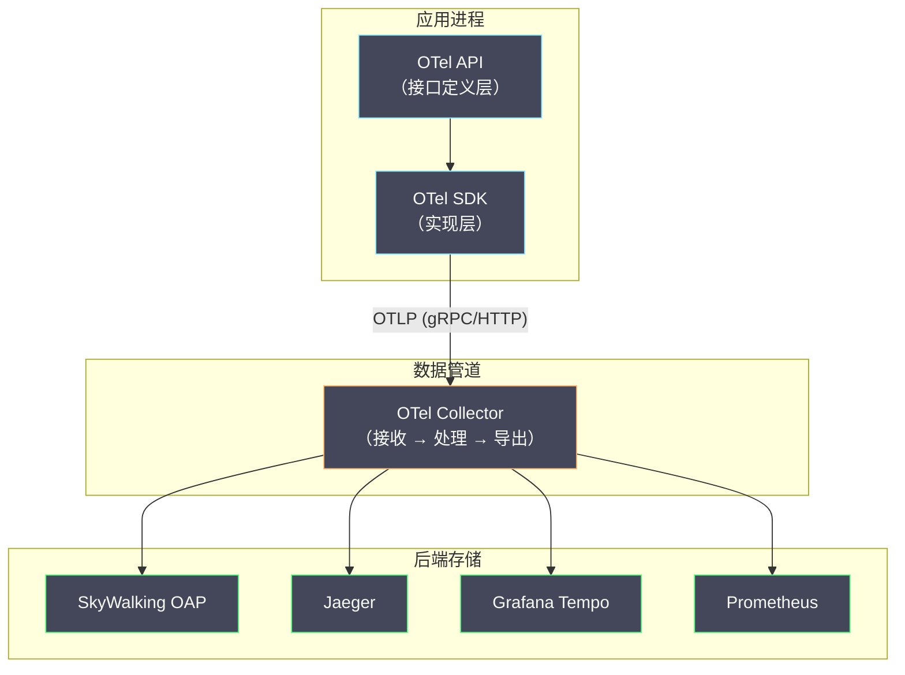
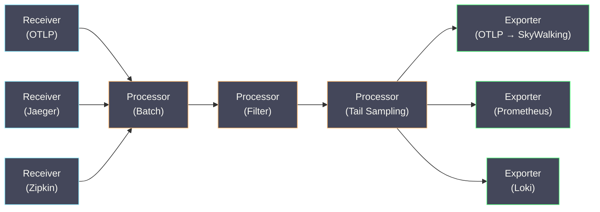

# 03 OpenTelemetry 统一标准

**摘要：**

在 OpenTelemetry 出现之前，链路追踪领域正处于"战国时代"——OpenTracing 只定义 API 却不提供实现，OpenCensus 由 Google 主导却与前者互不兼容，Zipkin、Jaeger、SkyWalking 各自定义传播格式与数据模型，应用一旦选定某个追踪系统便被深度绑定。2019 年，OpenTracing 与 OpenCensus 宣布合并，OpenTelemetry（OTel）由此诞生，并逐步成为 CNCF 的官方可观测性标准项目，它的目标是**让应用的埋点代码与后端存储彻底解耦**。本文沿着"标准为什么分裂、又为什么走向统一"这条主线，解析 OTel 的三层架构（API / SDK / Collector）、统一传输协议 OTLP 的设计动机与报文结构、Auto-Instrumentation 的实现原理，以及 OTel 与 SkyWalking 的协作方式，最终回答两个问题：**OTel 凭什么成为统一标准，以及在已有系统中应当如何引入它**。

---

## 第 1 章 标准分裂：OTel 之前的混乱局面

### 1.1 OpenTracing：有 API 无实现的尴尬

要理解 OpenTelemetry 为什么会长成今天这个样子，得先回到它诞生之前的那个"战国时代"。

2016 年，CNCF 接纳了 **OpenTracing** 项目，试图定义一套**厂商无关的链路追踪 API 标准**——应用代码只依赖 OpenTracing API，具体的实现（Zipkin、Jaeger、SkyWalking）通过运行时绑定注入。这个理念本身是正确的：**埋点代码不应该绑定具体的追踪后端**。面向接口编程的思想统治了 Java 世界二十年，追踪系统没有理由成为例外。

但 OpenTracing 有两个致命缺陷。

**缺陷一：只有 API 规范，没有官方 SDK 实现。** OpenTracing 定义了 `Tracer`、`Span`、`SpanContext` 等接口，却不提供任何实现，每个追踪系统都得自己动手实现这些接口——Jaeger 提供 `jaeger-client`，Zipkin 提供 `brave`，SkyWalking 干脆自带 Agent。这就好比只颁布了度量衡的标准，却没有人去铸造符合标准的钱币：API 层面看似统一了，SDK 层面依然碎片化，切换后端仍然要更换 SDK 依赖、修改初始化代码。

**缺陷二：只覆盖链路追踪，不覆盖指标和日志。** OpenTracing 只关注 Traces，对 Metrics 和 Logs 完全不涉足。而在实际生产中，三种信号必须深度协作——从 Trace 自动生成 RED 指标、在日志中自动注入 Trace ID，都是日常操作。一个只覆盖 Traces 的标准，从一开始就注定承担不起"统一可观测性"的使命。

这两个缺陷的共同点是：**它们都不是"设计得不够好"，而是"边界划得太窄"**。只定义接口不定义实现，把最麻烦的部分留给了社区；只覆盖一种信号，把最需要统一的部分排除在外。后来的 OTel 正是针对这两点逐一补课。

### 1.2 OpenCensus：Google 的"全家桶"策略

2018 年，Google 发起了 **OpenCensus** 项目。与 OpenTracing"只定义 API"的做派不同，OpenCensus 提供了覆盖多种语言的**完整 SDK 实现**，同时支持 Traces 和 Metrics 的采集，开箱即用，不需要额外的实现代码。

听起来很美好，但问题恰恰出在"另一个标准"的诞生本身：

- **社区割裂**：两个标准并存，库的开发者不知道应该适配哪个，用户不知道应该选择哪个。
- **Google 主导色彩浓厚**：设计决策主要由 Google 和 Microsoft 驱动，其他厂商的参与度较低。
- **与 OpenTracing 不兼容**：数据模型和 API 均有差异，无法互操作。

于是，一场本想终结碎片化的标准化努力，反而把水搅得更浑了。OpenCensus 的教训值得记取：**一个"更好的标准"如果无法与既有标准共存，那么它带来的分裂成本，可能超过它带来的改进收益**。标准的价值来自共识，而共识一旦被打破，重建的成本远高于维持。

### 1.3 社区的痛点：到底选哪个

到 2018 至 2019 年，可观测性社区面临一个尴尬的局面：

```text
应用开发者：我应该用 OpenTracing 还是 OpenCensus？
库开发者：  我应该适配哪个标准？两个都适配成本太高
运维工程师：我们的 Java 服务用了 OpenTracing + Jaeger，
            Go 服务用了 OpenCensus + Stackdriver，数据无法互通

→ 两个标准的存在反而加剧了碎片化
```

请注意这个颇具讽刺意味的事实：**标准化本身成了碎片化的新来源**。这样的剧目在软件史上不止一次上演——CORBA 如此，Web Service 如此，可观测性领域也没能免俗。要走出困局，靠的不是再打一场标准战争，而是把对立的双方变成同一家。

### 1.4 为什么标准之争总是以合并收场

回顾这段历史，会发现一个规律：**技术标准的竞争，结局往往不是"一方胜出"，而是"合并"或"一家独大"**，具体是哪一种，取决于双方的力量对比。

当双方各有长板、且都没有压倒性优势时，合并是唯一出路——OpenTracing 的 API 设计与 OpenCensus 的 SDK 实现，恰好谁也不服谁、又谁也替代不了谁，于是只能合。反过来，如果一方拥有绝对的市场或生态位，标准之争就会以"它成为事实标准"收场，比如容器编排领域的 Kubernetes——它不需要与对手合并，因为对手已经被生态边缘化了。

这个规律给技术选型提了个醒：**押注一个"还在争论中的标准"，本身就是一种风险**。你无法预判它是会胜出、被合并，还是最终被边缘化。这也是为什么"跟随事实标准、而非押注新标准"通常更稳妥——**事实标准是已经赢了的结果，而不是还在赌的过程**。

### 1.5 一个思想实验：如果没有这次合并

不妨设想另一种可能：2019 年那次合并没有发生。世界会怎样？

最直接的后果是，OpenTracing 与 OpenCensus 会继续并行若干年。库的开发者仍然要面对"适配哪个"的两难，用户仍然要在两套生态之间做选择，而跨语言的链路仍然拼不起来。这个过程可能持续五到十年，直到某一方在市场竞争中逐渐边缘化——但"逐渐"二字意味着漫长的过渡期，期间全行业都在为分裂买单。

这笔账值得算：**标准分裂的成本，不是某个公司承担的，而是所有使用方共同承担的**。每一次为兼容两套标准而写的胶水代码、每一次因为格式不通而放弃的联动、每一次因为不敢押注而推迟的选型，都是这份成本的具体形态。

所以那次合并的真正价值，不在于"技术上的优雅"，而在于**它为整个行业节省了数年时间**。这也解释了为什么 OTel 能在短短几年内获得如此广泛的支持——它解决的不是一个技术难题，而是一个"所有人都被拖累"的公共问题。**当一个标准能让所有人少做无用功时，它的普及就只是时间问题**。

---

## 第 2 章 OTel 的诞生与定位

### 2.1 合并：一加一等于几

2019 年 5 月，正当所有人以为这场标准之争还要再打十年的时候，OpenTracing 和 OpenCensus 忽然宣布握手言和，合并为 **OpenTelemetry**（简称 OTel），先进入 CNCF Sandbox，后晋升为 Incubating 项目。

这次合并之所以能成，是因为双方的"长板"恰好互补。OpenTracing 擅长 API 设计——厂商无关、面向接口；OpenCensus 擅长 SDK 实现——多语言覆盖、开箱即用。合并后的核心承诺有四条：

- 继承 OpenTracing 的 API 设计理念（厂商无关）。
- 继承 OpenCensus 的 SDK 实现能力（开箱即用）。
- 同时覆盖 **Traces、Metrics、Logs** 三种信号（OpenTracing 只覆盖 Traces）。
- 定义统一的传输协议 **OTLP**（解决各家协议不兼容的问题）。

这四条承诺，每一条都精准对应了 1.1 与 1.2 里暴露的缺陷。**理解了"旧标准错在哪"，就能理解"新标准为什么这样设计"**——这也是本专栏一贯的读法：先讲问题，再讲方案。

### 2.2 OTel 不是什么

理解 OTel"不是什么"，与理解它"是什么"同样重要。因为对它的误解，大多源于"把它当成了一整套平台"。

**OTel 不是后端存储系统**：它不存储数据、不提供查询 UI，只负责**数据的采集、处理和转发**，最终数据要发送到具体的后端（如 SkyWalking OAP、Jaeger、Grafana Tempo、[[可观测/指标/00 专栏导览|Prometheus]] 等）。

**OTel 不是 APM 产品**：它不提供告警、拓扑发现、根因分析等 APM 功能，这些能力由后端产品（如 SkyWalking、Datadog、New Relic）提供。

**OTel 不强制替换现有系统**：它被设计为**增量引入**——你可以在已有的 SkyWalking Agent 基础上，逐步把部分服务切换到 OTel SDK，两者完全可以共存（SkyWalking OAP 支持接收 OTel 格式的数据）。

> [!note] OTel 的准确定位
> OpenTelemetry = **标准数据模型** + **多语言 SDK** + **统一传输协议（OTLP）** + **数据收集中间件（Collector）**。
>
> 它解决的是"数据怎么采、怎么传"的问题，不解决"数据怎么存、怎么查、怎么分析"的问题。

这个定位划出了一条清晰的边界：**OTel 是"管道"，不是"仓库"**。理解了这条边界，后面关于"要不要用 OTel""用了 OTel 还要不要 SkyWalking"的种种疑问，就都有了判断的起点。

### 2.3 OTel 与 CNCF 生态的关系

OTel 是 CNCF 项目，它与 Prometheus、Jaeger、Fluent Bit 等并列，共同构成云原生可观测性的版图。理解它在 CNCF 里的位置，有助于把握它的"职责边界"。

CNCF 生态里有一条隐含的分工：**标准层负责"约定"，实现层负责"落地"**。OTel 站在标准层——它定义数据模型、协议与 SDK，但不做存储与 UI；Prometheus 站在实现层（同时也是指标的事实标准）——它存储指标、提供查询；Jaeger、Tempo 是追踪的存储实现。

一个常见的疑问是"OTel 会不会取代 Prometheus"。答案是不会，因为二者不在同一层：**OTel 负责"把指标采出来、送出去"，Prometheus 负责"把指标存下来、查出来"**。事实上，二者是互补的——用 OTel SDK 采集指标、通过 Prometheus Exporter 暴露，再由 Prometheus 抓取，是一条被广泛采用的组合。

CNCF 的治理模式，也是 OTel 能保持中立的制度保障。**一个厂商主导的项目很难成为跨厂商的标准，而一个由基金会中立治理的项目才有资格**。这是 OpenCensus（Google 主导）当年失败、而 OTel（CNCF 中立治理）能成功的深层原因之一——技术之外，治理结构同样决定了标准的命运。

### 2.4 OTel 与 Jaeger、Tempo 的分工

常有人把 OTel 与 Jaeger、Tempo 放在一起比较，仿佛它们是竞品。事实并非如此——它们分属不同的层。

**OTel 负责"采"**：它提供 SDK 与 Agent，把应用里的追踪数据采集出来，用 OTLP 发送出去。**Jaeger、Tempo 负责"存"**：它们接收追踪数据、存储、并提供查询 UI。二者是上下游关系，不是替代关系。

值得注意的是，Jaeger 与 Tempo 都原生支持 OTLP 接收——也就是说，应用可以**跳过 Collector，直接把 OTLP 数据发给它们**。这样做省了一层部署，但也失去了 Collector 提供的处理能力（过滤、采样、多后端分发）。**要不要 Collector，本质上是在"架构简洁"与"处理灵活"之间做选择**：链路简单、单一后端时可以直接发；链路复杂、多后端时，Collector 的价值就凸显出来。

一个实用的判断标准是：**当"数据要发往哪里"只有一个答案时，可以不用 Collector；当这个答案会变、或不止一个时，就值得引入它**。这又回到了 3.4 讲的"分拨中心"比喻——分拨中心的价值，恰恰在于"发往哪里"这件事会变。

---

## 第 3 章 OTel 的三层架构

### 3.1 架构总览

OTel 的架构分为三个清晰的层次：应用进程内的 API 与 SDK、独立部署的 Collector、以及最终的后端存储。



这三层各自回答一个问题：**API 层回答"库怎么写"**，**SDK 层回答"数据怎么采"**，**Collector 层回答"数据怎么转"**。把它们分开，是 OTel 最重要的架构决策。

### 3.2 第一层：OTel API（接口定义层）

OTel API 是一组**纯接口定义**，不含任何实现逻辑，核心接口有四个。

**TracerProvider**：创建和管理 Tracer 实例的工厂，一个应用通常只有一个全局的 TracerProvider。

**Tracer**：创建 Span 的接口，每个库或模块通过 `TracerProvider.getTracer("library-name", "version")` 获取自己的 Tracer 实例。

**Span**：代表一个追踪操作，提供 `setAttribute()`、`addEvent()`、`setStatus()`、`end()` 等方法。

**Context / Propagator**：管理 SpanContext 的进程内传播与跨进程传播。

**为什么要单独定义 API 层？** 这是 OTel 设计中最精妙的部分，答案藏在库开发者的两难处境里：**库的开发者只依赖 OTel API（零依赖、零开销），而不依赖 OTel SDK**。

不妨设想一个场景：你维护着一个开源的 HTTP 客户端库（譬如 `okhttp`），想为它添加链路追踪支持。如果你依赖了 OTel SDK，所有使用你的库的应用都会被迫引入 OTel SDK 及其传递依赖——即使用户根本不需要链路追踪。这在工程上是不可接受的。

OTel API 的解法是 **No-op 实现**：当应用没有配置 OTel SDK 时，所有 API 调用（`tracer.spanBuilder().startSpan()`）都返回一个**空操作（No-op）Span**，不记录任何数据、不产生任何性能开销；只有当应用显式注册了 OTel SDK，API 调用才会被路由到真正的实现。接口与实现分离、运行时才绑定——这门在 Java 世界被验证了二十年的老手艺，放到可观测性领域，依然是化解"库作者的两难"的最优解。

```java
// 库代码：只依赖 otel-api（轻量级，无传递依赖）
import io.opentelemetry.api.trace.Tracer;
import io.opentelemetry.api.trace.Span;

public class MyHttpClient {
    // 从全局 TracerProvider 获取 Tracer
    private static final Tracer tracer =
        GlobalOpenTelemetry.getTracer("my-http-client", "1.0.0");

    public Response send(Request request) {
        // 如果应用没有配置 SDK → 返回 No-op Span，零开销
        // 如果应用配置了 SDK → 返回真实 Span，开始记录
        Span span = tracer.spanBuilder("HTTP " + request.method())
            .setSpanKind(SpanKind.CLIENT)
            .startSpan();
        try (Scope scope = span.makeCurrent()) {
            span.setAttribute("http.method", request.method());
            span.setAttribute("http.url", request.url());
            Response response = doSend(request);
            span.setAttribute("http.status_code", response.code());
            return response;
        } catch (Exception e) {
            span.setStatus(StatusCode.ERROR);
            span.recordException(e);
            throw e;
        } finally {
            span.end();
        }
    }
}
```

这段代码里藏着两个值得注意的细节。**其一是 `makeCurrent()`**：它把当前 Span 绑定到进程内的上下文（Java 里是 ThreadLocal），使得后续创建的 Span 能自动成为它的子 Span——这正是第 02 篇讲过的"进程内传播"。**其二是 `try-finally` 的 `span.end()`**：无论请求成功还是抛异常，Span 都必须结束，否则它不会上报，调用树就会缺一块。**"每个 startSpan 都必须配一个 end"是埋点代码的铁律**，也是新手最容易犯错的地方。

### 3.3 第二层：OTel SDK（实现层）

OTel SDK 是 API 的具体实现，运行在应用进程中，职责有三。

**Span 的创建与管理**：实现 TracerProvider 和 Tracer 接口，创建真实的 Span 对象，管理 Span 的生命周期。

**Span 的处理流水线**：SDK 定义了一条 **SpanProcessor** 流水线，Span 创建和结束时都要经过它：

- **SimpleSpanProcessor**：Span 结束时立即同步导出（适合开发调试，生产不推荐）。
- **BatchSpanProcessor**：Span 结束时先进入内存队列，达到批量大小或超时后批量导出（生产推荐）。

**Span 的导出**：SDK 通过 **SpanExporter** 把处理后的 Span 数据发送到后端：

- **OtlpGrpcSpanExporter**：通过 gRPC 发送 OTLP 格式数据到 OTel Collector。
- **OtlpHttpSpanExporter**：通过 HTTP 发送 OTLP 格式数据。
- **JaegerExporter**：发送 Jaeger 格式数据到 Jaeger Collector。
- **ZipkinExporter**：发送 Zipkin 格式数据到 Zipkin Server。
- **LoggingSpanExporter**：将 Span 输出到控制台日志（调试用）。

这里的 Simple 与 Batch 之别，本质上是"延迟"与"吞吐"的取舍：Simple 每次结束就发，延迟最低但请求数最多；Batch 攒够再发，吞吐高但"最后一批"可能要等到超时才发出。**生产环境一律用 Batch**——这是 Dapper"低开销"原则在 SDK 层的又一次体现。

**资源（Resource）**：SDK 通过 Resource 描述"谁在产生这些数据"——包括服务名（`service.name`）、服务版本（`service.version`）、部署环境（`deployment.environment`）、主机名、容器 ID 等。这些信息会附加到所有导出的 Span 上，是后端识别数据来源的关键。

Resource 的重要性常被低估。**同一个操作名（如 `GET /api/orders`）在不同服务里含义完全不同，是 Resource 让后端能把它们区分开**。也正因如此，`service.name` 几乎是一切追踪后端的"第一索引维度"，配置错了会导致整个后端的数据都归到一个服务下。

### 3.4 第三层：OTel Collector（数据管道）

**OTel Collector** 是一个独立部署的二进制服务，作为应用与后端之间的**数据管道**。如果把应用比作发货的商家、后端比作收货的买家，Collector 扮演的就是物流分拨中心的角色——商家只管把包裹交给最近的分拨中心，不必关心最后由哪家承运商、走哪条路线送到门口；哪天换了收货地址，改的也只是分拨中心的调度单，商家对此一无所知，也无需知道。

它的核心价值由此而来。

**解耦应用与后端**：应用只需把数据发给 Collector（通过 OTLP 协议），Collector 负责转发到具体后端。更换后端时，只需修改 Collector 配置，不需修改应用代码，更不需重新部署应用。

**数据处理能力**：Collector 可以在转发之前对数据做处理（过滤、聚合、采样、属性修改等），替后端减轻压力。

Collector 的架构由三个组件组成：



**Receivers（接收器）**：接收来自应用的数据，支持多种格式——OTLP（gRPC/HTTP）、Jaeger（Thrift/gRPC）、Zipkin（JSON/Thrift）、Prometheus（Pull/Push）等。多格式接收是"渐进迁移"的关键：旧服务继续用旧协议发，Collector 统一转换。

**Processors（处理器）**：对接收到的数据做处理，常用的有：

- **batch**：将数据批量化，减少后端写入次数。
- **filter**：按条件过滤掉不需要的数据（如过滤掉健康检查的 Trace）。
- **tail_sampling**：尾部采样，只保留错误或慢请求的 Trace。
- **attributes**：修改或删除 Span 属性（如脱敏）。
- **resource**：修改 Resource 信息。

**Exporters（导出器）**：将处理后的数据发送到后端，支持 OTLP（通用）、Jaeger、Zipkin、Prometheus Remote Write、Elasticsearch、Kafka 等。

一个典型的 Collector 配置如下：

```yaml
# otel-collector-config.yaml
receivers:
  otlp:
    protocols:
      grpc:
        endpoint: 0.0.0.0:4317
      http:
        endpoint: 0.0.0.0:4318

processors:
  batch:
    timeout: 5s
    send_batch_size: 1024
  filter:
    traces:
      span:
        - 'attributes["http.target"] == "/health"'  # 过滤健康检查

exporters:
  otlp/skywalking:
    endpoint: skywalking-oap:11800
    tls:
      insecure: true
  prometheus:
    endpoint: 0.0.0.0:8889

service:
  pipelines:
    traces:
      receivers: [otlp]
      processors: [filter, batch]
      exporters: [otlp/skywalking]
    metrics:
      receivers: [otlp]
      processors: [batch]
      exporters: [prometheus]
```

这份配置里最值得注意的是 `pipelines` 段：**它把"接收 → 处理 → 导出"明确串成一条流水线**，而且可以按信号（traces / metrics）分别定义。这种"声明式管道"的设计，让 Collector 的扩展变得非常自然——想加一个后端，就在 `exporters` 里加一段、在 `pipelines` 里挂上，不必改动任何应用代码。

### 3.5 三层架构的收益：几次解耦推演

抽象的"解耦"说起来空洞，不妨用三个具体场景推演一遍，看每一层分离各自化解了什么痛。

**场景一：想把追踪数据从一个后端换到另一个后端。** 如果没有 OTel，你要更换 SDK 依赖、修改初始化代码、重新测试、重新部署每一个服务——几百个服务的迁移，足以让任何团队望而却步。有了 OTel，应用的 SDK 只负责发 OTLP，换后端只需改 Collector 配置一行，应用完全不动。**这一层解耦（Collector 与后端分离），化解的是"后端迁移成本"**。

**场景二：一个开源库想支持追踪，但不想强迫用户安装 SDK。** 如果没有 OTel，库要么不提供追踪（用户抱怨），要么依赖某个具体 SDK（用户被迫引入传递依赖，抱怨更多）。有了 OTel API 的 No-op 机制，库只依赖轻量的 API，用户装了 SDK 就记录、不装就零开销。**这一层解耦（API 与 SDK 分离），化解的是"库作者的两难"**。

**场景三：一个团队同时有 Java、Go、Python 三种服务。** 如果没有 OTel，每种语言要对接各自的后端协议，数据格式还不统一。有了 OTLP，三种语言都用同一套协议发送，后端统一接收。**这一层解耦（应用与协议分离），化解的是"多语言割裂"**。

三个场景对应三种痛，三种痛对应三层解耦——**这就是 OTel 架构的全部动机**。它不是为了"优雅"而分层，而是每一层都精准地化解了一类现实问题。

### 3.6 Collector 的部署形态：Agent 与 Gateway

Collector 可以有两种部署形态，它们的取舍直接影响架构。

**Agent 模式**：在每一个节点（或 Kubernetes 的每个 Node）上部署一个 Collector 实例，应用把数据发给本机的 Collector，再由它转发出去。优点是减少网络跳数、就近接收；缺点是每个节点都要消耗资源，且实例数量多、配置分发麻烦。

**Gateway 模式**：集中部署一组 Collector 实例，所有应用都发给它们。优点是集中管理、易于统一配置与扩缩；缺点是可能成为瓶颈与单点（需要多副本与负载均衡）。

实践中常见的是**两者组合**：节点上的 Agent 负责就近接收与初步处理（如过滤），再统一转发到 Gateway 做重处理（如尾部采样）与后端分发。这样既享受了就近接收的低延迟，又保留了集中处理的灵活性。

但组合会带来一个必须处理的约束——**尾部采样的路由问题**。尾部采样要求"同一条 Trace 的所有 Span 落到同一个 Collector 实例"，否则谁都无法看到完整链路。在 Agent + Gateway 的组合下，这就要求 Gateway 层用"按 Trace ID 路由"的负载均衡（而不是普通的轮询），把同一条 Trace 的 Span 都送到同一个实例。**这个细节看似冷门，却是"尾部采样能不能用"的关键**——很多团队在尾部采样上踩的坑，根源都在这里。

---

## 第 4 章 OTLP：统一传输协议

### 4.1 为什么需要统一协议

在 OTel 之前，每个追踪系统都使用自己的传输协议：Zipkin 走 JSON over HTTP，Jaeger 走 Thrift over UDP 或 gRPC，SkyWalking 走自定义 Protobuf schema 的 gRPC。这意味着应用的 SDK 必须先知道后端是什么系统，才能用正确的协议发送数据——更换后端等于更换 SDK 加修改代码，这与 OpenTracing 想解决的问题如出一辙。

**OTLP（OpenTelemetry Protocol）** 是 OTel 定义的统一传输协议，所有 OTel 兼容的后端都必须支持 OTLP 接收。应用只需通过 OTLP 发送数据，不必关心后端是什么系统。如果说 Collector 是物流分拨中心，OTLP 就是全行业统一的面单格式——包裹上印着同样的字段，任何分拨中心都认得。

**协议统一是"解耦"的最后一块拼图**。数据模型统一了、SDK 统一了，如果传输协议不统一，应用与后端之间仍然存在硬绑定。OTLP 补上了这一环，让"换后端不改代码"从口号变成事实。

### 4.2 OTLP 的协议设计

OTLP 支持两种传输方式。**OTLP/gRPC** 基于 gRPC 加 Protocol Buffers，性能最优，是生产环境的推荐方式，默认端口 4317。**OTLP/HTTP** 基于 HTTP 加 Protobuf（或 JSON），兼容性更好（不依赖 gRPC 支持），适合浏览器与受限网络环境，默认端口 4318。

OTLP 的 Protobuf 数据结构（简化版）如下：

```protobuf
// 一次导出请求包含多个 ResourceSpans
message ExportTraceServiceRequest {
  repeated ResourceSpans resource_spans = 1;
}

// 每个 ResourceSpans 代表一个服务实例的所有 Span
message ResourceSpans {
  Resource resource = 1;           // 服务信息（service.name, host.name 等）
  repeated ScopeSpans scope_spans = 2;
}

// 每个 ScopeSpans 代表一个 Instrumentation Scope（如一个库）的所有 Span
message ScopeSpans {
  InstrumentationScope scope = 1;  // 库名和版本（如 "my-http-client" v1.0）
  repeated Span spans = 2;
}

// 单个 Span 的完整数据
message Span {
  bytes trace_id = 1;              // 16 字节
  bytes span_id = 2;               // 8 字节
  bytes parent_span_id = 4;        // 8 字节（可空）
  string name = 5;                 // 操作名
  SpanKind kind = 6;               // CLIENT/SERVER/PRODUCER/CONSUMER/INTERNAL
  fixed64 start_time_unix_nano = 7;
  fixed64 end_time_unix_nano = 8;
  repeated KeyValue attributes = 9;
  repeated Event events = 11;
  repeated Link links = 12;
  Status status = 15;
}
```

这个结构有三层嵌套：**请求 → ResourceSpans（按服务实例分组）→ ScopeSpans（按库分组）→ Span**。这个分组的用意很明确：**把"重复度高的元数据"提取到上层，只发一次**。同一个服务实例的所有 Span 共享一份 Resource，同一个库的所有 Span 共享一份 InstrumentationScope——对每秒产生数千个 Span 的服务来说，这点节省相当可观。

### 4.3 OTLP 的批量与压缩

OTLP 在设计上处处为网络传输效率打算。

**批量发送**：一次 `ExportTraceServiceRequest` 可以携带成百上千个 Span，大幅减少 HTTP/gRPC 请求数。SDK 的 `BatchSpanProcessor` 负责在内存中积攒 Span，达到阈值后一次性发出。

**Resource 去重**：如 4.2 所述，同一个服务实例的所有 Span 共享同一个 Resource 对象（只发送一次），而不是每个 Span 都携带完整 Resource。

**gRPC 压缩**：OTLP/gRPC 支持 gzip 压缩，典型压缩比 3:1 到 5:1。

这三条优化合起来，把"每条 Span 的传输成本"压到了一个很低的水平。**追踪系统的开销，很大一部分其实花在传输上**，因此这些看似细节的优化，直接决定了"能不能把采样率开高一点"。理解了这一点，就能理解为什么 OTLP 的设计者会花大力气做去重与压缩——**省下的带宽，最终会转化成更高的数据完整度**。

### 4.4 OTLP 与既有协议的对照

把几种主流协议放在一起，能更清楚地看到 OTLP 想解决的是什么：

| 协议 | 传输方式 | 序列化 | 主要问题 |
|---|---|---|---|
| Zipkin | HTTP | JSON / Thrift | 无标准、面向 Zipkin 定制 |
| Jaeger | UDP / gRPC | Thrift | UDP 不可靠，格式专属 Jaeger |
| SkyWalking | gRPC | 自定义 Protobuf | schema 专属 SkyWalking |
| OTLP | gRPC / HTTP | Protobuf（或 JSON） | 中立、面向所有后端 |

这张表里，前三种协议的共同问题是"**面向单一后端定制**"——用它们发送数据，等于把后端的名字写进了应用的配置里。而 OTLP 的设计目标是"**面向所有后端中立**"：它不假设后端是谁，因此应用可以只认 OTLP。

这个差别看似只是"格式问题"，实则是"耦合问题"。**协议的分裂成本，最终都要由使用方来承担**——每一次后端迁移、每一次多语言对接，都要为此付出额外的适配工作。OTLP 统一协议，本质上是把这份成本一次性消掉。

---

## 第 5 章 Auto-Instrumentation：零代码修改的埋点

### 5.1 手动埋点与自动埋点

**手动埋点（Manual Instrumentation）**：开发者在代码中显式调用 OTel API 创建 Span、设置属性。优点是完全可控，缺点是侵入性大，而且要求开发者理解链路追踪的概念。

**自动埋点（Auto-Instrumentation）**：通过框架级的拦截机制（如 Java Agent、Python monkey-patching、Node.js require hooks），自动在 HTTP 请求处理、数据库查询、RPC 调用等关键路径上创建 Span，**不需要修改任何应用代码**。

OTel 为主流语言都提供了自动埋点能力：

| 语言 | 自动埋点机制 | 覆盖的框架 |
|---|---|---|
| Java | Java Agent（`-javaagent:` JVM 参数） | Spring Boot、gRPC、JDBC、Kafka、Redis、OkHttp 等 |
| Python | `opentelemetry-instrument` CLI（monkey-patching） | Flask、Django、requests、SQLAlchemy、Celery 等 |
| Node.js | `@opentelemetry/auto-instrumentations-node`（require hooks） | Express、Koa、pg、mysql、Redis、gRPC 等 |
| Go | 无官方自动埋点（Go 缺乏运行时拦截机制） | 需手动埋点或使用 eBPF 方案 |
| .NET | `OpenTelemetry.AutoInstrumentation`（CLR Profiler API） | ASP.NET Core、HttpClient、EF Core、gRPC 等 |

这张表里最值得注意的是 Go 那一行：**Go 没有官方自动埋点**。原因在于 Go 缺乏运行时字节码拦截机制——它是静态编译的，没有 JVM 那样的"类加载时可改写字节码"的钩子。这解释了为什么"零侵入"在 Go 生态里格外困难，也解释了为什么 eBPF 方案在 Go 社区备受期待（见第 07 篇）。**语言特性决定了自动化的上限**，这一点在选型时值得留意。

### 5.2 Java Auto-Instrumentation 的工作原理

OTel Java Agent 的自动埋点机制与 SkyWalking Java Agent 同出一门，都基于 **Java Instrumentation API + 字节码增强**：

```text
JVM 启动参数：
  java -javaagent:opentelemetry-javaagent.jar -jar myapp.jar

执行流程：
  1. JVM 加载 otel-javaagent.jar 中的 premain() 方法
  2. Agent 注册一个 ClassFileTransformer
  3. 每当 JVM 加载一个类时，Transformer 检查这个类是否匹配某个 Instrumentation Module
     （例如：javax.servlet.http.HttpServlet 匹配 Servlet Instrumentation）
  4. 如果匹配，使用 Byte Buddy 修改类的字节码：
     - 在方法入口插入 Span 创建逻辑
     - 在方法出口插入 Span 结束逻辑
     - 在异常捕获处插入异常记录逻辑
  5. 返回修改后的字节码，JVM 使用修改后的类继续执行
```

这套机制的核心是 `ClassFileTransformer`——它像一个"类加载流水线上的质检员"，每当一个类被加载，就检查它是不是需要被增强，需要的话就改写字节码。**它对业务代码完全透明，因为改写发生在类加载的那一刻，而不是在源码里**。第 05 篇会以 SkyWalking 为例，把这套机制拆到更细的层面。

OTel Java Agent 与 SkyWalking Java Agent 的差异如下：

| 维度 | OTel Java Agent | SkyWalking Java Agent |
|---|---|---|
| 数据模型 | OTel 标准（Span + Resource） | SkyWalking 自定义（Segment + Span） |
| 传输协议 | OTLP（gRPC/HTTP） | SkyWalking gRPC 协议 |
| 后端依赖 | 任何支持 OTLP 的后端 | SkyWalking OAP |
| 插件数量 | 约 100 个 Instrumentation Module | 约 100+ 个插件 |
| 指标采集 | 支持（从 Span 自动生成 RED 指标） | 支持（OAP 端聚合） |
| Profiling | 不支持（OTel 尚未标准化 Profiling） | 支持（线程 dump Profiling） |

### 5.3 OTel 与 SkyWalking 的共存方案

在已经使用 SkyWalking Agent 的 Java 服务里，如何引入 OTel？笔者把它归纳为三种策略。

**策略一：SkyWalking OAP 接收 OTLP 数据。** SkyWalking OAP 从 9.x 版本开始支持通过 OTLP gRPC Receiver 直接接收 OTel 格式的数据。这意味着新服务可以用 OTel SDK/Agent 埋点，数据仍然发送到 SkyWalking OAP，在 SkyWalking UI 中统一查看。

```text
旧服务 → SkyWalking Agent → SkyWalking OAP → SkyWalking UI
新服务 → OTel Agent → OTel Collector → SkyWalking OAP → SkyWalking UI
```

**策略二：OTel Collector 作为统一接入层。** 所有服务（无论用哪种 Agent）都把数据发送到 OTel Collector，由 Collector 统一转发到 SkyWalking OAP。SkyWalking Agent 也可以配置为将数据发送到 OTel Collector（通过 gRPC Exporter）。

**策略三：渐进式迁移。** 先在非核心服务上试用 OTel Agent，验证兼容性与性能影响；再逐步扩展到更多服务；最终根据需要决定是否完全切换。

> [!info] 实际建议
> 对于 Java 生态、且已深度使用 SkyWalking 的团队，短期内没有必要切换到 OTel Agent——SkyWalking Agent 在 Java 生态的覆盖度与稳定性仍然领先。OTel 的价值更多体现在**多语言环境**（Go、Python、Node.js 服务用 OTel SDK，Java 服务继续用 SkyWalking Agent，数据统一汇入 SkyWalking OAP）与**后端灵活性**（未来可能需要同时把数据发送到多个后端）。
>
> 工具没有高下之分，只有合不合适——这个结论放在可观测性领域，与放在架构设计的任何其他角落一样成立。

### 5.4 自动埋点的边界

自动埋点常被宣传为"零侵入、全覆盖"，但它有明确的边界，把它们讲清楚，才不会在落地后失望。

**其一，它覆盖"框架边界"，不覆盖"业务语义"。** 自动埋点能记录"一次 HTTP 请求、一次数据库查询、一次 RPC 调用"，因为这些都有明确的框架入口。但它不知道"这段代码在算折扣""这个分支在处理退款"——**业务语义只有开发者知道，因此必须手动埋点补充**。自动埋点给你一张"骨架图"，手动埋点给它填上"业务肌肉"，两者缺一不可。

**其二，它的覆盖率取决于适配进度。** 自动埋点依赖"框架适配"——每个框架都需要有人写对应的 Instrumentation Module。冷门框架、自研框架往往没有适配，只能手动埋点。**"支持某某框架"不是一句空话，而是逐个框架的适配工作**。

**其三，它可能采集过多。** 自动埋点会把健康检查、心跳、探针请求也一并记录下来，这些 Span 数量巨大却毫无价值，反而推高成本。因此通常需要配合 Collector 的 filter 处理器，把它们过滤掉。

**其四，它不解决上下文传播的所有边界。** 正如第 02 篇所述，异步边界（线程池、消息队列）是传播的难点，自动埋点虽然尽力覆盖，但仍可能遗漏。**"自动埋点装上了，链路就完整了"是一种错觉**——完整性需要持续的验证与补漏。

理解了这四条边界，就能得到一个务实的结论：**自动埋点降低门槛，手动埋点保证深度，两者结合才是正解**。

---

## 第 6 章 OTel 对 Metrics 与 Logs 的覆盖

### 6.1 OTel Metrics

OTel 的 Metrics 部分定义了与 [[可观测/指标/00 专栏导览|Prometheus]] 数据模型兼容的指标类型：

| OTel 指标类型 | 对应 Prometheus 类型 | 用途 |
|---|---|---|
| Counter | Counter | 只增不减的计数器（如请求总数） |
| UpDownCounter | Gauge | 可增可减的计数器（如当前连接数） |
| Histogram | Histogram | 值的分布（如请求延迟分布） |
| Gauge | Gauge | 瞬时值（如 CPU 使用率） |

OTel SDK 采集的指标可以通过 **Prometheus Exporter** 暴露为 Prometheus 格式（让 Prometheus 来 Pull），也可以通过 **OTLP** 推送到 OTel Collector，再转发到 Prometheus Remote Write 端点。**这种"推拉皆可"的设计，正是 OTel 兼容既有生态的体现**——它不要求你放弃 Prometheus，而是让你能平滑地把 OTel 指标汇入其中。

### 6.2 OTel Logs

OTel 的 Logs 部分是三者中最晚成熟的（2023 年才达到 Stable 状态）。值得注意的是，OTel 对日志的定位并不是"替换现有的日志框架"（如 Log4j、Logback、Zap），而是做三件既有框架做不好的事：

- **关联**：在现有日志中自动注入 Trace ID 与 Span ID，使日志与链路追踪可以互相跳转。
- **采集**：通过 OTel Collector 的 Filelog Receiver，采集日志文件并转发到后端（如 [[可观测/日志/00 专栏导览|Grafana Loki]]、[[中间件/Elasticsearch/00 专栏导览|Elasticsearch]]）。
- **结构化**：将非结构化的日志文本转换为结构化的 Log Record（带 Trace ID、Severity、Resource 等字段）。

这三件事里，"关联"最关键。**日志框架关心的是"怎么写日志"，OTel 关心的是"怎么让日志与链路对上"**——二者职责不同，因此不是替代关系。第 02 篇讲过的 Trace ID 注入日志，正是这一能力的具体体现。

### 6.3 三信号统一的意义

把 Traces、Metrics、Logs 放进同一套标准，看似只是"省了几套 SDK"，实则改变了几件事。

**其一，关联变得廉价。** 三信号共享同一套 Resource、同一套上下文传播，因此"从指标跳到追踪、从追踪跳到日志"不需要额外的胶水代码——它们天然共享 `service.name`、Trace ID 等字段。

**其二，采集可以统一。** 一个 Collector 就能同时接收三种信号、统一做处理（脱敏、采样、过滤），运维面从"三套管道"收敛为"一套管道"。

**其三，避免了三套标准的分裂。** 如果 Traces、Metrics、Logs 各有一套标准，那么"标准分裂"的故事就会重演三次。**把三种信号放进同一个项目，是 OTel 对"碎片化"这个历史教训的正面回应**。

### 6.4 语义约定：一份隐性的契约

三信号统一之后，还有一样东西决定了数据能否被真正用好——**语义约定（Semantic Conventions）**。它规定了"某种操作应该用哪些属性名"，比如 HTTP 请求的状态码必须叫 `http.status_code`，而不是 `status`、`httpStatus` 或 `code`。

语义约定的重要性在于：**它是"跨团队查询能复用"的前提**。如果每个团队各起各的属性名，那么一个团队精心写的查询、看板、告警，换到另一个团队就完全失效——**数据的价值，一半在于采集，一半在于大家用同一种方式描述它**。

但语义约定有一个天然的弱点：**它不是强制性的**。OTel 无法阻止你写 `status_code`，也无法阻止你用 `http_code`。因此在实际团队里，语义约定往往需要靠"评审"与"规范"来维护——**把它当成一份接口契约来对待，而不是一份可选的建议**。

这一点与第 02 篇讲 Span 命名时的结论一脉相承：**任何用于跨团队聚合的维度，都需要一份共同认可的约定**。没有约定，数据越多，反而越乱。

### 6.5 三信号统一对后端架构的影响

三信号统一到同一套标准，对后端也提出了新要求：**它必须能同时接收、存储并关联三种数据**。

关联变简单了，因为三者共享 `service.name`、Resource 与上下文。但**存储却不能统一**——因为三种信号的数据特性天差地别：指标是"全量、低基数、长期保留"的，追踪是"采样、高基数、中期保留"的，日志是"海量、全文、短期保留"的。把它们塞进同一个存储引擎，往往会导致"要么指标太贵、要么日志太慢"。

因此，现实中的可观测平台大多是**分层存储**的：指标用专门的时序库（如 VictoriaMetrics、Prometheus），追踪用专门的追踪库（如 SkyWalking 的 ES / BanyanDB、Tempo），日志用日志库（如 Loki、Elasticsearch）。而"统一"体现在**采集与关联层**，不体现在存储层。

这个结论值得记住：**标准统一不等于存储统一**。OTel 统一的是"数据怎么采、怎么传、怎么关联"，它并不主张"三信号用同一个数据库"。**把不同特性的数据放进不同特性的存储，是工程上的必然选择，而不是标准不彻底的妥协**。理解了这一点，就不会再纠结于"OTel 既然统一了，为什么后端还要三套存储"这类问题。

---

## 第 7 章 OTel 的落地与边界

### 7.1 引入 OTel 的三种姿态

不同团队引入 OTel 的姿势并不相同，大致有三种。

**姿态一：只借标准，不换实现。** 团队继续用 SkyWalking Agent 采集，但要求新代码遵循 OTel 语义约定、使用 W3C 传播格式。这样既享受了"标准带来的互通"，又避免了"全量换 Agent"的风险。这是成本最低的一种。

**姿态二：用 OTel 采集，用既有后端存储。** 用 OTel SDK/Agent 采集数据，通过 Collector 转发到 SkyWalking OAP 或其他既有后端。它适合"多语言环境"——让非 Java 服务也能接入，而 Java 服务可以保持不变。

**姿态三：全量迁移到 OTel 栈。** 采集、传输、存储全部换成 OTel 生态（如 OTel + Tempo + Loki + Prometheus）。它适合新建系统或"本就打算重建可观测栈"的团队，迁移成本最高。

**这三种姿态没有对错，只有阶段匹配**。多数团队的现实路径是从姿态一开始，按需演进到姿态二、姿态三。**一步到位地全量迁移，往往不是技术问题，而是组织协调问题**——几百个服务的 Agent 更换、几百个团队的排期，远不是"技术上可行"就能推动的。

### 7.2 边界与争议

OTel 虽被寄予厚望，但它也有明确的边界与尚在争论的地方。

**其一，它不管存储与查询。** 这既是"专注"的优点，也是"责任分散"的缺点——当追踪系统出问题时，你很难让 OTel 项目"对整条链路的体验负责"。**中立性的代价，就是没有人为端到端体验兜底**。

**其二，它的抽象层数多。** API、SDK、Collector 三层，加上各式 Exporter、Processor，配置与调试的复杂度不低。对只想"快速看到链路"的团队，这套体系可能显得过重。

**其三，部分能力仍在演进。** Logs 2023 年才 Stable，Profiling 至今仍在 SIG 阶段，eBPF 方案尚未定型。**采用一个"仍在演进的标化标准"，意味着要接受一定的不确定性**——这也是为什么很多团队选择"只借标准、不换实现"。

### 7.3 未来方向：Profiling 与 eBPF

OTel 正在把 **Continuous Profiling** 作为第四种信号纳入标准。2024 年，OTel Profiling SIG（Special Interest Group）开始制定 Profiling 的数据模型与传输协议，目标是让 Profiling 数据也能通过 OTLP 传输，并与 Traces、Metrics、Logs 关联起来——从慢 Span 直接跳转到对应时间段的火焰图。

另一条线是 **eBPF 原生支持**。传统的自动埋点依赖语言运行时的拦截机制（Java Agent、Python monkey-patching），天然无法覆盖所有语言（特别是 Go 和 C/C++）。基于 eBPF 的链路追踪可以在内核层面拦截网络系统调用，实现**真正的语言无关自动埋点**。OTel 社区正在探索把 eBPF 作为一种新的自动埋点机制。

OTel 的故事还远没有讲完：Profiling 作为第四种信号正在标准化，eBPF 带来了语言无关埋点的另一种可能。但未来究竟如何发展，目前仍然言之尚早——毕竟在这个领域，我们已经见过太多自称"终极解决方案"的标准了。

### 7.4 一个反例：把 OTel 当成万能药

有一类常见的失败，是团队误以为"上了 OTel，就有了可观测性"。

他们装上 OTel Agent、部署好 Collector、把数据送进后端，然后就等着故障被轻松定位。结果却发现：**没有人报警，因为告警要另外建；数据很快膨胀，因为没人做采样治理；查询慢得没法用，因为没人设计索引与保留策略**。最后得出"OTel 不过如此"的结论。

问题的根源在于，**OTel 是管道，不是能力**。它把数据从 A 运到 B，但"数据存得好不好、查得快不快、有没有人看、出事了叫不叫人"——这些都不在它的职责范围内。**把管道误当成仓库，是采用 OTel 时最容易犯的认知错误**。

正确的期待是：OTel 让你的应用"不再绑定后端"，让你的多语言团队"能用同一套标准"，让你的后端迁移"不必改代码"。至于"可观测性能力"，仍然需要后端产品（SkyWalking、Tempo、Datadog）与配套的告警、治理来共同提供。**分清管道与能力，才能对 OTel 有一个准确的期待**。

### 7.5 OTel 的成熟度地图

采用一个"仍在演进的标化标准"，最需要知道的就是"哪些部分成熟了、哪些还在路上"。把各信号与机制的成熟度列出来，有助于判断"现在能用什么"。

**已经稳定（Stable）的**：Traces（最早稳定，也是 OTel 的起点）、Metrics（已稳定）、Logs（2023 年达到 Stable）。这三者的数据模型、API、SDK 都已经稳定，可以放心用于生产。

**仍在演进中的**：Profiling——2024 年才开始制定数据模型与协议，尚未 Stable；eBPF 自动埋点——处于探索阶段，方案尚未定型；部分语言的自动埋点——覆盖度差异较大（如 Go 缺乏官方方案）。

**配套工具的成熟度**：Collector 已经相当成熟，社区组件丰富；各语言的 SDK 成熟度则参差不齐，Java、Python、Node.js、.NET 较成熟，其他语言相对滞后。

这张地图的用法是：**选型时只押注已经 Stable 的部分，对演进中的部分保持观察、但不做硬依赖**。比如，你可以放心用 OTel 的 Traces 与 Metrics，但不应把"Profiling 标准化"当作近期可依赖的能力。**采用一个演进中的标准，关键在于分清"它的哪一部分已经可以托付"**。

---

## 第 8 章 工程实践：如何引入 OTel

### 8.1 引入顺序

一个稳妥的引入顺序是：**先统一传播格式（W3C），再统一语义约定，最后才考虑更换采集实现**。

先统一传播格式，是因为它是"链路能否拼起来"的前提——如果 Java 服务用 sw8、Go 服务用 B3，那么即使两边都采了数据，跨语言的链路也是断的。这一步成本最低、收益最直接。

再统一语义约定，是因为它决定了"数据能不能被统一查询"——如果两个团队对"HTTP 状态码"这个属性用了不同的键名，那么跨团队的看板就无法复用。这一步需要约定与评审，但没有技术风险。

最后才考虑更换采集实现。因为采集实现（Agent / SDK）的更换涉及每个服务的重启与验证，成本最高、风险最大，应当在前面两步打好基础之后再做。

### 8.2 常见坑

实践中，OTel 的落地有几处高频的坑。

**其一是 `service.name` 没配。** 大量团队忘记显式设置 `service.name`，导致数据被归到默认值（如 `unknown_service`）下，后端里所有服务混在一起，完全无法区分。**这是最廉价也最致命的配置错误**。

**其二是 Collector 的单点。** 把 Collector 部署成单实例，一旦它挂了，所有链路数据就断了。生产环境应当部署多副本，并用负载均衡分发。但对尾部采样而言，多副本又引入了"同一 Trace 的 Span 必须落到同一实例"的约束（见思考题 3）。

**其三是采样配置不一致。** 应用侧配了头部采样，Collector 侧又配了尾部采样，两者叠加后实际采样率可能远低于预期。**采样策略要在整条链路上通盘设计，而不是各处随手一配**。

**其四是忽略 Batch 的尾部延迟。** 用 BatchSpanProcessor 时，最后一批数据要等到超时才发出。如果超时设得过长，故障排查时就会"看不到最近的链路"。把超时设在一个合理的小值（如 5 秒），是一个务实的折中。

### 8.3 如何度量引入效果

引入 OTel 之后，应当用几个指标度量它的效果：**追踪覆盖率**（有多少服务、多少关键接口被埋点）、**断链率**（有多少 Trace 的调用树是断的）、**采集开销**（Agent 带来的额外 CPU 与内存）、**数据时效**（从 Span 产生到可查询的延迟）。

这四个指标里，**"断链率"最容易被忽视，却最能反映落地质量**。一个覆盖率 100%、但断链率 30% 的体系，实际可用性远低于一个覆盖率 60%、断链率 5% 的体系——因为断链意味着"关键的那一跳看不到"，而这恰恰是排查最需要的部分。

### 8.4 自建 Collector 还是用发行版

引入 OTel 时，还有一个具体的选择：Collector 用哪个发行版？

OTel Collector 官方维护了两个发行版。**Core 发行版**只包含核心组件（OTLP 接收、batch 处理、OTLP 导出等），体积小、攻击面小、依赖少。**Contrib 发行版**则打包了社区贡献的全部组件（各种 Receiver、Processor、Exporter），功能最全、体积也最大。

实践中还有厂商发行版——一些可观测性厂商会提供"预置了自家 Exporter"的 Collector，省去自己组装的工作。

如何选择？一个务实的路径是**从 Contrib 起步、按需裁剪**：先用 Contrib 把功能跑通，确认需要哪些组件后，再用官方提供的构建工具（如 OpenTelemetry Collector Builder）裁剪出一个"只含所需组件"的定制发行版。这样既能享受功能完整，又能控制体积与攻击面。

这条路径背后的原则是：**先用"全量"换"跑通"，再用"裁剪"换"精简"**。反过来做——一开始就追求最小依赖——往往会在遇到缺失组件时反复返工，反而更慢。**工程上的顺序，常常是"先跑通、再优化"，而不是"一步到位"**。

### 8.5 团队协作：谁负责 OTel 的哪些部分

OTel 的落地不只是技术工作，更是一次跨团队的协作。把职责划清楚，能避免大量扯皮。

**平台团队负责"公共设施"**：部署与维护 Collector、后端存储、统一的传播格式与语义约定、以及"什么属性可以采"的准入规范。这些是"所有人共用的部分"，必须集中治理，否则每个团队各搞一套，标准就名存实亡。

**应用团队负责"自己的埋点"**：设置正确的 `service.name`、按需补充业务语义的手动 Span、遵守平台约定的属性名。这些是"各服务独有的部分"，平台无法代劳，也不该代劳。

**双方共同负责"覆盖率与断链率"**：平台提供度量手段与看板，应用团队负责把自己的断链修好。**把"链路完整性"当成一个需要双方共同维护的指标，而不是某一方的 KPI**，是这套协作能否长期运转的关键。

这个分工的深层逻辑是：**OTel 提供了统一的"语言"，但"用这门语言说什么"，仍然取决于每个团队**。平台能保证"大家说的是同一种语言"，却无法保证"每个人都把话说全了"。**标准化能降低协作成本，但不能替代协作本身**。

---

## 小结

OTel 的故事，本质上是"从分裂走向统一"的故事。OpenTracing 与 OpenCensus 的分裂教会了社区一件事：**一个标准如果无法与既有标准共存，它带来的分裂成本可能超过改进收益**。OTel 的合并之所以能成，是因为它把两个标准的长板拼在了一起——API 设计的理念来自 OpenTracing，SDK 实现的能力来自 OpenCensus。

它的架构则围绕"解耦"二字展开：**API 与 SDK 分离**，让库开发者可以零依赖地埋点；**SDK 与 Collector 分离**，让应用不必知道后端是谁；**Collector 与后端分离**，让更换存储变成改一行配置；**OTLP 统一协议**，让"换后端不改代码"成为事实。每一层分离，都在削弱一种绑定。

但它也有边界：OTel 是管道而非仓库，它不解决存储、查询与体验；它中立，因此没有人对端到端负责；它仍在演进，Profiling 与 eBPF 尚未定型。**理解了这些边界，就能理解为什么"全量迁移 OTel"对多数团队来说并不是最优解，而"只借标准、渐进演进"往往更务实**。

下一篇（第 04 篇）会进入本专栏的主线产品 SkyWalking——看看一个"把采集、存储、UI、告警、Profiler 全做进一个项目"的 APM 平台，是如何在 OTel 之外，走出另一条"一体化"的路的。

---

## 参考资料

1. OpenTelemetry 官方文档：https://opentelemetry.io/docs/
2. OTLP Specification：https://opentelemetry.io/docs/specs/otlp/
3. OpenTelemetry Collector：https://opentelemetry.io/docs/collector/
4. OpenTelemetry Java Instrumentation：https://github.com/open-telemetry/opentelemetry-java-instrumentation
5. SkyWalking OTel Receiver：https://skywalking.apache.org/docs/main/latest/en/setup/backend/otlp-traces/
6. OpenTelemetry Profiling Vision：https://opentelemetry.io/docs/specs/otel/profiling/
7. W3C Trace Context：https://www.w3.org/TR/trace-context/
8. Sridharan, C. (2018). *Distributed Systems Observability*. O'Reilly Media.

---

> [!note] 思考题
> 1. OTel Collector 是可观测数据的中间层——接收（Receivers）→ 处理（Processors）→ 导出（Exporters）。Collector 可以部署为 Agent（每个节点/Pod 一个）或 Gateway（集中部署）。Agent 模式减少了网络跳数但增加了节点资源消耗，Gateway 模式集中管理但可能成为瓶颈。在 Kubernetes 中你如何选择部署模式？
> 2. Collector 的 Processor 支持数据转换——如 `batch`、`filter`、`attributes` 和 `tail_sampling`。尾部采样需要在内存中缓存完整 Trace 才能决策。在什么样的 Trace 量和延迟下，尾部采样的内存需求是可控的？
> 3. Collector 的高可用与水平扩展——多个 Collector 实例通过负载均衡接收数据。但尾部采样要求同一 Trace 的所有 Span 发送到同一个实例，否则无法做出完整决策。`loadbalancing` Exporter 通过 Trace ID 路由解决这个问题，它的实现原理是什么？
> 4. 为什么 Go 语言没有官方的自动埋点？这一语言特性如何影响多语言团队的可观测性选型？
> 5. 引入 OTel 的三种姿态（只借标准 / 用 OTel 采集 + 既有后端 / 全量迁移）分别适合什么阶段？为什么"一步到位"往往是组织问题而非技术问题？
