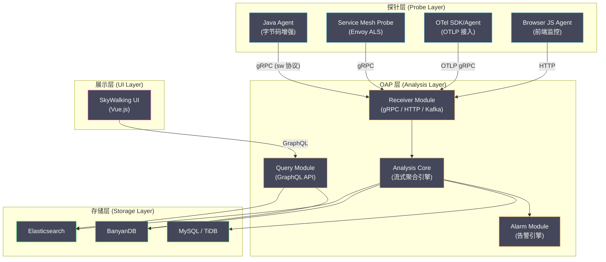

# 04 SkyWalking 整体架构深度解析

**摘要：**

Apache SkyWalking 是目前 Java 生态中最成熟的全栈 APM（Application Performance Management）系统。与 Zipkin、Jaeger 等"纯链路追踪"系统不同，SkyWalking 把**链路追踪、性能指标聚合、服务拓扑发现、告警、持续剖析**收进了一个项目。本文从它的整体架构出发，剖析 Agent、OAP（Observability Analysis Platform）、UI 三层的职责划分与数据流转，重点解释 OAP 如何把原始 Segment 数据"边收边算"地转化成拓扑图与聚合指标，以及 Elasticsearch、BanyanDB 两种存储后端的选型考量，最后落到这套一体化架构的代价与边界。读完之后，你应当能回答两个问题：**SkyWalking 凭什么能"开箱即用"，以及这份便利背后付出了什么代价**。

---

## 第 1 章 SkyWalking 的定位与设计哲学

### 1.1 不仅仅是链路追踪

很多人第一次接触 SkyWalking 时，会把它等同于"Java 版的 Zipkin"——一个链路追踪系统。这个认知并不准确。SkyWalking 的完整定位是 **APM 加可观测性分析平台**，链路追踪只是它的能力之一。

SkyWalking 提供的核心能力可以列成一张表：

| 能力 | 说明 | 对应 Zipkin / Jaeger |
|---|---|---|
| 链路追踪 | Trace / Segment / Span 采集与查询 | 有 |
| 性能指标 | 服务 / 实例 / 端点级别的 P50 / P99 / QPS / 错误率 | 无（需额外部署 Prometheus） |
| 服务拓扑 | 自动发现服务间调用关系，生成拓扑图 | 无（Jaeger 有基础版本） |
| 告警 | 基于指标阈值或异常检测触发告警 | 无 |
| 日志关联 | 将日志与 Trace ID 关联，在 UI 中联动查看 | 无 |
| 持续剖析 | 对慢 Span 触发线程 dump，生成火焰图 | 无 |
| 浏览器端监控 | 采集前端页面的性能数据（FP / FCP / LCP） | 无 |
| 基础设施监控 | 通过 Prometheus Exporter 或 OTel 接收 VM / K8s 指标 | 无 |

这张表的关键不在"SkyWalking 功能多"，而在**"这些功能是同一个项目里的"**。Zipkin、Jaeger 的哲学是"只做追踪这一块积木"，其余交给使用者自己去拼（指标用 Prometheus、拓扑自己画、告警自己建）。SkyWalking 则选择了另一条路：**把观测链路所需的全部能力，做成一个开箱即用的整体**。

这个选择直接决定了后面的一切：一体化意味着更强的"默认体验"，也意味着更重的架构、更深的耦合。**理解了"一体化"这个出发点，就能理解 SkyWalking 后续所有设计的由来**。

### 1.2 两条核心设计原则

SkyWalking 有两条贯穿始终的设计原则。

**原则一：无侵入（Non-Intrusive）。** SkyWalking 的 Java Agent 通过字节码增强实现埋点，**应用代码零修改**。这不仅仅是"方便"的问题——在大型企业里，要求每个团队在代码里加追踪 SDK 是一个极其困难的推动过程（涉及代码审查、发布排期、回归测试）。Java Agent 通过 JVM 参数 `-javaagent:` 注入，运维团队可以在部署层面统一配置，不需要开发团队的任何配合。

这条原则的价值，可以用一个对比来说明：如果追踪接入需要"每个团队改代码、排期、发版"，那么一个 300 人的研发组织，接入周期往往以"季度"计；而如果只需要"运维在启动参数里加一行"，接入周期可以缩短到"一次重启"。**无侵入带来的，是组织协作成本的数量级下降**——这也是它被反复强调的根本原因。

**原则二：流式分析（Streaming Analysis）。** SkyWalking OAP 不是简单地"存储 Span 然后查询"——它在接收 Segment 数据时，**实时进行流式分析**：从 Span 中提取服务名、端点名、响应时间等信息，实时计算 P50 / P99 / QPS / 错误率等聚合指标，实时构建服务拓扑图。这意味着三件事：

- **指标查询是 O(1) 的**：查看某个服务过去一小时的 P99 延迟，不需要扫描所有 Span 再聚合——OAP 在接收时已经预聚合好了，查询时只需读聚合结果。
- **拓扑图是实时的**：新增一个服务或调用关系，几秒内就能在拓扑图中看到。
- **存储压力更小**：聚合后的指标数据量远小于原始 Span 数据量。

### 1.3 设计哲学与 Dapper 三原则的对应

回看第 01 篇讲过的 Dapper 三原则，会发现 SkyWalking 的每条设计都能与之对应，只是它把每条原则推得更远。

**低开销**对应"Ring Buffer 加异步上报"——业务线程只往环形缓冲写一下就返回，真正的网络发送交给后台线程；缓冲区满了就丢数据，绝不阻塞业务。**应用透明**对应"Java Agent 字节码增强"——Dapper 只在自家 RPC 框架里植入，SkyWalking 则试图用字节码增强兜住开源世界里几乎所有主流框架。**广泛部署**对应"多探针 + 多协议接收"——除了 Java Agent，它还支持服务网格探针、OTel SDK、浏览器探针，目的就是让"整条链路都被覆盖"。

这三条对应关系说明：**SkyWalking 不是 Dapper 的简单复刻，而是把 Dapper 的原则在开源环境下推到了极致**。Dapper 有 Google 的统一框架可用，SkyWalking 没有，于是它只能靠"更激进的字节码增强"来弥补——这也解释了为什么它的 Agent 会如此复杂（第 05 篇的主题）。

### 1.4 从孵化到顶级项目：一条演进的线索

理解 SkyWalking 的架构，还有一条历史线索值得补上，因为**它的每一层几乎都是为回应某一类现实问题而长出来的**。

SkyWalking 由吴晟发起，2017 年进入 Apache 孵化器，2019 年毕业为 Apache 顶级项目。它的架构不是一次设计到位的：早期版本只是一个"Agent 加简单后端"的追踪系统；5.x 引入了 OAP 与流式分析，把"边收边算"确立为核心；6.x 引入 GraphQL，应对日益多样的查询；7.x 引入 OAL，把指标定义从代码里抽出来；8.x 引入 MAL 与 eBPF 相关能力，开始消化"外部指标"；9.x 支持 OTLP，拥抱标准化。

这条线索说明了一个道理：**架构不是被"设计"出来的，而是被"问题"逼出来的**。OAL 的出现，是因为"每加一个指标都要改核心代码"不可持续；OTLP Receiver 的出现，是因为"多语言团队要求标准接入"。每一次演进，都是对上一版痛点的一次回应。

**理解了这一点，就不会再问"SkyWalking 为什么要有这么多模块"**——那些模块不是设计者的偏好，而是长期演进留下的疤痕与答案。

---

## 第 2 章 三层架构总览

### 2.1 架构图

SkyWalking 的架构分为探针层、OAP 层、存储层与展示层：



四层的职责可以一句话概括：**探针负责"采"，OAP 负责"算"，存储负责"存"，UI 负责"看"**。其中 OAP 是整套系统的大脑——它既承接采集，又驱动分析，还对外提供查询，是整个架构里最重的一层。

### 2.2 数据流：从 Agent 到 UI

一个请求的链路数据在 SkyWalking 中的完整流转如下：

```text
1. Agent 端（应用进程内）
   → 字节码增强拦截 HTTP 入口 → 创建 EntrySpan
   → 拦截数据库调用 → 创建 ExitSpan
   → 拦截 HTTP 出口调用 → 创建 ExitSpan + 注入 sw8 Header
   → 请求处理完成 → 整个 Segment 完成
   → 放入本地缓冲区（环形队列）
   → 后台线程通过 gRPC 流式发送到 OAP

2. OAP Receiver 端
   → 接收 gRPC 流中的 Segment 数据
   → 反序列化 Protobuf → 得到 Segment 对象

3. OAP Analysis Core
   → 从 Segment 中提取：
     - 服务名、实例名、端点名
     - 响应时间、是否错误
     - 上下游调用关系（从 EntrySpan 与 ExitSpan 的 Peer 信息）
   → 流式聚合：
     - 更新端点级别的 P50/P75/P90/P95/P99 延迟
     - 更新服务级别的 QPS、错误率
     - 更新服务拓扑关系
   → 将原始 Segment 与聚合指标分别写入存储

4. 存储层
   → Segment 数据存入 Trace 索引（按 Trace ID 可查询）
   → 聚合指标存入 Metrics 索引（按服务/端点 + 时间范围可查询）
   → 拓扑关系存入 Topology 索引

5. 查询与展示
   → 用户在 UI 上查看拓扑图 → 调 GraphQL API → Query 模块读拓扑数据
   → 用户点击某个服务 → 查看该服务指标（P99、QPS）→ 从 Metrics 索引读取
   → 用户点击某个慢请求 → 查看 Trace 详情 → 按 Trace ID 读所有 Segment
```

这条链路里最值得注意的是第 3 步的"**一次写入、两路存储**"：原始 Segment 被完整存下来供"查明细"，同时被抽取、聚合成指标供"看趋势"。**同一份数据在进入系统的瞬间就被分成了"明细"与"统计"两份**——这个设计是理解 SkyWalking 存储成本结构的关键。

### 2.3 各层职责的边界

把四层的边界划清楚，有助于理解"出了问题该找谁"。

**探针层的问题表现为"数据不对"**：链路断了、指标偏低、Span 缺失。这类问题多半出在 Agent 的配置或框架适配上。

**OAP 层的问题表现为"数据没更新"**：拓扑不刷新、指标停更、告警不触发。这类问题多半出在 OAP 的负载、存储连接或分析规则上。

**存储层的问题表现为"查询慢或写不进"**：Trace 查不出来、指标超时、集群红灯。这类问题多半出在存储的容量、索引或分片上。

**UI 层的问题表现为"页面打不开或显示异常"**：这通常是前端与 GraphQL 的问题，与前几层无关。

**把"现象"映射到"层"，是排查 SkyWalking 故障的第一步**。很多团队在排查时反复在错误的层上打转，根源就是没有先做这一步定位。

### 2.4 一条 Trace 在四层里的"变形"

同一个请求的数据，在四层里其实有着完全不同的形态，理解这个"变形"过程，能更透彻地把握数据流。

**在 Agent 里**，它是 **Segment**——一个服务实例处理一个请求的全部 Span 的集合，用 SkyWalking 的私有数据模型组织。

**在传输中**，它是 **Protobuf 字节流**——被序列化后通过 gRPC 流式发送，此时它与"语义"无关，只是一串字节。

**在 OAP 里**，它被"劈成两半"：一半是**原始 Segment**（原样保留，供查明细），另一半是**Source 对象**（被抽取成 Service / Endpoint / ServiceRelation，供聚合）。

**在存储里**，它进一步分化为**索引文档**（按 Trace ID 可查）与**指标点**（按服务加时间桶可查）。

**在 UI 里**，它最终呈现为**瀑布图**（一次请求的时间线）、**拓扑边**（服务间的调用关系）、**曲线**（指标随时间的走势）。

这个"变形"过程揭示了一个关键事实：**追踪系统的本质，是"把同一次请求，用多种形态存储和呈现"**。原始数据用于"查清一件事"，聚合数据用于"看清一类事"，两者不是冗余，而是服务不同的提问方式。**理解了这一点，就能理解为什么"存了原始数据"不等于"有了指标"**——它们是从同一份源头分化出的两种信息形态。

### 2.5 为什么把存储单独算一层

许多资料把 SkyWalking 描述成"三层架构"（Agent、OAP、UI），本文把它讲成四层，把存储单列出来。这不是文字游戏，而是因为**存储的独立性对架构理解至关重要**。

理由有两条。**其一，存储是可替换的**——ES、BanyanDB、MySQL 可以互换，而这种替换会显著改变系统的成本结构与运维方式。一个"可替换且影响重大"的部分，值得在架构图里单列。

**其二，存储是瓶颈的高发地**。SkyWalking 的性能问题，十有八九最终落在存储上——写入跟不上、查询超时、集群红灯。把存储单列，能在排查时更快地定位到"是不是存储的问题"。

更普遍地说，**分层的目的不是"画得好看"，而是"划清哪些部分可以独立变化"**。Agent 可以换（多语言探针）、OAP 可以扩（多实例）、存储可以换（ES 换 BanyanDB）、UI 可以换（走 GraphQL API 自建）——每一层都是一条"可独立演进"的边界。**架构图里的每一层，都应当对应一条清晰的可变边界**，否则分层就只是装饰。

---

## 第 3 章 Agent 层：数据采集的前线

### 3.1 Agent 的核心职责

SkyWalking Agent 运行在应用进程内，核心职责有三个。

**职责一：自动埋点。** 通过字节码增强，在框架关键方法（如 `javax.servlet.http.HttpServlet.service()`、`java.sql.PreparedStatement.execute()`）的入口与出口注入追踪逻辑，创建对应的 Span。这部分将在第 05 篇详细讲解。

**职责二：Context 管理。** 维护当前线程的 Trace Context（通过 ThreadLocal），管理 Span 的父子关系。当检测到跨进程调用（如 HTTP 出口、Kafka 生产者）时，把 SpanContext 序列化到传输载体（HTTP Header 或 Kafka Message Header）中。

**职责三：数据上报。** 将完成的 Segment 通过 gRPC 流式发送到 OAP。

### 3.2 上报机制：Ring Buffer 与异步发送

Agent 内部维护了一个**环形缓冲区（Ring Buffer）**作为本地暂存，它的工作方式如下：

```text
业务线程                          上报线程
   │                                │
   ├── 创建 Span                     │
   ├── 处理请求                      │
   ├── 结束 Span                     │
   ├── Segment 完成                  │
   ├── 放入 Ring Buffer ────────────→│
   │   （非阻塞，如果满了则丢弃）       ├── 从 Ring Buffer 取出 Segment
   │                                ├── 序列化为 Protobuf
   │                                ├── 通过 gRPC Stream 发送到 OAP
   │                                └── 如果发送失败，重试或丢弃
```

这里有一个刻意的设计：**用环形缓冲区而不是阻塞队列**。原因是"业务线程绝不能因为链路追踪而被阻塞"——如果 OAP 不可用或网络延迟，阻塞队列会让业务线程排队等待，直接影响线上请求的响应时间。而环形缓冲区在满时选择**静默丢弃**：牺牲追踪数据的完整性，换取业务零影响。

这是一个典型的"**观测系统绝不能反噬被观测系统**"的取舍。它意味着一个重要的运维事实：**当 OAP 出问题时，你丢掉的不仅是"看不到链路"，而是"这段时间的链路永久丢失"**——因为被丢弃的数据没有第二份。理解了这一点，就能理解为什么生产环境要给 OAP 留足余量、并监控 Ring Buffer 的丢弃率。

### 3.3 配置与调优

Agent 的核心配置文件是 `agent.config`（或通过环境变量、JVM 系统属性覆盖）：

| 配置项 | 默认值 | 说明 |
|---|---|---|
| `agent.service_name` | 必填 | 服务名，OAP 用它来标识服务 |
| `collector.backend_service` | `127.0.0.1:11800` | OAP 的 gRPC 地址 |
| `agent.sample_n_per_3_secs` | `-1`（全量） | 每 3 秒最多采样 N 条 Trace |
| `buffer.channel_size` | `5` | Ring Buffer 的 Channel 数量 |
| `buffer.buffer_size` | `300` | 每个 Channel 的缓冲区大小 |
| `agent.ignore_suffix` | `.jpg,.png,.css,.js` | 忽略的 URL 后缀（不追踪静态资源） |
| `agent.span_limit_per_segment` | `300` | 单个 Segment 最多 Span 数量（防止无限递归） |

> [!warning] 生产避坑：agent.span_limit_per_segment
> 如果一个请求内部有大量循环调用（如 for 循环里调用数据库 1000 次），每次调用都会创建一个 Span，可能导致单个 Segment 非常大，既占内存又增加 OAP 处理压力。`span_limit_per_segment` 配置了上限，超过后新 Span 不再创建。默认 300 在大多数场景够用，但 batch 插入场景（如 MyBatis 批量插入）可能需要调大。

### 3.4 Agent 层的边界

Agent 层有三个必须知道的边界。

**其一是"只看得到被适配的框架"**。字节码增强依赖插件——每个框架都需要有人写对应的插件。冷门框架、自研框架往往没有插件，只能靠手动埋点（Toolkit API）补充。**"无侵入"覆盖的是"主流框架"，不是"全部代码"**。

**其二是"看不到异步之后的逻辑"**。跨线程、跨消息队列的上下文传递需要额外处理，Agent 尽力覆盖但可能遗漏（第 02 篇讲过）。

**其三是"丢弃是常态而非异常"**。Ring Buffer 满时静默丢弃、采样未命中时不上报、span_limit 超限时截断——这三件事在生产中都会发生，而它们都会让"看到的链路"与"真实发生的链路"产生偏差。**理解这些偏差，才不会把"追踪里没看到"误判为"没有发生"**。

### 3.5 Agent 的插件体系

Agent 的"覆盖面"由插件体系决定，因此有必要看清它的组织方式。

SkyWalking Agent 内置了大量插件，覆盖主流框架：Web 层的 Spring MVC、Tomcat、Jetty；RPC 层的 Dubbo、gRPC、Feign；消息层的 Kafka、RocketMQ；数据访问层的 JDBC、MyBatis、Redis、MongoDB；以及 HTTP 客户端层的 OkHttp、HttpClient 等。每个插件都要声明两件事：**它要增强哪些类、以及在这些类的哪些方法上插入什么逻辑**。

这套体系的边界很清晰：**插件覆盖的是"有插件的地方"**。冷门框架、公司自研的中间件，往往没有现成插件，需要自己开发（SkyWalking 提供了插件开发的 SDK），或者退回手动埋点（Toolkit API）。

一个务实的做法是：**先用内置插件覆盖大部分框架，再针对自研组件单独开发插件或手动埋点**。覆盖率不必追求 100%——因为真正需要追踪的，往往是"跨进程边界"与"关键业务路径"，而不是每一个内部函数。

**插件体系是"无侵入"这句承诺的实际边界**。宣传中的"零代码修改"，前提是"你的框架有插件"；如果没有，无侵入就无从谈起。**把这句话理解成"对有插件的主流框架零侵入"，才是准确的**。

### 3.6 Agent 与应用的进程关系

有一个基础事实常被忽略，却影响深远：**SkyWalking Agent 与业务代码运行在同一个 JVM 进程里**。

这带来三个直接后果。**其一，共享资源**：Agent 占用的 CPU、内存、线程，都是从业务进程里"分"出来的，不是额外的开销。**其二，共享 GC**：Agent 分配的对象会参与同一个堆的垃圾回收，如果 Agent 分配过多，会增加 GC 压力。**其三，共享故障域**：如果 Agent 因为某个 bug 抛异常，理论上可能影响业务线程（这也是为什么 Agent 的代码要做极其严格的异常防护）。

因此有一个必须建立的认知：**"无侵入"指的是"不用改代码"，不是"没有成本"**。Agent 的字节码增强会增加方法调用的开销，上下文管理会占用内存，异步上报会消耗 CPU 与网络。**这些成本是真实存在的，只是被隐藏在了"零代码修改"的便利之下**。

实践中的做法是：给业务进程预留出 Agent 的开销（经验上 CPU 几个百分点、内存几十到几百 MB），并在压测时把 Agent 一起压进去。**把 Agent 当成业务进程的一部分来做容量规划，而不是把它当成"透明的旁观者"**——这是第 07 篇量化追踪开销时的前提。

### 3.7 Agent 的自诊断能力

还有一个实用但常被忽略的细节：**Agent 自身也具备可观测性**。它会写一份自诊断日志（`agent.log`），记录上报失败、插件加载异常、连接断开等事件。

这份日志的价值，在排查"数据看起来不对"时尤其明显。比如"某个服务的链路突然断了"——是业务没调用，还是 Agent 没上报？看 `agent.log` 就能区分：如果日志里满是"connect to OAP failed"，那问题在 OAP 侧；如果一切正常却仍无数据，那问题可能在插件或采样。

**观测系统自身也需要被观测**，这是一个容易被忽略的原则。SkyWalking 用自诊断日志做到了这一点；同样地，OTel Collector 有自身的指标端点、Prometheus 有自身的自监控指标。**当你依赖一套系统来看清别人时，别忘了也需要一套手段来看清它自己**——否则它出问题时，你将处于"既看不见业务、也看不见它"的双盲状态。

---

## 第 4 章 OAP 层：可观测性分析的大脑

### 4.1 模块化架构

OAP（Observability Analysis Platform）是 SkyWalking 的后端核心，采用**高度模块化**的架构。每个功能都是一个独立 Module，通过 SPI（Service Provider Interface）机制加载：

| Module | 职责 |
|---|---|
| receiver-trace | 接收 Agent 上报的 Segment 数据（gRPC） |
| receiver-otel | 接收 OTel OTLP 格式的数据 |
| receiver-meter | 接收 Prometheus 格式的指标数据 |
| receiver-log | 接收日志数据 |
| analysis | 流式分析引擎核心（MAL + OAL） |
| storage-elasticsearch | Elasticsearch 存储实现 |
| storage-banyandb | BanyanDB 存储实现 |
| query-graphql | GraphQL 查询接口 |
| alarm | 告警规则引擎 |
| configuration | 动态配置管理（支持 Apollo、Nacos、etcd 等） |

这种模块化设计的好处是**可以按需加载**。如果只需要链路追踪（不需要指标与告警），可以只启用 `receiver-trace` 加 `analysis` 加 `storage` 加 `query-graphql`，减少资源消耗。**"一体化"不等于"必须全开"**——它提供了完整的零件，但允许你只装需要的那部分。

### 4.2 OAL：指标聚合的 DSL

OAP 的流式分析引擎使用一种名为 **OAL（Observability Analysis Language）** 的领域特定语言来定义指标的聚合逻辑。OAL 脚本定义了"从哪些源数据中提取什么字段、用什么聚合函数、生成什么指标"。

一个 OAL 脚本示例如下：

```text
// 服务级别的响应时间百分位数
service_resp_time = from(Service.latency).longAvg();
service_p99 = from(Service.latency).p99(10, 10000);  // 精度 10ms，最大值 10000ms

// 端点级别的 QPM
endpoint_cpm = from(Endpoint.*).cpm();  // Calls Per Minute

// 服务级别的成功率
service_sla = from(Service.*).percent(status == true);  // status=true 表示成功

// 服务关系级别的平均响应时间（用于拓扑图上的调用延迟标注）
service_relation_resp_time = from(ServiceRelation.latency).longAvg();
```

OAL 的执行流程如下：

```text
Segment 到达 OAP
    ↓
Segment 被解析为一系列 Source 对象：
  - Service Source（服务名、延迟、状态）
  - Endpoint Source（端点名、延迟、状态）
  - ServiceRelation Source（调用方服务名、被调用方服务名、延迟）
  - ServiceInstance Source（实例名、延迟、状态）
    ↓
每个 Source 对象被分发到所有匹配的 OAL 规则：
  - Service Source → service_resp_time, service_p99, service_sla
  - Endpoint Source → endpoint_cpm
  - ServiceRelation Source → service_relation_resp_time
    ↓
OAL 引擎在内存中维护聚合窗口（默认 1 分钟）：
  - 1 分钟内的所有 latency 值被收集
  - 窗口结束时计算 avg、p99 等
    ↓
聚合结果写入存储（按"服务名 + 时间桶"索引）
```

OAL 的价值在于**把"指标定义"从代码里抽了出来**。新增一个指标，不需要改 Java 代码、不需要重新编译 OAP，只需在 OAL 脚本里加一行，重启后生效。**把领域逻辑表达为 DSL，是"一体化平台"能保持可扩展性的关键手法**——否则每加一个指标都要动核心代码，平台很快就会僵化。

### 4.3 拓扑图的自动发现

SkyWalking 的服务拓扑图是**自动发现**的——不需要手动配置服务间的依赖关系，OAP 从 Segment 数据中自动提取。

**发现逻辑**：当 OAP 收到一个 Segment，如果其中包含 **ExitSpan**（服务出口调用），ExitSpan 里有一个 `peer` 字段，记录了被调用方的地址（如 `payment-service:8080` 或 `mysql:3306`）。OAP 从 ExitSpan 的 `peer` 提取被调用方，结合当前 Segment 的服务名，就得到一条"服务 A 调用服务 B"的关系。

**难点在于如何识别被调用方的服务名。** ExitSpan 的 `peer` 可能是 IP 加端口（如 `10.0.0.5:8080`），而不是服务名。OAP 有两种方式把它映射回服务名：

- **Agent 端注入**：如果被调用方也部署了 SkyWalking Agent，它在处理 EntrySpan 时会在响应中携带自己的服务名（通过 sw8 Header 的 correlation 部分），调用方 Agent 可以从响应里拿到。
- **OAP 端关联**：OAP 维护一张"实例 → 服务名"的映射表。Agent 注册时会上报自己的服务名与实例地址，OAP 用这张表把 ExitSpan 的 `peer` 转换成服务名。

对于外部依赖（如 MySQL、Redis、Kafka），Agent 拿不到对方的"服务名"，但会根据调用类型自动生成一个虚拟服务名（如 `mysql:3306`、`kafka-cluster`），在拓扑图中显示为外部依赖节点。

这套机制有一个隐含前提：**拓扑的准确性，依赖于"被调用方也接入了 SkyWalking"**。如果下游服务没接入，OAP 就只能把它当成一个"未知的外部节点"，拓扑图上就会出现一个无法展开的黑盒。**这再次印证了 Dapper 的"广泛部署"原则——拓扑的价值，取决于覆盖的完整度**。

### 4.4 MAL 与 OAL 的分工

OAP 里其实有两套分析语言：**OAL** 与 **MAL（Meter Analysis Language）**。理解它们的分工，能看清 OAP 的两条数据通路。

**OAL 处理"追踪推导出的指标"**：它的输入是 Segment（来自 Agent），输出是服务、端点、关系级别的指标。这些指标是"从追踪数据里算出来的"，因此 OAL 的规则与追踪数据模型（Service、Endpoint、ServiceRelation）紧密绑定。

**MAL 处理"外部接入的指标"**：它的输入是 OTel Metrics、Prometheus 指标等"原生指标"，输出是统一的指标存储格式。它不依赖追踪数据，而依赖标准的指标模型（Resource、Scope、Meter）。

两条通路的汇合点在存储层：**无论指标来自"追踪推导"还是"外部接入"，最终都写进同一套指标存储，用同一套 GraphQL 接口查询**。这带来一个很有价值的效果——在同一个仪表盘上，既能看到"从追踪算出的服务 P99"，也能看到"从 Prometheus 接入的 JVM 内存"，两者无缝并列。

**这个设计揭示了"一体化 APM"的本质：它不是一个功能列表，而是一个"数据汇聚点"**。它把来自追踪、指标、日志的各类数据，用统一的方式存下来、用统一的接口查出来，从而让"跨信号的关联视图"成为可能。

### 4.5 告警模块的工作方式

告警是 SkyWalking"一体化"能力的直接体现，值得单独看一眼它的工作方式。

**告警规则的输入是"指标"**。你在 OAL 里定义了 `service_resp_time`，告警规则就可以写"当 `service_resp_time` 超过 1000ms 持续 5 分钟时触发"。规则由三部分组成：**监控对象**（哪个服务的哪个指标）、**触发条件**（阈值或表达式）、**持续时间**（持续多久才触发，用于过滤瞬时抖动）。

**告警在 OAP 内评估，不依赖外部组件**。这与 Prometheus 的 Alertmanager 模式不同——Alertmanager 是独立组件，Prometheus 通过规则把告警推给它；而 SkyWalking 的告警引擎内嵌在 OAP 里，规则直接定义在配置中，评估与通知都由 OAP 完成。

两种模式各有优劣。**内嵌的优势是"简单"**——不必再部署、再配置一个组件；**外挂的优势是"灵活"**——Alertmanager 有更丰富的路由、分组、静默、抑制能力，能应对复杂的值班体系。

因此有一条实践建议：**中小规模、告警规则简单时，用 SkyWalking 内嵌告警就够；告警体系复杂（多级路由、值班轮换、告警风暴抑制）时，把告警统一收敛到 Alertmanager 或夜莺这类专门的告警聚合平台**。这也呼应了第 01 篇的观点：**告警负责"叫醒你"，而"怎么叫得准、叫得不烦人"，是一门独立的工程**。

### 4.6 动态配置：OAP 的可运维性

OAP 有一个容易被忽视却很实用的能力：**它支持从 Apollo、Nacos、etcd 等配置中心动态读取配置**，而不必把配置写死在本地文件里。

这件事的意义在于"响应速度"。设想一次告警风暴：你需要临时调高某个规则的阈值、或临时静默某个服务。如果配置写死在文件里，就意味着"改文件、重启 OAP、等待恢复"——在故障现场，这几分钟可能是最要命的几分钟。而动态配置让这类调整"改一处、立即生效"，把运维响应从"分钟级"压到"秒级"。

**动态配置与"配置即代码"之间，其实存在一种张力**。配置即代码（把配置纳入版本管理、走评审流程）保证了变更的可追溯与可复现；动态配置则追求"即时生效、绕过流程"。一个务实的折中方式是：**常规配置走代码与评审，应急开关（如临时阈值、临时静默）走动态配置并记录操作日志**——既保住了可追溯，又保住了响应速度。

这条经验不只适用于 SkyWalking。**任何"需要在故障现场快速调整"的系统，都值得考虑把"应急开关"与"常规配置"分开**：前者要快，后者要稳。把它们混在一起，要么"应急时改不动"，要么"常规配置被随手改乱"。

---

## 第 5 章 存储层：Elasticsearch 与 BanyanDB

### 5.1 三类数据的差异化需求

SkyWalking 存储的数据分为三大类，对存储引擎的要求各不相同：

| 数据类型 | 特征 | 读写模式 | 数据量 |
|---|---|---|---|
| Trace（Segment） | 原始链路数据，按 Trace ID 查询 | 写多读少，按 ID 点查 | 极大（TB 级/天） |
| Metrics（指标） | 聚合后的时间序列，按服务 + 时间范围查询 | 写多读多，范围查询 | 中等（GB 级/天） |
| Metadata（元数据） | 服务列表、实例列表、拓扑关系 | 读多写少，全量查询 | 小（MB 级） |

这三类数据的特性差异，决定了"用一个存储引擎装下全部"必然是一种妥协——**Trace 要的是"按 ID 快速点查 + 海量写入"，Metrics 要的是"按维度范围聚合"，两者的最优存储结构并不相同**。理解了这层差异，才能理解 SkyWalking 为什么要在 ES 之外再自研一个 BanyanDB。

### 5.2 Elasticsearch 作为存储后端

Elasticsearch（ES）是 SkyWalking 最成熟、使用最广泛的存储后端。SkyWalking 在 ES 中为每种数据类型创建独立索引（带日期后缀，支持按天滚动与自动清理）：

```text
索引命名规则：
  sw_segment-20240101          ← Trace 数据（按天分索引）
  sw_metrics-p99-20240101      ← P99 指标数据
  sw_service_traffic-20240101  ← 服务元数据
  sw_service_relation-20240101 ← 服务拓扑关系
```

**ES 的优势**：成熟稳定、运维经验丰富；全文搜索能力强（可以按 Trace ID、Endpoint Name 搜索）；生态完善（Kibana 可视化、Index Lifecycle Management 自动清理）。

**ES 的劣势**：资源开销大——倒排索引对时间序列数据（Metrics）不是最优的存储格式，写入放大明显；成本高——ES 集群通常需要大量内存（JVM Heap 加 OS Page Cache），三节点起步的集群每月成本可观；时间序列查询效率一般——Metrics 的"按服务加时间范围聚合查询"，ES 的性能不如专用的时序库。

### 5.3 BanyanDB：SkyWalking 的原生存储

**BanyanDB** 是 SkyWalking 社区从零开发的专用存储引擎，2023 年开始进入生产就绪状态。它针对 SkyWalking 的三类数据做了定制优化。

**Trace 存储优化**：使用**倒排索引加列式存储**的混合结构——Trace ID 查询走倒排索引（快速查找），按时间范围扫描走列式存储（顺序读取）。

**Metrics 存储优化**：使用类似时序库的**时间分片（Time Shard）**结构——每个时间窗口的指标紧凑存储，范围查询只扫描必要的时间分片；比 ES 的写入放大小得多（ES 需要维护倒排索引，BanyanDB 只需追加写入）。

两者的资源消耗对比如下：

| 维度 | Elasticsearch | BanyanDB |
|---|---|---|
| 内存需求 | 高（JVM Heap + Page Cache） | 低（Go 实现，内存可控） |
| 磁盘使用 | 高（倒排索引膨胀） | 低（列式压缩） |
| 写入性能 | 中（需构建倒排索引） | 高（追加写入为主） |
| Trace 查询 | 快（倒排索引） | 快（倒排索引） |
| Metrics 查询 | 中 | 快（时间分片优化） |
| 运维复杂度 | 高（JVM 调优、分片管理） | 低（单二进制部署） |
| 生态成熟度 | 非常成熟 | 早期（社区仍在快速迭代） |

> [!info] 存储选型建议
> - **已有 ES 集群且运维经验丰富**：继续使用 ES，稳定可靠。
> - **新部署、追求低成本低运维**：考虑 BanyanDB，资源消耗显著更低。
> - **超大规模（日均 TB 级 Trace）**：ES 集群成本高昂，BanyanDB 或 Kafka 加对象存储方案更经济。
> - **需要日志全文搜索能力**：ES 不可替代（BanyanDB 不支持全文搜索）。

### 5.4 存储选型的深层逻辑

上面那张表是"结论"，但真正值得理解的是"为什么会有这样的差异"。

ES 的定位是**通用搜索引擎**——它为"任意字段、任意组合的检索"而设计，倒排索引是达成这个目标的手段，代价是"写入时要建索引、存储要膨胀"。把它用于追踪与指标，本质上是"用一把瑞士军刀砍柴"：能用，但不是最优。

BanyanDB 的定位是**专用 APM 存储**——它清楚地知道自己的数据只有三类（Trace、Metrics、Metadata），也知道每类数据的访问模式是什么，因此可以针对性地设计结构。**专用带来效率，通用带来灵活**——这正是二者差异的根源。

这条逻辑可以推广到更广的选型场景：**当你的访问模式高度确定时，专用存储往往能以更低成本提供更好性能；当访问模式多变、难以预测时，通用存储的灵活性才更有价值**。选择哪一个，取决于"你的数据怎么被访问"这个问题有多确定。

### 5.5 存储的成本结构

SkyWalking 的存储成本，主要由"Trace 的原始数据"驱动——它占了绝大部分容量。因此**控制成本的第一杠杆不是换存储，而是减少 Trace 的写入量**：提高采样率控制的精度、过滤无价值的 Span（健康检查、静态资源）、缩短 Trace 的保留周期。这三招的效果，往往比"从 ES 换到 BanyanDB"更直接。

换存储解决的是"单位数据的成本"，而治理数据量解决的是"数据总量"。**前者是乘法上的优化，后者是加法上的削减**——两者都该做，但治理数据量的边际收益通常更高。这也是为什么第 07 篇会把"采样"单列一章：**在追踪系统里，采样就是成本治理的主战场**。

### 5.6 存储的容量规划

存储成本是 SkyWalking 落地时最现实的问题，而规划可以从两个量入手。

**Trace 的容量**，可以用一条公式粗估：

```text
Trace 存储量 ≈ 日请求量 × 采样率 × 每个 Segment 的平均字节数 × 保留天数
```

举例：若某系统日请求量为 1 亿、采样率 1%、每个 Segment 平均 2 KB，则单日原始数据约为 `1e8 × 0.01 × 2KB ≈ 2 GB`，保留 7 天约 14 GB——这个量级其实很轻。但若采样率提到 10%、日请求量升到 10 亿，则单日就变成 200 GB，保留 7 天需要 1.4 TB。**采样率与请求量各自放大一个数量级，成本就放大两个数量级**——这就是为什么采样是成本治理的主战场。

**Metrics 的容量**，取决于"实体数 × 指标数 × 时间点数"：服务数、实例数、端点数越多，需要存储的序列越多。这部分通常远小于 Trace，但也不能忽视——因为端点的基数可能很大（一个服务几百个端点）。

规划的正确顺序是：**先估 Trace（它是大头），再估 Metrics（它是长尾），最后才决定存储引擎与集群规模**。而在这三步之前，还有一件更该先做的事——**把采样率与保留周期定下来**。因为无论按哪个公式估算，采样率一变，所有估算都要重来。**先定策略、再算容量，比"先买机器、再想怎么用"要务实得多**。

---

## 第 6 章 UI 层与 GraphQL API

### 6.1 SkyWalking UI 的核心视图

SkyWalking UI 是一个 Vue.js 单页应用，提供以下核心视图。

**全局拓扑图（Topology）**：展示所有服务及其调用关系的拓扑图，每条边上标注调用的平均延迟与 QPS。支持按时间范围过滤与按服务名搜索。

**服务仪表盘（Service Dashboard）**：展示单个服务的详细指标：P50 / P75 / P90 / P95 / P99 延迟、QPS、错误率、Apdex 评分。支持多种时间粒度（分钟 / 小时 / 天）。

**Trace 查询（Trace Query）**：按 Trace ID、服务名、端点名、时间范围、最小延迟等条件搜索 Trace，展示完整的调用树与瀑布图。

**告警（Alarm）**：展示触发的告警列表，支持按严重级别与时间范围过滤。

**Profile（性能剖析）**：展示持续剖析任务的结果，以火焰图形式展示指定端点的线程栈采样数据。

这五个视图恰好对应了"一体化 APM"的完整链路：**拓扑看全局、仪表盘看趋势、Trace 查明细、告警看异常、Profile 下钻代码**。它们不是孤立的页面，而是可以互相跳转的一个整体——**从拓扑图点一个服务、跳到它的仪表盘、再跳到一条慢 Trace、最后跳到火焰图，整个过程不需要切换系统**。这正是"一体化"最直观的价值。

### 6.2 GraphQL API

UI 与 OAP 之间通过 **GraphQL** 通信。GraphQL 相比 REST 的优势是：客户端可以精确指定需要的字段，避免过度传输。

```graphql
# 查询某个服务过去 1 小时的 P99 延迟
query {
  readMetricsValues(condition: {
    name: "service_p99"
    entity: { serviceName: "order-service", normal: true }
  }, duration: {
    start: "2024-01-01 0900"
    end: "2024-01-01 1000"
    step: MINUTE
  }) {
    values {
      values { value }
    }
  }
}
```

选择 GraphQL 而非 REST，有一个与"一体化"呼应的原因：**SkyWalking 的查询需求极其多样**——拓扑要查关系、仪表盘要查多指标、Trace 要查明细，若用 REST，就要为每种组合定义一个端点，接口数量会迅速膨胀。GraphQL 让客户端"按需取字段"，一个端点就能覆盖大量查询组合。**当"查询维度"很多时，GraphQL 的表达力优势就体现出来了**。

### 6.3 可视化形态与问题的对应

SkyWalking UI 的几种视图，其实对应着不同类型的"问题"，理解这层对应关系，能让排查更有的放矢。

**拓扑图回答"整体长什么样"**：它适合"我完全不了解这个系统"的场景——先看一眼有哪些服务、谁调用谁，建立整体认知。它不适合"精确定位"，因为拓扑是聚合视图，看不到单次请求。

**仪表盘回答"趋势正常吗"**：曲线适合发现"异常的时间点"——延迟是从什么时候开始涨的、错误率有没有拐点。它适合"确认问题是否存在、从何时开始"。

**瀑布图回答"这次请求慢在哪"**：它是唯一能"看到个体请求"的视图，适合"已经确认有问题，要定位到具体环节"。

**火焰图回答"哪行代码慢"**：它下钻到代码级，适合"定位到某个接口后，还想知道是哪段代码"。

这四种视图构成了一个"从粗到细"的排查漏斗：**拓扑建立认知 → 仪表盘确认异常 → 瀑布图定位环节 → 火焰图下钻代码**。**可视化的形态不是随便选的，而是被"它要回答的问题"决定的**——这也是为什么 SkyWalking 不把所有这些信息都塞进一张图，而是分成几个各司其职的视图。

### 6.4 GraphQL 的代价

GraphQL 带来了表达力，也带来了治理问题，值得一并说明。

**其一，查询可能被滥用**。GraphQL 允许客户端自由组合字段，但也意味着一个深层嵌套的查询可能消耗大量后端资源。OAP 需要为查询设置复杂度上限与超时，防止"一个查询拖垮后端"。

**其二，缓存更复杂**。REST 的每个端点是一个独立的 URL，缓存策略直观；而 GraphQL 通常只有一个端点，缓存要按"查询内容"来区分，实现更复杂。

**其三，学习成本更高**。团队需要理解 schema、查询语法、字段选择，门槛高于"调一个 REST 接口"。

这些代价换来的，是"一个端点覆盖大量查询组合"的表达力。**选择 GraphQL，本质上是在"接口数量爆炸"与"单接口治理复杂"之间做选择**——当查询维度足够多（如 SkyWalking 的拓扑、指标、明细、告警）时，前者的痛会超过后者，GraphQL 就值得。

这个权衡逻辑可以推广：**当"接口数量"成为主要矛盾时，用声明式查询（GraphQL）收敛它；当"接口简单、缓存重要"时，REST 更直接**。技术选型的依据，永远是"当前的主要矛盾是什么"。

---

## 第 7 章 高可用部署

### 7.1 OAP 集群部署

OAP 支持多实例集群部署，多个 OAP 实例之间通过**集群协调器**同步元数据（服务列表、实例列表等）。支持的协调器包括 ZooKeeper、Kubernetes（通过 K8s API 自动发现 OAP Pod）、etcd、Consul、Nacos 等。

Agent 可以配置多个 OAP 地址（逗号分隔），通过客户端负载均衡把 Segment 分发到不同的 OAP 实例。**OAP 实例之间不需要互相同步 Segment 数据**——每个 OAP 独立接收和处理分配给自己的 Segment。

**OAP 无状态化设计**：OAP 本身是无状态的（所有持久化数据都在存储层），可以随时水平扩缩容。增加 OAP 实例只需启动新进程并注册到集群协调器，Agent 会自动感知并开始向新实例发送数据。

### 7.2 Kafka 作为中间缓冲

在超大规模场景下（每秒数十万 Segment），Agent 直连 OAP 可能导致 OAP 过载。SkyWalking 支持通过 Kafka 作为中间缓冲：

```text
Agent → Kafka Topic (skywalking-segments) → OAP Kafka Fetcher → Analysis → Storage
```

Kafka 的引入带来三点好处。**削峰填谷**：突发流量先写入 Kafka，OAP 按自身处理能力消费。**Agent 端更可靠**：写入 Kafka 的延迟远低于直连 OAP，减少 Ring Buffer 溢出的概率。**OAP 重启不丢数据**：OAP 重启期间数据暂存在 Kafka，重启后继续消费。

引入 Kafka 的代价也很明确：**多了一层需要运维的组件，端到端延迟增加，且"数据时效"不再由 OAP 决定**。因此它更适合"规模已经很大、直连确实撑不住"的场景，而不是"一开始就上"的默认选择。**中间件的价值往往在规模压力下才显现，过早引入只会增加复杂度**。

### 7.3 集群协调器的选择

集群协调器负责"元数据的一致性"——服务列表、实例注册信息、动态配置等。它不承载链路数据，但它的稳定性直接决定了集群能否正常扩缩容。

选择协调器时，最务实的依据是"**你的环境里已经有什么**"。Kubernetes 环境里，直接用 K8s API 最省事（不必额外部署）；已有 ZooKeeper 或 etcd 的团队，复用它比新引入一套更划算。**在基础设施层面，复用既有组件通常优于引入新组件**——因为每一套新组件都意味着新的运维、新的监控、新的故障面。

### 7.4 一个按规模演进的部署示例

把前面的组件按规模排一排，就能得到一条"从简到繁"的演进路径。

**起步阶段（小规模，每天几百 GB 以内）**：一组 Agent 直连一个单实例 OAP，OAP 连一个单节点 ES（或 BanyanDB），再加一个 UI。这个拓扑能撑起大多数中小团队的日常观测，运维负担最小。

**成长阶段（中等规模，每天数 TB）**：OAP 扩为多实例集群，用协调器同步元数据；ES 扩为多节点集群，配置冷热分层与 ILM 自动清理；Agent 配置多个 OAP 地址做客户端负载均衡。

**大规模阶段（每天数十 TB 以上）**：引入 Kafka 做中间缓冲，OAP 从 Kafka 消费；考虑 BanyanDB 替代 ES 以降低单位成本；采样策略做分级（核心链路高采样、边缘链路低采样）；Trace 保留周期缩短到数天，指标保留周期拉长。

这条路径的关键不在"组件越多越好"，而在**"每一步都由具体的压力触发"**——OAP 撑不住了才扩集群，ES 成本失控了才考虑换存储，写入延迟成问题了才上 Kafka。**过早引入复杂组件，只会让简单的问题变复杂**；而"什么时候该演进"，取决于你对"当前瓶颈在哪"的判断。

---

## 第 8 章 架构的取舍与边界

### 8.1 一体化与组装式的对立

SkyWalking 的架构选择，可以用一句话概括：**用"一体化"换取"开箱即用"，代价是"更重的耦合"**。

一体化的收益很实在：装一个 Agent、起一个 OAP、连一个存储，就有了追踪、指标、拓扑、告警、Profiler——不需要在五个项目之间搭桥。对"想要快速见效"的团队，这是最省心的路径。

一体化的代价同样实在：**每一层都与 SkyWalking 的私有模型绑定**。它的数据模型是 Segment / EntrySpan，不是标准的 Span / SpanKind；它的传输协议是 sw8，不是 W3C；它的指标定义在 OAL 里，不是通用的 PromQL。**这些私有设计带来了效率，也带来了锁定**——想换后端，就得换 Agent；想用标准，就得靠兼容层。

这也是为什么 OTel 会在 SkyWalking 之外另起炉灶——**它选择了相反的路径：不做一体化，只做标准化的"零件"，把"组装"的活留给使用者**。两条路径没有对错，只是服务于不同的团队与阶段。

### 8.2 流式分析的代价

"边收边算"的流式分析，是 SkyWalking 性能优势的来源，但它也有代价。

**其一是"算错了就难改"**。聚合在数据接收时完成，一旦某个指标的定义有问题，历史数据无法"重算"——只能等新数据按新规则聚合。而"先存后算"的系统（如从原始数据现场聚合）就没有这个限制。

**其二是"灵活性受限"**。你能查到的指标，必须在 OAL 里预先定义过；想临时算一个"没人定义过的指标"，流式分析给不了。这解释了为什么 SkyWalking 仍然要保留原始 Segment 的存储——**预聚合覆盖了 90% 的常规查询，而剩下的 10% 长尾需求，仍然要回到原始数据里现场算**。

**其三是"聚合窗口的边界"**。聚合按时间窗口进行，跨窗口的精确查询（如"过去 37 分钟的平均值"）只能近似。**流式分析用"预计算的精度损失"，换来了"查询的即时性"**——这是一笔明确的交易。

### 8.3 与 OTel 生态的关系

第 03 篇讲过 OTel 与 SkyWalking 的共存方案，这里从架构角度再看一次。

SkyWalking 对 OTel 的态度是**"兼容而非对抗"**：它提供 OTel Receiver 接收 OTLP 数据，提供 MAL 处理 OTel Metrics。这意味着你可以让 Java 服务继续用 SkyWalking Agent（享受它的无侵入与 Profiler），让 Go 服务用 OTel SDK（享受它的标准与多语言），两者数据汇入同一个 OAP、在同一个 UI 里查看。

这个策略很务实：**SkyWalking 不试图成为"唯一标准"，而是成为"能消化标准的平台"**。它的护城河不在"标准"，而在"开箱即用的完整体验"——标准可以统一，但"把追踪、指标、拓扑、告警、Profiler 整合成一个好用的产品"，是标准给不了的。

### 8.4 什么时候不该用 SkyWalking

把边界讲完，还要说清"什么情况下它不合适"，这才算完整。

**非 Java 为主的团队**。SkyWalking 最强的能力（无侵入字节码增强、Profiler）都集中在 Java Agent 上。如果团队主力是 Go、Python、Node.js，那么 SkyWalking 的 Java 优势无从发挥，OTel 加标准后端可能更合适。

**已有成熟 OTel 加 Grafana 栈的团队**。如果团队已经在用 OTel 采集、Grafana 展示、Tempo 存储，那么引入 SkyWalking 意味着"再来一套"——两套体系并行，反而增加复杂度。此时"复用既有栈"通常优于"另起炉灶"。

**对成本极度敏感、又无法接受"重架构"的团队**。SkyWalking 的一体化带来了完整的 OAP 与存储，但也带来了相对更重的运维面。若团队只想"轻量地看到链路"，OTel 加 Tempo（对象存储）这类组合的成本结构会更友好。

**需求极其单一、只想"看一眼链路"的团队**。如果只要一个"能看调用树"的工具，那么 SkyWalking 的指标、拓扑、告警、Profiler 都是"用不上的重量"。**功能不是越多越好，匹配才是**。

把这四条列出来的目的，不是要贬低 SkyWalking，而是要说明：**任何"开箱即用"的方案，其代价都是"你得接受它的一整套设计"**。接受它，就享受它的完整；不接受，就选一条更轻的路。**选型的本质，是选一套你愿意长期承受的取舍**。

---

## 小结

SkyWalking 的架构，可以用两个词概括：**一体化**与**流式**。

一体化，是把观测所需的全部能力收进一个项目，换来"开箱即用"的体验；代价是与私有模型的深度绑定，以及相对更重的架构。流式，是在数据接收时就完成聚合与拓扑推导，换来"查询即时、指标 O(1)"；代价是灵活性受限、算错难改、长尾查询仍需回到原始数据。

这两条设计线索，分别回答了"SkyWalking 为什么好用"和"SkyWalking 为什么重"。理解了它们，就能理解它的每一层为什么长成这样：Agent 的 Ring Buffer 是"不阻塞业务"的取舍，OAP 的 OAL 是"指标可扩展"的手段，BanyanDB 是"专用存储换效率"的尝试，GraphQL 是"应对多维度查询"的选择。

下一篇（第 05 篇）会下钻到 Agent 内部——把"字节码增强"这套无侵入埋点的技术拆开，看看它如何在类加载的那一刻改写字节码、如何管理上下文、又如何在异步边界上尽力不丢上下文。**理解了第 04 篇的架构骨架，再理解第 05 篇的实现细节，就有了完整的坐标系**。

---

## 参考资料

1. Apache SkyWalking 官方文档：https://skywalking.apache.org/docs/
2. SkyWalking OAL Reference：https://skywalking.apache.org/docs/main/latest/en/concepts-and-designs/oal/
3. BanyanDB 设计文档：https://skywalking.apache.org/docs/skywalking-banyandb/latest/
4. Wu Sheng (2020). *Apache SkyWalking: Application Performance Monitoring for Distributed Systems*. Medium.
5. SkyWalking GitHub Repository：https://github.com/apache/skywalking
6. SkyWalking Kafka Fetcher：https://skywalking.apache.org/docs/main/latest/en/setup/backend/backend-kafka-fetcher/

---

> [!note] 思考题
> 1. SkyWalking 的 Ring Buffer 在满时会静默丢弃数据。请评估这个设计的利弊：如果换成"阻塞等待"，会带来什么后果？如果换成"写本地磁盘再补发"，又会增加什么复杂度？
> 2. OAL 把指标定义从代码里抽出来，换来了"不改代码就能加指标"。但它也带来"指标定义分散在脚本里、难以统一治理"的问题。你会如何管理一个包含上百条 OAL 规则的系统？
> 3. SkyWalking 的服务拓扑依赖"被调用方也接入了 SkyWalking"。如果链路里有一半服务没接入，拓扑图会呈现什么样子？这对"用拓扑图做故障定位"有什么影响？
> 4. 流式分析用"预计算的精度损失"换"查询的即时性"。请举一个"预聚合满足不了、必须回到原始数据现场算"的查询例子。
> 5. 如果让你在"继续用 ES"与"迁移到 BanyanDB"之间决策，你会先看哪几个指标？为什么说"治理数据量"通常比"换存储"收益更高？
