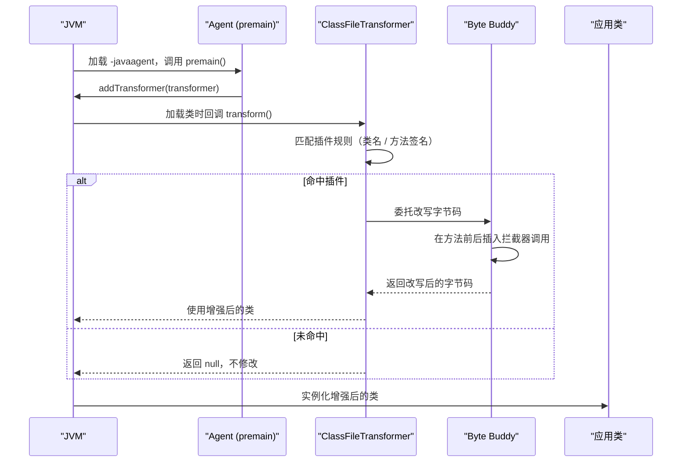

# 05 SkyWalking Java Agent 字节码增强原理

**摘要：**

SkyWalking 之所以能实现"应用代码零修改"的无侵入埋点，核心技术是 **Java Agent 字节码增强**——在 JVM 类加载时拦截目标类的字节码，动态注入追踪逻辑。这不是 SkyWalking 独创的技术，而是 JVM 平台的一项底层能力。本文从 JVM 的 **Java Instrumentation API** 出发，解释 Agent 如何获得改写字节码的权限、又如何与应用类隔离；然后深入 Byte Buddy——SkyWalking 底层使用的字节码操作框架——的工作原理；接着剖析插件体系如何把"拦截哪个类的哪个方法"与"注入什么追踪逻辑"解耦成可扩展的机制；最后落到 Context 管理、sw8 传播格式，以及字节码增强这条路线的风险与边界。读完之后，你应当能回答两个问题：**"零侵入"在技术上究竟是怎么实现的，以及它为此付出了什么代价**。

---

## 第 1 章 Java Instrumentation API：Agent 的入场券

### 1.1 什么是 Java Agent

在讨论 SkyWalking 之前，需要先理解 JVM 层面的 **Java Agent** 机制——它是所有 Java 字节码增强技术的基础设施。

**Java Agent** 是一个特殊的 JAR 包，通过 JVM 启动参数 `-javaagent:path/to/agent.jar` 加载。JVM 在启动时，会在应用的 `main()` 方法执行之前，先调用 Agent JAR 中指定的 `premain()` 方法。在 `premain()` 里，Agent 可以注册一个 **ClassFileTransformer**，这个 Transformer 会在每个类被 ClassLoader 加载时被回调，从而获得**修改该类字节码的机会**。

这个机制由 `java.lang.instrument` 包提供，核心接口是 `Instrumentation`：

```java
// Agent 的入口方法：JVM 在 main() 之前调用
public static void premain(String agentArgs, Instrumentation inst) {
    // 注册一个 ClassFileTransformer
    // 之后每个类加载时，transform() 方法都会被调用
    inst.addTransformer(new MyClassFileTransformer(), true);
}

public class MyClassFileTransformer implements ClassFileTransformer {
    @Override
    public byte[] transform(
        ClassLoader loader,            // 加载该类的 ClassLoader
        String className,              // 类名（如 "javax/servlet/http/HttpServlet"）
        Class<?> classBeingRedefined,  // 如果是 retransform，这是原始 Class 对象
        ProtectionDomain domain,
        byte[] classfileBuffer         // 原始字节码
    ) {
        // 检查是否需要增强这个类
        if (shouldEnhance(className)) {
            // 修改字节码并返回
            return enhanceBytecode(classfileBuffer);
        }
        // 返回 null 表示不修改
        return null;
    }
}
```

这个机制的关键在于"**钩子的位置**"：它不在业务代码里，而在 **JVM 的类加载流程里**。JVM 每加载一个类，都会给已注册的 Transformer 一次"改不改"的机会。SkyWalking 要做的，就是在这个钩子上判断"这个类是不是我要增强的"，是的话就改写它。**因为改写发生在类加载的那一刻，业务源码完全不知情，这就是"无侵入"的技术本质**。

### 1.2 premain 与 agentmain

Java Agent 有两种加载方式：

| 方式 | 入口方法 | 加载时机 | 使用场景 |
|---|---|---|---|
| 静态加载 | `premain()` | JVM 启动时，`main()` 之前 | SkyWalking Agent 的标准使用方式 |
| 动态加载 | `agentmain()` | JVM 运行中，通过 Attach API 注入 | 热部署、在线诊断（如 Arthas） |

SkyWalking Agent 使用 `premain()` 静态加载，原因有两条。

**其一，premain 能拦截所有类的首次加载。** 在 `main()` 之前注册 Transformer，可以确保应用中所有类的加载都能被拦截——包括那些在启动阶段就被加载的核心框架类。

**其二，agentmain 需要 retransform 已加载的类。** 如果类已经被加载（如 JDK 核心类），动态注入就必须调用 `inst.retransformClasses()` 重新触发 transform。这个操作有诸多限制（不能添加或删除字段、方法，只能修改方法体），且性能开销较大。**在 JVM 启动时"从头拦起"，比"事后补救"要干净得多**——这也是为什么静态加载是无侵入追踪的首选。

### 1.3 ClassLoader 隔离：一个绕不开的难题

Agent 的字节码运行在应用进程中，但 Agent 的类和应用的类需要**隔离**——Agent 依赖的 Byte Buddy、gRPC Client 等库不应该与应用依赖的同名库冲突。设想应用的 classpath 里恰好有一个不同版本的 gRPC，如果 Agent 直接复用，就可能出现"类冲突"甚至"方法找不到"的诡异问题。

SkyWalking Agent 通过**自定义 ClassLoader**（`AgentClassLoader`）实现隔离：

```text
JVM ClassLoader 层级：

Bootstrap ClassLoader（加载 rt.jar 等 JDK 核心类）
    ↓
AgentClassLoader（加载 SkyWalking Agent 的类和插件）
    ↓（不是父子关系，而是平行）
Application ClassLoader（加载应用的类）
```

Agent 的核心类（如 `ContextManager`、`AbstractSpan`）由 `AgentClassLoader` 加载，与 `Application ClassLoader` 隔离。但这里有一个棘手的问题：**增强后的方法体需要调用 Agent 的 API**（如创建 Span），而增强后的方法体运行在 `Application ClassLoader` 的上下文里——它看不见 `AgentClassLoader` 里的类。

SkyWalking 的解法是把关键桥接类加载到 **Bootstrap ClassLoader**（所有 ClassLoader 的祖先）中——因为 Bootstrap ClassLoader 里的类对所有 ClassLoader 都可见。这是一个典型的"**用更高的可见性打通隔离**"的手法：核心 API 放在最顶层，谁都能看见；其余实现放在隔离层，互不干扰。**理解了这层隔离与桥接，就能理解为什么 Agent 的代码结构会显得"别扭"**——那些别扭，都是为了让"隔离"与"可见"这对矛盾共存。

### 1.4 这个机制最初不是为可观测性准备的

一个有趣的事实是：**Java Instrumentation API 最初并不是为"链路追踪"设计的**。

它诞生于 JVM 的工具化需求——性能剖析（profiler 需要在方法前后插桩计时）、调试工具（需要动态查看类的状态）、热部署（在不重启的情况下替换类）、测试框架（如 Mock 框架需要在运行时改写行为）。可观测性对它的使用，其实是后来的事。

这个事实有两层启示。**其一，平台级能力的价值，往往在"被意想不到的场景用上"之后才充分显现**。Instrumentation API 的设计者大概没料到，它日后会成为 APM 行业的基础设施。**其二，好的底层机制应当保持"用途中立"**——它只提供"改字节码的能力"，不预设"改来干什么"，因此能被无数场景复用。

理解了这一点，再看 SkyWalking 的 Agent，就能把它放在正确的坐标系里：**它不是"发明了一种埋点技术"，而是"把一项通用平台能力，用在了可观测性这个特定场景上，并把它工程化到了极致"**。创新往往不在底层机制，而在"如何把一个通用能力做到好用"。

### 1.5 为什么"无侵入"在 Java 里最容易

把 Java 的这套机制与其他语言对比，会发现一个有意思的事实：**"零侵入自动埋点"在 Java 生态里做得最好，根源在于 JVM 提供了"类加载时可改写字节码"这项特权**。

其他语言的方案各有妥协。**Python** 用 monkey-patching——在运行时替换模块的函数引用，能覆盖一部分库，但对"已编译的 C 扩展"无能为力。**Node.js** 用 require hooks——拦截模块加载，改写导出的函数，覆盖范围受限于"模块化的写法"。**Go** 最麻烦：它是静态编译的，没有运行时拦截机制，官方至今没有自动埋点方案，只能靠手动埋点或 eBPF 从内核层观测。

这张对比说明：**"零侵入"不是一种通用的技术能力，而是"特定语言运行时特性"的产物**。Java 有字节码与类加载器，所以能做到；Go 没有，就只能换一条路。**在选型时，这一点直接决定了"多语言团队能不能享受同等的埋点体验"**——这也解释了为什么 OTel 的自动埋点覆盖度在不同语言间差异巨大（第 03 篇的表里，Go 那一行是空的）。

对 Java 团队而言，这其实是一项被低估的优势：**它让"可观测性接入"从"改代码的项目"变成了"改启动参数的操作"**。而对非 Java 团队，则要尽早接受"手动埋点 + 内核观测"的现实，并在架构上为它留出工作量。

---

## 第 2 章 Byte Buddy：字节码操作的瑞士军刀

### 2.1 为什么选择 Byte Buddy

直接操作 JVM 字节码（`byte[]` 数组）是一项极其繁琐且容易出错的工作。Java 生态中有多个字节码操作框架，抽象层级各不相同：

| 框架 | 抽象层级 | 复杂度 | 性能 | SkyWalking 使用 |
|---|---|---|---|---|
| ASM | 最低（字节码指令级） | 极高 | 最优 | 否（太底层） |
| Javassist | 中等（源码级修改） | 中等 | 良好 | 早期版本使用 |
| Byte Buddy | 最高（Java API 级） | 低 | 优秀 | 当前使用 |
| CGLIB | 高（代理级） | 低 | 良好 | 否（功能不够） |

Byte Buddy 由 Rafael Winterhalter 开发，它的核心优势是：**用纯 Java API 描述字节码修改，不需要了解任何 JVM 字节码指令**。开发者只需要定义"拦截哪个方法"和"在方法前后执行什么逻辑"，Byte Buddy 自动生成正确的字节码。

SkyWalking 早期使用 Javassist，后来切换到 Byte Buddy，原因有二。**其一，性能更优**：Byte Buddy 生成的字节码质量高（接近手写字节码），运行时开销更小。**其二，API 更安全**：Byte Buddy 的 API 设计具有强类型安全性，编译期就能发现很多错误；而 Javassist 需要以字符串形式编写 Java 代码片段，错误只在运行时才暴露。

第二条原因其实更关键。**用字符串描述代码，意味着"编译器帮不了你"**——拼错的类名、写错的方法签名，都要等到运行时才炸，而那时可能已经在生产环境了。**从"字符串拼接"升级到"类型安全的 API"，本质上是在把一类运行时错误提前到编译期**，这个收益在长期维护中会被不断兑现。

### 2.2 Byte Buddy 的核心 API

Byte Buddy 的使用范式是**声明式**的——描述"做什么"而不是"怎么做"：

```java
// 示例：使用 Byte Buddy 增强 HttpServlet.service() 方法
new AgentBuilder.Default()
    // 1. 匹配条件：拦截哪些类
    .type(named("javax.servlet.http.HttpServlet"))
    // 2. 增强逻辑：对匹配的类做什么修改
    .transform((builder, typeDescription, classLoader, module, domain) ->
        builder.method(
            // 匹配 service(HttpServletRequest, HttpServletResponse) 方法
            named("service")
                .and(takesArguments(2))
                .and(takesArgument(0, named("javax.servlet.http.HttpServletRequest")))
        )
        // 3. 委托给拦截器：在方法前后执行自定义逻辑
        .intercept(MethodDelegation.to(HttpServletInterceptor.class))
    )
    // 4. 注册到 Instrumentation
    .installOn(instrumentation);
```

**拦截器（Interceptor）** 是一个普通的 Java 类，用 Byte Buddy 的注解标记方法参数：

```java
public class HttpServletInterceptor {

    @RuntimeType  // 表示返回值类型在运行时确定
    public static Object intercept(
        @This Object servlet,            // 被拦截的对象实例
        @AllArguments Object[] args,     // 方法的所有参数
        @Origin Method method,           // 被拦截的原始方法
        @SuperCall Callable<?> callable  // 调用原始方法的 Callable
    ) throws Exception {
        // ===== 方法执行前：创建 Span =====
        HttpServletRequest request = (HttpServletRequest) args[0];
        Span span = ContextManager.createEntrySpan(request.getRequestURI());
        span.setComponent("Tomcat");
        span.setTag("http.method", request.getMethod());

        try {
            // ===== 调用原始方法 =====
            Object result = callable.call();

            // ===== 方法执行后：记录结果 =====
            HttpServletResponse response = (HttpServletResponse) args[1];
            span.setTag("http.status_code", String.valueOf(response.getStatus()));
            if (response.getStatus() >= 400) {
                span.errorOccurred();
            }
            return result;
        } catch (Exception e) {
            // ===== 异常处理：记录错误 =====
            span.errorOccurred();
            span.log(e);
            throw e;
        } finally {
            // ===== 清理：结束 Span =====
            ContextManager.stopSpan();
        }
    }
}
```

Byte Buddy 在类加载时把上述拦截逻辑编译为字节码，注入到 `HttpServlet.service()` 方法中。运行时，当 Tomcat 调用 `HttpServlet.service()` 时，实际执行的是增强后的版本——先创建 Span，再执行原始逻辑，最后结束 Span。

这段拦截器代码里有一个值得注意的设计模式：**`@SuperCall Callable` 把"调用原始方法"包装成了一个可延迟执行的对象**。这样拦截器就可以自由地决定"什么时候调、在什么上下文里调"——比如"先创建 Span，再调用原方法，最后结束 Span"。**把"方法调用"变成一个可传递的一等公民，是 AOP 类框架的通用手法**，理解这一点，就能看懂几乎所有拦截器代码的骨架。

### 2.3 增强的时机与性能影响

字节码增强发生在**类加载时**，而不是每次方法调用时。这个时机选择带来几个重要后果。

**增强只发生一次。** 每个类只在第一次被 ClassLoader 加载时经过 Transformer，之后 JVM 使用增强后的字节码，不再有 Transformer 的开销。因此增强本身的成本是"一次性的"，与运行时长无关。

**运行时开销约等于拦截器逻辑本身。** 增强后的方法体里增加了拦截器的调用（创建 Span、设置属性、结束 Span），这个开销通常在**微秒级**。**追踪的性能成本，主要来自"拦截器做了什么"，而不是"字节码被增强了"这个事实**——这也解释了为什么"采样"能有效降低开销（未采样时拦截器几乎什么都不做）。

**JIT 优化依然友好。** 增强后的字节码对 JVM 的 JIT 编译器是透明的——JIT 会把增强后的方法体与原始逻辑一起优化（内联、逃逸分析等）。**JVM 并不区分"这段字节码是人写的还是 Agent 注入的"**，因此增强不会破坏 JIT 的优化能力。

**启动时间会受影响。** Agent 在 JVM 启动时需要遍历所有加载的类、检查是否需要增强。这个过程会增加应用启动时间，通常在**数百毫秒到几秒**（取决于应用的类数量与启用的插件数量）。对长期运行的服务，这个一次性开销完全可以接受；但对 Serverless 函数（冷启动敏感），就值得权衡。

### 2.4 字节码增强与其他埋点手段的对比

要理解字节码增强的价值，最好把它与其他埋点手段放在一起比较。

**源码级 SDK 埋点**：开发者在代码里显式调用 API（如 OTel 的 `tracer.spanBuilder(...)`）。它的优点是精确可控、不依赖运行时机巧；缺点是侵入性强、覆盖面取决于开发者的自觉。**它适合"业务语义"的埋点**（如"处理订单"），因为只有开发者知道该在哪埋。

**AOP 框架埋点**（如 Spring AOP）：用切面在 Spring Bean 的方法前后织入逻辑。它比源码埋点省事，但**只能覆盖 Spring 容器管理的 Bean**——数据库驱动、HTTP 客户端、消息客户端这些"非 Spring 管理的对象"它够不着。

**字节码增强埋点**：在类加载时改写任意类的字节码。它的覆盖面最广——**只要是 JVM 加载的类，理论上都能增强**，无论它是不是 Spring Bean、属于哪个框架。代价是复杂度最高、维护成本最大。

| 手段 | 覆盖面 | 侵入性 | 维护成本 | 适用场景 |
|---|---|---|---|---|
| 源码 SDK | 开发者写到哪里 | 高 | 低 | 业务语义埋点 |
| AOP 框架 | Spring Bean | 中 | 中 | 应用内方法监控 |
| 字节码增强 | 任意 JVM 类 | 零（应用侧） | 高 | 框架级自动埋点 |

这张表解释了 SkyWalking 的选择逻辑：**它的目标是"覆盖整条链路的所有跨进程边界"，而这些边界几乎都在框架层（Servlet、JDBC、HTTP 客户端）**。AOP 够不着这些地方，源码埋点又要求每个团队配合，于是字节码增强成了唯一可行的选择。**技术路线的选择，由"目标覆盖面"倒推而来**，而不是"哪个技术更酷"。

### 2.5 Byte Buddy 的两个核心抽象

Byte Buddy 的 API 看似繁多，但核心抽象只有两个：**ElementMatcher（匹配什么）** 与 **Implementation（怎么增强）**。理解这两个概念，就看懂了它的全貌。

**ElementMatcher** 是一个"谓词"，回答"这个元素（类、方法、字段）是不是我要处理的"。它可以组合——`named("service").and(takesArguments(2))` 就是"名字是 service、且有两个参数"。所有的匹配逻辑，最终都归结为对 ElementMatcher 的构造与组合。

**Implementation** 描述"对匹配到的元素做什么"。最常见的是 `MethodDelegation`（把方法调用委托给一个拦截器类）与 `Advice`（在方法前后插入代码）。前者适合"需要完整控制方法调用"的场景（如需要拿到参数、决定何时调用原方法），后者适合"只需在前后插一段逻辑"的简单场景。

这两个抽象的组合，构成了 Byte Buddy 的全部表达力：**用 ElementMatcher 精确锁定增强点，用 Implementation 描述增强行为**。回到 3.2 讲的插件接口，会发现 SkyWalking 的 `ClassMatch` / `MethodMatch` 其实就是 ElementMatcher 的封装，`Interceptor` 则是 Implementation 的一种——**SkyWalking 的插件 API，本质上是 Byte Buddy API 的一层"面向追踪场景"的封装**。

**理解了底层的通用抽象，再看上层的专用 API，就会觉得它们"顺理成章"**——这正是"先懂原理、再看实现"的价值。

---

## 第 3 章 SkyWalking 的插件体系

### 3.1 插件的本质：把"增强什么"与"如何增强"解耦

SkyWalking Agent 需要支持数十种框架（Tomcat、Spring MVC、Dubbo、gRPC、MySQL JDBC、Redis Jedis、Kafka 等），每种框架要拦截不同的类和方法、注入不同的追踪逻辑。如果把这些增强逻辑硬编码在 Agent 核心中，代码会极其臃肿、难以维护，也无法让社区独立贡献。

SkyWalking 的解法是**插件体系**——每个框架的追踪支持被封装为一个独立的**插件**，插件定义三件关键信息：**增强目标**（拦截哪个类的哪个方法）、**拦截器**（在方法前后执行什么逻辑）、**Span 语义**（创建什么类型的 Span、设置什么 Component 与 Tags）。

这个解耦的意义，可以用一个类比来说明：**Agent 核心是"插座"，插件是"各种插头"**。插座定义了统一的接口，插头各管一种设备；要支持新设备，只需造一个新插头，不必改插座。**插件化是"覆盖面可持续扩张"的制度前提**——没有它，每加一个框架都要动核心代码，扩张迟早会停滞。

### 3.2 插件的接口定义

每个 SkyWalking 插件需要实现 `AbstractClassEnhancePluginDefine` 抽象类（或其子类），定义以下关键方法：

```java
// 伪代码：SkyWalking 插件接口
public abstract class AbstractClassEnhancePluginDefine {

    // 1. 定义要增强的类
    protected abstract ClassMatch enhanceClass();

    // 2. 定义要增强的实例方法及其拦截器
    protected abstract InstanceMethodsInterceptPoint[] getInstanceMethodsInterceptPoints();

    // 3. 定义要增强的构造方法及其拦截器
    protected abstract ConstructorInterceptPoint[] getConstructorInterceptPoints();

    // 4. 定义要增强的静态方法及其拦截器（可选）
    protected abstract StaticMethodsInterceptPoint[] getStaticMethodsInterceptPoints();
}
```

一个具体的插件示例（Tomcat 插件）如下：

```java
public class TomcatInstrumentation extends ClassInstanceMethodsEnhancePluginDefine {

    @Override
    protected ClassMatch enhanceClass() {
        // 增强 Tomcat 的 StandardHostValve 类
        // 这个类是 Tomcat 请求处理管道中的关键环节
        return byName("org.apache.catalina.core.StandardHostValve");
    }

    @Override
    public ConstructorInterceptPoint[] getConstructorInterceptPoints() {
        return null;  // 不增强构造方法
    }

    @Override
    public InstanceMethodsInterceptPoint[] getInstanceMethodsInterceptPoints() {
        return new InstanceMethodsInterceptPoint[] {
            new InstanceMethodsInterceptPoint() {
                @Override
                public ElementMatcher<MethodDescription> getMethodsMatcher() {
                    // 拦截 invoke(Request, Response) 方法
                    return named("invoke");
                }

                @Override
                public String getMethodsInterceptor() {
                    // 指定拦截器类名
                    return "org.apache.skywalking.apm.plugin.tomcat.TomcatInvokeInterceptor";
                }

                @Override
                public boolean isOverrideArgs() {
                    return false;  // 不修改方法参数
                }
            }
        };
    }
}
```

这个接口设计里，**"匹配什么"（ClassMatch / MethodMatch）与"做什么"（Interceptor）是分离的**。匹配用声明式的表达式（`byName(...)`、`named(...)`），拦截器是独立的类。这种分离让插件既能精确控制"拦截点"，又能把"追踪逻辑"写成可测试、可复用的独立单元。

### 3.3 插件的发现与加载

SkyWalking Agent 使用 **SPI（Service Provider Interface）** 机制发现和加载插件：

```text
skywalking-agent/
├── skywalking-agent.jar          ← Agent 核心
├── config/
│   └── agent.config              ← 配置文件
├── plugins/                      ← 插件目录（自动加载）
│   ├── apm-tomcat-plugin.jar
│   ├── apm-spring-mvc-plugin.jar
│   ├── apm-dubbo-plugin.jar
│   ├── apm-mysql-plugin.jar
│   ├── apm-redis-jedis-plugin.jar
│   └── ...
├── optional-plugins/             ← 可选插件（手动移入 plugins/ 启用）
│   ├── apm-trace-ignore-plugin.jar
│   ├── apm-spring-cloud-gateway-plugin.jar
│   └── ...
└── optional-reporter-plugins/    ← 可选上报插件
    ├── kafka-reporter-plugin.jar
    └── ...
```

Agent 启动时的加载流程是：扫描 `plugins/` 目录下的所有 JAR；通过 SPI 加载每个 JAR 中的 `AbstractClassEnhancePluginDefine` 实现；收集所有插件返回的类匹配规则；把匹配规则注册到 Byte Buddy 的 AgentBuilder；最后把 AgentBuilder 安装到 Instrumentation，开始拦截类加载。

**按需启用与禁用插件**：不需要某个框架的追踪支持时，直接从 `plugins/` 目录移除对应的 JAR 即可；需要可选功能时，从 `optional-plugins/` 移入 `plugins/`。**这种基于文件系统的插件管理方式非常直观**——它把"启用哪些能力"变成了"放哪些文件"，降低了运维的心智负担。

### 3.4 插件开发的三种拦截模式

SkyWalking 根据 Span 类型，定义了三种拦截器基类。

**EntrySpan 拦截器**用于服务入口（如 HTTP 请求接收、消息消费）。拦截器需要：从传入请求中提取 SpanContext（如从 HTTP Header 提取 `sw8`）；创建 EntrySpan，把提取的上下文作为父 Context；设置操作名（如 `GET /api/orders`）与组件名（如 `Tomcat`）。

**ExitSpan 拦截器**用于服务出口（如 HTTP 请求发送、数据库查询）。拦截器需要：创建 ExitSpan，记录被调用方地址（peer）；把当前 SpanContext 序列化并注入传输载体（如 HTTP Header）；设置操作名（如 `MySQL/JDBC/PreparedStatement/execute`）与组件名（如 `MySQL`）。

**LocalSpan 拦截器**用于进程内部操作（如本地缓存查询、业务逻辑）。拦截器只需要：创建 LocalSpan，记录操作名与组件名，不涉及跨进程的 Context 传播。

这三种模式的划分，与第 02 篇讲的 Span Kind 一一对应。**EntrySpan 是"链路的入口"，ExitSpan 是"链路的出口"，LocalSpan 是"链路内部"**——插件开发者只要想清楚"我要增强的这段代码，在链路里扮演什么角色"，就能选对拦截模式。

### 3.5 匹配规则如何工作

插件的"匹配规则"是它最核心的部分，值得单独说清。

**类匹配（ClassMatch）** 决定"增强哪些类"，常见的方式有三种：**按类名精确匹配**（`byName("org.apache.catalina.core.StandardHostValve")`）、**按继承关系匹配**（`byHierarchy`，匹配某个类的所有子类，适合接口多实现的情况）、**按类注解匹配**（`byClassAnnotationMatch`，匹配带某注解的类，Spring MVC 插件常用）。

**方法匹配（MethodMatch）** 决定"增强类里的哪些方法"，同样有组合能力：按方法名匹配、按参数数量匹配、按参数类型匹配，并可以用 `and` / `or` 组合。比如 `named("service").and(takesArguments(2))` 就精确锁定了"名为 service、且有两个参数"的方法。

这两级匹配的组合，让插件能精确地"锁定增强点"。但这里有一个必须注意的性能约束：**匹配是在类加载时执行的，而类加载是启动路径上的关键环节**。如果匹配规则写得过于宽泛（如匹配所有类），那么每次类加载都要走一遍复杂的判断，启动时间会被显著拖慢。因此插件作者要在"匹配精确"与"匹配开销"之间权衡——**用最便宜的方式排除掉绝大多数类，是插件性能的关键**。

### 3.6 插件与框架版本的耦合

插件体系有一个必须正视的成本：**它与框架版本强耦合**。

插件依赖"被增强类的结构"——类名、方法名、方法签名。而这些结构可能随框架版本变化。当 Tomcat 或 Spring 在新版本里改了某个方法的签名，旧插件就可能"匹配不上"（增强失效，静默地丢追踪）或"增强出错"（更糟，可能导致应用异常）。

SkyWalking 用一些手段缓解这个问题：用"按继承关系匹配"而非"按精确类名匹配"来增加兼容性；对同一框架的不同大版本提供不同的插件；在 Agent 里加入"增强失败就跳过"的容错。

但这些手段只是缓解，无法根治。**字节码增强本质上是一项"需要持续投入"的技术**——框架每升一次级，就要验证一次插件。这也是为什么 SkyWalking 有一个活跃的 Java Agent 仓库在持续维护：**这份维护成本，就是"无侵入"的隐藏账单**。

理解了这一点，就能理解一个务实的实践：**在升级框架版本时，把"验证 Agent 兼容性"列入升级清单**。把它当成一次需要测试的变更，而不是"应该没事"的默认假设——**绝大多数 Agent 相关的事故，都源于"以为它没事"**。

---

## 第 4 章 Context 管理的内部实现

### 4.1 ContextManager：线程级的 Trace 状态机

`ContextManager` 是 SkyWalking Agent 中管理 Trace 上下文的核心类。它通过 ThreadLocal 维护每个线程的 Trace 状态：

```java
// 简化的 ContextManager 实现逻辑
public class ContextManager {
    // 每个线程持有一个 AbstractTracerContext
    private static ThreadLocal<AbstractTracerContext> CONTEXT = new ThreadLocal<>();

    // 创建入口 Span（服务接收请求时调用）
    public static AbstractSpan createEntrySpan(String operationName, ContextCarrier carrier) {
        AbstractTracerContext context = getOrCreate();
        return context.createEntrySpan(operationName);
    }

    // 创建出口 Span（调用下游服务时调用）
    public static AbstractSpan createExitSpan(String operationName, ContextCarrier carrier, String peer) {
        AbstractTracerContext context = getOrCreate();
        return context.createExitSpan(operationName, peer);
    }

    // 创建本地 Span
    public static AbstractSpan createLocalSpan(String operationName) {
        AbstractTracerContext context = getOrCreate();
        return context.createLocalSpan(operationName);
    }

    // 结束当前 Span
    public static void stopSpan() {
        AbstractTracerContext context = CONTEXT.get();
        if (context.stopSpan(context.activeSpan())) {
            // 所有 Span 都已结束，Segment 完成
            // 将 Segment 放入上报缓冲区
            TracingContext.ListenerManager.notifyFinish(context.capture());
            CONTEXT.remove();  // 清理 ThreadLocal，防止内存泄漏
        }
    }

    private static AbstractTracerContext getOrCreate() {
        AbstractTracerContext context = CONTEXT.get();
        if (context == null) {
            // 检查采样策略：是否需要记录这个 Trace
            if (SamplingService.trySampling()) {
                context = new TracingContext();       // 真实的追踪上下文
            } else {
                context = new IgnoredTracerContext();  // 忽略上下文（不记录任何数据）
            }
            CONTEXT.set(context);
        }
        return context;
    }
}
```

这段代码里有两个设计值得注意。

**其一是 `CONTEXT.remove()`。** 当 Segment 完成时，必须把 ThreadLocal 清理掉，否则线程池里的线程会一直持有上一个请求的上下文，造成**内存泄漏**与**上下文串味**（下一个请求复用了上一个请求的 Trace ID）。**在"线程复用"的环境里，"用完即清"是一条必须遵守的铁律**。

**其二是 `IgnoredTracerContext`。** 当采样决定不记录当前 Trace 时，ContextManager 创建一个"空"上下文，所有 Span 创建与结束操作都是 No-op，几乎零开销。这比"创建真实 Span 然后在上报时丢弃"更高效——**它把"不采样"的成本从"创建对象再扔掉"降到了"什么都不做"**。第 02 篇讲采样时说的"低开销"，在这里得到了最直接的体现。

### 4.2 Span 的栈式管理

一个线程中可能嵌套多个 Span（如 EntrySpan → LocalSpan → ExitSpan），SkyWalking 使用**栈（Stack）**来管理嵌套关系：

```text
线程执行顺序：
  1. HTTP 请求到达 → createEntrySpan("GET /api/orders")       栈：[Entry]
  2. 进入业务逻辑 → createLocalSpan("OrderService.create")     栈：[Entry, Local]
  3. 调用数据库 → createExitSpan("MySQL/SELECT", "mysql:3306") 栈：[Entry, Local, Exit]
  4. 数据库返回 → stopSpan()                                   栈：[Entry, Local]
  5. 调用支付服务 → createExitSpan("POST /pay", "pay:8080")    栈：[Entry, Local, Exit]
  6. 支付返回 → stopSpan()                                     栈：[Entry, Local]
  7. 业务完成 → stopSpan()                                     栈：[Entry]
  8. HTTP 响应 → stopSpan()                                    栈：[]  → Segment 完成
```

**栈顶的 Span 就是当前的 Active Span**——新创建的 Span 自动以栈顶 Span 为父。这正是第 02 篇讲过的"追踪的父子关系，本质是程序调用栈在时间维度上的投影"的落地实现。

### 4.3 跨线程的 Context 传递

当业务代码使用异步编程（如把任务提交到线程池）时，新线程的 ThreadLocal 里没有 Trace Context，链路会"断裂"。SkyWalking 提供了两种机制解决这个问题。

**机制一：ContextSnapshot 手动传递。**

```java
// 主线程：捕获当前 Context 的快照
ContextSnapshot snapshot = ContextManager.capture();

// 提交到线程池
executor.submit(() -> {
    // 子线程：恢复 Context
    ContextManager.continued(snapshot);
    try {
        // 在子线程中创建的 Span 会自动关联到原始 Trace
        AbstractSpan span = ContextManager.createLocalSpan("async-task");
        // ... 业务逻辑
        ContextManager.stopSpan();
    } finally {
        ContextManager.cleanAfterAsync();
    }
});
```

**机制二：@TraceCrossThread 注解加 Agent 自动增强。**

```java
@TraceCrossThread
public class MyTask implements Runnable {
    @Override
    public void run() {
        // Agent 自动在 run() 入口恢复 Context
        // 不需要手动调用 capture() 和 continued()
    }
}

// 使用方式与普通 Runnable 完全一样
executor.submit(new MyTask());
```

Agent 的 `@TraceCrossThread` 插件在类加载时，自动把 `ContextSnapshot` 的捕获与恢复逻辑注入到被注解类的构造方法与 `run()`/`call()` 方法中。

这两种机制的分工很清晰：**手动传递（ContextSnapshot）灵活但需要改代码，注解增强（@TraceCrossThread）零侵入但只覆盖被标注的类**。实践中，业务代码里的异步任务往往用前者（精确控制），框架层面的异步（如 Agent 自带的线程池插件）用后者（自动覆盖）。**这与第 03 篇讲"自动埋点与手动埋点互补"是同一个道理**——覆盖边界与精确控制，往往需要两条腿走路。

### 4.4 为什么"不采样"也必须传上下文

这里有一个容易被误解的点，值得再强调一次：**即使采样决定不记录，ContextManager 仍然会创建 `IgnoredTracerContext` 并传播 Trace ID**。

原因在于，采样与传播是两件独立的事（第 02 篇讲过）：上游不采样，不代表下游不采样；Trace ID 必须一路传下去，下游才有机会决定"我要不要记录"。如果"不采样"就"不传上下文"，那么下游永远没有机会记录这条链路——**这就把"上游的采样决策"变成了"整条链路的采样决策"，而这恰恰破坏了一致性采样的前提**。

SkyWalking 用 `IgnoredTracerContext` 巧妙地实现了这一点：**它"什么都不记"，但"什么都照常传"**。这个设计既保证了低开销（不记录就没有开销），又保证了链路的可传播性（下游仍可决策）。

### 4.5 上下文管理的失败模式

上下文管理是 Agent 里最容易出问题的地方，把常见失败模式列清楚，有助于排查。

**其一是忘记 `stopSpan`。** 每个 `createXxxSpan` 都必须配一个 `stopSpan`，否则 Span 永远不会结束、Segment 永远不完整、ThreadLocal 永远不会被清理。因此拦截器里的 `stopSpan` 必须放在 `finally` 块里——**这是埋点代码的铁律，因为异常路径最容易漏掉它**。

**其二是 ThreadLocal 未清理导致"串味"。** 如果 Segment 完成后没有 `CONTEXT.remove()`，线程池里的线程会一直持有上一个请求的上下文。下一个请求复用这个线程时，就可能"继承"了上一个请求的 Trace ID——表现为"两条毫不相干的请求，却出现在同一条 Trace 里"。这类问题极难排查，因为它只在特定并发时序下出现。

**其三是异步边界未传递。** 这是"断链"的头号原因，第 02、04 篇都强调过。表现是"链路在下游突然换了一个 Trace ID"。

**其四是异常路径下的 Span 丢失。** 如果拦截器在 `catch` 里做了"提前 return"而没走 `finally`，Span 就会漏结束。**异常处理写得越复杂，越容易在这里出问题**。

这四类失败的共同特征是"**症状与根因相距很远**"——忘记清理表现为"Trace 串味"，异步漏传表现为"链路断裂"。因此排查时的一条有效策略是：**先怀疑"上下文生命周期"，再看业务逻辑**。因为上下文问题是"系统性"的（影响所有请求），而业务问题通常是"局部性"的（只影响特定场景）。

### 4.6 并发模型演进带来的新挑战

上下文管理有一个容易被忽视的"时代变量"：**并发模型在演进，而上下文载体也在随之变化**。

传统的并发模型是"线程池"——上下文放在 ThreadLocal 里，跨线程时手动快照传递。这套方案在第 4.3 节讲得很清楚。

但新的并发模型带来了新问题。**响应式编程（如 Reactor、RxJava）** 里，一个请求可能在不同的线程上执行不同的阶段，ThreadLocal 的"线程绑定"假设不再成立——上下文必须跟着"数据流"走，而不是跟着"线程"走。**协程（如 Kotlin 协程）** 也有类似问题：一个协程可能在不同线程上挂起与恢复，ThreadLocal 同样靠不住。

更近的变化是 **Java 21 的虚拟线程（Virtual Thread）**。虚拟线程数量可能达到百万级，如果每个虚拟线程都在 ThreadLocal 里存一份上下文，内存开销会非常可观——这也是 JEP 里推动"Scoped Values"替代 ThreadLocal 的动机之一。

这些变化的共同启示是：**"上下文放在哪里"这个问题，没有一劳永逸的答案——它取决于当前的并发模型**。ThreadLocal 在"一请求一线程"的时代是最优解，在多线程、协程、虚拟线程的时代就需要新的载体。**追踪系统必须跟着并发模型的演进而调整**，否则就会在新的编程范式里"水土不服"。这也解释了为什么"异步链路断裂"始终是追踪领域的高频问题——**并发模型越复杂，上下文传播就越难**。

---

## 第 5 章 常见插件的增强策略

### 5.1 JDBC 插件：数据库调用追踪

JDBC 插件拦截 `java.sql.PreparedStatement` 的 `execute()`、`executeQuery()`、`executeUpdate()` 方法，创建 ExitSpan：

```text
增强目标：java.sql.PreparedStatement.execute*()
Span 类型：ExitSpan
Component：MySQL / PostgreSQL / Oracle（根据 JDBC URL 自动识别）
Peer：从 Connection 的 URL 中提取（如 "mysql:3306"）
Tags：
  - db.type: mysql
  - db.instance: order_db
  - db.statement: SELECT * FROM orders WHERE id = ?（参数化 SQL，不含实际值）
```

> [!warning] SQL 记录的安全考量
> SkyWalking 默认记录**参数化 SQL**（`SELECT * FROM orders WHERE id = ?`），不记录实际的参数值——这是为了防止敏感数据（如用户密码、身份证号）泄露到追踪系统。如果需要记录完整 SQL（含参数），需要额外启用 `trace_sql_parameters` 配置，并自行承担安全风险。**追踪系统往往是最"不设防"的数据存储之一**——它被开发者随意查询、导出、共享，因此把敏感数据挡在门外，应当是一条默认原则。

### 5.2 Spring MVC 插件：HTTP 入口追踪

Spring MVC 插件拦截 `@RequestMapping` 标注的 Controller 方法，创建 EntrySpan：

```text
增强目标：带有 @RequestMapping 注解的方法
Span 类型：EntrySpan
Component：SpringMVC
Tags：
  - http.method: GET / POST / PUT / DELETE
  - url: /api/orders/{id}
  - http.status_code: 200
```

一个微妙的设计点：Spring MVC 插件的增强目标不是 `DispatcherServlet`（那是 Servlet 容器层面的入口），而是具体的 Controller 方法。这样做的好处是**操作名可以精确到 Controller 方法级别**（如 `OrderController.getOrder`），而不是泛泛的 `DispatcherServlet.service()`。

这个取舍揭示了插件设计的一条原则：**增强点选得越"靠近业务"，Span 的语义就越清晰，但适配的复杂度也越高**。选 `DispatcherServlet` 简单通用，但 Span 名千篇一律；选 Controller 方法精确，但需要处理注解匹配、方法重载等细节。**插件作者必须在这条"通用性"与"精确性"的轴上做出选择**。

### 5.3 HTTP Client 插件：出口调用追踪

以 OkHttp 插件为例，它拦截 `okhttp3.RealCall.execute()` 与 `enqueue()` 方法，创建 ExitSpan 并注入 sw8 Header：

```text
增强目标：okhttp3.RealCall.execute() / enqueue()
Span 类型：ExitSpan
Component：OKHttp
Peer：从 Request.url() 中提取主机和端口
Context Propagation：
  1. 在发送请求前，将当前 SpanContext 序列化为 sw8 格式
  2. 添加到 HTTP Request 的 Header 中
  3. 被调用方的 Agent（如 Tomcat 插件）从 Header 中提取 sw8
  4. 还原为 SpanContext，作为新 Segment 的父 Context
```

### 5.4 插件的共性

把上面三个插件放在一起看，会发现它们遵循同一个骨架：**判断入口还是出口 → 创建对应类型的 Span → 记录关键属性 → 结束 Span**。差异只在于"拦截哪里"与"记录什么"。

这个共性正是插件体系的价值所在：**它把"追踪的通用逻辑"沉淀在拦截器基类里，把"框架特有的适配"留给插件**。开发者写一个新插件时，不需要从零思考"追踪该怎么做"，只需要回答两个问题——"这个框架的关键方法在哪"、"调用它时该记录什么"。**把通用性沉淀、把特殊性隔离，是任何可扩展体系的设计通则**。

### 5.5 一个自研插件该怎么写

当团队使用自研中间件（如内部的 RPC 框架、消息客户端）时，就需要自己写插件。这个过程其实有章可循，可以拆成六步。

**第一步，确定增强点。** 找到框架里"一次跨进程调用的入口与出口方法"——入站处理的方法（增强为 EntrySpan）、出站发送的方法（增强为 ExitSpan）。判断标准是"这次调用是否跨越了进程边界"。

**第二步，选择 Span 类型。** 入站选 EntrySpan，出站选 ExitSpan，进程内的关键逻辑选 LocalSpan。选错类型会导致拓扑图错乱或网络延迟计算失真。

**第三步，写拦截器。** 在方法前创建 Span、设置组件名与关键属性；在方法后记录结果与状态；在 `finally` 里 `stopSpan`。出站拦截器还要负责注入传播 Header。

**第四步，处理上下文。** 入站拦截器要提取 Header 还原上下文；出站拦截器要序列化上下文注入 Header。

**第五步，注册 SPI。** 在插件的资源目录里声明 `AbstractClassEnhancePluginDefine` 的实现类，Agent 启动时才会加载它。

**第六步，验证。** 用真实调用验证：Span 是否被创建、上下文是否正确传递、链路是否能与上下游拼起来。

这六步里，最容易出错的是**第一步与第四步**——增强点选错会导致"采不到关键调用"，上下文处理不当会导致"链路断裂"。**插件开发的难点不在写代码，而在"想清楚这次调用在链路里的位置"**。

---

## 第 6 章 sw8 协议：上下文传播格式

### 6.1 sw8 Header 的结构

SkyWalking 使用自定义的 `sw8` HTTP Header 传播 Trace Context。sw8 的格式是用 `-` 分隔的多个字段，每个字段用 Base64 编码：

```text
sw8: 1-TRACE_ID-SEGMENT_ID-SPAN_ID-SERVICE-INSTANCE-ENDPOINT-PEER_HOST

各字段含义：
  1              → 采样标志（1=采样，0=不采样）
  TRACE_ID       → Trace ID（Base64 编码）
  SEGMENT_ID     → 父 Segment ID（Base64 编码）
  SPAN_ID        → 父 Span ID（数字）
  SERVICE        → 父服务名（Base64 编码）
  INSTANCE       → 父实例名（Base64 编码）
  ENDPOINT       → 父端点名（Base64 编码）
  PEER_HOST      → 目标地址（Base64 编码）
```

### 6.2 为什么不直接用 W3C Trace Context

这个问题值得深究，因为它体现了"标准"与"效率"之间的一次真实取舍。

SkyWalking 的 sw8 携带了比 W3C `traceparent` 更多的信息——特别是**父服务名、父实例名、父端点名**。这些信息让下游服务在接收请求时，不需要查询任何外部系统，就能知道"谁调用了我"——OAP 利用这个信息直接构建服务拓扑图。

而 W3C `traceparent` 只携带 Trace ID、Parent Span ID 与 Flags。OAP 需要在收到双方的 Segment 后，通过 Span 的 `peer` 信息与反向查找来建立调用关系——这比 sw8 的方式更间接。

**这是一个典型的"标准 vs 效率"取舍**：sw8 用"更多字段"换来了"更直接的拓扑推导"，代价是与标准不兼容；W3C 用"更少字段"换来了"跨厂商互通"，代价是拓扑推导要绕一道弯。SkyWalking 从 8.x 版本开始同时支持 sw8 与 W3C Trace Context，通过配置选择——**它没有在两者之间选一个，而是让使用者在"效率"与"互通"之间自己权衡**。

### 6.3 兼容策略的启示

SkyWalking 支持两种传播格式的做法，本身就是一条值得借鉴的经验：**面对"既有私有协议"与"新兴标准"的冲突，未必要二选一，也可以"双支持 + 配置切换"**。

这条策略的好处是让迁移变得渐进：团队可以先继续用 sw8（保留效率），等需要与外部系统互通时，再切换到 W3C（或同时支持）。**迁移的最大阻力往往不是"新方案不好"，而是"切换成本太高"**——而"双支持"恰好把切换成本降到了"改一个配置"。

### 6.4 sw8 的字段设计解析

sw8 的每个字段都不是随便加的，理解它们的设计意图，有助于把握"私有协议为什么长这样"。

**采样标志放在第一位**：这样接收方在读第一个字符时就能判断"要不要为这条链路做记录"，无需解析完整字符串，是一个"快路径优化"。

**服务名、实例名、端点名都随行传播**：这是 sw8 与 W3C 最大的差别。它的目的是"让下游无需查询就能知道上游是谁"，从而让 OAP 能直接推导拓扑。**这是把"拓扑推导的成本"从"后端计算"前移到了"传播"**——用一点带宽，换后端的一次查询。

**用 Base64 编码、用 `-` 分隔**：因为服务名、端点名可能包含非 ASCII 字符，且 HTTP Header 对字符集有限制，Base64 是稳妥的选择；而 `-` 是 HTTP Header 里安全、又不常出现在 Base64 里的分隔符（Base64 用 `+` 和 `/`）。**协议格式的选择，处处受"载体约束"的影响**。

这三点合起来说明：**一个协议长什么样，取决于它"要在什么载体上跑、要服务什么使用场景"**。sw8 服务于"SkyWalking 自家的拓扑推导"，因此它携带更多信息；W3C 服务于"跨厂商互通"，因此它追求最小、最中立。**理解了设计意图，就不会再简单地评判"谁的协议更先进"**。

### 6.5 传播格式的未来：向 W3C 收敛

从趋势上看，传播格式正在向 W3C 收敛——这几乎是必然的。原因很简单：**当生态里只有一个标准时，任何"私有格式"都要为"跨系统互通"付出额外代价**。随着 OTel 的普及、跨厂商链路的增多，"用标准格式"的收益会越来越大。

但这不意味着 sw8 会立刻消失。**私有格式在"自家生态内"仍有明确的效率优势**——它携带的额外信息（服务名、实例名、端点名）能让拓扑推导更直接，这是 W3C 的极简设计给不了的。因此现实中的收敛过程会是渐进的：**对外互通时用 W3C，内部链路继续用 sw8（或双格式并存）**。

这条演进路径其实在软件史上反复出现：**私有协议先在自家生态里优化到极致，再在"互通需求"的推动下逐步向标准靠拢**。TCP/IP 取代各种私有网络协议、HTTP 取代各种 RPC 私有协议，走的都是同一条路。**标准化的动力，从来不是"私有格式不好"，而是"互通的需求越来越强"**。

理解了这一点，就能对"要不要现在就切换到 W3C"这类问题给出务实的回答：**看你的互通需求有多强**。如果链路全在自家生态内，sw8 的效率优势仍然值得保留；如果有大量跨团队、跨厂商的链路要拼，那就该尽早拥抱标准。

---

## 第 7 章 字节码增强的边界与风险

### 7.1 兼容性风险

字节码增强依赖"被增强类的内部结构"——类名、方法名、方法签名。而这些结构可能随框架版本变化。当 Tomcat 或 Spring 在新版本里改了某个方法的签名，旧插件就可能"匹配不上"或"增强出错"。

这就是为什么 SkyWalking 需要**紧跟框架版本、不断维护插件**。**字节码增强是一项"需要持续投入"的技术**——它不是"装一次就永远能用"，而是"框架每升一次级，就要验证一次"。这也是"无侵入"的真实代价之一：**它把"应用改代码的成本"转移成了"Agent 维护插件的成本"**。

### 7.2 启动开销与冷启动

如 2.3 所述，Agent 会增加应用启动时间。在常规的"长驻服务"里，这个开销可以忽略；但在两类场景里它会被放大：**其一是 Serverless（冷启动敏感）**，每次冷启动都要重新走一遍增强流程；**其二是大规模弹性伸缩**，频繁启停的实例会反复承受启动开销。

**这提醒我们：任何"全局性"的技术方案，都会在某些特定场景下变成负担**。无侵入追踪在常规场景里近乎完美，在冷启动敏感的场景里却要重新评估。

### 7.3 排障的困难

最后一个风险是"排障困难"。字节码增强发生在"看不见的地方"——源码里没有这段逻辑，调试器里断不到，堆栈里可能多出陌生的帧。当增强引入问题时（如某个框架的插件与另一插件冲突、或增强了不该增强的类），排查会相当棘手。

因此有一条实践建议：**遇到"诡异行为"时，先怀疑 Agent**。做法是"去掉 `-javaagent` 再复现一次"——如果问题消失，就基本可以锁定是 Agent 的问题。**把"能不能一键去掉"作为评估无侵入方案的一条标准**，是很务实的选择：它决定了出问题时你有没有一条快速排除的退路。

### 7.4 一个真实的事故场景

把风险具体化，来看一个典型的事故：某团队升级了某个框架的大版本，应用的单元测试与集成测试全部通过，于是直接发布上线。上线后却发现：**服务能启动，但追踪数据里完全看不到这个框架的调用**——因为旧插件的匹配规则在新版本里匹配不上了，增强静默失效。

更糟的变体是：增强没有"静默失效"，而是"增强出错"，导致应用在启动阶段抛异常——这次是直接不可用。

这两种情况对应的应对措施不同。**对"静默失效"，要靠"追踪覆盖率监控"来发现**（如定期核对"关键框架的 Span 是否存在"）；**对"增强出错"，要靠"灰度发布"来兜底**（先在一个实例上验证，确认无误再全量）。

这个场景的教训是：**字节码增强的引入，与任何代码变更一样，需要灰度与验证**。它的"零侵入"容易让人误以为"没有风险"，但**风险并没有消失，只是从"代码变更"转移到了"运行时的字节码改写"**——后者更隐蔽，因为它不在 diff 里。

### 7.5 如何降低这些风险

针对上述风险，有几条可落地的实践。

**其一是"插件白名单"**。不把全部插件都放进去，而是只放"确实需要的那些"——插件越少，启动开销越小，冲突面也越小。

**其二是"版本矩阵测试"**。对核心框架，维护一个"框架版本 × Agent 版本"的兼容矩阵，升级前先在矩阵上验证。这一步的投入，会在一次事故中被全额赚回。

**其三是"覆盖率监控"**。把"关键框架是否还在产生 Span"做成一个可监控的指标，一旦某类 Span 消失就告警。**静默失效是最危险的失效**，因为它没有任何报错。

**其四是"可快速摘除"**。保证 Agent 能在不改代码的情况下被摘掉（如通过启动参数、配置开关），这样一旦怀疑是 Agent 的问题，就能快速验证。**给任何"隐式生效"的组件留一条"快速关掉"的路，是运维的基本功**。

### 7.6 Agent 的版本管理

最后补一个实践问题：**Agent 的版本，应当如何管理**？

一个常见的误区是把 Agent 当成"装一次就不用管"的东西——应用发布时不动它，Agent 版本几年不升。这会带来两个问题：**其一，错过新框架的适配与缺陷修复**；**其二，某天被迫升级时，一次跨越多个大版本，风险陡增**。

更稳妥的做法是**把 Agent 当成一项基础设施来管理**：与应用解耦（通过启动参数或基础镜像注入，而不是打进应用包）；建立"Agent 版本 × 框架版本"的兼容清单；按节奏小步升级，而不是长期不动。

这里有一个容易被忽视的好处：**Agent 与应用解耦后，升级 Agent 不必重新构建应用**——只要基础镜像或启动参数变一下，重启即可。这大幅降低了"追踪能力升级"的成本，也让它从"应用团队的排期"变成了"运维团队的操作"。**解耦的价值，就是让两条演进线可以独立推进**。

---

## 第 8 章 一个增强流程的完整走查

把全篇的内容串成一个走查，会更容易建立整体印象。先看一次类加载增强的时序：



假设应用以 `-javaagent:skywalking-agent.jar` 启动：

```text
① JVM 启动，加载 skywalking-agent.jar
   → 调用 premain()，注册 ClassFileTransformer

② Agent 扫描 plugins/ 目录，通过 SPI 加载所有插件
   → 得到一份"类匹配规则"清单（Tomcat、Spring MVC、JDBC ...）

③ JVM 加载 javax.servlet.http.HttpServlet
   → Transformer 回调，匹配到 Servlet 插件
   → Byte Buddy 改写字节码：在 service() 前后插入拦截器调用

④ JVM 加载 java.sql.PreparedStatement 的实现类
   → 匹配到 JDBC 插件，改写 execute() 方法

⑤ 请求到达，Tomcat 调用增强后的 service()
   → 拦截器创建 EntrySpan，存入 ThreadLocal 的上下文栈

⑥ 业务代码查询数据库，调用增强后的 execute()
   → 拦截器创建 ExitSpan，记录 SQL 与 peer

⑦ 业务代码调用下游 HTTP 服务，调用增强后的 OkHttp execute()
   → 拦截器创建 ExitSpan，注入 sw8 Header

⑧ 请求处理完毕，各 Span 依次 stopSpan()，栈清空
   → Segment 完成，放入 Ring Buffer，后台线程异步上报

⑨ 若某处使用了异步线程且未传递上下文
   → 该线程的链路"断裂"，形成独立的 Trace
```

这个走查里，**②③④是"启动期"的工作，⑤⑥⑦⑧是"运行期"的工作，⑨是"最容易出问题的地方"**。把这条流程记住，就能理解绝大多数 Agent 相关现象的成因——从"启动变慢了"（②③④的开销）到"链路断了"（⑨的遗漏）。

### 8.2 从增强流程看性能优化点

走完这条流程，性能优化的"抓手"也就清晰了——它们都对应流程里的某个环节。

**启动期的抓手是"减少插件"**：③④两处的增强开销与"启用了多少插件"直接相关。只放需要的插件，启动就快。

**运行期的抓手是"减少无谓 Span"**：⑤⑥⑦处每次创建 Span 都有成本。用 `ignore_suffix` 过滤静态资源、用采样跳过大部分请求、用 `span_limit_per_segment` 防止单 Segment 过大——这三招直接削减运行期开销。

**上报期的抓手是"批量与异步"**：⑧处的上报是异步的，但 Ring Buffer 的大小与上报批量会影响"丢弃率"与"内存占用"。调大缓冲区能降低丢弃率，但会增加内存占用——**这是一个明确的取舍，需要根据"数据重要程度"与"内存余量"来定**。

**传播期的抓手是"压缩 Header"**：sw8 携带的信息比 W3C 多，Header 也更大。在高 QPS 场景里，这个体积差异会被放大——**这也是为什么 SkyWalking 支持切换到 W3C 格式的一个隐含理由**：牺牲一点拓扑推导的直接性，换取更小的传播开销。

这四个抓手说明：**追踪系统的性能调优，不是"调一个神奇参数"，而是"在流程的每个环节做取舍"**。理解了流程，就知道该在哪里下手。

---

## 小结

SkyWalking 的无侵入埋点，建立在三层技术之上：**Java Instrumentation API** 提供了"改写字节码的钩子"，**Byte Buddy** 提供了"声明式改写字节码的手段"，**插件体系**提供了"持续扩张覆盖面的制度"。三者缺一不可——没有钩子，就无从下手；没有 Byte Buddy，改写字节码将极其繁琐；没有插件，覆盖面的扩张会停滞。

这套技术换来的，是"应用代码零修改"的极致便利。但它的代价同样真实：**兼容性需要持续维护**（框架升级就要验证插件）、**启动开销无法避免**（冷启动敏感场景要重新评估）、**排障需要额外技巧**（出问题先怀疑 Agent）。**"零侵入"是"把成本从应用侧转移到了 Agent 侧"，而不是"消除了成本"**——理解这一点，才能对这套方案有一个准确的期待。

下一篇（第 06 篇）会转到 OAP 一侧——看看 Agent 采集上来的 Segment，在后端是如何被"边收边算"地转化成聚合指标与拓扑关系的。**第 05 篇讲了"数据怎么采"，第 06 篇讲"数据怎么算"**，两者合起来，才构成 SkyWalking 的完整数据链路。

---

## 参考资料

1. Java Instrumentation API Specification：https://docs.oracle.com/javase/8/docs/api/java/lang/instrument/package-summary.html
2. Byte Buddy 官方文档：https://bytebuddy.net/
3. Rafael Winterhalter (2015). *Byte Buddy: Runtime Code Generation for the Java Virtual Machine*. PhD Thesis.
4. Apache SkyWalking Java Agent 源码：https://github.com/apache/skywalking-java
5. SkyWalking Agent Plugin Development Guide：https://skywalking.apache.org/docs/skywalking-java/latest/en/setup/service-agent/java-agent/java-plugin-development-guide/
6. SkyWalking Cross Process Propagation Headers Protocol：https://skywalking.apache.org/docs/main/latest/en/api/x-process-propagation-headers-v3/

---

> [!note] 思考题
> 1. Java Agent 的"无侵入"依赖"类加载时的字节码改写"。如果应用的某个类在 Agent 注册 Transformer 之前就已经被加载了，会发生什么？`agentmain()` 的 retransform 机制为什么有诸多限制？
> 2. Byte Buddy 相比 Javassist 的关键优势是"类型安全的 API"。请举一个 Javassist 用字符串写代码、错误只在运行时暴露的例子，并说明这种错误在长期维护中会带来什么麻烦。
> 3. `IgnoredTracerContext` 的设计是"什么都不记，但什么都照常传"。为什么"不采样就不传上下文"会破坏一致性采样？这个设计体现了"采样"与"传播"怎样的关系？
> 4. 字节码增强把"应用改代码的成本"转移成了"Agent 维护插件的成本"。请评估这笔转移：在什么规模的组织里，这笔转移是划算的？在什么情况下不划算？
> 5. 如果生产环境出现一个"诡异行为"，你会如何判断它是不是 Agent 引起的？为什么"能不能一键去掉 Agent"应当成为评估无侵入方案的一条标准？
