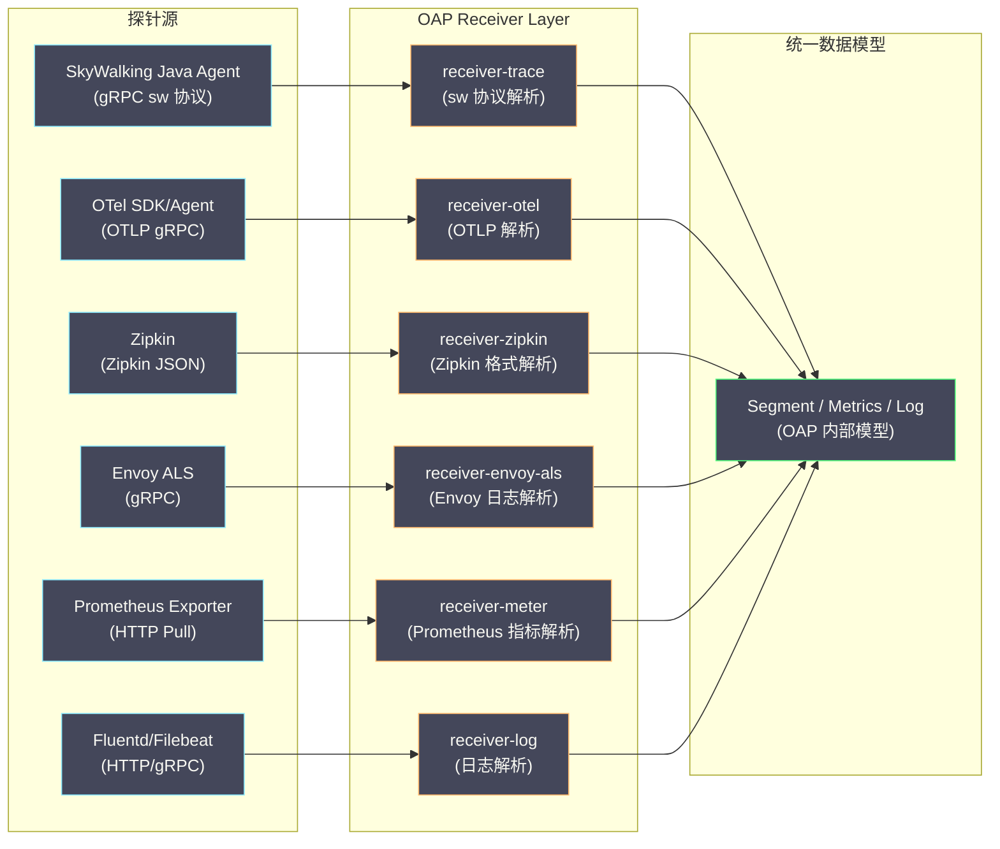
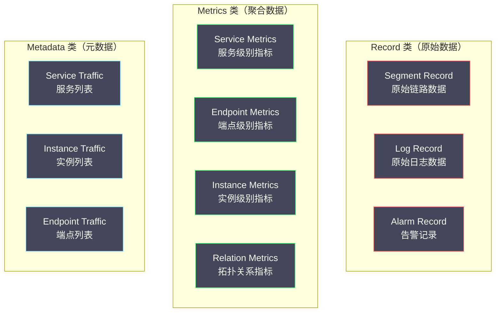

# 06 SkyWalking OAP 流处理与存储模型

**摘要：**

SkyWalking 的 OAP（Observability Analysis Platform）是整个系统的"大脑"——它不是把 Agent 上报的 Segment 原样存储，而是在数据接收的瞬间进行**实时流式分析**：提取服务拓扑、计算聚合指标（P99 / QPS / 错误率）、评估告警规则。这种"写入时计算"的架构，让查询不必扫描海量原始 Span，从而把指标查询压到毫秒级、把存储成本压下一个台阶。本文剖析 OAP 的 Receiver 层如何接收多协议数据、Analysis Core 如何通过 OAL 与 MAL 定义流式聚合逻辑、数据在 Elasticsearch 与 BanyanDB 中的具体存储结构，以及拓扑图与告警引擎的构建过程，最后落到这套架构的性能调优点与固有边界。读完之后，你应当能回答两个问题：**"边收边算"到底省下了什么，以及它又牺牲了什么**。

---

## 第 1 章 OAP 的数据接收层

### 1.1 多协议 Receiver 架构

OAP 的 Receiver 层是一个**多协议适配器**——它接收来自不同探针、不同格式的数据，统一转换为 OAP 内部的数据模型后交给 Analysis Core 处理。



这个架构的意义，可以用一个比喻来说明：**Receiver 层像一排"多制式充电接口"**——不管你拿的是哪种插头（sw 协议、OTLP、Zipkin JSON），它都能接上，然后在内部统一转成同一种"电压"（OAP 内部模型）。**统一的是"内部模型"，不是"接入格式"**——这正是"兼容而非对抗"策略的技术实现。

### 1.2 receiver-trace：原生协议接收

这是最核心的 Receiver，负责接收 SkyWalking Agent 通过 gRPC 上报的 Segment 数据。

Agent 与 OAP 之间的通信基于 gRPC 的**双向流（Bidirectional Streaming）**——Agent 在一个长连接上持续发送 Segment，OAP 在同一个连接上返回命令（如动态配置变更、Profile 任务下发）。

gRPC 流带来三点好处。**减少连接开销**：不必为每个 Segment 建立新的连接。**背压（Back Pressure）**：gRPC 流内置流量控制，如果 OAP 处理不过来，会**自动降低 Agent 的发送速率**——注意这里与 Agent 的 Ring Buffer 丢弃是两道不同的闸门。**命令通道复用**：Agent 不需要额外的心跳连接来拉取配置与命令。

这两道闸门的配合值得说明：**当 OAP 慢时，gRPC 的背压先让 Agent"少发一点"；只有当背压传到 Agent 的 Ring Buffer、缓冲区也满了，才会开始丢弃**。也就是说，"丢弃"是最后一道防线——在此之前，系统会先尝试"减速"。理解了这条链路，就能理解为什么"调大 Ring Buffer"能降低丢弃率：它把"减速"的缓冲区间拉长了。

**Segment 的 Protobuf 结构**（简化版）如下：

```protobuf
message SegmentObject {
    string traceId = 1;            // Trace ID
    string traceSegmentId = 2;     // Segment ID
    string service = 3;            // 服务名
    string serviceInstance = 4;    // 实例名
    repeated SpanObject spans = 5; // 本 Segment 包含的所有 Span
    bool isSizeLimited = 6;        // 是否因为 span_limit 被截断
}

message SpanObject {
    int32 spanId = 1;
    int32 parentSpanId = 2;
    int64 startTime = 3;           // 毫秒时间戳
    int64 endTime = 4;
    string operationName = 5;      // 端点名
    string peer = 6;               // 被调用方地址（ExitSpan）
    SpanType spanType = 7;         // Entry / Exit / Local
    SpanLayer spanLayer = 8;       // Http / Database / RPCFramework / MQ / Cache
    int32 componentId = 9;         // 组件 ID（如 Tomcat=1, SpringMVC=14）
    bool isError = 10;             // 是否错误
    repeated KeyStringValuePair tags = 11;   // 标签
    repeated Log logs = 12;                  // 日志/异常
    repeated SegmentReference refs = 13;     // 跨 Segment 引用（来自上游的 sw8）
}
```

这个结构里有三个字段对后面的分析至关重要：**`spanType`**（决定它是入口、出口还是内部）、**`spanLayer`**（决定它属于 HTTP、数据库、RPC 还是消息队列，用于生成虚拟服务名）、**`refs`**（指向上游 Segment，是跨服务拼装调用树的依据）。**OAP 的几乎所有分析能力，都建立在对这三个字段的解读上**。

### 1.3 receiver-otel：OTLP 协议接收

OAP 从 9.x 版本开始支持直接接收 OTel 的 OTLP 格式数据，这使得使用 OTel SDK/Agent 的服务可以把数据直接发到 SkyWalking OAP，不需要中间的 OTel Collector。

OTLP 到 SkyWalking 内部模型的转换逻辑如下：

| OTLP 字段 | SkyWalking 字段 | 转换规则 |
|---|---|---|
| `resource.service.name` | `service` | 直接映射 |
| `resource.service.instance.id` | `serviceInstance` | 直接映射 |
| `span.name` | `operationName` | 直接映射 |
| `span.kind = SERVER` | `spanType = Entry` | Kind 到 SpanType 的映射 |
| `span.kind = CLIENT` | `spanType = Exit` | Kind 到 SpanType 的映射 |
| `span.attributes["net.peer.name"]` | `peer` | 提取被调用方地址 |
| `span.attributes["http.method"]` | tags 中的 `http.method` | 属性透传 |

> [!note] OTLP 接收的局限性
> OTLP Receiver 的功能目前不如原生 sw 协议 Receiver 完整——一些 SkyWalking 特有的能力（如 Segment 级别的批量上报优化、sw8 Header 中携带的父服务名信息）在 OTLP 格式中没有对应。使用 OTLP 接入时，拓扑图的发现可能不如原生 Agent 精确，需要 OAP 做更多的反向关联推断。**这再次印证了"标准追求互通、私有追求效率"这条规律**（第 05 篇 6.2 节）。

### 1.4 为什么接收层要支持这么多协议

有人会问：既然有了原生 sw 协议，为什么还要费力支持 OTLP、Zipkin、Envoy ALS 这么多种格式？

答案在于"**接入的现实**"。一个真实的组织里，往往同时存在多种技术栈：Java 服务用 SkyWalking Agent，Go 服务用 OTel SDK，服务网格用 Envoy，遗留系统可能只有 Zipkin 格式的数据。**如果 OAP 只认自己的协议，那么它就只能"看见"一部分系统**——而追踪的价值恰恰建立在"覆盖整条链路"之上（Dapper 的广泛部署原则）。

因此，多协议接收不是"功能堆砌"，而是"**为了覆盖完整性而必须付出的适配成本**"。每多支持一种协议，就多覆盖一类技术栈，链路断裂的可能性就少一分。**接入层的宽容度，直接决定了观测的完整度**。

### 1.5 接收层的背压与限流

接收层除了"多协议适配"，还有一项容易被忽视的职责：**保护 OAP 自己不被压垮**。

它有三道防线。**第一道是 gRPC 背压**：如 1.2 所述，当 OAP 处理不过来时，gRPC 会降低 Agent 的发送速率——这是一次"温和"的减速，不丢数据。**第二道是接收队列与线程池上限**：`gRPCThreadPoolQueueSize` 限制了"等待处理的请求"的排队长度，超出就拒绝——这是"温和"到"强硬"的过渡。**第三道是 Agent 侧的 Ring Buffer 丢弃**：当背压一路传导过去，Agent 的缓冲区也满了，就会开始丢弃——这是最后的兜底，代价是数据永久丢失。

这三道防线的设计哲学是"**逐级降级，尽量不丢**"：先减速、再拒绝、最后才丢弃。理解这个梯度，就能理解运维时的两个判断：**看到"上报超时"说明第一道防线已经在工作，还来得及加资源；看到"Ring Buffer 丢弃"说明已经到第三道防线，数据已经在丢失了**。两者的紧急程度完全不同。

这也解释了为什么"监控 Agent 的丢弃率"是一条重要的告警：**它是"数据完整性已经受损"的最直接信号**，比"OAP CPU 高"这类指标更值得优先响应。

### 1.6 网格侧与遗留系统的接入

除了原生协议与 OTLP，OAP 还提供两类"补齐覆盖面"的 Receiver，值得一提。

**Envoy ALS（Access Log Service）接收**：Envoy 是服务网格（如 Istio）的数据面代理，它能以 ALS 协议上报"每一次代理转发"的访问日志。OAP 接收这些日志后，可以还原"服务之间的网格级调用关系"——**这让 SkyWalking 能覆盖"网格里的服务间流量"，而不只是"应用内的埋点"**。第 01 篇讲过"网格观测与应用观测互补"，ALS 接收正是这一互补在 SkyWalking 里的落地。

**Zipkin 格式接收**：OAP 能直接接收 Zipkin 格式的数据。这让"已经在用 Zipkin 的系统"可以不改采集、只把数据转发到 OAP，从而把遗留追踪数据也纳入统一视图。**这是一条"低成本接入"的路径**——不必先迁移采集，就能先统一展示。

这两类 Receiver 的共同意义是：**接收层的宽容度，决定了 SkyWalking 能"看见"多大的世界**。原生协议覆盖自家 Agent，OTLP 覆盖多语言标准，ALS 覆盖网格，Zipkin 覆盖遗留——**每多一种格式，就少一片观测盲区**。这也是第 01 篇"广泛部署"原则在接收层的体现。

---

## 第 2 章 Analysis Core：流式分析引擎

### 2.1 写入时计算与查询时计算

理解 OAP Analysis Core 的关键，是理解两种数据处理范式的差异。

**查询时计算（Query-time Computation）**：原始数据原样存储，查询时扫描相关数据并实时聚合。例如查询"Order Service 过去一小时的 P99 延迟"时，扫描过去一小时所有 Order Service 的 Span，提取延迟值，现场算 P99。它的优点是存储简单、灵活性高（可以按任意维度聚合）；缺点是查询慢（要扫描大量原始数据）、存储成本高（必须保留所有原始数据）。

**写入时计算（Write-time Computation）**：数据到达时立即预聚合，把聚合结果存成独立指标；查询时直接读预聚合结果。它的优点是查询极快、存储成本低（聚合结果远小于原始数据）；缺点是灵活性低（只能查预定义好的聚合维度）、写入逻辑更复杂。

SkyWalking OAP 采用的是**写入时计算**——Segment 到达的瞬间就被分解为多个维度的聚合指标，查询时不必再碰原始 Span。这是它的指标查询能做到毫秒级的根本原因。

**这是一次典型的"把成本从查询端挪到写入端"的取舍**，与第 02 篇讲 Loki"把成本从写入挪到查询"恰好相反。两者的选择依据是同一个问题的两面：**你的负载是"写多读少"还是"写少读多"**？追踪数据的写入量巨大，但查询（尤其是指标查询）也频繁，因此 SkyWalking 选择"写入时多花一点、查询时省下大量"。

### 2.2 Source Dispatch：数据分流

当一个 Segment 到达 Analysis Core 后，第一步是**Source Dispatch（数据分流）**——从 Segment 中提取不同维度的信息，生成多个 **Source 对象**，每个 Source 代表一种分析视角：

```text
一个 Segment 到达后被分解为：

1. Service Source
   - 服务名: order-service
   - 延迟: 150ms
   - 是否错误: false
   → 用于计算服务级别的 P99、QPS、错误率

2. ServiceInstance Source
   - 服务名: order-service
   - 实例名: order-service-pod-abc123
   - 延迟: 150ms
   - CPU 使用率、JVM 内存（如果 Agent 上报了 JVM 指标）
   → 用于计算实例级别的指标

3. Endpoint Source
   - 服务名: order-service
   - 端点名: POST /api/orders
   - 延迟: 150ms
   - 是否错误: false
   → 用于计算端点级别的 P99、QPS

4. ServiceRelation Source（从 ExitSpan 提取）
   - 调用方: order-service
   - 被调用方: payment-service（从 peer 字段解析）
   - 延迟: 80ms
   → 用于构建服务拓扑图和边上的指标

5. EndpointRelation Source（从 ExitSpan 提取）
   - 调用方端点: POST /api/orders
   - 被调用方端点: POST /api/pay
   → 用于端点级别的依赖关系
```

这个"一次解析、多视角输出"的设计，是流式分析的核心。**同一个 Segment 被"看"了五遍，每一遍服务一种聚合目的**。它带来一个重要的灵活性：新增一个分析维度，只需新增一种 Source，不必改动其他 Source 的解析逻辑。**把"数据"与"视角"解耦，是流式分析引擎能持续演进的关键**。

### 2.3 OAL：聚合规则的声明式定义

OAL（Observability Analysis Language）是 SkyWalking 自定义的 DSL，用于声明式地定义"从哪个 Source 提取什么数据、用什么聚合函数、生成什么指标"。它的语法结构很简洁：

```text
指标名 = from(Source.字段).聚合函数(参数);
```

SkyWalking 内置的核心 OAL 规则（摘选）如下：

```text
// ===== 服务级别指标 =====

// 平均响应时间
service_resp_time = from(Service.latency).longAvg();

// P50/P75/P90/P95/P99 响应时间
service_percentile = from(Service.latency).percentile2(10);
// percentile2(10) 表示：精度为 10ms 的桶分布，计算 P50/P75/P90/P95/P99

// 每分钟调用次数（Calls Per Minute）
service_cpm = from(Service.*).cpm();

// SLA（成功率）
service_sla = from(Service.*).percent(status == true);
// status == true 表示请求成功

// Apdex 评分
service_apdex = from(Service.latency).apdex(name, status);

// ===== 端点级别指标 =====

endpoint_resp_time = from(Endpoint.latency).longAvg();
endpoint_percentile = from(Endpoint.latency).percentile2(10);
endpoint_cpm = from(Endpoint.*).cpm();
endpoint_sla = from(Endpoint.*).percent(status == true);

// ===== 服务关系指标（拓扑图上的边）=====

// 调用方到被调用方的平均响应时间
service_relation_server_resp_time = from(ServiceRelation.latency).longAvg();
// 调用次数
service_relation_server_cpm = from(ServiceRelation.*).cpm();
```

OAL 里有一个值得注意的细节：**`percentile2(10)` 的"桶分布"实现**。P99 这类分位数无法精确地从"分钟级聚合结果"里再聚合出来（分位数不可加），因此 SkyWalking 的做法是**在聚合窗口内维护一个"延迟桶分布"**——把每个延迟值按 10ms 精度落进对应的桶，窗口结束时再从桶分布里算出分位数。**这解释了为什么分位数指标需要额外的存储（桶分布）**，也解释了它的精度是有限的（10ms 粒度）。**理解了这个实现，就不会再对"为什么 P99 有时看起来不太准"感到意外**。

### 2.4 聚合窗口与时间桶

OAP 的指标聚合基于**固定时间窗口**（默认 1 分钟），每分钟的聚合结果作为一个**时间桶（Time Bucket）**存储。

```text
时间轴：

10:00 ─────── 10:01 ─────── 10:02 ─────── 10:03
  │             │             │             │
  └─ 窗口 1 ──┘             └─ 窗口 3 ──┘
         └─ 窗口 2 ──┘

窗口 1（10:00~10:01）：
  接收到 500 个 Service Source（order-service）
  计算结果：
    service_resp_time = avg(所有 latency) = 120ms
    service_p99 = percentile(所有 latency, 0.99) = 850ms
    service_cpm = 500
    service_sla = 498/500 = 99.6%
  存储为：
    key: order-service + 202401011000（时间桶）
    values: {resp_time: 120, p99: 850, cpm: 500, sla: 9960}
```

**多精度时间桶**：SkyWalking 支持多种时间精度的聚合，用于不同时间范围的查询：

| 精度 | 时间桶格式 | 用途 |
|---|---|---|
| 分钟 | `202401011000` | 最近几小时的实时监控 |
| 小时 | `2024010110` | 最近几天的趋势分析 |
| 天 | `20240101` | 最近几个月的历史回顾 |

分钟级数据量最大（每天 1,440 个桶），保留时间最短（默认 2 天）；天级数据量最小，保留时间最长（默认 90 天）。OAP 内部有一个**降采样（Downsampling）**机制，自动把分钟级数据聚合为小时级与天级。

这套"多精度 + 降采样"的设计，解决的是"**精度与保留时长的矛盾**"：保留分钟的精度 90 天，数据量会大到不可接受；只保留天级精度，又无法满足"看最近一小时"的实时需求。**分层存储让"近的看细节、远的看趋势"成为可能**——这是几乎所有时序系统的通用手法（指标系统也是如此）。

### 2.5 MAL：外部指标的处理

OAL 处理的是从追踪 Segment 中提取的指标。对于外部来源的指标（如 Prometheus Exporter 暴露的 JVM 指标、Kubernetes 指标），SkyWalking 使用另一种 DSL——**MAL（Meter Analysis Language）**。

MAL 的作用是把 Prometheus 格式的指标转换为 SkyWalking 的指标体系，并支持二次计算：

```yaml
# MAL 配置示例：处理 JVM 指标
expSuffix: tag({tags -> tags.service = service})
metricPrefix: meter_jvm

# 从 Prometheus 指标 jvm_memory_used_bytes 计算 JVM 内存使用率
metricsRules:
  - name: memory_used
    exp: jvm_memory_used_bytes
  - name: memory_max
    exp: jvm_memory_max_bytes
  - name: memory_usage_percent
    exp: jvm_memory_used_bytes / jvm_memory_max_bytes * 100
```

OAL 与 MAL 的分工，在第 04 篇 4.4 节讲过：**OAL 处理"从追踪推导的指标"，MAL 处理"外部接入的指标"**，两者在存储层汇合。这个设计让 SkyWalking 的仪表盘能同时展示"从追踪算出的服务 P99"与"从 Prometheus 接入的 JVM 内存"——**跨信号的数据，在存储层被统一了**。

### 2.6 降采样：让历史数据"活得久一点"

降采样机制值得单独说明，因为它是"存储成本控制"的核心手段之一。

它的工作方式是：**分钟级的聚合结果，在被写入的同时（或稍后），被进一步聚合成小时级；小时级的再聚合成天级**。这样，即使分钟级数据两天后被删除，历史趋势仍然以"小时级 / 天级"的形式保留下来。

这个过程带来一个取舍：**降采样会损失精度**。天级的 P99，是从"当天的所有分钟级聚合结果"再聚合出来的，它无法恢复出"某一天 10:00 那一分钟的具体 P99"。但对"看长期趋势"这个用途来说，精度损失是完全可以接受的——**没有人会为了看"过去 90 天的趋势"，而要求精确到分钟**。

降采样体现了一条通用的存储策略：**数据的精度应当随"年龄"递减**。新鲜的数据要精确（因为要用于实时排障），陈旧的数据要省（因为主要用于趋势回顾）。**"精度换空间"是时序存储最常用的手法之一**，Loki 的保留策略、Prometheus 的下采样、SkyWalking 的多精度时间桶，走的都是同一条路。

### 2.7 聚合的准确性：从样本到总体

流式聚合还有一个统计学层面的细节值得说明：**从样本算出的指标，与"真实总体"之间可能存在偏差**。

考虑一个具体情形。如果 Agent 侧做了采样（比如只上报 1% 的请求），那么 OAP 拿到的就是"1% 的样本"。用这些样本算出的"平均响应时间"，在**均匀采样**下是总体的无偏估计；但如果采样是**非均匀的**（比如尾部采样只保留慢请求），那么算出来的平均值就会系统性偏高——**因为样本里慢请求被过度代表了**。

这带来一条重要的使用原则（第 02 篇 5.8 节也提过）：**采样后的数据适合"定位"，不适合"统计"**。想知道"整体 P99 是多少"，应当依赖"全量采集的指标"；想知道"这次慢请求卡在哪"，才去看"采样后的追踪"。**把两者混用，就会得出似是而非的结论**。

那 SkyWalking 是怎么处理这个矛盾的？答案是：**它从 Agent 侧就尽量不做激进采样，而是把采样决策交给使用者显式配置**（`agent.sample_n_per_3_secs`）。默认全量采样虽然成本高，但保证了"从追踪算出的指标"是可信的。**这是一个"默认保准确、按需换成本"的取向**——它把"要不要牺牲统计准确性"这个决定，明确地交给了使用者，而不是替使用者默默做掉。

### 2.8 规则的治理：当 OAL 规则多起来之后

OAL 把指标定义从代码里抽了出来，这是一大进步。但当规则多到几十上百条时，新的治理问题就出现了：**规则分散、命名混乱、没人知道哪条规则还在被用**。

这与第 03 篇讲的"语义约定"是同一类问题：**把逻辑声明化之后，"声明本身"就需要治理**。几条可落地的实践是：**统一命名规范**（如 `service_xxx` / `endpoint_xxx` / `service_relation_xxx` 前缀分明）；**按用途分组**（核心指标与诊断指标分开维护）；**定期审计**（回看哪些指标真的被看板与告警引用，删掉没人用的）。

**"声明式"降低了"写规则"的成本，却抬高了"管理规则"的重要性**——因为写规则变容易了，规则数量就会膨胀，而膨胀的规则集本身就是新的复杂度来源。这条规律适用于所有 DSL：OAL 如此，PromQL 规则如此，告警规则也如此。**任何降低创作门槛的机制，都需要配套的治理手段，否则就会被自己的产物淹没**。

### 2.9 重复上报与幂等性

流式分析还有一个必须处理的现实问题：**同一份数据可能被上报多次**。

为什么会重复？因为 Agent 的上报是"至少一次"语义——如果上报后没收到确认、或网络抖动导致确认丢失，Agent 会重试。这在分布式系统里无法避免，因此系统必须能"容忍重复"。

OAP 的处理方式是**让聚合操作保持幂等**。对于 Metrics 类数据，写入用的是"按实体加时间桶 upsert"——同一分钟内重复到达的样本，会更新同一个聚合结果，而不是新增一条。因此"同一份数据到两次"不会导致指标翻倍。**幂等性是流式分析能在"不可靠网络"上工作的前提**。

但要注意，幂等并非在所有场景都能实现。**求和类指标**（如总调用次数）在"重复上报"下确实会偏大——因为每份数据都被"加"了一次。因此精确的计数类指标，往往需要额外的去重手段（如按 Segment ID 去重），或者接受"轻微的重复计数"这一现实。**"至少一次"语义的代价，就是"要么做去重、要么容忍偏差"**——这与消息队列领域的取舍完全一致。理解了这一点，就能对"指标为什么偶尔会有细微偏差"有一个合理的预期：它多半不是缺陷，而是"至少一次"语义的固有代价。

---

## 第 3 章 数据存储模型

### 3.1 三类数据的差异化策略

OAP 存储的数据按访问模式分为三类，每类使用不同的策略：



**Record 类（原始数据）**：写入是追加式的，每条记录独立；查询按 Trace ID 点查（Segment），或按时间范围加过滤条件扫描（Log、Alarm）；数据量最大（TB/天），保留时间短（默认 3 天）；优化重点是写入吞吐量与压缩比。

**Metrics 类（聚合数据）**：写入按"实体加时间桶"为 key 做 upsert（同一分钟内有新数据就更新聚合结果）；查询按实体加时间范围做范围查询；数据量中等（GB/天），保留时间中等；优化重点是范围查询效率与 upsert 性能。

**Metadata 类（元数据）**：写入是低频更新（服务注册、实例上下线）；查询是全量扫描（列出所有服务/实例/端点）；数据量小（MB 级）；优化重点是读取速度。

这三类数据的特性差异极大，**用同一种存储策略对待它们，必然有一类会被牺牲**。这正是 SkyWalking 要把它们分开存储的原因，也是第 04 篇讲"存储选型要看访问模式"的具体落地。

### 3.2 Elasticsearch 中的存储结构

以 Elasticsearch 为存储后端时，OAP 为每种数据类型创建独立的索引。

**Segment 索引**的文档结构如下：

```json
// 索引名：sw_segment-20240101
{
    "trace_id": "abc123...",
    "segment_id": "seg456...",
    "service_id": "order-service",
    "service_instance_id": "order-service-pod-abc",
    "endpoint_name": "POST /api/orders",
    "start_time": 1704067200000,
    "end_time": 1704067200150,
    "latency": 150,
    "is_error": 0,
    "data_binary": "<base64 encoded Protobuf>",  // 完整的 Segment Protobuf 序列化数据
    "time_bucket": 202401011000
}
```

注意 `data_binary` 字段：**OAP 不把 Span 的每个字段都展开成 ES 文档字段**（那样会导致 mapping 极其复杂），而是把完整的 Segment Protobuf 序列化后以 binary 字段存储。ES 索引只对查询需要的字段建索引（`trace_id`、`service_id`、`start_time`、`latency`、`is_error`），完整数据在点查时从 `data_binary` 反序列化。

这个设计的权衡很明确。**优点是 ES mapping 简单、索引字段少、写入快**；**缺点是无法在 ES 层面直接查询 Span 内部字段**（如"搜索包含特定 SQL 的 Span"），必须先按 Trace ID 查到 Segment，再在应用层解析。

这是一个"**索引少量关键字段、原样存完整数据**"的经典手法，与第 02 篇讲 Loki"只索引标签"的思路同源——**索引是昂贵的，因此只对"确定会被查询的维度"建索引；其余数据原样保留，需要时再解析**。区别只在于：Loki 把"未索引的部分"放在压缩块里，SkyWalking 把它放在 `data_binary` 里。

**Metrics 索引**的文档结构如下：

```json
// 索引名：sw_service_resp_time-20240101
{
    "metric_table": "service_resp_time",
    "entity_id": "order-service",      // 服务名的 hash
    "time_bucket": 202401011000,        // 分钟级时间桶
    "value": 120,                       // 聚合结果：平均响应时间 120ms
    "total": 500,                       // 参与聚合的样本总数
    "count": 500                        // 有效样本数
}
```

Metrics 索引的 key 是 `entity_id + time_bucket`，查询时通过这两个字段的范围查询获取一段时间内的指标值。**这个 key 的设计，正是"写入时计算"得以高效的基础**——因为聚合结果按"实体加时间"组织，范围查询只需顺序扫描一小段。

### 3.3 Elasticsearch 索引生命周期管理

SkyWalking 使用**按天分索引加 TTL 自动删除**的策略管理 ES 索引：

```yaml
# 索引清理规则（OAP application.yml 中配置）
storage:
  elasticsearch:
    # Record 类数据保留天数
    recordDataTTL: 3          # Segment、Log 保留 3 天
    # Metrics 类数据保留天数（分钟级）
    metricsDataTTL: 7         # 分钟级指标保留 7 天
    # 其他精度的保留天数由 OAP 内部计算
```

OAP 内部有一个定时任务（默认每天凌晨 4 点执行），自动删除过期索引。由于索引按天命名（如 `sw_segment-20240101`），删除操作是**整个索引的删除**，而不是文档级删除，效率极高。

**"按天分索引"是一个值得单独记住的技巧**：它把"删除过期数据"从一个"昂贵的文档级操作"变成了"廉价的整表删除"。这在日志、追踪这类"数据量大、保留周期明确"的场景里，是一条被反复验证的实践——Loki 的保留、ES 的 ILM、ClickHouse 的 TTL，思路都是一致的。**当"数据有明确生命周期"时，按时间分片存储，能让"过期清理"变得几乎免费**。

ES 索引的优化建议如下：

| 配置项 | 推荐值 | 说明 |
|---|---|---|
| 副本数 | 1（生产）/ 0（开发） | Segment 索引通常不需要高可用（丢失几小时历史链路可接受） |
| 分片数 | 2 到 5 | 根据数据量调整，每个分片建议 10 到 50 GB |
| 刷新间隔 | 10s | 默认 1s 对 SkyWalking 不必要，增大可减少 I/O |
| 合并策略 | `tiered` | 适合追加写入模式 |
| 索引模板 | 使用 OAP 自动创建的模板 | OAP 启动时自动创建 |

### 3.4 BanyanDB 的存储结构

BanyanDB 作为 SkyWalking 社区自研的存储引擎，针对上述三类数据做了专门优化。

**Stream 存储（对应 Record 类）**：BanyanDB 用 **Stream** 数据模型存储 Segment 与 Log 等原始数据。Stream 的底层是 LSM-Tree（Log-Structured Merge Tree）结构，优化了追加写入的吞吐量。

与 ES 不同，BanyanDB 的 Stream 支持对数据中的特定字段建立**倒排索引**，同时原始数据按**列式存储**（而非 ES 的行式文档存储）。列式存储带来两点优势：**压缩比更高**（同一列的数据类型相同，压缩效果远好于行式），**选择性读取**（查询时只需读取需要的列，不必加载完整文档）。

**Measure 存储（对应 Metrics 类）**：BanyanDB 用 **Measure** 数据模型存储聚合指标。Measure 的底层是针对时间序列数据优化的结构——**Time Shard（时间分片）** 让范围查询只扫描必要的分片；**Entity Index（实体索引）** 按实体 ID 建索引，点查高效；**压缩编码** 上，时间戳用 delta-of-delta 编码、数值用 XOR 编码（与 Prometheus TSDB 的压缩方案同源）。

### 3.5 存储选型的再思考

第 04 篇已经从"成本与运维"角度比较过 ES 与 BanyanDB，这里从"数据模型"角度补一层。

ES 的模型是"**文档加倒排索引**"，它假设数据是"形态多变的文档"；BanyanDB 的模型是"**Stream 加 Measure**"，它明确知道数据只有"原始流"与"聚合指标"两种形态。**BanyanDB 的专用性，来自它敢于对"数据形态"做出强假设**——而这个假设之所以成立，是因为它只服务于 SkyWalking 这一个场景。

这解释了为什么"专用存储往往更高效"：**当你确切知道数据的形态与访问模式时，可以做出更激进的优化**。ES 不敢假设"数据只有两种形态"，因为它要服务所有场景；BanyanDB 敢，因为它只为追踪而生。**通用与专用的差别，本质上是"敢不敢做假设"的差别**。

### 3.6 存储容量的估算

容量估算不是一个纯理论问题——它决定了"要买多少机器"。SkyWalking 的估算可以从三类数据分别入手。

**Record 类的容量**（大头）：

```text
Segment 存储量 ≈ 日 Segment 数 × 每个 Segment 的存储字节数 × 保留天数
```

关键在于"每个 Segment 的存储字节数"——它既包含 Protobuf 序列化后的 `data_binary`，也包含索引字段。经验上，一个包含 20 个 Span 的 Segment，序列化后大约几 KB 到十几 KB。若某系统日均 1 亿 Segment、每个 5 KB、保留 3 天，则约 1.5 TB——这个量级对 ES 集群来说不算小。

**Metrics 类的容量**：

```text
Metrics 存储量 ≈ 实体数 × 指标数 × 每日时间桶数 × 保留天数 × 每点字节数
```

它的量级通常远小于 Record 类，但"实体数"这一项容易被低估——**端点的基数可能很大**（一个服务几百个端点），而每个端点都要独立存一份指标。因此在"端点很多"的系统里，Metrics 的容量也要认真估。

**Metadata 类的容量**可以忽略不计（MB 级）。

估算的正确顺序是：**先估 Record（它决定集群规模）→ 再估 Metrics（它决定是否要额外优化）→ Metadata 直接忽略**。而在估算之前，还有两件事要先定：**采样率**（直接按比例缩放 Record 的量）与**保留周期**（直接按天数缩放）。**这两个策略一变，所有估算都要重来**——因此"先定策略、再算容量"，永远比"先买机器、再想怎么用"更务实。

### 3.7 冷热分层与存储介质的演进

存储成本优化还有一条空间：**让不同"温度"的数据落在不同介质上**。

思路很直接。**热数据**（最近几小时到几天的 Segment）会被频繁查询，应当放在高性能的 SSD 上；**冷数据**（更早的历史 Segment）几乎只用于偶发的追溯，可以放在便宜的 HDD 甚至对象存储上。ES 本身支持冷热分层（通过 ILM 把老索引迁到冷节点），SkyWalking 的按天分索引恰好与这个机制天然契合——**索引天然按时间分好了组，迁移与删除都只需操作整个索引**。

更激进的方案是"**把原始 Trace 放到对象存储**"（类似 Grafana Tempo 的做法）：对象存储的每 GB 成本远低于本地磁盘，代价是查询延迟更高。**这对"绝大多数 Trace 只在写入后几小时内被查一次、之后基本不再被访问"的负载非常合适**——用查询延迟换存储成本，正是第 02 篇讲 Loki 时的同一笔交易。

这提醒我们：**存储优化不只有"换引擎"一条路，"分层介质"往往更平滑**。在同一个引擎内做冷热分层，比"整体迁移到新引擎"的改动小得多，收益却常常可观。**先用分层榨干现有引擎的潜力，再考虑换引擎**，是一个务实的顺序。

---

## 第 4 章 拓扑图与告警引擎

### 4.1 服务拓扑的构建过程

服务拓扑图是 SkyWalking 最直观的功能之一。它的数据来源于 `ServiceRelation Source`，构建过程如下：

```text
1. Agent 上报 Segment，其中包含 ExitSpan
   ExitSpan: {
     operationName: "POST /api/pay",
     peer: "payment-service:8080",   // 被调用方地址
     componentId: 12                  // HTTP Client
   }

2. OAP 从 ExitSpan 中提取调用关系：
   调用方：order-service（当前 Segment 的服务名）
   被调用方：payment-service（从 peer 解析，或从下游 Segment 的服务注册信息关联）

3. 生成 ServiceRelation Source：
   { source: "order-service", dest: "payment-service",
     componentId: 12, latency: 80ms, isError: false }

4. ServiceRelation Source 进入 OAL 引擎：
   service_relation_server_resp_time = from(ServiceRelation.latency).longAvg();
   service_relation_server_cpm = from(ServiceRelation.*).cpm();

5. 聚合结果存入 Metrics 索引

6. UI 查询拓扑图时，OAP 从 Metrics 索引读取所有 ServiceRelation 记录，
   构建节点和边，返回给 UI 渲染
```

**外部依赖的拓扑展示**：对于数据库、Redis、消息队列等外部依赖，Agent 拿不到对方的"服务名"，但会根据 ExitSpan 的 `spanLayer` 与 `componentId` 自动生成一个虚拟服务名：

| ExitSpan 类型 | 虚拟服务名格式 | 拓扑图中的显示 |
|---|---|---|
| MySQL 查询 | `mysql:3306` | 数据库图标 + `mysql:3306` |
| Redis 操作 | `redis:6379` | 缓存图标 + `redis:6379` |
| Kafka 生产 | `kafka-cluster` | 消息队列图标 + `kafka-cluster` |
| HTTP 外部调用 | `api.thirdparty.com:443` | 外部服务图标 |

**虚拟服务名是一个很巧的设计**：它让"外部依赖"在拓扑图里有了"身份"，从而能被画成一个节点、能被统计调用延迟。如果没有它，拓扑图上的所有外部依赖都会退化成一个模糊的"未知"节点，完全失去诊断价值。

### 4.2 告警引擎

SkyWalking 的告警引擎基于 **OAL 聚合后的指标数据** 触发告警。规则在 `alarm-settings.yml` 中定义：

```yaml
rules:
  # 规则 1：服务平均响应时间 > 1000ms 持续 3 分钟
  service_resp_time_rule:
    metrics-name: service_resp_time
    op: ">"
    threshold: 1000
    period: 10         # 检查周期（分钟）
    count: 3           # 在 period 内触发 count 次则告警
    silence-period: 10 # 告警后沉默 10 分钟（避免重复告警）
    message: "服务 {name} 的平均响应时间超过 1000ms"

  # 规则 2：服务成功率 < 80%
  service_sla_rule:
    metrics-name: service_sla
    op: "<"
    threshold: 8000    # SLA 值 × 100（80% = 8000）
    period: 10
    count: 2
    silence-period: 10
    message: "服务 {name} 的成功率低于 80%"

  # 规则 3：端点 P99 > 3000ms
  endpoint_p99_rule:
    metrics-name: endpoint_percentile
    op: ">"
    threshold: 3000
    period: 10
    count: 3
    silence-period: 10
    message: "端点 {name} 的 P99 延迟超过 3000ms"
```

告警触发后，可以通过 **Webhook** 发送到外部系统（如钉钉、Slack、PagerDuty）：

```yaml
webhooks:
  - url: http://alert-gateway/skywalking/webhook
    # OAP 会向这个 URL POST 告警信息的 JSON
```

> [!info] 告警引擎的局限性
> SkyWalking 的告警引擎是基于预聚合指标的**阈值告警**——它能做到"P99 延迟超过阈值触发告警"，但不能做到"检测到异常的延迟波动模式触发告警"（即异常检测）。如果需要更高级的能力（如基于机器学习的异常检测），需要把指标导出到 [[可观测/指标/00 专栏导览|Prometheus]]，使用 [[07 Grafana 仪表盘与告警工程化|Grafana]] Alerting 或专门的 AIOps 平台。**这再次印证了"没有银弹"——一体化平台的告警够用，但复杂的告警体系仍然需要专门的工具**（第 04 篇 4.5 节）。

### 4.3 拓扑与告警的共同点

拓扑图与告警引擎看似两个功能，但它们有一个共同的根基：**都建立在"流式聚合出来的指标"之上**。

拓扑图的每条边，是 `ServiceRelation` 指标；告警的每条规则，是某个 `service_*` 或 `endpoint_*` 指标。**它们都不是"实时查询原始数据"得到的，而是"读取预聚合结果"得到的**——这正是"写入时计算"的威力：**一次预聚合，支撑了拓扑、仪表盘、告警三种截然不同的呈现**。

理解了这一点，就能理解为什么 SkyWalking 的功能虽然多，架构却相对统一：**它把所有功能都建立在同一套"流式聚合"的地基上**。加一个功能，往往只需加一条 OAL 规则与一个查询接口，不必新开一条数据通路。**地基统一，上层就能自由生长**——这是"写入时计算"最被低估的价值。

### 4.4 拓扑图的局限

拓扑图虽然直观，但它的准确性有三个前提，把前提讲清楚，才不会误用。

**前提一：链路必须被完整覆盖。** 拓扑是"从 ExitSpan 推导被调用方"得到的，如果下游服务没接入追踪，OAP 只能把它当成"未知外部节点"。**拓扑图上出现的"黑盒节点"，往往就是"没接入追踪的服务"**——它同时也是一份"接入进度表"。

**前提二：peer 必须能被解析成服务名。** 如第 04 篇 4.3 节所述，这依赖"被调用方也上报了自己的服务名"。如果 peer 只是一个 IP、且下游没接入，OAP 就解析不出服务名，拓扑上只能显示 IP。

**前提三：拓扑是聚合视图，不含个体。** 拓扑图上的边标注的是"平均延迟"，看不到"某一次调用"。**当平均延迟正常、但个别请求很慢时，拓扑图是看不出来的**——这时必须回到 Trace 明细。

这三条前提合起来说明：**拓扑图适合"建立整体认知"，不适合"精确定位"**。它是一个很好的"第一眼工具"（这个系统长什么样、有哪些服务、谁调用谁），但"这一跳为什么慢"这类问题，它答不上来。**把工具用在它擅长的场景，是使用任何可视化视图的基本功**。

---

## 第 5 章 OAP 性能调优

### 5.1 性能瓶颈的分布

OAP 的性能瓶颈通常出现在以下环节：

| 环节 | 瓶颈表现 | 常见原因 |
|---|---|---|
| gRPC 接收 | Agent 上报超时 | OAP 实例数不足，gRPC 线程池满 |
| Analysis Core | 聚合延迟增加 | CPU 不足（聚合计算是 CPU 密集型） |
| ES 写入 | ES 写入队列积压 | ES 集群写入吞吐量不足 |
| ES 查询 | UI 查询超时 | ES 分片过多 / 查询范围过大 |

这张表说明：**OAP 的瓶颈可能出现在四个完全不同的环节，而它们需要完全不同的解法**。接收层瓶颈要加实例，分析层瓶颈要加 CPU，写入瓶颈要扩 ES，查询瓶颈要调分片。**"OAP 慢了"是一个过于笼统的判断**——排查的第一步，永远是先定位"慢在哪一环"。

### 5.2 关键调优参数

**OAP 端**的关键配置：

```yaml
# application.yml

core:
  default:
    maxConcurrentCallsPerConnection: 0
    maxMessageSize: 10485760  # 10MB，防止超大 Segment 阻塞

receiver-trace:
  default:
    # gRPC 接收线程数
    gRPCThreadPoolSize: 8
    # gRPC 接收队列大小
    gRPCThreadPoolQueueSize: 10000

storage:
  elasticsearch:
    bulkActions: 5000         # 每批最多 5000 条
    flushInterval: 15         # 最长 15 秒刷一次
    concurrentRequests: 4     # ES 写入并发数
```

**ES 集群端**的关键配置：

```yaml
# elasticsearch.yml

# 禁用副本（如果可以接受丢失数据的风险）
index.number_of_replicas: 0

# 增大 translog 刷盘间隔（提高写入性能）
index.translog.durability: async
index.translog.sync_interval: 30s

# 增大 refresh 间隔
index.refresh_interval: 30s

# 增大 indexing buffer
indices.memory.index_buffer_size: 30%
```

这些参数的共同取向是"**为写入吞吐量让路**"——增大刷盘间隔、增大 refresh 间隔、禁用副本，都是在用"数据的即时可见性"与"高可用性"换取"写入性能"。**这是一笔明确的交易**：追踪数据"晚几秒可见"通常可以接受，但"写入积压"会直接导致数据丢失。**理解每个参数在"拿什么换什么"，比记住推荐值更重要**。

### 5.3 水平扩展策略

当单个 OAP 实例无法处理所有数据时，可以部署多个 OAP 实例组成集群，Agent 通过客户端负载均衡把数据分散到不同实例。

**扩展维度**有三条。**OAP 实例数**：根据总 Segment QPS 增加实例，经验值是单个 OAP 实例（4C8G）大约能处理 5,000 到 10,000 Segment/秒。**ES 节点数**：根据存储量与写入吞吐增加，经验值是单个 ES 数据节点（8C32G、SSD）大约能处理 10,000 到 20,000 文档/秒的写入。**Kafka 缓冲**：在 Agent 与 OAP 之间引入 Kafka，实现削峰填谷，OAP 按自身能力消费。

### 5.4 调优的正确顺序

调优最容易犯的错误，是"上来就调参数"。正确的顺序应当是：**先定位瓶颈环节 → 再判断是"容量不足"还是"配置不当" → 最后才动参数或加资源**。

判断"容量不足"与"配置不当"的区别，有一个简单的方法：**看资源利用率**。如果 CPU、内存、磁盘 I/O 都接近打满，那是容量不足，加资源或加实例才有用；如果资源利用率不高却仍然慢，那多半是配置不当（如批量太小、并发太低、索引设计不合理），调参数才有用。**在资源没打满的情况下加机器，是典型的"花钱没效果"**。

还有一个常被忽略的前置动作：**先治理数据量**。正如第 04 篇 5.5 节所述，减少写入量（提高采样精度、过滤无价值 Span、缩短保留周期）的收益，往往比调参数或加资源更直接。**在优化"单位成本"之前，先削减"总量"**——这是成本优化的一般顺序。

### 5.5 OAP 自身的可观测性

与第 04 篇 3.7 节讲的"Agent 自诊断"同理，**OAP 自身也需要被观测**。它暴露了一组内部指标（通过 HTTP 端点或 JMX），覆盖几个关键维度。

**接收侧**：gRPC 连接的活跃数、接收队列的长度、被拒绝的请求数。这些指标能反映"接收层是否已经吃紧"。

**分析侧**：聚合计算的耗时、Source 的吞吐量、分析线程池的饱和度。这些指标能反映"Analysis Core 是不是瓶颈"。

**存储侧**：写入的批量大小、写入延迟、失败重试次数。这些指标能反映"存储是不是跟不上"。

**告警侧**：告警的触发次数、Webhook 的失败次数。这些指标能反映"告警链路是否畅通"。

把这几组指标做成看板，就能在"OAP 变慢"时快速定位到"慢在哪一环"。**这与 5.4 讲的"先定位环节"是同一件事的两种说法**——一个是从"排查动作"的角度，一个是从"监控手段"的角度。**要定位瓶颈，先要有能定位瓶颈的观测数据**——这正是"观测系统自己也要被观测"的意义。

### 5.6 Kafka 缓冲的取舍

第 04 篇提过 Kafka 作为中间缓冲的价值，这里从"代价"角度补一层。

引入 Kafka 的收益有三条：**削峰填谷**（突发流量先进 Kafka，OAP 按能力消费）、**Agent 更可靠**（写 Kafka 的延迟低，减少 Ring Buffer 丢弃）、**OAP 重启不丢数据**（数据暂存在 Kafka）。

代价同样有三条。**其一是端到端延迟增加**：数据要先进 Kafka、再被 OAP 消费，从"产生"到"可查"的时间会变长——在故障现场，"晚几秒看到链路"可能是有代价的。**其二是多了一个运维组件**：Kafka 集群要部署、要监控、要处理它的故障，故障面扩大。**其三是数据时效不再由 OAP 控制**：当 Kafka 积压时，你看到的是"滞后的数据"，需要额外监控"消费延迟"。

因此引入 Kafka 的判断标准很清晰：**当"直连 OAP 已经导致大量数据丢失"时，它才值得**。在规模尚未触及这个边界时引入，只会白白增加延迟与运维复杂度。**中间件的价值，总是在规模压力下才真正兑现**——提前引入，往往是为一个还不存在的问题付成本。

---

## 第 6 章 流式分析的边界

### 6.1 预聚合的三重代价

"写入时计算"的优势明显，但它的代价也必须讲清。

**其一是灵活性受限。** 你能查到的指标，必须在 OAL 里预先定义过。想临时算一个"没人定义过的指标"，流式分析给不了。**预聚合覆盖的是"已知的、常规的"查询，长尾的、临时的需求它接不住**。

**其二是"算错难改"。** 聚合在数据接收时完成，一旦某个指标的定义有问题，历史数据无法"重算"——只能等新数据按新规则聚合。而"查询时计算"的系统没有这个限制，改一下查询语句就能得到新结果。

**其三是精度损失。** 分位数用桶分布近似、降采样会损失细节、时间桶的边界会造成"跨窗口查询只能近似"。**这些都是"为了即时性而付出的精度代价"**。

### 6.2 长尾查询为什么必须回到原始数据

正因为预聚合有上述代价，SkyWalking **必须同时保留原始 Segment**——否则那 10% 的长尾查询就彻底做不了。

什么是长尾查询？举例来说：**"找出所有包含特定 SQL 的慢请求"**——这个查询的维度（SQL 内容）事先无法预定义成指标，只能回到原始 Segment 里解析、过滤。**预聚合解决"聚合统计"，原始数据解决"明细检索"，两者是分工而非冗余**。

这也解释了为什么 SkyWalking 的存储里，Record 类（原始数据）占了绝大部分容量——**它服务的是那些"无法预知、但一旦需要就非查不可"的需求**。从成本角度看，这是一笔"保险费用"：平时用不上，但真出问题时，没有它就无从下手。

### 6.3 两种范式的选择依据

把"写入时计算"与"查询时计算"放在一起，选择依据其实很清楚。

**当"查询模式相对固定、查询频率高、写入量大"时，选写入时计算**——SkyWalking 正属于此类：指标查询（仪表盘、拓扑、告警）极其频繁，而查询维度相对固定，因此预聚合收益巨大。

**当"查询模式多变、查询频率低、写入量小"时，选查询时计算**——比如临时的日志分析：你不知道会查什么，但查询频率不高，此时保留原始数据、现场计算更合适。

这条判断逻辑与第 04 篇、第 03 篇反复出现的"因地制宜"是同一个道理：**没有普适的最优解，只有"与负载特征匹配"的解**。SkyWalking 选写入时计算，是因为它的负载特征恰好落在"适合预聚合"那一侧；换一个负载特征不同的系统，同样的选择就可能变成负担。

### 6.4 一个反例：把 OAP 当搜索引擎用

把边界具体化，来看一个常见的误用：某团队希望"在追踪数据里做全文检索"——比如"找出所有访问了某个罕见接口的请求""搜索包含某段报错的 Trace"。他们发现 OAP 的查询界面支持按条件过滤，于是把这类需求都压了上去，结果查询频繁超时。

问题的根源在于，**这些需求恰好落在"流式分析的弱项"上**。全文检索、按任意字段过滤，需要"扫描并解析大量原始数据"，而 OAP 的强项是"读预聚合结果"。**把搜索引擎的活交给流式分析平台，等于让一个为聚合统计设计的系统去干全文检索**——它的架构从根上就不是为此优化的。

这个反例的教训是：**每个系统都有它的"设计中心"，越出中心的查询必然昂贵**。OAP 的设计中心是"聚合统计 + 按 ID 点查明细"，因此"按服务/端点/时间范围看指标"很快，"按 Trace ID 看明细"也很快，但"按任意字段全文检索"就很慢。**在采用一个平台之前，先问"它的设计中心是什么"，比问"它有哪些功能"更有价值**——因为功能列表不会告诉你"哪些功能是顺手做的、哪些是勉力支撑的"。

### 6.5 与"查询时计算"系统的一次对照

把 SkyWalking 与一个典型的"查询时计算"系统（如纯 Loki）放在一起对照，边界会更清晰。

| 维度 | 写入时计算（OAP） | 查询时计算（Loki 式） |
|---|---|---|
| 指标查询 | 极快（读预聚合） | 慢（现场聚合） |
| 明细检索 | 快（按 ID 点查） | 中（流式扫描） |
| 任意字段检索 | 慢（需解析 data_binary） | 中到快（视索引而定） |
| 新指标的定义成本 | 中（要写 OAL 规则） | 低（改查询语句即可） |
| 存储成本 | 较低（聚合结果小） | 取决于索引策略 |

这张表的关键不是"谁更快"，而是"**快在哪、慢在哪**"。OAP 在"常规指标查询"上占优，Loki 式在"临时、多变的检索"上占优。**两者的差异，源于它们对"查询模式是否可预知"这个问题的不同假设**——OAP 假设"可预知，因此可以预先算好"，Loki 式假设"不可预知，因此保留原始数据现场算"。

回到 SkyWalking 自身，它的解法其实是"**两条腿走路**"：用流式分析服务"可预知的常规查询"，用原始 Segment 服务"不可预知的长尾查询"。**这不是妥协，而是一种清醒的分工**——承认"没有一种范式能同时最优地服务两类需求"，于是把两类需求交给两套机制。

### 6.6 写入时计算的适用条件

把全篇的取舍收拢，可以给出一条"什么时候该用写入时计算"的判断清单。

**条件一：查询模式相对固定。** 如果团队要看的就是"服务/端点的 P99、QPS、错误率、拓扑"这几类指标，那么预聚合能覆盖绝大部分需求。反过来，如果查询是"临时起意、维度多变"的探索式分析，预聚合就力不从心。

**条件二：查询频率足够高。** 预聚合的价值在于"一次算、多次读"。如果某个指标每天只被查一次，那么"预先算好"省的查询开销，可能还抵不上"写入时多算一遍"的成本。**预聚合的收益与"读的次数"成正比**。

**条件三：能接受精度的近似。** 分位数用桶近似、降采样损失细节——如果业务对精度极其敏感（如计费、SLA 结算），就要谨慎评估这些近似的可接受度。

三条都满足时，写入时计算几乎是必然的更优解；有一条不满足，就值得重新掂量。**回到那句话：没有普适的最优，只有与负载特征匹配的解**。SkyWalking 之所以能靠"写入时计算"取得极佳的效果，是因为追踪数据的负载特征恰好三条全中——**它的成功不是"范式赢了"，而是"范式与场景匹配了"**。

---

## 小结

SkyWalking OAP 的存储与流处理模型，可以用一句话概括：**在数据入口做尽可能多的计算，让查询尽可能少碰原始数据**。

这个选择带来了三样东西：**极快的查询**（读预聚合结果，毫秒级）、**可控的存储**（聚合结果远小于原始数据）、**统一的地基**（拓扑、仪表盘、告警都建立在同一套指标上）。它也付出了三样代价：**灵活性受限**（只能查预定义维度）、**算错难改**（历史无法重算）、**精度有损**（分位数近似、降采样）。

理解这套模型，还需要记住几条具体的工程手法：**多协议接收**保证覆盖完整；**Source Dispatch** 实现"一次解析、多视角输出"；**OAL 与 MAL** 分工处理"推导指标"与"外部指标"；**按天分索引**让过期清理变得廉价；**多精度加降采样**让"近的看细节、远的看趋势"成为可能。**这些手法不是孤立的技巧，而是"写入时计算"这个总策略在不同环节的具体展开**。

下一篇（第 07 篇）会转到"成本"这个主题——讲采样。它既是追踪系统的第一成本杠杆，也是"完整性"与"开销"之间最直接的一次权衡。**理解了第 06 篇的存储模型，再看第 07 篇的采样策略，就能把"成本从哪来、又该从哪里省"这条线索彻底串起来**。

---

## 参考资料

1. Apache SkyWalking OAP Configuration：https://skywalking.apache.org/docs/main/latest/en/setup/backend/configuration-vocabulary/
2. SkyWalking OAL Reference：https://skywalking.apache.org/docs/main/latest/en/concepts-and-designs/oal/
3. SkyWalking MAL Reference：https://skywalking.apache.org/docs/main/latest/en/concepts-and-designs/mal/
4. BanyanDB Architecture：https://skywalking.apache.org/docs/skywalking-banyandb/latest/
5. SkyWalking Alarm Configuration：https://skywalking.apache.org/docs/main/latest/en/setup/backend/backend-alarm/
6. Elasticsearch Performance Tuning for SkyWalking：https://skywalking.apache.org/docs/main/latest/en/setup/backend/backend-es-init/

---

> [!note] 思考题
> 1. "写入时计算"把成本从查询端挪到了写入端。请对比 Loki 的"查询时计算"（第 02 篇），说明两者各自适合什么样的负载特征。
> 2. `percentile2(10)` 用"10ms 精度的桶分布"近似分位数。为什么分位数不能像求和、计数那样"精确地再聚合"？这个近似会带来什么实际影响？
> 3. SkyWalking 把完整 Segment 序列化进 `data_binary` 字段，只对少量字段建索引。这个做法与 Loki 的"只索引标签"有什么共通之处？它们各自牺牲了什么能力？
> 4. 降采样让"分钟级数据聚合为天级"时损失了精度。请举一个"必须回到分钟级精度"的查询场景，并说明此时该如何保留数据。
> 5. 面对"OAP 变慢"，你会按什么顺序排查？为什么说"在资源没打满时加机器"是典型的花钱没效果？
