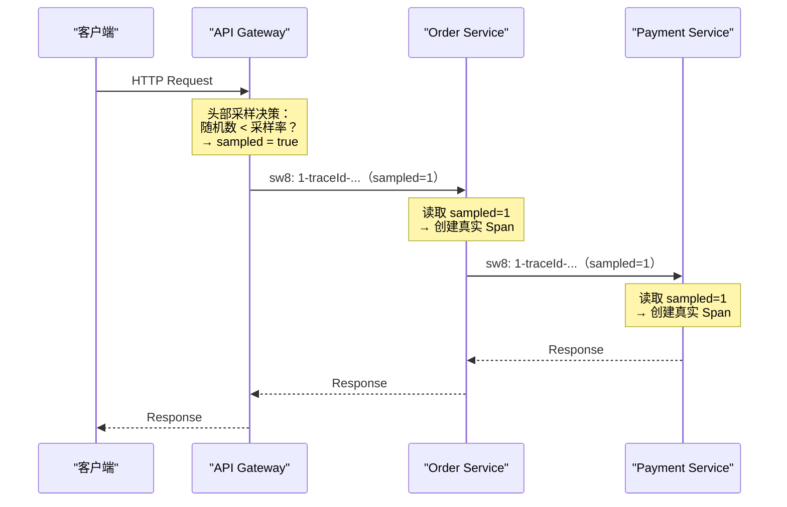

# 07 SkyWalking 采样策略与性能影响

**摘要：**

链路追踪系统面临一个根本性的矛盾：**数据越完整，排查问题越容易；但数据越多，存储与传输的成本越高，对业务系统的性能影响也越大**。采样（Sampling）是化解这个矛盾的核心手段——只记录一部分请求的链路，在信息完整性与资源开销之间找平衡点。本文先算清"全量采集"的真实代价，再对比头部采样与尾部采样的本质差异，剖析 SkyWalking 的采样实现与"Trace 采样但 Metrics 全量"这一关键设计，随后量化追踪对业务系统的 CPU、内存、GC、网络开销，最后给出分层的采样配置建议与选择框架。读完之后，你应当能回答两个问题：**追踪究竟要花多少成本，以及这些成本该从哪里省**。

---

## 第 1 章 采样的根本矛盾

### 1.1 全量采集的代价

先算一笔账。假设一个中等规模的微服务系统：50 个微服务，平均每个请求经过 8 个服务（产生 8 个 Segment、约 20 个 Span），系统总 QPS 为 10,000。全量采集的数据量是：

```text
每个 Span 平均大小 ≈ 500 字节（含 Attributes、Component、Peer 等）
每秒 Span 数 = 10,000 × 20 = 200,000
每秒数据量 = 200,000 × 500 B = 100 MB/s
每天数据量 = 100 MB/s × 86,400 = 8.64 TB/天
```

8.64 TB/天意味着什么？**存储成本**：即使压缩后，Elasticsearch 集群也需要 TB 级 SSD，按 7 天保留算约 60 TB。**网络带宽**：50 个服务的 Agent 总共每秒向 OAP 发送 100 MB，需要千兆网络。**OAP 处理压力**：每秒 20 万个 Span 的反序列化、分析、聚合、写入。**Agent 端开销**：每个实例每秒要序列化并发送数千个 Span。

把这四项摆在一起，就能看出"全量采集"不是"多花点钱"的问题，而是"从业务到观测、整条链路都要跟着扩容"的系统性问题。**成本不是单点的，而是沿着数据流一路传导的**。

### 1.2 不采样的后果：不只是成本

全量采集不只是"多花钱"，它还可能**反过来影响业务系统的稳定性**，这一点常被低估。

**Agent 端的内存压力**：每个 Span 在上报前要暂存在 Agent 的 Ring Buffer 里。高 QPS 下，如果上报速度跟不上产生速度，Ring Buffer 满后新 Span 会被丢弃——但在丢弃之前，大量 Span 对象的创建与回收本身就会增加 GC 压力。

**网络抖动放大效应**：如果 Agent 到 OAP 的网络出现短暂延迟，全量模式下积压的数据量远大于采样模式，恢复后的突发流量可能直接压垮 OAP。

**OAP 雪崩风险**：OAP 的流式分析引擎有处理上限。全量数据超过上限时，会形成一条恶性循环——OAP 处理延迟增加 → Agent 的 gRPC 请求超时 → Agent 重试 → OAP 压力更大。

这三条合起来说明一个关键事实：**观测系统的过载，会通过重试与资源竞争，反向传导给业务系统**。这正是第 01 篇反复强调的"观测系统绝不能反噬被观测系统"——而采样，就是防止这种反噬的第一道闸门。

### 1.3 采样的核心权衡

采样不是无损压缩——它是有信息损失的。采样率越低，丢失的信息越多：

| 采样率 | 每天数据量（上述场景） | 信息完整性 | 适用场景 |
|---|---|---|---|
| 100% | 8.64 TB | 完整 | 低流量系统、安全审计、金融交易 |
| 10% | 864 GB | 高频接口信息充分，低频接口可能缺失 | 中等流量生产环境 |
| 1% | 86 GB | 只有高频接口有足够样本 | 高流量生产环境 |
| 0.1% | 8.6 GB | 大量接口无样本，只能看到热点路径 | 超高流量、成本敏感 |

这张表最有价值的不是"数字"，而是它揭示的一个反直觉结论：**采样率的选择不应该是一个全局统一的数字**。

### 1.4 为什么"一个采样率"是错的

延续上一点：高频接口（QPS=10,000）即使 1% 采样率，每秒仍有 100 条样本，足够做统计分析；但低频接口（QPS=1）在 1% 采样率下，平均 100 秒才有 1 条样本——**如果这个接口在某一秒出了问题，很可能恰好没被采样到**。

更糟的是，低频接口往往正是"出问题时最需要证据"的地方：定时任务、消息消费者、后台批处理——它们调用次数少，一旦出错，能用的样本也就少。**用统一的采样率对待高频与低频接口，等于让"样本本来就稀缺的地方"更稀缺**。

这条洞察直接引出了后文的两种策略：**速率限制采样**（保证每秒至少有 N 条，照顾低频）与**尾部采样**（按"是否有价值"而非"是否随机"来取舍）。**理解了"统一采样率的缺陷"，就能理解后面所有采样策略的设计动机**。

### 1.5 采样的经济学：一个成本模型

采样决策之所以值得认真对待，是因为它直接决定了追踪系统的账单。可以把成本拆成一个简单的模型：

```text
追踪总成本 ≈ 数据量 × 单位存储成本
数据量 ≈ 请求量 × 采样率 × 每请求字节数
```

这个模型里，**采样率是唯一"可以随手调、又直接影响账单"的变量**——请求量由业务决定、每请求字节数由埋点决定，只有采样率可以自由权衡。因此"调采样率"成了追踪降本最直接的杠杆。

但这里有一个容易被忽视的点：**成本并非只与"存储"挂钩**。数据量还会传导到网络、OAP 的 CPU、Agent 的 GC——**采样率降低带来的收益是全局的，不只是省存储**。反过来，采样率提高带来的成本也是全局的。**把采样率理解成"一个影响整条数据链路的乘数"，而不是"一个存储配置项"，才是准确的**。

这也解释了为什么本专栏把采样单独用一整篇来讲：**在追踪系统里，采样不是"一个可选配置"，而是"成本与完整性的总开关"**。

### 1.6 采样的三种哲学

把散落在全篇的采样策略归拢，会发现它们背后其实是三种不同的"哲学"，各自对应一种"怕"。

**随机采样**代表"**怕不具代表性**"——它假设"随机抽取的样本能代表总体"，因此按比例随机抽。它的信条是"统计上的无偏"。

**价值导向采样**（尾部采样）代表"**怕漏掉重要的**"——它不追求代表性，而是追求"把有限预算花在最有价值的数据上"。它的信条是"重要性优先于随机性"。

**速率限制采样**代表"**怕低频的没样本**"——它不关心总体比例，只关心"每个接口每秒至少有 N 条"。它的信条是"保证下限"。

这三种哲学无法互相替代，因为它们服务的目标不同：随机采样服务"统计"，价值导向服务"排障"，速率限制服务"覆盖"。**选择采样策略的第一步，不是比较它们的技术实现，而是先问自己"我最怕漏掉什么"**——答案会直接指向对应的哲学。

这也解释了为什么实践中常需要"组合"：**一个系统往往同时怕"不具代表性""漏掉重要的""低频没样本"三件事**，因此需要多层采样各管一怕。**理解了"每种策略对应一种怕"，组合策略就不再是"堆叠"，而是"各司其职"**。

---

## 第 2 章 头部采样：SkyWalking 的默认策略

### 2.1 头部采样的工作原理

**头部采样（Head-based Sampling）** 在请求进入系统的第一个服务（Root Span 创建时）就做出采样决策：这个 Trace 要不要记录？

决策一旦做出，就被编码到 SpanContext 中，传播到整条调用链的所有下游服务。所有下游服务遵守这个决策——要么整条链路全部记录，要么全部不记录。



头部采样的最大优点是"**决策一次、全程一致**"——决策在入口做出、随上下文传播，下游不再自行决策，因此不会出现"半条链路"。**用一次早期的决策，换来了全链路的确定性**，这是它被广泛采用的根本原因。

### 2.2 SkyWalking Agent 的采样配置

SkyWalking Agent 提供两种头部采样配置。

**方式一：`agent.sample_n_per_3_secs`**：

```properties
# 每 3 秒最多采样 N 条 Trace
# -1 = 全量采样（默认值）
# 0  = 不采样
# 正整数 = 每 3 秒最多采样 N 条
agent.sample_n_per_3_secs=100
```

这是一种**速率限制采样（Rate Limiting Sampling）**：每 3 秒最多记录 100 条 Trace。它的特点是：采样数量恒定（不管 QPS 是 100 还是 100,000，每 3 秒都最多 100 条）；低流量时接近全量采样；高流量时等效采样率自动降低。

**这正是 1.4 节所说的"照顾低频接口"的实现**——因为它按"绝对条数"而非"固定比例"限制，所以低频接口几乎总是能被采到（流量小时 100 条足以覆盖全部），而高频接口则被自动按比例削减。**用"绝对上限"代替"固定比例"，是一条很实用的采样设计**。

**方式二：通过 `apm-trace-ignore-plugin` 忽略特定路径**：

```properties
# 忽略健康检查、静态资源等无需追踪的路径
trace.ignore_path=/health,/actuator/**,/favicon.ico,*.css,*.js,*.png
```

这不是传统意义上的"采样"，而是**过滤**——直接排除不需要追踪的请求类型，减少无价值数据。**过滤与采样是两种不同的"减量"手段**：过滤针对"已知无价值"的数据（健康检查、静态资源），采样针对"有价值但不必全留"的数据。前者应当尽量做足，因为它减掉的是纯粹的噪音。

### 2.3 采样决策的传播一致性

头部采样有一个关键约束：**整条调用链必须使用同一个采样决策**。

如果 API Gateway 决定采样（sampled=1），但 Order Service 的 Agent 配置了更低的采样率，Order Service 不能单方面推翻这个决策——否则会出现"半条链路"：Gateway 的 Span 有、Order Service 的没有，Trace 断裂。

SkyWalking 的实现方式是：**下游服务的采样决策以上游传播的 `sw8` Header 为准**。只有在 Root Span（没有上游传播的 sw8 Header）时，才根据本地的采样配置做决策。

```text
采样决策逻辑（伪代码）：

if (收到了上游的 sw8 Header) {
    // 下游服务：遵循上游的采样决策
    sampled = sw8.sampledFlag;
} else {
    // Root Span：根据本地采样配置决策
    sampled = SamplingService.trySampling();
}
```

这意味着一件重要的运维事实：**采样配置应该在入口服务（API Gateway）上设置**，下游服务的 `sample_n_per_3_secs` 只影响"以该服务为 Root Span 的请求"（如定时任务、消息消费等不经过 Gateway 的请求）。**配错位置，等于采样配置失效**——这是一个高频的配置陷阱。

### 2.4 头部采样的固有缺陷

头部采样有一个无法回避的根本缺陷：**在请求入口处，无法预知这个请求后续会不会出错、会不会异常缓慢**。

一个采样率 1% 的系统，如果某个请求触发了一个罕见的 bug（导致 500 错误），这个请求有 99% 的概率没被采样——工程师在追踪系统里找不到这条链路，只能靠日志与指标去定位。

这个缺陷在三种场景里尤其严重。**低频错误**：错误率 0.01%、采样率 1%，平均需要 100 万个请求才能采到 1 条错误链路。**尾部延迟**：P99.9 的慢请求在 1% 采样率下，平均需要 10 万个请求才能采到 1 条。**间歇性故障**：只在特定条件下触发的问题，采样可能完全错过。

**这三种场景的共同点是"稀有但重要"**——而头部采样恰恰对"稀有"最不友好，因为它在"还不知道是否稀有、是否重要"时就做了决定。**这正是尾部采样要解决的问题**。

### 2.5 概率采样与确定性采样

头部采样内部还有一条技术分岔，值得单独说清：**概率采样与确定性采样**。

**概率采样**：每个请求独立地"掷一次骰子"（生成随机数），随机数落在采样率区间内就采。它实现最简单，但有一个问题：**同一个 Trace 在不同服务上"掷骰子"的结果可能不同**——除非决策只由入口做、并传播给下游（这正是 2.3 节讲的机制）。

**确定性采样**：把 Trace ID 做哈希，哈希值落在某区间内就采。它的妙处在于**无需传播也能一致**——因为 Trace ID 是全局唯一的，任何服务对同一个 Trace ID 做哈希，结果都一样。**它用"确定性"代替了"传播"**。

确定性采样的优势在特定场景里很明显：当上下文传播可能失败（异步边界、第三方系统）时，确定性采样仍能保证"同一 Trace 要么全采要么全不采"。但它的局限也很明确：**决策必须在入口就定死，无法实现尾部采样**（因为尾部采样需要"看完整 Trace 再决定"）。

SkyWalking 采用的是"决策在入口做、随 sw8 传播"的方案，本质上是概率采样加显式传播。**两条路线各有适用场景：传播可靠时，概率采样加传播更灵活；传播不可靠时，确定性采样更稳**。理解这条分岔，有助于在"为什么我按比例配了采样率、链路却仍然不完整"这类问题上找到答案。

### 2.6 SkyWalking 采样与 OTel 采样的概念对应

如果团队同时接触 SkyWalking 与 OTel，会看到两套"看起来不同、实则对应"的采样概念，这里做一次对照。

**SkyWalking 的 `sample_n_per_3_secs`** 对应 OTel 的"**速率限制采样**"思路——按"每单位时间最多 N 条"限制。OTel 侧没有完全等价的内置 Sampler，但可以在 Collector 层实现类似效果。

**OTel 的 `TraceIdRatioBased`** 对应"**固定比例采样**"——按 Trace ID 哈希决定，保证同一 Trace 一致。SkyWalking 侧没有直接的等价配置，它靠"入口决策加传播"来保证一致。

**OTel 的 `ParentBased`** 对应 SkyWalking 的"**跟随上游决策**"——子 Span 继承父 Span 的采样决策。**这其实是两种系统共同的核心机制**：采样决策随上下文传播，下游不推翻上游。

**OTel 的 `AlwaysOn` / `AlwaysOff`** 对应"全量 / 不采样"两个极端。

这张对照表的意义在于：**两套系统的采样机制，本质上是同一批思想的两种表达**。理解了"速率限制""固定比例""跟随上游"这三种基本机制，无论面对哪套系统的文档，都能很快找到对应。**概念相通，只是名字不同**——这也是本专栏反复强调"先理解原理、再看实现"的原因。

---

## 第 3 章 尾部采样：保留最有价值的链路

### 3.1 尾部采样的工作原理

**尾部采样（Tail-based Sampling）** 把采样决策推迟到 **Trace 的所有 Span 都收集完成之后**。此时可以看到 Trace 的全貌——是否包含错误、总耗时多少、经过了哪些服务——再据此决定是否保留。

```text
尾部采样流程：

1. 所有 Agent 先全量上报 Span（不做采样决策）
2. 数据到达中间缓冲层（如 OTel Collector 或 Kafka）
3. 缓冲层等待 Trace 的所有 Span 到齐（或等待超时）
4. 根据完整 Trace 的属性做采样决策：
   - 包含错误 Span → 100% 保留
   - 总耗时 > 阈值（如 2 秒）→ 100% 保留
   - 正常请求 → 按概率采样（如 1%）
5. 被保留的 Trace 发送到后端存储
6. 被丢弃的 Trace 释放缓冲区空间
```

用一句话概括头部与尾部的差别：**头部采样是"在信息最少时做决定"，尾部采样是"在信息最全时做决定"**。前者便宜但可能错过关键样本，后者精准但昂贵且复杂。

### 3.2 尾部采样的实现难点

尾部采样看起来完美解决了头部采样的缺陷，但它的实现复杂度远高于头部采样，有三个难点。

**难点一：如何判断 Trace 已经"完成"？** 在分布式系统中，一个 Trace 的最后一个 Span 可能来自任何服务。缓冲层无法确切知道"所有 Span 都到齐了"，只能设置一个**等待超时**（如 30 秒）——超时后不管是否完整，都做决策。这个超时需要权衡：太短（如 5 秒）则异步调用链可能不完整（如消息队列消费延迟超过 5 秒）；太长（如 5 分钟）则缓冲区内存压力大、决策延迟高。

**难点二：缓冲区内存消耗。** 全量上报加缓冲等待，意味着所有 Span 都要暂存在内存里。以前面的例子（每秒 20 万 Span、每个 500 字节），等待 30 秒：

```text
缓冲区内存 = 200,000 span/s × 500 B × 30 s = 3 GB
```

3 GB 用于缓冲，对 OTel Collector 来说可接受，但需要足够的内存配置——**这也意味着尾部采样天然是"内存换精度"的方案**。

**难点三：分布式 Trace 的全局聚合。** 如果多个 Collector 实例并行运行（高可用部署），同一个 Trace 的不同 Span 可能到达不同实例。尾部采样必须把同一个 Trace 的所有 Span **路由到同一个实例**（通过 Trace ID 一致性哈希），或使用集中式的决策服务。**这个路由约束，是尾部采样在生产环境里最容易踩的坑**（第 03 篇 3.6 节也提过）。

### 3.3 OTel Collector 的尾部采样实现

OTel Collector 提供了 **Tail Sampling Processor**，支持基于多种条件的尾部采样：

```yaml
processors:
  tail_sampling:
    # 等待 Trace 完成的超时时间
    decision_wait: 30s
    # 同时缓冲的最大 Trace 数量
    num_traces: 100000
    # 每秒做多少次采样决策
    expected_new_traces_per_sec: 10000
    # 采样策略（按顺序评估，第一个匹配的策略生效）
    policies:
      # 策略 1：错误请求 100% 保留
      - name: errors-policy
        type: status_code
        status_code: {status_codes: [ERROR]}

      # 策略 2：慢请求（>2s）100% 保留
      - name: latency-policy
        type: latency
        latency: {threshold_ms: 2000}

      # 策略 3：特定服务的请求提高采样率
      - name: important-service
        type: string_attribute
        string_attribute:
          key: service.name
          values: [payment-service, order-service]

      # 策略 4：其他正常请求 1% 采样
      - name: default-policy
        type: probabilistic
        probabilistic: {sampling_percentage: 1}
```

这份配置揭示了一个重要的设计模式：**策略是"按顺序评估、第一个匹配生效"的**。因此顺序至关重要——把"错误""慢请求"这类"必须保留"的策略放在前面，把"默认按比例采样"放在最后兜底。**"优先级 + 兜底"的结构，让尾部采样能表达复杂的保留逻辑**，这也是它比头部采样灵活的地方。

### 3.4 SkyWalking 对尾部采样的支持

SkyWalking 本身的 Agent 与 OAP 不直接支持尾部采样——SkyWalking Agent 做的是头部采样。但可以通过以下架构实现尾部采样：

```text
Agent（全量上报） → OTel Collector（Tail Sampling）→ SkyWalking OAP

或者：

Agent（全量上报） → Kafka → OTel Collector（Tail Sampling）→ SkyWalking OAP
```

在这种架构里：Agent 配置 `sample_n_per_3_secs=-1`（全量上报）；OTel Collector 的 Tail Sampling Processor 做采样决策；只有被保留的 Trace 才发到 SkyWalking OAP。

> [!warning] 全量上报加尾部采样的资源代价
> 全量上报意味着 Agent 端的 Span 创建、序列化、网络传输开销与不采样时完全相同。尾部采样只减少了后端存储的数据量，**不减少 Agent 端与网络传输的开销**。如果 Agent 端的性能开销是瓶颈，尾部采样帮不上忙——仍然需要在 Agent 端做头部采样来降低开销。**这条边界极其重要：尾部采样解决的是"存什么"，不解决"传什么"**。

### 3.5 尾部采样的成本收益分析

尾部采样不是"免费的精准"，值得把它的成本与收益摆在一起看。

**收益**：错误链路 100% 保留、慢请求 100% 保留、关键服务可加权保留。**这三条收益的共同点，是"把有限的存储预算花在最有价值的数据上"**——从"随机保留"升级为"按价值保留"，同样一份预算，能保住的"有用信息"大幅增加。

**成本**：Agent 端全量上报的开销（与不采样相同）、缓冲区的内存、额外的 Collector 组件、Trace ID 路由的复杂度、以及"决策延迟"（要等 Trace 完成）。

因此尾部采样适合的场景是：**存储成本是主要矛盾、而 Agent 端开销尚有余量**。反过来，如果 Agent 端已经是瓶颈（比如业务对延迟极其敏感、或 QPS 高到 Agent 自身吃力），那么"全量上报"这个前提就不成立，尾部采样也就无从谈起。

**这笔账的核心，是"成本发生在哪一层"**。尾部采样把成本集中在"Agent 与缓冲"，把收益体现在"存储与质量"。**选择它之前，先确认"你愿意在哪一层付成本"**——这比"它能不能保留错误链路"更值得先问。

### 3.6 尾部采样的路由实现

3.2 节提到"同一个 Trace 的所有 Span 必须路由到同一个实例"，这个约束在实际部署里是怎么满足的？答案是"**按 Trace ID 路由**"。

OTel Collector 提供了一个 `loadbalancing` Exporter，它不按轮询分发，而是**按 Trace ID 做一致性哈希**，把同一个 Trace 的 Span 都送到同一个下游实例。部署结构通常是两层：**前一层 Collector 只做路由**（用 loadbalancing 分发），**后一层 Collector 做尾部采样**（每个实例只处理"路由给自己"的那部分 Trace）。

这个两层结构的关键在于：**路由层是无状态的、可随意扩缩的，决策层是有状态的、需要"同一个 Trace 落到同一处"**。这与第 04 篇讲的"无状态层随便扩、有状态层谨慎动"是同一个架构原则——**把"可自由伸缩的部分"与"需要保持一致的部分"分开**。

理解了这层路由，就能理解为什么"尾部采样在高可用部署下会变复杂"：**它把一个"本可以无状态的水平扩展"，变成了一个"需要按 key 路由的有状态处理"**。这不是尾部采样的缺陷，而是"全局决策"这一需求的固有代价——**任何需要"看到全局才能决定"的机制，都要面对"如何把全局数据聚到一处"的难题**。

---

## 第 4 章 链路追踪的性能影响量化

### 4.1 Agent 端的 CPU 开销

SkyWalking Agent 的 CPU 开销来自以下几个环节：

| 环节 | 每次调用开销 | 说明 |
|---|---|---|
| Span 创建 | 约 1 到 3 μs | 创建 Span 对象、设置初始字段 |
| Attribute 设置 | 约 0.5 μs/个 | HashMap 的 put 操作 |
| Context 传播（进程内） | 约 0.5 μs | ThreadLocal 的 get/set |
| Context 传播（跨进程） | 约 5 到 10 μs | sw8 Header 的序列化与反序列化 |
| Span 结束加队 | 约 2 到 5 μs | 计算 duration、放入 Ring Buffer |
| Segment 序列化 | 约 10 到 50 μs/Segment | Protobuf 序列化（后台线程执行） |

对于一个典型的 HTTP 请求处理（创建 1 个 EntrySpan 加 2 个 ExitSpan 加 1 个 LocalSpan）：

```text
追踪开销 ≈ (3 + 3 + 3 + 3) μs（Span 创建与结束）
         + 10 μs（Context 传播）
         + 30 μs（Segment 序列化，后台线程）
         ≈ 22 μs（业务线程开销）+ 30 μs（后台线程开销）
```

如果业务请求的处理时间是 10 ms，追踪增加的延迟占比约 0.2%——对绝大多数服务可以忽略不计。

### 4.2 Agent 端的内存开销

Agent 的内存开销主要来自三部分。

**Span 对象**：每个约 200 到 500 字节（取决于 Attributes 数量）。一个并发处理 100 个请求的服务，同时存在的 Span 对象约 400 个（每请求 4 个），总内存约 200 KB——可忽略。

**Ring Buffer**：默认配置（`buffer.channel_size=5`、`buffer.buffer_size=300`）下，最多暂存 1,500 个 Segment。每个约 2 到 5 KB，总内存约 3 到 7.5 MB。

**gRPC Channel Buffer**：Agent 通过 gRPC 流式发送数据，gRPC 内部有自己的缓冲区，通常占 1 到 5 MB。

Agent 的总额外内存开销约 **5 到 15 MB**，对现代 Java 服务（堆内存通常 1 到 8 GB）微不足道。

### 4.3 Agent 端的 GC 影响

链路追踪最隐蔽的性能影响，不是 CPU 或内存的绝对值，而是**对 GC 的间接影响**。

每个请求创建的 Span 对象是**短生命周期对象**——请求处理完就变成垃圾。这些短生命周期对象会增加 Young Generation 的 GC 压力。在高 QPS 场景下（每秒数千请求），每秒额外创建数千个 Span 对象及其关联的 String、HashMap 等，可能导致 Minor GC 频率增加。但由于 Span 对象生命周期短、对象图简单（没有复杂引用链），对 GC 暂停时间的影响通常很小（小于 1 ms）。

SkyWalking Agent 内部通过以下优化减少 GC 影响：**对象复用**（部分内部对象如 `ContextCarrier` 使用对象池）、**避免装箱**（Span ID 用原始 `int` 而非 `Integer`）、**惰性初始化**（Attributes 的 HashMap 只在首次 `setAttribute()` 时创建）。

**这三条优化值得单独留意，因为它们是"低开销"在代码层面的具体兑现**。它们共同遵循一个原则：**在"不产生对象"与"产生对象"之间，永远优先选择前者**——因为对象一旦产生，成本就转移到了 GC 上，而 GC 的成本是全局的、难以预测的。

### 4.4 网络开销

Agent 到 OAP 的网络传输，是全量采样场景下的主要瓶颈。以前面的例子：

```text
每个服务实例 QPS = 200（总 10,000 QPS / 50 服务）
每个请求产生 1 个 Segment ≈ 2 KB
每秒网络传输 = 200 × 2 KB = 400 KB/s ≈ 3.2 Mbps

采样率 10%：400 KB/s × 10% = 40 KB/s（可忽略）
采样率 1%： 400 KB/s × 1%  = 4 KB/s（可忽略）
```

对单个服务实例，即使全量采样，400 KB/s 的额外流量也不是问题。但从 OAP 端看，50 个服务共 200 个实例同时上报，总流量 = 200 × 400 KB/s = 80 MB/s——**这才是需要认真对待的量级**。

这解释了为什么"采样"在生产环境里几乎是必需的：**它的收益是"全局性"的**。单个 Agent 的开销可能微不足道，但把所有 Agent 的开销加起来、再加上 OAP 与存储的压力，总成本就变得不可忽视。**评估追踪开销时，不能只看单个实例，而要看"整个集群乘以 QPS"**。

### 4.5 量化的方法论

上面这些数字都带着"约"字，因为追踪开销高度依赖具体场景。**与其记住数字，不如掌握量化方法**。

量化的正确做法是"**对照压测**"：在同一个压测场景下，跑两遍——一遍带 Agent、一遍不带，对比 QPS、P99 延迟、CPU 使用率、GC 频率的差异。这样得到的是"你的系统在"你的负载"下的真实开销，比任何通用数字都可靠。

量化时要注意三点。**其一，把 Agent 的开销算进容量规划**（第 04 篇 3.6 节讲过，Agent 与业务共享 JVM）；**其二，区分"采样"与"不采样"两种模式**，因为它们的开销差异可能是数量级的；**其三，关注"尾部"而非"平均"**——追踪对 P99 的影响，通常比它对平均值的影响更值得关注，因为用户感知的是尾部。

**"先量化、再优化"是一条基本原则**。在没有量化之前就断言"追踪开销太大"或"追踪开销可以忽略"，都是猜测——而容量规划不该建立在猜测上。

### 4.6 启动开销：一个容易被忽略的成本

前面几节讲的都是"运行期"开销，但追踪还有一笔"启动期"开销（第 05 篇 2.3 节提过），值得在这里量化一下。

Agent 在 JVM 启动时要遍历所有已加载的类、检查是否匹配某个插件。这个过程的开销与"应用的类数量"和"启用的插件数量"正相关，经验上在**数百毫秒到几秒**之间。对长期运行的服务，这笔一次性开销可以忽略；但在两类场景里它会被放大：**Serverless（每次冷启动都要付一遍）**、**大规模弹性伸缩（频繁启停的实例反复承受）**。

这笔开销的存在，再次印证了那条判断：**任何"全局性"的技术方案，都会在某些特定场景下变成负担**。无侵入追踪在常规长驻服务里近乎完美，在冷启动敏感的场景里就要重新评估——要么减少插件、要么把追踪移到应用之外（如网格侧观测）。

**量化启动开销的方法很简单**：对比"带 Agent"与"不带 Agent"两种启动方式的耗时。这个数字值得记下来，因为它是"能不能上无侵入追踪"的一个硬约束——如果某个函数的冷启动预算只有 200ms，而 Agent 要花 1 秒，那它就不适合。

### 4.7 追踪开销与业务 SLA 的关系

追踪的开销不是"实验室里的数字"，它最终要落进业务的 SLA 预算里。

设想某个接口的 P99 延迟目标是 100 ms。追踪带来的额外延迟如果只有 0.2 ms，那它在预算里几乎可以忽略。但如果埋点过密（每个函数都建 Span）、采样率又开得很高、Attribute 里还塞了大量数据，那么这个开销可能涨到几毫秒甚至更高——**在 100 ms 的预算里，几毫秒就不再是可以忽略的了**。

这带来一条重要的认知：**追踪应当被当成业务的一个"依赖"来对待**。就像你不会让一个下游服务随意拖慢主链路一样，也不该让追踪的开销不受约束地增长。**给追踪设一个"开销预算"**（如"不得超过业务 P99 的 1%"），并定期用对照压测验证（4.5 节），是把这条原则落地的具体做法。

**把观测系统当成"业务依赖"而不是"透明旁观者"，是成熟度的分水岭**。前者会为它做容量规划、设预算、做验证；后者则会在某天"追踪把系统拖慢了"时才后知后觉。**第 04 篇 3.6 节讲的"Agent 与业务共享 JVM"，在这里得到了成本视角的呼应**。

---

## 第 5 章 生产环境的采样策略配置建议

### 5.1 按业务场景分层配置

不同类型的服务应当使用不同的采样策略：

| 服务类型 | 推荐采样策略 | 理由 |
|---|---|---|
| API Gateway | `sample_n_per_3_secs=300`（约 100/s） | 入口服务，采样决策传播到全链路 |
| 核心交易服务 | 全量或高采样率 | 每笔交易都可能需要追溯 |
| 内部 CRUD 服务 | 跟随上游决策 | 不需要独立采样 |
| 批处理与定时任务 | 全量 | QPS 低但每个任务都重要 |
| 消息消费者 | `sample_n_per_3_secs=30` | 作为独立入口，需要自己的采样决策 |

这张表的核心思想是：**按"链路位置"与"业务价值"分层，而不是全系统统一**。入口服务决定全局采样率，内部服务跟随上游，独立入口（定时任务、消息消费者）各自配置。**理解了"采样决策的传播规则"（2.3 节），这张表就是它自然推导出的结果**。

### 5.2 错误链路保留策略

即使在低采样率下，也应当尽量保留错误链路。SkyWalking 的 Agent 本身不直接支持"错误时强制采样"（那需要尾部采样能力），但有几种近似方案。

**方案一：提高采样率加事后过滤。** 把采样率设得足够高（如 10%），确保错误链路有较大概率被采到，查询时通过 UI 的"只看错误"过滤器筛选。**这是最简单、但成本最高的做法**——它用"多存"换"不漏"。

**方案二：引入 OTel Collector 做尾部采样。** 如第 3 章所述，用 Tail Sampling Processor 配置"错误 Trace 100% 保留"。这是最精准的方案，但需要额外的组件与资源。

**方案三：SkyWalking 的 `force_sample_error_segment` 配置。** SkyWalking 9.x 及以后的 Agent 支持 `agent.force_sample_error_segment=true`——当 Segment 中包含错误 Span 时，即使该 Trace 之前被标记为"不采样"，也会强制上报这个 Segment。

方案三有一个限制：它只能保证**当前服务的 Segment 被上报**，不能保证整条调用链的所有 Segment 都被上报（上游可能已经丢弃了自己的 Segment）。结果是：错误 Segment 可以被看到，但可能缺少上下文。**这是一个"聊胜于无"的折中**——它至少让你知道"出错了"，而不是完全看不见。

### 5.3 动态调整采样率

生产环境中，固定采样率往往不够灵活：日常低峰期可以调高采样率获取更多数据；流量洪峰时需要降低采样率保护系统；排查问题时需要临时提高特定服务的采样率。

SkyWalking 支持通过**动态配置**实时调整采样率（不必重启 Agent）：

```text
动态配置源 → SkyWalking OAP → Agent 心跳时拉取最新配置

支持的动态配置源：Apollo、Nacos、ZooKeeper、etcd、Consul、gRPC
```

运维人员可以在配置中心修改 `agent.sample_n_per_3_secs` 的值，Agent 在下次心跳时（默认 30 秒间隔）自动生效，无需重启。

这条能力在故障现场极其宝贵。设想一次流量洪峰导致大量丢弃：如果能"临时把采样率调低"保护 OAP，就能保住"至少有一部分链路可用"；而如果采样率写死在配置里、必须重启才能改，那就只能眼睁睁看着系统被压垮。**"能动态调"与"只能重启改"，在故障现场是"能不能救"的差别**。

### 5.4 采样的治理

采样策略一旦定下，还需要持续治理，否则会逐渐失准。

**定期回看采样效果**：用"采样命中率"与"关键链路保留率"两个指标评估——前者反映"数据够不够用"，后者反映"该留的有没有留住"。

**把采样策略文档化**：写清"哪个服务用什么采样率、为什么这么定"，避免"后来的人不知道为什么是 100 而随手改成 10"。

**采样与告警联动**：如果告警依赖"能看到错误链路"，那么采样策略就必须保证"错误链路能保留"——否则告警响了、链路却查不到，等于白响。**采样的正确性，最终要用"告警时能不能查到证据"来检验**。

### 5.5 一个采样配置的完整示例

把前面几节的建议拼起来，形成一个可参考的配置方案。假设一个电商系统，包含网关、订单、支付、库存、推荐、定时对账等模块。

```text
【入口层】
API Gateway:
  sample_n_per_3_secs=300    # 约 100/s，作为全链路采样决策的源头
  trace.ignore_path=/health,/actuator/**,*.css,*.js,*.png

【核心业务层（跟随上游）】
Order Service / Payment Service / Inventory Service:
  sample_n_per_3_secs=-1     # 不独立决策，跟随网关传播的 sw8
  force_sample_error_segment=true   # 出错时强制上报本 Segment

【独立入口】
定时对账任务:
  sample_n_per_3_secs=-1     # 全量，低频但每次都要追溯
消息消费者:
  sample_n_per_3_secs=30     # 独立入口，自己决策

【低价值/高噪音】
推荐服务 / 埋点上报:
  sample_n_per_3_secs=10     # 低采样，控制总量
```

这份配置体现了三条原则：**入口统一决策**（网关的采样率决定全链路）、**独立入口各自配置**（定时任务与消息消费者）、**按价值分层**（核心业务高采样、低价值低采样）。

值得强调的是最后一条：**采样分层不该只看"流量大小"，还要看"价值高低"**。一个 QPS 很高的推荐服务，未必需要和支付服务同样的采样率——**因为它的"出错代价"不同**。把"业务价值"纳入采样决策，是采样从"技术配置"升级为"业务策略"的标志。

### 5.6 采样治理的组织协作

采样的落地，最后会落到"谁负责什么"这个组织问题上。

**平台团队负责"默认策略与工具"**：提供一份"默认采样配置"（让新服务不必自己拍脑袋）、提供动态配置的能力（让调整不必重启）、提供"采样效果看板"（让效果可见）。**把"不用思考也能得到一个合理默认"作为目标**，是平台团队该做的事。

**应用团队负责"自己的采样决策"**：核心业务该不该提高采样率、哪些路径该忽略、出问题时需不需要临时调整——这些只有了解业务的人能判断。**平台提供"旋钮"，应用决定"拧到哪"**。

**双方共同负责"关键链路可追溯"**：平台保证"错误链路强制上报"这类机制可用，应用保证"核心链路确实开了这个开关"。**把"告警时能不能查到证据"作为一个共同的验收标准**，是这套协作的落脚点。

这与第 03 篇 8.5 节讲的"OTel 落地是协作"是同一个道理：**可观测性工具提供"统一的能力"，但"怎么用"永远需要业务侧的判断**。采样尤其如此——因为它直接是"成本与价值的权衡"，而"什么有价值"只有业务知道。

---

## 第 6 章 采样对指标准确性的影响

### 6.1 采样不影响指标

一个容易被忽视的问题：**采样会不会影响 SkyWalking 中指标（P99、QPS、错误率）的准确性？**

答案是：**SkyWalking 的指标不受采样影响**。

原因在于它的聚合逻辑：OAP 从 Segment 中提取指标数据时，**无论 Segment 是否被"采样用于 Trace 查询"，都会参与指标聚合**。采样只影响"能不能按 Trace ID 查到完整链路"，不影响指标的准确性。

但这有一个前提：**Agent 端的采样配置用的是 `sample_n_per_3_secs`，而不是完全不创建 Span**。当采样限制生效时，Agent 创建的是 `IgnoredTracerContext`（第 05 篇 4.1 节讲过）——它不记录 Span 详情，但仍然会上报基本的**性能指标数据**（服务名、端点名、延迟、状态码）到 OAP。

### 6.2 为什么"Trace 采样但 Metrics 全量"是关键设计

上一点揭示的设计，值得单独强调：**SkyWalking 的采样只作用于"Trace 明细"，不作用于"Metrics 聚合"**。

这个设计带来的效果是：**即使在极低的 Trace 采样率下，仪表盘上的 P99、QPS、错误率仍然是精确的**。换句话说，你既能看到"准确的趋势"（指标），又能在需要时"查到一部分明细"（采样后的 Trace）——**用一份数据流，同时服务两种精度需求**。

**这是一个非常聪明的取舍**。如果采样同时作用于指标，那么低采样率下"P99 会失真"，仪表盘就不可信了；而如果为了指标准确而全量上报，成本又太高。**把"聚合"与"明细"的采样策略分开，恰好化解了这个两难**。

### 6.3 与 Prometheus 指标的对比

如果用 Prometheus 采集同样的指标（通过应用内嵌的 Micrometer 等库），指标的准确性与链路追踪的采样率完全无关——因为 Prometheus 指标是在应用内部独立计算的，不依赖链路追踪。

SkyWalking 的指标来源于 Segment 数据，理论上与 Prometheus 的结果一致（两者都是全量统计）。但实际中可能有微小差异，原因有两点：**聚合窗口不同**（SkyWalking 是 OAP 端的 1 分钟窗口，Prometheus 的 `rate()` 依赖 scrape interval，通常 15 到 30 秒）；**分位数算法不同**（SkyWalking 用自定义的桶分布，Prometheus 用 Histogram 桶插值）。

这些差异提醒我们：**"同一个指标"在不同系统里可能给出不同的数值**，而差异往往源于"口径不同"而非"谁算错了"。在跨系统对比指标之前，先对齐口径（窗口、算法、采样策略），否则就会陷入无休止的"数字对不上"。

### 6.4 采样与 SLO：一个容易被忽视的联系

采样还与 SLO（Service Level Objective）体系有一个容易被忽视的联系。

SLO 的度量依赖"错误率"与"延迟分位数"这类指标。由于 SkyWalking 的指标不受采样影响（6.1 节），**SLO 的计算在 SkyWalking 里是可靠的**——这是一件幸事。设想如果采样同时作用于指标，那么低采样率下 SLO 就会失真，"错误预算"的消耗就不可信，整个 SLO 体系都会动摇。

但采样仍会影响 SLO 的"事后追溯"能力。当 SLO 告警说"错误预算消耗过快"时，你需要的不仅是"知道消耗了"，还有"知道为什么消耗"——而这需要看错误链路。**如果采样率太低、错误链路又没保留，那么 SLO 告警就成了"只说有事、不说何事"的空响**。

因此有一条实践建议：**在 SLO 覆盖的核心链路上，采样策略必须保证"错误链路可追溯"**。可以接受"正常请求只留 1%"，但不能接受"错误请求也留不到"。**SLO 定义了"什么算坏"，采样则必须保证"坏的时候有证据"**——两者是配套的。

### 6.5 采样数据的统计陷阱

即使知道了"指标不受采样影响"，在使用采样后的 Trace 明细做分析时，仍有几个统计陷阱需要避开。

**陷阱一：用尾部采样后的数据算平均值。** 尾部采样"保留全部慢请求、只留部分正常请求"，因此样本里慢请求被过度代表。用它算"平均延迟"，结果会系统性偏高。**这不是数据错了，而是"样本构成"变了**。

**陷阱二：幸存者偏差。** 你看到的链路，都是"被采样保留下来"的链路；那些"没被采样的链路"，恰恰可能包含你没注意到的问题。**"在追踪里没看到"不等于"没有发生"**——这是使用任何采样数据时都要默念的一句话。

**陷阱三：把"样本数"当"总量"。** 某个接口在追踪里出现 100 次，不代表它被调用了 100 次——可能是采样率的倒数倍。**用样本数推断总量，必须知道采样率**，否则会得出完全错误的规模判断。

避开这三个陷阱的共同方法，是**始终问一句"这份数据的采样口径是什么"**。采样率是多少、是随机采样还是尾部采样、有没有过滤——**口径不清，结论就不可信**。这与第 06 篇 2.7 节讲的"采样数据用于定位、不用于统计"是同一个道理，只是这里把它落成了三个具体的坑。

---

## 第 7 章 采样策略的选择框架

### 7.1 三种策略的对比

把头部采样、尾部采样、速率限制采样放在一起，各自的取舍就清楚了：

| 维度 | 头部采样（概率） | 速率限制采样 | 尾部采样 |
|---|---|---|---|
| 决策时机 | 请求入口 | 请求入口 | Trace 完成后 |
| 决策依据 | 随机数 | 时间窗口内计数 | 完整 Trace 属性 |
| 实现复杂度 | 低 | 低 | 高 |
| Agent 端开销 | 低（不采样则不记录） | 低 | 高（需全量上报） |
| 错误链路保留 | 差（随机） | 差（随机） | 好（可 100% 保留） |
| 低频接口友好度 | 差 | 好 | 好 |
| 典型场景 | 高流量、成本敏感 | 中流量、需照顾低频 | 关键业务、需保留异常 |

### 7.2 选择依据

三条策略没有绝对的优劣，选择依据是"**你最怕漏掉什么**"。

**最怕漏掉错误与慢请求** → 尾部采样（它能 100% 保留这些）。

**最怕低频接口没样本** → 速率限制采样（它保证每秒至少有 N 条）。

**最怕成本失控、且能接受随机性** → 概率采样（它最简单、最省）。

**最怕 Agent 端开销** → 必须在 Agent 端做头部采样，因为尾部采样要求全量上报（3.4 节）。

这四条判断的依据，其实是"**你在信息完整性与开销之间，更在意哪一端**"。**没有一种策略能同时最优地满足所有诉求**——这正是第 02 篇反复讲的"没有银弹"在采样领域的体现。

### 7.3 组合策略

实践中，最优解往往不是"选一种"，而是"**组合**"。

一个常见的组合是：**Agent 端做速率限制采样（保证低频、控制总量）→ Collector 端做尾部采样（捞回错误与慢请求）**。这样，Agent 端的开销被控制住，同时关键链路又被保住——**两层采样各司其职，一层管"总量"，一层管"质量"**。

另一条组合是：**全局用概率采样兜底 + 关键服务用高采样率 + 错误 Segment 强制上报**。它适合"不想引入 Collector 复杂度，但希望关键业务有足够样本"的团队。

**组合策略的思想，与前面讲过的"头部粗采加尾部精筛"一脉相承**：先用一层便宜的机制把量压下来，再用一层精准的机制把关键的捞回来。**分层的思路，在成本控制里几乎无处不在**。

### 7.4 采样决策应当被评审

最后一个容易被忽略的建议：**采样策略应当被评审，而不是"开发随手配一个数字"**。

原因在于，采样策略是一个"**成本与完整性的显式交易**"，而交易的双方分属不同角色。成本（存储、带宽）是平台/运维关心的事，完整性（能不能查到错误链路）是业务/研发关心的事。**如果只由一方决定，就必然偏袒一方**——开发倾向于"多采一点，方便排查"，运维倾向于"少采一点，控制成本"，而两种倾向都可能造成损失。

因此一个成熟的团队会：**把采样策略写进规范**（哪个服务、什么采样率、为什么）、**在变更时评审**（尤其调低采样率的变更）、**定期回看效果**（5.4 节的治理）。**把采样当作一项需要共同决策的策略，而不是一个人的随手配置**——这是采样治理成熟的标志。

---

## 第 8 章 采样之外：其他降本手段

采样是追踪降本的主战场，但它不是唯一的战场。把其他手段列出来，能形成一个更完整的降本清单。

**手段一：过滤无价值请求。** 健康检查、静态资源、探针请求——这些请求数量巨大却毫无诊断价值。用 `trace.ignore_path` 在采集入口就把它们挡掉，是最"零风险"的降本——**因为减掉的确实是噪音**。

**手段二：控制 Span 数量。** Span 不是越细越好（第 02 篇 8.1 节）。`span_limit_per_segment` 防止单个 Segment 无限膨胀；埋点时不滥用 Span，避免"每个函数都建一个"。**减少 Span 数量，比减少 Trace 数量更"精细"**——因为它减的是"同一请求内的冗余"。

**手段三：缩短保留周期。** Trace 明细的查询需求集中在"最近几天"，历史数据更多用于"看趋势"。把 Record 类的保留周期从 7 天缩到 3 天，能省下过半的存储——**而指标（Metrics）的保留周期可以长得多**，因为它便宜且用于趋势。

**手段四：冷热分层。** 让老数据落到更便宜的介质上（第 06 篇 3.7 节）。它不减少数据量，但降低单位成本。

**手段五：控制 Attribute 大小。** SQL 截断、请求体只存摘要（第 02 篇 2.4 节）。**Attribute 是 Span 里最大的部分，控制它等于直接压缩了数据量**。

这五条手段与采样是互补的：**采样减"多少请求被记录"，过滤减"哪些请求不值得记"，Span 控制减"每个请求记多少"，保留周期减"记多久"，分层减"存在哪"**。五条一起用，才能在"完整性"与"成本"之间找到最好的平衡点。**降本从来不是"调一个参数"，而是"在数据流的每一段做一点优化"**。

---

## 小结

采样的本质，是"**用可接受的信息损失，换取可承受的资源开销**"。这个交易之所以必要，是因为追踪的原始数据量随 QPS 线性膨胀，而其中绝大多数数据在绝大多数时间里不会被查询。

回看全篇，有三条判断值得记住。

**第一条：采样率不是全局统一的数字。** 高频接口与低频接口对"样本充足"的需求完全不同，用同一个比例对待它们，等于让样本本来就稀缺的地方更稀缺。速率限制采样与尾部采样，都是对这一点的回应。

**第二条：头部采样与尾部采样的差别，是"决策时机"的差别。** 前者在信息最少时决定，便宜但可能错过关键样本；后者在信息最全时决定，精准但昂贵。**"头部粗采加尾部精筛"的组合，是两者优点的叠加**。

**第三条：采样只作用于明细，不作用于聚合。** SkyWalking 的"Trace 采样但 Metrics 全量"设计，让指标始终精确、明细按需保留——**这是它能在低采样率下仍保持仪表盘可信的关键**。

下一篇（第 08 篇）是本专栏的收官——把前面讲过的所有概念与机制，落到真实的工程实践里：跨线程与异步传播的坑怎么填、采样与告警怎么联动、追踪如何与指标日志串起来、容量怎么规划、故障怎么排查。**理解了前七篇的原理，第 08 篇就是把这些原理"用起来"的清单**。

---

## 参考资料

1. Apache SkyWalking Agent Configuration：https://skywalking.apache.org/docs/skywalking-java/latest/en/setup/service-agent/java-agent/configurations/
2. OpenTelemetry Tail Sampling Processor：https://github.com/open-telemetry/opentelemetry-collector-contrib/tree/main/processor/tailsamplingprocessor
3. Sigelman, B., et al. (2010). *Dapper, a Large-Scale Distributed Systems Tracing Infrastructure*. Section 4.4: Trace Collection.
4. Shkuro, Y. (2019). *Mastering Distributed Tracing*. Chapter 7: Sampling.
5. SkyWalking Dynamic Configuration：https://skywalking.apache.org/docs/main/latest/en/setup/backend/dynamic-config/

---

> [!note] 思考题
> 1. 为什么"全局统一的采样率"是错的？请用"高频接口 QPS=10,000"与"低频接口 QPS=1"各举一个例子，说明同一个 1% 采样率对它们意味着什么。
> 2. 头部采样"在信息最少时做决定"，尾部采样"在信息最全时做决定"。请说明尾部采样为什么必须"全量上报"，以及这为什么使它"不减少 Agent 端开销"。
> 3. 速率限制采样（`sample_n_per_3_secs`）为什么比"固定比例采样"更照顾低频接口？在什么场景下它会显得不够用？
> 4. SkyWalking 的"Trace 采样但 Metrics 全量"设计，让指标不受采样影响。如果这个设计不成立（采样同时作用于指标），会带来什么后果？
> 5. 如果你要在"引入 OTel Collector 做尾部采样"与"提高 Agent 采样率加事后过滤"之间选择，你会看哪几个因素？请给出一个判断框架。
