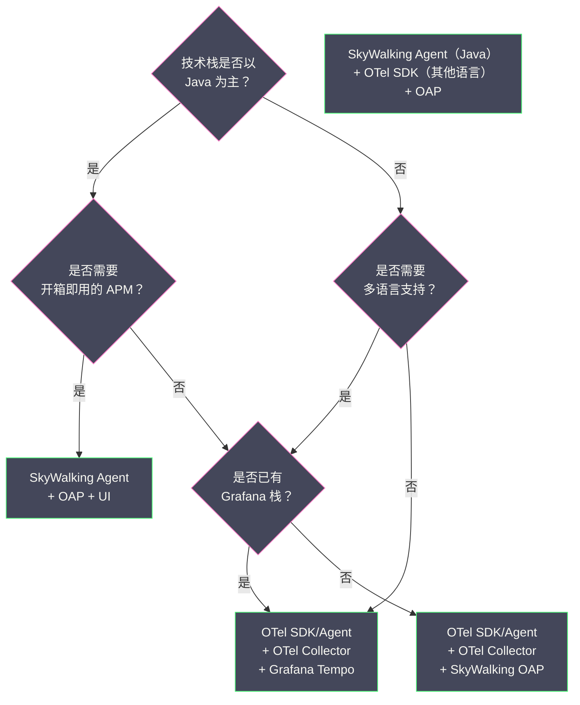

# 08 链路追踪工程实践落地经验

**摘要：**

前面七篇从理论到实现，剖析了链路追踪的概念、标准、SkyWalking 的架构与内部机制。但"懂原理"与"用得好"之间仍有巨大的鸿沟——在真实生产环境里，落地会遇到大量工程问题：跨线程与跨协程的 Context 丢失、异步消息队列导致的链路断裂、操作名爆炸导致 OAP 内存耗尽、Agent 与框架的版本冲突等。本文作为链路追踪子专栏的收官，把这些高频问题逐一拆解：先讲链路断裂的四类根因与排查方法，再讲操作名爆炸的成因与治理，随后是兼容性管理、与指标日志的联动、部署清单与排查 SOP，最后落到选型决策与组织推广。读完之后，你应当能回答两个问题：**落地追踪最常踩哪些坑，以及一个团队该按什么顺序把它用起来**。

---

## 第 1 章 链路断裂：最常见的落地问题

### 1.1 什么是链路断裂

**链路断裂（Trace Gap）** 是指一条完整的调用链路中某些 Span 缺失，导致在 UI 中看到的 Trace 不完整——要么出现孤立的 Span（找不到父 Span），要么调用树里某个节点的子节点缺失。

链路断裂是落地中最常见也最令人沮丧的问题。一个断裂的 Trace 不仅失去排查价值（看不到完整调用路径），还会干扰 OAP 的拓扑构建（调用关系不完整）与指标计算（缺失的 Segment 不参与聚合）。**更麻烦的是，它往往"静默发生"**——没有报错、没有告警，只是"有些链路看起来怪怪的"。

### 1.2 断裂原因一：跨线程 Context 丢失

这是 Java 生态里最高频的断裂原因。SkyWalking Agent 用 ThreadLocal 存储 Trace Context，当业务代码把任务提交到线程池时，新线程的 ThreadLocal 里没有 Context，后续创建的 Span 无法关联到原始 Trace。

常见的跨线程场景如下：

| 场景 | 典型代码 | Agent 是否自动处理 |
|---|---|---|
| `ExecutorService.submit()` | `executor.submit(runnable)` | 需要 `apm-jdk-threading-plugin`（optional） |
| `CompletableFuture` | `CompletableFuture.supplyAsync(...)` | 需要 `apm-jdk-threading-plugin`（optional） |
| Spring `@Async` | `@Async public void asyncMethod()` | 需要 `apm-spring-async-plugin` |
| Reactor / WebFlux | `Mono.fromCallable(...).subscribeOn(...)` | 需要 `apm-spring-webflux-plugin` |
| Netty EventLoop | Netty 的异步回调 | 部分支持（依赖具体插件） |
| 自定义线程 | `new Thread(runnable).start()` | 不支持（需手动传递） |

解决方案有三条，**按"侵入性从低到高"排列**。

**方案一：启用 optional-plugins 中的线程增强插件。**

```bash
# 启用方式：将插件从 optional-plugins 移动到 plugins 目录
cp optional-plugins/apm-jdk-threading-plugin-*.jar plugins/
```

> [!warning] 启用 jdk-threading-plugin 的风险
> 这个插件会增强所有实现了 `Runnable`/`Callable` 接口的类——包括 JDK 内部类、第三方库内部类、框架内部类。在某些场景下可能导致：**类加载冲突**（增强 Bootstrap ClassLoader 加载的类时出错）、**性能影响**（大量短生命周期的 Runnable 被增强，增加 GC 压力）、**误增强**（与业务无关的线程任务也被增强，产生无意义的 Span）。
>
> 建议在测试环境充分验证后再上线。如果只有特定场景需要跨线程传播，优先用 `@TraceCrossThread` 注解精确控制。**"增强所有 Runnable"是一把双刃剑——它覆盖最广，也最容易误伤。**

**方案二：使用 @TraceCrossThread 注解。**

```java
import org.apache.skywalking.apm.toolkit.trace.TraceCrossThread;

@TraceCrossThread
public class OrderProcessTask implements Runnable {
    @Override
    public void run() {
        // Agent 自动在 run() 入口恢复 Context
        // 这里创建的 Span 会正确关联到提交任务的父 Trace
        orderService.processOrder(orderId);
    }
}

// 使用方式不变
executor.submit(new OrderProcessTask(orderId));
```

**方案三：手动 Context 传递（终极兜底）。**

```java
import org.apache.skywalking.apm.toolkit.trace.TraceContext;

// 在主线程中捕获 Context 快照
final String traceId = TraceContext.traceId();

// 在新线程中恢复
executor.submit(() -> {
    // 使用 Toolkit API 创建关联的 Span
    ActiveSpan.tag("traceId", traceId);  // 至少记录关联信息
});
```

这三条方案的取舍很清楚：**方案一覆盖最广但风险最大，方案二精确但需要改代码，方案三最灵活但最费事**。实践中的顺序通常是"先试方案二（精确、低风险），不够再考虑方案一（广覆盖、需验证）"。**这与第 05 篇 4.3 节讲的"手动与自动互补"是同一套思路**——覆盖边界与精确控制，需要两条腿走路。

### 1.3 断裂原因二：消息队列的异步调用

当服务 A 通过 Kafka、RabbitMQ、RocketMQ 发送消息到服务 B 时，消息可能在队列中停留几秒到几分钟。如果 Agent 没有正确处理消息队列的 Context 传播，服务 B 消费消息时创建的 Span 就无法关联到服务 A 的 Trace。

SkyWalking 对主流消息队列的支持如下：

| 消息队列 | 插件 | Context 传播方式 | 注意事项 |
|---|---|---|---|
| Kafka | `apm-kafka-plugin` | 将 sw8 注入 Kafka Record Header | Producer 与 Consumer 都需 Agent |
| RabbitMQ | `apm-rabbitmq-plugin` | 将 sw8 注入 AMQP Message Header | 同上 |
| RocketMQ | `apm-rocketmq-plugin` | 将 sw8 注入 Message UserProperty | 同上 |
| Pulsar | `apm-pulsar-plugin` | 将 sw8 注入 Message Property | 同上 |

**消息队列链路的特殊性**在于：**生产者与消费者之间存在时间解耦**。生产者发送后就结束了（ExitSpan 完成），消费者可能几秒甚至几分钟后才开始处理。在瀑布图里，这种调用关系看起来是这样的：

```text
Producer 的 Trace：
  [EntrySpan: POST /api/orders] ─── 150ms ───
    [ExitSpan: Kafka/Producer/order-topic] ── 5ms ──

Consumer 的 Trace（可能是同一个 Trace ID，也可能是新的 Trace）：
  [EntrySpan: Kafka/Consumer/order-topic] ─── 200ms ───
    [ExitSpan: MySQL/INSERT] ── 50ms ──
```

SkyWalking 的 Kafka 插件会在 Consumer 的 EntrySpan 中携带 Producer 的 Trace ID 作为 `ref`（SegmentReference），使两者关联为同一个 Trace。但如果消息经过**多次转发**（如 Kafka → 中间处理服务 → 再写入另一个 Kafka Topic），链路会变得非常长且复杂，查看时需要注意时间跨度。

**这也是消息队列链路最容易被误解的地方**：因为时间跨度可能很大，"调用耗时"会显得荒谬地长。**记住第 02 篇讲过的 PRODUCER/CONSUMER 语义**——它们之间的"耗时"包含"消息在队列里等待的时间"，这个数字大并不代表有问题。

### 1.4 断裂原因三：中间层未传播 Header

如果调用链中存在**不传播 sw8 Header 的中间层**（如 Nginx 反向代理、API Gateway、服务网格 Sidecar），下游服务收不到 sw8 Header，链路就在这里断裂。

常见的中间层处理方式如下：

| 中间层 | 默认行为 | 解决方案 |
|---|---|---|
| Nginx | 不转发自定义 Header（取决于配置） | 在 `proxy_pass` 处添加 `proxy_set_header sw8 $http_sw8;` |
| Kong | 默认转发所有 Header | 通常无需配置 |
| Spring Cloud Gateway | 需要 SkyWalking 插件 | 启用 `apm-spring-cloud-gateway-plugin`（optional） |
| Envoy (Istio) | 需要配置 Header 透传 | 配置 Envoy 的 `custom_tags` 或用 SkyWalking 的 ALS 接入 |
| gRPC Gateway | 需要手动转发 Metadata | 在 gRPC Interceptor 中转发 sw8 Metadata |

这类断裂的特点是"**断在基础设施层，而不是应用代码里**"——应用侧的 Agent 配置完全正确，但中间层把 Header 吃了。**排查这类问题的第一反应应当是"检查中间层"，而不是"怀疑应用埋点"**。

### 1.5 断裂的排查方法

把三类原因归拢，可以给出一套排查顺序。

**第一步，看断点在哪一跳。** 在瀑布图里找到"哪个 Span 之后就没有子 Span 了"。断点位置直接指向问题类型：断在"线程池调用"处 → 跨线程问题；断在"消息发送/消费"处 → 消息队列问题；断在"网关之后" → 中间层问题。

**第二步，看下游是否生成了独立 Trace ID。** 如果下游的 Trace ID 与上游不同，说明"上下文完全没传过去"，是漏传；如果相同但缺 Span，可能是采样或上报的问题。

**第三步，检查传播载体。** 对 HTTP，抓包看 sw8 Header 是否存在；对消息队列，看消息属性里有没有注入；对中间层，逐层确认配置。

**这套顺序的价值在于"从现象快速缩小范围"**——不必一上来就翻代码，而是先通过"断点位置"把可能性收敛到一类。**排查的效率，往往取决于"先做什么"，而不是"做了多少"**。

### 1.6 断裂对指标与拓扑的连带影响

断裂不只是"看不全一条链路"，它的影响会传导到两个下游能力。

**其一是拓扑图失真。** 拓扑是从 ExitSpan 与下游 EntrySpan 的关联推导出来的。如果链路断了，OAP 就不知道"这个 ExitSpan 对应的是哪个下游服务"，于是拓扑图上会出现孤立节点或错误的边。**拓扑图的准确性，直接取决于链路的完整度**。

**其二是指标口径偏差。** 如果某个服务的 Segment 大量丢失（比如因为 Ring Buffer 丢弃），那么从这些 Segment 聚合出的 QPS 就会偏低。**指标看起来"这个服务流量不大"，实际上只是"数据没采上来"**——这类偏差极其危险，因为它会让排查走上完全错误的方向。

这两条影响说明：**断裂是一个"会扩散"的问题**。它先让 Trace 不完整，再让拓扑不可信，最后让指标失真——**而这三样恰好是排查时依赖的全部工具**。这也解释了为什么"断链率"值得被当作一个一等指标来监控（7.3 节）：**它是"整个观测体系是否可信"的前哨信号**。

### 1.7 断链的自检清单

把本章内容收成一份自检清单，遇到断链时逐项核对。

- **断点在哪一跳？** 定位到"最后一个有子 Span 的位置"，据此判断是跨线程、消息队列还是中间层。
- **下游的 Trace ID 是否与上游相同？** 不同则是"完全没传过去"（漏传或中间层吃掉）；相同但缺 Span 则可能是采样或上报问题。
- **有没有跨线程的异步调用？** 检查是否启用了线程增强插件、或是否用了 `@TraceCrossThread`。
- **有没有消息队列？** 检查 Producer 与 Consumer 是否都装了 Agent、消息头里有没有注入上下文。
- **有没有中间层（Nginx、网关、Sidecar）？** 检查 Header 透传配置。
- **日志里有没有 `TID: N/A`？** 如果有，说明"上下文在那一处丢失"，可以作为断链的侧写证据。
- **断链是普遍的还是偶发的？** 普遍 → 配置问题；偶发 → 可能与并发时序或异步边界有关。

**这份清单的价值，是把"凭感觉排查"变成"按项核对"**。断链问题看似千变万化，但根因就那么几类——**有了清单，就不容易在错误的方向上打转**。

---

## 第 2 章 操作名爆炸：OAP 的隐形杀手

### 2.1 什么是操作名爆炸

**操作名爆炸（Endpoint Name Explosion）** 是指 SkyWalking 中注册的端点（Endpoint）数量失控增长，导致 OAP 内存耗尽或 ES 索引膨胀。

正常情况下，一个服务的端点数有限——每个 REST API 路径对应一个端点，如 `GET /api/orders`、`POST /api/users`。但如果端点名里包含**动态参数**（如订单 ID、用户 ID），每个请求都会产生一个唯一的端点名：

```text
正常的端点名：
  GET /api/orders         → 1 个端点
  GET /api/orders/{id}    → 1 个端点（Agent 应该参数化）
  POST /api/users         → 1 个端点

操作名爆炸：
  GET /api/orders/12345   → 1 个端点
  GET /api/orders/12346   → 1 个端点
  GET /api/orders/12347   → 1 个端点
  ...
  GET /api/orders/99999   → 87,655 个端点
```

每个端点在 OAP 中都会创建独立的指标时间序列（P99、QPS、错误率等），**端点数 × 指标类型 × 时间桶 = 海量指标数据**，OAP 的内存与 ES 的索引容量迅速耗尽。

**这与第 02 篇讲 Span 命名时说的"高基数是万恶之源"是同一个问题**，只是它发生在"端点"这个维度上。**追踪系统里任何"用于聚合的维度"，一旦基数失控，就会从"帮助聚合"变成"拖垮系统"**。

### 2.2 常见的爆炸原因

**原因一：RESTful URL 中的路径参数未参数化。** SkyWalking 的 Spring MVC 插件通常能正确把 `@PathVariable` 参数化（把 `/api/orders/12345` 转成 `/api/orders/{id}`），但以下情况可能失败：使用原生 Servlet 而不是 Spring MVC；URL 路径里包含非标准的动态部分（如 `/api/v1/tenant-abc/orders`，其中 `tenant-abc` 是动态租户 ID）；使用自定义路由框架。

**原因二：数据库 SQL 未参数化。** 如果 JDBC 插件没有正确处理 SQL 参数化，每个不同的 SQL 都会成为一个独立端点：

```text
SELECT * FROM orders WHERE id = 12345   → 端点 1
SELECT * FROM orders WHERE id = 12346   → 端点 2
```

正确的参数化应当是 `SELECT * FROM orders WHERE id = ?`。

**原因三：GraphQL / gRPC 的操作名不规范。** GraphQL 的 query name 与 gRPC 的 method name 如果包含动态部分，同样会导致爆炸。

这三种原因的共同点是：**"本该被参数化的动态部分，被原样写进了端点名"**。换句话说，**爆炸的本质是"把高基数的值当成了聚合维度"**。

### 2.3 解决方案

**方案一：Agent 端操作名分组。**

```properties
# agent.config
plugin.springmvc.collect_http_params=false
agent.operation_name_threshold=500

# 或使用 apm-trace-ignore-plugin 过滤无关端点
trace.ignore_path=/health,/actuator/**
```

**方案二：OAP 端端点名分组（Endpoint Grouping）。** OAP 支持在服务端对端点名做正则分组，在 `endpoint-name-grouping.yml` 中配置：

```yaml
grouping:
  # 将 /api/orders/{任意字符} 统一为 /api/orders/{id}
  - service-name: order-service
    rules:
      - /api/orders/.+  →  /api/orders/{id}
      - /api/users/.+/profile  →  /api/users/{id}/profile
```

**方案三：设置端点数量上限。** OAP 有一个 `maxEndpointNum` 配置（默认 500），超过这个数量的新端点会被忽略。如果日志里出现 `Endpoint name overflow` 警告，说明端点数量已接近上限，需要排查爆炸原因。

**三条方案的分工是"从源头到兜底"**：Agent 端分组是最"上游"的治理（在采集时就参数化），OAP 端分组是"后端补救"（采集时没做好，后端再收敛），数量上限是"最后防线"（前两者都失效时的保护）。**治理高基数问题，永远优先在"数据进入系统之前"做**——这与第 02 篇讲的"在采集入口做减法"完全一致。

### 2.4 高基数问题的一般规律

操作名爆炸只是高基数问题的一个实例。把它抽象出来，可以得到一条通用规律：**追踪系统里所有"会被聚合、会被索引"的维度，都必须是低基数的**。

哪些维度会被聚合？**端点名**（用于算端点级指标）、**服务名**（用于算服务级指标）、**peer**（用于画拓扑）、**Span 的属性值**（部分会被索引）。这些维度一旦高基数，都会引发类似的问题——只是表现形式不同：端点爆炸拖垮 OAP 内存，标签爆炸拖垮 ES 索引，属性爆炸拖垮存储。

**判断一个维度是否"安全"的方法很简单：问它"可能的取值有多少种"**。如果答案是"可枚举的几十种"，安全；如果答案是"随请求增长"，危险。**这条判断标准，与 Loki 的标签治理（第 02 篇）、指标的基数控制是通用的**——**"基数意识"是使用任何可观测系统时的基本功**。

### 2.5 一次操作名爆炸的真实排查

把爆炸的排查过程走一遍，会更容易理解它的隐蔽性。

**最初的现象**：OAP 的内存使用率缓慢上升，几周后触发 OOM；或者 ES 的索引增长远超预期。**注意"缓慢"这个词**——它不是"某天突然爆炸"，而是"日积月累"。

**排查的第一步是看"端点数量"**。OAP 提供了"服务下的端点列表"，如果一个服务注册了几万个端点，那基本可以确定是爆炸。**这一步的关键是"有没有端点数的监控"**——没有监控，就只能等到 OOM 才发现。

**第二步是定位爆炸源**。把端点名排序，看哪些端点"长得像但末尾不同"（如 `/api/orders/12345`、`/api/orders/12346`）。**这种"前缀相同、后缀各异"的模式，就是未参数化的典型特征**。

**第三步是反查调用方**。确定是哪个接口后，回溯到对应的 Controller 或 SQL，找出"为什么没有参数化"——是用了原生 Servlet？是自定义路由？还是 SQL 拼接？

**这次排查的教训有两个**：**其一，"端点数"必须被监控**，否则问题会在积累很久之后才爆发；**其二，爆炸的根源往往在"某个新上线的接口"**——它可能只是加了一个"按租户 ID 查询"的接口，而租户 ID 是动态的。**新接口上线时的"参数化检查"，应当成为一次代码评审的固定项**。

---

## 第 3 章 Agent 与框架的兼容性问题

### 3.1 类加载冲突

SkyWalking Agent 通过字节码增强修改目标类，但某些框架也用了类似技术（如 Spring AOP 的 CGLIB 代理、Hibernate 的字节码增强），两者可能产生冲突。

| 框架 | 冲突表现 | 解决方案 |
|---|---|---|
| Spring AOP (CGLIB) | 增强后的类被 CGLIB 再次代理，方法拦截失效 | SkyWalking 插件已适配，通常无问题 |
| Lombok | `@SneakyThrows` 生成的异常处理代码与 Agent 的异常拦截冲突 | 升级 Agent 到最新版本 |
| MapStruct | 编译时代码生成与运行时增强不兼容 | 排除 MapStruct 生成类的增强 |
| GraalVM Native Image | Native Image 不支持运行时字节码修改 | 无法用 Java Agent，需改用 OTel SDK 手动埋点 |
| Quarkus (Native) | 同 GraalVM | 同上 |

这张表里最值得留意的是 GraalVM 那一行：**它代表的不是"兼容性 bug"，而是"技术路线的根本冲突"**。Native Image 在构建期就完成了编译，运行时没有"类加载"这个环节，因此字节码增强从原理上就无从下手。**遇到这种情况，不是"等 Agent 适配"，而是"换一条技术路线"**（改用 OTel SDK 手动埋点或编译期插桩）。

### 3.2 版本兼容性矩阵

SkyWalking Agent 的版本需要与应用使用的框架版本匹配。常见要求如下：

| Agent 版本 | Java 版本 | Spring Boot | Dubbo | gRPC |
|---|---|---|---|---|
| 9.x | 8, 11, 17, 21 | 2.x, 3.x | 2.7+, 3.x | 1.x |
| 8.x | 8, 11, 17 | 2.x | 2.7+ | 1.x |

> [!warning] Java 17 及以上的模块化限制
> Java 17 默认启用了强封装（Strong Encapsulation），禁止反射访问 JDK 内部 API。SkyWalking Agent 的某些增强需要访问 `java.lang` 或 `sun.misc` 包，需要在 JVM 启动参数中添加：
> ```text
> --add-opens java.base/java.lang=ALL-UNNAMED
> --add-opens java.base/java.lang.reflect=ALL-UNNAMED
> ```
> **这是 Java 平台"加强封装"与"字节码增强"之间的一次正面对撞**——平台想让内部实现不可见，而 Agent 恰恰需要看到内部。这个矛盾会长期存在，每一次 JDK 收紧封装，Agent 都要跟着调整。

### 3.3 排查 Agent 问题的工具

当 Agent 出现异常（类加载错误、NPE、Span 丢失）时，排查手段按优先级排列如下。

**手段一：Agent 日志。** Agent 的日志文件位于 `logs/skywalking-api.log`，默认级别是 `INFO`。排查时可以临时调成 `DEBUG`：

```properties
# agent.config
logging.level=DEBUG
logging.output=FILE
logging.dir=/path/to/logs
logging.max_file_size=300000000  # 300MB
```

**手段二：Agent 自身的健康指标。** SkyWalking Agent 通过 JMX 暴露自身的健康指标（已创建的 Span 数、已丢弃的 Segment 数、gRPC 连接状态），可以通过 JMX 客户端（如 JConsole）或 Prometheus JMX Exporter 采集。

**手段三：独立测试。** 在怀疑 Agent 与特定框架冲突时，创建一个最小化的测试项目（只包含该框架加 SkyWalking Agent），排除其他变量的干扰。

**手段四：摘除 Agent 复现。** 去掉 `-javaagent` 参数再复现一次，看问题是否消失（第 05 篇 7.3 节）。**这是最"一锤定音"的手段**——如果问题消失，就基本可以锁定 Agent。

### 3.4 兼容性的管理

兼容性问题不会"一次解决、永久无忧"，它需要持续管理。三条实践值得坚持。

**其一，维护兼容矩阵。** 把"Agent 版本 × 框架版本 × JDK 版本"的组合记下来，升级前先在矩阵上验证。**这份文档的价值，会在一次"差点上线的事故"里被全额赚回**。

**其二，升级要灰度。** Agent 版本升级与框架版本升级一样，都应当先灰度一个实例、观察一段时间，再全量。**"字节码增强的变更"虽然不出现在 diff 里，但它同样是变更**。

**其三，保留回退能力。** 确保 Agent 可以通过启动参数或配置快速摘除，这样一旦怀疑是它的问题，就能在几分钟内验证。**给任何"隐式生效"的组件留一条快速关掉的路，是运维的基本功**。

### 3.5 框架升级时的验证流程

由于 Agent 与框架版本强耦合（第 05 篇 3.6 节），"框架升级"这件事对追踪系统而言是一次高风险操作。一个稳妥的验证流程有五步。

**第一步，查兼容矩阵**：确认新框架版本是否在 Agent 的支持范围内。不在范围内的，要么先升级 Agent，要么推迟框架升级。

**第二步，在测试环境验证**：跑一遍完整的业务用例，确认"关键框架的 Span 依然存在"。**这里的检查重点是"Span 有没有消失"，而不是"有没有报错"**——因为增强失效往往是静默的。

**第三步，对比链路完整度**：用同一个请求，对比升级前后的 Trace，看调用树的结构是否一致。**如果升级前有的 Span，升级后没了，那就是插件失配**。

**第四步，灰度发布**：先在一个实例上升级，观察一段时间（覆盖典型的业务场景），再全量。

**第五步，保留回退**：确认"回退到旧版本"的路径可用，一旦发现问题能快速恢复。

**这个流程的核心是"把'看不见的变更'当成'需要验证的变更'"**。框架升级在 diff 里看得到，但"字节码增强因此失效"却看不到——**恰恰是这种"看不见"，让它容易被跳过验证**。

### 3.6 一个兼容性事故的复盘

把 3.5 节的流程反过来看，一个典型的兼容性事故是这样发生的。

**事故经过**：某团队升级了某个框架的大版本。单元测试与集成测试全部通过，于是直接全量发布。上线后服务运行正常，但**追踪数据里完全看不到这个框架的调用**——旧插件的匹配规则在新版本里匹配不上了，增强静默失效。

**为什么没被发现**：测试覆盖的是"业务逻辑是否正确"，而不是"Span 是否还在"。**"增强失效"不产生任何报错，因此常规测试抓不到它**。而全量发布又跳过了灰度——两个疏忽叠加，让问题直达生产。

**排查过程**：发现"某个框架的 Span 消失"后，先怀疑"是不是采样把它过滤了"（排除），再怀疑"是不是 Agent 配置变了"（排除），最后对比 Agent 日志与框架版本，才锁定"插件与新框架版本不兼容"。

**教训有三条**。**其一，"Span 消失"需要被监控**——把"关键框架的 Span 是否存在"做成一个可检查的项（第 07 篇 4.5 节的覆盖率思路）。**其二，框架升级必须灰度**，先在一个实例上验证追踪是否正常。**其三，把"验证 Agent 兼容性"写进升级清单**，让它是"流程里的固定动作"，而不是"想起来才做"。

**这个事故的本质，是"变更的可见性与风险不匹配"**：框架升级在 diff 里看得见，因此团队以为"测过了就行"；而"字节码增强失效"看不见，因此被默认"应该没事"。**恰恰是"看不见的变更"，最需要显式的验证**。

---

## 第 4 章 链路追踪与指标、日志的联动

### 4.1 Trace ID 注入日志

链路追踪最大的工程价值之一，是**把 Trace ID 注入应用日志**，使工程师可以从追踪系统跳到日志系统，查看特定请求的详细日志。

SkyWalking 提供了 Toolkit 库，可以把 Trace ID 注入主流日志框架。

**Log4j2 集成：**

```xml
<!-- pom.xml -->
<dependency>
    <groupId>org.apache.skywalking</groupId>
    <artifactId>apm-toolkit-log4j-2.x</artifactId>
    <version>${skywalking.version}</version>
</dependency>
```

```xml
<!-- log4j2.xml 的 Pattern 配置 -->
<PatternLayout pattern="%d [%traceId] [%thread] %-5level %logger{36} - %msg%n"/>
```

`%traceId` 是 SkyWalking Toolkit 提供的自定义 Pattern，它从当前线程的 Trace Context 里提取 Trace ID。如果当前线程没有 Trace Context（如应用启动阶段的日志），输出 `TID: N/A`。

**Logback 集成：**

```xml
<dependency>
    <groupId>org.apache.skywalking</groupId>
    <artifactId>apm-toolkit-logback-1.x</artifactId>
    <version>${skywalking.version}</version>
</dependency>
```

```xml
<!-- logback.xml -->
<appender name="STDOUT" class="ch.qos.logback.core.ConsoleAppender">
    <encoder class="ch.qos.logback.core.encoder.LayoutWrappingEncoder">
        <layout class="org.apache.skywalking.apm.toolkit.log.logback.v1.x.TraceIdPatternLogbackLayout">
            <pattern>%d [%tid] [%thread] %-5level %logger{36} - %msg%n</pattern>
        </layout>
    </encoder>
</appender>
```

日志输出效果：

```text
2024-01-01 10:00:00.150 [abc123def456...] [http-nio-8080-exec-1] INFO  OrderController - 创建订单: orderId=789
2024-01-01 10:00:00.180 [abc123def456...] [http-nio-8080-exec-1] INFO  OrderService - 扣减库存成功
2024-01-01 10:00:00.250 [abc123def456...] [http-nio-8080-exec-1] ERROR PaymentService - 支付失败: timeout
```

工程师在日志里看到错误后，复制 Trace ID，在 SkyWalking UI 中搜索它，就能看到完整的调用链路与每个环节的耗时。**这条"从日志到链路"的路径，是日常排查里使用频率最高的一条联动**。

### 4.2 从 Grafana 跳转到 SkyWalking

如果团队用 Grafana 作为统一的可视化平台，可以在 Grafana 仪表盘中配置**数据链接（Data Links）**，实现从指标图表直接跳转到 SkyWalking UI：

```text
Grafana Panel 的 Data Link 配置：
  Title: 查看 SkyWalking Trace
  URL: http://skywalking-ui:8080/trace?service=${__field.labels.service_name}&duration=30m
```

当工程师在 Grafana 中发现某个服务的 P99 延迟异常时，点击数据链接，直接跳转到 SkyWalking UI 查看该服务在对应时间段的慢请求 Trace。**这条"从指标到链路"的路径，把"发现问题"与"定位问题"无缝衔接了起来**。

### 4.3 SkyWalking 内置的日志关联

SkyWalking 9.x 支持**直接接收日志数据**（通过 receiver-log 模块），并在 UI 中展示与 Trace 关联的日志：

```text
日志采集方式：
1. Agent Toolkit 直接上报（日志框架通过 Appender 直接发送到 OAP）
2. Fluentd / Filebeat 采集日志文件，发送到 OAP 的 HTTP/gRPC 端点
3. OTel Collector 采集日志，通过 OTLP 发送到 OAP
```

在 SkyWalking UI 中查看某条 Trace 时，可以在 "Log" 标签页看到该 Trace 对应时间段内、该服务产生的所有日志——前提是日志中包含了正确的 Trace ID。**这条路径省去了"复制 Trace ID 再到日志系统搜索"的手工步骤**，是联动体验最顺滑的一种。

### 4.4 联动的三个层次

把上面三条联动归拢，可以看到联动的成熟度有三个层次。

**层次一：手动关联。** 日志里有 Trace ID，但跳转靠人工复制粘贴。它是最容易达到的层次，成本最低，也最不顺手。

**层次二：单向跳转。** 配置了 Data Link，从指标能一键跳到链路，或从链路能一键跳到日志。它需要配置，但显著提升了排查效率。

**层次三：双向联动。** 追踪、指标、日志三者在同一个 UI 里互相跳转、共享上下文。它需要统一的采集与存储，成本最高，体验最好。

**团队不必一步到位**——从层次一开始，按排查的实际痛点逐步升级即可。**但方向是明确的：联动的层次越高，排查时"手动搬运上下文"的动作就越少**，而每一次"手动搬运"，都是排查时间里被浪费掉的一段。

### 4.5 日志联动的成本

Trace ID 注入日志听上去"只是加一个 Pattern"，但它也有成本，值得算清。

**其一是日志体积的增加**。每条日志多了一个 32 位的 Trace ID，看起来不多，但在"每天几十亿行日志"的规模下，这会变成可观的存储增量。**一个 32 字符的字段乘以十亿行，就是几十 GB**。

**其二是日志格式的变更**。注入 Trace ID 会改变日志的行格式，而**任何依赖日志格式的下游解析（如某些日志采集器的正则、某些告警的匹配规则）都可能因此失效**。变更前需要排查"有没有东西在解析日志格式"。

**其三是"跨线程日志拿不到 Trace ID"**。如果日志打在异步线程里，而上下文没传过去，那么这条日志的 Trace ID 就是 `N/A`——**这与链路断裂是同一个根因**。因此"日志里的 Trace ID 缺失率"，其实可以作为"跨线程上下文传递是否完好"的一个侧写指标。

这三条成本说明：**联动不是"配一下就完了"，它同样需要评估、灰度与验证**。**"加一个字段"的直觉，往往会低估它在规模下的影响**。

### 4.6 追踪与日志的时间对齐

联动里还有一个容易被忽视的细节：**追踪与日志的"时间"未必对得上**。

原因有三。**其一是时钟偏移**：不同机器的时间不完全同步（第 02 篇 2.7 节），日志来自应用服务器、Span 时间来自各服务，两者叠加后可能差出几十毫秒甚至更多。**其二是时区**：日志与追踪系统如果配置了不同的时区，时间会整体错位。**其三是语义不同**：日志的时间是"这条日志被写下的时刻"，Span 的时间是"这段操作开始与结束的时刻"——两者本就不是一回事。

这些差异带来的实际影响是：**在 UI 里"跳转查看某条 Trace 对应的日志"时，按时间范围过滤可能"漏掉"或"多出"一些日志**。应对办法是：跳转时把时间范围放宽一些（如前后各加一分钟），而不是"精确匹配 Span 的起止时间"。

**"时间对不上"在可观测性里是一个高频困扰**——指标、日志、追踪三者的时间口径本就不同。**与其追求"毫秒级对齐"，不如接受"分钟级近似"，并在跳转时留出余量**。**把"对齐"当成一个需要显式处理的问题，而不是默认成立的前提**，能省下大量"为什么日志少了几条"的困惑。

---

## 第 5 章 生产环境部署清单

### 5.1 Agent 端检查清单

| 检查项 | 说明 | 优先级 |
|---|---|---|
| `agent.service_name` 配置正确 | 使用有意义的服务名（如 `order-service`，不要用默认值） | P0 |
| `collector.backend_service` 指向正确的 OAP | 多 OAP 实例时用逗号分隔 | P0 |
| 采样策略配置合理 | 入口服务配置采样率，内部服务跟随上游 | P0 |
| `trace.ignore_path` 过滤无关路径 | 排除 `/health`、`/actuator`、静态资源 | P1 |
| 日志中注入 Trace ID | 配置 Log4j2 / Logback 的 TraceId Pattern | P1 |
| 跨线程插件是否需要启用 | 评估业务代码中的异步场景 | P1 |
| `span_limit_per_segment` 设置合理 | 防止循环调用产生海量 Span，默认 300 | P2 |
| Agent 版本与框架版本兼容 | 特别注意 Java 17 及以上的模块化限制 | P2 |

### 5.2 OAP 端检查清单

| 检查项 | 说明 | 优先级 |
|---|---|---|
| OAP 集群部署（至少 2 实例） | 避免单点故障 | P0 |
| ES 集群资源充足 | 内存、磁盘、写入吞吐量 | P0 |
| TTL 配置合理 | Segment 3 到 7 天，Metrics 7 到 30 天 | P0 |
| 告警规则配置 | 至少配置 P99 延迟与错误率的告警 | P1 |
| 端点分组规则 | 防止操作名爆炸 | P1 |
| Kafka 缓冲（大规模场景） | 削峰填谷，保护 OAP | P2 |
| 动态配置源接入 | 支持运行时调整采样率 | P2 |

### 5.3 故障排查 SOP

当线上出现性能问题时，利用链路追踪的标准排查流程如下：

```text
Step 1: 发现异常（指标告警）
  → Grafana / SkyWalking 仪表盘显示 P99 延迟飙升
  → 确认受影响的服务和时间范围

Step 2: 定位服务（拓扑图）
  → 打开 SkyWalking 拓扑图，查看哪条调用边的延迟异常
  → 缩小到具体的上下游服务对

Step 3: 定位请求（Trace 查询）
  → 按服务名 + 时间范围 + 最小延迟条件搜索 Trace
  → 选择一个典型的慢 Trace，查看瀑布图
  → 找到耗时最长的 Span

Step 4: 查看上下文（日志关联）
  → 复制慢 Span 对应的 Trace ID
  → 在日志系统中搜索该 Trace ID
  → 查看详细的错误信息、SQL 语句、请求参数

Step 5: 定位代码（Profile 剖析）
  → 如果慢 Span 是服务内部处理（而非等待下游）
  → 在 SkyWalking UI 中对该端点创建 Profile 任务
  → 查看火焰图，定位到具体的函数级别

Step 6: 修复与验证
  → 根据定位结果修复代码或配置
  → 部署后观察指标是否恢复正常
  → 再次搜索 Trace 确认延迟恢复
```

这六步恰好是第 01 篇"四大信号分工"的一次完整演练：**指标发现（Step 1）→ 追踪定位（Step 2、3）→ 日志取证（Step 4）→ Profiler 下钻（Step 5）**。**SOP 的价值不在"步骤本身"，而在"每一步都有明确的输入与输出"**——上一阶段的产出（异常服务、慢 Trace、Trace ID）正是下一阶段的输入，整条链路不会卡在"接下来该干什么"。

### 5.4 清单的使用方式

清单不是"读一遍就扔"的东西，它有三种用法。

**其一是上线前的检查**：新服务接入追踪时，对照清单逐项确认。**它能把"新手容易忘的事"变成"流程里的固定动作"**。

**其二是定期审计**：每隔一段时间回看一遍，确认配置没有因为"临时调整"而跑偏（比如某个服务为了排查问题临时把采样率调到 100%，事后忘了改回来）。

**其三是故障时的参照**：排查时对照清单，快速排除"配置层面的低级问题"。**很多"诡异问题"最后都发现是某个配置项没配好**——对照清单能省下大量时间。

### 5.5 上线前的演练

清单是"静态的检查"，而演练是"动态的验证"。上线追踪系统之前，值得做一次演练：**人为制造一个慢请求，然后完整走一遍排查 SOP**。

演练要验证四件事：**指标能不能发现**（告警是否触发）、**拓扑能不能定位**（能否看出是哪条边慢）、**Trace 能不能查到**（能否找到那条慢请求的瀑布图）、**日志能不能关联**（能否从 Trace ID 跳到日志）。**这四步里任何一步断掉，都说明联动还没打通**。

演练的价值在于"**在真正需要它之前，先确认它能用**"。很多团队在故障现场才发现"告警没配""日志里没 Trace ID""跳转链接是错的"——而这些问题，在演练里几分钟就能发现。**"在平静时演练，在风暴时才能用"**，这是任何应急体系的基本功。

### 5.6 追踪系统的自监控清单

第 04、06 篇都强调过"观测系统自身也要被观测"，这里把它落成一份可执行的监控清单。

**Agent 侧**：Ring Buffer 的丢弃率（最关键，直接反映数据完整性受损）、与 OAP 的连接状态、插件加载是否成功、自身的内存与 CPU 占用。

**OAP 侧**：gRPC 接收队列长度与被拒绝请求数、聚合耗时、写入延迟与失败重试次数、告警 Webhook 的成功率。

**存储侧**：集群容量与水位的趋势、写入吞吐与查询延迟、索引数量与分片健康度。

**端到端**：从"Span 产生"到"可被查询"的延迟、断链率、追踪覆盖率。

这份清单里，**"Agent 丢弃率"与"端到端延迟"两条最值得优先告警**。前者是"数据正在丢失"的直接信号；后者是"排查时能不能及时看到"的直接信号。**很多团队监控了 OAP 的 CPU、ES 的磁盘，却漏掉了这两条最贴近"追踪到底能不能用"的指标**。**监控该盯的，是"能力是否兑现"，而不是"组件是否忙碌"。**

---

## 第 6 章 选型决策

### 6.1 一张决策树

"该用 SkyWalking 还是 OTel 加 Tempo"，是最常见的选型问题。下面这棵决策树可以帮你快速定位：



**总结**：Java 为主加追求开箱即用 → SkyWalking 全家桶；多语言加已有 Grafana → OTel 加 Tempo；Java 为主加多语言混合 → SkyWalking Agent 加 OTel SDK 加 SkyWalking OAP；标准化优先 → OTel SDK 加 Collector 加任意后端。

### 6.2 决策的深层依据

决策树给出了"选什么"，但更值得理解的是"为什么这么选"。回看全篇与第 04、05 篇的分析，选型的深层依据其实只有三条。

**第一条是"语言栈"。** Java 为主，则 SkyWalking 的无侵入优势能充分发挥；多语言为主，则 OTel 的标准与多语言覆盖更关键。**语言栈决定了"无侵入"这个最大变量能不能用上**。

**第二条是"最缺什么"。** 缺"开箱即用的完整能力"（追踪、指标、拓扑、告警、Profiler 一体），选 SkyWalking；缺"可自由组合的标准底座"，选 OTel。**选型的第一步不是比功能，而是先看清自己最缺的是哪一环**（第 01 篇 4.5 节）。

**第三条是"已有资产"。** 已有 Grafana 栈，则向 OTel 加 Tempo 靠拢更顺；已有 SkyWalking，则不必为了"标准"而推倒重来。**复用既有资产，通常优于另起炉灶**。

这三条合起来说明：**选型不是"哪个产品更好"的问题，而是"哪套方案与你的约束更匹配"的问题**。**约束一旦明确，答案往往呼之欲出**。

### 6.3 迁移路径

如果团队决定从一套迁到另一套，路径的选择同样重要。三条务实的原则如下。

**其一，先统一传播格式，再统一采集。** 传播格式（W3C）是"链路能否拼起来"的前提，成本低、收益直接；采集实现（Agent 与 SDK）的更换涉及每个服务，成本最高（第 03 篇 8.1 节）。

**其二，用 Collector 做"中间层"。** 让 Collector 承担"接收旧格式、输出新格式"的转换，业务侧不动、转换逻辑集中、可测试、可回滚（第 03 篇 6.5 节）。

**其三，灰度与双跑。** 先迁一部分服务，用双跑（同时上报新旧后端）对比数据一致性，确认无误再扩大范围。

**迁移的本质不是"换工具"，而是"换一套理解数据的语言"**。承认"过渡期两套并存"，比强行"一步到位"要务实得多。

### 6.4 混合架构的治理

现实中的团队，往往落在"混合架构"这一档——Java 服务用 SkyWalking Agent，其他语言用 OTel SDK，数据汇入同一个 OAP。这种架构灵活，但治理复杂度也更高，有几点需要特别注意。

**其一，服务命名要统一。** 两套采集体系如果对"服务名"用了不同的命名规则（如 Java 用 `order-service`、Go 用 `order_service`），OAP 里就会出现两个"看起来是同一个服务"的条目，拓扑与指标都会分裂。**统一命名规范，是混合架构能"看起来像一个系统"的前提**。

**其二，传播格式要一致。** 如果 Java 用 sw8、Go 用 W3C，那么跨语言的链路就拼不起来。**要么都切到 W3C，要么让两套传播格式能互相转换**（第 03 篇 5.3 节）。

**其三，语义约定要统一。** 两套体系对"HTTP 状态码"这个属性用了不同的键名，跨语言的看板就无法复用。**语义约定是"数据能否被统一查询"的前提**（第 03 篇 6.4 节）。

**其四，接受"能力不对等"。** SkyWalking Agent 有 Profiler、有更精确的拓扑；OTel SDK 没有这些。**混合架构下，不同语言的服务能提供的观测能力本就不对等**——承认这一点、并为非 Java 服务单独规划 Profiler 方案（如 Pyroscope、Parca），比强行追求"能力一致"更务实。

**混合架构的治理核心，是"让两套体系在'能统一的地方'统一"**——命名、传播、语义约定统一，能力差异则承认并单独补齐。**追求"处处一致"会让治理无谓地复杂化**。

### 6.5 选型要看"反悔成本"

选型时，除了看"哪个方案更好"，还应当看"**如果选错了，换的代价有多大**"——这就是"反悔成本"。

**反悔成本最低的方案**：采用标准协议（W3C）、用 Collector 做中间层、把采集与存储解耦。这类方案的共同特点是"**换后端不改应用**"——一旦发现选错了，改动集中在配置层，不必动每个服务。**OTel 之所以被看好，很大程度是因为它把反悔成本压得很低**。

**反悔成本最高的方案**：把数据模型、传播格式、指标定义全部绑定到某个私有体系上。一旦要换，就要换 Agent、改传播、重写指标定义——**几百个服务的迁移，足以让任何团队望而却步**。

因此有一条务实的选型原则：**在"能力满足"的前提下，优先选反悔成本低的方案**。SkyWalking 的"一体化"能力更强，但它的私有模型让反悔成本偏高；OTel 的能力更"零件化"，但它的标准与解耦让反悔成本很低。**这不是"谁更好"，而是"你更愿意用多少便利去换多少可逆性"**。

**"可逆性"是一个被低估的选型维度**。技术会演进、需求会变化，今天的最优解未必是三年后的最优解——**留一条"能体面地换掉"的退路，比追求"当下最合适"更长远**。这与第 03 篇讲"只借标准、渐进演进"是同一个判断。

---

## 第 7 章 落地的组织经验

### 7.1 推广的顺序

追踪的落地不只是技术问题，更是组织问题。一个务实的推广顺序是：**先在一个"痛点最明显"的团队试点 → 拿到效果 → 再横向推广**。

"痛点最明显"的团队，通常是"调用链最长、排查最痛苦"的那一个。他们最有意愿配合，也最容易看到效果——**先做出一个"看得见的成功案例"，比开十次宣讲会都管用**。

试点成功后，横向推广时的抓手是"**把接入变成默认**"：把 Agent 打进基础镜像、写进部署模板，让"新服务天然就带追踪"，而不是"每个团队自己去接"。**降低接入门槛，比强调接入价值更能推动落地**。

### 7.2 常见阻力与应对

推广追踪时，会遇到几类典型的阻力。

**"改代码太麻烦"。** 应对：强调无侵入方案（Java Agent 只需改启动参数），并把"接入"从"开发任务"变成"运维动作"。

**"会不会影响性能"。** 应对：用对照压测的数据说话（第 07 篇 4.5 节），给出"你的系统下的真实开销"，而不是空泛的"开销很小"。

**"我们已经在用日志了"。** 应对：用一个"跨服务排查"的真实案例说明——**日志能回答"那一刻发生了什么"，但回答不了"这个请求走了哪条路"**（第 01 篇 1.4 节）。

**"数据会不会泄露敏感信息"。** 应对：说明脱敏机制（SQL 参数化、Attribute 截断），并把"哪些数据可以采"写成规范。

**应对阻力的共同原则，是"用对方的语言回答对方的顾虑"**——性能顾虑用数据回答，成本顾虑用收益回答，安全顾虑用机制回答。

### 7.3 如何度量落地效果

落地是否成功，需要可度量的指标，而不是"感觉挺好"。四条值得跟踪的指标如下。

**追踪覆盖率**：有多少服务、多少关键接口被埋点。它反映"覆盖面的广度"。

**断链率**：有多少 Trace 的调用树是断的。它反映"落地的质量"——**覆盖率 100% 但断链率 30%，实际可用性远低于覆盖率 60% 但断链率 5%**（第 03 篇 8.3 节）。

**平均定位时长**：从"收到故障告警"到"定位到根因"的平均耗时。它反映"追踪到底帮上了多大忙"——**这是最贴近价值的指标**。

**排查时的手工跳转次数**：一次排查里，工程师需要手工复制粘贴 Trace ID、切换系统的次数。它反映"联动成熟度"——**这个数字越小，说明联动做得越好**。

**度量的意义，在于把"追踪有没有用"从主观判断变成客观事实**。当你能拿出"平均定位时长从 40 分钟降到 12 分钟"这样的数字时，追踪的价值就不再需要靠说服来传递了。

### 7.4 追踪的价值如何被看见

最后回到一个根本问题：**如何让追踪的价值"被看见"**？因为很多追踪项目失败，不是因为技术不行，而是因为"没人觉得它有用"。

让价值可见，有三条务实的做法。

**其一，把"定位时长"讲成故事。** 一次"用追踪十分钟定位了排查了两小时的故障"，比任何指标都有说服力。**在故障复盘里主动展示"追踪是怎么帮上忙的"，是最高效的价值传递**。

**其二，让"从指标到链路"的跳转成为习惯。** 当团队习惯了"指标报警→点一下看链路"，追踪就从一个"独立工具"变成了"排查流程的一部分"。**工具只有嵌进流程，才会被持续使用**。

**其三，用"覆盖率的提升"兑现"定位的加速"。** 覆盖越广、断链越少，"一次跳转看到全貌"的概率就越高。**把覆盖率与定位时长做成趋势图，让团队看到"投入带来的改善"**。

这三条的共同点是：**不空谈价值，而是让它体现在日常动作与具体数字里**。**一个工具的真正落地，标志不是"装了多少实例"，而是"排查时会不会下意识地打开它"**。

### 7.5 从工具到习惯到文化

追踪的落地，其实要跨过三个阶段：**工具、习惯、文化**。

**第一阶段是"工具"**：装上了、能用了，但只有少数人会在排查时想起它。这个阶段的追踪是"一个可用的系统"。

**第二阶段是"习惯"**：排查时"下意识地先看追踪"成了默认动作。它通常由两件事促成——**故障复盘中反复展示追踪的用处**，以及**把"从指标到链路"的跳转做得足够顺滑**。这个阶段的追踪是"流程的一部分"。

**第三阶段是"文化"**：写代码时就考虑"这段逻辑要不要打 Span""这个端点名会不会高基数""这个异步边界要不要传上下文"。**追踪从"排查时用的东西"变成了"开发时就考虑的东西"**。

三个阶段里，第一到第二的跨越最难，因为它不是技术问题，而是"人的行为改变"。**跨越的关键，是让追踪在"真实的、高价值的排查场景"里证明自己**——一次"它帮我省了两小时"的经历，胜过无数次宣讲。

**判断一个团队处在哪个阶段，有一个简单的测试：故障发生时，工程师的第一反应是什么**？如果是"先看日志"，那还在第一阶段；如果是"先看指标、再点进链路"，那已经进入了第二阶段。

---

## 第 8 章 常见误区与反模式

把全篇提到的坑收成一份"反模式清单"，作为快速自查的工具。

**反模式一：采样率全局统一。** 高频与低频接口对样本的需求不同，统一比例会让低频接口失去样本（第 07 篇 1.4 节）。**正确的做法是按链路位置与业务价值分层。**

**反模式二：把追踪当告警用。** 追踪是"拉"的工具，不会主动通知你出事了（第 01 篇 7.5 节）。**该从指标告警来发现问题，再从追踪定位。**

**反模式三：Span 越细越好。** 每个函数都建 Span，会让数据量膨胀、成本上升，而大部分 Span 对定位毫无帮助（第 02 篇 8.1 节）。**只在"值得度量的边界"上打 Span。**

**反模式四：用 Baggage 传业务参数。** 把接口契约藏进观测元数据，一旦追踪关闭业务就会失败（第 02 篇 8.2 节）。**业务参数走业务参数。**

**反模式五：把端点名当自由文本。** 动态参数写进端点名，会引发操作名爆炸（本章 2.1 节）。**任何用于聚合的维度，都必须低基数。**

**反模式六：用追踪数据做统计。** 采样后的数据适合定位、不适合统计（第 02 篇 5.8 节、第 07 篇 6.5 节）。**统计口径要看指标，不看采样后的明细。**

**反模式七：把 Agent 当成"透明旁观者"。** 它与业务共享 JVM，其开销是真实成本（第 04 篇 3.6 节）。**把 Agent 算进容量规划。**

**反模式八：升级框架不验证 Agent。** 字节码增强会静默失效（本章 3.5 节）。**把"验证 Agent 兼容性"列入升级清单。**

这八条反模式的共同特征，是"**把观测系统当成一个不需要治理的附加物**"。而事实上，**观测系统本身就是一个需要容量规划、需要版本管理、需要成本治理、需要持续维护的工程系统**。**把它当成一等公民来对待，是这一篇最想传达的态度**。

---

## 小结

作为本专栏的收官，这一篇把前面七篇的原理落成了"可执行的清单"。回看全篇，有两条主线值得记住。

**第一条是"断裂"与"基数"——落地中最常见的两类问题。** 断裂让链路失去价值，它的根因集中在跨线程、消息队列、中间层三处；基数失控让系统被拖垮，它的根因集中在"把高基数的值当成了聚合维度"。**这两类问题的共同解法，都是"在数据进入系统之前治理"**——在采集入口传好上下文、参数化好端点名。

**第二条是"联动"与"组织"——决定追踪能否真正用起来的两件事。** 技术上，联动的层次越高，排查越顺；组织上，推广的顺序、阻力的应对、效果的度量，决定了追踪会不会沦为"装了但没人用"。**追踪的价值不在"它有多强"，而在"它有没有被用起来"**。

七篇原理加一篇实践，构成了这个专栏的完整闭环：**第 01 至 03 篇建立认知（为什么、是什么、标准怎么统一），第 04 至 06 篇剖析实现（架构、采集、存储），第 07 篇讲成本（采样），第 08 篇讲落地（实践）**。读到这里，你应当已经具备了"从选型到落地"的完整知识。

追踪之外，还有指标、日志、Profiler 三种信号，以及把它们串起来的全景视角。**本专栏讲的是"定位因果"，而完整的可观测性，需要四种信号的协同**——这也是全景导览要收束的主题。

---

## 参考资料

1. Apache SkyWalking Agent Plugin Development Guide：https://skywalking.apache.org/docs/skywalking-java/latest/en/setup/service-agent/java-agent/java-plugin-development-guide/
2. SkyWalking Toolkit Trace API：https://skywalking.apache.org/docs/skywalking-java/latest/en/setup/service-agent/java-agent/application-toolkit-trace/
3. SkyWalking Log Integration：https://skywalking.apache.org/docs/skywalking-java/latest/en/setup/service-agent/java-agent/application-toolkit-log/
4. SkyWalking Endpoint Grouping：https://skywalking.apache.org/docs/main/latest/en/setup/backend/endpoint-grouping-rules/
5. OpenTelemetry Best Practices：https://opentelemetry.io/docs/concepts/instrumentation/best-practices/
6. SkyWalking FAQ：https://skywalking.apache.org/docs/main/latest/en/faq/

---

> [!note] 思考题
> 1. 链路断裂的根因集中在跨线程、消息队列、中间层三处。请给出一套"从断点位置快速缩小范围"的排查顺序，并说明每一步的判断依据。
> 2. 操作名爆炸的本质是"把高基数的值当成了聚合维度"。请列举三个你们系统里可能高基数的维度，并说明如何治理。
> 3. GraalVM Native Image 与字节码增强存在根本性冲突。这对"想在 Serverless 场景用追踪"的团队意味着什么？有哪些替代方案？
> 4. 联动的三个层次（手动关联、单向跳转、双向联动）分别需要什么前置条件？为什么"从层次一开始、按痛点升级"比"一步到位"更务实？
> 5. 度量追踪落地效果的四条指标里，"平均定位时长"最贴近价值。如果你要向领导证明"追踪值得投入"，你会怎么设计这个度量？
