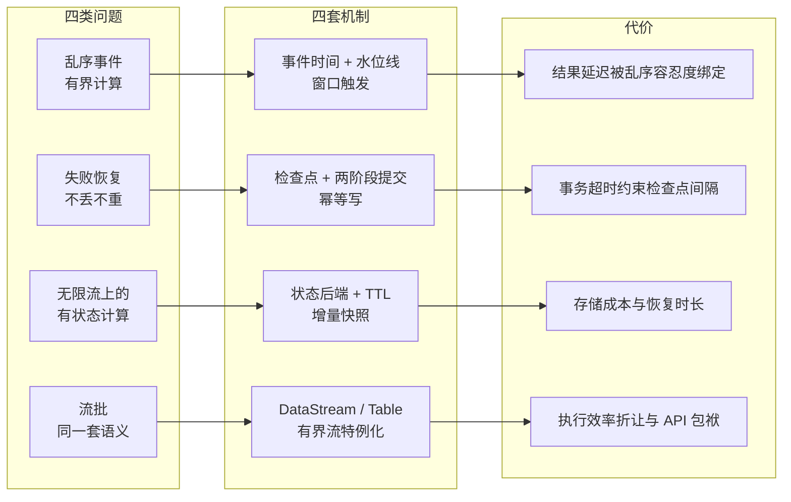
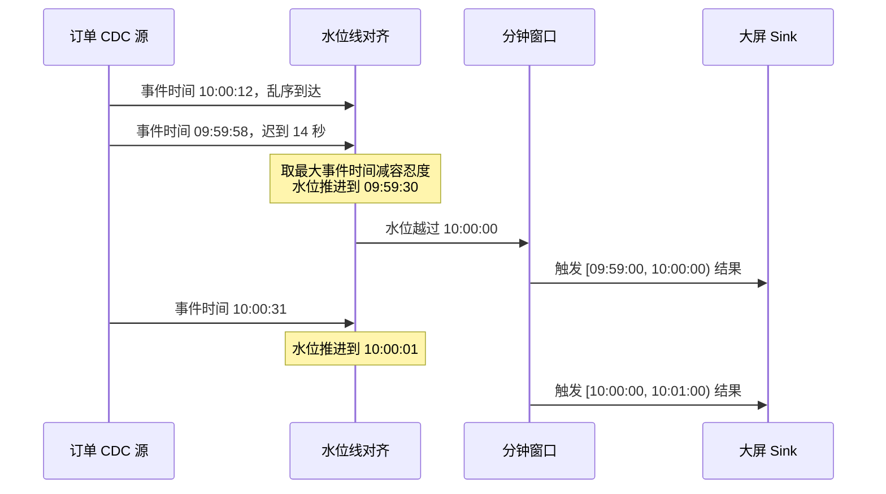
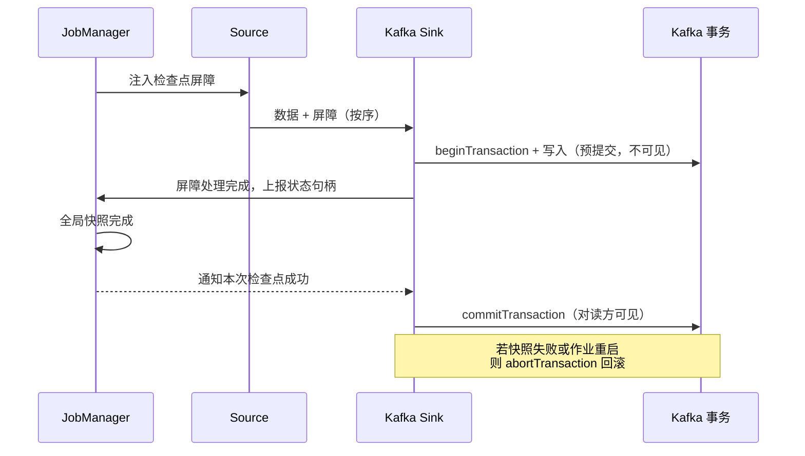
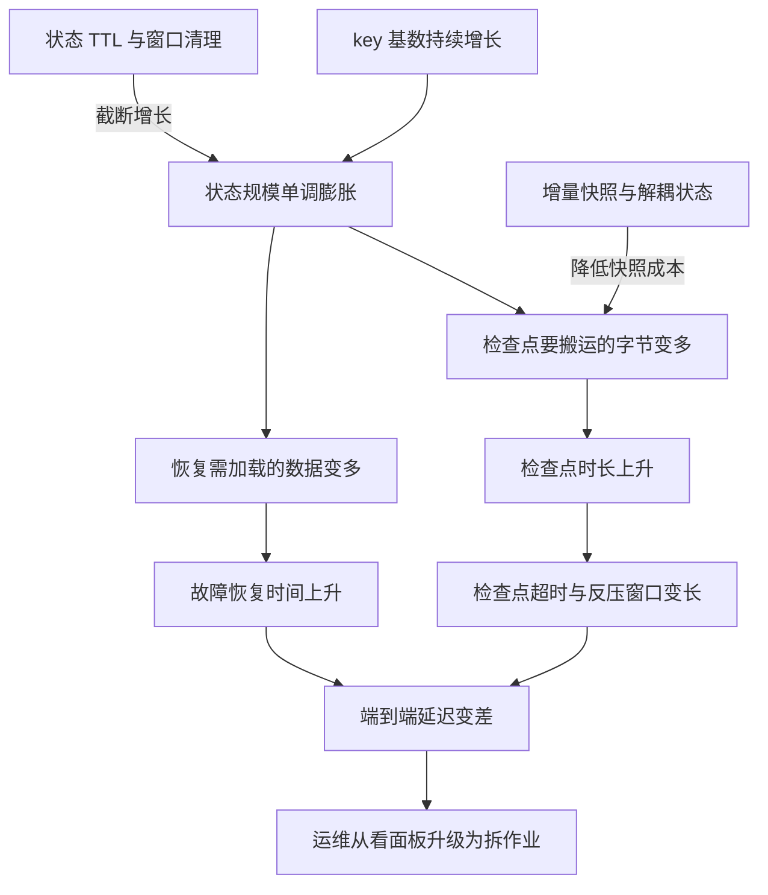
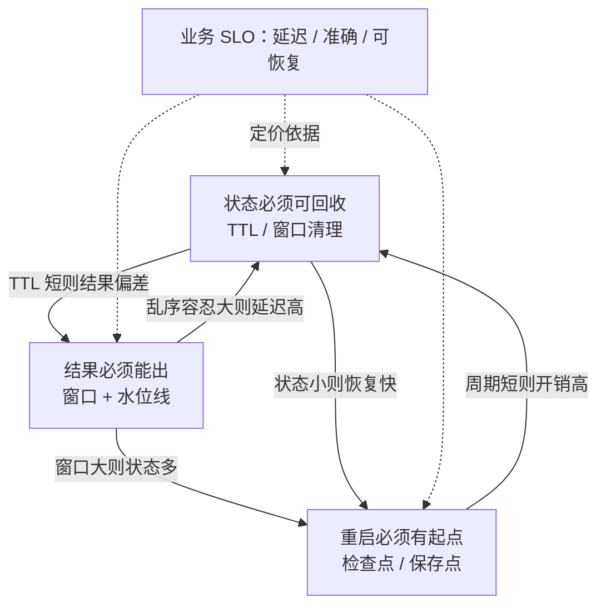
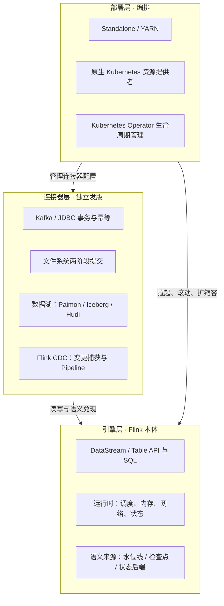

**摘要：**

问"Flink 是什么"，得到的回答通常是"原生流处理引擎、毫秒级延迟、精确一次、批流一体"。这四句话是四份承诺，不是四个形容词，每一份承诺背后都有一台具体的机器在兑现：乱序事件要靠水位线（Watermark）把无限流切成可结账的片段，失败恢复要靠检查点（Checkpoint）与两阶段提交（Two-Phase Commit）拼出端到端语义，无限流上的有状态计算要靠状态后端与状态存活时间（TTL）兜住增长，流批同一套语义则要求把"有界"当成"无界"的特例而不是另起一套引擎。本文不写产品介绍，从这四个承诺出发，逐条交代机制承担了什么、代价出现在哪里，再划出它的能力边界：低延迟单条处理给不了开箱的毫秒级、小批量 ETL 用它不划算、状态极小的无状态转发用不上它、团队没有流处理运维经验时它的隐性成本很高；同时把它与 Spark Structured Streaming、Kafka Streams、Flink CDC 的位置关系摆清楚，把生态的引擎、连接器、部署三层各自的责任分开，最后用 1.x 到 2.x 的演进说明它的定位是怎样漂移的。全文回答两个问题：什么问题它真的能解，什么问题它解不了。

---

## 第 1 章 定位不是宣言，是四台机器

2025 年 3 月，Apache Flink 2.0 发布，四个月后的 2.1 把方向表述为"统一实时数据与 AI"；这类公告描述的是方向，能当选型依据的只有兑现能力。一家餐厅的菜单上写"三分钟上菜"，靠的不是这句话本身，而是后厨的备料台、传菜动线和灶位分工；读菜单的人只记住"三分钟"，遇到满座时就会觉得被骗。Flink 的定位也是这样一组承诺，每一条都对应后厨里的一台机器，机器在，承诺在；机器不在或者代价付不起，承诺就只是一句广告。

流处理的选型失败，极少是因为"没选对产品"，多数是因为"没算清代价"。

### 1.1 从一次选型争论说起

笔者用一个贯穿全文的场景承载这些判断。某电商要交付两条链路：一条实时大屏，展示当天的成交额、下单量、支付成功率，要求秒级可见；一条 CDC 入湖链路，把订单库两百多张分表的变更同步到湖表，供次日分析与回溯。两条链路同源，都是同一份 MySQL binlog，峰值三万 TPS 量级，到达计算侧的顺序与事务提交顺序并不一致，乱序窗口在三十秒到两分钟之间浮动，上游还时不时来一次加列或改类型的 DDL。

项目组开了三次会，争论集中在三个反对意见上：Spark 已经有一套批处理集群，为什么还要再引入一个引擎；Kafka Streams 是库，不用维护集群，是不是够了；团队没有人维护过 Flink，上线之后出事谁兜。支持方的理由也很直接：大屏要窗口聚合，需要事件时间语义；入湖要一条不丢，需要端到端精确一次；两条链路源头相同，希望用同一套代码覆盖。

三次会都没结论，原因是双方都在用形容词打仗——"Flink 更强""Spark 够用""Kafka Streams 更轻"，而形容词无法被证伪，也就无法被决策。真正把会开完的，是把"Flink 强"翻译成四个能逐条验证的问题：乱序数据怎么算对、失败之后怎么不重不漏、无限增长的状态怎么不撑爆磁盘、同一份逻辑能否既跑实时又跑回溯。

### 1.2 四个承诺，四套机制

先把四组对应关系摆出来，后面每一章逐条展开。表格里的"不管它会怎样"一列，是这一篇真正想让人记住的部分——**反事实比定义更有说服力**。

| 要解决的问题 | 兑现它的机制 | 不管它会怎样 | 代价落在哪里 |
|---|---|---|---|
| 乱序事件的有界计算 | 事件时间 + 水位线 + 窗口触发 | 只能按处理时间结账，结果不可复现，对账对不上 | 结果延迟被乱序容忍度绑定，迟到数据要靠重算或丢弃 |
| 失败时不丢不重的恢复 | 检查点 + 两阶段提交 + 幂等写 | 恢复点在"已写出但未确认"的缝隙里，下游出现重复 | 事务超时约束检查点间隔，下游要支持事务或幂等 |
| 无限流上的有状态计算 | 状态后端 + 状态 TTL + 增量快照 | 状态单调膨胀，检查点与恢复时间同步恶化 | 内存、本地盘、远程存储的成本与调优精力 |
| 流批同一套语义 | DataStream/Table 统一 API + 有界流特例化 | 两套代码两套口径，Lambda 架构的双链路维护 | 通用性带来的执行效率折让与 API 演进包袱 |

这四台机器并不是彼此独立。状态后端决定了检查点的大小，检查点的大小决定了失败恢复的时长，而恢复时长又反过来约束水位线能容忍多少乱序；想在同一份作业里同时优化四端，多半会得到一个谁都不满意的配置。这是流处理工程的基本矛盾，也是后面所有权衡的源头。

耦合还体现在另外几条链路上：状态后端的输出尺寸决定检查点一次要搬多少字节，水位线策略决定窗口状态能清理多早，而批模式又把检查点的大部分能力闲置掉。选型时只盯住某一条承诺，很容易在另一条上翻车。

### 1.3 本文的职责边界

仓库里有两个 Flink 专栏，分工是明确划开的：`原理` 列回答"代码里究竟怎么走的"——屏障如何对齐、状态如何在内存与磁盘之间换入换出、水位数值在算子间如何广播、RocksDB 的写放大从哪来；`实战` 列回答"工程上怎么配、怎么集成、怎么排障"——参数取什么值、连接器怎么接、部署形态怎么选、出问题先看哪里。

本篇属于后者，讲的是定位与边界，所以凡是涉及内部实现的推导，只给结论和一句指向。水位线的内部推进算法与时间戳提取链路在 [[大数据/Flink/Flink原理深度解析与性能优化/07 Flink 时间与 Watermark 底层机制]]，状态后端的内存布局与序列化路径在 [[大数据/Flink/Flink原理深度解析与性能优化/05 Flink 状态后端深度解析]]，检查点的屏障对齐、非对齐快照与恢复流程在 [[大数据/Flink/Flink原理深度解析与性能优化/06 Flink Checkpoint 机制深度解析]]，运行时角色划分与槽位调度在 [[大数据/Flink/Flink原理深度解析与性能优化/01 Flink 架构总览：JobManager、TaskManager 与执行模型]]。本列后续篇章里，DataStream API 的用法见 [[03 DataStream API 深度使用指南]]，时间语义的配置见 [[04 时间语义与 Watermark 实战]]，状态与检查点的参数组合见 [[06 状态管理与 Checkpoint 实战]]，端到端精确一次的落地见 [[08 Flink 与 Kafka 端到端精确一次实战]]。

行文顺序按"四台机器 → 三条纪律 → 边界 → 对照 → 生态 → 版本 → 反例"推进，最后落到一份可以拿去开会的判断清单。

---

## 第 2 章 乱序事件的有界计算：水位线把无限切成可结账

流处理最容易被低估的难点，不是"数据来得快"，而是"数据来得乱"。网络重传、消息队列堆积、上游批量提交事务、跨机房复制延迟，这些因素叠加起来，让同一条业务链路上的事件到达顺序与产生顺序几乎从不一致。如果计算只能按到达时间结账，那么同一份数据在今天重跑和在明天重跑，结果会不一样——对实时大屏来说，数字抖动只是难看；对账务与结算来说，结果不可复现就是缺陷。

### 2.1 没有水位线，唯一能给的是处理时间

先做一个反事实推演。假设不用事件时间，只按处理时间（Processing Time）开窗：每分钟一个滚动窗口，把到达的订单按分钟累加。上游 binlog 因为批量提交，在 10:00:30 一次性吐出 10:00:00 至 10:00:29 的订单；窗口在 10:00:30 收到它们，于是这三十秒的成交额全部记进了 10:00:30 至 10:01:00 这个窗口。大屏上就会出现"某一分钟陡增、前一分钟几乎为零"的锯齿，业务方看到的曲线与真实交易节奏对不上。

更麻烦的是可复现性。同一份 Kafka 数据换一个消费组从最早位点重放，到达节奏与第一次完全不同，每窗口的数字也就不同——一份"实时报表"没有任何版本可以对账，出了问题只能相信它没出问题。

### 2.2 水位线的本质是一个单调下界

事件时间（Event Time）的引入把"事件什么时候发生"从"消息什么时候到达"里剥离了出来，问题随之变成：在无限的数据流里，什么时候可以断言"某个时间区间的事件已经到齐"。水位线（Watermark）给出的回答是一个**单调递增的下界**——它声明"事件时间小于等于这个值的数据，我不再期待还会到来"。

这个声明带着假设，而假设是水位线一切边界的起点。它假设乱序有上限：配置 `forBoundedOutOfOrderness(Duration)` 时，你等于对外承诺"晚到超过这个时长的数据我不再等"。它也假设每个数据源都在推进：如果一个 Kafka 主题有一百个分区，其中某个分区因为上游业务停摆而长期没有新数据，那么它的水位线会停在原地，下游多源对齐后的全局水位线也随之停住，窗口永远不会触发——这不是缺陷，是**取所有源里最慢的那个**这一语义的必然结果，`withIdleness` 的作用就是让长时间空闲的分区被暂时摘出对齐集合。

用散场来做比喻会更直观。电影院清场时不会等所有观众都走到门口，而是看"最慢的那位观众已经离开了第 N 排"，由此推断前 N 排已经空了；水位线就是这个"第 N 排"。它给了确定性的边界，代价是你必须接受"走得特别慢的那位可能还在里面"。

### 2.3 三个开关各自买的是什么

配置面上真正影响行为的只有三个开关，它们买的不是"更准"，而是"准与快之间的一次定价"。

其一是乱序容忍度。`forBoundedOutOfOrderness` 给得越大，能算进窗口的迟到数据越多，结果越接近真值，但窗口触发也越晚：容忍五分钟，下游就要接受结果晚五分钟量级才可见（量级判断，还要叠加检查点与 Sink 的批处理时间）。给得越小，延迟越低，代价是迟到数据被直接丢弃。

其二是空闲检测。`withIdleness` 让长时间没有数据的分区退出对齐，避免一个死掉的分区拖住全局窗口。它的风险在于迟到的"复活"：分区恢复供数的瞬间，水位线可能被一次大跨度推进，把原本还能被容忍的乱序数据直接判为迟到。这类故障在运维上表现为"作业没报错，但每小时的总量与上游对不上"，排查路径见 [[10 生产运维：监控、调优与常见问题排查]] 里"水位线不推进"那一节。

其三是允许迟到。`allowedLateness` 让窗口在水位线越过后仍然保留一段时间的状态，迟到的数据进来会重新触发计算，下游因此必须能接受同一条结果的多次更新。这个开关的代价是两头的：状态在这个额外窗口期内不能释放，Sink 侧要能处理撤回流（retract）或者 upsert。

### 2.4 边界：水位线是假设，不是事实

把水位线的边界说清楚，比讲清用法更有价值。

第一个边界是"源不推进就永远不出结果"。无界流里最危险的不是乱，而是停。一个分区停摆，全局水位线跟着停，窗口不触发，大屏数字冻结在一个值上，而作业状态是正常的 RUNNING——监控面板上唯一的线索是水位线指标变平。这类问题的判据不在 Flink 侧，要先看上游分区是否还有写入。

第二个边界是"乱序程度无法先验知道"。业务方通常给不出"最大乱序多少秒"的准确答案，运维只能从迟到数据比例反推。容忍度设小了，丢数据；设大了，延迟高。这是一次没有标准答案的定价，只能靠旁路输出统计迟到分布，再定期回校。

第三个边界是"迟到之后无法自动治愈"。超过容忍度与允许迟到之和的数据，要么被丢弃，要么靠外部补数重算。这一点决定了任何宣称"实时链路完全替代离线链路"的方案都必须保留一条重算路径。

| 时间语义 | 结果可复现 | 结果延迟 | 状态开销 | 适用判断 |
|---|---|---|---|---|
| 处理时间 | 否，重放结果不同 | 最低，随到达即算 | 最小 | 只做监控告警、不参与对账 |
| 摄入时间 | 否，取决于写入时刻 | 低 | 小 | 源侧时间不可信、但要求相对稳定的近似 |
| 事件时间 | 是，同一份数据同一结果 | 由乱序容忍度决定 | 最大，窗口需保留 | 参与结算、对账、指标口径固化 |

---

## 第 3 章 失败时不丢不重：快照管内部，两阶段提交管外部

分布式系统里"不出错"是奢望，"出错之后结果仍然正确"才是工程目标。Flink 的检查点（Checkpoint）解决的是作业内部状态的一致性快照问题，它保证恢复之后每个算子的状态恰好对应流上的某个位点；但它不解决"已经写到下游的数据怎么办"。把这两件事混为一谈，是上线后出现重复账单的最常见原因。

### 3.1 反事实：只开检查点会发生什么

设想一条订单入湖链路，Sink 是每批次提交一次的文件写入。作业开启了每分钟一次的检查点。某一分钟里，Sink 已经写完了第 100 批文件，但检查点还没完成（或者刚好在完成前作业失败）。恢复时作业回退到上一分钟的检查点，从那个位点重放，于是第 100 批数据被再写一遍。文件系统不会自动去重，湖表里就出现了重复行。

这就是**至少一次（At-Least-Once）**的典型形态：不丢，但会重。要把它变成**精确一次（Exactly-Once）**，需要在"内部快照"与"外部可见性"之间建立一条绑定关系——外部写入的提交时机必须由检查点是否完成来决定。这正是两阶段提交要干的事。

### 3.2 两阶段提交的三段与两个等待

两阶段提交把一个事务切成预提交与提交两段，中间夹着一个"等检查点完成"的等待。以 Kafka Sink 为例：每条记录写进生产者事务但不对读方可见（预提交），检查点屏障流过 Sink 时把当前事务信息写进算子状态，等这次检查点全局完成之后，作业才调用提交把事务对读方可见；如果检查点失败或者作业重启，事务被中止，数据回滚。

第二个等待容易被忽略：事务有超时。Kafka 事务的超时由生产者侧 `transaction.timeout.ms` 控制，broker 侧另有 `transaction.max.timeout.ms` 作为上限；如果检查点间隔与执行时间加起来超过事务超时，事务会在提交之前被 broker 主动中止，作业随即失败，然后重启、再失败，形成循环。Flink 的 Kafka 连接器在这方面有一个**经典的坑**：连接器侧的默认事务超时与 broker 的默认上限不在一个量级上（前者以小时计，后者以十几分钟计，具体默认值以对应版本的连接器与 Kafka 文档为准），第一次上精确一次链路时如果不调这两侧，作业会在跑了几十分钟之后开始反复重启。

推论很直接：端到端精确一次是**三个条件的合取**——作业内部快照可用、下游支持事务或者幂等写、检查点周期与事务超时相容。少一个条件，语义都会退化。

### 3.3 代价：延迟、下游能力与运维面

精确一次不是免费的，代价分三处结算。

第一处是延迟。提交要等检查点完成，而检查点要等屏障流过整个拓扑；一次检查点从注入到完成，在中等规模作业上通常是秒级到十几秒量级（量级判断），端到端可见延迟因此被抬高一个台阶。对账类链路可以接受，大屏类链路要盘算。

第二处是下游能力。事务写要求下游支持事务，Kafka 支持，对象存储与大部分数据库不支持；不支持事务就只能退到幂等写，而幂等写要求有稳定的主键与"覆盖而非追加"的写入语义。文件系统类 Sink 走的是另一条路：两阶段文件提交，先在临时目录写、检查点完成后再原子改名。这三条路径的能力与代价完全不同，选型时必须按 Sink 的实际能力来定语义，而不是反过来。

| Sink 类型 | 可达语义 | 依赖条件 | 主要代价 |
|---|---|---|---|
| Kafka（事务 Sink） | 端到端精确一次 | 事务超时与检查点周期相容 | 可见延迟抬高，事务资源占用 |
| 支持 upsert 的库表 | 幂等写近似精确一次 | 稳定主键，覆盖语义 | 乱序覆盖可能留下旧值 |
| 对象存储/文件系统 | 两阶段文件提交 | 原子改名，临时目录隔离 | 小文件与提交开销 |
| 纯追加型外部系统 | 至少一次 | 无 | 需要下游去重或接受重复 |

第三处是运维面。精确一次链路的排障比至少一次复杂一层：要看检查点状态、事务中止记录、下游可见数据三者是否对齐，"看起来没丢但多了几行"这类现象往往要把时间轴精确到秒才能解释。这份成本不出现在架构图里，只出现在值班表上。

### 3.4 状态规模如何抬高恢复成本

检查点的另一半价值是恢复。恢复时间大致由三部分构成：任务拉起、状态加载、以及从检查点重放到追上实时。状态越大，中间一项越占主导。做一个示例推算：一 TB 的状态，若远程存储的聚合读取带宽按 1 GB/s 量级估算，纯传输就需要约十七分钟，再叠加 RocksDB 的加载与文件句柄开销，实际恢复落在几十分钟量级；而这个过程中上游还在持续写入，重放阶段要追的积压又进一步拉长了恢复窗口。

这解释了一个常见现象：小作业上线很顺，数据涨到一定规模之后，同一条链路的"故障恢复"从可接受变成不可接受，而代码一行没改。恢复能力不是配置出来的，**由状态规模决定**；能改的只有状态规模本身，以及快照的组织方式（增量快照、解耦式状态管理）。这两条路分别对应第 4 章与第 10 章。

---

## 第 4 章 无限流上的有状态计算：状态后端是规模选项

如果流是无限的，那么"记住一些东西"这件事就必须有边界。Flink 把状态（State）做成了一等公民：算子可以直接持有键控状态，框架负责它的持久化、恢复与再分配。这个设计让"过去十分钟每个用户的点击次数"这类计算变得自然，同时也把一个问题推到了台前——状态放在哪里，以及它凭什么不会无限长大。

### 4.1 状态从哪里来

状态不是显式声明的变量，而是算子语义的副产物。一次 `keyBy` 之后的聚合要记住每个 key 的中间结果；一次双流 Join 要缓存两侧尚未匹配上的记录；一次去重要记住见过的主键；会话窗口要为每个活跃会话维护累积值。这些都不需要用户手写存储代码，但每一项都在消耗内存或磁盘。

状态后端（State Backend）回答的是"这些状态放在哪、怎么序列化、怎么做快照"。1.x 时代主流选择有两个：堆内存后端把状态放在 JVM 堆里，读写快、容量受 GC 与堆大小限制；RocksDB 后端放在本地磁盘的 LSM 结构里，容量大、支持增量快照，代价是序列化开销与后台合并（compaction）的抖动。2.0 起又多了一条路：解耦式状态管理把主副本放到远程文件系统，本地盘退化为缓存，检查点更轻、恢复与扩缩容更快，代价是状态访问可能触达网络。实现细节见 [[大数据/Flink/Flink原理深度解析与性能优化/05 Flink 状态后端深度解析]]。

状态后端的选择标准不是"哪个性能好"，而是"状态有多大、能容忍多长的恢复时间、本地盘与远程存储哪个更便宜"。用仓库做比喻：货架摆在工位旁边拿取最快但容量有限，摆在厂房角落容量大但要走两步，外包给中心仓容量近乎无限但每次取货都要运输——三种选择对应三种业务节奏，没有普适最优。

### 4.2 不设 TTL 会怎样

无限流的前提带来的第一个硬约束是：**状态必须可回收**。业务上"每个用户的历史行为"听起来没有终点，如果状态也不设终点，它就会随 key 基数单调增长。增长曲线不是线性的——key 的基数随时间累积，每个 key 的状态又可能因为列表、Map 结构继续膨胀，二者相乘之后，状态规模在几个月内从几十 GB 涨到几 TB 是常见形态（量级判断）。

后果是一条完整的传导链：状态变大，检查点要搬的字节变多，检查点时长从秒级涨到分钟级；检查点变长，暂停与反压的窗口变长，端到端延迟变差；恢复时要加载的数据变多，故障恢复时间从分钟级涨到几十分钟；RocksDB 的合并压力随数据量上升，CPU 与 IO 抖动变成常态。这条链上每一环都在同一个方向上恶化，所以它不会自己收敛，下图标出这条链的形状。

状态存活时间（TTL）是把这条链截断的手段。DataStream 侧通过 `StateTtlConfig` 声明过期策略，可以控制过期状态对读是否可见、过期清理在写入时触发还是读时触发；SQL 侧通过 `table.exec.state.ttl` 统一设定，社区版默认值在小时量级（以对应版本文档为准）。TTL 的设计要点是**按业务语义定价**而不是按经验拍一个值：去重状态只需要覆盖业务允许的重复窗口，会话状态只需要覆盖会话超时，维表缓存只需要覆盖维表变更周期。给一个统一的大值等于没设。

### 4.3 状态规模与运维复杂度的对应

状态规模不只影响性能，还决定运维方式。下面的对应关系属于量级判断，具体阈值随集群、存储与作业形态浮动，但拐点的顺序是稳定的。

| 状态规模量级 | 后端与快照策略 | 运维动作的重心 | 典型失效形态 |
|---|---|---|---|
| 十 GB 以内 | 堆内存后端即可 | 看 GC 与堆使用率 | 堆内对象膨胀引发 Full GC |
| 十 GB 到百 GB | RocksDB + 定期全量快照 | 看检查点时长与磁盘余量 | 检查点超时，本地盘写满 |
| 百 GB 到 TB | RocksDB + 增量快照 + 分散本地目录 | 看增量快照的基线大小与合并开销 | 恢复时间进入十分钟量级 |
| TB 以上 | 解耦式状态或按业务拆作业 | 看远程存储带宽、扩缩容演练 | 恢复时间不可接受，扩缩容窗口过长 |

这张表的用法是提前预判：设计阶段就能估算出量级落在第三行时，增量快照、状态 TTL、作业拆分就该一起规划，而不是等恢复超时之后再补。

---

## 第 5 章 流批同一套语义：统一的是语义，不是执行

"流批一体"被引用得太多，含义已经被磨平。它实际主张的只有一句：有界数据是无界数据的特例，因此同一套 API 与同一套语义可以覆盖两种输入。这句话成立，但从"语义统一"推到"执行统一"再到"性能统一"，每一步都不成立。

### 5.1 统一的到底是什么

第一层统一在 API。DataStream API 既能读 Kafka 这种无界源，也能读文件这种有界源；同一段代码通过 `execution.runtime-mode` 切换流模式与批模式，逻辑不需要改。第二层统一在语义。Table API 与 SQL 把流看成一个持续变化的动态表（Dynamic Table），查询是对这张表的连续查询，批模式下同一张表被当成静态快照，查询结果是它的物化视图。第三层统一在运行时。两种模式共用同一套调度、内存与网络栈，不需要维护两套引擎。

需要区分的是"同一套语义"与**同一个结果**。批模式处理的是全量有界数据，不使用水位线，结果是精确且确定的；流模式依赖水位线推进，输出的是事件时间语义下的最终一致结果，且逐条结果的到达顺序与快照时点相关。把两者当成"结果必然逐位相同"来验收，是数据口径对不上的常见来源。

### 5.2 有界流在批模式下能做什么

批模式的价值不在于"能跑批"，而在于可以针对有界性做流模式做不到的优化。数据有界意味着可以阻塞式交换：中间结果先落盘再消费，因此允许全局排序、更激进的 Join 重排，以及拿到全部输入之后做代价更低的 Hash Join；调度器也能按阶段推进，用自适应批调度在上游产出规模确定之后再决定下游并行度。这些优化在无界流里不成立，因为"全部输入"不存在。

### 5.3 统一的代价

统一的代价有两处。

一处是**通用性税**。为流设计的运行时带着屏障、异步快照、背压感知这些构件，批作业用不上却要承担其存在成本；这也是纯离线大规模批处理仍会选 Spark 一类引擎的原因——它们能把执行计划按"阶段"重排，不必迁就水位线与状态模型。Flink 的批模式在持续优化，但在超大规模离线场景里，选它更多是为了"少维护一个引擎"。

另一处是 API 演进包袱。DataSet API 曾经是批处理的主入口，随着流批统一被逐步边缘化：1.15 起标记废弃，2.0 正式移除，批处理全部收敛到 DataStream 与 Table API。类似地，旧的 `SourceFunction`、`SinkFunction` 与 Sink V1 在 2.0 被移除，统一 Sink API 成为唯一入口。这些变化对使用者的直接影响是依赖矩阵与迁移路径，细节不在本篇展开，见 [[02 快速上手：第一个 Flink 程序]]。

| 维度 | 流模式 | 批模式 |
|---|---|---|
| 输入 | 无界，持续到达 | 有界，可全量读取 |
| 时间语义 | 事件时间为主，依赖水位线 | 不使用水位线，结果确定 |
| 交换方式 | 流水线交换，逐条传递 | 可阻塞交换，允许落盘与重排 |
| 状态 | 核心能力，需 TTL 治理 | 多为中间结果，可不必持久化 |
| 检查点 | 决定语义与恢复能力 | 通常关闭或不承担语义 |
| 调度 | 按槽位与区域恢复 | 自适应批调度，按阶段推进 |

---

## 第 6 章 "流是无限的"逼出来的三条纪律

前面四章的四台机器，可以收束成三条更朴素的纪律。它们不是 Flink 的 API 约定，而是"输入无穷"这个前提施加给所有流处理系统的约束；Flink 只是把这三条做成了一套可配置的能力。理解这三条，比记住任何参数都更能避免上线后的意外。

### 6.1 状态必须可回收

无界输入意味着 key 空间没有自然终点，状态也就没有自然终点。任何有状态算子都要回答"这个状态什么时候可以被忘掉"：去重状态对应业务允许的重复窗口，Join 缓存对应两侧记录的最大关联时距，会话窗口对应会话超时，维表缓存对应维表变更周期。答不上来的算子，就是未来某次磁盘写满的候选。

这里有一个容易被忽略的次序问题：TTL 该和有状态算子一起设计，而不是上线之后再补。因为 TTL 会改变结果语义——过期之后新到的老数据会被当成新 key 处理，多产生一条输出。先上线再补，等于在线上悄悄改了业务口径。

### 6.2 结果必须有"什么时候能出"的答案

一个没有窗口、没有水位线的连续查询，只会不断输出变更流，永远不存在"最终结果"这个时点；它适合驱动下游的实时更新，不适合回答"今天的总额是多少"。凡是业务方要的是"一个数"，就必须在链路上明确三件事：窗口怎么切、水位线容忍多少乱序、结果什么时候对下游可见。

这三件事一旦确定，端到端延迟的量级也就确定了：窗口长度加乱序容忍度加检查点周期，是**结果可见延迟的下界**。业务方说"要秒级"，而窗口是一分钟、容忍度是三十秒，那么无论怎么调参，结果都不可能在一秒内出来。这类需求冲突必须在设计阶段暴露，而不是上线后当故障处理。

### 6.3 重启必须有起点

无状态作业可以从头开始，有状态作业不行——它必须知道"从哪里接着算"。检查点是自动的起点，由框架周期性生成，用于故障恢复；保存点（Savepoint）是人为的起点，由运维在变更前生成，用于升级、扩缩容与逻辑迁移。两者格式相近、用途不同，混用是运维事故的常见来源：拿检查点当保存点恢复，会因状态与拓扑的对应关系缺失而失败。

起点还带来一个隐含要求：算子的唯一标识（uid）**必须稳定**。uid 变了，保存点里的状态就找不到归属，恢复时要么报错要么被静默丢弃。这一条在 [[06 状态管理与 Checkpoint 实战]] 里有专门的升级流程，本篇只强调它是"重启有起点"的前提而不是可选项。

### 6.4 三条纪律会互相拉扯

三条纪律不是并列关系，它们在配置面上互相牵制。

检查点周期调大，快照开销下降，但恢复时重放的位点更远、丢的进度更多；调小，恢复更精确，但每次快照的固定开销被摊薄得更少，长事务的提交也更频繁。状态 TTL 调短，状态规模受控、恢复更快，但迟到数据更容易被当成新 key，结果出现偏差。窗口与乱序容忍度调大，结果更稳，但结果可见延迟被抬高，检查点要承载的窗口状态也更多。

三个方向没有同时最优的解，只有一组与业务 SLO 匹配的解。把这三条画成一个互相约束的三角，比记住一张参数表更接近真实决策。

| 纪律 | 主要配置项 | 违约后的症状 | 判断线索 |
|---|---|---|---|
| 状态可回收 | `StateTtlConfig`、`table.exec.state.ttl`、窗口清理 | 磁盘缓慢写满，检查点时长递增 | 状态大小曲线单调上升 |
| 结果能出 | 窗口长度、乱序容忍度、空闲检测 | 数字冻结或结果迟到才可见 | 水位线指标与窗口触发计数 |
| 重启有起点 | 检查点周期、保存点、算子 uid | 恢复失败或状态静默丢失 | 恢复日志里的状态映射告警 |

---

## 第 7 章 它不适合的场景

讲到这里，正面能力已经清楚，接下来是这一篇的价值点：什么情况下不该用它。判断依据不是"Flink 能不能做"，而是"用它做的总成本是否低于更简单的方案"。下面四类场景，笔者都建议先考虑替代方案。

### 7.1 低延迟单条处理不是它的强项

"原生流处理"常被读成"毫秒级实时"，这两件事**并不等价**。Flink 的处理模型确实是逐条传递，但链路上有多处会引入等待：网络栈的输出缓冲默认按固定间隔刷出（`execution.buffer-timeout` 的默认值在一百毫秒量级，以对应版本文档为准），检查点屏障要在数据流里穿行，状态访问要经过序列化，Sink 的批提交还要等一批。这些叠加之后，一条记录从进入到对下游可见，P99 落在几十到几百毫秒量级是常态（量级判断）。

把缓冲刷出调到零、关掉检查点、把算子数压到最少，确实能把延迟压到个位数毫秒量级（量级判断），代价是吞吐显著下降、容错被削弱。于是问题变成：既然要的是一条记录的实时判定，为什么把判定放进一个为吞吐与容错设计的分布式引擎？单条判定的延迟敏感场景（风控规则命中、协议解析、在线特征拼接）更适合放在应用进程内的规则引擎或内存 KV 上，由 Flink 负责窗口聚合、跨流关联与状态累积。

### 7.2 小批量 ETL 用批更划算

假设有一批维表，每五分钟同步一次，每次增量几百行到几万行，源是 JDBC、目标是数仓。用 Flink 做当然能跑，但你要为它准备常驻集群或常驻会话、配置水位线（即便用不上）、维护检查点与保存点、处理版本升级时的状态兼容。这些成本换来的收益是"数据延迟从五分钟变成两分钟"（量级判断），而业务方可能根本感知不到。

批处理方案在这类场景里更划算：由调度器定时拉起一个批任务，全量覆盖或者按分区覆盖，失败重跑即可，语义简单、资源可以完全释放。用拖拉机去送一份快递，不是拖拉机不好，而是这趟活不需要它的牵引力。

判断的口径可以这样给：单次任务时长远小于调度间隔（譬如单次几十秒、间隔五分钟），且结果可以覆盖写而不是增量累积时，常驻流作业的固定成本就压过了延迟收益。数据量小时这一点更明显，因为小作业的状态与检查点开销占比更高。

### 7.3 状态极小且无状态的转发，消息队列自己就能做

另一类常见误用是把 Flink 放在两个系统之间做纯粹的搬运与轻度转换：从主题 A 消费，改几个字段，写到主题 B。这条链路没有窗口、没有状态、没有跨流关联，它需要的只是"消费—转换—生产"三段。

这种活让消息队列自己就能做：消费组天然支持并行消费与位点管理，生产端支持事务或幂等；确实需要轻量转换，Kafka Connect 或 Kafka Streams 就够，不必引入需要独立运维的集群。引入 Flink 的收益接近零，成本却包括集群、状态目录、检查点存储、监控面板与值班知识——在一条笔直的路上修收费站，只增加摩擦。

### 7.4 团队没有流处理运维经验时，代价被低估

这一类不是技术问题，是组织问题，但它造成的失败比前三类更多。流处理作业的运维知识与批处理有本质差异：批任务失败重跑就行，流作业失败要面对"从哪里恢复"、"状态是否兼容"、"下游会不会收到重复"这三问；批任务的资源可以周期释放，流作业常驻且要预留恢复资源；批任务的调优围绕执行计划，流作业的调优围绕状态、水位线与反压。

把这些知识缺口折算成成本，通常表现为三件事：上线初期的恢复时间长于预期、版本升级因状态不兼容而推迟、定位时间主要花在理解指标口径上。没有流处理经验的团队不是不能做，而是要在项目预算里显式列出"学习与演练"这一项——保存点恢复、扩缩容、故障注入各演练一轮。缺了这一项，第一次真实故障会替你把学费补上。

| 场景 | 症状 | 更合适的选择 | 判断依据 |
|---|---|---|---|
| 单条记录毫秒级判定 | 调低缓冲后吞吐塌陷，关检查点后不敢上线 | 应用内规则引擎 + 内存 KV | 延迟要求低于几十毫秒且无需窗口 |
| 分钟级小批量同步 | 常驻资源闲置，语义复杂却无收益 | 批调度 + 覆盖写 | 单次任务时长远小于调度间隔 |
| 无状态搬运转发 | 引入集群但逻辑只有三段 | 消息队列消费组、Connect、Kafka Streams | 无窗口、无状态、无跨流关联 |
| 团队无流运维经验 | 恢复慢、升级拖延、定位靠猜 | 先做试点与演练，或先用批方案 | 缺少状态与检查点的运维知识储备 |

---

## 第 8 章 与相邻技术的边界

选型讨论之所以经常跑偏，是因为把定位不同的东西放在同一张表里比"谁更强"。Flink、Spark Structured Streaming、Kafka Streams 三者的差别不在强弱，而在"计算放在哪里、状态归谁管、运维归谁做"。

### 8.1 与 Spark Structured Streaming：微批与原生流

Spark Structured Streaming 的默认执行模型是微批（Micro-Batch）：把流切成小批次，用 Spark 的批处理引擎逐批执行。这个模型继承了 Spark 的全部生态——同一套 SQL 优化器、同一套数据源、与湖仓格式的良好集成——代价是延迟下限由批次间隔决定。批次间隔通常取秒级，端到端延迟落在百毫秒到秒级量级（量级判断）；微批的每一批都要走一次任务调度与提交，间隔压得太小会让调度开销占比升高。

Spark 另有一条持续处理（Continuous Processing）路径，从很早的版本就以实验特性提供，延迟可以压到毫秒量级，但支持的处理类型受限，生产使用并不普遍。因此选型时实用的判断是：把 Spark Structured Streaming 当成"秒级到分钟级"的工具，把 Flink 当成"百毫秒到秒级"的工具。

状态能力是第二个分野。微批模型下，跨批次的状态由执行器维护，状态规模与批次执行的耦合更紧；大状态下容易触发批次超时与检查点失败。Flink 的状态后端与增量快照是为大状态设计的，代价是运维面更复杂。这也是为什么"状态有多大"往往比"延迟有多低"更能决定选型结果。

沿用前面的电商场景：大屏只需分钟级刷新、团队已有成熟的 Spark 与湖仓体系，Structured Streaming 更省心；要求秒级、端到端不重不漏、还要跨流关联，Flink 的模型更贴合。Spark 侧的模型细节见 [[大数据/Spark/Spark-Structured-Streaming流处理深度解析/01 微批执行模型：MicroBatch 与 Continuous Processing 的本质差异]]。

### 8.2 与 Kafka Streams：库与集群

Kafka Streams 是**一个库，不是集群**。它被嵌入在应用进程里运行，应用的部署、扩缩容、监控都由既有的应用运维体系承担；状态默认存在本地 RocksDB，并通过变更日志主题把状态备份到 Kafka；并行度上限由分区数决定。

这个定位带来两个好处：不必维护额外的计算集群，Kafka 的运维体系可直接复用；应用的发布、灰度、回滚都是熟悉的路径。也带来两个限制：数据源以 Kafka 为中心，跨源（数据库、文件、对象存储）能力弱；处理规模受分区数与单应用资源约束，跨团队的大规模共享计算难以承载。

把两者放在一起比"性能"意义不大，更容易得出判断的问题是："这套计算逻辑属于某个应用，还是属于一个平台。"属于应用的，用库更自然；属于平台、要被多个团队共享、要接多种数据源的，用集群更合适。Kafka 侧的消费语义与库内状态机制见 [[中间件/Kafka/09 Kafka Connect 与 Kafka Streams]] 与 [[中间件/Kafka/07 消费语义——Exactly-Once 的实现路径]]。

### 8.3 与 Flink CDC：生态组件不是引擎

Flink CDC 经常被当成"另一个 Flink"，其实它是运行在 Flink 之上的数据集成组件。它提供的是连接器与作业模板：读取 MySQL、PostgreSQL 等数据库的变更日志，转换成 Flink 能处理的变更流，再写入下游。3.0 起引入 Pipeline API 与声明式 YAML，把全量快照与增量读取合并到一个作业里，并开始支持端到端的模式演进，使用方式从"写 Flink SQL"变成"写一份 YAML 并提交"。

这层关系决定了责任划分：Flink CDC 解决的是"怎么把库的变更可靠地读出来、怎么把模式变化传下去"，不解决"计算引擎如何调度、状态如何恢复"。它的版本与 Flink 版本之间存在兼容矩阵，升级引擎时要一并核对连接器版本，这一点在 [[大数据/Flink/Flink从入门到实战/07 Table API 与 Flink SQL 实战]] 的 CDC 接入部分有具体配置。

| 维度 | Flink | Spark Structured Streaming | Kafka Streams |
|---|---|---|---|
| 形态 | 分布式计算集群 | 分布式计算集群 | 应用内库 |
| 执行模型 | 原生流，逐条传递 | 微批为主，持续处理为实验特性 | 原生流，逐条传递 |
| 延迟量级 | 几十毫秒到秒级，受缓冲与检查点影响 | 秒级为主，持续处理属实验特性 | 百毫秒级，受提交间隔影响 |
| 状态 | 一等公民，后端可选，支持大状态 | 跨批次维护，规模受批次约束 | 本地 RocksDB + 变更日志主题 |
| 数据源 | 任意源，连接器生态最广 | 任意源，Spark 生态 | 以 Kafka 为中心 |
| 运维归属 | 计算平台团队 | Spark 平台团队 | 应用团队 |
| 适合判断 | 大状态、乱序严格、跨源 | 团队已用 Spark、湖仓一体、延迟不敏感 | 轻量转换、纯 Kafka、不想维护集群 |

---

## 第 9 章 生态的三层：引擎、连接器、部署

"Flink 出了问题"这句话在故障复盘里几乎没有信息量，因为 Flink 生态是三层结构，每层的责任主体、发版节奏与故障形态都不同。把三层分开，才知道该找谁、该看哪份文档、该等哪个版本。

### 9.1 引擎层：API 与运行时

引擎层是 Flink 项目本体，包括 DataStream API、Table API 与 SQL 以及底层运行时。它回答"计算怎么做"，也是"语义承诺"的来源：水位线、检查点、状态后端都在这一层。

引擎层有一个容易被忽视的维度：API 的稳定性标注。公开稳定的接口标注为 `@Public`，可以长期依赖；仍在演进的标注为 `@PublicEvolving`，跨版本可能有行为变化；内部实现标注为 `@Internal`，不在兼容承诺之内。选型时如果发现关键能力落在 `@PublicEvolving` 上（2.0 起的解耦式状态后端就属于这一类），升级计划里要给它留出验证窗口。依赖矩阵与打包方式见 [[02 快速上手：第一个 Flink 程序]]，本篇不重复。

### 9.2 连接器层：语义的最后一公里

连接器层决定数据怎么进出，也决定端到端语义能否兑现。Kafka 连接器提供事务写，JDBC 提供批量与幂等写，文件系统提供两阶段提交，数据湖连接器（Paimon、Iceberg、Hudi）把流式写入组织成可查询的表。它们大多独立发版，版本号与引擎并不对应，升级时要查兼容矩阵而不是对齐版本号。

这一层也是"故障归属"最容易错判的地方：数据没写进湖表，可能是引擎的检查点没完成，可能是连接器的提交策略配错，也可能是湖表格式本身的小文件合并把写入拖慢。判断的顺序是先看检查点是否成功，再看连接器的事务或提交日志，最后看湖表的元数据。

### 9.3 部署层：编排与生命周期

部署层回答"作业怎么起来、怎么滚动、怎么扩缩容"。可选形态包括独立集群、YARN、原生 Kubernetes 与 Kubernetes Operator：原生 Kubernetes 是 Flink 自带的资源提供者，负责按作业申请与释放 Pod；Operator 是独立的 Apache 项目，在 Kubernetes 之上补齐了作业生命周期管理、保存点触发的滚动升级、状态与配置的声明式管理，发版节奏与 Flink 本体分开（1.13.0 于 2025 年 9 月发布，以对应版本文档为准）。

三层的排障入口完全不同：引擎层看检查点与水位线指标，连接器层看事务与提交记录，部署层看容器事件与编排状态。混在一起，就会出现"作业反复重启"被归因到错误的层。

| 层 | 责任 | 发版节奏 | 典型故障归属 |
|---|---|---|---|
| 引擎 | 计算语义、状态与容错 | 与 Flink 版本同步 | 水位线不推进、检查点超时、恢复失败 |
| 连接器 | 数据进出、端到端语义 | 独立版本，需查兼容矩阵 | 事务中止、重复写、提交不生效 |
| 部署 | 作业生命周期、资源编排 | 独立项目版本 | Pod 反复拉起、保存点滚动失败、资源不足 |

---

## 第 10 章 版本与定位的演进：从 1.x 到 2.x

Flink 的定位不是一次定型的。十年间它改过三次自我描述：先是"流批一体的执行引擎"，再是"有状态流处理的工业标准"，2.0 之后变成"统一实时数据与 AI 的平台"。定位漂移不是营销话术，它会在 API 取舍、模块拆分与生态重心上留下痕迹，读得懂这些痕迹，才能判断"现在学什么、以后会被什么替换"。

### 10.1 1.x 的主线：把流做成默认，把批收进来

2014 年 Flink 进入 Apache 基金会并成为顶级项目，2015 年的论文把"流与批在同一引擎里表达"立为设计前提。此后的 1.x 版本可以按三条线去读：一条是把 Table API 与 SQL 从附加能力做成主入口（Blink 合入之后，SQL 成为事实上的首选接口）；一条是把容错做成工业级（非对齐检查点在 1.11 引入，用来在反压严重时仍能完成快照）；一条是把批处理收进同一套 API（1.12 起 DataStream 统一处理有界与无界输入，DataSet 逐步退场）。

1.15 前后还有一个影响配置面很深的变动：Table 模块被拆分，规划器（planner）从原先的单体依赖变成 loader 与具体 planner 分离的结构，目的是隔离 Calcite 依赖、让连接器与方言可以独立演进。这个拆分对使用者最直接的影响是依赖配置与方言切换方式，属于"升级时才会撞上"的那类变化。

### 10.2 2.x 的关键变化

2.0 在 2025 年 3 月发布，是一个真正的**破坏性版本**。移除的东西包括：DataSet API 整体删除，批处理全部收敛到 DataStream 与 Table；旧的 `SourceFunction`、`SinkFunction` 与 Sink V1 接口删除，统一 Sink API 成为唯一入口；公共 API 里长期废弃的类型与配置被清理。运行环境方面，Java 17 成为默认与推荐的运行时，低版本 JDK 的支持范围以对应版本的兼容性文档为准。

更重要的是状态管理的架构变化：2.0 引入解耦式状态管理，主状态放在远程文件系统，本地盘作为缓存，检查点因此变轻、恢复与扩缩容变快；配套的状态存储 ForSt 与异步执行框架一起交付，但相关接口仍标注为演进中，默认是否启用要以对应版本文档为准（设计动机与实现见 FLIP-427 与 VLDB 2025 的论文）。这条路线直接改变了第 4 章那张"状态规模与运维复杂度"表格的形状——TB 级状态的恢复时间可能从几十分钟量级压到分钟量级（量级判断），代价是对远程存储的带宽与延迟提出要求。

2.1 在 2025 年 7 月发布，重心转向"实时 + AI"：Table API 支持 Process Table Functions，可以像写算子一样写表函数并访问托管状态、事件时间与定时器；SQL 侧加入模型 DDL 与 `ML_PREDICT` 一类能力，把模型推理纳入查询；还引入 VARIANT 类型处理半结构化数据、引入新的 Join 策略缓解大状态下的 Join 瓶颈。2025 年 11 月的 2.1.1 是一次缺陷修复版本。这些变化对选型者的含义是：Flink 正在从"流的计算引擎"扩到"实时特征与推理的承载层"，如果业务里有实时特征需求，这是加分项；如果只是做 ETL，这些新能力不影响判断。

### 10.3 Stateful Functions 的现状

Stateful Functions（StateFun）曾经是 Flink 生态里一个独立子项目，试图用"有状态函数 + 远程调用"的模型承载事件驱动应用。它的现状需要明确写出来：最后一个版本是 2023 年 9 月的 3.3.0，构建于 Flink 1.16，此后长期没有提交与新版本；社区已经提出正式下线这个子项目的提案（FLIP-569，2026 年进入讨论），理由是没有维护者、落后主线多个版本、积压的 PR 无人评审。

对选型来说结论很清楚：新项目不要把 StateFun 列入候选。它承载的"事件驱动应用 + 远程函数"思路并没有消失，只是实现路径转到了别处——DataStream 的 ProcessFunction、2.1 起的 Process Table Functions，都能以更主流的方式表达同类逻辑。

> [!warning] 生态组件的生命周期先于能力评估
> 子项目长期无提交、构建在落后多个版本的引擎上，本身就是最强的选型信号：能力好不好用是次要的，能不能跟着主线升级才是决定性的。

### 10.4 定位漂移带来的判断变化

把版本演进串起来看，有几条判断需要随之更新。

第一，"Flink 只是流处理引擎"这个印象已经过时。它同时是 SQL 计算引擎、CDC 集成框架的运行时、数据湖写入的执行层、实时特征与推理的承载层，多角色叠加意味着运维面更宽，也意味着"只装一个引擎解决所有实时问题"的想法更接近现实。

第二，"批流一体"的含义在收敛。1.x 指的"同一套 API 跑两种输入"，2.x 更强调"同一份语义与同一套状态管理"，执行层面的差异依然存在。把它理解成"批处理性能和 Spark 一样"，仍然会失望。

第三，升级成本在 2.x 门槛处**陡增**。DataSet 移除、Source/Sink V1 移除、Java 版本变化、状态后端新增选项，这四件事叠在一起，使得跨大版本升级不是改个依赖号，而是一次需要规划的重构。规划方法见 [[09 Flink on YARN 与 Kubernetes 生产部署]] 与 [[10 生产运维：监控、调优与常见问题排查]] 中的升级与保存点章节。

| 维度 | 1.x 时代 | 2.x 时代 |
|---|---|---|
| 批处理入口 | DataSet 与 DataStream 并存 | 仅 DataStream 与 Table |
| Source/Sink | 旧接口与新 Sink API 并存 | 统一 Sink API V2 |
| 运行时（JDK） | Java 8/11 为主 | Java 17 默认，低版本以兼容文档为准 |
| 状态管理 | 堆内存 / 本地 RocksDB | 增加解耦式状态与 ForSt |
| SQL 能力 | 以查询与聚合为主 | 增加 PTF、模型 DDL、VARIANT |
| 定位表述 | 流批一体执行引擎 | 实时数据与 AI 平台 |

---

## 第 11 章 反例三则

反例比正面清单更能校准判断，因为它们把代价显式地摆了出来。下面三则都取自常见的误用路径，每一则给出一条完整的代价链与一条替代路径。

### 11.1 把小批量 ETL 塞进 Flink

第一个反例是把日终批量对账改成流式作业。业务诉求是"每天凌晨把订单表与支付表做一次全量核对，结果写进对账库"。实现方式是把两张表接成两个流，按订单号做双流 Join，等水位线推进到全天之后再输出结果。

代价链是这样的：全量 Join 要求两侧状态保留全天的数据，状态量直接等于两张表当天的行数；为了等"全天到齐"，水位线要么设成一天量级的容忍度，要么干脆退回批模式；检查点要覆盖这份巨大的状态，一次快照的时长以十分钟计（量级判断）；作业只在凌晨跑几个小时，其余时间占着资源。一个"每天一次的全量计算"被包装成了"永远在等结尾的流计算"。

替代路径是把对账写成批任务：按日期分区读取、按订单号 Join、结果覆盖写。资源按需申请、失败重跑、语义简单。如果确实希望减少一套引擎，可以用 Flink 的批模式跑这段逻辑，但仍然按批任务的方式调度，不要在流模式下等水位线。

### 11.2 期待 Flink 做毫秒级点查

第二个反例是把 Flink SQL 当成在线查询引擎：应用侧每次用户请求都提交一条 SQL，查某个用户的实时画像，期望在几十毫秒内返回。

这条路径的问题在于定位错位。Flink SQL 是连续查询，作业提交、拓扑编译、资源申请、状态加载都是重操作，单次提交的时间量级在秒级；即使常驻 SQL Gateway 保持会话，查询要走规划、优化与部署路径，也很难满足点查的延迟要求。把连续查询当点查用，等于把搜索引擎当数据库用。

替代路径是把"点查"和"实时计算"拆开：Flink 负责把画像算好，写进支持点查的存储（KV、OLAP 引擎或缓存），应用侧直接查存储。画像的更新频率与查询频率分别按各自的节奏设计，两边互不牵制。实时写入 OLAP 的工程形态，在 [[中间件/Doris/00 专栏导览]] 与 [[中间件/Clickhouse/00 专栏导览]] 里有对应章节。

### 11.3 用 Flink 替代消息队列

第三个反例是把 Flink 当成"带计算的消息总线"，让服务 A 写 Kafka、Flink 消费并转发给服务 B 与服务 C，靠 Flink 做路由与解耦。

这等于让流处理引擎去承担消息中间件的职责，而两者的设计目标不同：消息队列要的是多订阅者、位点管理、保留策略、租户隔离与低运维；流引擎要的是状态、窗口、容错与吞吐。用 Flink 做总线，四处会同时付代价：下游要自己实现多路分发与背压传递；消息保留依赖外部存储而非队列的保留策略；多团队共享一套集群带来资源与权限隔离问题；扩缩容要考虑状态迁移而非分区再均衡。

替代路径是把总线职责还给消息队列：Kafka 承担路由、保留与多订阅，Flink 只承担需要状态与窗口的计算部分，且以独立作业的形式挂在总线侧。这条边界一旦划清，两边都可以按各自的最优方式演进。

---

## 第 12 章 落点：五个可以拿去开会的问题

把全文收束成五个问题。它们不需要技术细节就能被业务方与团队回答，但每一个都直接决定选型结论。

| 问题 | 如果答案是"否" | 指向的机制 |
|---|---|---|
| 结果是否必须按事件时间可复现、可对账 | 处理时间窗口可能就够了，不必背上水位线的复杂度 | 第 2 章 |
| 失败后下游能否接受重复，或能否支持事务/幂等 | 端到端精确一次不成立，需要重新设计 Sink | 第 3 章 |
| 状态规模会不会随时间单调增长到 TB 量级 | 堆内存后端即可，无需解耦式状态 | 第 4 章 |
| 同一份逻辑是否真的需要在实时与回溯两侧复用 | 流批一体的收益不成立，两套方案可能更省 | 第 5 章 |
| 团队是否具备状态、水位线、检查点的运维能力 | 先做试点与演练，或先用批方案承接 | 第 7 章 |

五个问题里只要有三个落在"否"，引入 Flink 的收益就很难覆盖它的固定成本；反过来，如果前两个都是"是"，那么它几乎是把语义做对的少数路径之一。剩下三个问题决定的是"用多重"——用它的全部能力，还是只用它的窗口与状态，把连接器与部署尽量简化。

行文至此可以下一个结论：Flink 的定位不是"更快的批处理"或者"更强的消息队列"，而是把四个互相冲突的承诺——乱序下算对、失败时不重不漏、无限状态不失控、批流复用一份逻辑——压进同一套语义里。代价是运维面变宽、**通用性税**，以及每次升级都要面对的状态兼容。这些问题不会因版本迭代消失，只会换一种形态出现；判断一套链路该不该用它，最终看的是这四个承诺里**你到底需要几个**。

---

## 参考资料

1. Apache Flink 官方文档，*Concepts → Stateful Stream Processing* 与 *Timely Stream Processing*：事件时间、水位线与状态的基本语义，[nightlies.apache.org/flink](https://nightlies.apache.org/flink/flink-docs-stable/docs/concepts/stateful-stream-processing/)。
2. Apache Flink 官方文档，*Checkpointing* 与 *Savepoints*：检查点语义、非对齐检查点、保存点的用途与兼容性边界，[nightlies.apache.org/flink](https://nightlies.apache.org/flink/flink-docs-stable/docs/ops/state/checkpoints/)。
3. Apache Flink 官方文档，*Disaggregated State Management*：2.0 引入的解耦式状态管理、本地缓存与远程存储的分工，[nightlies.apache.org/flink](https://nightlies.apache.org/flink/flink-docs-master/zh/docs/ops/state/disaggregated_state/)。
4. Apache Flink 官方文档，*Execution Configuration*：`execution.buffer-timeout` 默认值与其对延迟/吞吐的影响，[nightlies.apache.org/flink](https://nightlies.apache.org/flink/flink-docs-stable/docs/deployment/config/)。
5. Apache Flink 官方文档，*Kafka Connector*：Sink 的交付语义与 `transaction.timeout.ms` 的事务超时约束，[nightlies.apache.org/flink](https://nightlies.apache.org/flink/flink-docs-stable/docs/connectors/datastream/kafka/)。
6. FLIP-427 *ForSt: Disaggregated State Store*：ForSt 状态存储与 `ForStStateBackend` 的设计，[cwiki.apache.org](https://cwiki.apache.org/confluence/display/FLINK/FLIP-427%3A+ForSt+-+Disaggregated+state+Store)。
7. Mei 等，*Disaggregated State Management in Apache Flink 2.0*，PVLDB 18(12)，2025：解耦式状态的动机、异步执行模型与恢复加速的量化评估，[vldb.org](https://www.vldb.org/pvldb/vol18/p4846-mei.pdf)。
8. FLINK-36245 *Remove legacy SourceFunction / SinkFunction / Sink V1 API in 2.0*：2.0 移除旧接口的范围与替代路径，[issues.apache.org](https://issues.apache.org/jira/browse/FLINK-36245)。
9. FLIP-569 *Sunset the Stateful Functions (StateFun) Sub-project*：StateFun 长期无维护、最后版本 3.3.0 与下线提案，[cwiki.apache.org](https://cwiki.apache.org/confluence/display/FLINK/FLIP-569%3A+Sunset+the+Stateful+Functions+%28StateFun%29+Sub-project)。
10. Apache Flink 2.1.0 与 2.1.1 发布公告：Process Table Functions、模型 DDL、VARIANT 类型与缺陷修复范围，[flink.apache.org](https://flink.apache.org/2025/07/31/apache-flink-2.1.0-ushers-in-a-new-era-of-unified-real-time-data--ai-with-comprehensive-upgrades/)。
11. Apache Flink Kubernetes Operator 发布目录：1.13.0 于 2025 年 9 月发布，与 Flink 本体分开版本管理，[projects.apache.org](https://projects.apache.org/project.html?flink-kubernetes-operator)。
12. FLIP-216 *Table API & SQL: Decouple planner and connector*：1.15 起 planner 拆分与 loader 结构的由来，[cwiki.apache.org](https://cwiki.apache.org/confluence/display/FLINK/FLIP-216)。
13. Apache Kafka 文档，*Kafka Streams* 与事务配置：`transaction.max.timeout.ms`、`processing.guarantee` 与状态变更日志主题，[kafka.apache.org](https://kafka.apache.org/documentation/streams/)。
14. Apache Spark 文档，*Structured Streaming Programming Guide*：微批触发与持续处理模式的支持范围，[spark.apache.org](https://spark.apache.org/docs/latest/structured-streaming-programming-guide.html)。
15. 本仓库：[[大数据/Flink/Flink原理深度解析与性能优化/01 Flink 架构总览：JobManager、TaskManager 与执行模型]]、[[大数据/Flink/Flink原理深度解析与性能优化/03 Flink 内存模型深度解析]]、[[大数据/Flink/Flink原理深度解析与性能优化/06 Flink Checkpoint 机制深度解析]]。

---

> [!note] 思考题
> 1. 大屏链路要求"秒级可见"，而入湖链路要求"一条不丢"。如果两条链路共用同一批算子，哪些参数会被两端同时拉扯，你会把它们拆开还是接受折中。
> 2. 如果把乱序容忍度从三十秒调到五分钟，端到端延迟与结果准确性的交换比例如何估算，用什么数据来验证这个调整是否值得。
> 3. 一个只有窗口聚合、没有跨流关联的作业，状态仍然涨到了 TB 量级。在不改变业务逻辑的前提下，有哪些路径可以把状态压下来，各自的副作用是什么。
> 4. 团队准备从 1.x 升到 2.x，DataSet 与旧 Sink 接口都要重写。你会把这次升级拆成几步，哪一步必须做保存点恢复演练。
> 5. 某个需求"用 Flink 做实时点查"被提出，业务方只关心延迟。你会用哪几个问题把这个需求拆成"实时计算 + 点查存储"两段。