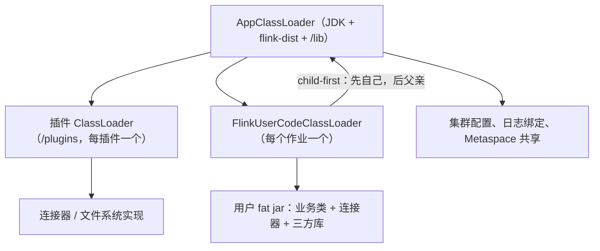
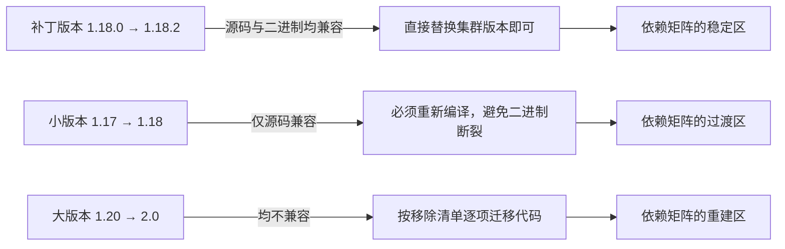
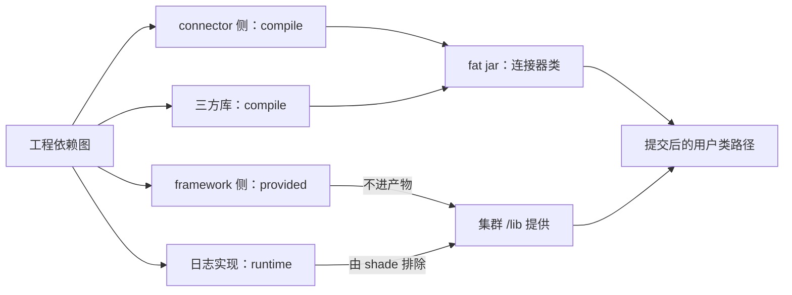
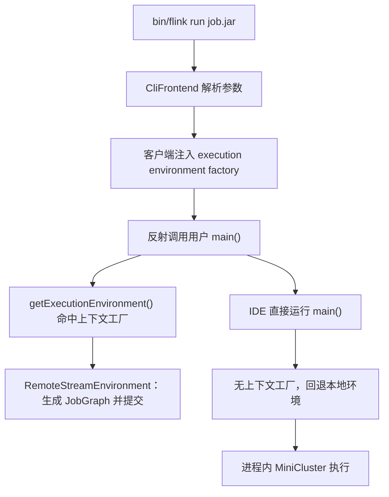
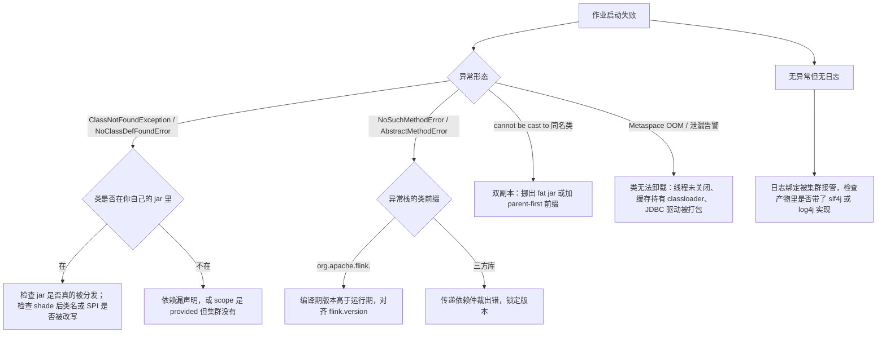
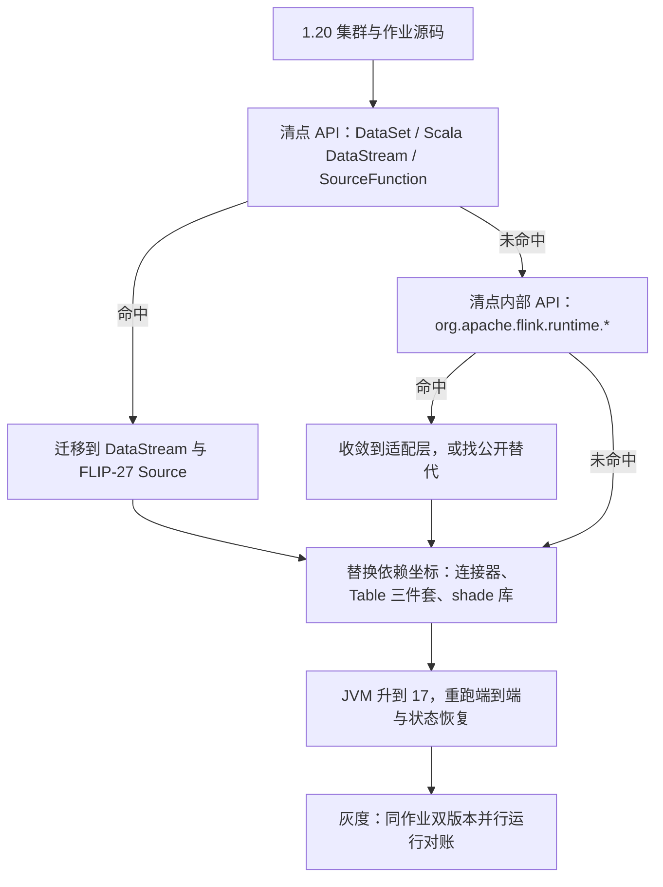

**摘要：**

一份在 IDE 里跑得好好的 Flink 作业，提交到集群却在启动阶段抛 `ClassNotFoundException`，或者换一台机器运行就报 `NoSuchMethodError`，这类故障的成因极少落在业务逻辑上，绝大多数落在版本与依赖这一层。本文把"上手第一篇"从写一个 WordCount 换成搭一套能稳定提交的骨架，围绕三条线索展开：其一，Flink 1.x 到 2.x 的版本线与运行时三元组（框架、JDK、Scala 二进制版本）如何约束工程，2.0 为什么算一次断代；其二，依赖的三类陷阱——`provided` scope 与 fat jar 里的重复类、传递依赖的仲裁与连接器的双段版本号、用户代码 shade 时的排除与 relocate——各自在什么时机炸掉；其三，`flink run` 的提交形态、classloader 的反转加载与父优先白名单、API 稳定性标注，如何共同构成"本地能跑、集群不能跑"的落差。收尾给出一张可执行的检查清单与一组反例。文中有意略去安装步骤与入门程序，结论全部指向工程决策：版本怎么锁、scope 怎么设、包怎么打、失败先看哪里。读完之后应当能回答两个问题：给定一个集群，工程该锁哪几个版本；提交失败时，第一步该看哪一处证据。

---

## 第 1 章 上手的第一个障碍不在业务代码里

一个具备了流处理基本概念的工程师，第一个真正卡住他的问题往往与算子无关。比较典型的现场是这样的：本机 IDE 里点运行，作业在进程内跑出结果，控制台刷着每一条输出；打包上传，`bin/flink run` 回车，JobManager 日志里出来一行 `java.lang.ClassNotFoundException: org.apache.flink.streaming.api.environment.StreamExecutionEnvironment`，或者更隐晦一些，作业能起来，跑到第一个算子就 `NoSuchMethodError`。业务代码一行没改，失败与成功的差别只在于"在哪儿跑"和"跟谁一起跑"。

要把这类现象解释清楚，得先看清楚 Flink 进程里到底有几层"谁的类"。第一层是集群自带的运行时，`flink-dist.jar` 连同 `/lib` 目录下的若干 JAR 一起，由 JVM 的 AppClassLoader 加载，这一层里有 DataStream API、运行时、网络栈、状态后端、SQL 运行时；第二层是插件，`/plugins` 下的连接器与文件系统实现，由 Flink 的插件机制各自起一个 classloader 加载；第三层是用户代码，也就是你提交的那个 JAR，由每个作业独享的 `FlinkUserCodeClassLoader` 动态加载。三层之间不是平铺关系，而是父与子的关系，而"子加载器先看自己、再看父亲"这一条**反转加载**（inverted classloading）策略，正是绝大多数提交期故障的根源。



这张图解释了一件事：用户在 fat jar 里放进去的每一个类，其可见性与优先级，都取决于它与 AppClassLoader 里同名类的关系。同名且被列入父优先白名单，打进去的副本等于白打；同名却不在白名单，则两个副本同时存在，JVM 视之为两个不同的类型，于是出现 `com.foo.X cannot be cast to com.foo.X` 这种看起来荒谬的异常。

`flink-dist` 的体量在这里值得先建立一个数量级概念：官方分发包解压后带 `lib` 的目录通常在数百 MB 量级，其中 `flink-dist.jar` 本身就包含绝大部分运行时类；而一个只写业务逻辑、不带任何三方库的作业 JAR 通常只有几十 KB 到一两 MB。两者相差两到三个数量级，这个差距本身就是"为什么不该把运行时打进用户 JAR"的第一层直觉。

还有一层语义需要先划清。在依赖这个题目上，"上手"的真实含义不是"能算出结果"，而是"在固定的版本组合下，同一份产物可以稳定地提交到目标集群，并且失败时知道先看哪一处证据"。前者只依赖本机环境，后者要求工程对版本、scope、类加载三件事都做出过显式选择。所谓**开发环境**，本质上是"工程骨架 + 依赖矩阵 + 提交参数"三者的可复现组合，本机装了什么只是其中最不重要的一环。

> [!info] 本篇的边界
> 本章及后续各章讲的是工程侧配置：版本怎么锁、scope 怎么设、包怎么打、提交参数怎么写、失败先看哪里。至于这些类加载与图构建动作在源码里怎么走，属于机制层，放在 [[大数据/Flink/Flink原理深度解析与性能优化/01 Flink 架构总览：JobManager、TaskManager 与执行模型]] 与 [[大数据/Flink/Flink原理深度解析与性能优化/02 从 StreamGraph 到 JobGraph 再到 ExecutionGraph]]；部署形态的细节放在 [[大数据/Flink/Flink从入门到实战/09 Flink on YARN 与 Kubernetes 生产部署]]。

打个比方，这套分层有点像住宅的产权边界：开发商交房时已经把承重墙、水电主管道做完了（集群的 `/lib`），业主只需要装修自己的套内（用户 JAR）；如果业主非要在自家再砌一遍承重墙，交房验收时物业不会拦，但两家共用的那面墙一旦受力，谁都说不清责任。技术上的限定是：Flink 的"物业"确实会拦——它用父优先白名单保证 `org.apache.flink.` 前缀的类永远从父亲加载，你打进去的同名类被静默忽略，代价只是体积和一次潜在的类身份错位。

---

## 第 2 章 版本矩阵：从 1.x 到 2.x 的坐标系

Flink 的版本号不是装饰。一个工程的依赖坐标至少要同时对齐**三个维度**：框架版本、目标 JDK、Scala 二进制版本。三者中任何一个错位，都足以让作业在编译期、提交期或运行期中的一个环节失败。先看主干时间线。

| 版本 | 发布年份 | 与依赖相关的关键变化 |
| --- | --- | --- |
| 1.0 | 2016 | 首个稳定版，DataStream 与 DataSet 双 API 并存 |
| 1.9 | 2019 | Blink 分支合流，Table API 与 SQL 整体重构，planner 进入重构期 |
| 1.13 | 2021 | 状态后端 API 抽象重整，`HashMapStateBackend` 与 `EmbeddedRocksDBStateBackend` 取代旧命名 |
| 1.14 | 2021 | Scala 2.11 与 2.12 两种二进制分发包并存，选错后缀是这一年最常见的提交故障之一 |
| 1.15 | 2022 | Table 依赖拆为 `flink-table-api-java-uber`、`flink-table-runtime`、`flink-table-planner-loader` 三件套，`planner-loader` 引入隔离类路径 |
| 1.18 | 2023 | 全部 Scala API 标注废弃（FLIP-265），API 废弃迁移期规则（FLIP-321）自本版生效 |
| 1.19 | 2024 | 支持 Java records 作为 POJO 序列化 |
| 1.20 | 2024 | 1.x 末线，补丁版本维护延续到 2026 年 |
| 2.0 | 2025-03 | 移除 DataSet API 与 Scala 的 DataStream/DataSet API、移除 `SourceFunction`/`SinkFunction` 等一批旧接口，Java 17 成为默认与推荐版本，Java 21 实验支持 |
| 2.1 | 2025-07 | 延续 2.x 线，连接器生态按新主版本重发 |
| 2.2 | 2025-11 | 同上 |
| 2.3 | 2026-06 | 同上 |

表里的日期按 Maven Central 的发布记录整理，实际选型时以官方下载页与 release notes 为准。真正需要背下来的不是年份，而是三条边界：1.x 内部的版本演化以"新增与废弃"为主，2.0 是一次真正的破坏性调整；Scala 支持在 2.0 收缩到 Table API；JDK 的下限在 2.0 抬到 11，推荐值抬到 17。

运行时三元组可以整理成一张对照表，用来回答"我这个集群能跑什么 JDK 编译出来的作业"。

| 维度 | 1.x 常见取值 | 2.x 取值 | 错位的后果 |
| --- | --- | --- | --- |
| JDK | 1.8 至 17，1.18 之后 17 逐渐主流 | 最低 11，默认 17，21 实验支持 | 用 17 编译、集群跑 8，字节码版本不兼容，启动即 `UnsupportedClassVersionError` |
| Scala | 1.14 之前 2.11/2.12 双发行，1.15 起 2.12 为主，2.0 起 DataStream 的 Scala API 移除 | 2.12（分发构建默认） | 用错后缀，`NoSuchMethodError` 或 `NoClassDefFoundError` |
| 框架 | 同一大版本内小版本可升级，跨大版本需重编 | 2.x 与 1.x 之间存在 API 删除 | 低版本编译、高版本运行通常可行，反向则常见 `NoSuchMethodError` |

这张表里最容易被忽视的是 JDK。工程里的 `maven.compiler.source` 经常跟着 IDE 默认值走，而集群的 JDK 由运维决定，两边一旦错位，报错信息（`UnsupportedClassVersionError: class file version 61.0`）反而比类找不到更直白，排查成本低，但定位到"编译目标"这一步之前，很多人会先怀疑镜像或分发包。

三个维度的兼容承诺并不相同，把它们画在同一张图上，就容易看出为什么"跨大版本升级"在 Flink 里从来不是改一个版本号。



1.x 内部的演化之所以能用"替换版本号"解决，是因为社区在小版本之间维持了 `@Public` API 的源码兼容，并把破坏性变化推到废弃流程里慢慢消化；2.0 之所以必须**重建依赖矩阵**，是因为它同时动了三件事：移除 DataSet API 这一整套批处理入口、移除 DataStream 的 Scala 实现、把 Java 下限抬到 11 并默认 17。这三件事没有一件能靠"兼容层"绕过去，DataSet 的算子语义与 DataStream 有实质差别，Scala 的 DataStream 实现依赖宏与隐式转换，JDK 下限则直接决定字节码版本。

断代带来的连带效果是依赖形态整体换了一轮。连接器要按 `4.0.x-2.0` 这样的双段版本重发，Table 依赖要从旧的 uber 包换成分发包里的三件套，日志、Kryo、Netty 这些被 shade 的库也随框架版本一起换版本号（2.0 的 `flink.shaded.version` 为 `19.0`，与之配套的 `flink-shaded-jackson` 一类构件采用"上游版本-框架 shade 版本"的命名，譬如 `2.22.2-22.0`）。所以升级到 2.x 时，pom 里需要动的位置远不止 `flink.version` 一处，凡是与 Flink 构件版本绑定的地方都要重新对齐。

同一大版本内的小版本混用，安全边界由官方兼容性承诺划定。Flink 对 `@Public` API 的承诺是：补丁版本之间源码与二进制双向兼容，小版本之间只保证源码兼容。这意味着 1.18.0 编译的作业直接跑 1.18.2 集群一般是安全的，而拿 1.19 新增的 API 编译、再丢到 1.18 集群上跑，编译期毫无察觉，运行期才会在某条记录经过某个算子时炸出 `NoSuchMethodError`。反向的场景，也就是高版本编译、低版本运行，正是本节要建立的第一条直觉：依赖矩阵不是"顺手对齐"，而是提交成败的前置条件。

> [!warning] 版本对齐的工程做法
> 把 `flink.version`、`target.java.version`、`scala.binary.version` 收敛为 pom 里唯一的三个属性，任何模块不得写死具体版本；用 `dependencyManagement` 统一 connector 版本；CI 里固定跑一次 `mvn dependency:tree -Dincludes=org.apache.flink` 并与集群分发包的 `/lib` 清单做比对。比对这一步最不起眼，却能在提交之前拦住大多数版本错位。

比对可以交给构建工具自动做。`maven-enforcer-plugin` 的 `bannedDependencies` 规则擅长处理"某几类坐标绝对不该出现"这种判断题：错误后缀的 Scala 构件、与 `planner-loader` 冲突的 planner、以及会和集群日志体系打架的日志实现，都可以写成排除项，让构建在最早的时刻失败。

```xml
<plugin>
  <groupId>org.apache.maven.plugins</groupId>
  <artifactId>maven-enforcer-plugin</artifactId>
  <executions>
    <execution>
      <id>check-dependency-matrix</id>
      <goals><goal>enforce</goal></goals>
      <configuration>
        <rules>
          <bannedDependencies>
            <excludes>
              <exclude>org.apache.flink:*_2.13</exclude>
              <exclude>org.apache.flink:flink-table-planner_2.12</exclude>
              <exclude>org.slf4j:slf4j-simple</exclude>
              <exclude>org.slf4j:slf4j-log4j12</exclude>
              <exclude>log4j:log4j</exclude>
            </excludes>
            <message>依赖矩阵校验失败：对齐 flink.version、Scala 后缀与日志实现后再打包</message>
          </bannedDependencies>
        </rules>
      </configuration>
    </execution>
  </executions>
</plugin>
```

这类规则的价值在于把"人记版本"变成"构建校验版本"。规则本身要随版本演进而维护，譬如 2.0 之后 Scala 的 DataStream 构件已不存在，对应排除项就可以删掉；维护成本远低于每次提交失败后的排查成本。

版本线还影响一件事：你能拿到什么形态的依赖。1.x 的 Table 依赖是一整包 `flink-table` uber jar，2.x 拆成三件套并按需放进 `/lib`，所以 1.x 时代那种"把 `flink-table` 整包打进 fat jar"的写法，在 2.x 上既不合规也没必要。这类"依赖形态随版本演进"的变化，在工程里的表现就是 pom 需要跟着改，而不是简单把版本号从 1.20 改成 2.0。

---

## 第 3 章 Scala 二进制兼容：后缀 `_2.12` 是怎么来的

Scala 生态里最容易被 Java 工程师误解的一点是：Scala 2.12 与 2.13 之间并不保持**二进制兼容**。这不是"版本号小，影响不大"的差异，而是集合库被整体替换、标准库签名大规模变化带来的结果。一个在 2.12 下编译的类，引用了 `scala.collection.TraversableOnce`，换到 2.13 的类路径上运行时，这个类型已经不存在，于是 `NoClassDefFoundError`；如果方法签名变了但类还在，报的就是 `NoSuchMethodError`。整个 JVM 生态熟悉的"二进制兼容"承诺，在 Scala 的跨小版本之间并不成立。

Flink 的应对办法是给所有直接或传递依赖 Scala 的构件加上二进制版本后缀，`flink-scala_2.12`、`flink-streaming-scala_2.12`、`flink-table-api-scala-bridge_2.12` 都是这个规则的产物。后缀的含义是"这个 JAR 里的字节码是按哪个 Scala 二进制版本编译的"，而不是"这个 JAR 需要哪个 Scala 编译器"。如果你的应用是纯 Java、不使用任何 Scala API，官方文档的措辞是"可以使用任意 Scala 版本"——因为此时你的依赖树里根本不该出现带后缀的 Flink 构件。

`scala-library` 本身的仲裁是这条规则的延伸。带后缀的 Flink 构件会声明对某个 2.12.x 的 `scala-library` 依赖，如果你的工程或某个三方库同时引入了 2.13 的 `scala-library`，Maven 按最短路径仲裁，很可能选中 2.13，于是 Flink 的 `_2.12` 构件在运行时找不到 2.12 的标准库成员，报错位置与业务无关，栈里全是 Scala 集合的方法名。这类冲突的处置不是"改 Flink 版本"，而是把 `scala-library` 显式锁到分发版使用的 2.12.x 上，并检查是否有依赖偷偷把它顶到 2.13。

```
判断后缀是否该出现，看依赖树比看文档快：

mvn dependency:tree -Dincludes=org.scala-lang:scala-library
mvn dependency:tree -Dincludes=org.apache.flink | grep "_2\."
```

前者告诉你 scala-library 被谁拉进来、仲裁到了哪个版本；后者告诉你 Flink 的带后缀构件从哪条路径进来的。两条命令的输出合起来，就是"我的 Scala 版本是否与集群一致"的全部证据。

还有一层历史细节需要交代清楚。Flink 的 2.12 构建长期停在 2.12.7 附近，原因是 2.12.8 的编译器不再生成某些方法，与之前的 2.12.x 不再二进制兼容，官方文档对此有明确说明，并建议需要更高 2.12.x 的用户自行按构建指南本地构建。这也是 Scala 生态给所有框架出的同一道难题：想跟随小版本升级，就得承担二进制断裂的代价。Flink 选择不升，把断裂挡在发行版之外，代价是用户在别处拉进 2.12.8 以上的 scala-library 时，仍可能遇到方法缺失。

至于 Scala 2.13，Flink 从未提供官方支持。相关的需求从 2019 年就开过单（FLINK-13414），一直没有落地，FLIP-265 的动机里写明了两点：社区的主要投入已经转向 Java API，Scala 侧的支持与 Java 侧并不同步；Flink 的 2.12 构建停在 2.12.7，再往前升就要承担二进制断裂，以当时的状态也不值得为 2.13 重做一遍。这份提案在 2022 年前后落地，明确了"先废弃、后移除"的路线：1.18 起所有 Scala API 标注废弃，2.0 中移除 DataStream 与 DataSet 的 Scala API，只保留 Table API 这一支。这一点在 Maven Central 上可以直接验证：`flink-scala_2.12` 的最后一批版本停在 1.20.x，2.x 线不再发布这个坐标。

| 场景 | 依赖树里的典型特征 | 结论 |
| --- | --- | --- |
| 纯 Java 应用 + Java API | 无 `_2.12` 构件，scala-library 不出现或被排除 | 无需关心 Scala 版本 |
| 纯 Java 应用 + Table API | 出现 `flink-table-planner_2.12` 或 `flink-table-planner-loader` | 用 `planner-loader` 可避开后缀问题 |
| Scala 应用 + DataStream | 出现 `flink-streaming-scala_2.12`、`scala-library` | 三个版本必须同时对齐，2.0 起需迁移到 Java API |
| Scala 应用 + Table API | 出现 `flink-table-api-scala(-bridge)_2.12` | 2.0 仍可用，但需与分发版 Scala 版本一致 |

Table 这一支的处理方式很能说明问题。从 1.15 起，分发包在 `/lib` 里放的是 `flink-table-planner-loader`，在 `/opt` 里放的是带 Scala 后缀的 `flink-table-planner_2.12`。前者把 planner 藏在一个隔离的类路径后面，把 Scala 依赖一并封进去，于是用户侧看不到后缀，也不需要操心；后者把 planner 暴露在普通类路径上，必须与分发版的 Scala 版本一致。官方文档说得很直白：两个 planner 不能同时出现在类路径里，同时存在会导致 Table 作业失败。之所以还要保留带后缀的那个，是为了让需要访问 planner 内部实现的工具与自定义方言有路可走，但这条路的代价是把自己绑死在分发版的 Scala 版本上。

一个常见误解值得单独澄清：不少人以为只要把 `flink-table-planner_2.12` 换成 `flink-table-planner-loader` 就"与 Scala 无关了"，实际只是把 Scala 依赖从你的类路径挪进了隔离类路径，运行时仍然存在，只是不再参与你的依赖仲裁。真正的收益是消除了后缀选择错误与集合库版本冲突，而不是让 Scala 消失。

---

## 第 4 章 依赖的第一类陷阱：`provided` 与 jar hell

`provided` scope 的语义在 Maven 里很直白：编译期可见、**打包不带**、运行期由外部提供。对 Flink 工程来说，这个"外部"就是集群的 `flink-dist` 与 `/lib`。工程骨架里最核心的两个坐标——`flink-streaming-java` 与 `flink-clients`——官方模板一律设为 `provided`，理由写在 Maven 配置文档里：不这么设，最好的情况是 JAR 体积膨胀到夸张的程度，最坏的情况是打进 JAR 的框架类与集群自带的版本互相冲突。

冲突的具体形态取决于前缀。`org.apache.flink.` 在父优先白名单里，意味着即使你打进了不同小版本的 Flink 类，加载时仍然优先用集群的那一份，看起来"没出事"，实际只是你的副本被静默忽略；而一旦跨越了白名单边界，譬如某个三方库在 Flink 里被 shade 成了 `org.apache.flink.shaded.*`，你自己又带了一份原版，两边就是两个不同的类型，跨 classloader 传递对象时抛 `X cannot be cast to X`，异常栈里两个一样的类名会让人怀疑人生。

这种"看起来没出事"的假象正是第一类陷阱最贵的地方。作业在 Session 集群上跑通了，团队据此认为打包没问题，直到某天集群从 1.18 升到 1.19，同一个产物在启动阶段报 `NoSuchMethodError`——因为打进去的副本虽然被忽略，但编译器是按它来校验签名的，运行期取到的却是另一个版本的方法表。也就是说，多打一份框架通常不会立刻报错，它只是把错误**推迟**到集群升级那天。

另一个容易误判的现象是"我只把 `flink-clients` 打进去了，应该没事"。`flink-clients` 里的客户端类与集群侧的类属于同一套坐标体系，白名单同样覆盖，所以单独打它通常也不会立刻炸；但它会把 `flink-core`、`flink-runtime` 等一串传递依赖带进产物，体积和重复随之倍增。判断标准应当回到 scope 而不是回到"有没有炸"：只要坐标属于框架侧，就应当是 `provided`。

依赖版本的统一还有第二种形态：把框架侧坐标集中到父 pom 的 `dependencyManagement` 里，子模块只写坐标不写版本。Flink 没有随框架发布的官方 BOM（以对应版本发行说明为准），这件事只能自己维护：父 pom 锁住 `flink.version`、各连接器的双段版本、日志实现版本，子模块一律不写版本。好处是升级时改一处，坏处是父 pom 变成需要评审的资产——任何人在子模块里手写版本覆盖它，都会绕过整套校验。

本地 IDE 运行是另一半问题。`provided` 的依赖不会进 IDE 的运行类路径，直接点运行会报找不到类。官方文档给出的做法是在 IntelliJ 的运行配置里勾选 `Include dependencies with "Provided" scope`，一步到位；用 Maven 命令跑（譬如 `exec:java`）时则要另想办法，常见的是为本地运行单独准备一个 profile，把关键依赖的 scope 临时改成 `compile`。后一种做法在工程里很常见，风险在于它给了"误用它去打包"的机会：只要有人带着 `-P` 参数打了一次包，产物里就混进了框架类，体积翻几十倍，且与集群版本不一致。

```xml
<!-- 本地运行 profile：只用于 IDE 之外的命令行调试，打包产物不得使用 -->
<profile>
  <id>local-run</id>
  <dependencies>
    <dependency>
      <groupId>org.apache.flink</groupId>
      <artifactId>flink-streaming-java</artifactId>
      <version>${flink.version}</version>
      <scope>compile</scope>
    </dependency>
    <dependency>
      <groupId>org.apache.flink</groupId>
      <artifactId>flink-clients</artifactId>
      <version>${flink.version}</version>
      <scope>compile</scope>
    </dependency>
  </dependencies>
</profile>
```

体积上的判断可以给一个粗量级：纯业务 JAR 在 1 MB 上下；带 Kafka 连接器、Jackson、若干三方库的 fat jar 在数十 MB；一旦把 Flink 运行时打进去，直接跳到数百 MB 量级。体积本身不是错误，错误在于体积增长背后的类重复。

> [!warning] 体积与冲突概率的关系（量级判断）
> 一个经验性的判断：fat jar 从 10 MB 量级涨到 100 MB 量级时，与集群已有类重复的概率大约从"偶尔踩到"变成"几乎必然踩到某一处"；再往 300 MB 以上走，重复从"某几个库"变成"整个框架层"。这个关系不是线性的，因为冲突取决于重复的类是否落在父优先白名单内、是否跨 classloader 传递对象，而不是取决于字节数本身。

反例很直接：把 `flink-streaming-java` 从 `provided` 改成默认 scope，提交到 Session 集群，运气好时作业能跑（因为白名单兜住了），运气不好时 TaskManager 报 Metaspace 相关错误或者 classloader 泄漏告警——`classloader.check-leaked-classloader` 默认为 `true`，一旦它发现某个已经终止的作业 classloader 仍被使用，作业会直接失败。这类故障的排查成本特别高，因为症状（Metaspace 增长、提交被拒）与原因（多打了一份框架）之间隔着好几层。

---

## 第 5 章 依赖的第二类陷阱：传递依赖与版本仲裁

Maven 的**依赖仲裁规则**是"路径最短者胜，路径相同则先声明者胜"，这条规则在 Flink 工程里会制造两种典型冲突：一种是 Flink 自身构件被三方库拉进了另一个版本，另一种是三方库之间对公共依赖的版本分歧，仲裁结果恰好是 Flink 运行时不期望的那个版本。

诊断入口只有一条命令，但要看对地方。

```bash
# 谁把 Flink 构件拉进来了，仲裁结果是什么
mvn dependency:tree -Dincludes=org.apache.flink -Dverbose

# 看整体树里被 omitted 的冲突项
mvn dependency:tree -Dverbose | grep -E "omitted|conflict"
```

输出里出现 `omitted for conflict with X` 的地方，就是仲裁发生的现场。如果被丢弃的是 Flink 构件的某个小版本，问题通常出在某个连接器或工具库硬编码了 Flink 版本；如果被丢弃的是三方库，则需要判断 Flink 运行时期望哪个版本。

典型的仲裁现场长这样，一眼就能看出问题出在第二个分支。

```bash
$ mvn dependency:tree -Dincludes=org.apache.flink -Dverbose
[INFO] com.example:order-cdc-job:jar:1.0.0
[INFO] +- org.apache.flink:flink-streaming-java:jar:1.18.1:provided
[INFO] +- org.apache.flink:flink-connector-kafka:jar:3.0.1-1.17:compile
[INFO] |  \- (org.apache.flink:flink-core:jar:1.17.2:compile - omitted for conflict with 1.18.1)
[INFO] \- org.apache.flink:flink-clients:jar:1.18.1:provided
```

带 `omitted` 的那一行含义很明确：连接器是按 1.17 编译的 `3.0.1-1.17`，它自带的 `flink-core` 被仲裁丢弃，最终运行时用的是 1.18.1 的 `flink-core`。这种组合在多数情况下能跑，因为 Flink 在小版本之间保持 `@Public` API 的源码兼容，但二进制兼容不保证——一旦连接器调用了某个在 1.18 中被改了签名的方法，异常会在作业运行到那个 Source 才出现。处置方式是把连接器换成与集群同版本的那一行，譬如 1.18 对应 `3.0.1-1.18` 或 `3.2.0-1.18`，而不是靠仲裁"看起来能跑"。

版本对齐到连接器这一层之后，还有一件事要确认：连接器与格式（format）的匹配。Kafka 连接器负责读写 Kafka，JSON、Avro、Debezium 这类格式负责解析消息体，两者是独立坐标、独立版本。CDC 场景里尤其容易出错——Debezium 格式的版本要跟连接器版本配套，而 Debezium 自身又对 Kafka 客户端版本有要求，三者构成一条隐式的版本链。这条链上任何一环错位，症状都是"作业起来了、数据没进来"，排查时依赖树比日志更有用。

Table 依赖的形态变化是理解这类冲突的最好样本。1.15 之前，`flink-table` 是一个 uber jar，里面同时包含 API、运行时和 planner；1.15 之后拆成三个构件，分发包的 `/lib` 里放的是 `flink-table-api-java-uber`、`flink-table-runtime`、`flink-table-planner-loader`。官方文档明确指出拆分的目的之一，是让用户能把 `planner-loader` 换成带 Scala 后缀的 `planner_2.12`，从而访问 planner 内部实现。这个设计的连带效果是：用户工程里如果既引了 `flink-table-planner` 又引了 `flink-table-planner-loader`，或者引入的某条传递路径把 `planner_2.12` 带进来了，类路径里就出现两个 planner，Table 作业在编译查询计划时失败。

| 坐标 | 分发版是否已提供 | 建议 scope | 说明 |
| --- | --- | --- | --- |
| `flink-streaming-java` | 是（`flink-dist`） | `provided` | 任何情况下都不应打进产物 |
| `flink-clients` | 是（`/lib`） | `provided` | CLI 提交所需的客户端类 |
| `flink-table-api-java` / `-bridge` | 是（`flink-table-api-java-uber`） | `provided` | Table 程序的 API 层 |
| `flink-table-planner-loader` | 是（`/lib`） | `provided` | 与 `planner_2.12` 二选一 |
| `flink-connector-kafka` | 视集群 `/lib` 而定 | `compile` 或 `provided` | 必须与集群内版本一致 |
| `log4j-slf4j-impl` / `log4j-core` | 是（`/lib`） | `runtime` + shade 排除 | 本地出日志，产物不带 |
| `flink-test-utils` | 否 | `test` | MiniCluster 与测试工具 |
| `com.google.code.findbugs:jsr305` | 否 | 排除 | 纯注解，打进去只增体积 |

连接器的版本语义需要单独记住：外部化之后的连接器采用**双段版本号**（连接器版本 - Flink 版本），譬如 `3.3.0-1.20` 表示面向 Flink 1.20 的 3.3.0 连接器，`4.0.1-2.0` 表示面向 Flink 2.0 的 4.0.x 连接器。双段版本号的含义是"这段连接器代码是针对那个 Flink 大版本编译与测试的"，不是"任意兼容"。跨大版本的连接器通常会伴随 API 迁移，譬如 Sink V1 到 Sink V2 的接口变化，所以连接器版本不能凭"看着差不多"往上抬。

还有一个细节藏在 Flink 的根 pom 里：发布到 Maven Central 的 Flink 构件默认把内置依赖标记为 `optional`（属性 `flink.markBundledAsOptional` 默认为 `true`），目的是避免下游工程通过传递依赖把 Flink 的内部库一并拉进来。这个机制解释了为什么有时候"我只加了一个 connector，结果依赖树里多出一堆东西"，也解释了为什么某些工具链需要显式声明更多坐标。同一处源码里还有 `flink-shaded-force-shading` 这个构件，Flink 的根 pom 直接称它为 dummy artifact，作用是在构建期占位，让依赖解析把 shaded 模块一并纳入，打包时应当排除，不要误以为它是运行时依赖。

---

## 第 6 章 依赖的第三类陷阱：用户代码的 shade 与 relocate

并不是所有工程都需要 fat jar。只用 Flink 自带连接器与格式、且这些构件在集群 `/lib` 里已经存在的作业，提交普通 JAR 就够了；需要 fat jar 的是引用了分发版没有的库的场景，譬如自研的 SDK、JDBC 驱动、缓存客户端。打包方式的选择本身不复杂，复杂的是 shade 的配置细节，因为它决定了产物能不能在别人的类加载体系里正常活下来。

官方模板的 shade 配置值得逐项读一遍，每一项都对应一类真实故障。

```xml
<plugin>
  <groupId>org.apache.maven.plugins</groupId>
  <artifactId>maven-shade-plugin</artifactId>
  <configuration>
    <createDependencyReducedPom>false</createDependencyReducedPom>
    <artifactSet>
      <excludes>
        <exclude>org.apache.flink:flink-shaded-force-shading</exclude>
        <exclude>com.google.code.findbugs:jsr305</exclude>
        <exclude>org.slf4j:*</exclude>
        <exclude>org.apache.logging.log4j:*</exclude>
      </excludes>
    </artifactSet>
    <filters>
      <filter>
        <artifact>*:*</artifact>
        <excludes>
          <exclude>META-INF/*.SF</exclude>
          <exclude>META-INF/*.DSA</exclude>
          <exclude>META-INF/*.RSA</exclude>
        </excludes>
      </filter>
    </filters>
    <transformers>
      <transformer implementation="org.apache.maven.plugins.shade.resource.ServicesResourceTransformer"/>
      <transformer implementation="org.apache.maven.plugins.shade.resource.ManifestResourceTransformer">
        <mainClass>com.example.job.OrderCdcJob</mainClass>
      </transformer>
    </transformers>
  </configuration>
</plugin>
```

四个排除项各有出处。`flink-shaded-force-shading` 是构建期的空壳，排掉；`jsr305` 是编译期注解，排掉；`org.slf4j` 与 `org.apache.logging.log4j` 两条最为关键，因为日志的类与绑定在父优先白名单里，集群的 `lib` 已经提供了完整的一套 log4j2 加 slf4j 桥接，你的产物里再带一份，不仅重复，而且真正生效的是父亲那一份，你的 `log4j2.properties` 未必被读，最终表现是"日志全黑"。

**日志全黑**这件事值得展开。Flink 的父优先白名单里明确列出 `org.slf4j`、`org.apache.log4j`、`org.apache.logging`、`org.apache.commons.logging`、`ch.qos.logback` 这些前缀，意味着这些包永远从 AppClassLoader 加载。用户 JAR 里如果带了 `log4j-core`，它不会被使用；如果带的是旧版 log4j 或另一个 slf4j 绑定，则可能在启动时打印 `SLF4J: Class path contains multiple SLF4J bindings`，也可能什么都不打印——因为在父加载器看来，绑定已经存在，用户那份没有被加载，配置却指向不存在的文件。判据很清楚：`bin/flink run` 的客户端日志正常、TaskManager 上看不到你的业务日志，同时依赖树里有 `org.slf4j` 或 `log4j` 的重复项，基本可以定性。

`ServicesResourceTransformer` 是另一个常被忽略的项。三方库通过 `META-INF/services` 做 SPI 注册，譬如 JDBC 驱动、Jackson 的模块、Flink 的工厂类；shade 默认会覆盖同名资源文件，导致除最后一个之外的注册全部丢失，症状是"类在 jar 里，但框架说找不到实现"。这个 transformer 的作用就是把多个 `META-INF/services` 文件按行合并，属于必加项。

然后是 **relocate**。官方文档的立场是：Flink 已经把 guava、netty、jackson 这类依赖 shade 进了 `org.apache.flink.shaded.*`，用户通常不需要自己 relocate。真正需要 relocate 的是"你依赖的库与集群里某个库同名但版本不同，且不在父优先白名单内"的情况，典型是老版本的 `commons-lang3`、`protobuf-java`、`avro`，或者内部 SDK 自带的某个 JSON 库。relocate 的代价要一并算进来：类名被改写后，反射、序列化、SPI 文件、注解扫描都可能失效，所以 relocate 之后必须再跑一次端到端提交验证，而不是只看编译通过。

| 依赖类型 | 处理方式 | 不处理的后果 |
| --- | --- | --- |
| 日志实现（slf4j 绑定、log4j 核心） | 排除，交由集群提供 | 日志丢失、绑定冲突告警 |
| 编译期注解（jsr305 等） | 排除 | 体积增大，无功能影响 |
| Flink shaded 库的原版（guava、jackson） | 一般无需 relocate | 可能双副本，跨 classloader 传递对象时报类型不匹配 |
| 与集群同名的三方库、版本不同 | relocate 或改版本对齐 | `NoSuchMethodError`、`AbstractMethodError` |
| 自研 SDK、内部依赖 | 直接打包，必要时 relocate | 通常是必要成本 |

比喻来说，shade 像搬家时给自家纸箱贴颜色标签：同一栋楼里已经有物业统一配的蓝色标签箱（集群提供的库），你只需要给自己的箱子贴别的颜色，而不是把物业的箱子也重新贴一遍；贴错颜色的结果不是箱子丢，而是搬进新家后按标签找不到东西。

打包前后到底发生了什么，值得用一张图对齐。



图里右侧那一步是关键：产物最终只有三类内容——业务类、连接器、三方库；框架与日志实现都来自集群。判断一个依赖该不该出现在产物里，只需要问一句"集群的 `/lib` 里有没有它"，而不是问"我的代码编译时需不需要它"。

shade 还有一个默认关闭但很容易被误开的选项：`minimizeJar`。它通过可达性分析裁剪"没被静态引用"的类，对依赖反射、SPI、注解处理的库几乎是灾难——Jackson 的模块、JDBC 驱动、Flink 的连接器工厂都可能被判定为不可达而删除，症状是编译通过、提交时报 `ClassNotFoundException`，而类明明在源码里被引用过。工程上更稳妥的做法是保持 `minimizeJar` 关闭，靠显式排除列表控制体积，让产物的内容可预测。

体积与类数之间还有一个经验性的换算：一个数十 MB 的 fat jar 里通常有几万个类，而集群 `lib` 里同名的类占比越高，重复的概率越大。这个比例不必精确计算，只需要建立"体积越大、需要排查的重复面越广"的直觉，并在每次新增依赖时问一句它是否只是集群已有库的另一个副本。

---

## 第 7 章 `flink run` 的提交形态与执行环境推断

打包完成之后，第一个疑问通常是：为什么同一份 `main()` 方法，在 IDE 里执行和用命令行执行，行为不一样。答案在 `StreamExecutionEnvironment.getExecutionEnvironment()` 的实现逻辑里：它先看当前线程上下文里有没有**执行环境工厂**，有就用工厂创建（远程环境），没有就退回到本地环境。而那个工厂，是客户端在调用用户 `main()` 之前注入的。



这条链路解释了两件常被混淆的事：`getExecutionEnvironment()` 的"自动感知"不是运行时魔法，而是调用栈上下文的结果；同一个方法在 Application Mode 下由 JobManager 侧调用，在 Session 模式下由客户端调用，两者的类路径与工作目录假设并不相同。

命令行层面的参数可以分成三组。定位组：`-c` 指定入口类，`-m` 指定 JobManager 的地址与端口，`-t` 指定部署目标。行为组：`-d` 后台提交，`-p` 并行度，`-s` 从 Savepoint 恢复。配置组：`-D` 传入动态配置。

```bash
# 提交到已有集群，指定入口类与并行度
$FLINK_HOME/bin/flink run \
  -m flink-jm.internal:8081 \
  -c com.example.job.OrderCdcJob \
  -p 8 \
  -Dpipeline.max-parallelism=64 \
  -d \
  order-cdc-job.jar --kafka-topic order_cdc
```

`-c` 与 JAR 的 Manifest 是互为备份的关系：shade 配置里通过 `ManifestResourceTransformer` 写入了 `Main-Class`，此时可以省略 `-c`；一个 JAR 里有多个入口类时，`-c` 是唯一可靠的指定方式。漏写又没配 Manifest 时，报错是 `Could not find or load main class`，属于较容易定位的一类。

`-t` 的取值在 2.0 里收敛为 `local`、`remote`、`yarn-session`、`yarn-application`、`kubernetes-session`、`kubernetes-application` 六种，`local` 指的是用进程内 MiniCluster 以 Session 模式执行，`remote` 指的是提交到已运行集群。`-D` 有一个容易踩的边界：提交到已运行的 Session 集群时，只有执行级配置生效，集群级配置不会回写，写了也不报错。

正因为只有执行级配置生效，`-D` 的实际用途集中在检查点、重启与并行度上限这一组参数上。下面这条命令把"能在生产稳定跑起来"所需的最小配置都写进了提交参数，好处是它随作业走，不依赖集群配置文件的当前值。

```bash
$FLINK_HOME/bin/flink run \
  -d \
  -c com.example.job.OrderCdcJob \
  -Dexecution.checkpointing.interval=30s \
  -Dexecution.checkpointing.mode=EXACTLY_ONCE \
  -Dexecution.checkpointing.timeout=10min \
  -Dstate.checkpoints.dir=hdfs:///flink/checkpoints/order-cdc \
  -Dpipeline.max-parallelism=64 \
  -s hdfs:///flink/savepoints/savepoint-8f2c1a \
  order-cdc-job.jar --kafka-topic order_cdc
```

`-s` 与 `-d` 可以同时使用，含义是"从指定 Savepoint 恢复并后台提交"。恢复失败最常见的原因不是路径错误，而是作业拓扑变化导致算子的 UID 与状态不再匹配，这类问题属于状态与检查点的范畴，处置方式放在 [[大数据/Flink/Flink从入门到实战/06 状态管理与 Checkpoint 实战]]。这里只需记住一条：检查点目录必须对集群所有组件可见，用 `file://` 路径在本地点起来的 Session 集群上"能跑"，换到 YARN 或 K8s 上会直接失败。

三种部署模式在 2.0 里只剩下两种，这件事对依赖矩阵有直接影响。

| 维度 | Session Mode | Application Mode | Per-Job Mode（1.x 后期弃用，2.0 移除） |
| --- | --- | --- | --- |
| 集群生命周期 | 独立于作业，长期运行 | 每个应用一个集群 | 每个作业一个集群 |
| `main()` 执行位置 | 客户端 | JobManager | 客户端 |
| 资源隔离 | 多作业共享，互相影响 | 应用内共享 | 作业级独占 |
| 用户 JAR 的分发方式 | RPC 分发给各组件 | 预先放在 `usrlib` | RPC 分发 |
| 对依赖的影响 | 用户代码一律走动态类加载 | 组件启动即带 JAR，类路径假设变化 | 与 Session 相近 |

Application Mode 的差异不是部署细节，而是类加载路径的变化。官方文档的表述是：应用模式假设用户 JAR 已经与 Flink 分发版捆绑在一起，放在各组件的 `usrlib` 目录下，这样部署与恢复时不必再通过 RPC 分发。对 YARN 上的应用模式还有一层额外规则：默认情况下用户 JAR 会被放进系统类路径（`yarn.classpath.include-user-jar`），只有显式设为 `DISABLED` 才走用户类加载器。这意味着同一份作业在 YARN 应用模式与 Session 模式下的类加载行为可能不同，前者更接近"所有类平铺"，后者是"反转隔离"。提交前如果不确认这一点，很容易把一次环境切换误判成代码问题。

还有一个更隐蔽的差异：`main()` 在 JobManager 上执行时，`main()` 里做的所有资源操作都发生在集群侧，`registerCachedFile()` 注册的文件路径必须对 JobManager 可见。本地测试时这些都成立，换到应用模式可能就不成立。

---

## 第 8 章 classloader 隔离：本地能跑、集群报 ClassNotFoundException

把前面几章的线索收拢，就能解释标题里的那个反差。IDE 里所有类都在同一个 AppClassLoader 里，用户 JAR 与 Flink 分发包平铺在一层，反转机制根本不参与，所以看不到任何隔离问题；集群上，用户代码被 `FlinkUserCodeClassLoader` 加载，父亲是 AppClassLoader，反转策略开始生效，白名单开始起作用，于是"同一份代码"开始表现出不同的可见性。

实现上，`org.apache.flink.util.FlinkUserCodeClassLoaders` 提供了两套创建方式：`parentFirst` 与 `childFirst`，前者是 Java 默认的父优先，后者是 Flink 默认的 **child-first**，白名单以字符串前缀数组的形式传入；外层还有一个 `SafetyNetWrapperClassLoader`，负责在 classloader 已终止后仍被访问时抛错。这个类本身标注着 `@Internal`，恰好是下一章话题的一个引子——连"怎么创建用户类加载器"都属于内部实现，说明这个层次的变化不承诺稳定。

配置面上，1.20 与 2.0 的 core 配置里与类加载相关的选项只有五个：`classloader.resolve-order`（默认 `child-first`）、`classloader.parent-first-patterns.default`、`classloader.parent-first-patterns.additional`、`classloader.check-leaked-classloader`（默认 `true`）、`classloader.fail-on-metaspace-oom-error`（默认 `true`）。这里需要澄清一个常见误解：Flink 并没有提供"按包粒度的 child-first 白名单"这种旋钮，反转是全局的，白名单只能把个别前缀拉回父优先，不能反过来对某个包强制子优先。所以配置能调的空间比很多人以为的窄：要么整体反转，要么整体父优先（把 `resolve-order` 设为 `parent-first`），再靠白名单微调。

默认白名单里包含哪些前缀，直接决定了"哪些类打进去等于白打"。2.0 的默认值是 `java.`、`scala.`、`org.apache.flink.`、`com.esotericsoftware.kryo`、`org.apache.hadoop.`、`javax.annotation.`、`org.xml`、`javax.xml`、`org.apache.xerces`、`org.w3c`、`org.rocksdb.`、`org.slf4j`、`org.apache.log4j`、`org.apache.logging`、`org.apache.commons.logging`、`ch.qos.logback`。看到这份清单就能理解两件事：为什么日志实现必须交给集群；为什么 `org.apache.flink.` 下的类永远不会取你打包进去的版本。

插件层是第三层，与用户代码层平行。`/plugins` 目录下的每个插件由 Flink 在进程启动时加载一次，之后不再变化，所以插件的版本升级必须重启进程；插件的类通过 `META-INF/services` 里的工厂接口被发现，这也是为什么 shade 时 `ServicesResourceTransformer` 不能漏。把连接器 JAR 放进 `/lib` 与放进 `/plugins` 是两种不同待遇：前者进入 AppClassLoader，与框架类平级，冲突时直接表现为进程级问题；后者在独立 classloader 里，冲突局限在插件内部。选择哪一种，取决于这个连接器是否要被所有作业共享。

故障定位可以按异常形态走一棵判定树。



判定树里最容易被忽略的是 `NoSuchMethodError` 的类前缀。前缀是 `org.apache.flink.` 说明是框架版本错位，处置是重新对齐版本；前缀是三方库说明是仲裁问题，处置是锁定版本或 relocate。两种处置方向完全相反，看错前缀会把排查时间翻倍。

JDBC 驱动是一个具体的、值得单列的案例。JDK 的 `DriverManager` 在加载驱动时只看"调用者的类加载器"，用户代码由 `FlinkUserCodeClassLoader` 加载，驱动类也由它加载时一切正常；但如果驱动被打进 fat jar，而连接池或框架侧由另一层加载器发起连接，就会出现 `No suitable driver found`——驱动明明在 jar 里。官方文档给出的处置是把驱动 JAR 放进 Flink 的 `lib/` 目录，或者把驱动包加进 `classloader.parent-first-patterns.additional`，两者都是让驱动只被加载一次。

`classloader.check-leaked-classloader` 默认开启带来的另一个后果是：作业结束后如果还有线程或静态缓存持有 classloader，下一个作业提交时会被拒绝并提示泄漏。这类问题的排查方向是 `close()` 方法里的资源释放、Guava interners 之类的全局缓存、以及 Avro 序列化器的对象缓存。长期运行的 Session 集群里，泄漏会以 Metaspace 缓慢增长的形式出现，直至 `OutOfMemoryError: Metaspace`，此时 `classloader.fail-on-metaspace-oom-error` 会让进程直接失败而不是留下一个半死状态——这是一种"早失败"的设计取舍。

怀疑故障出在类加载层时，最快的验证手段是做一次对照实验：把集群配置里的 `classloader.resolve-order` 临时改成 `parent-first`，重提一次作业。故障消失说明问题出在双副本或子加载器可见性；故障照旧则更可能是依赖缺失或版本错位。实验的代价是一次集群重启，收益是把排查范围从"所有可能"缩到两类。实验结束务必改回默认值，父优先会让所有依赖冲突退回 Java 默认语义，反转机制本来能容错的那部分随之消失。

---

## 第 9 章 API 稳定性标注：`@Public`、`@PublicEvolving`、`@Internal`

Flink 用注解表达一个 API 的稳定级别，源码里位于 `org.apache.flink.annotation` 包下：`@Public` 表示稳定，`@PublicEvolving` 表示演进中，`@Experimental` 表示实验性；没有这些注解的类与成员一律视为内部实现，"不提供任何保证"。这条例外的表述来自官方的升级文档，也是判断"这个 API 能不能用于核心逻辑"的唯一可靠依据。

官方给出的兼容性承诺按"升级类型 × 注解"划分，可以直接整理成表。

| 注解 | 大版本升级（源码 / 二进制） | 小版本升级（源码 / 二进制） | 补丁版本升级（源码 / 二进制） |
| --- | --- | --- | --- |
| `@Public` | 均不保证 | 源码保证，二进制不保证 | 均保证 |
| `@PublicEvolving` | 均不保证 | 均不保证 | 均保证 |
| `@Experimental` | 均不保证 | 均不保证 | 均不保证 |

这张表最有价值的推论是：`@PublicEvolving` 的东西不能当稳定 API 用。很多人看到 `Public` 开头就放心，实际它在小版本之间既不保证源码兼容也不保证二进制兼容，升级 1.17 到 1.18 就编译不过，是完全符合承诺的行为。

从 1.18 起生效的 FLIP-321 又加了一层约束：废弃的 API 会有一个保证的**迁移期**。`@Public` 的迁移期是两个小版本，最早在下一个大版本移除；`@PublicEvolving` 是一个小版本；`@Experimental` 是一个补丁版本。这解释了 2.0 里为什么一次性移除了那么多东西——DataSet API、`SourceFunction`、`SinkFunction`、`TableSchema`、`Time` 换 `Duration`、`TimeCharacteristic` 等，它们大多在 1.15 到 1.20 之间就完成了废弃标注，迁移期已过。

`@Deprecated` 是四个注解里唯一不表达稳定级别、而表达生命周期的标注。它本身不说明这个 API 有多稳定，只说明官方打算在某个版本移除它；真正决定移除时机的是它同时带有的稳定级别注解。一个被标了 `@Deprecated` 的 `@Public` 方法，按 FLIP-321 至少还有两个小版本的迁移期；一个被标了 `@Deprecated` 的 `@Experimental` 方法，可能下一个补丁版本就消失。读废弃注解必须连稳定级别一起读，只看 `@Deprecated` 会误判改造工期。

`@Internal` 的判据则更简单：只要你的核心逻辑依赖了 `org.apache.flink.runtime.*`、`org.apache.flink.streaming.runtime.*` 这类包里的类，或者依赖了前面提到的 `FlinkUserCodeClassLoaders`，升级就是一次赌博。赌的不是"会不会坏"，而是"坏在哪一次升级"。工程上可以做的是把这类依赖显式登记成技术债，并在 CI 里加一道检查：编译期扫描 import 中是否出现内部包前缀，出现则告警。

```bash
# 粗粒度的内部 API 使用面检查：扫描编译产物里的 import 与常量池引用
mvn -q dependency:build-classpath -Dmdep.outputFile=cp.txt
javap -p -c target/classes/com/example/job/OrderCdcJob.class \
  | grep -E "org/apache/flink/(runtime|streaming/runtime)/" | head
```

Flink 自身的构建里用 japicmp 做二进制兼容检查，参照版本写在根 pom 的 `japicmp.referenceVersion` 属性里。这个工具对使用方也有价值：把两个版本的 Flink JAR 作为输入，可以列出哪些 `@Public` API 的签名发生了变化，从而在升级之前就知道会断在哪里。

把前面各章的判据串起来，1.20 到 2.x 的升级路径可以画成一条带分支的检查链。



第一步之所以先查 API 而不是先改版本号，是因为这三类移除会直接让编译失败，编译不过时改依赖没有意义。第二步查内部 API 的目的是评估工作量：`@Internal` 的调用点没有编译期提示，只能靠扫描与人工确认。第三、四步才是通常理解的"升级"，其中 JVM 升级与依赖替换可以并行推进，但端到端验证必须放在最后统一做一次。

升级路径里还有一个常被漏掉的成本：状态兼容。同一份作业换版本重跑，如果算子的 UID 没显式指定，拓扑一变就恢复不了状态；显式指定 UID 是 1.x 时代就有的要求，在跨大版本升级时它的价值才真正显现——它把"能不能从 Savepoint 恢复"变成一件与代码重构无关的事。

> [!info] 稳定性标注与选型的取舍
> 需要访问 planner 内部实现的 SQL 网关类工具、需要自定义状态后端的高级场景，往往绕不开内部 API。这时的决策不是"用不用"，而是"能不能把内部 API 的使用面压缩到一层适配代码里"，把升级时的修改范围限定在一个包内。这与依赖矩阵的思路一致：把不可控的部分集中，是控制升级成本的通用手法。

换个比喻，`@Public` 是施工图，`@PublicEvolving` 是方案图，`@Internal` 是设计师的草稿。照草稿施工不是不行，但改图之后没有人负责通知你。

---

## 第 10 章 本地调试姿势与打包提交检查清单

本地调试有三条路径，各自适合不同的问题。第一条是 `getExecutionEnvironment()`，在 IDE 里运行时会退化成进程内的本地环境，适合验证业务逻辑；第二条是显式创建 `createLocalEnvironment(parallelism)`，并行度可控，适合复现并发相关的行为；第三条是 `createLocalEnvironmentWithWebUI(configuration)`，会额外起一个 Web UI，默认端口与 `rest.port` 一致，通过 `Configuration` 可以改端口，用于观察算子链、反压与水位线。

```java
// 本地起 Web UI：需要 flink-runtime-web 在类路径上，仅用于开发
Configuration conf = new Configuration();
conf.setString(RestOptions.PORT.key(), "8088");
StreamExecutionEnvironment env = StreamExecutionEnvironment.createLocalEnvironmentWithWebUI(conf);
```

需要把两件事分清：本地 Web UI 看到的是进程内 MiniCluster 的界面，它与生产集群的 Web UI 长得一样，但指标体系、反压采样、检查点存储都不同，看到"本地不反压"不能推断生产不反压。

单元测试层面，`flink-test-utils` 提供 `MiniCluster`，可以在 JUnit 里起一个轻量集群并直接执行作业，适合验证序列化、状态与检查点配置这类只有"跑起来"才暴露的问题；Table 程序另有 `flink-table-test-utils`，会一并引入 planner 与运行时。`print()` 这类算子则要限定在临时验证里使用：它的输出走 TaskManager 的标准输出，在集群上既不稳定也不可检索，而且会引入逐条字符串格式化的开销，生产作业应当用日志、指标或正式 Sink 替代。

打包与提交的检查可以固化成一张**检查清单**，逐项打勾。

| 检查项 | 判据 | 位置或命令 | 不满足的后果 |
| --- | --- | --- | --- |
| 版本对齐 | `flink.version` 与集群版本一致 | pom 属性 / `mvn dependency:tree` | 提交期 `NoSuchMethodError` |
| JDK 目标 | `maven.compiler.target` 不高于集群 JDK | pom / `java -version` | `UnsupportedClassVersionError` |
| scope | 框架依赖为 `provided` | `mvn dependency:tree -Dscope=runtime` | 产物含框架类，体积与冲突 |
| shade 排除 | 日志实现、jsr305、force-shading 已排除 | pom / `unzip -l` | 日志丢失、体积膨胀 |
| 主类 | `-c` 与 Manifest 至少其一正确 | `flink run -c ...` | `Could not find or load main class` |
| 并行度 | 提交参数、算子设置、集群默认值三者有明确优先级 | `-p` / `env.setParallelism` | 资源不足或吞吐上不去 |
| 检查点 | 路径、间隔、超时可被集群访问 | 提交参数或 `-Dexecution.checkpointing.*` | 首次检查点失败，作业无法恢复 |
| 日志 | 产物内无 slf4j/log4j 实现 | `mvn dependency:tree` | 业务日志全黑 |
| classloader | 无 `org.apache.flink.runtime.*` 的硬依赖 | 编译期扫描 | 升级即断 |

反例可以集中列一遍，每一条都对应前面的某处机制。把 `flink-streaming-java` 设为默认 scope，产物带框架类，白名单兜住大部分场景，但泄漏检查与体积问题绕不开。Scala 版本与集群不一致，`NoSuchMethodError` 出现在与业务毫无关系的集合操作里。依赖里带了自己的 slf4j 实现，日志全黑，排查时误以为是作业没起来。核心逻辑建在 `@Internal` API 上，某次小版本升级后编译失败，改造成本远超预期。把 Table 的 planner 与 planner-loader 同时放进类路径，作业在编译查询计划阶段失败。

这张表可以进一步变成 CI 脚本：用 `unzip -l` 列出产物里的 `org/apache/flink/` 顶层包，出现即失败；用 `mvn dependency:list` 输出运行时依赖，与集群 `/lib` 清单求交集，交集里只允许出现明确允许的连接器；用 `javap` 扫描编译产物里的内部包引用。这三条检查加起来不到百行脚本，却能把"提交到集群才发现"的多数问题提前到合并请求阶段。把清单变成校验，是把个人经验转成团队能力的常见手法，也是依赖治理里性价比最高的一步。

产物的验收也可以不依赖人工。`unzip -l job.jar | grep -c "org/apache/flink/"` 这类命令能直接回答"产物里有没有框架类"，返回非零即异常；再用 `ls -lh` 看体积，与团队约定的量级上限（譬如 80 MB）比对。上限不必精确，它的作用是把"新增一个依赖"这件事在代码评审阶段暴露出来，而不是在提交失败之后。

> [!note] 什么时候可以破例
> 独占集群、或者作业与集群同生命周期的部署方式下，把用户 JAR 直接放进 `/lib` 是官方文档认可的简化手段：类进入系统类路径后不再动态加载，泄漏与反转问题一并消失。代价是这份 JAR 的依赖必须与集群完全共存，任何版本冲突都会变成进程级故障；Session 集群多作业共用时不能这么做。

到这里可以把整篇的落点收在一处：版本矩阵与依赖治理的收益不在当下，而在下一次升级。一个把 scope、版本、shade、classloader 都理顺的工程，升级时改的是属性值与少量适配代码；一个没理顺的工程，升级时改的是架构。两者在功能上线当天的表现可能完全一样，但工程成本的差异会在半年后显现出来。

---

## 参考资料

1. Apache Flink 2.0.0 发布公告与发布说明：<https://flink.apache.org/2025/03/24/apache-flink-2.0.0-a-new-era-of-real-time-data-processing/>
2. Flink 文档「Advanced Configuration」，Scala 版本规则与 Table 依赖三件套、planner 与 planner-loader 的关系：<https://nightlies.apache.org/flink/flink-docs-release-2.0/docs/dev/configuration/advanced/>
3. Flink 文档「Debugging Classloading」，反转类加载、父优先白名单、`cannot be cast to` 与类泄漏：<https://nightlies.apache.org/flink/flink-docs-release-2.0/docs/ops/debugging/debugging_classloading/>
4. Flink 文档「Upgrading Applications and Flink Versions」，API 稳定性注解与 FLIP-321 迁移期规则：<https://nightlies.apache.org/flink/flink-docs-release-2.0/docs/ops/upgrading/>
5. Flink 文档「Deployment」，2.0 只保留 Application 与 Session 两种模式：<https://nightlies.apache.org/flink/flink-docs-release-2.0/docs/deployment/overview/>
6. Flink 文档「Command-Line Interface」，`flink run` 参数与 `--target` 取值：<https://nightlies.apache.org/flink/flink-docs-release-2.0/docs/deployment/cli/>
7. Flink 文档「Java Compatibility」，Java 11 自 1.10 支持、2.0 默认 Java 17、Java 21 实验支持：<https://nightlies.apache.org/flink/flink-docs-release-2.0/docs/deployment/java_compatibility/>
8. Flink 文档「How to use Maven to configure your project」，`provided` scope 的理由与 IntelliJ 设置：<https://nightlies.apache.org/flink/flink-docs-release-2.0/docs/dev/configuration/maven/>
9. Flink Quickstart 的 pom 模板，shade 排除项与 transformer 配置：<https://github.com/apache/flink/blob/release-2.0/flink-quickstart/flink-quickstart-java/src/main/resources/archetype-resources/pom.xml>
10. FLIP-265「Deprecate and remove Scala API support」：<https://cwiki.apache.org/confluence/spaces/FLINK/pages/231115782/FLIP-265+Deprecate+and+remove+Scala+API+support>
11. FLIP-321「Introduce an API deprecation process」：<https://cwiki.apache.org/confluence/display/FLINK/FLIP-321>
12. Maven Central 制品记录，用于核对 Scala 后缀构件的版本范围与连接器版本语义：<https://repo1.maven.org/maven2/org/apache/flink/flink-table-planner_2.12/>
13. Maven Central 上的 Kafka 连接器版本列表，双段版本号示例：<https://repo1.maven.org/maven2/org/apache/flink/flink-connector-kafka/>

---

> [!note] 思考题
> 1. 你的工程只用了 Java API，依赖树里却出现了 `_2.12` 后缀的构件，这个后缀是从哪条路径进来的，它会影响哪些运行时行为？
> 2. 在 Session 集群上把某个三方库加进 `classloader.parent-first-patterns.additional`，与把它 relocate 后再打包，两种处置各自的代价是什么？
> 3. 同一个作业在 YARN 应用模式下类加载"接近平铺"，在 Session 模式下是反转隔离，这种差异会怎样影响本地测试的有效性？
> 4. 如果把核心逻辑建在 `@PublicEvolving` 的 API 上，升级一个小版本后编译失败的概率有多大，工程上有什么办法把这个风险前移？
> 5. 一个长期运行的 Session 集群，Metaspace 每月缓慢增长，你会先查哪三类持有者，为什么？