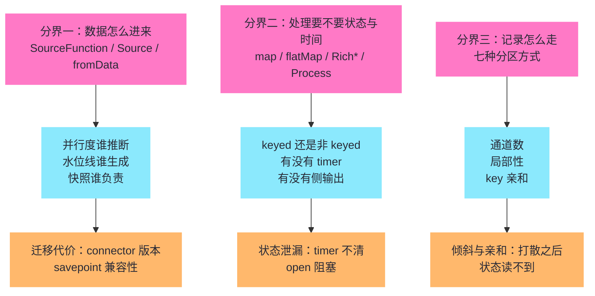
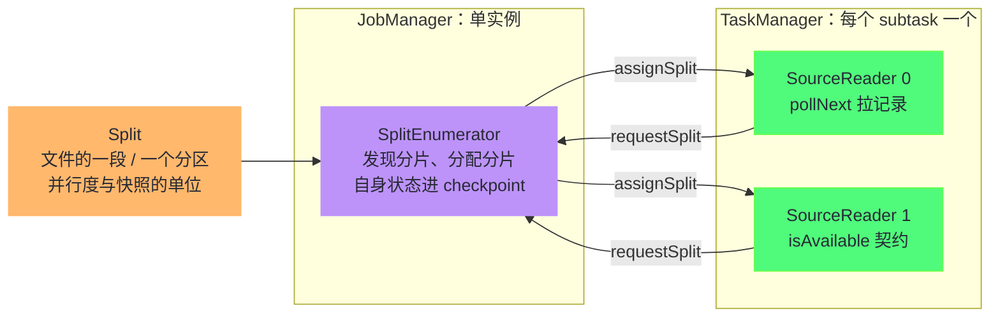
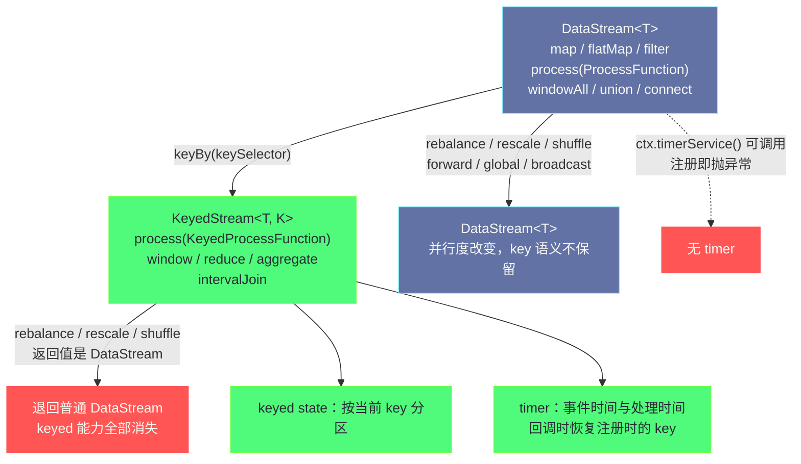
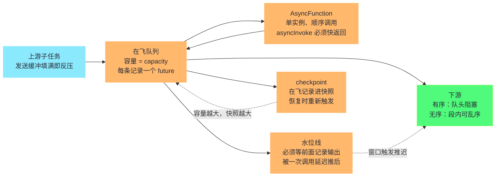
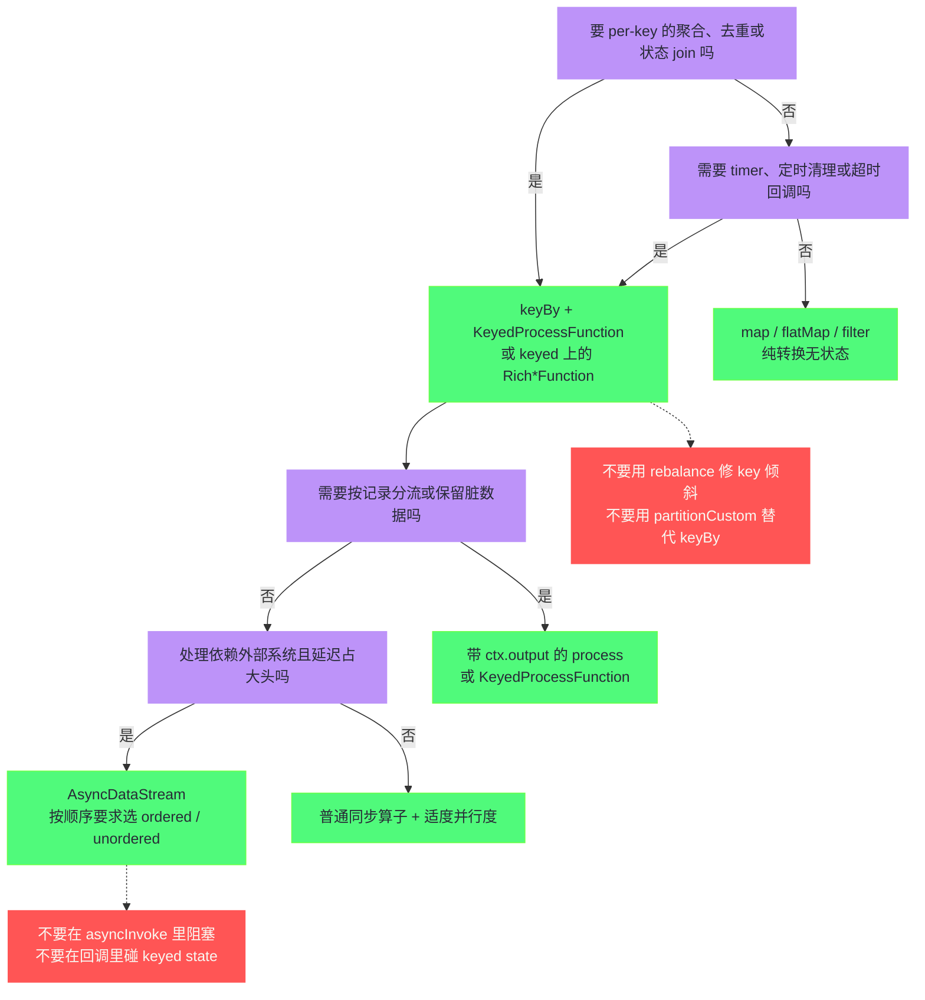

**摘要：**

DataStream API 的难点不在"有哪些算子可用"，而在同一件事往往有三四种写法，彼此的代价差一到两个数量级。本文按选型与陷阱组织，不讲 API 清单。先看 Source 的三代接口——被废弃的 `SourceFunction`、FLIP-27 的 `Source` 与 `fromSource`/`fromData`——各自把并行度、水位线、快照的责任放在哪一层，替换时又要付什么代价；再划出 `map`/`flatMap` 与 `process` 的分界，以及 `KeyedStream` 与 `DataStream` 之间那条只有跨过去才有 keyed state 与 timer 的线。随后把七种分区方式的路由语义、网络通道数与局部性摆成选型表，并讲透 `keyBy` 之后再做 `rescale`/`rebalance` 为什么会丢掉 key 亲和。后半篇处理四类"跑通了但不对"的机制：侧输出的 `OutputTag` 类型擦除与按 id 匹配、异步 I/O 的 `capacity` 与 `timeout` 如何与反压和水位线纠缠、`union`/`connect`/`coProcess` 的状态归属、`execute`/`executeAsync` 与三处 `setParallelism` 的作用域。全文收在一张从症状到处置的陷阱表上。

贯穿全篇的场景是电商实时大屏与 CDC 入湖共用一个集群，两条链路的 key 基数与访问模式正好相反，多数选型判断在这两条链路上会给出不同答案。接口行为以 Flink 1.19 与 1.20 的文档和源码为准，涉及 2.x 的差异单独标注；key group、反压链路、水位线传递这些机制细节不在此展开，按 1.2 节的链接分流到原理列。落点是一句话：**选型即分配责任**，把一致性、并行度与顺序的账交给该负责的那一层。

---

## 第 1 章 选型问题的形状

### 1.1 从 1.0 到 2.0：接口换过三轮

DataStream API 的三段式骨架——Source、Transformation、Sink——从 2016 年 Flink 1.0 起就没变过，变的是每一段的"责任边界"。第一轮变化在 Source 上：FLIP-27 把原先揉在一个 `run()` 循环里的分片发现、分片分配与记录读取拆成三份，新的 `Source` 接口配合 `env.fromSource` 进入主线，`SourceFunction` 在 1.18 被打上 `@Deprecated`，Flink 2.0 的 release notes 直接写明 `SourceFunction`、`SinkFunction` 与 Sink V1 已移除，依赖它们的旧 connector 在 2.x 上不再可用。第二轮是入口的改朝换代：`fromElements` 与 `fromCollection` 在 1.19 交给 `fromData` 接替，`addSource` 从 1.18 起被标记废弃并把使用者指向 `fromSource`，`RichFunction` 的 `open(Configuration)` 在 1.19 之后让位给 `open(OpenContext)`。第三轮才刚开始：Flink 2.0 引入了实验性的 DataStream V2（FLINK-34547），把状态、时间服务、分区从 `DataStream` 的方法上拆成显式的上下文对象。

这三轮变化的方向一致：把"谁来保证正确性"从用户的手写循环里，挪到框架的算子契约里，也就是把**一致性责任从用户挪进算子契约**。理解这一点，才能理解为什么本文讨论的陷阱大都不是"用错方法"，而是"把责任放在了不该放的那一层"。

### 1.2 本文讲什么，不讲什么

本文属于实战列，只回答两个问题：这件事该选哪种写法，以及选了之后会在哪里翻车。各接口的机制细节归原理列：key group 与状态分桶的映射、`maxParallelism` 为何不可返工，见 [[大数据/Flink/Flink原理深度解析与性能优化/05 Flink 状态后端深度解析]]；网络缓冲、反压的传播链路与 checkpoint 对齐，见 [[大数据/Flink/Flink原理深度解析与性能优化/04 Flink 网络传输与反压机制深度解析]]；水位线在算子间的传递算法，见 [[大数据/Flink/Flink原理深度解析与性能优化/07 Flink 时间与 Watermark 底层机制]]。时间语义的实务口径归 [[大数据/Flink/Flink从入门到实战/04 时间语义与 Watermark 实战]]，状态后端与恢复流程归 [[大数据/Flink/Flink从入门到实战/06 状态管理与 Checkpoint 实战]]，端到端一致性归 [[大数据/Flink/Flink从入门到实战/08 Flink 与 Kafka 端到端精确一次实战]]。本文只在机制影响选型判断时给一句结论，然后指过去。

行文里的接口行为以 Flink 1.19 与 1.20 的源码和文档为准；涉及 2.x 的差异会单独标注，标注不了的地方按"以对应版本文档为准"处理。

### 1.3 贯穿场景与三类不对称

贯穿全文的场景固定为两条链路同跑一个集群：一条是电商实时大屏，从 Kafka 读用户行为与订单事件，按用户、按商品做聚合；另一条是 CDC 入湖，把 MySQL 的 binlog 去重后写成湖表的 upsert 流。前者的特点是 key 基数不高、访问频繁、对延迟敏感；后者的特点是 key 基数随主键增长、每条记录只碰一两次状态、对吞吐敏感。

选型难，难在三类不对称。

一是代际不对称。同一种数据源有三种写法，新旧接口的能力与生态支持不在同一水平线上，混用时最麻烦的不是编译错误，而是"能跑但 checkpoint 恢复不了"。

二是上下文不对称。`DataStream` 与 `KeyedStream` 差一个字，能力差一整套：keyed state、timer、窗口、interval join 全在后者身上。而分区操作会把后者降级成前者，降级是静默的——它不丢数据，只丢能力。

三是并发模型不对称。同步算子、异步算子、广播流、侧输出，四者的"顺序"承诺各不相同，而顺序一旦被打破，业务上通常表现为"结果偶发不对"，而不是报错。

下图把本文的十章压成一条主线：三次分界，每一处都是一次责任的分配。

这张图的读法是：每一条分界都同时产出"能力"与"账单"，选型就是决定把账单记在哪一栏。

---

## 第 2 章 Source 的三代写法与迁移代价

### 2.1 SourceFunction：把一致性交给用户

`SourceFunction` 的契约只有两条：`run(SourceContext)` 里循环发数据，`cancel()` 被调用后必须跳出循环。所有麻烦都在契约之外。

第一条麻烦是并行度。`env.addSource(...)` 建出的流默认并行度是 1，只有实现 `ParallelSourceFunction` 或继承 `RichParallelSourceFunction` 时才按环境并行度并行。这个约定靠**类层次推断**，忘了实现接口，作业不报错，只是永远只有一个 source 子任务在跑，上游一个分区消费、下游一堆子任务空等。

第二条麻烦是一致性。`SourceFunction` 的 javadoc 把话说得很直白：实现了 `CheckpointedFunction` 的 source 必须自己保证"状态快照、内部状态更新、元素发射"这三件事不并发，办法是在 `ctx.getCheckpointLock()` 上加同步块。也就是说，offset 与水位线的正确性由用户手写锁来维护，框架只在旁边递一把锁。`StreamSource` 在运行时确实把任务的锁对象交给了 source context，`collect()` 与 `emitWatermark()` 都在这把锁上同步；`run()` 里一旦持锁阻塞，被挡住的不只是数据处理，还有 checkpoint 的同步阶段。

第三条麻烦是分片。分区的发现、分配、再均衡全在 `run()` 里手写，Kafka 加分区要重启作业，文件目录新增文件要自己扫，有界与无界两种语义也得自己约定。

这三条合起来，就是 1.18 给它加 `@Deprecated`、2.0 直接移除的理由。

### 2.2 FLIP-27：把职责拆成三份

新接口的拆法是把"数据的切分单位"提升为一等概念。

`Source` 本身退化成一个工厂：产出枚举器、读取器，以及两个序列化器（分片序列化器与枚举器 checkpoint 序列化器），外加一个 `getBoundedness()` 声明这条流有界还是无界。真正的逻辑在枚举器和读取器里，两者的 checkpoint 也分别落在 JobManager、TaskManager 两侧。

拆开之后有三件事变得自然。分片分配不再是 source 内部的私事，枚举器可以周期性地重新列一遍目录或分区，把新分片派给空闲的读取器——这就是动态分区发现。分片本身是可序列化的对象，checkpoint 时只需记录"我读到了哪些分片、每个分片读到哪"，不必把整个消费逻辑塞进状态。水位线也可以下沉到读取器一侧，按分片粒度维护。

### 2.3 fromSource 与 fromData 的用法边界

`env.fromSource(source, watermarkStrategy, sourceName)` 是新接口的入口，第三个参数是算子名，会出现在 Web UI 与线程名里，别随手写 "source"。第四个重载允许显式传入 `TypeInformation`，用于 source 自己推不出输出类型的场景，它带着 `@Experimental` 标注。

`env.fromData(...)` 是 1.19 为替代 `fromElements` 与 `fromCollection` 引入的，源码里它的实现是把集合包成 `FromElementsGeneratorFunction`，再交给 `DataGeneratorSource`，最后调 `fromSource(...)` 并把并行度**钉死为 1**。所以它其实已经走在新接口上了，这也是为什么它不接受大于 1 的并行度：`DataStreamSource` 内部的 `isParallel` 为假，`setParallelism(2)` 会在构建期被校验拒掉。

两个入口的分工很清楚：`fromData` 只用于测试与小的有界数据集，参数化生成速率、并行消费这类事都不归它管；真实数据源一律 `fromSource` 加官方 connector。

### 2.4 新接口换来的四件事

第一件是并行度的表达方式。`fromSource` 建出的 `DataStreamSource` 的 `isParallel` 恒为真，并行度取环境值，`setParallelism` 走统一校验；旧接口则要靠标记接口推断，默认值是 1。这个差别在团队协作里格外刺眼：自定义 source 若继承的是 `RichSourceFunction` 而不是 `RichParallelSourceFunction`，并行度就退化为 1，监控上只会看到"有一个 source 子任务 100% 忙"，而不是报错。

第二件是**水位线归属**。`fromSource` 接收一个 `WatermarkStrategy`，这个策略不是被塞到下游的独立算子，而是被交给 source 算子本体：`SourceOperator` 持有策略、按 `autoWatermarkInterval` 周期性推进，内部还维护一张"每个分片当前水位线"的表，配合水位线对齐（watermark alignment）在某个分片跑得太快时暂停它。旧写法里 `assignTimestampsAndWatermarks` 是下游的独立算子，它看到的是合并后的流，分片边界已经消失，想让慢分片不拖住全局水位线，只能靠 `withIdleness` 这类近似手段。

第三件是 **`isAvailable()` 契约**。读取器不阻塞线程，而是返回一个 `CompletableFuture`：数据可读时该 future 完成，运行时据此决定何时调用 `pollNext`。契约原文允许"偶发的假阳性"，即没有数据时也完成 future；但如果永远返回已完成的 future，就会退化成忙等，`pollNext` 被反复空转调用。这条契约的价值在于把"等数据"从线程阻塞变成状态机推进，任务线程始终能处理 checkpoint、timer 与邮件。

第四件是有界与无界的统一。`Source#getBoundedness()` 声明这条流是 `BOUNDED` 还是 `CONTINUOUS_UNBOUNDED`，运行时据此选择批式或流式执行路径；同一个 `FileSource` 不调 `monitorContinuously` 就是有界，调了就是无界，不需要用户在环境上切换运行模式。

| 维度 | `SourceFunction` | FLIP-27 `Source` | `fromData` |
| --- | --- | --- | --- |
| 并行度来源 | 是否实现 `ParallelSourceFunction`，默认 1 | 取环境并行度，`setParallelism` 受校验 | 固定为 1 |
| 水位线在哪生成 | source 内部手写 `emitWatermark` | source 算子内按策略生成，可分片跟踪 | 内部用单调递增策略 |
| 快照责任 | 用户用 `getCheckpointLock()` 手工保证 | 读取器状态与枚举器状态分别托管 | 无状态 |
| 动态发现分片 | 不支持，需重启 | 枚举器周期重扫即可 | 不适用 |
| 代码量 | 一个类、两个方法 | 三个类加两个序列化器 | 一行 |
| 2.x 状态 | 已移除 | 主线 | 主线 |

### 2.5 迁移代价与过渡期的选择

迁移不是改写一个类那么简单，代价集中在三处。

其一是代码量。自定义 source 要写 `Split`、`SplitEnumerator`、`SourceReader` 三个实现，外加分片与枚举器两个 `SimpleVersionedSerializer`；如果源本身没有"可切分"的概念（譬如一个只能全量拉取的 HTTP 接口），还得先造一个分片模型，否则并行度永远是 1。

其二是状态兼容。两类接口在 checkpoint 里记录的 operator state 结构不同，从旧 consumer 的 savepoint 直接恢复到新 source，offset 接不上；实务上的做法是记下旧作业的最新位点，用 `OffsetsInitializer` 从该位点重启新作业，而不是迁移状态。切换窗口内要接受短暂重复消费，靠下游去重或幂等写入兜住。

其三是生态窗口。Flink 1.x 的维护期内，`SourceFunction` 还能用（1.18、1.19 只是告警加废弃），但 2.x 之后所有依赖它的 connector 都不能用，官方在 2.0 的适配计划里点名了 Kafka、Paimon、JDBC、Elasticsearch 等一批。停在 1.x 的作业可以缓，规划升 2.x 的作业则没有第二条路。

过渡期的判断可以简化成一句：只要还在 1.18 以上，新写的 source 一律走 `Source`；已有的 `SourceFunction` 不动，但把它当作 2.x 升级清单上的一项技术债登记。

---

## 第 3 章 处理算子的分界：map、flatMap 与 process

### 3.1 能力矩阵

`map`、`flatMap`、`filter` 三个算子共用一套能力边界：一条记录进来、零到多条出去，不能读记录的时间戳，不能访问状态，不能往侧输出写东西。`Rich*Function` 在此之上加了生命周期与运行时上下文，因此可以拿 keyed state（前提是处在 keyed 上下文里），也可以读 `RuntimeContext` 里的并行度、子任务编号、累加器。`ProcessFunction` 再往上，多了三样：逐条记录的 `ctx.timestamp()` 与 `ctx.currentWatermark()`、`ctx.output(tag, value)` 侧输出、以及 keyed 版本才有的 timer。

| 能力 | `map`/`flatMap`/`filter` | `Rich*Function` | `ProcessFunction`（非 keyed） | `KeyedProcessFunction` |
| --- | --- | --- | --- | --- |
| 一进多出 | 支持 | 支持 | 支持 | 支持 |
| 生命周期 `open`/`close` | 无 | 有 | 有 | 有 |
| 读记录时间戳 | 无 | 无 | 有 | 有 |
| keyed state | 无 | keyed 上下文可用 | 不可用 | 可用 |
| timer | 无 | 无 | 注册即抛异常 | 可用 |
| 侧输出 | 无 | 无 | 有 | 有 |
| 典型用途 | 清洗、投影 | 带外部资源的转换 | 分流、打时间戳记号 | 超时、去重、会话切分 |

表格里非 keyed 那一列容易被误读：`ProcessFunction` 能读时间戳、能写侧输出，但注册 timer 会直接抛 `UnsupportedOperationException`——这一层保护写在算子的 `Context` 实现里，四种注册与删除方法一律抛异常，不在运行期悄悄忽略。

### 3.2 必须用 ProcessFunction 的四条判据

第一条，需要 timer。事件时间上的"超时未支付就关单"、"同一用户 30 分钟无行为就切会话"、"去重窗口内重复就丢弃"，本质都是"在未来某个时刻回调一次"，只有 timer 能做。而且 **timer 只在 keyed 上下文里存在**，这条判据同时决定了流的类型：`keyBy` 之后才能用。事件时间 timer 的触发条件值得先讲清楚：它只在水位线推进到注册的时间戳时才回调，水位线停住，超时逻辑就整体失灵，这条耦合在多输入链路里会被放大（见 6.2）。

第二条，需要在回调里动状态。`onTimer` 触发时，框架会把当前 key 重新置为注册 timer 时绑定的那个 key，因此可以在回调里读写该 key 的状态；这个语义是非 keyed 算子给不了的。

第三条，需要侧输出。`flatMap` 想丢脏数据只能不调 `collect()`，丢掉了就找不回来；要用侧输出把脏数据留下，得用带 `ctx.output()` 的算子。

第四条，需要把上述三件事与逐条处理揉在一起。业务上最常见的是"每条记录更新状态并注册 timer，timer 触发时检查状态决定是否输出"——这条链路只能在一个 `KeyedProcessFunction` 里写完，拆到多个算子会引入额外的序列化与网络跳数。

反过来，只有状态没有时间时，`Rich*Function` 就够了。`keyBy(userId).map(new RichMapFunction(...))` 里的 `getRuntimeContext().getState(...)` 完全合法，因为经过 `keyBy` 之后算子处在 keyed 上下文，只是它的静态类型仍是 `DataStream`，拿不到 `window` 与 timer。这类写法在只需要一个累加器的场景里比 `ProcessFunction` 少一半样板代码。

### 3.3 RichFunction 的 open 里不该做的事

`open()` 在每个子任务启动时调用一次，是初始化外部连接的正确位置，但它跑在任务线程上，而这个线程同时负责处理 checkpoint、timer 与邮件。在里面做长阻塞调用，后果是三重的：任务启动阶段就长时间不响应心跳，TaskManager 可能判定任务失联；checkpoint 无法触发，恢复窗口被拉长；每个子任务各做一次，连接数与初始化流量按并行度成倍放大。

1.19 之后这里还有一个版本敏感的细节：`RichFunction` 新增了 `open(OpenContext)`，旧的 `open(Configuration)` 退居其后，默认实现会把前者转调后者；两个都实现时只调新的，新的实现里不调 `super.open()`，旧的就不会被执行。升级 1.18 到 1.19 时如果初始化逻辑只写在 `open(Configuration)` 里，行为还能保持；但一旦有人顺手改成 `open(OpenContext)` 且没把逻辑搬过去，连接池就再也不会被创建，表现为运行期空指针。

`open()` 里该做的是建连接、注册状态描述符、读取配置；不该做的是全量装载维度表、跑一次长查询、等待远端服务就绪。后者的正确位置是数据流本身：把维度快照做成一条有界流再 `broadcast` 成广播状态，或者交给异步 I/O 按需查询。

### 3.4 反例：用 map 维护一份私有缓存

一个常见的写法是在算子里挂一张 `HashMap` 当缓存：`private final Map<String, Long> cache = new HashMap<>()`，`map()` 里先查缓存，未命中就查库并回填。

这条路上有四个坑，按发现难度排序。第一，这张 map 不在 checkpoint 里，作业重启后缓存清空，重启瞬间的查询量会打到外部库；第二，扩缩容后 key 到子任务的映射变了，原本命中的缓存全部失效，命中率断崖式下降，而外部库的容量是按稳态配的；第三，map 没有淘汰策略，key 基数一涨就是堆增长，最终 OOM；第四，`close()` 里没人清它，长时间运行后它成了事实上的状态，却既不参与 TTL，也不参与快照。

正确的做法是把"缓存"变成一等状态：keyed 上下文里的 `ValueState` 或 `MapState`，配上 `StateTtlConfig` 的过期策略；如果要按时间主动失效，就把状态与 timer 一起用，注册 timer、在 `onTimer` 里清值。这样缓存参与 checkpoint、随并行度重新分配、有明确的容量与生命周期。

---

## 第 4 章 KeyedStream 与 DataStream：一条编译期划出的线

### 4.1 类型层次里的能力裁剪

`KeyedStream` 是 `DataStream` 的子类，但它并没有重写那些分区方法。`rebalance`、`rescale`、`shuffle`、`forward`、`global`、`broadcast` 全部定义在 `DataStream` 上，返回类型也是 `DataStream<T>`。所以在 `keyBy` 之后再调其中任何一个，得到的是一个普通 `DataStream`，`window`、`sum`、`reduce`、`process(KeyedProcessFunction)`、`intervalJoin` 这些方法立刻从方法补全里消失。

这不是设计疏漏，是刻意的**能力裁剪**。分区方式与 keyed 语义在数学上互斥：keyed 的前提是"同 key 必到同一实例"，而轮询、随机、广播都在破坏这个前提。类型系统把这个矛盾提前到编译期，代价是链式调用被打断，收益是省掉了一类运行期才暴露的错误。

### 4.2 运行期才出现的两样东西

过了这条线，运行期多出两样东西。

一是 keyed state。算子通过 `getRuntimeContext().getState(descriptor)` 拿到状态句柄，读写自动落在"当前 key"的空间上；框架在处理每条记录前把当前 key 设为该记录的分区 key，所以同一段代码对每个 key 各自维护一份值。非 keyed 上下文里调同样的接口会抛异常，因为根本没有**当前 key 的概念**。

二是 timer service。`ctx.timerService()` 在 keyed 上下文里可以注册事件时间与处理时间 timer，回调时当前 key 被恢复为注册时的 key。非 keyed 的 `ProcessFunction` 里 `timerService()` 方法能调到，但注册与删除四个方法全抛 `UnsupportedOperationException`——调用点在业务代码里，堆栈一眼能看出来。

下图把两条线摆在一起：左边是非 keyed 分支，右边是 keyed 分支，分叉点就是一次 `keyBy`，分叉之后能做的事完全不同。

### 4.3 keyBy 的代价与它不提供的保证

`keyBy` 是一次网络分区：记录按 key 的哈希落到 key group，再按每个子任务负责的 key group 范围路由。如果上下游并行度相同且中间没有别的分区算子，Flink 未必真的走网络（存在链化与本地转发的优化），但只要并行度有变化，就是实打实的一次 shuffle。

它不提供三样东西，另有一条前置条件需要先满足。它不提供状态：`keyBy` 本身不创建任何状态，状态是后续算子在 `open()` 里声明描述符之后才有的，"keyBy 之后就有状态"是把类型变化误当成状态变化。不提供本地性：同一个 key 的记录在分区前后可能不在同一个物理节点，key 亲和是"同 key 到同一子任务"，不是"同 key 到同一机器"。不提供负载均衡：key 的哈希分布天然倾斜，热点 key 会把一个子任务打满，而其余子任务空闲。

那条件写在 key 上：同一个业务 key 每次运行时算出的哈希必须一致。用 POJO 做 key 时，若 `hashCode` 依赖的字段包含可变状态、时间戳或自增序号，重启前后同一个业务 key 会落到不同子任务，恢复出来的状态就对不上；用 `Object` 默认的 `hashCode` 更糟，它基于内存地址，跨进程不可能稳定。key 的序列化与 key group 归属机制见原理列的 05 篇，实务上只需记住一句：key 用不可变、字段齐全、哈希稳定的类型，别把整个实体对象直接当 key 用。

### 4.4 三种"以为有状态"的误判

第一种，`keyBy` 之后没声明状态却以为有状态。这类作业在并行度 1 时能跑对（所有 key 都在同一个子任务），一提并行度就错，因为代码实际上依赖了"整个作业只有一份内存"的假象。

第二种，`KeyedStream` 上用了 `RichMapFunction` 并访问了 `ValueState`，但状态描述符在 `open()` 里用局部变量声明、没有保存成字段。第二次调用时 `getState(descriptor)` 又建了一个新描述符，虽然 Flink 会按名字复用底层状态，但每条的重复注册在堆后端上会带来不必要的查找开销，更麻烦的是这种写法掩盖了状态的存在，让后来者以为这里是"无状态转换"。

第三种，把 `union` 之后的状态当成原有 keyed 流的延续。`union` 返回普通 `DataStream`，两个输入的 keyed 语义在这里被丢弃；要恢复，必须重新 `keyBy`，而那意味着再一次全量 shuffle 与状态重建。

---

## 第 5 章 分区方式选型：七种路由的性质与代价

### 5.1 一张表看完七种路由

分区方式决定了"上游子任务的第 i 条输出，去下游哪个子任务"。七种内置方式加一种自定义，性质差别很大。

| 方式 | 路由规则 | 数据分布 | 网络通道 | key 亲和与局部性 | 典型用途 | 误用后果 |
| --- | --- | --- | --- | --- | --- | --- |
| `keyBy` | key 哈希 → key group → 子任务 | 按 key 倾斜 | U×D（按 key group 实际映射） | 保留，同 key 必同实例 | 有状态聚合、去重、窗口 | 热点 key 打满单实例 |
| `rebalance` | 全局轮询 | 均匀 | U×D | 无，全局连通 | 无状态的均匀分摊 | 之后仍按 key 做状态，全错 |
| `rescale` | 局部轮询 | 组内均匀 | 约 U×D/k，k 为并行度倍数 | 无，仅连接是局部的 | 上下游成倍数、无 key 语义的扩缩 | 同上 |
| `shuffle` | 随机 | 概率均匀 | U×D | 无 | 无状态的随机分摊 | 均匀性与顺序都不可控 |
| `broadcast` | 复制给所有下游 | 每份复制 D 次 | U×D，每条 D 份 | 无，每条复制 D 份 | 配置、规则、小维度表 | 大表广播打爆内存与网络 |
| `forward` | 同下标直连 | 不变 | 同下标直连，通常为 0 | 无，按下标直连 | 并行度一致的逐元素处理 | 并行度不同时建图报错 |
| `global` | 全部到 0 号 | 全压一个实例 | U×1 | 无，全部集中到 0 号 | 单点合并、写单文件 | 下游并行度形同虚设 |
| `partitionCustom` | 自定义 | 自定义 | 视分区器 | 视分区器 | 特殊业务分桶 | 当成 keyBy 用，状态错乱 |

### 5.2 通道数与局部性

通道数是选型里最容易被忽略的成本。`rebalance` 让每个上游子任务与每个下游子任务之间都有一条逻辑通道，U 个上游、D 个下游就是 U×D 条；`rescale` 把下游切成若干组，每个上游只跟自己那一组通信，通道数降到原来的 1/k 左右，上下游成整数倍关系时最明显。

`forward` 是唯一不产生网络传输的方式：同下标直连，如果两个算子还能链化到一个任务里，连缓冲与序列化都省掉。它的代价是刚性——`forward()` 要求上下游并行度一致，不一致时建图阶段直接抛 `UnsupportedOperationException`，错误信息里会带上上下游算子名与各自的并行度。这条硬约束其实说明了一件事：不指定分区器时，Flink 在并行度相同时默认就用 `forward`，并行度不同才自动退化为 `rebalance`。也就是说，多数作业里那条"看不见的分区"是框架替你选的，只有并行度一变，它才变成一次真正的 shuffle。

`global` 把流量全压到 0 号子任务，下游并行度在这里失效；它只适合"必须单点"的场景，譬如把分片后的结果合并成一个文件，或者写一个不支持并发的下游。把它当成"保证顺序"的手段是一种误解：它确实让全局有序成为可能，代价是整条链路退化成单线程。

### 5.3 什么时候该用哪个

判断顺序可以简化为三问。

第一问，业务是否依赖 key 语义。依赖（要做 per-key 聚合、去重、会话、状态 join）就只能是 `keyBy`，其余六种都不行。

第二问，下游是否有状态。没有状态时，`rebalance` 与 `shuffle` 可以用来打散倾斜，前者轮询、确定性更强，后者随机、实现更轻；有状态时打散等于把状态打散，除 `keyBy` 之外的选择都会让"同 key 同实例"不成立。

第三问，数据是"分发"还是"复制"。`broadcast` 是复制，每条记录发 D 份，只适合小体量的配置与规则；把它用在大维度表上，网络与堆会同时告警。

`partitionCustom` 要单独说一句：它属于"分发"类，返回的是普通 `DataStream`，不承担任何 keyed 语义。用它模拟 `keyBy`（譬如自定义分区器按 key 取模）在数据量小时看不出问题，一旦并行度变化或分区器与 key group 假设不一致，下游状态就会读错分区。它能解决的问题是"按业务维度分桶"（譬如把大客户单独分到一个子任务），不是"替代 keyBy"。

### 5.4 keyBy 之后再做 rescale 或 rebalance

这是本篇最需要讲透的一处，因为它有四种不同的表现形式，前两种在编译期，后两种在运行期。

第一种，直接链式调用。`keyBy(...).rebalance()` 的返回值是 `DataStream`，写法上合法，但之后想再 `sum()` 或 `process(KeyedProcessFunction)` 就编不过。这是最幸运的情况：类型系统把错误挡在了构建阶段。

第二种，重新 `keyBy` 补齐。`keyBy(k).rebalance().keyBy(k)` 能编过，运行期也"看起来正常"，但它做了两次分区：第一次按 key 哈希，第二次把已经打散的记录重新按 key 哈希。第一跳完全没有必要，纯属多一次网络往返与序列化；如果第一跳之后还夹着有状态算子，那个算子的状态是按第一跳的 key group 建的，第二跳之后同一个 key 落到另一组子任务，**下游永远读不到上游那个 key 的状态**——这不是缺陷，状态本来就不跨算子共享，但很多"想用状态做 join"的设计正是栽在这里。

第三种，自定义分区器。有人为了修热点，把 `keyBy` 换成 `partitionCustom`，让分区器按 key 前缀分桶，再在下游用 keyed 状态。问题在于 `partitionCustom` 之后就不是 keyed 流了，keyed 状态根本不可用；如果硬用 `RichMapFunction` 加 `getRuntimeContext().getState(...)`，运行期会抛"只能在 keyed stream 上使用"的异常。

第四种，`connect` 之后。`keyedStream.connect(other)` 返回 `ConnectedStreams`，原先的 keyed 上下文在这里被丢掉；要恢复，得在 `ConnectedStreams` 上再 `keyBy(keySelector1, keySelector2)`，然后才可以用 `KeyedCoProcessFunction`。

四种形式背后的机制是同一句：**key 亲和不是记录的属性**，而是"分区器 + key group 范围"共同决定的运行期事实。key group 如何映射到子任务、并行度变化时如何重切，见 [[大数据/Flink/Flink原理深度解析与性能优化/05 Flink 状态后端深度解析]]；本文只强调结论——任何绕过 `keyBy` 的路由，都不会替你维护这个事实。

### 5.5 反例：打散之后仍指望 key 亲和

一个真实的排查形态是这样的：作业在大屏链路上按 `userId` 聚合，监控发现某个子任务 CPU 是其他的三倍，于是有人在 `keyBy` 之前加了一个 `rebalance` 试图均摊。

结果有两个。CPU 倾斜没有缓解，因为 `keyBy` 的哈希分区在 `rebalance` 之后重新决定落点，热点 key 依旧集中到一个子任务，`rebalance` 只是把"进 keyBy 之前"的流量摊平了，而热点是 key 维度的属性，不是流量维度的。更糟的是，如果这个 `rebalance` 被加在了 `keyBy` 之后（重新 `keyBy` 补齐的那种写法），中间那个有状态算子会开始读到空状态，业务表现为"每个子任务各自算出一份不完整的累计值"，而且重启后数值会跳变，因为恢复时的分区映射与故障前不同。

判据分两层。先对比该算子各子任务的 keyed state 大小与输入记录数：输入均匀而状态大小差异很大，说明倾斜在 key 维度，打散流量没有用；再看业务侧同一个 key 的累计值是否在多个子任务各出现一份，若是，说明分区在中途被改写过，一份状态被拆成了几份。处置是给热点 key 加盐做两阶段聚合，或者把"热点单独链路"与"长尾聚合链路"拆开，而不是再插一个分区算子。

---

## 第 6 章 多流合并：union、connect 与 coProcess

### 6.1 语义差异

三条路都能把两条流"放在一起处理"，但合并的层次完全不同：`union` 合并的是数据，`connect` 合并的是算子，`coProcess` 是后者的处理函数。

| 维度 | `union` | `connect` | `coProcess` 家族 |
| --- | --- | --- | --- |
| 流类型 | 必须相同 | 可以不同 | 随 `connect` |
| 流数量 | 2 条及以上 | 恰好 2 条 | 恰好 2 条 |
| 合并结果 | 一条 `DataStream` | `ConnectedStreams`，不合并数据 | 同 `connect` |
| 状态共享 | 不涉及，合并后是一条流 | 同一算子实例，两个方法共享状态 | 同 `connect` |
| keyed 语义 | 丢弃，要重新 `keyBy` | 丢弃，要 `ConnectedStreams.keyBy` | 只有 `KeyedCoProcessFunction` 有 |
| 水位线 | 各输入分别推进，输出取最小 | 同 `union` | 同 `union` |

### 6.2 union 的水位线短板

`union` 之后，下游算子对每个输入分别跟踪水位线，自身水位线取所有输入的最小值。于是任何一条输入空闲，整条链路的水位线就被钉住：窗口不触发、timer 不回调、`onTimer` 里的清理逻辑不执行，表现为"数据在流但结果不出"。

这个问题在"多 topic 汇总"的场景里很常见：某个 topic 白天有流量、夜里没有，夜间窗口全部卡住。解法有两个层次：算子层面用 `WatermarkStrategy.withIdleness`，把超过阈值没有数据的分区标记为空闲，暂时不参与最小值计算；架构层面把"必须常驻的输入"和"可能空闲的输入"分开处理，空闲那条用 `connect` 加广播状态，而不是并到主流里。

需要注意 `withIdleness` 的语义：它把分片标记为空闲，前提是水位线生成器能知道分片边界，这也是新 Source 接口把水位线生成下沉到 source 内部的原因之一。

### 6.3 connect 的真实用途

`connect` 解决的是"两条流需要共享同一份算子状态"的问题，最典型的是规则流驱动事件流：事件流高频，规则流低频，规则更新后要对后续事件立刻生效。

这种模式下，`connect` 的价值不在"合并"，而在**同一算子实例**。两个处理方法读写同一份状态，规则流写、事件流读，中间不需要网络与序列化。如果用 `union` 拼成一条流再按类型分派，两条流的类型必须相同（通常退化成一个 `Object` 包装类），并且每次规则更新都要经过一次完整的分区与反序列化。

代价要说清楚：`connect` 产生的算子只有一个并行度，两条输入若并行度与算子不同，Flink 会在输入边上补一次分区，等于连接前各自多一次 shuffle，省不掉网络；所以实务上通常让两条流与算子的并行度保持一致。两边的水位线在算子内部各自维护，如果两边的数据量差异极大，算子的推进节奏会按更慢的那一边走。

### 6.4 coProcess 的状态归属

`CoProcessFunction` 与 `KeyedCoProcessFunction` 的差别只有一处，但这一处决定能不能用 timer 与 keyed state。前者的 `processElement1` 与 `processElement2` 拿到的 `Context` 里没有可用的 timer service，也拿不到 keyed state，能用的只有 `CheckpointedFunction` 那套 operator state；后者的两个方法与 `onTimer` 都可以读写当前 key 的状态。

要用后者，`ConnectedStreams` 必须已经 keyed：`stream1.connect(stream2).keyBy(k1, k2).process(new KeyedCoProcessFunction(...))`。之所以要传两个 keySelector，是因为两条流的 key 提取逻辑可以不同，但提取出来的 key 必须落在同一个 key group 空间里，否则同一子任务上两个输入看到的"当前 key"对不上。

广播连接这一支还有一个普通 `connect` 给不了的能力：`KeyedBroadcastProcessFunction` 的 `applyToKeyedState` 可以在广播规则更新时对所有 key 的状态做一次遍历修正（譬如风控规则的阈值变了，要把所有 key 的判定结果重算）。它只存在于 `BroadcastConnectedStream`，普通 `connect` 没有这个入口。

### 6.5 两个常见写错

第一个是 `union` 之后忘记重新 `keyBy`。两条 keyed 流 `union` 之后得到的是普通 `DataStream`，直接接 `sum()` 编不过；接了 `map` 之后想用状态，运行期才报错。补 `keyBy` 是对的，但要意识到那是一次额外的全量 shuffle。

第二个是 `connect` 之后直接用 `KeyedCoProcessFunction`。`connect` 本身不建立 keyed 上下文，只有 `ConnectedStreams.keyBy` 才会；少了这一步，运行期的表现是状态后端为空，`getRuntimeContext().getKeyedStateStore()` 拿到的不是你以为的那个，抛出的是"keyed state 只能在 keyed stream 上使用"这一类异常。

---

## 第 7 章 侧输出：类型擦除与按 id 匹配

### 7.1 一条记录两个出口

侧输出让一个算子在处理同一条记录时，把结果分到不同的下游流：正常数据进主流，解析失败的原始串进侧输出流，超时的记录进另一条。它替代了已移除的 `split()`，也是处理脏数据的标准做法——**不是丢弃，而是分流**并留下可追溯的原始数据。

写法上只有两个动作：算子内部 `ctx.output(tag, value)` 写，下游用 `mainStream.getSideOutput(tag)` 取。两个动作里的 `tag` 是同一个 `OutputTag` 实例，匹配就靠它。

### 7.2 为什么必须写匿名子类

`OutputTag<T>` 的构造器里有一行关键代码：`TypeExtractor.createTypeInfo(this, OutputTag.class, getClass(), 0)`。它拿运行时的实际类去解析泛型参数——只有写成 `new OutputTag<String>("parse-error") {}`，实际类才是 `OutputTag` 的匿名子类，类型参数 `String` 才留在字节码的签名里，才能被解析成 `TypeInformation`。

不写那对花括号，`getClass()` 返回的就是 `OutputTag.class` 本身，泛型参数在运行期已被擦除，解析必然失败，抛 `InvalidTypesException`。异常信息里写得很明白：最常见的原因是忘记把 `OutputTag` 写成匿名内部类，其次是不能用泛型变量（`new OutputTag<T>(id) {}` 同样失败，因为 `T` 在运行期是类型变量而不是具体类型）。

这个错误的形态是"构造期就炸"，比运行期丢数据好排查得多，但它的位置很尴尬：`new OutputTag<...>(...)` 通常写在类的静态字段里，异常会在作业提交阶段随类初始化一起出现，堆栈指向那一行静态初始化，与业务逻辑离得很远。

### 7.3 getSideOutput 的匹配规则

`OutputTag` 的 `equals` 与 `hashCode` 只用了 `id` 字段，类型信息不参与比较。这带来两个后果。

好消息是匹配很宽松：只要 id 相同，两个分别 `new` 出来的 `OutputTag` 实例就能对上，不必把同一个对象在算子与下游之间传递——上下游各自声明一个同 id 的 tag 是可行的。

坏消息是 **id 成了唯一的身份**。`getSideOutput` 内部维护了一张"已请求过的侧输出"表，键是 tag、值是类型信息；同一算子上用同一个 id 请求了不同的类型，会直接抛 `UnsupportedOperationException`，提示"同 id 的侧输出已用不同类型请求过，侧输出 id 必须唯一"。这条检查只覆盖同一算子，跨算子复用同 id 是允许的，因为侧输出的作用域是算子级。

另一条容易忽略的规则是取侧输出的位置：`getSideOutput` 必须挂在**产出该侧输出的那个算子**上。侧输出不属于整条流，它属于某一次算子调用的输出缓冲；在 `mainStream.map(...)` 之后调用 `getSideOutput(tag)`，取到的是 `map` 这个算子的侧输出，而 `map` 从来没写过侧输出，于是拿到的是一条空流或者运行期报错，取决于版本与类型检查。

### 7.4 代价与适用边界

侧输出的直接开销不大：记录走的仍是同一算子的输出缓冲，只是被贴了一个标签，下游多一条逻辑边、多一次序列化。真正的成本在拓扑形状上：每多一条侧输出，算子就多一个下游、多一组网络缓冲；侧输出超过三四条之后，Web UI 上的拓扑会变得难以阅读，checkpoint 的元数据也会随之膨胀。

因此它适合"主流之外的一两条支流"：脏数据、迟到数据、异常记录。不适合当数据总线用——如果需要把一个流按业务类型拆成七八条，正确的位置是前面的 `keyBy` 与下游多个算子，或者干脆在 Sink 侧按类型写不同的目标，而不是在一个算子上挂八条侧输出。

---

## 第 8 章 异步 I/O：吞吐、顺序与背压的三角

### 8.1 吞吐是怎么来的

同步访问外部系统时，算子线程的时间几乎全花在等响应上。假设单次查询平均 20ms、每秒钟能处理 50 条，那么一个子任务的吞吐上限就是 50 条每秒，算子线程 99% 的时间在等 IO。

异步 I/O 把这些等待重叠起来：一个子任务同时挂起 `capacity` 个在飞请求，吞吐的上限变成 `capacity / 平均延迟`。`capacity` 取 100、平均延迟 20ms 时，上限约 5000 条每秒每子任务（示例推算，忽略序列化与调度开销），比同步写法高两个数量级。

提高并行度也能达到同样的吞吐：要 5000 条每秒，同步写法需要约 100 个子任务（示例推算）。但这 100 个子任务意味着 100 个算子实例、100 份到数据库的连接池、100 组网络缓冲，而数据库侧的连接数往往才是真正的瓶颈。异步 I/O 用"单线程多并发"换掉了"多线程多连接"，这是它在资源账上更划算的原因。

关键前提常被忽略：`AsyncFunction` 只有一个实例，对每个子任务的记录**单实例顺序调用**，不会多线程并发进入。异步效果完全来自 `asyncInvoke` 快速返回、把结果交给回调；一旦在 `asyncInvoke` 里调 `.get()` 等待结果，或者在回调里做重活，异步就退化成同步，而且占住了唯一的调用线程。另有一条拓扑约束：异步算子不能被链到 source 上，source 子任务与它之间必然隔着一次网络传递，估算容量与端到端延迟时要把这段缓冲算进去。

### 8.2 两种顺序模式

`AsyncDataStream.unorderedWait` 与 `orderedWait` 的差别不只是"顺不顺序"。

有序模式的实现是一个按插入序排列的队列：队头记录的结果没回来，后面的记录就算先完成也不能发，必须等。这带来两件事：一条慢查询会阻塞它后面所有记录的输出，延迟被放大到"最慢的那条"；同时记录在队列里停留的时间变长，checkpoint 时需要保存的在飞记录更多。

无序模式按完成顺序输出，但它对水位线依然保持秩序：同一段水位线之内的记录可以互相超越，水位线不能越过记录，记录也不能越过水位线。换言之，"无序"只在两个水位线之间成立；如果水位线很密（`autoWatermarkInterval` 很小），无序模式的开销会向有序模式靠拢，因为每条水位线都要等它前面的记录全部输出。

### 8.3 capacity：并发上限与反压的交接点

`capacity` 是每个子任务允许同时在飞的请求数，默认 100。它的作用机制不是"超过就丢"，而是"超过就停下来"。

队列满了之后，算子不再从上游取记录：`tryPut` 返回空，算子转向邮箱让出执行权，等有空位再重试。这个动作把反压交给了上游——上游的发送缓冲填满，再往上就是 source 消费变慢。所以 `capacity` 同时是**三个量的上限**：并发数、吞吐上限、以及内存里在飞记录的数量。关于反压链路本身如何逐级传导，见 [[大数据/Flink/Flink原理深度解析与性能优化/04 Flink 网络传输与反压机制深度解析]]。

调参的方向由此确定。`capacity` 太小，吞吐被"并发数 ÷ 延迟"卡死，反压频繁；太大，堆里堆积的在飞记录变多，checkpoint 变大，且一条慢请求会拖住更长的时间。文档给的经验是：与其把 `capacity` 调得很大，不如提高算子并行度，因为队列容量对内存的影响是线性的，而并行度可以把压力摊到多个任务上。

### 8.4 水位线与 checkpoint 的连带影响

异步算子对 checkpoint 的承诺是精确一次：它在快照时把在飞记录一并写入，恢复时重新触发这些请求。这条承诺的代价是 checkpoint 的体积包含了"在飞记录 × 记录大小"，`capacity` 调大，checkpoint 同步阶段的耗时就上升；有序模式还要额外保存"已完成但未到队头"的结果。

水位线的影响更隐蔽。有序模式下，水位线排在队列里，必须等它前面的记录全部输出才能发出去；无序模式下水位线不会被记录越过，但必须等段内记录完成。两种模式的实际效果相同：异步算子会把水位线推后"至少一个外部调用延迟"。如果下游有窗口，窗口的触发时间会因此推迟；如果延迟抖动大，窗口结果的抖动也会放大。

### 8.5 timeout 的三种处理与数据丢失

`timeout` 参数定义单次异步操作的最长等待，超时之后走 `AsyncFunction.timeout()`。默认实现是把结果 future 以 `TimeoutException` 完成——任务因此失败并重启，重启后这条记录会重新被消费。

这个默认值在生产上通常是"正确但吵闹"的选择：外部系统短暂抖动时，作业会重启循环，但数据不丢。把它改成静默丢弃，只需要在 `timeout()` 里调用 `resultFuture.complete(Collections.emptyList())`。

危险在第三种写法：覆盖了 `timeout()`，但既没有 `complete` 也没有 `completeExceptionally`。此时这条记录在算子看来"永远没完成"，它占着队列的一个位置不放；队列被这类记录填满后，算子停止拉取上游，反压吃满，水位线不再推进，checkpoint 也无法完成。表面上像卡死，实际是队列里的**僵尸记录**在累积。文档对此的措辞是：覆盖 `timeout()` 时务必调用 `complete` 或 `completeExceptionally`，告知框架这条记录已处理完。

如果启用了重试（`unorderedWaitWithRetry` 一类接口），`timeout` 是包含所有重试在内的总时长，容量需求要按 `输入速率 × 重试比例 × 平均重试时长` 估算：输入 100 条每秒、1% 的记录重试一次、平均重试 60 秒，需要的额外容量约 60（示例推算，公式来自官方文档）。

下图把异步算子的三个面画在一起：左边是并发与队列，中间是顺序与水位线，右边是 checkpoint 与恢复。

### 8.6 反例：三个参数配错的方式

第一个，`capacity` 设成 1。看起来"保守"，实际退化成同步——同一时刻只有一个在飞请求，吞吐等于 1 除以延迟，与同步写法没有区别，还多了一层队列与回调的开销。

第二个，`capacity` 设成几千。短期吞吐确实上去了，但每次 checkpoint 都要把几千条在飞记录写进快照，同步阶段耗时上升，恢复时间变长；更麻烦的是堆里堆着几千个回调闭包，一旦外部系统批量变慢，OOM 与反压同时出现。

第三个，有序模式配大 `capacity`。有序模式的队头阻塞意味着有效并发远小于名义并发：队头那条慢请求不回来，后面 999 条完成了也发不出去，队列被占满，反压照样发生。此时应该换成无序模式，或者把"必须保序"的部分下沉到 keyed 链路里按 key 排序。

还有一个不属于参数但同类的错误：在回调里读写 keyed state。回调由外部客户端触发，执行时"当前 key"的上下文早已失效，读到的可能是别的 key 的状态，也可能直接抛异常。正确做法是在 `asyncInvoke` 里把 key 从记录里取出来，作为请求的一部分传下去，回调时再按业务需要处理。

---

## 第 9 章 执行与并行度：execute、executeAsync 与三处 setParallelism

### 9.1 同步提交与异步提交

`env.execute()` 是阻塞的：它把图编译成 JobGraph、提交、然后一直等到作业结束，返回 `JobExecutionResult`。批作业、离线回填、一次性计算用它很自然。

`executeAsync()` 返回 `JobClient`，提交完立刻返回，程序继续执行。它适合需要在提交之后继续做事的场景：做外部编排、拿 JobID 落库、等待作业结束后触发下游。代价是生命周期要自己管——进程退出前必须等作业结束或显式取消，否则本地执行器与集群的连接会被一起关掉，留下一个没人管的运行中作业，checkpoint 目录里也会积下没有归属的元数据。

CLI 提交还有一条额外约束：客户端默认开启"单作业执行"检查，一个 `main()` 里第二次调用 `execute()` 会被拒绝。工具类里要跑多个作业，用 `executeAsync()` 拿多个 `JobClient` 更可控。

### 9.2 并行度的四个层级与它们的优先级

并行度可以在四个地方设置，其中三个直接写进算子的并行度，第四个只提供默认值。

| 层级 | 设置位置 | 生效范围 | 优先级 | 常见误用 |
| --- | --- | --- | --- | --- |
| 算子级 | 算子上的 `setParallelism(n)` | 该算子 | 最高 | 只给 source 设，忘了 sink |
| 环境级 | `env.setParallelism(n)` | 所有未显式设置的算子 | 中 | 以为会覆盖算子级 |
| 客户端 | `flink run -p n` | 环境的默认值 | 次之 | 与代码里的设置冲突后困惑 |
| 集群配置 | `parallelism.default` | 兜底默认值 | 最低 | 改完不重启集群不生效 |

两个细节值得强调。环境级**只影响没有显式设置的算子**，它在生成 StreamGraph 时才统一解析，所以在算子构建之后再调 `env.setParallelism` 同样生效，不必写在最前面。`-p` 交给客户端，最终落到环境的默认并行度上，代码里显式的 `env.setParallelism` 优先级更高——这也是"为什么 `-p` 改了没效果"的常见答案：程序里写死了。

### 9.3 并行度与上下游的匹配

source 的并行度上限由数据源的分片数决定。Kafka topic 有 3 个分区，source 设 4 个并行度，多出来的那个子任务拿不到分区，一直空转；更麻烦的是它参与水位线的最小值计算，会把整条链路的水位线拖住，直到空闲检测生效。

sink 的并行度上限由目标系统的承载能力决定。写 Kafka 可以高并行，写单机 MySQL 则要压到个位数，否则连接数与写入压力会把数据库打满，反压回到 Flink 侧，最终表现在 source 端消费变慢。

中间算子的并行度受 `keyBy` 约束：`keyBy` 之后并行度决定状态分桶数，key group 的范围映射在这个并行度下固定；改并行度需要从 savepoint 恢复，且受 `maxParallelism` 上限约束（机制见原理列的 05 篇）。顺带纠正一处常见混淆：`maxParallelism` 不是并行度的一层，它约束的是 key group 的总数，1.19 之后的文档口径默认值约为"算子并行度 + 算子并行度的一半"，下界 128、上界 32768；它看起来像个并行度，实际只在改并行度和恢复状态时才显形。

### 9.4 反例：source 并行度大于分区数

这类作业的症状很有辨识度：source 算子的 Records Sent 在少数子任务上为零，checkpoint 大小正常，但端到端延迟随流量上升而恶化，水位线指标长期不动。

根因在于并行度配置只看了"算子层数"，没看数据源的分片数。处置有两条：把 source 并行度调到分区数以下（常见做法是等于分区数），或者保留多出的子任务但开启空闲检测；如果是为了"多消费几个 topic"，正确做法是让一个 source 订阅多个 topic（分片是分区级别的，topic 多不影响分片数），而不是盲目加并行度。

---

## 第 10 章 陷阱表与选型路径

### 10.1 症状、判据与处置

把本篇讨论的陷阱按"出问题先看哪里"整理成一张表，排查时从症状出发比从概念出发快。

| 症状 | 判据（先看哪里） | 根因 | 处置 |
| --- | --- | --- | --- |
| 作业只有一个 source 子任务忙 | Web UI 中 source 各子任务 Records Sent 分布 | 用了 `SourceFunction` 却没实现并行接口，默认并行度 1 | 迁到 `Source` 接口，或用 `fromSource` 加官方 connector |
| checkpoint 越来越大、恢复越来越慢 | checkpoint 大小趋势、Timer 数量指标 | `ProcessFunction` 注册的 timer 从不清理，按 key 与时间戳累积 | 在 `onTimer` 里 `deleteEventTimeTimer`，或把时间戳向下取整做合并 |
| 任务启动后长时间无响应 | TaskManager 日志中的心跳与 cancel 超时 | `open()` 里做了阻塞初始化（装载大表、等远端） | 改为懒加载与退避，维度数据走广播流或异步 I/O |
| 水位线长期不推进 | 各 source 子任务的水位线指标 | 存在空闲分区或空闲 source 子任务，取最小值被钉住 | 开 `withIdleness`，或让 source 并行度与分区数匹配 |
| 异步算子吞吐上不去 | 算子 in-flight 数与外部调用延迟 | `capacity` 太小或 `asyncInvoke` 里阻塞 | 按"并发 ÷ 延迟"估算 `capacity`，确保 `asyncInvoke` 快速返回 |
| 异步算子卡死、反压打满 | 队列填充度、`timeout()` 实现 | 覆盖了 `timeout()` 却没调用 `complete` | 补 `complete` 或 `completeExceptionally` |
| 并行度一提就出错、重启后数值跳变 | 各子任务状态大小、该算子是否声明了状态描述符 | 把算子字段当状态，或 `keyBy` 之后并没有声明任何状态 | 状态改由 `ValueState`/`MapState` 承载；检查是否在 `keyBy` 后插了 `rebalance`/`rescale` |
| 超时记录静默消失 | 超时计数指标、`timeout()` 的实现 | 覆盖 `timeout()` 后直接丢弃，既不记数也不落侧输出 | 超时记录写侧输出，按小时统计超时率再决定是否调大 `timeout` |
| 脏数据找不到 | 侧输出流条目数、`OutputTag` 定义处 | `OutputTag` 未写成匿名子类，或 `getSideOutput` 挂错了算子 | 补花括号；把取值移到产出侧输出的算子上 |
| 两条流合并后窗口不触发 | 各输入的 Watermark 指标 | `union` 中一条输入空闲，最小值拖住全局 | 空闲检测，或改用 `connect` 分离空闲输入 |
| 改了 `-p` 并行度没变 | 作业图里各算子并行度 | 代码里 `env.setParallelism` 写死，优先级更高 | 统一并行度入口，避免两处设置 |

### 10.2 三条反例的复盘

第一条，用 `map` 做需要状态的事。根因是把"算子对象字段"误当成"框架状态"：字段不参与快照、不随并行度重分配、不受 TTL 约束。判据是"重启后这份数据还在不在"，不在就说明它只是内存。处置见 3.4。

第二条，`rebalance` 打散后仍指望 key 亲和。根因是把"流量均衡"与"key 分布均衡"混为一谈：`rebalance` 均衡的是记录条数，不是 key 的哈希落点；而状态是跟着 key 走的。判据是"该算子的状态大小是否与它的输入条数成比例"，不成比例就说明 key 与记录在分布上是两回事。处置见 5.5。

第三条，异步 I/O 的队列容量设置不当。根因是把 `capacity` 当成"性能开关"而不是"内存与并发预算"：它同时约束吞吐、堆占用与 checkpoint 体积，三者不可能同时最优。判据是"在飞记录数 × 单条大小"与"checkpoint 同步阶段耗时"这两条曲线，容量调大之后两条曲线一起上涨，就该转向提高并行度。处置见 8.6。

### 10.3 选型路径

把前面九章压成一条决策路径，按顺序问四个问题，每个问题都把可选集合砍掉一半。

### 10.4 落点：把责任放在正确的层

回到本篇开头那三类不对称，选型的本质是同一个动作：把责任**放在正确的层**。

代际的不对称，责任在"谁保证一致性"。旧接口把 offset、水位线、快照三件事的责任交给用户手写的锁，新接口把它们收进读取器与枚举器的契约；选新接口等于把这块责任连同出错的概率一起交出去。

上下文的不对称，责任在"谁维护 key 亲和"。`keyBy` 之后 key 的归属是框架的事，任何 `rebalance`、`rescale`、`partitionCustom` 都在把这件事要回自己手里；要回去不是不行，但得自己负责，而多数人并没有准备好。

并发模型的不对称，责任在"谁保证顺序与背压"。同步算子靠线程阻塞天然有序，异步算子靠队列维持顺序，广播与侧输出则明确放弃部分顺序换取吞吐与分流能力。选了哪种，就得接受它对应的顺序承诺，而不是事后用额外的算子去补。

DataStream API 给了足够多的自由度，代价是每个自由度都附带一份要自己承担的账单。真正省事的从来不是"用最灵活的算子"，而是让每一层的责任与它擅长的事对齐。

---

## 参考资料

1. Apache Flink 文档：Data Sources（1.20，FLIP-27 的 Split / SplitEnumerator / SourceReader 三件套与有界无界统一），https://nightlies.apache.org/flink/flink-docs-release-1.20/docs/dev/datastream/sources/
2. Apache Flink 文档：Asynchronous I/O for External Data Access（1.20，含 capacity、timeout、有序无序、Event Time 与故障恢复各节），https://nightlies.apache.org/flink/flink-docs-release-1.20/docs/dev/datastream/operators/asyncio/
3. Apache Flink 文档：Process Function（1.20，含 timer 合并与 timer 进 checkpoint 的说明），https://nightlies.apache.org/flink/flink-docs-release-1.20/docs/dev/datastream/operators/process_function/
4. Apache Flink 文档：Side Outputs（1.20），https://nightlies.apache.org/flink/flink-docs-release-1.20/docs/dev/datastream/side_output/
5. Apache Flink 文档：Parallel Execution（1.20，四个并行度层级与 `maxParallelism` 默认值算法），https://nightlies.apache.org/flink/flink-docs-release-1.20/docs/dev/datastream/execution/parallel/
6. Apache Flink 2.0 Release Notes（SourceFunction、SinkFunction 与 Sink V1 的移除清单、connector 适配计划、FLINK-34547 DataStream V2），https://nightlies.apache.org/flink/flink-docs-release-2.0/release-notes/flink-2.0/
7. FLIP-27: Refactor Source Interface，https://cwiki.apache.org/confluence/display/FLINK/FLIP-27%3A+Refactor+Source+Interface
8. FLIP-12: Asynchronous I/O Design and Implementation，https://cwiki.apache.org/confluence/display/FLINK/FLIP-12%3A+Asynchronous+I%2FO+Design+and+Implementation
9. FLIP-232: Add Retry Support For Async I/O In DataStream API，https://cwiki.apache.org/confluence/display/FLINK/FLIP-232%3A+Add+Retry+Support+For+Async+I%2FO+In+DataStream+API
10. Flink 源码（release-1.20）：`StreamExecutionEnvironment`（`fromSource`/`fromData`/`addSource`）、`DataStreamSource`、`SourceTransformation`、`SourceOperator`、`AsyncWaitOperator`、`OrderedStreamElementQueue`、`UnorderedStreamElementQueue`、`ProcessOperator`、`OutputTag`、`StreamGraph`
11. Kafka connector 文档（`OffsetsInitializer` 的起始位点语义与 checkpoint 提交关系），https://nightlies.apache.org/flink/flink-docs-release-1.20/docs/connectors/datastream/kafka/

---

> [!note] 思考题
> 1. `fromData` 的并行度被硬钉成 1，`fromElements` 时代也是如此。如果让你为"用几百条配置记录初始化广播状态"设计入口，你会接受这个限制，还是绕开它？
> 2. 非 keyed 的 `ProcessFunction` 能读时间戳、能写侧输出，却不能注册 timer。如果给它加一个"全局 timer"的能力，会与 watermark 的传递语义产生什么冲突？
> 3. `keyBy` 之后的 `rebalance` 会在编译期降级为 `DataStream`，但如果有人在中间插入一个 `map` 再 `keyBy`，编译期就拦不住了。除了类型系统，还有哪些手段能让这类"多余的重新分区"在代码评审或运行时显形？
> 4. `unorderedWait` 只在两个水位线之间无序，水位线越密，无序带来的收益越小。假设业务的窗口是 1 分钟且要求低延迟，你会怎么权衡 `autoWatermarkInterval` 与异步算子的顺序模式？
> 5. 侧输出的匹配只看 id，不看类型，同一算子内不同类型却又同 id 会在 `getSideOutput` 时抛错。如果让你设计一个"跨团队共享侧输出标签"的规范，你会用什么办法避免 id 撞车？
> 6. 并行度的四层设置里，`-p` 是最容易让人误判优先级的一层。在自动化发布流水线里，你会把并行度固定在哪一层，为什么？