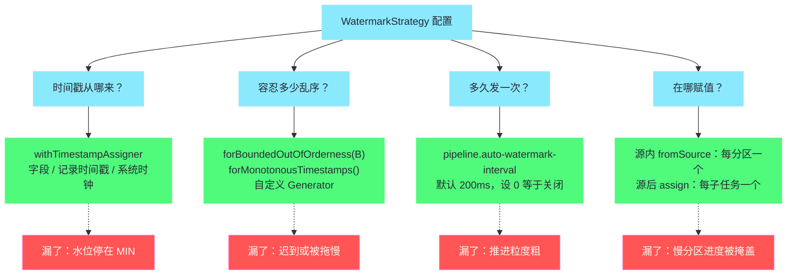
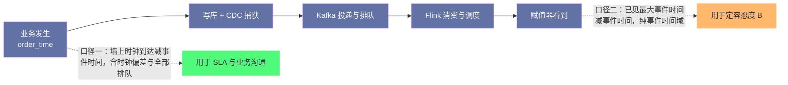
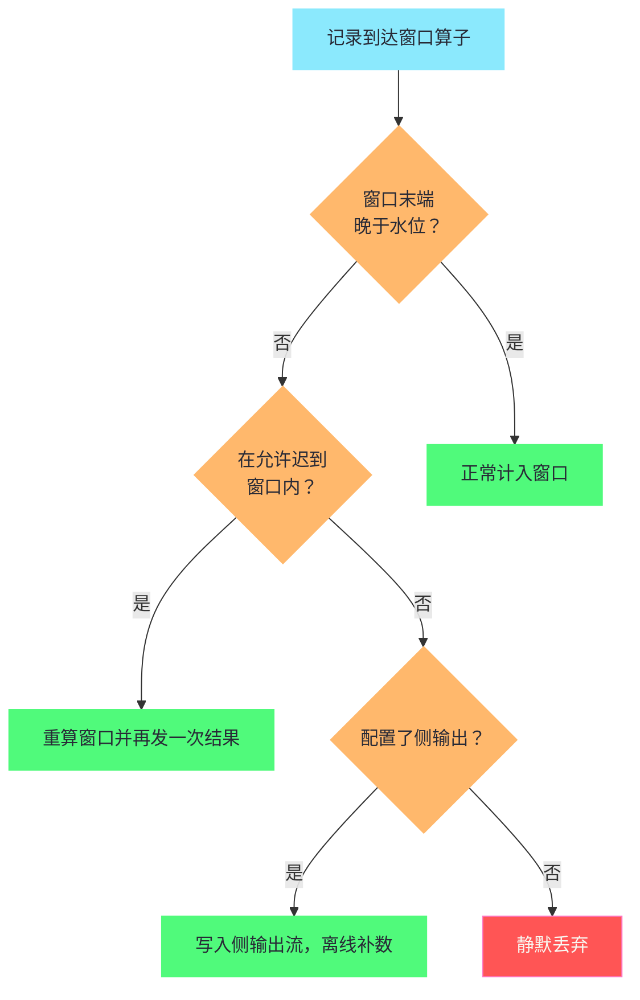
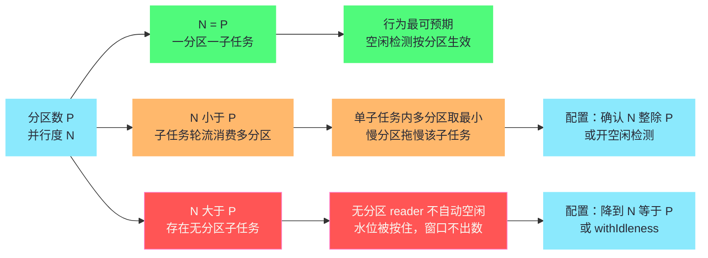

**摘要：**

时间语义的选择常被讲成"精度不同"，但它真正决定的是系统愿不愿意为一条记录的时间归属负责：事件时间给出的是有条件的承诺，条件成立则结果可重放；摄入时间只承诺入口之后不再偏移；处理时间什么都不承诺。本篇不谈机制怎么实现，只回答一个作业从设计到上线要面对的四个问题——选哪种语义、乱序容忍度填多少、空闲源开不开、迟到数据怎么兜。乱序容忍度不靠经验拍定，按"到达时刻的事件时间落差"这一口径在分区维度上打直方图，取各分区 P99.9 的最大值作起点，再用状态规模与输出延迟两侧的算术校核。空闲源、允许迟到、侧输出三者的配置相互耦合，本篇用一组判据表和三个反例把它们钉在具体数值上，最后把线上高频的几类症状整理成一张"指标判据到配置动作"的对照表。Watermark 的生成、合并与传播机制归原理列，本篇只在一处引用结论。

---

## 第 1 章 选型的起点：三种语义给的是三种承诺

### 1.1 同一份数据，重跑两次结果不一致

2024 年秋天，一个电商团队对账时发现实时大屏的当日成交额与数仓口径差了 4 万多元。按金额看不算大，但排查两周没有结论，最后发现问题不在数据，在作业用错了时钟。

他们的实时链路用处理时间做分钟聚合：订单 CDC 事件进 Kafka，作业消费后按处理时间窗口聚合，结果写进明细表再汇总。差异有三条产生路径。一是双十一预热那天 Kafka 积压了约九分钟，积压期间被读出的那批订单全部落进了它们"被读出"的那一分钟，而那一天正好跨零点，前一日的订单被记到了次日。二是作业因为一次 YARN 队列抢占重启过，消费位点回退了十几秒，这十几秒的数据被重放了一遍，金额重复累加。三是最隐蔽的一条，测试环境用同一份 Kafka 数据回灌验算，跑三次得到三个不同的数，团队一度以为是聚合函数有缺陷。

三条路径指的都是同一件事：处理时间下"这笔订单属于哪一分钟"这个问题没有答案，只有"这笔订单在哪一分钟被算子看到"。一旦排队、反压、重启补数改变了"被看到"的时刻，窗口归属就跟着移动，而且移动之后没有任何机制能察觉错了。事件时间把它变成另一个样子：迟到数据要么触发窗口重算，要么进侧输出并留下计数，误差从静默的必然变成可观测的例外。

这就是选型的真正分水岭。三者的差别不在误差有多大，而在**给定同一条记录，系统愿不愿意为它的归属负责**。

### 1.2 三种承诺的准确措辞

**事件时间（Event Time）**取记录自带的业务时间戳，承诺是：只要水位断言成立，结果就是对的；断言不成立时，误差会被显式暴露。水位断言的语义、单调性来源与合并规则见 [[大数据/Flink/Flink原理深度解析与性能优化/07 Flink 时间与 Watermark 底层机制|原理列第 07 篇]]，本篇只取它的工程含义——它把"允许出错"变回了"可观测的例外"。

**摄入时间（Ingestion Time）**取记录进入 Flink 数据流那一刻的系统时钟，由 Source 打一次戳，后续算子沿用。它的承诺短得多：入口之后不再偏移。入口之前的排队、跨机房投递、消息队列积压一概不在承诺范围里，而现实中造成大偏差的恰恰是入口之前那一段。

**处理时间（Processing Time）**取算子所在机器的系统时钟，没有任何归属承诺，窗口只是"按墙上时钟闭合的桶"，装进去的是那一刻恰好经过的元素。

三者的承诺强度不同，配置成本也不同：事件时间要一套赋值器与生成器，还要为迟到准备兜底；摄入时间只要一个单调生成器；处理时间一个配置项都不用。这个成本差是很多人退回处理时间的原因，但省下的配置会在第一次补数、第一次重启、第一次对账时连本带利还回来。

### 1.3 三个判据

把三种承诺翻译成可以对着业务口径问的问题，只有三句。

**判据一：结果必须可重放吗。**同一份输入重跑两次、或者从某天的快照回灌一次，结果必须逐笔一致——那么只有事件时间可选。结算、对账、审计、入湖明细、对外报表都属于这一类，共同特征是"结果会被拿去与另一个系统比对"，任何一个只在对账时暴露的偏差都会变成事故。

**判据二：不需要重放，但进度必须单调吗。**典型是各类指标流水与埋点：下游只关心"某个时间点的计数只增不减"，不关心这个时间点是事件发生的还是被读到的，也不打算重放。这时摄入时间够用，而且比事件时间便宜——不用为乱序留出延迟，窗口边界一到就能出结果。

**判据三：只要快，不在乎重复计算吗。**大屏的秒级刷新、限流熔断的阈值判断、心跳与超时检测、缓存预热，这些逻辑的时间含义是"最近一段时间有没有动静"，而不是"事件属于哪一刻"。处理时间在这里不但够用，而且更贴近语义：限流器若按事件时间统计，一条晚到十分钟的流量会让它把十分钟前的高峰当成现在的流量。反过来，把事件时间硬套在限流器上，补数期间历史流量重新灌进流里，限流阈值会被过期的峰值打穿。

把三个判据与三处代价并排，选型就没什么可犹豫的了。

| 维度 | 事件时间 | 摄入时间 | 处理时间 |
| --- | --- | --- | --- |
| 结果可重放 | 可以，逐笔一致 | 重放时取决于入口时刻 | 不可以 |
| 迟到可识别 | 可以，进侧输出或触发重算 | 不可以，入口之前的偏移不可见 | 概念不存在 |
| 配置成本 | 赋值器 + 生成器 + 兜底 | 赋值器 + 单调生成器 | 无 |
| 输出延迟下限 | 容忍度 + 窗口长度 | 窗口长度 | 窗口长度 |
| 状态规模 | 受容忍度与允许迟到放大 | 只受窗口影响 | 只受窗口影响 |
| 典型口径 | 结算、对账、入湖、审计 | 单调进度类指标流水 | 大屏、限流、告警、心跳 |
| 配错的后果 | 状态与延迟偏高 | 入口前偏移被吞掉 | 无法重放，误差静默 |

### 1.4 事件时间不再是全局开关

老版本的 Flink 有一个 `env.setStreamTimeCharacteristic(TimeCharacteristic.EventTime)`，整个作业一个时间语义，这个 API 从 1.12 起被标记废弃，2.x 里已经移除。现在的模型是逐源声明：`env.fromSource(source, strategy, name)` 里的 `strategy` 决定这条流有没有事件时间，窗口算子的类型决定它按哪种时间切桶。二者组合出三种语义，而不是由一个开关决定。

这个变化带来一个常被忽略的自由度：同一条作业里不同源可以有不同的时间语义。回到贯穿本文的电商场景，一个作业同时接三条流是常见的：订单 CDC 进事件时间窗口做 GMV 大屏、商品维表变更流用处理时间做本地缓存刷新、埋点流用摄入时间做单调计数。三者互不干扰，也就不必为了一个源的需求把整条作业拖进水位体系。

如果确实要模拟摄入时间，写法是在源位置用系统时钟打戳，再配一个单调生成器：

```java
// 摄入时间的等价配置：戳在入口打一次，之后处理快慢不再影响归属
WatermarkStrategy<OrderEvent> ingestionLike = WatermarkStrategy
    .<OrderEvent>forMonotonousTimestamps()
    .withTimestampAssigner((event, recordTs) -> System.currentTimeMillis());
```

赋值器在源内部执行，这里取到的就是入口时刻，与摄入时间的定义一致；如果把它写在源之后的算子上，取到的就成了算子被调度到的时刻，语义退化成处理时间。

---

## 第 2 章 配置的骨架：策略、赋值器与发射节拍

### 2.1 一次配置要回答的四个问题

`WatermarkStrategy` 这个接口把四件事缝在了一起，配置时按顺序把四个问题答完就不会漏项。

第一个问题，**时间戳从哪来**——赋值器（Timestamp Assigner）的职责，从消息字段、Kafka 记录时间戳或者系统时钟取值。第二个问题，**容忍多少乱序**——生成器的职责，内置的两种生成器分别对应有界乱序与严格单调。第三个问题，**多久发一次水位**——发射节拍的职责，由 `pipeline.auto-watermark-interval` 控制，默认 200 毫秒。第四个问题，**在哪赋值**——源内还是源后，决定了生成器是每分区一个还是每子任务一个。

下图把四个问题与各自的配置项画在一起，后文每一节都对应其中一支。



### 2.2 赋值器：五个配置级错误

赋值器只有一行 lambda，出错的形态却相当固定，且都以"水位异常"的形式暴露。

| 错误 | 写错的样子 | 水位表现 | 验证手法 |
| --- | --- | --- | --- |
| 单位不一致 | 业务给秒级，代码按毫秒用 | 停在 1970 年附近 | 抽样打印原值与解析值 |
| 时区错位 | 东八区时间被当作 UTC 解析 | 整体早或晚 8 小时 | 与库里同名字段比对 |
| 字段取错 | 用了入库时间而非业务时间 | 看似正常，迟到分布异常平坦 | 看落差直方图是否退化成单桶 |
| 解析兜底 | 解析失败返回 0 或 null | 落在常量或最小值 | 对越界值直接抛异常而非兜底 |
| 用错来源 | 该用业务字段却用了记录时间戳 | 乱序消失，语义变成摄入时间 | 核对业务口径是否需要重放 |

第五类值得多说一句。`withTimestampAssigner` 的第二个参数 `recordTimestamp` 是 Kafka 记录自带的时间戳，多数场景下等于生产者的发送时刻（`CreateTime`）。用它最省事，因为不依赖消息体里的字段；但它把语义悄悄换成了"生产者发送时刻"，一旦生产者本身有重试、批量发送，或者业务时间与发送时间之间隔着一段业务处理，口径就变了。这个参数正确的用途是兜底：业务字段缺失时退到它，并且要计数，让缺失率可见。

> [!warning] 兜底是排查的敌人
> 赋值器里任何"解析失败返回 0"的写法，都会把配置错误伪装成机制问题：水位停在一个离谱的值上，看代码逻辑完全正确，实际是数据进了兜底分支。正确做法是越界直接抛异常让作业失败，或者在赋值器外挂一个计数器，把兜底次数做成指标，一旦非零就告警。

### 2.3 三种生成方式与它们的使用场景

**有界乱序（`forBoundedOutOfOrderness`）**是最常用的写法，水位等于已观测最大事件时间减去容忍度再减一毫秒（那一毫秒来自断言的等号语义，推导在原理列）。它适合"乱序有上界、上界可以估计"的场景，配置的形式是一个 `Duration`：

```java
WatermarkStrategy<OrderEvent> strategy = WatermarkStrategy
    .<OrderEvent>forBoundedOutOfOrderness(Duration.ofSeconds(5))   // 事件时间域内的容忍度
    .withTimestampAssigner((event, recordTs) -> event.getOrderTime());
```

这里要强调一个容易混淆的点：容忍度 5 秒不是"允许消费延迟 5 秒"，而是"允许一条记录的事件时间比已见最大值落后 5 秒"。消费延迟哪怕到了十分钟，只要各分区进度一致，水位也会跟着数据一起走，不会有任何记录被判迟到。这个区分是第 3 章测量方法的基础。

**严格单调（`forMonotonousTimestamps`）**是有界乱序取零的特例，水位就是最大事件时间减一毫秒。它适合两类场景：单分区且生产者保证顺序的源，以及已经在入口按时间排好序的文件源。这里有一个与旧资料不同的结论需要纠正——在多分区并行消费的 FLIP-27 源上，这个策略并不"过于激进"，因为每个分区有独立生成器，单调假设只需在分区内部成立，合并时取最小值会把跨分区的进度差吸收掉。真正不能用的地方是源后赋值：多个分区的记录被交织成一条流之后，单个生成器看到的序列不再单调，此时用它会漏数据。

**自定义生成器（`WatermarkGenerator`）**用于两种场景，一种是数据里有明确的批次边界，另一种是容忍度需要随流量自适应。前者的典型是 CDC：一个事务的多条变更记录之间不能切开，只有读到该事务的 `COMMIT` 记录时，才能确定这批数据的下界。

```java
public class CommitDrivenGenerator implements WatermarkGenerator<CdcEvent> {
    private long maxTs = Long.MIN_VALUE;
    private long lastCommitWallClock = System.currentTimeMillis();

    @Override
    public void onEvent(CdcEvent event, long eventTs, WatermarkOutput output) {
        maxTs = Math.max(maxTs, eventTs);
        // 事务边界是不连续的断点：只有 COMMIT 到齐，整批数据的下界才确定
        if (event.isCommit()) {
            output.emitWatermark(new Watermark(maxTs - 1));
            lastCommitWallClock = System.currentTimeMillis();
        }
    }

    @Override
    public void onPeriodicEmit(WatermarkOutput output) {
        // 长时间没有 COMMIT 时按处理时间兜底放行，否则一个安静的主题会冻住全链路
        if (System.currentTimeMillis() - lastCommitWallClock > 60_000L) {
            output.emitWatermark(new Watermark(maxTs - 1));
        }
    }
}
```

这个生成器把两种发射模式都用上了：事件驱动（断点式）负责精确，周期驱动负责兜底。任何只做断点式而完全不兜底的自定义生成器，都会在"主题安静下来"时表现为水位冻结——症状与空闲源一模一样，根因却在生成器。

| 生成方式 | 水位公式 | 适用前提 | 用错的后果 |
| --- | --- | --- | --- |
| `forBoundedOutOfOrderness(B)` | 最大值 − B − 1 | 分区内乱序有上界 | B 偏小丢数据，偏大拖状态 |
| `forMonotonousTimestamps()` | 最大值 − 1 | 分区内严格有序 | 源后赋值时会漏数据 |
| 自定义断点式 | 由事件标记决定 | 有批次或事务边界 | 无兜底时水位冻结 |
| 自定义自适应 | 由统计量决定 | 乱序随流量变化 | 逻辑复杂，需自证单调 |

### 2.4 发射节拍与它的连带影响

`pipeline.auto-watermark-interval` 默认 200 毫秒，含义是每 200 毫秒调用一次生成器的周期发射回调。它直接决定水位的推进粒度：窗口的触发时刻最多比数据到齐晚一个节拍。对一分钟的窗口，200 毫秒可以忽略；对要求亚秒级反馈的看板，这个节拍就是主要延迟来源，需要压到 50 毫秒以下，代价是每条水位记录在流里的传播开销按比例增加。

这个配置还有一处连带效应，出问题时的表现不像它造成的。

**空闲检测挂在同一个节拍上**：`withIdleness` 的判定是在周期发射那次回调里顺带完成的，所以把间隔设成 0 不只是关闭了周期发射，而是连空闲判定一起失效——作业安静时水位彻底不动，恢复时也不会重新对齐。配置里出现 0 的作业，通常是从别处抄配置时带进来的，排查时值得第一个怀疑。

### 2.5 赋值位置：源内与源后的互斥规则

一条流只应该有一处赋值。在 `fromSource` 里传入策略之后再调 `assignTimestampsAndWatermarks`，会造成两个后果：后者的生成器会忽略上游水位（只放行水位结束标记），等于把源内生成的结果全部丢掉；同时生成器粒度从每分区退化为每子任务。两者叠加，表现是"水位在动，但慢分区的数据大量迟到"，比完全不配更难查。

判断方法很简单：如果在源之后还看到一处 `assignTimestampsAndWatermarks`，先确认它是不是历史遗留。真正需要源后赋值的场景只有一类——源本身不提供水位且无法在源内配置策略，此时才接受粒度退化，并要用 `withIdleness` 把空闲分区的问题补回来。

### 2.6 SQL 侧的等价配置

SQL 作业没有 `WatermarkStrategy` 对象，配置落在 DDL 与运行时参数两处。DDL 里的 `WATERMARK FOR ... AS` 只能表达"减一个固定间隔"，等价于有界乱序策略：

```sql
CREATE TABLE orders (
  order_id    BIGINT,
  user_id     BIGINT,
  amount      DECIMAL(12, 2),
  order_time  TIMESTAMP(3),
  -- 只能表达固定减量，表达不了断点式与自适应
  WATERMARK FOR order_time AS order_time - INTERVAL '5' SECOND
) WITH (
  'connector' = 'kafka',
  'topic' = 'order_created',
  'properties.bootstrap.servers' = 'kafka:9092',
  'properties.group.id' = 'gmv-dashboard',
  'scan.startup.mode' = 'group-offsets',
  'format' = 'json'
);

-- 空闲源：DataStream 侧配的 idleness 管不到 SQL，必须单独设
SET 'table.exec.source.idle-timeout' = '90s';
```

`table.exec.source.idle-timeout` 与 DataStream 的 `withIdleness` 是两条互不相通的路径，这是混部集群里最常见的一处漏配。该选项在 1.x 早期默认 0，含义是不启用；较新版本改过默认值的表达方式，配置时显式写出比依赖默认值稳妥，具体默认以对应版本文档为准。

迟到数据在 SQL 侧的能力比 DataStream 弱一档，没有 `sideOutputLateData` 的等价物，只有"提前发射"与"延后发射"两个旋钮：

```sql
-- 提前发射：窗口未闭合也输出中间结果，下游需能接受撤回或更新
SET 'table.exec.emit.early-fire.enabled' = 'true';
SET 'table.exec.emit.early-fire.delay' = '10s';

-- 延后发射：窗口闭合后继续保留一段时间，为迟到数据补发更新
SET 'table.exec.emit.late-fire.enabled' = 'true';
SET 'table.exec.emit.late-fire.delay' = '30s';
```

`late-fire` 在语义上接近 `allowedLateness`，但输出是一条更新记录，需要下游声明主键并支持更新（`upsert-kafka`、带主键的 JDBC 表、HBase 之类）。写成 `append` 模式的主题，下行会看到同一窗口的多条互不覆盖的记录，看板上的数字被重复累加。SQL 作业排查"结果翻倍"时，先看这一处。

### 2.7 配置检查单

上线前把下面这张表走一遍，能挡掉绝大多数配置级故障。

| 检查项 | 正确写法 | 配错的表现 |
| --- | --- | --- |
| 时间戳单位 | 毫秒，秒级字段显式乘 1000 | 水位停在 1970 年 |
| 时区 | 与库里同名字段逐条比对 | 整体偏移整小时数 |
| 兜底 | 越界抛异常，或计数并告警 | 水位停在常量上 |
| 赋值位置 | 全链路仅一处 | 慢分区数据大量迟到 |
| 容忍度 | 有测量依据且记录在案 | 结果偏小或延迟偏高 |
| 发射节拍 | 非 0，且与窗口粒度匹配 | 水位不动或延迟偏高 |
| 空闲检测 | DataStream 与 SQL 各自确认 | 夜间窗口不出数 |
| 允许迟到 | 有值或明确写 0 | 迟到全丢，且无人知晓 |
| 侧输出 | 有承接，有计数 | 迟到量不可观测 |
| 下游幂等 | upsert 或有主键去重 | 结果重复累加 |
| 水位对齐 | 组名全局唯一 | 组间互相拖慢 |

---

## 第 3 章 乱序延迟设多少：把拍脑袋换成测量

### 3.1 先分清两种"晚"

"这条数据晚了多少"有两个含义完全不同的度量，混用是乱序容忍度设错的第一个原因。

**口径一，端到端落差。**记录到达 Flink 时，用墙上时钟减去它的事件时间。这个量包含业务机时钟偏差、写库与 CDC 捕获延迟、Kafka 投递、消费排队、算子调度，是业务方问"数据延迟多少"时要的答案，也是 SLA 的分母。

**口径二，事件时间落差。**记录到达那一刻，赋值器已经见过的最大事件时间减去这条记录的事件时间。这个量全程在事件时间域内计算，不跨时钟，因此不受机器时钟偏差污染，也不受消费积压影响。它恰好就是容忍度要覆盖的那个量：一条记录被判定为迟到，当且仅当这个落差超过了容忍度。

下图把一条订单从发生到进入算子拆成四段，标出两种口径各自覆盖哪一段。



两者不能用同一个数字。口径一偏大且随负载波动，拿它定容忍度会把 B 设得过大；口径二才是可直接与 B 比较的量。

### 3.2 全局积压不制造迟到

旧资料里常见一个说法：Kafka 消费者积压时重放历史数据，历史数据的事件时间早于当前时间，所以产生乱序。这个说法只在特定条件下成立，不加限定地信它会把排查引向错误方向。

设想整个主题同时积压了十分钟，所有分区都停在十分钟前的位置。作业继续消费，水位跟着数据一起停在十分钟前，两者同步移动，没有任何记录的落差变大。此时的表现是"结果出得晚十分钟"，不是"数据迟到"，处置手段是加并行度、治理反压、调整起始位点，与容忍度无关。

真正产生迟到的情形是分区之间进度不一致。这时下游水位取各分区水位的最小值（合并机制见原理列第 4 章），一个落后的分区会把全局水位按住，反倒让快分区的数据更难被判迟到。这个方向的结论有点反直觉：**慢分区让结果变晚，不让数据变迟；只有在慢分区被判成空闲之后，它自己的数据才会迟到**。第 4 章会用到这个结论。

所以在分区维度上，真正需要容忍度兜的是分区内部的乱序：同一分区的多个生产实例、生产者重试与批量、CDC 对多表的合并写，都会让事件时间在分区内小幅回退，量级通常在数百毫秒到数秒。

### 3.3 在线测量：在赋值器旁边打落差直方图

要拿到口径二的分布，最直接的办法是在赋值之后挂一个探针算子，用分桶计数代替精确分位数——数万条记录里算精确 P99.9 意义不大，桶计数足够定位量级，而且能作为长期指标留下来。

```java
public class LatenessProbe extends ProcessFunction<OrderEvent, OrderEvent> {
    private transient Counter[] buckets;
    private long maxTs = Long.MIN_VALUE;

    @Override
    public void open(Configuration cfg) {
        // 按 2 的幂分桶：桶 i 覆盖 [2^i, 2^(i+1)) 毫秒，最大覆盖到 2^31 毫秒约 24.8 天
        buckets = new Counter[32];
        for (int i = 0; i < buckets.length; i++) {
            buckets[i] = getRuntimeContext().getMetricGroup().counter("lateness_bucket_" + i);
        }
    }

    @Override
    public void processElement(OrderEvent event, Context ctx, Collector<OrderEvent> out) {
        maxTs = Math.max(maxTs, event.getOrderTime());
        long deficit = Math.max(0L, maxTs - event.getOrderTime());
        // 索引即 floor(log2(deficit))，配合桶边界能把分位数还原到一倍误差以内
        buckets[63 - Long.numberOfLeadingZeros(deficit | 1L)].inc();
        out.collect(event);
    }
}
```

桶下标的取法利用了 `Long.numberOfLeadingZeros`，`deficit | 1` 让零值也落进第 0 桶。读出指标后按下标从高到低累加，累加量达到总计数 0.1% 时对应的桶上界就是 P99.9，1% 对应 P99。每个桶代表一个二倍区间，所以还原出来的分位数误差不超过一倍，对定容忍度来说绰绰有余。

探针要按分区打点，读的时候取每个分区的 P99.9，再取其中最大值，原因在 3.5 节。

### 3.4 离线测量：落地时间差的分位统计

如果数据已经落在湖仓里，离线统计更省事，也能回看历史。前提是落库时打了一个到达时间字段——很多入湖管道默认就会打，只是没人用它。

```sql
-- 口径一：用落库时间减事件时间，能看出链路整体延迟与其日内波动
SELECT
  TUMBLE_START(arrival_ms, INTERVAL '1' HOUR)              AS hour_of_day,
  COUNT(*)                                                  AS cnt,
  APPROX_PERCENTILE(arrival_ms - event_ms, 0.5)             AS p50,
  APPROX_PERCENTILE(arrival_ms - event_ms, 0.99)            AS p99,
  APPROX_PERCENTILE(arrival_ms - event_ms, 0.999)           AS p999,
  MAX(arrival_ms - event_ms)                                AS max_lag
FROM ods_order_cdc
WHERE dt = CURRENT_DATE - INTERVAL '1' DAY
GROUP BY TUMBLE(arrival_ms, INTERVAL '1' HOUR);
```

这份统计的用途是看形状：若 P99.9 与 P99 只差一个量级以内、且日内平稳，说明乱序有明确上界，容忍度可以放心按 P99.9 取；若最大值比 P99.9 高出两三个数量级，说明分布有长尾，容忍度再大也覆盖不住尾巴，得靠侧输出加离线修正。它还会暴露两类异常：某个小时的分位数集体跳高，通常是上游批量补数；分位数长期接近零，通常是落库时间打在了事件时间同一处，这份统计实际没有测量价值。

需要提醒的是，口径一含机器时钟偏差，若业务库与入湖侧没有严格对时，几秒的偏差会被算进分位数。它的绝对值不能直接当容忍度用，只能用来判断形状与量级。

### 3.5 从分布到容忍度

测量的落点是三个数：各分区口径二 P99.9 的最大值、口径一 P99.9、以及窗口长度。容忍度按下面的顺序取。

先取 `B₀ = 各分区 P99.9 的最大值`。为什么不取全局合并分布的 P99.9，也不取平均值：水位逐分区生成再取最小，每个分区各自减同一个 B，所以一个分区的内部落差超过 B 时，它自己的数据就会迟到，与别的分区进度无关。约束是逐分区成立的，就必须逐分区看尾巴再取最大值。

再把 `B₀` 向上取整到一个好记的值，并加一个安全系数。工程上常用乘 1.2 到 1.5 再向上取整，理由不是保守，而是采样窗口有限——一天的 P99.9 是 86 万条记录里排第 864 位，换个采样窗口数值就会变，留一点余量比每周改一次配置划算。这一步的取值属于量级判断，不必精确到毫秒。

最后用第 9 章的算术做两侧校核：按这个 B 算出的存活窗口数与状态规模能不能接受，输出延迟是否满足业务口径。两侧都过不了，说明这个场景不该用"在线精确"，应该转成"在线近似加离线修正"。

> [!info] 一个被忽略的前提
> 上面整套测量都假设"事件时间戳的分布是有意义的"。如果上游的时间戳是入库时补的、或者按批次统一赋值，测出来的落差分布会异常平坦，甚至退化成单桶。这种数据没有可用的事件时间语义，容忍度调到多少都救不回来，只能回到处理时间或者在上游修数据。

### 3.6 两侧代价

容忍度是唯一一个同时压着延迟与状态的参数，两侧代价都可以算。

延迟侧的代价是线性的：窗口的触发时刻从"窗口末端"推迟到"窗口末端加 B"，平均输出延迟增加 B，最大延迟增加 B 加一个发射节拍。对分钟级窗口，5 秒的 B 只占 8%，可以接受；30 秒的 B 就占了一半，大屏的"实时"感会明显退化。

状态侧的代价按倍数放大。窗口状态从第一个元素到达时创建，到水位越过"窗口末端加允许迟到"时清理，存活期约为窗口长度加 B 加 L；对滑动窗口再除以滑动步长，就是每个 key 同时存活的窗口数。第 9 章会给具体算式与示例推算，这里的定性结论是：B 每增加一个窗口长度，存活窗口数大致翻一倍。

把两侧代价与覆盖收益放在一张表里，就能看出为什么"往大里设"是错的。

| B 的取值 | 覆盖的乱序 | 延迟代价 | 状态代价 | 适用判断 |
| --- | --- | --- | --- | --- |
| 0 到 1 秒 | 仅严格有序或毫秒级抖动 | 几乎为零 | 最小 | 分区内严格有序且已验证 |
| 3 到 5 秒 | 分区内常见抖动 | 可忽略 | 小 | 大部分业务流的默认起点 |
| 30 秒到 1 分钟 | 多实例时钟偏差、生产者重试 | 分钟级窗口明显变慢 | 窗口数翻数倍 | 有明确测量依据才取 |
| 5 分钟以上 | 跨机房、批量补数 | 业务通常不接受 | 数十倍 | 一般应转侧输出加离线修正 |

---

## 第 4 章 空闲源：什么时候必须开，开了要付什么

### 4.1 三类必须开的拓扑

空闲源（Idle Source）指一段时间内没有任何记录产生的源子任务或分区。它本身不是问题，问题出在水位合并取最小值上：一个永不推进的水位会把整条链路的进度按住。原理列的结论是"空闲的表达靠独立的状态元素，不算水位"，本篇只关心什么时候必须让源进入这个状态。

第一类，**并行度大于分区数**。Kafka 源在 FLIP-27 之后不保证"没有分区的子任务自动进入空闲"——社区在 FLINK-25706 与 FLINK-25818 里明确了这一点：并行度高于分区数时，Kafka 源不会自动空闲，要么降低并行度，要么给水位策略加空闲超时。这类配置错误的后果很严重，因为作业看起来一切正常，CPU 低、无反压、数据在消费，就是窗口不出结果。

第二类，**分区流量极不均**。按用户 ID 哈希分区的主题里，总有几个分区承接的是低频用户，几十分钟没有一条记录很正常。此时并行度等于分区数也救不了，必须靠空闲检测。

第三类，**夜间低谷与灰度主题**。凌晨的订单主题可能整段静默，灰度主题在验证期只有零星流量，这类场景的问题不止在水位，还在复活（见 4.4 节）。

| 拓扑 | 为什么拖住水位 | 必须开吗 | 配置建议 |
| --- | --- | --- | --- |
| 并行度 > 分区数 | 无分区的 reader 不自动空闲 | 必须 | 优先降并行度到分区数，其次开空闲检测 |
| 分区流量极不均 | 低频分区水位不推进 | 必须 | 开检测，超时取正常间隙 3 到 5 倍 |
| 夜间低谷、灰度主题 | 整段静默 | 必须 | 开检测，同时把允许迟到放宽到覆盖静默期 |
| 并行度等于分区数且流量均匀 | 水位由最慢分区推进但不停 | 可选 | 不开更省心，避免误判 |
| 单分区源 | 无多路合并 | 不需要 | 不开 |

### 4.2 配置位置与粒度

`withIdleness` 挂在策略上，跟赋值位置一起决定粒度：

```java
WatermarkStrategy<OrderEvent> strategy = WatermarkStrategy
    .<OrderEvent>forBoundedOutOfOrderness(Duration.ofSeconds(5))
    .withTimestampAssigner((event, recordTs) -> event.getOrderTime())
    .withIdleness(Duration.ofSeconds(90));       // 90 秒无记录即视为空闲

DataStream<OrderEvent> orders = env.fromSource(kafkaSource, strategy, "order-source");
```

源内赋值时检测粒度为分区；源后赋值时检测粒度为整个子任务的输入活动度，某个分区静默它感受不到，这类配置在流量不均的主题上等于没配。SQL 作业走 `table.exec.source.idle-timeout`，与 DataStream 两不相通，同一集群上两条链路要分别确认。

### 4.3 超时值怎么定

超时值的下界由正常间隙决定：一个分区没有记录的时长本来就会波动，超时值不能落进这个波动的分布里，否则正常间隙会被误判为空闲。取正常间隙的 3 到 5 倍是个稳妥的起点；如果知道该分区记录的到达间隔分布，取 P99.9 间隙再乘 2 更可靠。

超时值的上界由可接受的延迟决定：频率极低的分区（譬如每小时一条记录），超时值一旦超过窗口长度，空闲检测就失去了意义——窗口早就该触发了，而水位还停在那里等。这类分区的正确做法不是把超时值调得更大，而是把它从主链路里拆出去，用单独的作业处理。

还有一个容易忽略的约束：超时值要与检查点间隔拉开距离。若超时值远小于检查点间隔，一次静默可能在两个检查点之间开始并结束，水位在这个间隙里跳一下又落回来，窗口会多触发一次、多输出一批结果；若超时值远大于检查点间隔，静默跨越多个检查点，恢复后需要重新走一遍对齐过程。取检查点间隔的 1 到 3 倍是常见的经验区间，具体依业务对流量的容忍度定。

### 4.4 副作用：复活、跳跃与允许迟到的耦合

空闲检测把水位推进的代价，是把这段静默"记成了一笔账"，账要在复活时还。

一个分区被判空闲之后，全局水位由其余分区继续推进，可能前进了几分钟。这个分区恢复时，读到的记录如果来自积压而非新产生的数据，事件时间就落后于当前水位，落差约等于静默时长。此时这些记录全部被判迟到：配置了允许迟到就在窗口里重算一遍，配置了侧输出就进侧输出，都没配就直接丢弃。

由此得到一条可操作的配置约束：**允许迟到量与容忍度之和应能覆盖静默时长，即 `B + L` 不小于空闲超时 `D`**（示例推算的量级判断）。这条不等式是三个参数之间唯一一条硬耦合，配错时的表现是"每次夜间低谷过后侧输出暴涨一批，且时间点与低谷吻合"。

另一个副作用是水位跳跃。复活瞬间该分区的水位从旧值跳到当前值，全局水位可能一次性前进几分钟，所有落在这一段区间里的窗口会在同一时刻全部触发，形成一次触发尖峰，定时器指标上能看到 `numFiredTimersPerSecond` 脉冲。如果下游写入对尖峰敏感，就要么把窗口拆小，要么在允许迟到上用更平滑的策略，而不是靠调大 B。

### 4.5 替代与配合手段

空闲检测不是唯一解，有时也不是最优解。

最彻底的办法是让并行度与分区数匹配。分区数 32、并行度 64 的作业，后 32 个子任务永远没有数据，这不是配置问题而是资源浪费，降到 32 就没必要开空闲检测。这个动作还能顺带解决另一个问题：槽位占用与检查点里的位点记录都减半。

第二个办法是水位对齐（Watermark Alignment），从 1.16 引入、1.17 起要求源连接器实现分区级对齐（FLIP-217）。它限制的是组内成员之间的进度落差，超过阈值就暂停快成员，从而把状态增长控制在阈值对应的范围内。它对"一个成员永远不动"的场景无效——那仍然要靠空闲检测——但对"成员之间进度差很大"的场景有效，能减少水位停滞期间攒下的状态。

```java
// 水位对齐：组名在作业内全局唯一，超出 drift 的快分区会被暂停
WatermarkStrategy<OrderEvent> aligned = WatermarkStrategy
    .<OrderEvent>forBoundedOutOfOrderness(Duration.ofSeconds(5))
    .withTimestampAssigner((event, ts) -> event.getOrderTime())
    .withIdleness(Duration.ofSeconds(90))
    .withWatermarkAlignment("orders-dashboard", Duration.ofSeconds(30));
```

对齐的代价在吞吐：整体进度被压到最慢成员的水平，快成员反复暂停。所以它和空闲检测是互补的两种手段，一个治"落差"，一个治"静默"，混着用时要分别看指标——对齐的问题看 `watermarkAlignmentDrift` 是否贴着上限，空闲的问题看 `sourceIdleTime` 是否持续增长。

第三个办法是按分区拆作业。低频分区与高频分区的乱序特征、容忍度需求、状态规模都不一样，硬塞进一个作业里只能取折中配置。拆开之后各配各的，代价是运维对象变多。

---

## 第 5 章 迟到数据的三种处置：判据与代价

### 5.1 判定是一个不等式

一条记录被判为迟到，当且仅当它的水位戳落在窗口算子当前水位之下——具体到时间窗口，就是记录所属窗口的末端早于当前水位减去允许迟到量。三种处置分别对应这个不等式成立之后的三条分支，机制推导见原理列第 6 章。本节只解决一个问题：三条分支怎么选。

下图把判定与三条分支画在一起，后面三节分别对应一条分支。



### 5.2 允许迟到：要修正结果时选它

允许迟到（`allowedLateness`）保留窗口状态一段时间，窗口触发之后到达的迟到数据会重新触发计算，输出一条更新后的结果。

```java
OutputTag<OrderEvent> lateOrders = new OutputTag<OrderEvent>("late-orders") {};

SingleOutputStreamOperator<OrderAgg> result = orders
    .keyBy(OrderEvent::getUserId)
    .window(TumblingEventTimeWindows.of(Time.minutes(1)))
    .allowedLateness(Time.seconds(30))        // 窗口触发后再保留 30 秒
    .sideOutputLateData(lateOrders)           // 超出 30 秒的走侧输出
    .aggregate(new OrderAggFunction(), new OrderMetaFunction());
```

它的价值在"结果修正"：大屏上的分钟成交额在迟到数据补进来之后被更新成正确值，业务方看到的是最终收敛的数字，而不是一个永久偏小的初值。代价有两层。

第一层是输出语义变了。同一个窗口会被输出多次，下游必须能接受更新：按窗口与维度做覆盖、写进支持主键更新的表、或者在下游去重。写成 append 模式的文件或主题，会得到一串同键不同值的记录，谁最后被读到谁赢，看板上的数字会抖。

第二层是状态规模。窗口状态要多留 L 才清理，而存活期本来就已经包含窗口长度与容忍度，L 是在这个基础上再加一段。第 9 章会给倍数算式，定性的说法是：L 每加一个窗口长度，存活窗口数再加一倍。

还有一个语义限制值得确认：允许迟到只对事件时间窗口有效，处理时间窗口上配置它会被忽略（窗口分配器不是事件时间时该值被置零）。所以在一个混用两种时间语义的作业里，串在处理时间窗口上的 `allowedLateness` 是一段看起来生效、实际什么都没做的代码。

### 5.3 侧输出：要单独分析迟到时选它

侧输出（Side Output）把超出允许迟到的记录分流到另一条流，主流不受影响，侧流可以单独承接。

```java
// 侧流的第一用途是补数：按窗口与维度重算，然后覆盖写入
result.getSideOutput(lateOrders)
      .map(e -> new LateRecord(e, e.getOrderTime()))
      .sinkTo(FileSink.<LateRecord>forRowFormat(
              new Path("/warehouse/late/orders"),
              new SimpleStringEncoder<LateRecord>("UTF-8")).build());
```

它的价值在可观测性与可修复性：迟到量变成一条可以计数、可以抽样、可以离线分析的流，而不是一个被丢弃的隐形数字。适合两类场景，一类是财务与对账明细，迟到的那部分必须能在夜里并回离线口径；另一类是需要在事后判断"这批迟到是配置问题还是上游问题"的排查场景。

代价落在存储与链路上。侧输出的数据量等于迟到率乘以吞吐，迟到率 0.5%、吞吐 5 万条每秒时，每日侧输出约 2160 万条（示例推算），按 1KB 一条算就是 20GB 量级，比主流小得多但绝不可忽略；再加上要有人在夜里跑补数任务、要保证补数幂等、要处理补数与实时口径的重复计算，这部分工程成本往往比配置本身高。

### 5.4 丢弃：可以接受时选它

既不配允许迟到也不配侧输出，迟到数据被直接丢弃。这是默认行为，也是最省资源的行为。它的适用条件可以写得很明确：迟到数据的占比可以被量化，丢失这部分造成的口径偏差在业务容忍范围内，并且有人定期看这个偏差。

最容易踩空的正是最后一句。丢弃之后的迟到如果没有任何计数，偏差就只能在月度对账时被发现，那时已经找不到丢的是哪一批。所以选择丢弃的前提是至少留下一个计数——可以在窗口函数里对每次触发附带迟到计数指标，或者在上游按落差做统计。没有观测的丢弃不叫"可以接受"，叫"不知道丢了什么"。

### 5.5 三条分支的判据

把三条分支放在同一组维度上比较，选择就变成一个查表动作。

| 维度 | 允许迟到 | 侧输出 | 直接丢弃 |
| --- | --- | --- | --- |
| 结果是否被修正 | 是，窗口重算并再输出 | 否，需离线补数 | 否 |
| 下游要求 | 能接受同键多次更新 | 只需接一条普通流 | 无 |
| 状态代价 | 窗口状态多留 L，倍数约 (W+B+L)/S | 无窗口状态代价 | 最低 |
| 存储代价 | 检查点体积增大 | 侧流数据量 = 迟到率 × 吞吐 × 保留期 | 无 |
| 可观测性 | 输出重复需去重 | 迟到量可直接计数与抽样 | 不可观测，只能靠对账 |
| 典型场景 | 大屏、看板、需要收敛的指标 | 财务明细、需要补数的入湖链路 | 埋点、非财务指标、可容忍误差 |

实际配置里三者经常组合，组合的原则是分层的：允许迟到负责"在线能修的就地修"，侧输出负责"在线修不了的留证据"，丢弃负责"两类都不值得的场景"。同一作业里对不同窗口用不同组合是正常的，GMV 窗口用允许迟到加侧输出，UV 的分钟窗口只需要丢弃加计数。

### 5.6 SQL 侧的边界

SQL 作业没有侧输出的等价物，`late-fire` 只提供"在线修正"这一层能力，超出延后窗口的迟到数据照样丢弃。这决定了 SQL 链路在设计上的一个约束：如果业务口径不能接受丢弃，就不能只用 SQL 完成，要么下游加一层离线对账，要么把这一段降级成 DataStream。判断标准不是"哪种写法更简单"，而是"丢的那部分能不能被算出来"。

---

## 第 6 章 Kafka 多分区：每分区一个生成器带来的配置后果

### 6.1 分区数与并行度的配比

FLIP-27 之后的 Kafka 源为每个分区单独实例化水位生成器，分区水位再取最小值对外发布。这个设计把"分区"变成了配置的基本单位，于是第一件事就是核对分区数与并行度。

下图列出三种配比与各自的配置后果。



`N = P` 是最可预期的形态，不需要额外考虑分配变化；`N < P` 时一个子任务要轮流消费多个分区，这些分区的进度先在子任务内部取最小，慢分区的拖累被放大一次；`N > P` 是纯粹的配置错误，除了浪费槽位还会让水位停住。

还有一条与版本相关的约束值得知道：分区分配不是静态的。分区扩容、消费者组重平衡、从快照恢复后的归属变化，都会让某个子任务在运行途中拿到新分区，而新分区的水位起点是负无穷，对外水位又只增不减，于是表现为水位停住而不是回退。这类停滞的时间点与扩容、重启的时刻吻合，是最好辨认的一类。

### 6.2 积压：水位滞后与起始位点

积压本身不制造迟到（3.2 节讲过），但它制造两件麻烦：水位滞后导致的输出延迟，以及恢复期的进度错位。

判断积压看三个指标：`pendingRecords` 反映待消费量，`currentFetchEventTimeLag` 反映事件时间落后程度，`watermarkLag` 直接给出水位与当前处理时间的距离。三个一起看能分出两类：`pendingRecords` 涨且 `watermarkLag` 涨，是真积压，读得慢；`pendingRecords` 接近零而 `watermarkLag` 大，是没有新数据，属于空闲源的范畴。

处置积压的配置手段集中在起始位点上：

```java
KafkaSource<OrderEvent> source = KafkaSource.<OrderEvent>builder()
    .setBootstrapServers("kafka:9092")
    .setTopics("order_created")
    .setGroupId("gmv-dashboard")
    // 有状态恢复时以快照里的位点为准，这里只在首跑与无状态启动时生效
    .setStartingOffsets(OffsetsInitializer.committedOffsets(OffsetResetStrategy.EARLIEST))
    .setProperty("partition.discovery.interval.ms", "300000")
    .setValueOnlyDeserializer(new OrderEventDeserializer())
    .build();
```

有一点必须在配置时想清楚：`setStartingOffsets` 的优先级低于快照。从检查点或保存点恢复时，位点取快照里的值，这里的起点被忽略。因此"恢复后从头重跑"这类需求不能靠改这里实现，得真正把状态清掉或者换一个消费者组。反过来，看到"改了起点配置但作业没有按预期读数据"，先怀疑是不是带了状态恢复。

如果确实需要用历史数据回灌，正确做法是用 `OffsetsInitializer.timestamp(t)` 把起点卡在某个时刻，而不是从头读；同时把这条回灌链路与实时链路的窗口口径分开，否则回灌期间的水位会被历史数据按住，实时口径跟着停。

### 6.3 分区发现的影响

Kafka 源默认会周期性发现新分区，间隔 5 分钟，由 `partition.discovery.interval.ms` 控制，非正数表示关闭。这个默认值背后有段小历史：早期版本的 builder 在某些路径上没有把默认值透传下去，出现过多起"文档说开着、实际关着"的问题（FLINK-20777），后来才收敛到预期值。升级过跨大版本的作业，这一项值得显式写死。

分区发现对水位的影响负面多于正面。好处不言自明，扩容后不需要重启作业就能消费新分区；坏处是新分区以负无穷作为水位起点，会把全局水位按住，直到它读完自己的第一条记录。如果新分区里还有一段旧数据（扩容时把历史数据重新分区写入是常见操作），按住的时间会很长。

配置上两条路。主题不会扩容的作业，把间隔设成非正数直接关掉，省一次周期性元数据请求，也省掉一类突发停滞。会扩容的作业，保留发现但要接受停滞，并把允许迟到放宽到能覆盖停滞期的数据落差；更稳妥的是扩容后主动重启一次作业，让新分区在启动时就参与分配。

---

## 第 7 章 症状到配置：一张排查骨架

### 7.1 水位不推进

这是最高频的一类，表现统一、成因分散。四组判据可以把方向定下来。

若 `currentInputWatermark` 长期停在最小值、`sourceIdleTime` 在增长、`pendingRecords` 接近零，问题在"没有数据"，配置动作是核对并行度与分区数、开空闲检测、确认发射节拍不是 0。若 `pendingRecords` 在涨，问题在"读得慢"，配置动作是查反压、核对起始位点是否设成了最早、看分区之间是否严重倾斜。若停滞时刻与分区扩容或作业重启吻合，问题是新分区，配置动作见 6.3 节。若水位停在一个数值离谱的位置（1970 年前后、整八小时偏移、某个常量），问题是赋值器，配置动作是抽样打印原始字段与解析值。

### 7.2 结果出得晚

输出延迟的构成是四段相加：容忍度、窗口长度、发射节拍、下游写入耗时。定位方法是看 `watermarkLag` 是否与容忍度量级相当——相当说明延迟主要来自容忍度，配置动作是下调 B；若 `watermarkLag` 很小而输出仍然慢，延迟在下游，与水位无关。

### 7.3 结果不对

结果不对要分成三种形态，配置原因各不相同。

偏小——容忍度太小或允许迟到为 0，迟到数据被丢。判据是侧输出计数占比或迟到计数指标，占比超过百分之一，容忍度的取值就值得重估。配置动作是上调 B，或者加允许迟到，或者把侧输出接上做补数。

偏移——用错了时钟。表现是整段时间的数字都被搬到另一段时间，譬如东八区数据被当成 UTC 解析，整条曲线左移八小时。判据是对比同一指标的离线口径曲线形状，形状相同而位置偏移，就是时区或口径问题。

重复——允许迟到开了但下游是 append 语义，或者 SQL 的 `late-fire` 输出到非 upsert 主题。判据是同一个窗口键出现多条记录，配置动作是把下游改成覆盖写或主键更新。

### 7.4 状态不释放

状态不释放的直接原因是水位不再推进：窗口清理由水位驱动，水位不动，窗口状态就一直留着。所以这条的排查顺序与 7.1 完全一样，先查水位，再看状态。差别在观测入口不同——看算子状态大小、看检查点体积趋势、看窗口计数指标。

水位正常但状态仍然偏大，就是参数问题。两个来源：允许迟到设得过大，每个窗口多留一段；或者窗口状态另外配了 TTL 且 TTL 与允许迟到打架——TTL 短于允许迟到，窗口状态可能在允许迟到期内被删掉，迟到数据进来后聚合值从零开始累积，输出一个静默偏小的结果，这是最难查的一种；TTL 远长于允许迟到，则状态按 TTL 清理，水位清理形同虚设，白白占内存。

### 7.5 恢复之后大量迟到

从快照恢复后一段时间内迟到数据激增，成因通常是三条中的一条。

第一条，位点被外部改动。手工 reset 消费组位点、或者用不带状态的启动方式跑起来又切回带状态恢复，都会让数据起点与水位进度错位。判据是恢复后侧输出量的时间分布与重启时刻吻合，配置动作是坚持从快照恢复，不在恢复流程里插入位点操作。

第二条，主题分区数变了。扩容后新分区参与分配，各自从负无穷起步，与老分区的水位之间形成落差；落差越大，恢复初期的迟到越多。判据是分区数与并行度的关系发生变化，配置动作见 6.3 节。

第三条，作业停机期间上游补了历史数据。补数任务把旧数据写进同一个主题，事件时间比当前水位落后很多。这类不是恢复造成的，是补数造成的，处置方式是在链路设计上把补数与实时分开（6.2 节），而不是调大允许迟到。

### 7.6 汇总：判据与动作

把上面五节压成一张表，值班时按行对照即可。判据一列是可以直接在 Web UI 或指标系统里看到的量，动作一列是可以立刻改的配置。

| 症状 | 判据 | 常见配置原因 | 配置动作 |
| --- | --- | --- | --- |
| 水位停在最小值 | `sourceIdleTime` 涨、`pendingRecords` 为零 | 未开空闲检测、并行度大于分区数 | 开空闲检测，或把并行度降到分区数 |
| 水位完全不动 | 指标正常、无异常 | 发射节拍为 0、赋值器返回常量 | 恢复发射间隔，修正赋值器 |
| 水位推进极慢 | `pendingRecords` 与 `watermarkLag` 同涨 | 起始位点最早、分区倾斜、反压 | 改时间戳起点，治理反压 |
| 水位在特定时刻停住 | 与扩容、重启、重平衡时刻吻合 | 新分区从负无穷起步 | 等追平，或关闭分区发现后重启 |
| 输出延迟偏大 | `watermarkLag` 与容忍度量级相当 | 容忍度设大、窗口过大 | 下调容忍度，拆小窗口 |
| 结果偏小 | 侧输出计数占比高 | 容忍度偏小、允许迟到为 0 | 上调容忍度，加允许迟到 |
| 结果整体偏移 | 曲线形状同、位置不同 | 时区或时间戳字段错 | 修赋值器 |
| 结果重复累加 | 同窗口键多条记录 | 允许迟到开但下游 append | 下游改覆盖写或 upsert |
| 状态持续增长 | 水位不动、窗口数远超理论值 | 水位停滞、允许迟到过大 | 先修水位，再核对参数 |
| 迟到量随流量波动暴涨 | 与正常间隙同步 | 空闲超时过小 | 上调到正常间隙 3 到 5 倍 |
| 夜间窗口不出数 | 与低谷时间吻合 | 空闲检测未开 | 开检测，超时压到低谷间隙以下 |
| 恢复后迟到激增 | 与重启时刻吻合 | 位点被改、分区数变化、期间补数 | 从快照恢复，拆分补数链路 |

---

## 第 8 章 三个反例

### 8.1 用处理时间做对账口径

这是最常见也最贵的一类。选它的理由通常是"晚几秒无所谓"，但对账口径的问题从来不是晚几秒，而是不能重放。同一份数据重跑结果不同、补数期间历史数据涌进当前窗口、重启后位点回退导致重复累加，第 1.1 节的三条路径都会在对账时集中暴露。

更麻烦的是这类错误没有可观测的痕迹。事件时间下"迟到"是一个能计数的事件，处理时间下这个概念不存在，所以没有任何指标会告诉你"今天有百分之几的数据归错了窗口"。唯一的信号是月度对账差异，而那时已经无法定位。

判据可以写得很干脆：这段逻辑的结果如果会被拿去与另一个系统比对，就不能用处理时间。反过来，如果它只用来触发动作（限流、告警、缓存刷新），处理时间不但可用而且更准确。

### 8.2 空闲超时设成毫秒级

这个反例的心理动因是"水位不推进，那把超时调小一点总能推进了吧"。设成 200 毫秒的后果分两层。

第一层是技术上的无效。空闲判定挂在周期发射的节拍上，节拍本身默认 200 毫秒，把超时设得比节拍还小，判定粒度并没有变细——它只是让每一个正常的到达间隙都被判成空闲。

第二层是行为上的灾难。正常分区并不是每 200 毫秒都有记录，一秒几条的流量下，间隙经常超过一秒。这些间隙被判成空闲后，水位在间隙期间跳到前面，间隙结束后的记录落差变大，超过容忍度的部分全部迟到。表现是迟到量随流量波动同步暴涨，且波动周期与请求的自然节奏一致。更糟的是这个正反馈：迟到越多、越有人去调参数，越调越糟。

### 8.3 允许迟到设成小时级

"反正在线修总比丢掉好"，于是把允许迟到设成一小时。代价在一个窗口长度、一个吞吐量、一个活跃 key 数的组合上放大得非常快。

按一分钟滚动窗口、允许迟到一小时算，每个 key 同时存活的窗口数从约 1 个变成约 61 个；活跃 key 数 200 万、单窗口单 key 聚合状态 300 字节时，状态总量从 0.6GB 量级涨到 36GB 量级（示例推算）。这个量级会同时压垮三件事：检查点体积与时长、RocksDB 的写放大、故障恢复的时长。恢复慢又会拉长停机时间，停机时间又要求更大的允许迟到来覆盖，形成一个自洽的恶性循环。

而且收益远小于预期。迟到分布几乎总是长尾的，把允许迟到从 30 秒提到一小时，覆盖的是中位数附近的迟到，尾巴照样在，而对账差异恰恰来自尾巴。要修尾巴，靠的是侧输出加离线补数，不是更大的 L。允许迟到的合理量级是窗口长度的一到两倍，超过这个量级就该重新想链路设计。

---

## 第 9 章 量化：参数与代价的算术

下面所有数字都是示例推算，用于判断量级与趋势，不能直接搬到别的参数组合上。

### 9.1 容忍度与状态规模

对一个 key，某个时间窗口的状态从"该 key 在窗口内的第一条记录到达"时创建，到"水位越过窗口末端加允许迟到"时清理。水位约等于最大事件时间减容忍度，因此清理发生在最大事件时间越过"窗口末端 + 允许迟到 + 容忍度"时。窗口的存活期与同时存活的窗口数约为：

```
存活期 ≈ W + B + L
每个 key 同时存活的窗口数 ≈ (W + B + L) / S      （S 为滑动步长，滚动窗口时 S = W）
状态总量 ≈ 活跃 key 数 × 存活窗口数 × 单窗口单 key 状态
```

允许迟到单独作用时的倍数是 `1 + L / W`，与容忍度无关；滑动窗口还要再乘重叠数 `W / S`。这个乘法关系解释了一个常见现场：改配置时只动了允许迟到一项，状态涨了几十倍，因为它在乘法链的最后一环。

代入一组具体数字：窗口 1 分钟、滑动 1 分钟、活跃 key 200 万、单窗口单 key 状态 300 字节（聚合值加窗口元数据、加 key 本身的存储开销）。

| 容忍度 B | 允许迟到 L | 存活窗口数 | 状态总量 | 判断 |
| --- | --- | --- | --- | --- |
| 5 秒 | 30 秒 | 约 1.6 | 约 0.95GB | 常见配置，可接受 |
| 5 秒 | 5 分钟 | 约 6.1 | 约 3.7GB | 需要核对检查点时长 |
| 30 秒 | 30 秒 | 约 2.0 | 约 1.2GB | 容忍度抬高的代价不大 |
| 30 分钟 | 30 秒 | 约 31.5 | 约 18.9GB | 大屏实时性已经不可接受 |
| 30 分钟 | 1 小时 | 约 91.5 | 约 55GB | 检查点与恢复都会出问题 |

这张表最值得看的是第一列与第三列的关系：容忍度从 5 秒到 30 分钟涨了 360 倍，状态只涨了约 20 倍，因为存活期里的窗口长度 W 是常数项，起了稀释作用。反过来，当 B 与 L 都远小于 W 时，加大 B 几乎不花状态代价，这是"5 秒调到 30 秒不必犹豫"的算术依据。真正的悬崖出现在 B 与 L 开始与 W 同量级之后。

### 9.2 空闲超时与水位误差

空闲超时 D 决定了两件事：误判的概率，以及复活时的落差上界。

误判概率取决于 D 与分区到达间隙分布的关系。设某分区到达间隔的 P99.9 为 G，取 D = 2G 时误判概率已经可以忽略；取 D = G 时每次流量低谷都会误判，误判率大致与"间隙超过 G 的比例"同阶，这个数值需要实测，不能从分位数直接推。

复活落差的上界约等于 D（示例推算）：分区静默 D 之后被判空闲，全局水位在这段时间里最多前进 D 加上其余分区的进度，因此复活记录的落差量级在 D 附近。这就是 4.4 节那条 `B + L ≥ D` 约束的来源——要让复活的数据仍然能被窗口吸收，允许迟到加容忍度必须覆盖这段落差。

### 9.3 参数速查

把本篇讨论的参数、取值依据与配错的症状放在一张表里收尾。

| 参数 | 作用 | 取值依据 | 配错的症状 |
| --- | --- | --- | --- |
| `B`（容忍度） | 覆盖分区内乱序 | 各分区落差 P99.9 的最大值乘 1.2 到 1.5 | 偏小则结果偏小，偏大则延迟与状态双高 |
| `pipeline.auto-watermark-interval` | 水位推进粒度 | 窗口长度的百分之一到十分之一 | 为 0 则水位不动，过大则延迟高 |
| `withIdleness(D)` | 处理静默分区 | 正常间隙的 3 到 5 倍，且不超过窗口长度 | 过小则误判频繁，过大则夜间窗口不出数 |
| `allowedLateness(L)` | 在线修正迟到 | 窗口长度的一到两倍，且满足 B + L 不小于 D | 过小则修正不到，过大则状态爆 |
| 侧输出 | 留下迟到证据 | 按迟到率与保留期算存储 | 不配则迟到不可观测 |
| `watermarkAlignment` | 限制进度落差 | 数百毫秒到数秒 | 过紧则吞吐受最慢成员拖累 |
| `partition.discovery.interval.ms` | 发现新分区 | 主题是否扩容 | 开着则在扩容时水位停滞 |

---

## 小结

乱序容忍度的取值可以从测量走到算术：按"到达时刻的事件时间落差"在分区维度上取 P99.9 的最大值，再用 `(W + B + L) / S` 核对状态规模。空闲检测、允许迟到与容忍度之间有一条硬耦合 `B + L ≥ D`，三者不能各自独立调。迟到数据的三种处置是分层的，允许迟到管在线修正，侧输出管事后补数，丢弃管两端都不值得的场景，选哪一层取决于丢的那部分能不能被算出来。

下一篇 [[大数据/Flink/Flink从入门到实战/05 窗口完全指南]] 接着讲窗口本身：四种窗口类型的状态特征、触发器与驱逐器的组合方式、窗口状态的生命周期与清理时机。水位的传播机制、合并规则与断言语义见 [[大数据/Flink/Flink原理深度解析与性能优化/07 Flink 时间与 Watermark 底层机制|原理列第 07 篇]]；窗口状态如何写入快照见 [[大数据/Flink/Flink从入门到实战/06 状态管理与 Checkpoint 实战]]；作业卡住时的整体排查顺序见 [[大数据/Flink/Flink从入门到实战/10 生产运维：监控、调优与常见问题排查]]。

---

## 参考资料

1. Apache Flink 1.20 文档：Generating Watermarks，含 Dealing with Idle Sources、Watermark Alignment、Watermark Strategies and the Kafka Connector 三节，nightlies.apache.org。
2. Apache Flink 1.20 文档：Timely Stream Processing；Kafka Connector 的 Idleness 一节（并行度高于分区数时不自动空闲）。
3. Apache Flink 源码：`WatermarkStrategy`、`BoundedOutOfOrdernessWatermarks`、`AscendingTimestampsWatermarks`、`WatermarksWithIdleness`、`WatermarkGenerator`。
4. Apache Flink 源码：`KafkaSourceOptions#PARTITION_DISCOVERY_INTERVAL_MS` 的默认值与"非正数关闭"语义；`KafkaSourceBuilder` 关于快照位点优先于起始位点的说明。
5. Apache Flink 源码：`PipelineOptions#AUTO_WATERMARK_INTERVAL` 默认 200 毫秒；`ExecutionConfigOptions#TABLE_EXEC_SOURCE_IDLE_TIMEOUT`；`table.exec.emit.early-fire.*` 与 `late-fire.*` 系列。
6. Apache Flink 源码：`WindowOperator` 中允许迟到的清理定时器（窗口末端加允许迟到）；`WindowedStream#allowedLateness` 对非事件时间窗口置零的处理。
7. FLIP-27：Migrate Source API from SourceFunction to Source。FLIP-217：Support watermark alignment of source splits（1.16 引入，1.17 起要求连接器实现分区级对齐）。
8. FLINK-25706、FLINK-25818：Kafka Source 在并行度高于分区数时不自动进入空闲状态的说明与文档补充。
9. FLINK-20777、FLINK-36780：`partition.discovery.interval.ms` 默认值在早期 builder 中未透传的问题及后续收敛。
10. Tyler Akidau 等，The Dataflow Model: A Practical Approach to Balancing Correctness, Latency, and Cost in Massive-Scale, Unbounded, Out-of-Order Data Processing，VLDB 2015。

---

> [!note] 思考题
> 1. 分区内部乱序很小、分区之间进度差很大，这时把容忍度调大与开空闲检测，对结果与延迟的影响分别是什么。
> 2. 你要为一条新链路定容忍度，手上只有落库时间与事件时间两个字段，没有 Kafka 记录时间戳，这个测量口径的偏差来自哪里，还能不能用。
> 3. 允许迟到与 `late-fire` 都会让同一个窗口多次输出，如果下游是一张不做主键更新的明细表，重复记录会以什么形态出现。
> 4. 一个主题的分区数从 32 扩到 64，作业不重启，接下来半小时内最可能出现哪几种症状，各自的判据是什么。
> 5. 空闲超时设得比窗口长度还大时，空闲检测这一项配置是否还有意义，为什么。
