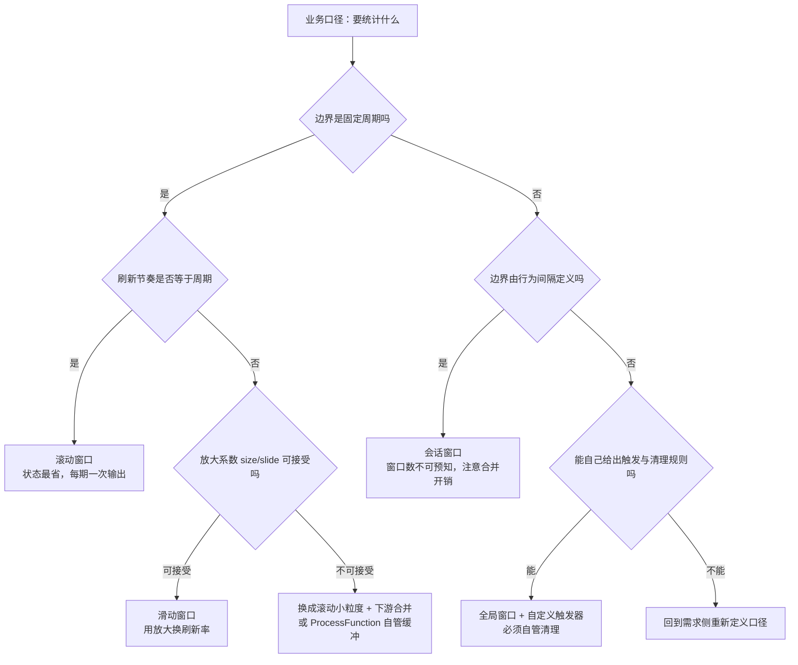
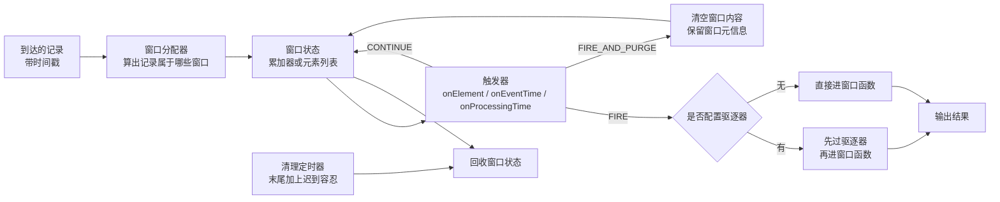
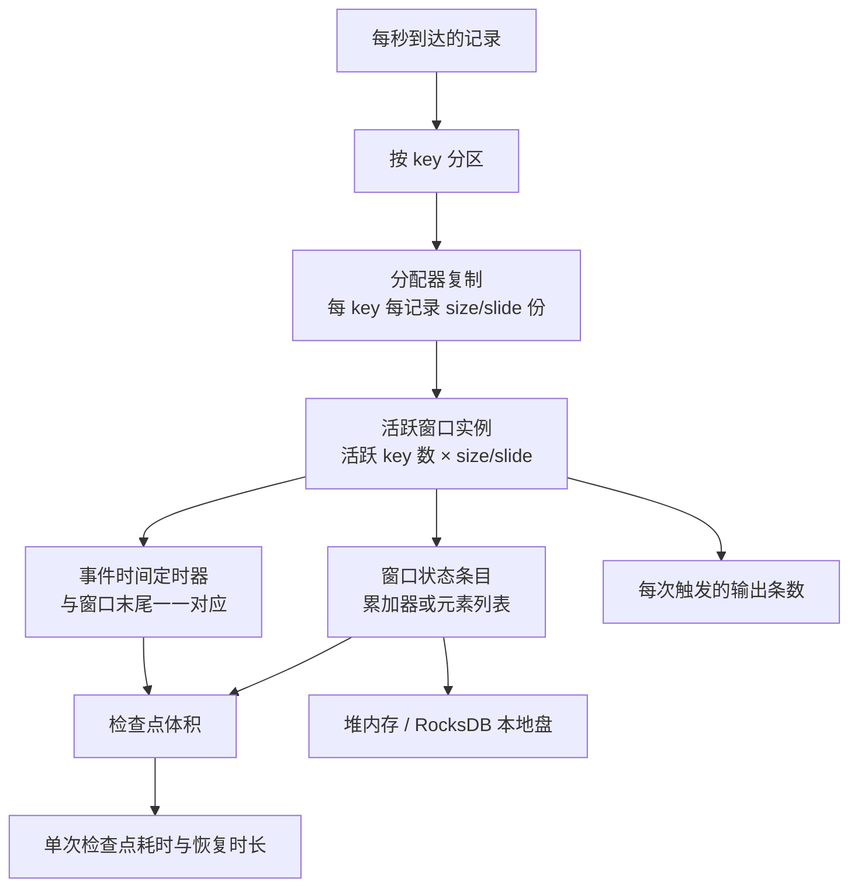
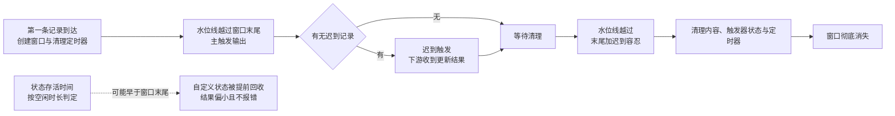

**摘要：**

窗口是流处理里最容易被当成"选一个类"的一步，也是最容易因为这一步把作业拖垮的一步。同一句"最近一小时成交额"，写成滚动窗口、滑动窗口、会话窗口，或者写成全局窗口加自定义触发器，结果口径、状态规模、输出节奏可以差好几个数量级；而多数窗口事故并不是选错了类，是选完之后只改了分配器，没有跟着改触发器，或者把全量聚合用在了本该增量聚合的地方。本文按"选型判据—三件套分工—聚合方式—数量与状态—生命周期—开窗位置—症状对照"的顺序展开，把四种窗口放回代价里比较，把窗口数爆炸拆成可以手算的算式（活跃 key 数 × 每 key 并发窗口数），把窗口清理与状态存活时间这两套互不知情的时钟分开讲，最后给出从症状反查配置的对照表和四个反例。全文回答两个问题：一个具体的统计需求该选哪种窗口、配哪套三件套；以及在上线之前怎么算清它会占多少状态、会不会把窗口数撑爆。

---

## 第 1 章 一句"最近一小时"，四种写法，四种代价

### 1.1 从一块实时大屏说起

笔者用一个贯穿全文的场景来承载后面所有的判断。某电商有两条实时链路：一条是大屏，要求展示"最近一小时的成交额"与"各品类成交额的 Top 5"，刷新间隔十秒；另一条是变更数据捕获（Change Data Capture，CDC）入湖，把订单库两百多张分表的变更同步到湖表，供次日回溯。两条链路的源头是同一份 binlog，峰值写入三万 TPS 上下，binlog 到达计算侧的顺序与事务提交顺序并不一致，乱序范围在三十秒到两分钟之间浮动。

大屏这条链路第一版写得很顺：按品类 `keyBy`，开一个窗口，窗口函数里求和，输出到 Redis。问题出在"最近一小时"这四个字上：滚动窗口只能给"整点小时"的口径，十秒刷新一次没有意义，因为十秒里窗口内容一分不变；于是有人换成了滑动窗口，`size` 一小时、`slide` 十秒，刷新率问题解决了，作业在第三天凌晨 OOM。事后复盘，放大系数是 360，也就是每一条成交记录在状态里存了 360 份，活跃品类数乘上这个系数，状态量级从几百兆抬到几十个 G（量级判断），检查点（Checkpoint）单次耗时从秒级进入分钟级，恢复时间跟着一起涨。

同一句需求还有两种常见写法，各自埋着不同的雷。一种是干脆不用 `keyBy`，直接 `windowAll`，觉得"品类维度不用分组，全局算更快"，上线后发现整个聚合只有一个并行子任务在跑，上游三十多个子任务全在给它喂数据；另一种是选了增量聚合也选对了，但输出里要带窗口起止时间，于是把求和改写成 `ProcessWindowFunction`，在函数体里遍历元素列表自己累加，状态量一夜之间又回到全量缓存的水位。

四种写法都能出数，**差别在代价的分布**：滚动窗口把代价压到最低，但牺牲了刷新率；滑动窗口买了刷新率，付的是状态与计算量的放大；会话窗口把窗口边界交给行为本身，付的是不可预知的窗口数与合并开销；全局窗口把边界完全交给开发者，付的是自己实现触发与清理的责任。所谓选型，就是在这四份代价里挑一份能接受的，而不是挑一个名字好听的类。

### 1.2 窗口由四件东西拼成，不是四个类

初学者常把窗口理解成"四种窗口类型"，实际上 Flink 的窗口算子是由四个可插拔部件拼起来的，四种标准窗口只是四套预设的组合。

| 部件 | 回答的问题 | 缺省行为 | 换成它会改变什么 |
|---|---|---|---|
| 窗口分配器（`WindowAssigner`） | 一条记录属于哪些窗口 | 由所选窗口类型决定 | 一条记录的窗口数、窗口边界的对齐方式 |
| 触发器（`Trigger`） | 什么条件下输出一次结果 | 事件时间窗口是 `EventTimeTrigger`，处理时间窗口是 `ProcessingTimeTrigger` | 输出节奏、输出次数、窗口能否重复输出 |
| 窗口函数（`WindowFunction`） | 拿什么数据怎么算 | 由 `reduce`/`aggregate`/`process` 的调用决定 | 状态里存累加器还是存全部元素 |
| 驱逐器（`Evictor`） | 输出前删掉哪些元素 | 不使用 | 是否还能做增量聚合 |

这四件里前三件是必选、驱逐器可选，四件合起来才决定一个窗口算子的行为，所以**只改分配器不动触发器**是这套体系里最常见的一类错误：把滚动窗口换成滑动窗口，输出节奏本应由水位线驱动，但如果之前为了别的需求挂过 `CountTrigger`，换完分配器之后触发器还是计数驱动，水位线推进到窗口末尾也不会触发，表现就是"窗口开着、数不出来"。反过来，把 `TumblingEventTimeWindows` 换成 `GlobalWindows` 却忘了换触发器，得到的是默认的 `NeverTrigger`，窗口永远不触发，状态只会一直涨。

还有一层耦合藏在分配器与函数之间：驱逐器一旦出现，窗口算子就不能再做预聚合，只能把窗口内所有元素原样存着，等触发时先过驱逐器再进函数。也就是说，装不装驱逐器不只影响"输出哪些数据"，它直接把聚合模式从增量改成了全量。

> 本文讲的是工程动作：窗口怎么选、参数相互怎么牵制、窗口数量怎么估算、作业出问题时先看哪里。水位线如何在算子间传播、窗口状态在什么时刻被内部定时器清掉，这类机制推导归 [[大数据/Flink/Flink原理深度解析与性能优化/07 Flink 时间与 Watermark 底层机制|水位线与窗口清理的机制]] 一篇；水位线生成器的参数怎么配、空闲分区怎么标记，归 [[大数据/Flink/Flink从入门到实战/04 时间语义与 Watermark 实战|第 04 篇]]；状态存活时间（Time To Live，TTL）的内部回收路径归 [[大数据/Flink/Flink原理深度解析与性能优化/05 Flink 状态后端深度解析|状态后端一篇]]。本文只在机制必需处给一句结论，不重复推导。

把一条结论先放在这里：水位线到达窗口算子时，算子把所有"末尾早于新水位线"的窗口取出来触发计算，同时把水位线原样往下游转发；而窗口状态的真正回收，靠的是算子在窗口末尾按迟到容忍量延长出来的那个清理定时器。这两件事的调用链与状态机，读原理列第 07 篇。

### 1.3 本文的读法

后面八章是一条决策链，不是一张知识清单。第 2 章给四种窗口的判据与代价，回答"选哪个"；第 3 章把三件套的分工摊开，回答"改哪个"；第 4 章讲增量聚合与全量聚合的分野，回答"状态为什么会爆"；第 5 章把窗口数量写成算式，回答"爆到什么程度"；第 6 章讲生命周期与两套时钟，回答"什么时候清理、为什么没清掉"；第 7 章讲开窗位置，回答"并行度去哪了"；第 8 章给症状对照与反例；第 9 章收成一份可以直接拿去评审的选型清单。

---

## 第 2 章 四种窗口的选型判据

判断一种窗口合不合适，笔者用的是四个问题：窗口边界由什么决定（时间周期、行为间隔、还是开发者自己）、一条记录会落进几个窗口、窗口什么时候能给出"完整"的结果、窗口数量能不能在上线前算出来。四个问题都答得出来，才算选型完成；有一个答不出来，那就是在上线之后用事故来补答案。

### 2.1 滚动窗口：把账期对齐业务，而不是对齐时间纪元

滚动窗口（Tumbling Window）把时间轴切成大小固定、互不重叠的片段，每个元素恰好属于一个窗口。判据很清楚：业务问的是"每一期多少"，而且这一期的边界是人为规定的整点、整分、整日，滚动窗口就是**最省的答案**，状态里每个 key 在任意时刻只有一个活跃窗口。

它的坑几乎都出在边界上：默认边界对齐 Unix 时间戳的整数倍，东八区的"每天"因此会被切成 UTC 的 00:00 到 24:00，也就是北京时间的早上八点到次日八点。要把它掰到本地零点，得给分配器一个偏移量：

```java
// 北京时间凌晨零点对齐的滚动窗口：偏移量取 -8 小时
.window(TumblingEventTimeWindows.of(Time.days(1), Time.hours(-8)))
```

偏移量的语义在文档里写得很直白：它只改变窗口分配的起点，不改变水位线。所以"对齐了东八区，结果还是晚八小时才出来"这类现象，根因不在偏移量，在水位线延迟与窗口末尾的关系，那属于第 04 篇的范围。

滚动窗口的第二个判据是刷新率，但业务要求"每分钟看到最近一小时"时，滚动窗口给不了这个语义，它只能在整点小时结算一次；硬要它每十分钟输出一次，就得改窗口尺寸，而窗口尺寸一改，"最近一小时"就变成了"最近十分钟"，口径直接变形。这时候真正该换的不是尺寸，是窗口类型。

### 2.2 滑动窗口：用放大换刷新率

滑动窗口（Sliding Window）有两个参数：窗口大小与滑动步长。步长小于大小时相邻窗口重叠，一条记录会同时落进多个窗口。判据是：业务要的刷新率高于"窗口大小"能提供的节奏，且这个刷新率是硬需求。

放大的倍数是**可以算准的**：Flink 的 `SlidingEventTimeWindows.assignWindows` 用一次递减循环给一条记录生成窗口：从包含该时间戳的最后一个窗口起点开始，每次回退一个步长，直到窗口起点早于"时间戳减窗口大小"。循环的次数就是这条记录的窗口数，平均值为 `size/slide`，上限为 `ceil(size/slide)`；当窗口大小能被步长整除时，每条记录的窗口数恒等于 `size/slide`。这一点比"每条记录属于 `ceil(size/slide)` 个窗口"的说法要精确，也决定了估算该用哪个数：算期望开销用 `size/slide`，算最坏情况用 `ceil(size/slide)`。

官方文档里有一句很克制的提醒：大小为一天、步长为一秒的滑动窗口"可能不是一个好主意"。这句话翻译成工程语言就是 86400 倍的放大，任何一份按这个比例复制的数据都活不过一次检查点。笔者见过更常见的版本是"窗口一小时、步长一秒"，放大 3600 倍，作业在压测阶段就被判了死刑。

那么什么样的情况下值得为刷新率付这个放大？笔者的经验阈值是**放大系数不超过十**，而且必须配合增量聚合。放大系数在十以内的场景，状态开销大致与按滚动窗口算的同一数量级，换来的刷新率是实打实的业务价值；放大系数一旦到了六十、三百、三千六，正确的做法不是调参，是换实现：用滚动窗口先算小粒度聚合，再在下游用滚动窗口做跨期合并，或者干脆退到 `KeyedProcessFunction` 加一个环形缓冲，按需滑动计算，把"复制份数"换成"一次遍历"。

> [!warning] 滑动窗口的三个参数，改动顺序有讲究
> 先定刷新率（步长），再定业务口径（窗口大小），最后算放大系数；放大系数超阈值就换实现，不要靠加内存扛。把顺序倒过来，先按内存定尺寸、再按感觉定步长，等号右边的放大系数会变成一次事故的判决书。

### 2.3 会话窗口：窗口数量不由你决定

会话窗口（Session Window）的边界不是时间轴上的刻度，而是行为之间的间隔：同一个 key 的相邻两条记录间隔小于会话间隔，就属于同一个会话，否则开新会话。判据是：业务对象本身就是"一段有始有终的活动"，譬如用户的一次浏览、一次客服对话、一次登录会话。用户行为分析选它，不是因为它时髦，是因为"会话"这个词在业务口径里本来就有定义。

它的实现方式决定了它的代价：文档写明，会话窗口算子为每一条到达的记录各建一个窗口，然后按间隔把相邻窗口合并。也就是说，一条记录先产生一个窗口实例，再看它能否与已有窗口接上，能接就合并，不能接就独占一个。窗口的创建次数因此**与记录数成正比**，活跃窗口数约等于未结束的会话数，而会话数取决于 key 的活跃密度与会话间隔，这两个量都不在上线前的可控清单里，只能从历史数据里估。

合并不是免费的。两个窗口合并要搬状态：窗口内容要合并，触发器的分区状态要合并，定时器要重新注册。一次合并的代价与两个窗口里的数据量成正比，而一条迟到的记录还可能把两个本来分开的会话"桥接"起来，触发一次计划外的合并，下游因此收到两条互相矛盾的结果。这也是为什么会话窗口的流量高峰往往先表现为 CPU 抖动，而不是状态膨胀：搬运的开销长在合并路径上，不在存储上。

会话间隔的取法，笔者的建议是先从业务侧拿一个粗值，再用离线数据验证分布：把同一 key 相邻记录的时间差做直方图，看哪个分位点能把"同一会话内的停顿"与"会话之间的间隔"分开，取那个分位点作为间隔。间隔取小了，一个会话被切成若干段，结果条数虚高；取大了，不同会话被粘在一起，单会话状态过大。动态间隔的能力可以按记录给出间隔，但要注意 API 的不对称：事件时间版本是 `EventTimeSessionWindows.withDynamicGap(...)`，处理时间版本却是一个独立的类 `DynamicProcessingTimeSessionWindows`，照着事件时间的写法去找处理时间的同名方法会编译不过。

### 2.4 全局窗口：没有边界，就得自己造边界

全局窗口（Global Window）把所有元素塞进同一个窗口，它没有自然的末尾，因此默认触发器是 `NeverTrigger`：**不触发、不清理、状态只涨**。判据只有一条：四种标准窗口的边界语义都对不上业务，且你愿意自己承担触发与清理两项责任。

用它要交代三件事：第一件是触发条件，计数触发（每满一万条出一批）与事件触发（收到一个"批次结束"标记）是两类典型需求；第二件是清理条件，触发器里必须明确在什么时机让窗口内容失效，否则窗口活到作业重启；第三件是幂等输出，同一个全局窗口可能被触发多次，下游必须能接受重复结果。

```java
stream
    .keyBy(event -> event.getDeviceId())
    .window(GlobalWindows.create())
    // 自定义触发器：攒够 100 条或收到批次结束标记时触发，触发后清空内容
    .trigger(new BatchOrMarkerTrigger(100))
    .aggregate(new BatchSummaryAggregator());
```

全局窗口最容易出的事故是"忘了清理"。触发之后只返回 `FIRE` 而不清内容，下一批数据会继续往旧内容上叠，业务看到的是越来越大的累计值；换成 `FIRE_AND_PURGE` 才是"每批独立"的语义，这两个返回值的差别放到第 3 章展开。

### 2.5 四种窗口的判据对照

把上面四节的判断收进一张表，表里的"代价"一列是选型时的第二顺位依据：**先看语义对不对**，再看代价能不能接受。

| 维度 | 滚动窗口 | 滑动窗口 | 会话窗口 | 全局窗口 |
|---|---|---|---|---|
| 窗口边界由什么决定 | 固定周期与偏移量 | 固定周期与步长 | key 的记录间隔 | 开发者自定义 |
| 一条记录的窗口数 | 1 | `size/slide`（上限 `ceil`） | 1（先独占再合并） | 1 |
| 窗口数能否预先算出 | 能，等于周期数 | 能，等于周期数 × 放大系数 | 不能，取决于活跃密度 | 能，等于 key 数 |
| 状态量级（增量聚合） | 最小 | 单窗口状态 × 放大系数 | 会话数 × 单会话状态 | key 数 × 累计状态 |
| 输出节奏 | 每期一次 | 每步长一次 | 会话结束时一次 | 完全由触发器决定 |
| 典型反例 | 拿它做"最近 N 分钟" | 步长设到秒级 | 间隔取错导致会话粘连 | 忘了清理 |

当四种标准窗口都对不上时，先别急着上全局窗口，值得回头问一句：这个需求是不是被描述错了。笔者见过一个"每五分钟统计一次最近一小时"的需求，追问之后发现业务真正要的是"整点小时的滚动汇总"，大屏上的"最近一小时"只是显示文案；把文案改成"本小时累计"，放大系数从六十变成一，一行代码没改，问题消失。需求的表述与需求的实质之间的缝隙，往往比窗口类型的差价更大。

四种窗口怎么落到具体写法上，用一张决策图收束：先看边界是不是周期，再看刷新率是否高于周期，最后看是不是由行为间隔定义。



---

## 第 3 章 三件套的分工：改一件要动另一件

窗口算子里，分配器、触发器、窗口函数是三个独立的决策点，它们通过一个共享的"窗口实例"耦合在一起。把这层耦合看清楚，很多"改了没生效""改了反而更糟"的故障就不需要猜了。下面这张图是元素进入窗口算子后的路径，后面三节沿着它逐段讲。



### 3.1 分配器：一条记录进几个窗口

分配器的唯一职责是回答"这条记录属于哪些窗口"。滚动与会话各返回一个窗口，滑动返回一组窗口，全局返回那个唯一的窗口。滑动窗口的复制就发生在这一步：`assignWindows` 里一次递减循环，把同一条记录包装成多个 `TimeWindow`，后面的状态写入按窗口逐个进行，所以"重复存储"不是状态后端的实现缺陷，而是分配语义的直接后果。

这一节要记住的推论是：换分配器等于换状态规模。滚动换滑动，放大系数从 1 变成 `size/slide`；滑动换会话，窗口数从"可预算"变成"不可预算"；任何窗口换全局，清理责任从框架转到开发者身上。分配器的改动永远是状态层面的改动，不是语法层面的改动。

### 3.2 触发器：默认行为是"输出"，不是"清空"

触发器回答"什么时候输出一次结果"，返回值有四种：`CONTINUE` 继续等，`FIRE` 触发计算，`PURGE` 只清内容不触发，`FIRE_AND_PURGE` 触发后清内容。这里有一处流传很广的错误说法需要纠正：`FIRE_AND_PURGE` 并不是默认行为。官方文档写的是**预置触发器默认只 `FIRE`，不清窗口内容**；事件时间窗口的默认触发器 `EventTimeTrigger` 在源码里也确实只返回 `FIRE`，它做两件事——当水位线已经越过窗口末尾时立刻触发，否则在窗口末尾注册一个事件时间定时器，等定时器到点再触发。

这个区别决定了迟到数据的行为：窗口内容在触发后仍然保留，所以一条在水位线之后、迟到容忍范围之内到达的记录，会再触发一次计算，产生所谓的迟到触发（late firing）；下游看到的是同一窗口的多个结果，按更新的语义处理。如果默认触发器把内容清掉了，迟到容忍就没有意义了。

窗口状态的真正回收不在触发器里，而在算子的清理定时器：窗口创建时算子按"窗口末尾 + 迟到容忍"注册一个定时器，到点把窗口内容、触发器状态和定时器一起清掉。这也解释了为什么把触发器换成计数触发之后，窗口不会自己消失：`CountTrigger` 只负责按数量触发，它不改变清理定时器，窗口仍然按时间末尾被回收；但如果换成全局窗口，末尾是无穷大，清理定时器等于永远不到点，状态就再也收不回来。

自定义触发器最常见的三个失误，都出在"改了触发器、没接住配套责任"上。

| 失误 | 现象 | 机理 |
|---|---|---|
| 给时间窗口挂 `CountTrigger`，期望"按时间也按量触发" | 攒够数量才出数，水位线过了也不出 | 指定触发器会替换默认触发器，时间触发能力被整体拿走 |
| 触发后返回 `FIRE`，期望"每批独立" | 每一批的结果都包含之前所有批的数据 | 内容未清空，下一批继续在旧内容上累加 |
| 用全局窗口但不写清理逻辑 | 状态单调增长，检查点越来越大 | 全局窗口末尾为无穷大，清理定时器不会到点 |

需要"既按时间又按量"的场景，正确路径是写一个组合触发器，内部同时注册事件时间定时器与维护计数，而不是拿一个内置触发器去替换另一个；需要"计数触发且每批独立"的场景，用 `PurgingTrigger.of(CountTrigger.of(n))` 把触发变成清空式触发。

### 3.3 驱逐器：输出前删数据的代价

驱逐器回答"输出前删掉哪些元素"，内置三种：按数量保留最新的若干条、按时间窗保留最近一段、按自定义差值函数删除离群点。它挂在触发之后、窗口函数之前或之后，用于"窗口很大但每次只看最近一部分"的展示类需求。

它的代价写在文档里：指定驱逐器会阻止任何预聚合，因为所有元素都必须先交给驱逐器过一遍。这一条把窗口从增量模式打回全量模式，状态量与窗口内元素数同阶。所以选驱逐器之前先问一句：这个过滤能不能放进窗口函数里？多数情况下可以，而且放进函数里至少还能保留预聚合的空间。

还有一处容易被忽略的细节：Flink 不保证窗口内元素的顺序，驱逐器"从头部删除"删掉的不一定是先到或后到的元素。需要严格按时间取最近的若干条，得自己在窗口函数里按时间戳排序，而不是依赖驱逐器的顺序。

### 3.4 想要的行为该动哪一件

把三件套的责任收成一张表，评审时可以直接对照：左边是想要的行为，中间是应该动的部件，右边是不要动的部件。

| 想要的行为 | 该动哪一件 | 不要动哪一件 | 常见代价 |
|---|---|---|---|
| 改变结算周期 | 分配器的窗口大小 | 触发器 | 周期变小，窗口数按比例增加 |
| 提高刷新频率 | 分配器的步长 | 窗口函数 | 状态按 `size/slide` 放大 |
| 按数量提前出数 | 触发器（叠加计时逻辑） | 分配器 | 输出次数增加，下游要能去重 |
| 每批结果独立 | 触发器的返回值（清空式触发） | 分配器 | 窗口内容不复用，迟到数据无处可去 |
| 只输出最近若干条 | 窗口函数内过滤 | 驱逐器 | 用驱逐器会失去预聚合 |
| 窗口结果带时间范围 | 窗口函数的元信息 | 分配器 | 用全量函数会失去增量聚合，见第 4 章 |

---

## 第 4 章 增量聚合与全量聚合：状态差出几个数量级

窗口状态里存什么，是窗口算子内存占用的唯一决定因素。同一个窗口、同一份数据，存累加器和存元素列表，状态量级可以差出一到四个数量级，这是窗口类作业 OOM 的**头号原因**，比参数配错的占比高得多。

### 4.1 状态里到底存了什么

`ReduceFunction` 与 `AggregateFunction` 属于增量聚合：每来一条记录，立刻与当前累加器合并，状态里只有一个累加器对象。`ReduceFunction` 的输入输出类型必须相同，适合求和、取最大；`AggregateFunction` 拆成输入、累加器、输出三个类型，适合平均值这类需要"和与计数"的聚合。两者的共同点是状态量与窗口内记录数无关，一个窗口一条状态。

`ProcessWindowFunction` 属于全量聚合：窗口触发时，算子把窗口内所有原始记录一次性交给函数，函数可以遍历、排序、取 Top-N，也可以访问窗口元信息与窗口级状态。代价是这些记录必须一直存在状态里，直到窗口被清理。窗口有多大、流量有多高，状态就有多大。

```java
// 增量聚合：状态里只有一个累加器（和 + 计数）
public class AverageAmountAggregator
        implements AggregateFunction<OrderEvent, Tuple2<Double, Long>, Double> {

    @Override
    public Tuple2<Double, Long> createAccumulator() {
        return Tuple2.of(0.0, 0L);
    }

    @Override
    public Tuple2<Double, Long> add(OrderEvent order, Tuple2<Double, Long> acc) {
        // 只保留中间量，原始记录不进状态
        return Tuple2.of(acc.f0 + order.getAmount(), acc.f1 + 1);
    }

    @Override
    public Double getResult(Tuple2<Double, Long> acc) {
        return acc.f1 == 0 ? 0.0 : acc.f0 / acc.f1;
    }

    @Override
    public Tuple2<Double, Long> merge(Tuple2<Double, Long> a, Tuple2<Double, Long> b) {
        // 会话窗口合并窗口时会被调用，非合并型窗口也要求实现
        return Tuple2.of(a.f0 + b.f0, a.f1 + b.f1);
    }
}
```

上面这段的每个方法都在回答一个问题：初始状态是什么、单条如何并入、如何产出结果、两个状态如何合并。`merge` 在滚动与滑动窗口里不会被调用，但接口要求实现，写错也不会立刻暴露，等到换成会话窗口才炸——这是跨窗口类型复用聚合函数时的一个隐患。

### 4.2 反例：用全量函数做简单求和

最常见的错误写法是这样：需求只是"每分钟每个品类的成交额"，因为要在输出里带上窗口起止时间，就写了 `ProcessWindowFunction`，在 `process` 里遍历元素累加。功能上没错，**代价上完全没必要**：窗口内每条记录都要进状态，一条不落。

```java
// 反例：只是为了带窗口时间，就把整窗元素搬进状态
.process(new ProcessWindowFunction<OrderEvent, CategorySummary, String, TimeWindow>() {
    @Override
    public void process(String category, Context ctx,
                        Iterable<OrderEvent> orders, Collector<CategorySummary> out) {
        double sum = 0;
        for (OrderEvent order : orders) {   // 这一次遍历的代价，是整窗元素常驻状态
            sum += order.getAmount();
        }
        TimeWindow w = ctx.window();
        out.collect(new CategorySummary(category, w.getStart(), w.getEnd(), sum));
    }
});
```

状态成本的算式很直白：状态量 = 窗口内记录数 × 单条记录大小 × 并发窗口数。窗口一小时、流量每秒一千条，单个窗口就是三百六十万条记录，按每条两百字节算，一个 key 的一个窗口就是七百多兆；再乘上并发 key 数与滑动放大系数，量级直接进入 TB。换成增量聚合之后，同样的需求状态里只有一个 `Tuple2<Double, Long>`，单窗口几十字节，放大一万倍也还是可控的。

### 4.3 组合写法：既要增量，又要窗口元信息

Flink 为这个需求提供了专门的重载：把增量聚合函数与全量窗口函数一起传进去，先用增量函数把元素压成累加结果，窗口触发时把"聚合结果"而不是"全部元素"交给窗口函数。窗口函数拿到的可迭代对象里只有一个元素，就是 `AggregateFunction` 的输出。

```java
stream
    .keyBy(order -> order.getCategory())
    .window(TumblingEventTimeWindows.of(Time.minutes(1)))
    .aggregate(
        // 第一个参数做增量：状态里只有一个 Double
        new SumAmountAggregate(),
        // 第二个参数只负责补元信息：拿到的可迭代对象里只有一个元素
        new ProcessWindowFunction<Double, CategorySummary, String, TimeWindow>() {
            @Override
            public void process(String category, Context ctx,
                                Iterable<Double> partial, Collector<CategorySummary> out) {
                double total = partial.iterator().next();
                TimeWindow w = ctx.window();
                out.collect(new CategorySummary(category, w.getStart(), w.getEnd(), total));
            }
        });
```

这个写法有三处需要留意：第一处是语义边界，窗口函数只能看到聚合结果，看不到原始记录，所以"既要总量又要明细"的需求不能靠这个组合解决，得走全量或者把明细放到侧输出。第二处是窗口级状态：`ProcessWindowFunction` 的上下文提供窗口级状态与全局状态，用了就得在 `clear()` 里一起清掉，否则窗口被回收时这些状态会留在原地，形成另一条泄漏路径。第三处是累加器的可合并性：组合写法在会话窗口下同样会走合并路径，累加器的 `merge` 必须正确，否则合并后的结果是错的。

### 4.4 什么时候必须全量

全量聚合不是错误选项，只是贵。必须用它的情形有四类：需要窗口内元素排序或取 Top-N，需要访问窗口元信息且不做组合聚合，需要窗口级或全局状态做跨触发累积（譬如多次迟到触发要去重），需要往侧输出写明细。这四类之外的"我在函数里遍历一下求和"都属于把增量能力浪费掉。

### 4.5 三种函数的状态量级

把三种函数放在同一口径下比较，表里的数字是示例推算，用来说明量级关系，不是实测值：假设单个窗口内有一万条记录、单条记录两百字节、每个 key 同时只有一个活跃窗口。

| 聚合方式 | 状态里存什么 | 单窗口状态量（示例推算） | 与元素数的关系 |
|---|---|---|---|
| `ReduceFunction` | 一个与输入同类型的元素 | 约数百字节 | 无关 |
| `AggregateFunction` | 一个累加器对象 | 数十到数百字节 | 无关 |
| 组合写法 | 一个累加器 + 窗口元信息 | 数十到数百字节 | 无关 |
| `ProcessWindowFunction` | 窗口内全部原始记录 | 约 2 MB | 线性正比 |
| 任意方式 + 驱逐器 | 窗口内全部原始记录 | 约 2 MB | 线性正比 |

量级差在这里已经能看出来：一万条记录的窗口，全量聚合是兆级，增量聚合是百字节级，**差四个数量级**；把窗口放大到一小时、把滑动系数算进去，这个差距不会缩小，只会沿着"窗口内记录数 × 并发窗口数"两条轴同时放大。

---

## 第 5 章 窗口数爆炸：把代价写成算式

"窗口数爆炸"不是一个精确术语，但它描述的现象很具体：活跃窗口实例的数量随 key 基数与窗口参数一起增长，状态、定时器、检查点体积、输出条数四条曲线同时抬头，直到某个环节先断。要说清这件事，得把它拆成能手算的乘法。

### 5.1 放大发生在复制环节

放大链条一共四步：元素到达、分配器复制、状态写入、定时器注册。第一步与第三步之间的复制是**放大的源头**，官方文档的原话是"Flink 为每个元素在它所属的每个窗口里各创建一份副本"。这句话对滚动窗口来说是 1 份，对滑动窗口来说是 `size/slide` 份，对会话窗口来说在合并完成之前也是 1 份，但会带来额外的合并搬运。

第四步容易被忽略：事件时间窗口的默认触发器会在窗口末尾注册一个事件时间定时器，同一个 key、同一个窗口末尾只挂一个定时器，但不同窗口的末尾不同，所以定时器的数量与活跃窗口数量同阶。一个六百万活跃窗口的作业，定时器服务里也压着六百万个待触发的定时器，它们同样进检查点、同样在恢复时重建。



### 5.2 三个算式

第一个算式给活跃窗口总数：窗口在任意时刻覆盖"当前时间"的那些实例才算活跃，对滑动窗口来说，每个 key 同时有 `size/slide` 个窗口覆盖当下，所以活跃窗口总数约等于活跃 key 数乘以放大系数，这个数决定了状态的条目数。

第二个算式给状态体积：状态体积约等于活跃窗口总数乘以单窗口状态大小，再乘上一个与状态后端相关的系数（堆内对象头与哈希表开销，或者 RocksDB 的键值编码开销）。增量聚合时单窗口状态是几十到几百字节，全量聚合时是"窗口内记录数 × 单条大小"。

第三个算式给输出压力：滑动窗口每过一个步长就有一批窗口到点，输出条数约等于"活跃 key 数 × 步长内到点的窗口数"，步长越小、窗口越大，下游每秒要接的结果条数越多；这条曲线经常先于状态曲线把下游打挂。

### 5.3 一次完整的示例推算

把贯穿案例里的数字代进去：假设大屏按十万个活跃品类与店铺维度聚合，窗口一小时、步长一分钟，采用增量聚合。

放大系数为 60，活跃窗口总数为十万乘六十，六百万个窗口实例。单窗口状态按一个累加器加一次状态条目开销估算，取一百五十字节，状态条目总量约九百兆；定时器按每个窗口一个、每个定时器连索引一起占几十字节估算，又是数百兆；两者相加，光"窗口骨架"就落在一吉字节上下。这个量级对单机状态后端不算致命，但它会在两处放大：检查点体积翻倍之后，单次检查点耗时从秒级进入十秒级；作业故障恢复时要把这六百万条状态重建一遍，恢复时间与状态条目数成正比。

把步长从一分钟改成十秒，放大系数变成 360，活跃窗口总数三千六百万，骨架状态跟着涨到六吉字节上下，输出条数涨到六倍。同一份业务口径，只是"刷新快一点"，代价是**一条数量级不同的曲线**。再把聚合方式换成全量聚合：每个 key 一小时内的记录数按一千条计，单条两百字节，一个 key 的一小时窗口内容约两百千字节，乘上六十个并发窗口是一千二百万字节，再乘十万个 key，得到的是太字节量级。这已经不是一个调参能解决的问题，是必须换实现。

同样的算式套到会话窗口，结论不同但更棘手：活跃窗口数约等于未结束的会话数，而会话数等于"活跃 key 数 × 每个 key 的并发会话数"，后者由记录密度与会话间隔共同决定，上线前只能从历史数据估。一个营销活动把用户的访问密度抬高，会话数未必涨，但合并次数会涨，因为每条记录都要去看能否接上已有窗口；真正让作业吃不消的往往不是状态条目数，而是合并时搬运状态的 CPU 开销。

### 5.4 倾斜：平均值掩盖的那一半

上面三个算式算出来的都是平均值，而 Flink 的状态是按 key 分区的：一个 key 的全部窗口状态落在同一个并行子任务上。key 的分布几乎从不均匀，头部 key 的数据量可以是平均值的几十倍，于是"集群总状态十吉字节、单任务内存两吉字节"的作业照样会 OOM，因为某个子任务分到的 key 恰好是热点。

判断倾斜的办法不复杂：看各子任务的托管内存占用、状态大小、每秒输出条数，如果最大值与中位数差出三倍以上，就**不要再按平均值规划容量**。缓解手段与所有流式倾斜问题一致：给热点 key 加盐做局部聚合再二次聚合，或者把窗口维度从"品类"下沉到"品类 + 二级类目"降低单 key 数据量，代价是下游要再做一次合并。

### 5.5 三种窗口的状态量级对比

把三种时间窗口放在同一口径下比较。数字仍是示例推算，假设十万活跃 key、单条记录两百字节、增量聚合、单窗口状态一百五十字节。

| 窗口类型与参数 | 单 key 并发窗口数 | 活跃窗口总数（示例推算） | 骨架状态量级（示例推算） | 主要风险 |
|---|---|---|---|---|
| 滚动窗口，一小时 | 1 | 十万 | 数十兆 | 基本可控，注意检查点间隔 |
| 滑动窗口，一小时滑动一分钟 | 60 | 六百万 | 一吉字节上下 | 状态与定时器同阶放大，检查点变慢 |
| 滑动窗口，一小时滑动十秒 | 360 | 三千六百万 | 六吉字节上下 | 输出条数同步放大，下游先崩 |
| 滑动窗口，一小时滑动一秒 | 3600 | 三亿六千万 | 数十吉字节 | 不具备可运行性 |
| 会话窗口，间隔三十分钟 | 约等于并发会话数 | 十万量级起，随活跃密度上涨 | 视会话长度而定 | 窗口数不可预算，合并搬运耗 CPU |
| 全局窗口，自管触发 | 1 | 十万 | 累计状态只增不减 | 清理责任在开发者，极易泄漏 |

表里最要紧的一列是数量级：滚动与滑动之间的差别不是"风格"，是数量级；会话与全局的差别不是"灵活度"，是能不能在上线前把数算出来。

---

## 第 6 章 窗口的生命周期：两套时钟各管一段

窗口从创建到消失只有三个节点：第一条记录落入时创建，触发器给出一次输出，清理定时器把状态收走。三个节点各有各的触发条件，而作业里同时还在跑另一套时钟——状态存活时间。两套时钟互不知情，混着看就会得出"配置生效了但状态没清"或者"状态莫名其妙少了"的结论。

### 6.1 创建：第一条记录决定一切的起点

窗口在第一条属于它的记录到达时创建。这句话有两个推论：其一，没有数据的窗口不存在，所以窗口数不是"时间轴上的格子数"，而是"有数据的那些格子数"，估算状态时应该用活跃 key 数而不是 key 总数。其二，窗口创建意味着三样东西同时落位：窗口内容状态、触发器状态、清理定时器，三者一一对应，任何一次泄漏都是这三样里的某一样被留了下来。

### 6.2 输出与迟到：allowedLateness 买的是什么

事件时间下，水位线越过窗口末尾时窗口触发第一次输出，这是主触发。主触发之后在水位线追上窗口末尾之前到达的迟到记录，默认被丢弃；设了迟到容忍（`allowedLateness`）之后，这些记录仍然会被加入窗口，并且可能再触发一次计算，产生迟到触发的结果。文档对此的表述很明确：迟到触发的结果应当被当作对先前结果的更新，数据流里因此会出现同一计算的多份结果，下游要么按更新处理，要么自己去重。

迟到容忍还有两个边界：第一，它**延长的是状态的保留时间**，不是结果的正确性：窗口在"末尾 + 迟到容忍"之后被彻底删除，更晚到达的记录仍然丢弃，想要不丢就得用侧输出把迟到数据接出来单独处理。第二，全局窗口没有迟到概念，它的末尾是长整型的最大值，任何记录都不会被判为迟到，这也意味着全局窗口的状态永远不会被框架回收。

> [!warning] 用迟到容忍兜"补数"是常见的误用
> 上游某次重放导致数据延迟两小时，有人把 `allowedLateness` 调到两小时想"接住"这些数据。结果窗口状态多保留两小时，活跃窗口数按比例上涨，检查点体积同步上涨，而真正迟到的数据依然可能落在容忍范围之外。补数的正确位置在源头：重放时重置水位线或者走离线补算，而不是让每个窗口都多站两小时岗。

### 6.3 清理：只对时间窗口有保证

清理定时器在窗口创建时按"末尾 + 迟到容忍"注册，水位线越过这个时间点，算子把窗口内容、触发器状态、定时器一并清掉。文档在这里给了一句关键的限定：Flink **只对基于时间的窗口保证删除**，对全局窗口这类非时间窗口不做保证。换句话说，滚动、滑动、会话三种窗口的删除是框架责任，全局窗口的删除是开发者责任。

还有一层区分值得记住：触发器返回的 `PURGE` 只清窗口内容，不清窗口元信息，窗口仍然存在，后续记录还能继续往里加；而清理定时器清的是窗口本身。两者都叫"清理"，语义完全不同，把 `PURGE` 当成"窗口结束"来用，得到的是一个内容被反复清空、元信息永不释放的窗口。

### 6.4 与状态 TTL 的关系：一套回收，另一套可能提前回收

状态存活时间是按"最后一次访问之后空闲多久"判定回收的机制，计时可以从处理时间或事件时间取，判定与窗口边界没有关系。窗口的清理按"窗口末尾加迟到容忍"判定，与空闲时长没有关系。两套时钟各自跑，交集处就是坑。

SQL 侧的口径是明确的：窗口相关算子（窗口聚合、窗口连接、窗口 Top-N 等）与区间连接不依赖 `table.exec.state.ttl` 来控制状态保留，也不能按算子配置状态存活时间；`STATE_TTL` 提示只覆盖常规连接与分组聚合。所以在 SQL 里把状态存活时间调小，既不会让窗口更早回收，也不会让窗口状态变小，它作用在别的算子上。

DataStream 侧的情况要分两种状态看：窗口内容状态由算子内部创建，用户拿不到它的描述符，也就无法为它配置存活时间，它的生死只由清理定时器决定。能挂存活时间的是开发者自己声明的状态：触发器通过 `getPartitionedState` 拿到的分区状态，以及 `ProcessWindowFunction` 上下文里的窗口级状态与全局状态。这些描述符一旦启用了存活时间，回收条件就变成"空闲若干时间"，与水位线彻底脱钩——窗口还没结束、迟到数据还在路上，状态可能已经被回收，表现出来就是计数少了一截、结果比预期偏小，而且这种缺失不会报错，只会在对账时被发现。

因此两边的正确用法是：窗口本身的回收交给窗口机制，不要试图用状态存活时间去"帮它清理"；窗口内自定义状态的存活时间要么不开，要么设得比"窗口长度加迟到容忍"更长，让它永远晚于窗口清理，从而不产生可观察的影响。

### 6.5 生命周期与两套时钟

下面这张图把三个节点与两套时钟放在同一时间轴上，实线是窗口机制，虚线是状态存活时间。



### 6.6 回收机制对照

把四类回收动作放在一张表里，区分"谁触发、清什么、不清什么、风险在哪"。

| 机制 | 触发条件 | 清掉什么 | 不清什么 | 主要风险 |
|---|---|---|---|---|
| 触发器的 `FIRE` | 触发器判定 | 什么都不清 | 内容、元信息、定时器 | 内容反复复用，结果越叠越大 |
| 触发器的 `PURGE` | 触发器判定 | 窗口内容 | 窗口元信息、触发器状态 | 元信息常驻，窗口仍在接收数据 |
| 清理定时器 | 水位线越过末尾加迟到容忍 | 内容、触发器状态、定时器 | 自定义的窗口级状态（需自行清） | 自定义状态忘记在 `clear()` 里清 |
| 状态存活时间 | 空闲时长超过阈值 | 启用该配置的状态条目 | 窗口内容状态（用户无法配置） | 早于窗口末尾回收，结果偏小 |

---

## 第 7 章 开窗位置：keyBy 之前还是之后

`keyBy` 放在窗口前面还是后面，决定的不只是代码顺序，而是这个聚合能不能并行、状态按什么维度分区、结果的口径是不是你要的那个。

### 7.1 两种开窗位置的语义差别

`keyBy` 之后开窗，得到的是键控窗口：每个 key 一条独立的窗口时间线，同一 key 的记录进同一组窗口，不同 key 互不干扰，状态按 key 分区分散到各并行子任务。这类窗口能并行，也能承载绝大多数"分组统计"的需求。

不 `keyBy` 直接开窗，用的是 `windowAll`，得到的是非键控窗口：整条流只有一个窗口时间线，所有 key 的记录混在同一个窗口里。文档写得很清楚，非键控窗口的全部窗口逻辑由单个任务执行，并行度为 1。

### 7.2 windowAll 的并行度是 1，不是"你想设多少"

`windowAll` 那一段的并行度只有一：把作业并行度调到三十，`windowAll` 这一段仍然只有一个子任务在算，上游三十个并行子任务把数据全部汇给它，下游再分发给三十个并行子任务。**聚合本身不会分片**，能分片的只有它前后的算子。

于是 `windowAll` 的适用面比想象中窄：只在"全局口径本来就只有一个结果"时合适，譬如全站 Top-N、全局去重计数、整条流的异常检测。这类需求的数据量必须小到单个子任务能扛，否则要么给这一个子任务足够大的内存与堆外空间，要么改成两阶段聚合。反过来，如果需求本身就是分组的，用 `windowAll` 就等于主动放弃并行度，而且放弃得很隐蔽——代码能跑，延迟上不去，看并行度面板才发现瓶颈在一个算子上。

> [!info] 判断并行度有没有落在窗口上
> Web UI 里点开窗口算子，看 Parallelism 一栏。键控窗口的并行度与作业并行度一致，非键控窗口恒为 1；如果窗口算子的并行度远小于上游，而输入速率又很高，这个算子就是整条链路的瓶颈点，先确认它是 `windowAll` 还是键控窗口再做优化。

### 7.3 两阶段聚合与串联窗口

既要全局口径又要并行度，标准做法是两阶段：先按业务维度 `keyBy` 做局部聚合，再用 `windowAll` 把局部结果合成全局结果。这个模式能成立，靠的是窗口结果的一个细节——窗口输出的元素时间戳被设为该窗口的最大允许时间戳，也就是**末尾减一**；下游用同样大小的窗口接，这些结果会被分进与上游完全相同的窗口。文档专门讲过这个性质：连续两次窗口操作只要窗口尺寸一致，第一段里属于窗口 `[0, 5)` 的结果，在第二段里仍然落在 `[0, 5)`。

```java
// 第一段：按品类局部聚合，状态按品类分区，可以并行
DataStream<CategorySummary> perCategory = stream
    .keyBy(order -> order.getCategory())
    .window(TumblingEventTimeWindows.of(Time.minutes(5)))
    .aggregate(new SumAmountAggregate(), new AttachWindowInfo());

// 第二段：全局取 Top 5，只有这一段是单并行度
perCategory
    .windowAll(TumblingEventTimeWindows.of(Time.minutes(5)))
    .process(new TopNWindowFunction(5));
```

第二段的输入是"每个品类一条"，体量从原始记录级降到品类级，单并行度也能扛。大屏 Top 5 这类需求用这个结构，既保住了口径，也把单点压力压到可接受范围。如果品类数量本身很大、第二段仍扛不住，就把 Top-N 改成两阶段 Top-N：先各分区取局部 Top-N，再由一个算子做归并。

### 7.4 两种开窗位置的对照

| 维度 | keyBy 之后开窗 | 直接 windowAll |
|---|---|---|
| 窗口时间线 | 每个 key 一条 | 全流一条 |
| 并行度 | 与作业并行度一致 | 恒为 1 |
| 状态分区 | 按 key 分散到各子任务 | 全部压在一个子任务 |
| 适用口径 | 分组统计、按维度的指标 | 全局 Top-N、全局去重、全局异常 |
| 常见误用 | 用高基数 key 开窗导致单任务状态过大 | 以为调大并行度就能扩容 |
| 扩容手段 | 调并行度、处理热点 key | 改两阶段聚合，把单点放在数据量小的一侧 |

---

## 第 8 章 症状、配置与反例

窗口作业的故障有一个共同点：表象与根因隔着一层。看现象直接改参数，改错方向的概率很高；按"先看证据、再定位部件、最后动配置"的顺序走，能省掉大量试错。

### 8.1 症状到配置的对照

下表按症状组织，中间两列是排查顺序：先看证据，再看通常对应的配置项。最后一列列的是不要做的动作，因为错误动作往往比故障本身更贵。

| 症状 | 先看的证据 | 通常对应的配置 | 不要做的事 |
|---|---|---|---|
| 窗口迟迟不出结果 | 各子任务的当前水位线、空闲源是否被标记、触发器是否被替换 | 水位线延迟与乱序容忍、触发器类型、窗口末尾与水位线的关系 | 盲目加大迟到容忍；先怀疑窗口函数写错 |
| 状态持续增长、检查点越来越大 | 窗口算子的状态大小、活跃窗口数、聚合方式 | 全量聚合、过小的步长、过长的迟到容忍、全局窗口无清理 | 先加内存；先缩短检查点间隔 |
| 同一窗口输出多条互相矛盾的结果 | 迟到触发次数、下游是否按更新处理 | 迟到容忍、迟到数据侧输出、下游去重策略 | 把迟到容忍调成零掩盖问题 |
| 窗口之间结果不一致（会话被拆开或被粘住） | 会话间隔与记录间隔的分布、合并次数 | 会话间隔取值、动态间隔取值、迟到数据桥接 | 用更长的迟到容忍去"等"数据 |
| 单个子任务状态或 CPU 远高于其他 | 各子任务的状态大小、输出速率、key 分布 | key 的基数与分布、是否按热点 key 分区 | 按平均值规划容量 |
| 输出条数打垮下游 | 每秒输出的结果条数、步长 | 步长过小、窗口过大、是否每步长全量输出 | 调大下游并行度而不改窗口参数 |

### 8.2 四个反例

第一个反例是把步长设到秒级：窗口一小时、步长一秒，放大系数三千六，活跃窗口数与定时器数量同步爆炸，状态条目从数十万涨到数亿量级。需求侧的真实意图往往只是"大屏上数字动得勤"，而这个意图用便宜得多的手段就能满足：按一分钟滚动聚合，前端每秒读最近一次结果；或者用处理时间窗口，把延迟从"等一分钟"降到"等一个水位线"。把刷新率直接翻译成步长，是把展示层的频率需求错误地压到了状态层。

第二个反例是用全量函数做简单求和。需求只是汇总，却因为要带窗口起止时间而写了 `ProcessWindowFunction`，状态从累加器变成整个窗口的元素列表。正确路径是第 4 章的组合写法：增量聚合负责算，全量函数只负责补元信息。这一处的改动通常是**全篇性价比最高的优化**，状态能降一到三个数量级，代码改动不过十行。

第三个反例是给 `windowAll` 配了大并行度：作业并行度设成三十二，全局 Top-N 仍然只有一个子任务在算，上游全部汇聚、下游再分发，这个算子的输入队列与状态内存成了整个作业的瓶颈。看到"加了资源但没有变快"，第一件事就该去看窗口算子的并行度是不是 1。

第四个反例是把迟到容忍当成补数开关。上游重放、下游追数、离线修正这三类需求各有各的解法，迟到容忍只解决"少量迟到但仍在容忍范围内的数据"，把它拉到小时级，等于让所有窗口多保留一小时的状态。状态体积与故障恢复时间都会跟着变差，而真正需要补的历史数据一条也接不住。

### 8.3 从 DataStream 映射到 SQL

窗口选型的判断在 SQL 侧同样成立，只是换了一套写法。四种窗口表值函数与本章的四类窗口一一对应，代价结构也一一对应。

| SQL 窗口表值函数 | 对应关系 | 参数 | 状态侧要注意什么 |
|---|---|---|---|
| `TUMBLE` | 滚动窗口 | 窗口大小、可选偏移量 | 状态最省，偏移量只改对齐不改水位线 |
| `HOP` | 滑动窗口，社区也称跳跃窗口 | 步长、窗口大小、可选偏移量 | 状态按 `size/slide` 放大，与 DataStream 同一条算式 |
| `CUMULATE` | 同起点的累计切片 | 步长、最大窗口大小、可选偏移量 | 适合"当日累计每 N 分钟刷新"，比用 `HOP` 配一天的窗口更省 |
| `SESSION` | 会话窗口 | 间隔、可选分区键 | 窗口数不可预算；文档明确其聚合暂不支持性能调优项，也不支持批模式 |

`CUMULATE` 值得单独说一句：它的语义是"从同一个起点开始，按步长逐步扩大窗口"，典型场景是"从零点起累计到当前的成交额，每分钟刷新一次"。用 `HOP` 去表达同一个口径，要走窗口大小一天、步长一分钟的配置，放大系数 1440；用 `CUMULATE` 表达，语义贴合，官方文档称其可以高效实现这类累计口径，代价明显低于用 `HOP` 硬拼。选 SQL 写法时先看口径是不是累计型，再决定用 `HOP` 还是 `CUMULATE`，这一步的差别比后面所有调参都大。具体写法与优化器的改写细节归 [[大数据/Flink/Flink从入门到实战/07 Table API 与 Flink SQL 实战|SQL 一篇]]。

### 8.4 一条从现象到根因的走查顺序

把上面的判断压成一条走查顺序，出问题时从上往下走，不要跳步。第一看水位线是否在推进，卡住的话先查空闲源与分区数，这一步归 [[大数据/Flink/Flink从入门到实战/10 生产运维：监控、调优与常见问题排查|排障一篇]]。第二看窗口算子的并行度是不是 1，确认瓶颈是结构性的还是资源不够。第三看窗口算子的状态大小与聚合方式，状态大且用的是全量函数，先改聚合。第四看放大系数与迟到容忍，算一遍活跃窗口总数。第五看 key 分布、确认是不是倾斜，这五步走完，绝大多数窗口问题的根因都能落在某一步上。

---

## 第 9 章 选型清单与边界

把全文的结论收成一份可以直接拿去评审的清单。清单按顺序执行，前一步的结论会缩小后一步的选择空间。

第一步，确定口径的时间边界：是固定周期、行为间隔，还是根本不该用窗口（改用 `KeyedProcessFunction` 加定时器）。第二步，确定刷新率：刷新率等于周期就选滚动窗口，高于周期就算放大系数，系数在十以内且能配增量聚合才选滑动窗口，否则改成两阶段。第三步，确定聚合方式：能压成累加器的一律用 `AggregateFunction`，需要元信息就配组合写法，只有排序、Top-N、明细这类需求才用全量函数。第四步，确定开窗位置：分组口径在 `keyBy` 之后，全局口径先做两阶段，确认单并行度那一侧的数据量可接受。第五步，算三笔账：活跃窗口总数、状态体积、每秒输出条数，加上倾斜系数再看容量够不够。第六步，写清楚回收责任：时间窗口交给清理定时器，全局窗口自己写清理，自定义状态在 `clear()` 里清，窗口自身的回收**不要指望状态存活时间**。

上线前还有五项检查，逐项过一遍能挡掉大部分事后回滚。窗口算子的并行度是否等于作业并行度；聚合方式是不是增量；迟到容忍的量级是否与乱序范围匹配而不是与补数需求匹配；检查点体积与窗口状态体积的估算是否留了一倍余量；有没有哪个窗口的清理条件依赖"数据不再到来"这种不会兑现的假设。

窗口这套机制的价值，不在于它提供了四种选择，在于它把这四种选择的代价都暴露给了开发者：滚动窗口省状态但慢，滑动窗口快但贵，会话窗口贴合行为但不可预算，全局窗口自由但责任自负。这四句判断**没有高下，只有适配**；写窗口代码时的每一个决定，都是在"刷新率、状态量、实现复杂度"三者之间做一次显式的取舍，而能否在写之前就把这三者的账算出来，恰好是窗口这一段最容易拉开差距的地方。

---

## 参考资料

1. Apache Flink 1.20 官方文档，*Windows*：窗口生命周期、四种分配器、触发器与 `FIRE`/`PURGE` 的语义、驱逐器与预聚合互斥、迟到容忍与迟到触发、状态大小建议，[nightlies.apache.org/flink](https://nightlies.apache.org/flink/flink-docs-release-1.20/docs/dev/datastream/operators/windows/)。
2. Apache Flink 1.20 官方文档，*Windowing table-valued functions*：`TUMBLE`、`HOP`、`CUMULATE`、`SESSION` 的参数与语义，会话窗口不支持批模式与其聚合优化现状，[nightlies.apache.org/flink](https://nightlies.apache.org/flink/flink-docs-release-1.20/docs/dev/table/sql/queries/window-tvf/)。
3. Apache Flink 1.20 官方文档，*Streaming Concepts → Idle State Retention Time*：`table.exec.state.ttl` 的作用范围，窗口算子与区间连接不依赖该配置、且不能按算子配置状态存活时间，[nightlies.apache.org/flink](https://nightlies.apache.org/flink/flink-docs-release-1.20/docs/dev/table/concepts/overview/)。
4. Apache Flink 源码（release-1.20 分支），`EventTimeTrigger`：默认触发器返回 `FIRE` 并在窗口末尾注册定时器，`canMerge` 与 `onMerge` 的实现，[github.com/apache/flink](https://github.com/apache/flink/blob/release-1.20/flink-streaming-java/src/main/java/org/apache/flink/streaming/api/windowing/triggers/EventTimeTrigger.java)。
5. Apache Flink 源码（release-1.20 分支），`SlidingEventTimeWindows`：`assignWindows` 的递减循环决定每条记录的窗口数，`Time` 参数的工厂方法已标记废弃、改用 `Duration`，[github.com/apache/flink](https://github.com/apache/flink/blob/release-1.20/flink-streaming-java/src/main/java/org/apache/flink/streaming/api/windowing/assigners/SlidingEventTimeWindows.java)。
6. Apache Flink 2.0 官方文档，*Windows*：2.x 仍保留经典 DataStream 窗口 API，另有 DataStream API V2 的窗口构建块，具体行为以对应版本文档为准，[nightlies.apache.org/flink](https://nightlies.apache.org/flink/flink-docs-release-2.0/docs/dev/datastream/operators/windows/)。
7. 本仓库：[[大数据/Flink/Flink从入门到实战/04 时间语义与 Watermark 实战]]、[[大数据/Flink/Flink从入门到实战/06 状态管理与 Checkpoint 实战]]、[[大数据/Flink/Flink原理深度解析与性能优化/07 Flink 时间与 Watermark 底层机制]]、[[大数据/Flink/Flink原理深度解析与性能优化/05 Flink 状态后端深度解析]]。

---

> [!note] 思考题
> 1. 大屏要"最近一小时成交额、每十秒刷新"，你算出滑动窗口的放大系数是 360。在不改业务口径的前提下，有哪三条路径可以把这个系数降下来，各自的实现代价与结果延迟是多少。
> 2. 会话窗口的窗口数取决于活跃密度与会话间隔。如果要求你在上线前给出"最坏情况下活跃窗口数"的估算，你会向业务方要哪几组数据，用什么口径把估算做实。
> 3. 一个作业的窗口算子状态持续增长，但聚合方式已经是增量聚合、窗口也是滚动窗口。问题可能落在哪几个部件上，你会按什么顺序排除。
> 4. 状态存活时间与窗口清理是两套时钟。如果必须同时使用两者，你会把存活时间设成什么范围，怎样验证它没有提前回收窗口内的自定义状态。
> 5. 全局窗口把清理责任交给了开发者，设计一个基于全局窗口的"每满一万条出一批"的聚合，你会把清理放在触发器的哪个方法里，为什么不能只靠窗口末尾。
