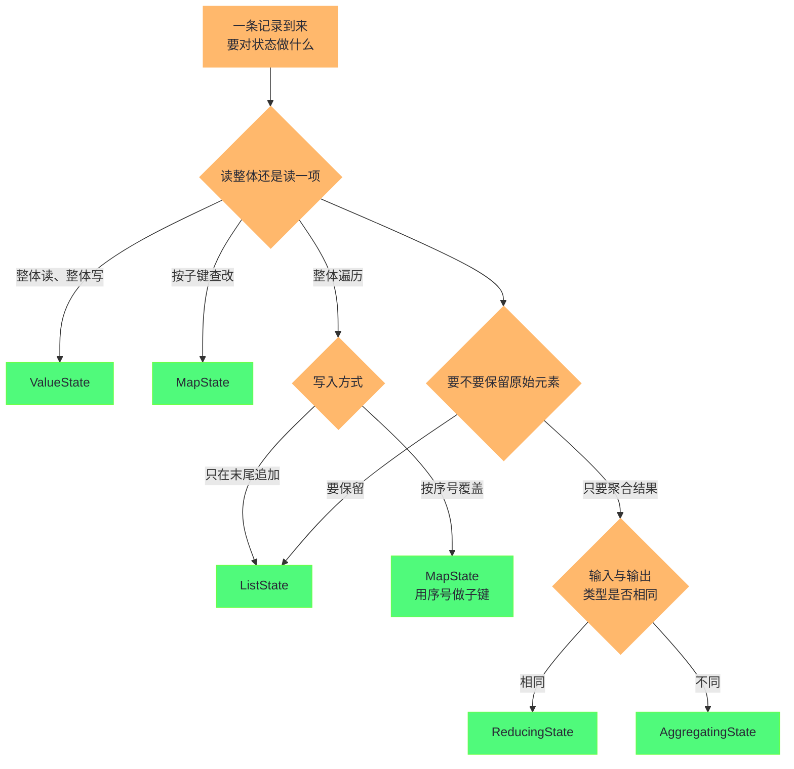
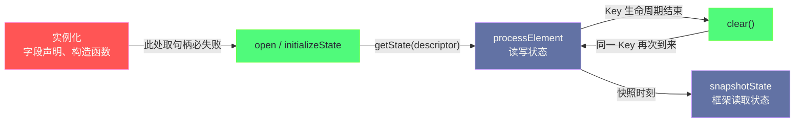
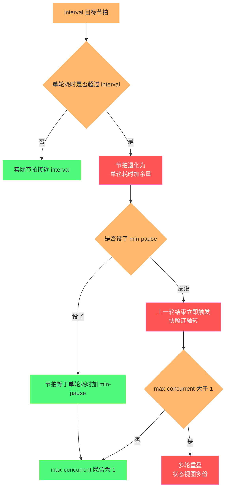
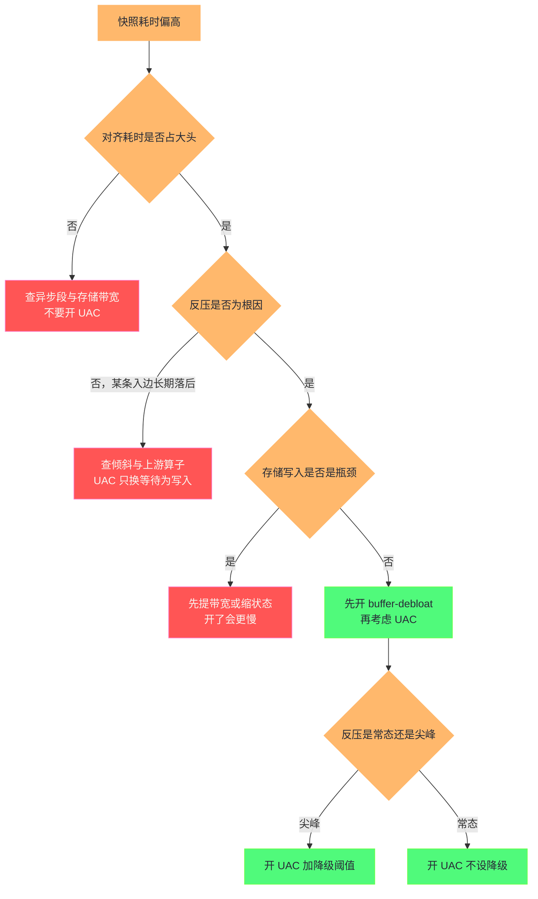
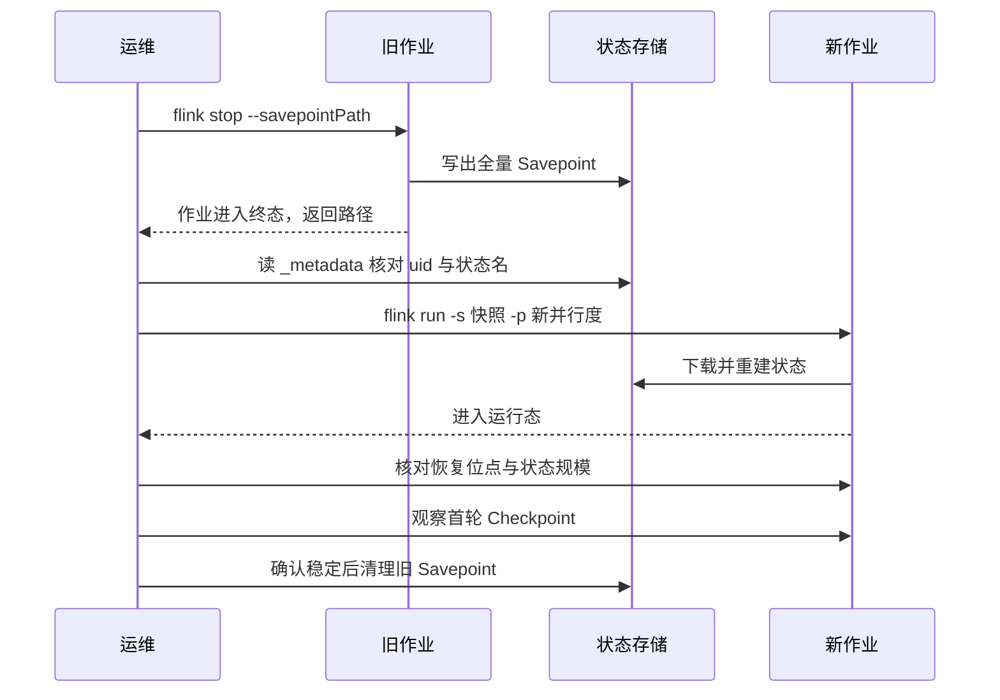

**摘要：**

Flink 的状态与快照在文档层面早已定型：五种键控状态、十来个参数、一套 Savepoint 命令，翻一遍官方文档用不了半小时。但线上的故障并不出在"不知道有这个参数"，而出在参数之间的勾连、状态定义与访问模式的错配，以及出事之后从哪个指标切进去。本篇只谈三件事。第一件是状态类型的判据：`ValueState`、`ListState`、`MapState`、`ReducingState`、`AggregatingState` 各对应一种访问模式，选错了在堆后端只是内存浪费，在 RocksDB 后端则是热路径上的数量级差异。第二件是 `RichFunction` 里管理状态的三条纪律，以及 Checkpoint 的配置清单——间隔、超时、最小间隔、并发上限、失败容忍、外部化保留这几个参数各自的连带后果，配成一张可执行的表，再落到三类作业画像的取值组合。第三件是运维动作：一致性级别怎么选、未对齐快照什么时候开、Savepoint 的 `uid` 与恢复边界、故障处置的四步流程与症状到配置的对应表。全文贯穿一个电商实时大屏加 CDC 入湖的场景，机制的推演交给原理专栏，这里只回答配多少、怎么判、怎么救。

---

## 第 1 章 三个问题的分界

### 1.1 一次发布暴露出的三类毛病

一次只改了并行度的发布，能把三种性质完全不同的毛病同时抖出来。第一种是恢复直接失败，日志里说某个算子的状态在快照里找不到对应项，作业起不来；第二种是恢复起来了，但 Checkpoint 从二十秒涨到三分钟，紧接着开始超时，重启之后从更早的快照恢复，重放一段数据，再慢一次；第三种是作业平时一切正常，偏偏每天凌晨失败一次，值班的人把超时调大之后，失败往后挪了半小时，问题照旧。

第一种毛病归状态定义：算子身份与状态名字在代码里没有被固定住，恢复时对不上号。第二种归参数配比：间隔、超时、对齐与上传带宽之间的关系没有算过，单轮耗时涨上去之后，参数组合还在按老状态量的假设工作。第三种归故障判读：没有人去看失败原因那行字，于是所有症状都被当成同一个"快照慢"来处理。

这三类问题共用一套参数、一套 API、一套监控面板，却需要三套不同的判断方式，这也是本篇按"选型、配比、运维"三段组织的原因。笔者在值班中遇到的快照类问题，绝大多数落在后两类上：第一类通常在第一次发布失败时就被迫修掉，后两类却能带着跑很久，直到某个数据量翻倍的月份集中爆发。

不妨先给这三段一个统一的心智图像：状态像仓库里的库存，快照像盘点。库存随业务增长，盘点的频率决定账实能差多少，盘点的深度决定停业多久，而货架的组织方式——状态用什么类型、按什么粒度存——决定了同样一批货要盘多久：托盘码放整齐，盘点快；货全堆在地上，翻一遍就是半天。这个图像只在"成本由数据量与组织结构共同决定"这一层成立，再往下推就会失真，因为分布式快照还要处理在途数据，实体仓库里没有对应物。

### 1.2 本文的边界

状态的物理形态与快照机制本身不在这里展开。为什么 `MapState` 在 RocksDB 上是每个 entry 一个 KV、`ListState` 却是整列表一个值，为什么 key group 让并行度可以改而 `maxParallelism` 不能改，为什么同步段与异步段的成本结构完全不同，这些都在 [[大数据/Flink/Flink原理深度解析与性能优化/05 Flink 状态后端深度解析|状态后端]] 与 [[大数据/Flink/Flink原理深度解析与性能优化/06 Flink Checkpoint 机制深度解析|Checkpoint 机制]] 两篇里推演过，下文只在需要判断的地方引一句结论并给出链接。

反压的诊断与缓解属于 [[大数据/Flink/Flink原理深度解析与性能优化/04 Flink 网络传输与反压机制深度解析|网络与反压]]一文的题目；端到端精确一次里 Sink 侧的两阶段提交与事务超时，属于 [[大数据/Flink/Flink从入门到实战/08 Flink 与 Kafka 端到端精确一次实战|Kafka 端到端精确一次]]；窗口自身携带的状态怎么清理，属于 [[大数据/Flink/Flink从入门到实战/05 窗口完全指南|窗口]]。

### 1.3 贯穿场景

沿用整个系列共用的案例：一套电商实时数仓，两条支路并行。支路 A 从消息队列读订单与支付事件，按分钟窗口聚合后写入实时大屏的指标表；支路 B 接 MySQL 的变更数据捕获（Change Data Capture，CDC）流，按主键去重合并后写入数据湖。两条支路各有一个多输入的窗口算子，各自带一个状态不小的去重算子，末端两个 Sink。它同时具备三个特征：状态会随业务增长、拓扑里有 shuffle、外部写入有语义要求——状态与快照上需要辨析的东西，在这个场景里都能找到落点。

后文的"大屏指标"与"入湖明细"分别指两条支路的输出，示例数字只为让量级关系可读，不作基准。

---

## 第 2 章 状态类型由访问模式决定

### 2.1 先问三个问题

挑状态类型的正确顺序，是**先描述访问模式，再回头选容器**，而不是先看别人的代码用了哪个类。需要回答的只有三个问题：一条记录到来时，我要读的是整块数据还是其中一项？写的时候是覆盖整块、还是往末尾追加、还是改其中一项？我需不需要把原始元素留下来、还是只要一个聚合结果？

这三个问题对应五种容器，界限相当清楚。整体读整体写、只留一个值，用 `ValueState`；按子键查改、键的数量不固定，用 `MapState`；只在末尾追加、之后整体遍历，用 `ListState`；只要聚合结果且输入输出同类型，用 `ReducingState`；只要聚合结果但输入类型与结果类型不同，用 `AggregatingState`。

| 访问模式 | 该用的类型 | 典型场景 | 用错的代价 |
| --- | --- | --- | --- |
| 每个 Key 一个值，整体读、整体覆盖 | `ValueState` | 去重标记、累计值、最近一次水位 | 基本没有替代品，注意 null 判断 |
| 每个 Key 下若干子键，按子键查改 | `MapState` | 购物车、按商品累计、按维度分桶 | 换成 `ValueState<Map>` 后 RocksDB 上每次读写整块反序列化 |
| 只在末尾追加，之后整体遍历 | `ListState` | 最近 N 条行为、待处理队列 | 列表无限增长，快照与恢复同步变慢 |
| 元素会被反复覆盖，需要按序号访问 | `MapState<Long, T>` | 定长滑动序列、带序号的去重窗口 | 用 `ListState` 后每次覆盖要重写整列表 |
| 只要聚合结果，输入输出同类型 | `ReducingState` | 求和、求最值、计数 | 用 `ListState` 存原始元素再自己聚合，状态放大数倍 |
| 只要聚合结果，输入输出不同型 | `AggregatingState` | 平均值、去重计数、百分位草图 | 用 `ReducingState` 塞不进中间累加器 |

下面这张判定图把三个问题的分支画在一起，顺序就是实际思考的顺序。



### 2.2 ValueState：整体读、整体写

单值状态是最简单的一类，语义就是"每个 Key 挂着一样东西"，**读写都针对整块**。它适合的状态形状有一个共同点：这份数据本身就是业务实体，不存在"只关心其中一小块"的访问。

```java
public class SpenderTracker extends KeyedProcessFunction<String, OrderEvent, SpendAlert> {

    private transient ValueState<Long> totalSpend;
    private transient ValueState<Long> lastSeen;

    @Override
    public void open(Configuration parameters) {
        // 句柄只能在 open 里取，此时 runtimeContext 已注入
        totalSpend = getRuntimeContext().getState(
                new ValueStateDescriptor<>("total-spend", Long.class));
        lastSeen = getRuntimeContext().getState(
                new ValueStateDescriptor<>("last-seen", Long.class));
    }

    @Override
    public void processElement(OrderEvent e, Context ctx, Collector<SpendAlert> out)
            throws Exception {
        Long prev = totalSpend.value();               // 从未设置或已 clear 时为 null
        long now = (prev == null ? 0L : prev) + e.getAmount();
        totalSpend.update(now);
        lastSeen.update(e.getEventTime());

        if (now > 100_000L) {
            out.collect(new SpendAlert(e.getUserId(), now));
        }
    }
}
```

`value()` 返回 null 这件事，被误判的频率比想象中高。业务上"这个用户没有消费过"与"这个用户消费了 0 元"是两件事，框架只表达前者。写过 `state.value() + 1` 的人，都会在某次压测里遇到空指针，然后把它当成偶发问题挂起来。

三个状态形状用 `ValueState` 特别合适：去重集合的布尔标记、单调递增的计数或累计值、指向"最近一次"的指针（最近水位、最近一条记录的时间戳）。反过来，凡是需要按子键取用的，用它就错了，这一点下一节展开。

### 2.3 MapState：按键查改

`MapState` 的形状是"每个 Key 下面挂一张表"，**访问粒度是单个 entry**。它成立的条件是：同一条记录到来时，你需要读写的只是这张表里的一行，而表里其余部分与本次处理无关。

购物车是标准例子，但真正能体现差别的是"按商品累计销售额"这类场景——一个商品一个 entry，改一个商品的数量只碰一行，其余几千行不参与序列化。这一点在 RocksDB 后端上是数量级差异：`MapState` 的每个 entry 是独立的 KV，改一行只反序列化一行；`ValueState<Map>` 把整张表塞进一个值，改一行要读出整块、改完再写回。两种形态的存储布局与读写成本在 [[大数据/Flink/Flink原理深度解析与性能优化/05 Flink 状态后端深度解析|状态后端]] 里画过对照图，这里只取结论：那条"用 `MapState` 不要用 `ValueState<Map>`"的经验，成立的前提是 RocksDB 后端；堆后端上两者的差别主要是内存表示与语义，不是访问延迟。

```java
public class CartAccumulator extends KeyedProcessFunction<String, CartEvent, CartSnapshot> {

    private transient MapState<String, Integer> cart;

    @Override
    public void open(Configuration parameters) {
        cart = getRuntimeContext().getMapState(
                new MapStateDescriptor<>("cart", String.class, Integer.class));
    }

    @Override
    public void processElement(CartEvent e, Context ctx, Collector<CartSnapshot> out)
            throws Exception {
        switch (e.getAction()) {
            case ADD: {
                Integer cur = cart.get(e.getItemId());   // 一次前缀点查
                cart.put(e.getItemId(), (cur == null ? 0 : cur) + e.getQuantity());
                break;
            }
            case REMOVE:
                cart.remove(e.getItemId());              // 一次前缀删
                break;
            case CHECKOUT: {
                Map<String, Integer> snap = new HashMap<>();
                for (Map.Entry<String, Integer> en : cart.entries()) {  // 前缀区间扫描
                    snap.put(en.getKey(), en.getValue());
                }
                out.collect(new CartSnapshot(e.getUserId(), snap, ctx.timestamp()));
                cart.clear();                           // 结算后这个 Key 的状态整块作废
                break;
            }
            default:
                break;
        }
    }
}
```

`entries()` 是这段代码里唯一需要留意的一处。它在 RocksDB 上是一次前缀区间扫描而不是若干次独立点查，成本与 entry 数量线性相关，且每条都要反序列化。一个购物车里堆了两万件商品，结算时的这次遍历就会成为那段时间的延迟尖峰，而单次 `get` 依旧很快。判断是否要处理这种极端情况，看的是"单 Key 的 entry 基数是否有上界"，没有上界就该在业务侧加限制，或者把这张表拆成两层。

`MapState` 还有两个容易被忽略的能力。一是它天然支持"按键删除"，`remove` 之后该 entry 在存储里消失，累积型状态用它来做过期清理比给每条数据打时间戳更直接。二是它可以用序号做子键，等价于一张定长数组，适合"最近 N 个窗口的中间结果"这类需要按下标覆盖的访问。

### 2.4 ListState：只服务于追加与整体遍历

`ListState` 的名字容易让人以为它是一般的列表容器，实际上它只对两种访问友好：往末尾追加，以及整体取出来遍历。任何"按下标改中间某个元素"的需求，都不是它的强项。

```java
// 最近 N 次行为的滑动窗口：追加 + 整体遍历，恰好落在 ListState 的能力范围内
private transient ListState<Long> recentTs;

@Override
public void open(Configuration parameters) {
    recentTs = getRuntimeContext().getListState(
            new ListStateDescriptor<>("recent-ts", Long.class));
}

private void pushAndTrim(long ts, int limit) throws Exception {
    recentTs.add(ts);                      // 追加，成本低
    List<Long> all = new ArrayList<>();
    recentTs.get().forEach(all::add);      // 整体取出，成本与长度成正比
    if (all.size() > limit) {
        recentTs.update(all.subList(all.size() - limit, all.size()));  // 整体覆盖
    }
}
```

这段代码的代价曲线值得算清楚。追加很便宜，整体取出与整体覆盖都不便宜：在 RocksDB 上，一个 Key 的**整个列表存在同一个值里**，`update` 意味着重写整个列表。所以"追加一条再把超过 N 条的部分整体重写一遍"这种写法，在 N 很小（譬如十几、几十）时无所谓，N 上千之后就是每来一条记录重写一千条。需要按下标覆盖或删除中间元素时，`MapState<Long, T>` 用序号做子键是更合适的形态，读取粒度从整列表变成单个 entry。

`ListState` 的另一半身份是算子状态（Operator State）的标准容器。键控状态跟着 Key 走，算子状态跟着并行子任务走，后者在自定义 Source 里管位点、在需要"每个子任务维护一份摘要"的算子上都用到。自定义 Source 通常要同时实现 `RichFunction` 与 `CheckpointedFunction`，前者给 `open`，后者给 `initializeState` 与 `snapshotState`：

```java
public class OffsetTrackingSource extends RichSourceFunction<Record>
        implements CheckpointedFunction {

    private transient ListState<PartitionOffset> offsets;

    @Override
    public void initializeState(FunctionInitializationContext ctx) throws Exception {
        ListStateDescriptor<PartitionOffset> desc = new ListStateDescriptor<>(
                "offsets",
                TypeInformation.of(new TypeHint<PartitionOffset>() {}));
        // 均分模式：恢复时按新并行度重新切分，适合"元素之间互相独立"的位点
        offsets = ctx.getOperatorStateStore().getListState(desc);

        if (ctx.isRestored()) {                 // 只有被恢复的算子才为真
            for (PartitionOffset o : offsets.get()) {
                restoreFrom(o);
            }
        }
    }

    @Override
    public void snapshotState(FunctionSnapshotContext ctx) throws Exception {
        offsets.clear();                        // 先清空再全量写入，避免重复累积
        for (PartitionOffset o : currentOffsets()) {
            offsets.add(o);
        }
    }
}
```

`initializeState` 里有三件事值得逐个记住。`isRestored()` 表达的是"这个算子的状态是从快照里恢复的"，新增算子在第一次启动时它是 false，初始化逻辑不能默认状态已经在位。均分（Even Split）与联合（Union）两种分配模式的选择由"元素之间是否独立"决定，位点之间独立用均分，需要全量视图的用联合，联合模式下并行度调大意味着同一份状态复制多份，恢复时间随之放大。`snapshotState` 里必须先 `clear()` 再写，否则每轮快照都往后追加一份，几轮之后快照体积就翻倍了。

### 2.5 ReducingState 与 AggregatingState：只要结果

这两类状态共同回答一个问题：能不能不保留原始元素，只保留一个能继续合并的中间值。能的场景，状态体积从"记录数"降到"一条记录"，快照、恢复、缓存三处同时受益。

`ReducingState<T>` 的输入与状态同类型，每次 `add` 立刻与旧值合并，`get` 取当前结果。它适合纯量聚合：求和、求最值、计数、按位或。`AggregatingState<IN, OUT>` 多一层，累加器（Accumulator）的类型与输入、输出都可以不同，`add` 往累加器里塞输入，`getResult` 把累加器转成输出。平均值就是它最典型的用例：输入是一条金额，累加器是"和与条数"，输出是商。

```java
// ReducingState：输入输出同型，合并函数就是一次加法
private transient ReducingState<Long> sales;
sales = getRuntimeContext().getReducingState(
        new ReducingStateDescriptor<>("sales", Long::sum, Long.class));
sales.add(item.getAmount());
long total = sales.get();

// AggregatingState：输入是金额，累加器是"和 + 条数"，输出是平均值
private transient AggregatingState<Long, Double> avgTicket;
avgTicket = getRuntimeContext().getAggregatingState(
        new AggregatingStateDescriptor<>("avg-ticket", new AvgAggregate(), Types.DOUBLE));
avgTicket.add(item.getAmount());
double avg = avgTicket.get();     // add 之后 get 才会触发 getResult
```

两者的选择判据只有一条，但这条经常被搞反：**中间结果能不能塞进输出类型**。平均值不行——只存商就再也合并不出新的平均值，必须把和与条数一起存，所以用 `AggregatingState`。求和可以——和本身就是最终结果，用 `ReducingState` 就够，不必为了"统一用 Aggregating"而多写一个累加器类。

还有一条与合并语义相关的判据，只在会话窗口这类会合并的场景里才露头：两种聚合状态都必须提供可结合的合并函数，合并顺序不影响结果。平均值若不记录条数就会出现"合并两个平均值不等于整体平均值"的错误，这也是累加器必须自己定义、不能偷懒用输出类型当累加器的原因。

### 2.6 选型的算账方式

判据之外，还需要一次量的核对，否则"用对了类型"仍可能选错粒度。三个量值得逐项估：条目基数（这个 Key 平均挂多少条）、单次访问的字节数（一次读写要搬多少数据）、以及这三者在快照体积上的投影。

条目基数决定"是否分片"：几万条的 `MapState` 与几万条的 `ListState`，前者按子键访问只碰一行，后者每次读整体；后者在这种基数下必然成为瓶颈。单次访问字节数决定"是否值得拆分"：一条记录几百字节的场景，`ValueState<Pojo>` 完全够用，包一层 `MapState` 只是多了一次查找；而单条记录几 KB、每 Key 上千条的场景，拆成 `MapState` 的收益立刻显现。快照体积的投影则是把前两个量乘起来再加上键与元数据开销，它决定了恢复时间的下限——状态涨十倍，恢复时间大致也涨十倍，这条关系在第 10 章还会用到。

### 2.7 三个写错的样子

第一种是把 `ListState` 当队列用，只 `add` 不裁剪，也不设 TTL。作业跑三个月之后，快照体积从几百 MB 涨到几十 GB，恢复时间从半分钟涨到十几分钟，而代码里没有任何一行看起来有问题。第二种是在 RocksDB 后端上用 `ValueState<Map>` 存分维度的累计值，键有几万个维度，每来一条记录读写一整张表，热路径上的耗时随维度数线性上升。第三种是把 `ListState` 当定长滑动窗口，每次覆盖整个列表——形态上没错，代价上错了，换成序号做子键的 `MapState` 之后，同样的逻辑快一个数量级。

三种错误有一个共同点：在小数据量、堆后端的**测试环境里全都看不出来**，只有在状态长起来、后端换成 RocksDB 之后才暴露。

---

## 第 3 章 RichFunction 里管理状态的三条纪律

### 3.1 第一条：句柄只能在 open 或 initializeState 里取

状态的读写要通过 `RuntimeContext` 拿到句柄，而这个上下文是在算子实例化之后由运行时注入的。字段声明处、构造函数里都拿不到它——那时算子还只是一个普通的 Java 对象，`getRuntimeContext()` 返回的是尚未装配的空引用，继续往下调用就是空指针。



正确写法是把所有句柄声明为 `transient` 字段，在 `open` 里一次性取齐。下图把句柄可得与不可得的时机放在一条时间线上。这一点看似是语法细节，实际影响的是可测性：状态句柄不能序列化，`transient` 保证了作业在算子实例跨进程传递时不会因为不可序列化字段而失败；而把取值集中在 `open` 里，也让"这个算子用了哪几个状态"变成一处可读的清单。

### 3.2 第二条：描述符的名字是状态身份

键控状态与算子之间的映射，靠两个标识共同确定：算子的 `uid`，以及状态的 `name`。`uid` 定位"是哪个算子"，`name` 定位"是这个算子里的哪一份状态"。两者任何一处变化，恢复时都会出现"快照里有一份状态，当前程序里找不到对应项"。

这条纪律最常见的破法是改名：一开始写 `new ValueStateDescriptor<>("state", ...)`，后来觉得不清晰改成 `"user-total-spend"`，代码上线、从 Savepoint 恢复，作业直接起不来。改名的人通常认为名字只是注释性信息，实际上它是**状态在快照里的地址**。

同一算子内两份状态重名，则是另一种形态的风险：新版本里加了一份同名的状态，恢复时两份都去认领同一份快照数据，行为不确定。两份状态在代码里名字只差一个字符的拼写错误（`"total"` 与 `"totals"`），同样属于恢复期才会暴露的问题。

### 3.3 第三条：clear() 的时机

`clear()` 清的是"当前 Key 的状态"——键控状态下它对当前 Key 生效，算子状态下它清掉该子任务持有的全部内容。它表达的是业务语义：**这个 Key 的事情结束了**。

判断时机有两个抓手。一是业务事件：结算、关单、注销、会话结束，这些动作之后该 Key 的状态不再有任何后续价值，应当在输出结果的同一步里清掉。二是时间：Key 本身没有终点，只是长期不活跃，此时与其在代码里散落清理逻辑，不如交给 TTL 兜底（下一节）。两者不该互相替代：`clear()` 是精确的、由业务驱动的删除，TTL 是模糊的、由时间驱动的兜底，缺了前者会导致"僵尸 Key 一直占着存储直到 TTL 到期"，缺了后者会导致"没人访问的 Key 永远不清理"。

定时器里清理是一个容易漏的点。用 `KeyedProcessFunction` 做会话超时的人，往往在 `onTimer` 里输出结果却忘了 `clear()`，于是超时之后的 Key 状态仍然留在存储里，直到下一轮 TTL 到期。窗口算子例外，它的状态生命周期由框架按窗口的创建与清除时间管理，不需要手写清理。

### 3.4 一段骨架：三条纪律的合并写法

把上面的纪律落成一段形状，就是一个可以直接套用的骨架：`RichFunction` 提供 `open`，`CheckpointedFunction` 提供 `initializeState` 与 `snapshotState`，句柄全部 `transient`，`name` 与 `uid` 都在一个地方集中定义。

```java
public class DedupAndAggregate extends KeyedProcessFunction<String, Event, Result>
        implements CheckpointedFunction {

    // 名字集中定义，避免散落在多处被顺手改掉
    private static final String STATE_SEEN = "seen-keys";
    private static final String STATE_AGG = "amount-sum";

    private transient ValueState<Boolean> seen;
    private transient ReducingState<Long> amountSum;
    private transient ListState<PartitionOffset> offsets;   // 算子状态，与 Key 无关

    @Override
    public void open(Configuration parameters) {
        ValueStateDescriptor<Boolean> seenDesc =
                new ValueStateDescriptor<>(STATE_SEEN, Boolean.class);
        seenDesc.enableTimeToLive(ttlConfig());             // 长期不活跃的 Key 由 TTL 兜底
        seen = getRuntimeContext().getState(seenDesc);

        amountSum = getRuntimeContext().getReducingState(
                new ReducingStateDescriptor<>(STATE_AGG, Long::sum, Long.class));
    }

    @Override
    public void initializeState(FunctionInitializationContext ctx) throws Exception {
        offsets = ctx.getOperatorStateStore().getListState(
                new ListStateDescriptor<>("offsets",
                        TypeInformation.of(new TypeHint<PartitionOffset>() {})));
    }

    @Override
    public void snapshotState(FunctionSnapshotContext ctx) throws Exception {
        offsets.clear();
        for (PartitionOffset o : currentOffsets()) {
            offsets.add(o);
        }
    }
}
```

这段骨架里要注意的只有一处：TTL 挂在 `seen` 上而不挂在 `amountSum` 上。去重标记是可以过期的，"七天内的重复"与"一个月前的重复"在业务上不是一回事；累计金额不行，它过期就意味着账目丢了。给不该过期的状态配 TTL，是**比不配 TTL 更严重的错误**，因为它不报错，只是慢慢少算。

### 3.5 状态 TTL 的配置面

TTL 的机制——四条清理路径各自在什么后端生效、为什么 RocksDB 增量快照里仍然带着过期数据——在 [[大数据/Flink/Flink原理深度解析与性能优化/05 Flink 状态后端深度解析|状态后端]] 一文的 TTL 章节讲透了，这里只列配置面上必须记住的几项。

```java
StateTtlConfig ttl = StateTtlConfig
        .newBuilder(Duration.ofDays(7))
        .setUpdateType(StateTtlConfig.UpdateType.OnCreateAndWrite)   // 从最后一次写开始计时
        .setStateVisibility(StateTtlConfig.StateVisibility.NeverReturnExpired)
        .cleanupInRocksdbCompactFilter(1_000)                        // 需在后端层开启压缩过滤器
        .build();

ValueStateDescriptor<Boolean> seenDesc =
        new ValueStateDescriptor<>("seen-keys", Boolean.class);
seenDesc.enableTimeToLive(ttl);
```

在 RocksDB 上使用压缩过滤器清理，必须同时打开 `state.backend.rocksdb.ttl.compaction.filter.enabled: true`，否则描述符里配了也不生效，表现为"过期数据一直在，快照体积不降"。这个开关是配置层面**最常被漏掉的一项**，因为它不在业务代码里。

三个运维动作值得固定下来。其一，按"峰值写入速率乘以保留期，再乘一个清理滞后系数"估算容量，而不是按保留期线性相乘——过期但尚未被物理清理的部分在 RocksDB 上占比不小。其二，验证 TTL 是否真的生效，看的是"恢复后状态条目总数是否随保留期下降"，而不是看代码里有没有那一行配置。其三，TTL 开关状态会进入恢复兼容性检查，用开了 TTL 的描述符去恢复一份没开 TTL 的状态（或反之）会直接失败，所以它是发布前必须对齐的一项，与状态名、状态类型同级。

---

## 第 4 章 Checkpoint 的配置清单与配比

### 4.1 一张可执行的配置表

参数不多，难的是每个参数的取值都由另外几个参数和作业画像共同决定。下表把配置键、默认值、取值判据与配错的后果放在一起，实际调参时按行对照即可。

| 配置键（Java API 同名） | 默认 | 取值判据 | 配错的后果 |
| --- | --- | --- | --- |
| `execution.checkpointing.interval` | 不开启 | 先按"常态单轮耗时的 3 到 5 倍"起步，再对业务能接受的数据空洞做校验 | 太短则快照开销占比过高，吞吐与延迟一起劣化；太长则恢复点变粗 |
| `execution.checkpointing.timeout` | 10 分钟 | 常态单轮耗时的 3 到 5 倍，且明显小于"容忍失败次数乘间隔"的窗口 | 太小把抖动直接变成重启；太大让卡死的快照长期占资源 |
| `execution.checkpointing.min-pause` | 0（未设） | 需要给"快照之间的正常处理时间"设下限时才设，锚点是上一轮完成 | 与并发上限同时设，语义互斥，行为退化为其中一个生效 |
| `execution.checkpointing.max-concurrent-checkpoints` | 1 | 单轮耗时不可压缩、又需要更密恢复点时才调到 2 | 大于 1 时状态视图可能同时存在多份，堆后端内存翻倍；与未对齐快照不兼容 |
| `execution.checkpointing.tolerable-failed-checkpoints` | 0 | 存储侧有分钟级抖动时设 2 到 3 | 设大把恢复点粒度乘上系数；设 0 则一次抖动就重启 |
| `execution.checkpointing.externalized-checkpoint-retention` | 不保留 | 一律设为 `RETAIN_ON_CANCELLATION` | 不开启时取消即删，发布与扩缩容之后无点可回 |
| `state.checkpoints.num-retained` | 1 | 2 到 3 | 只留一份时，最近一份损坏就没有退路 |
| `state.checkpoints.dir` / `state.checkpoint-storage` | JobManager 堆 | 生产必须指向持久化文件系统 | 堆内存储单轮上限 5 MB 量级，状态一大每轮必失败 |
| `execution.checkpointing.mode` | `EXACTLY_ONCE` | 见第 5 章判据 | 选错只影响对齐行为，不影响快照成本 |
| `execution.checkpointing.unaligned` | false | 见第 6 章判据 | 反压不重时开启只是徒增每轮写入量 |
| `execution.checkpointing.aligned-checkpoint-timeout` | 0（始终对齐） | 先开未对齐快照，再设 30 到 60 秒降级阈值 | 未开未对齐时设置无效，运维会以为已经"自动降级"了 |

> [!warning] 顺序不能颠倒
> 表里最后一行藏着一个非常典型的错配：有人只配了降级阈值，没有打开未对齐快照，于是面板上的对齐耗时照旧占大头，配置看起来"已经优化过"。官方的表述是"启用未对齐快照之后，还可以设置对齐超时"。

### 4.2 interval：恢复点粒度的旋钮

间隔是全部参数里唯一直接决定"故障时会丢多少数据"的一项，也是最容易被当作性能旋钮来拧的一项。它描述的是希望多久拍一次，实际节拍还要受单轮耗时、最小间隔与并发上限的约束——并发为 1 时，上一轮没结束就不会有下一轮。

间隔与两个东西直接对撞。一个是恢复时间：状态越大，恢复越慢，而从故障到服务恢复的这段时间里业务是停的，间隔设得再小也救不了这段停机，能救的是"恢复后需要重放多少数据"。另一个是快照开销占比：间隔越短，上传与序列化占用的 CPU、带宽、磁盘 IO 在运行时预算里的份额越大，吞吐随之下降。

一条稳定的经验是把"单轮耗时除以间隔"控制在**一成到两成**之间：单轮二十秒、间隔两分钟，占比约一成四，运行时还有余量吸收抖动；单轮九十秒、间隔一分钟，占比超过六成，作业的大部分时间都在为快照服务，此时间隔已经失去调节意义，该动的是状态或带宽。笔者倾向于把这条界限定得更保守：单轮耗时超过间隔一半时，就着手缩状态或提带宽，继续拧间隔只是把失败往后推。你不妨先量一遍当前的比值，再决定动哪一头。

较新的 1.x 版本提供了 `execution.checkpointing.interval-during-backlog`，用于在作业追赶积压期间放宽或暂停快照节奏，具体版本与默认值以对应版本文档为准。它解决的是"积压期间快照必然超时"这一类问题，属于对症但不治本的开关。

### 4.3 timeout：什么时候它开始害人

超时的语义是"一轮快照在此时间内没有完成就放弃"。它本身不改善任何东西，只是决定"把资源浪费多久之后放弃"。所以调大超时的效果永远是**让失败来得更晚**，而不是"让快照更快"。

超时设小是常见错误。譬如存储侧偶发一次慢写、某个子任务一次长 GC、对象存储一次限流，都可能让单轮耗时短暂翻倍；超时贴着常态耗时设，这些抖动就全部被翻译成失败与重启，而重启带来的重放又让下一次快照更慢，形成正反馈。设成常态耗时的三到五倍，是给抖动留出的缓冲。

超时设大也有代价，且代价不在快照本身，而在"卡死的快照占着资源不放手"：一轮因为反压彻底走不完的快照，会在超时之前一直占着协调器与子任务的快照资源，期间所有新的触发都被拒或排队。所以超时值的下限由"抖动幅度"决定，上限由"能容忍多久一次无效等待"决定。

### 4.4 最小间隔与并发上限：一枚硬币的两面

这两个参数描述的是**同一件事的两种写法**，因此不能同时生效。最小间隔一旦设定，就意味着任何时刻最多只有一轮快照在跑；反过来允许多轮并发，就必然存在"上一轮没完成、下一轮已开始"的时刻，最小间隔的语义随之瓦解。官方文档把这条关系写成"定义了最小间隔即隐含并发为 1"，机制侧的推演见 [[大数据/Flink/Flink原理深度解析与性能优化/06 Flink Checkpoint 机制深度解析|Checkpoint 机制]] 里参数一节。

选择规则因此很清晰。想让快照开销占比有稳定上限，用最小间隔，语义是"上一轮完成之后至少让作业正常跑这么久"；想要更密的恢复点，且能容忍状态视图重叠的代价，用并发上限。后者的代价常被低估：并发为 2 时，同一份状态在内存里可能同时存在两份快照视图，堆后端上等于状态内存翻倍，增量后端上要多维护几份文件引用。

下图把节拍的形成过程画出来，也是判断"改了参数为什么没效果"的依据。



### 4.5 失败容忍：把恢复点粒度乘一个系数

容忍次数的语义是"连续失败这么多次才让作业失败"，默认 0。它覆盖的失败类型有限：协调器侧 IO 异常、任务侧异步段失败、以及超时；同步段失败会直接触发任务重启，不受这个参数保护。

它真正的副作用在恢复点粒度上。正常时最坏的数据空洞约等于"间隔加单轮耗时"；容忍次数为 k 时，作业可以连续 k 轮失败才重启，期间恢复点一直停在最后一次成功的快照上，空洞放大到"(k+1) 乘间隔加单轮耗时"的量级。这是拿数据重复窗口换"不因一次抖动重启"的交换，取值要和业务能接受的重复窗口一起定，而不是拍一个 3 了事。

### 4.6 外部化保留与保留份数

外部化保留策略决定"作业被主动取消之后，快照还在不在"。默认策略下快照只服务于自动恢复，作业取消时会被清理；发布新版本、调整并行度、迁移集群这些动作都走"取消"这条路径，于是它们在默认配置下的结果就是"没有任何可恢复点"。

生产环境应当设为 **`RETAIN_ON_CANCELLATION`**，并配 2 到 3 份保留。保留份数换的是退路：最近一份因为存储侧问题损坏时，还能回退一轮。不过份数不能无限加，每一份都是完整的存储占用，清理策略也随之复杂，二到三份是"能回退两轮"与"存储可控"之间的折中。目录上还有一条纪律：快照目录与 Savepoint 目录分开，混在一起会让两套清理策略互相干扰。

### 4.7 存储：从 JobManager 堆到文件系统

默认的快照存储是 JobManager 堆内存，单轮可容纳的状态有严格上限（`JobManagerCheckpointStorage` 的默认上限在 5 MB 量级），仅适合本地调试。生产环境必须改成文件系统存储，方式是集群级配置 `state.checkpoint-storage: filesystem` 加 `state.checkpoints.dir: hdfs:///flink/checkpoints/<job>`，而不要把路径硬编码在代码里——同一份 JAR 要在开发、预发、生产之间流转，路径写死意味着每次环境切换都得改代码重新打包。

### 4.8 三类作业画像的取值

把上面的判据落到具体组合上，三类典型作业的配置长相差别很大。

| 维度 | 低延迟风控 | 实时大屏（支路 A） | CDC 入湖（支路 B） |
| --- | --- | --- | --- |
| 状态量级 | 几 GB | 几十 GB | 数百 GB 到 TB 级 |
| 状态后端 | 堆后端可行 | RocksDB 加增量快照 | RocksDB 加增量快照 |
| interval | 10 到 30 秒 | 60 到 120 秒 | 3 到 10 分钟 |
| timeout | 2 到 5 分钟 | 10 分钟 | 20 到 30 分钟 |
| min-pause | 5 到 10 秒 | 不设，靠 interval 约束 | 不设 |
| max-concurrent | 1 | 1 | 1 |
| tolerable-failed | 2 | 2 到 3 | 3 |
| 外部化保留 | 保留，2 份 | 保留，3 份 | 保留，2 到 3 份 |
| 未对齐快照 | 视反压，可开降级 | 反压尖峰时开降级 | 一般不开，先治 IO |
| 一致性级别 | 精确一次加下游幂等 | 精确一次 | 至少一次加主键覆盖 |

三类作业的差别不在参数名字，而在"哪一项是瓶颈"。风控类作业的瓶颈是延迟尖峰，所以间隔短、状态小、允许降级；大屏类作业的瓶颈是恢复点粒度，间隔与状态量在同一个数量级上；入湖类作业的瓶颈是每轮上传量，间隔只能拉长，能压缩的是增量与并发度。

---

## 第 5 章 EXACTLY_ONCE 还是 AT_LEAST_ONCE

### 5.1 对齐的代价是延迟尖峰

精确一次（Exactly-Once）在快照语境下的实现依赖 barrier 对齐：多输入的算子要等所有入边的 barrier 到齐才取快照，等待期间快的那条入边只能停住。停住的时长约等于"两条入边的进度差除以处理速率"，这是一个会把反压放大的量——进度差越大、处理越慢，等待越长。

不妨把对齐想成一行人约在路口集合：走得快的先到，却只能站着等最慢的那个，等待时长等于两拨人的路程差除以最慢那位的速度。不等行不行，不行：掉队的人到了下一段还得重新接上，快照的一致性正是靠"等齐"换来的。技术上的限定是：这里的路程差是两条入边的进度差，速度是当时的处理速率，两者都随反压变化，所以等待时长不是常数，反压一重就成倍放大。

这个代价的表现形式很具体：每到快照时刻，端到端延迟抬升一次再回落，曲线呈现**周期性尖峰**。判断它是否可接受，看的是尖峰高度是否跨过了业务的延迟阈值，而不是平均值。一个平均延迟二十毫秒、每到快照抬到三百毫秒的作业，平均值很好看，用户体验却是在每个快照点卡一下。

### 5.2 不对齐的代价是重复

至少一次（At-Least-Once）跳过了对齐等待，多输入算子在收到第一个 barrier 时直接取快照，落后通道里那批记录在恢复后会被重放。重复的量级等于**恢复点空洞内已经处理过的那部分数据**，空洞越大、重复越多。

重复是否可接受，取决于重复在链路上被谁吸收。内部状态不会因此错乱——`ValueState` 的覆盖写、`MapState` 的按键覆盖天然幂等；真正的问题在外部系统：向消息队列写了两次，下游就消费两次；向数据库 `insert` 两次，主键冲突或者两行；向计费系统上报两次，就是多扣了钱。

### 5.3 五条判据

| 判据 | 说明 | 结论 |
| --- | --- | --- |
| 下游写入可按主键覆盖 | 如 HBase、Elasticsearch、Doris 主键模型，重复写不产生重复行 | 至少一次可接受 |
| 下游有业务幂等键 | 消费侧按订单号与事件 ID 去重 | 至少一次可接受 |
| 结果可离线重算修正 | 日终对账、批处理回补能覆盖实时口径的偏差 | 至少一次可接受 |
| 副作用对外可见且有硬要求 | 扣款、发券、发短信、推送给第三方 | 必须精确一次，且 Sink 走两阶段提交 |
| 延迟阈值在毫秒级且状态很小 | 对齐尖峰会直接违反 SLA，而状态小使重复窗口可控 | 可以退到至少一次 |

这张表的核心是第四行：一旦副作用对外部世界可见且不可撤回，前面三行的便利都不成立，因为"重复一次"的代价不是多一行数据，而是一次真实的业务动作。反过来，如果下游具备主键覆盖能力，那"精确一次"在端到端意义上的收益相当有限，两阶段提交带来的额外延迟与事务超时风险反而更值得权衡。

### 5.4 一个常见的折中

折中的做法是**内部精确、外部幂等**：`execution.checkpointing.mode` 保持 `EXACTLY_ONCE`，让内部状态与位点保持一致；Sink 侧不启用两阶段提交，但要求写入按主键覆盖，或者带幂等键。这样恢复时"内部不重复、外部可能重复"，而外部重复被幂等吸收。

它省掉的是两阶段提交的成本：事务超时、提交延迟、以及"提交阶段的耗时超过快照间隔"这类连锁问题。代价是把幂等责任交给了下游，需要在验收时真的验证一次——人为制造一次故障恢复，看下游记录数有没有多出来，而不是相信设计文档。

模式选择不改变快照本身的成本，它只改变对齐行为。这一点常被误解成"至少一次更快，所以能省快照开销"，实际上快照要写的数据量、要序列化的状态没有变化，变的只是多输入算子要不要等。

---

## 第 6 章 未对齐快照的启用判据

### 6.1 三条判据同时成立才开

未对齐快照（Unaligned Checkpoint，UAC）在 Flink 1.11 随 FLIP-76 落地，思路是让 barrier 越过在途数据，把这段数据一并写进快照。它解决的问题非常具体：反压之下 barrier 追不上数据，对齐等待变成"清算积压的时间"。所以判据也只有三条，必须同时看。

第一条，单轮耗时里对齐等待占大头。这意味着"启动延迟加对齐耗时"远大于同步段与异步段之和，快照面板上表现为耗时结构失衡。第二条，反压是主要原因。如果对齐耗时高而反压指标正常，那多半是某条入边长期落后（数据倾斜或上游慢），此时 UAC 只是把等待换成写入。第三条，状态存储不是瓶颈。UAC 会增加每轮的写入量，存储带宽本来就吃紧的作业开了它只会更慢，这一点在官方文档里写得很直白：状态存储的 IO 是瓶颈时不该用它。

> [!note] 一句判据
> 判据可以简化成一句：UAC 换的是"等待"与"写入"，只有当**等待远比写入贵**的时候这笔交换才划算。

### 6.2 开之前先做两件更便宜的事

在动 UAC 之前，有两个成本更低的动作值得先执行。

一是打开缓冲区去膨胀（Buffer Debloating，1.14 起），配置键是 `taskmanager.network.memory.buffer-debloat.enabled`。它把算子之间的在途数据量控制在目标时延附近，对齐等待与 UAC 要写的在途数据量同时下降。对以对齐等待为主要瓶颈的作业来说，这一项常常就能把耗时压回可接受区间。

二是治反压本身。反压的根因通常是数据倾斜、下游写入慢、状态访问放大，属于 [[大数据/Flink/Flink原理深度解析与性能优化/04 Flink 网络传输与反压机制深度解析|网络与反压]]与 [[大数据/Flink/Flink原理深度解析与性能优化/09 Flink 性能调优体系|性能调优]]的题目。反压治好了，barrier 自然追得上，UAC 就不必开。

### 6.3 开了之后体积与恢复时间怎么变

启用之后有两个可观测的变化，都需要提前预估。

快照体积变大，增量等于"在途数据量"。给一个示例推算：某入湖支路吞吐二十万条每秒、单条两百字节，反压导致在途积压六十秒，那么在途数据约 2.4 GB，每轮快照要多写这么多。这个量随反压程度波动，反压严重的时段可能比正常状态大一个数量级。

恢复时间变长，多出的部分是在途数据的下载、注入与重新处理。同样是上面的量级，恢复到可服务状态要多花几十秒到几分钟。这也是"UAC 不是免费加速"的根本原因：它把**成本从运行时挪到了恢复时**，而恢复时业务是停的。

### 6.4 三档策略与选择顺序

| 档位 | 配置组合 | 适用前提 | 主要代价 |
| --- | --- | --- | --- |
| 始终对齐 | 默认，不设 `unaligned` | 对齐耗时占比低于两成 | 反压下可能超时，且无从降级 |
| 超时降级 | `unaligned: true` 加 `aligned-checkpoint-timeout: 30s` | 反压有尖峰但非常态 | 体积随积压波动，恢复时间不稳定 |
| 始终不对齐 | `unaligned: true`，不设降级阈值 | 反压长期存在、对齐是主要耗时 | 每轮都多写通道数据，恢复多一步注入 |

按判据逐层排除，最终落到三个档位之一，下面的顺序就是排除的顺序。



### 6.5 三条连带限制

并发必须为 1：当前版本不支持并发的未对齐快照，`max-concurrent-checkpoints` 只能保持 1，Savepoint 也不能与未对齐快照并发触发——这意味着大状态作业在触发 Savepoint 时需要排队等待。

与水位恢复语义有交互：未对齐快照恢复时先注入在途数据再生成水位，依赖"最新水位"的算子在恢复后的结果可能与对齐快照不同。验收时要核对指标口径，而不是只看作业有没有起来。

对长记录无解：barrier 可以越过记录，但不能打断正在处理的记录。单条记录处理很久（一次触发几千个定时器、或单条记录塞不进一个网络缓冲）时，barrier 仍然要等它处理完，此时 UAC 的收益为零。

---

## 第 7 章 Savepoint 的运维

### 7.1 uid：显式的身份契约

Savepoint 之所以能跨代码版本恢复，靠的是"状态与算子之间的映射稳定"，而映射的锚点是算子的唯一标识。不显式设置时，这个标识由算子在拓扑里的位置与结构推导，任何改变推导结果的动作都会让标识变化——增删算子、调整算子顺序、把匿名内部类换成 lambda，全都算数。

```java
DataStream<OrderEvent> orders = env
        .fromSource(kafkaSource, watermarkStrategy, "kafka-source")
        .uid("src-kafka-orders")                       // Source
        .map(new EnrichFunction())
        .uid("map-enrich")                             // 有状态 Map
        .keyBy(OrderEvent::getUserId)
        .process(new SpenderTracker())
        .uid("proc-spender")                           // 键控状态算子
        .sinkTo(kafkaSink)
        .uid("sink-kafka-metrics");                    // Sink
```

这里有三个反复出现的误解。第一个是把 `name()` 当成 `uid()`：`name` 只影响界面显示与日志，**不参与状态映射**，设了它并不解决问题。第二个是以为 Sink 不需要 `uid`：带两阶段提交的 Sink 内部持有事务状态，同样是键控或算子状态，改了 Sink 的实现类或漏了 `uid`，恢复时那份状态就无处安放。第三个是忽略了连接器内部的算子：Source 与 Sink 连接器的内部算子标识由框架按实现类推导，换连接器实现（从旧版 Kafka 生产端换成新版 `KafkaSink`）相当于换了一套标识，这一点在升级连接器时必须提前验证。

用 SQL 与 Table API 编写的作业，算子的 `uid` 由 planner 生成，能干预的程度很低。此类作业的稳定性依赖"执行计划不变"，所以发布前的必做动作是把新旧版本的 `EXPLAIN` 输出比对一遍，确认算子结构与标识没有漂移。

### 7.2 停止方式与选择

| 方式 | 命令形态 | 作业的终态 | 适用时机 |
| --- | --- | --- | --- |
| 打点不停作业 | `flink savepoint <jobId> <dir>` | 继续运行 | 定期备份、迁移前的状态留档 |
| 停止并打点 | `flink stop --savepointPath <dir> <jobId>` | 干净停止 | 发布新版本、调整并行度 |
| 直接取消 | `flink cancel <jobId>` | 取消 | 出故障、需要放弃当前状态 |
| 打点并排空 | `flink stop --drain --savepointPath <dir> <jobId>` | 干净停止 | 需要窗口全部触发、数据不丢尾巴 |

```bash
# 不停作业，打一个 Savepoint（作业继续跑）
flink savepoint <jobId> hdfs:///flink/savepoints/

# 停止作业并打点：先让 Source 停住，再把快照写完
flink stop --savepointPath hdfs:///flink/savepoints/ <jobId>

# 带 drain：先推进水位到 MAX_WATERMARK，让窗口把攒着的都触发完
flink stop --drain --savepointPath hdfs:///flink/savepoints/ <jobId>

# 从 Savepoint 恢复，允许改并行度
flink run -s hdfs:///flink/savepoints/savepoint-xxxxxx -p 32 -c com.example.Job job-v2.jar

# 丢弃一份不再需要的 Savepoint（会删除对应文件）
flink savepoint -d hdfs:///flink/savepoints/savepoint-xxxxxx
```

`stop` 与 `cancel` 的差别不只是"有没有打点"。`stop` 是干净停止：Source 停止发数据，下游算子把已收到的数据处理完之后进入终态，快照在停止前写完。`cancel` 是直接取消，算子线程被中断，只有外部化保留策略生效时才能捡回最近一份 Checkpoint。加 `--drain` 的 `stop` 还会先把水位推到最大值，让时间窗口把攒着的窗口全部触发——需要"不丢尾巴"的作业用它，不需要的用它会多等一段时间。

命令行参数名在不同版本上有调整，脚本化的运维流程应当以本机 `flink stop --help` 输出为准，或者改用 REST 接口 `/jobs/:jobid/savepoints`，它的请求体字段更稳定。

### 7.3 从 Savepoint 恢复允许改什么

这是 Savepoint 最有价值也最容易踩错的部分。

| 改动项 | 是否允许 | 说明 |
| --- | --- | --- |
| 并行度 | 允许 | 不能超过 `maxParallelism`；键控状态按 key group 重新落位 |
| `maxParallelism` | 不允许 | 改它等于换一套键空间，旧状态无法映射，只能整份重写 |
| 状态后端（堆与 RocksDB 互换） | 允许 | Savepoint 是后端无关的格式，恢复时重建 |
| 算子的 `uid` | 不允许 | 改了等同于删掉旧算子再加一个新算子 |
| 状态名与状态类型 | 不允许 | 序列化器快照会拒绝不兼容的类型变化 |
| 新增无状态算子 | 允许 | 不影响已有状态的映射 |
| 新增有状态算子 | 允许 | 新状态从空开始，`isRestored()` 为 false |
| 删除有状态算子 | 有条件允许 | 需要 `--allowNonRestoredState`，被删算子状态丢弃 |
| 业务逻辑（不改状态结构） | 允许 | 这才是 Savepoint 的设计目的 |
| `keyBy` 的 Key 类型 | 不允许，且一般不会报错 | 哈希规则变化会让状态静默错位 |

最后一行需要单独说。改变 Key 的类型或序列化方式，会改变键到 key group 的映射，恢复时 Flink 不会报"Key 类型不一致"，状态照样加载，但每个记录现在去读的是另一个分区里的状态——表现为"状态还在，但值全错了"。这类问题在排查时极难定位，因为它**不产生异常，只产生口径偏差**。

### 7.4 发布流程与验收动作

一次发布的动作顺序与四个核对点如下。



流程本身不复杂，容易被省掉的是中间四个验收动作。

第一，读快照的 `_metadata` 文件。它是 JSON 格式，里面有每个算子的 `uid` 与状态名清单，用它核对"新代码里的算子清单是否覆盖了快照里的清单"，比等作业启动失败再回头查要省事得多。

第二，核对恢复位点。作业起来之后确认 Source 是从 Savepoint 记录的位置继续，而不是从最新位置开始——后者意味着状态加载成功但位点没接上，数据空洞已经产生。

第三，核对状态规模。恢复后看状态条目数与快照体积是否与旧作业同一量级，量级差异往往意味着状态名不匹配导致部分状态被静默跳过（配合 `--allowNonRestoredState` 时尤其容易发生）。

第四，观察首轮 Checkpoint。恢复后的第一轮快照常常偏慢（本地缓存未热、RocksDB 刚装载完），要看到连续三轮耗时回落到常态区间才算通过。

### 7.5 Savepoint 的生命周期管理

Savepoint 是全量、自包含的，体积通常比同状态的增量 Checkpoint 大一个量级。这个特性决定了它不能太频繁：每小时打一份、保留三十天，存储成本会迅速超过快照目录本身。常规做法是"发布前必打、大版本变更前打、其余时间靠 Checkpoint 兜底"，保留份数按"能回退两个版本"定，通常两到三份。

清理要显式做。`flink savepoint -d <path>` 会删除对应文件，目录上也不能与 Checkpoint 混放——混放的后果是两套清理策略互相误伤，增量快照的共享文件被引用计数误判时，可能删掉不该删的东西。

---

## 第 8 章 故障处置四步

### 8.1 第一步：读失败原因

处置的第一步不是动手修，而是分诊：先判断这是哪一类问题，再决定往哪个方向动手。急诊室里把"胸痛"与"手指划伤"放进同一条流程，结果一定是重伤被耽误；把五类失败原因都当成"快照慢"去调超时，效果是一样的。面板上的红色只说明"失败了"，处置必须从失败原因那行字开始，四类原因对应四个方向，另有一类可以忽略。

| 失败原因（面上常见串） | 含义 | 是否直接触发重启 |
| --- | --- | --- |
| `Checkpoint expired before completing` | 单轮超出超时阈值 | 是，且计入容忍次数 |
| `Checkpoint was declined`（附任务未就绪、正在关闭等） | 有子任务不在可快照状态 | 是 |
| 异步段异常，多为 `IOException` 与存储侧报错 | 上传或写入失败 | 是，计入容忍次数 |
| 同步段异常 | 取状态视图时出错 | 是，直接触发受影响任务重启 |
| `subsumed`（被更新的快照取代） | 旧轮次被新轮次取代 | 否，可忽略 |

前四类里，第一类占压倒性多数，但"超时"只是症状，真正的原因要往下拆。

### 8.2 第二步：把一轮拆成四段

一轮快照的耗时由四段构成：启动延迟（触发到所有子任务收到）、对齐等待（多输入算子等最慢入边）、同步段（取状态视图）、异步段（序列化与上传）。四段之和近似等于总耗时，判断归因就是**找那一段占大头**。

- 启动延迟与对齐等待同时高：反压。barrier 压在队列后部，等待时间等于清算积压的时间。
- 同步段高：状态后端取视图成本高。堆后端看桶数量与并发写入，RocksDB 后端通常很短。
- 异步段高、快照大小正常：存储链路吞吐不足，或 RocksDB 合并与上传抢同一块盘。
- 异步段高、快照大小也在涨：状态本身在增长，或者每轮增量在放大。
- 每轮都被拒、面板上多轮排队：并发冲突或最小间隔与并发上限同时设。

把五种表现归并成四类——状态太大、IO 慢、对齐超时、并发冲突——第一行与第五行各自独立成类，中间三行归入状态与 IO 两类。

### 8.3 第三步：按归因处置

| 归因 | 先做的动作 | 再做的动作 | 不要做的事 |
| --- | --- | --- | --- |
| 状态太大 | 看全量大小趋势，找状态增长最快的算子 | 加 TTL、收紧保留期、换增量快照、把大 `ListState` 改成按子键的 `MapState` | 先拉长间隔，那只是推迟暴露 |
| IO 慢 | 看快照大小除以耗时的上传速率是否贴着带宽上限 | 独立磁盘、提升带宽、错峰上传、提高并行上传度 | 先换状态后端，换后端不改变带宽 |
| 对齐超时 | 看反压指标与对齐耗时占比 | 开 buffer-debloat，治反压，最后才用 UAC 降级 | 只调大 timeout |
| 并发冲突 | 检查 `max-concurrent` 与 `min-pause` 是否同时配置 | 保留其中一个，其余参数按节拍重算 | 把容忍次数调大当治本 |

### 8.4 第四步：验证

验证不是"看红色变绿"。三条判据缺一不可：连续三轮快照在常态耗时区间内完成；快照全量大小稳定（增量后端上要区分本轮大小与全量大小）；对齐耗时或启动延迟不再占大头。三条都满足，参数才算调对。

比参数更重要的是**恢复演练**。参数调优的目标是"故障时能恢复且恢复得快"，而这件事只能通过真的制造一次故障来验证：杀掉一个 TaskManager，看作业是否从预期的快照恢复、恢复耗时是否在 SLA 内、恢复后数据有没有重复或空洞。演练中发现的问题，通常比面板上的指标更能暴露参数错配——尤其是恢复时间，它由状态下载、本地装载、积压重放三段叠加，与快照参数只是间接相关。

### 8.5 症状到配置的对应

| 症状 | 最可能的归因 | 对应配置动作 |
| --- | --- | --- |
| 快照长期 `IN_PROGRESS`，超时才失败 | 状态大或 IO 慢 | 先量增量与上传速率；换增量、加带宽、清状态，最后才是调 timeout |
| 对齐耗时占大头，面板显示高反压 | 反压 | buffer-debloat、治反压、开 UAC 并设降级阈值 |
| 快照一轮比一轮慢，大小同步上涨 | 状态增长 | 加 TTL、收紧保留期、改状态形态（`ListState` 转子键 `MapState`） |
| 快照大小平稳但耗时上涨 | 存储或网络吞吐 | 查上传速率与磁盘合并指标；提带宽、独立磁盘 |
| 恢复时间不可接受 | 状态大加 RocksDB 冷启动 | 开本地恢复、缩状态、提高并行下载度、预热 |
| 固定每轮都失败一次 | 并发冲突或参数互斥 | `max-concurrent` 归 1，去掉与它互斥的 `min-pause` |
| 取消后无法恢复 | 未开外部化保留 | 设 `RETAIN_ON_CANCELLATION`，配保留份数 |

恢复时间这一行值得补一句：本地恢复（Local Recovery）把"从远端下载全量状态"换成"从本地副本加载"，能把恢复时间压掉一大截，代价是失去故障域隔离——TaskManager 磁盘丢失时只能回退到远端全量恢复，所以它是**加速手段，不是可靠性手段**。

---

## 第 9 章 六个反例

### 9.1 不设 uid

最普遍也最贵的一个。上线时不设，第一次发布就发现恢复不上，于是发布流程永久退化为"取消、重灌历史数据、从当前位点接上"。重灌的代价取决于数据源可回溯多久，一旦回溯窗口不够，就只能接受数据空洞。补救成本远高于当初给每个算子加一行 `.uid(...)`。

### 9.2 并发上限与最小间隔同时设

两个参数语义互斥，同时配置的结果要么被配置层拒绝，要么退化为其中一个生效。现象是"参数改了但节拍没变"，排查时容易误判成配置没生效而下发反复重启。真正想解决的是"快照太密影响吞吐"，方向应当是缩小单轮耗时或拉长间隔，加并发只会让状态视图多份、内存翻倍。

### 9.3 间隔设成一秒

有团队为了让恢复点足够密，把间隔设成一秒。上线后的表现是吞吐下降、延迟抖动，面板上快照几乎连轴转——因为单轮耗时本来就有几秒，间隔一秒的结果不是"每秒一拍"，而是**"上一轮完立刻下一轮"**，作业把大部分时间花在快照上。这组配置把"恢复点粒度"与"快照开销占比"两个维度一起牺牲掉了，还顺带让容忍次数失去意义：连续失败三次的窗口只有几秒。

### 9.4 把 Savepoint 当 Checkpoint 用

有人用定时脚本每五分钟打一次 Savepoint，理由是"这样状态一定不会丢"。问题是 Savepoint 全量、自包含、体积比增量快照大一个量级，五分钟一份的写入量与存储开销都不可接受；它还会与正在进行的快照争抢上传带宽，反而拉长单轮耗时。恢复点的日常保障应该交给 Checkpoint 加外部化保留，Savepoint 留给发布与迁移。

### 9.5 只调 timeout

出现超时就调大超时，是排障里最常见的一步，也是最容易把问题拖成事故的一步。超时只决定"放弃得早还是晚"，不改变任何一段耗时。把超时从十分钟调到三十分钟，接下来看到的是"每三十分钟失败一次"，而卡死的那轮快照在这三十分钟里一直占着资源，期间所有新触发排队。它把失败周期拉长，把定位窗口缩小，其余什么都没变。

### 9.6 把 TTL 当容量治理

给所有状态都加上 TTL，然后认为容量问题解决了，是另一种常见误判。TTL 保证的是"过期值读不到"，不保证"空间立刻释放"：RocksDB 上要等 compaction 经过该条目，增量快照上传的是 compaction 的产物，所以快照体积在 TTL 到期后往往不下降。把 TTL 当作容量上界的设计工具是合理的，当作"立刻瘦身"的运维手段一定会失望。

---

## 第 10 章 四笔账一起算

### 10.1 四个量的关系

间隔、状态大小、恢复点粒度（Recovery Point Objective，RPO）、恢复时间（Recovery Time Objective，RTO），这四个量互相牵制，任何一组参数都是在这四者之间选了一个支点。

间隔决定 RPO 的量级，状态大小决定 RTO 的量级，而恢复时间反过来压住了缩小间隔的收益——恢复本身要十几分钟时，把间隔从五分钟缩到一分钟，业务感受到的停机几乎不变，变的只是数据空洞。快照开销占比则是间隔与单轮耗时之比，它决定这套参数能撑多久不出问题。

| 指标（示例推算） | 作业甲（风控，状态 2 GB） | 作业乙（大屏，状态 50 GB） | 作业丙（入湖，状态 400 GB） |
| --- | --- | --- | --- |
| 单轮快照耗时 | 约 2 秒 | 约 20 秒 | 约 90 秒 |
| 间隔 | 30 秒 | 60 秒 | 300 秒 |
| 快照开销占比 | 约 6% | 约 25% | 约 23% |
| 正常 RPO 上界 | 约 32 秒 | 约 80 秒 | 约 390 秒 |
| 容忍 3 次后的 RPO 上界 | 约 122 秒 | 约 260 秒 | 约 1290 秒 |
| 恢复时间 | 约 10 秒 | 约 90 秒 | 约 8 分钟 |
| 故障合计影响（停机加空洞） | 约 42 秒 | 约 170 秒 | 约 15 分钟 |

表里的每一列都是同一套公式算出来的（示例推算，用于说明量级关系，非实测）：RPO 上界约等于"间隔加单轮耗时"，容忍 k 次后放大到"(k+1) 乘间隔加单轮耗时"；恢复时间约等于"状态下载加本地装载加积压重放"，状态越大、并行下载度不变，这一段越长。

从表里能读出三件事。作业甲的瓶颈不在快照，而在恢复后的重放，所以它的优化方向是缩短恢复路径。作业乙的快照开销占比接近三成，说明间隔已经压到极限，想再密只能缩状态。作业丙从故障到数据追平接近十五分钟，**远大于它的间隔**五分钟，说明它的停机时长由恢复路径主导，继续加密快照换不来体感改善，该动的是恢复时间本身。

### 10.2 一张选择顺序

把三笔账（运行时开销、重放量、恢复时间）摆在一起，取舍的顺序就出来了。

先定 RTO：业务能容忍多久停机，决定了状态量能与后端选择，也决定了要不要开本地恢复。再定 RPO：业务能容忍多少数据空洞或重复，决定了间隔与容忍次数。最后配开销：把单轮耗时压到间隔的两成以内，压不下去就说明状态或带宽需要动，而不是继续拧参数。

这个**顺序不能倒**。先算开销再倒推 RPO 的做法，会在某个数据量翻倍的月份突然失效；而先定 RTO 与 RPO，参数的选择空间虽然被压缩，但压力落在"该怎么缩状态、该怎么提带宽"这些真正需要动工程的地方。

### 10.3 收束

状态管理的难点从来不是五种状态里的任何一个，而是"这个状态该不该存在、该以什么形态存在多久"。快照配置的难点也不是参数本身，而是参数背后那三笔互相挤压的成本。工程上能做的，是把状态的生命周期写成代码里的显式动作——`clear()` 标明终结、TTL 兜住遗漏、`uid` 与状态名固定住身份——再让参数去匹配业务的时间要求。

至于这些纪律在表格式编程里会退化成什么形态，那是另一个话题：SQL 与 Table API 的状态由 planner 生成，`uid` 与状态名都不可手写，能做的只剩下比对执行计划、确认算子结构没有漂移，这一点在 [[大数据/Flink/Flink从入门到实战/07 Table API 与 Flink SQL 实战|Table API 与 Flink SQL]] 里展开。

---

## 参考资料

1. Apache Flink 官方文档，*Checkpointing*：启用方式、超时、最小间隔、可容忍失败次数、并发上限与外部化快照的语义与默认值，[nightlies.apache.org](https://nightlies.apache.org/flink/flink-docs-release-1.19/docs/dev/datastream/fault-tolerance/checkpointing/)。
2. Apache Flink 官方文档，*Checkpointing under backpressure*：未对齐快照的适用条件、对齐超时、缓冲区去膨胀与并发限制，[nightlies.apache.org](https://nightlies.apache.org/flink/flink-docs-release-1.19/docs/ops/state/checkpointing_under_backpressure/)。
3. Apache Flink 官方文档，*Checkpoints*：检查点存储的选择、外部化保留与目录布局，[nightlies.apache.org](https://nightlies.apache.org/flink/flink-docs-release-1.19/docs/ops/state/checkpoints/)。
4. Apache Flink 官方文档，*Savepoints*：触发方式、`uid` 的作用、恢复时的兼容边界与并行度调整，[nightlies.apache.org](https://nightlies.apache.org/flink/flink-docs-release-1.19/docs/ops/state/savepoints/)。
5. Apache Flink 官方文档，*Working with State*：五种键控状态的 API、算子状态与 `CheckpointedFunction` 的分配模式，[nightlies.apache.org](https://nightlies.apache.org/flink/flink-docs-release-1.19/docs/dev/datastream/fault-tolerance/state/)。
6. Apache Flink 官方文档，*State TTL*：更新策略、可见性、四条清理路径与 RocksDB 压缩过滤器开关，[nightlies.apache.org](https://nightlies.apache.org/flink/flink-docs-release-1.19/docs/dev/datastream/fault-tolerance/state/#state-time-to-live-ttl)。
7. FLIP-76 *Unaligned Checkpoints*：让屏障超越记录、把在途数据纳入快照的方案与限制，Flink 1.11 落地，[cwiki.apache.org](https://cwiki.apache.org/confluence/display/FLINK/FLIP-76%3A+Unaligned+Checkpoints)。
8. Apache Flink 官方文档，*Tuning Checkpoints and Large State*：大状态下快照与恢复的调优方向，[nightlies.apache.org](https://nightlies.apache.org/flink/flink-docs-release-1.19/docs/ops/state/large_state_tuning/)。

---

> [!note] 思考题
> 1. 一个算子需要维护"全局计数器"（不与任何 Key 关联）。用广播状态、用联合模式的算子状态、用外部存储三选一，各自的恢复行为与扩容代价差在哪里？
> 2. 某作业状态 200 GB，间隔 60 秒，单轮耗时 90 秒。在不改变业务代码的前提下，有哪几种方式能让"快照开销占比"回到两成以内，它们各自牺牲什么？
> 3. 从 Savepoint 恢复时把 `keyBy` 的 Key 类型从 `String` 换成了 `Long`，作业能起来但口径全错。为什么框架不会报错，靠什么手段能在发布前发现这类问题？
> 4. 反压严重导致对齐超时，团队直接开启了未对齐快照，结果快照更慢、恢复更久。请从"等待与写入"的交换关系出发，说明他们漏判了哪一条前提。
> 5. 业务要求 RTO 五分钟、RPO 一分钟，状态量 300 GB。这三个数字放在一起是否自洽？如果不自洽，你会先动哪一个，理由是什么？