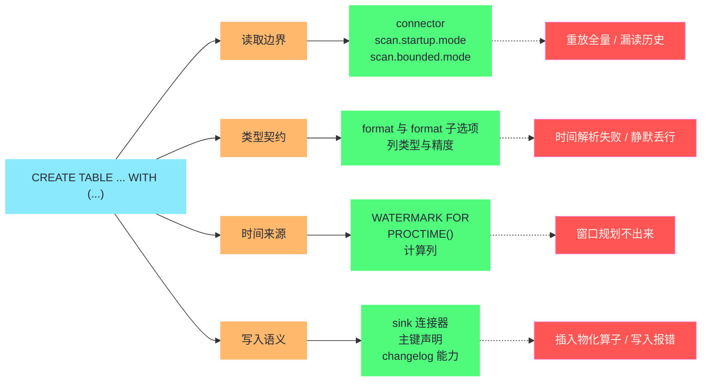
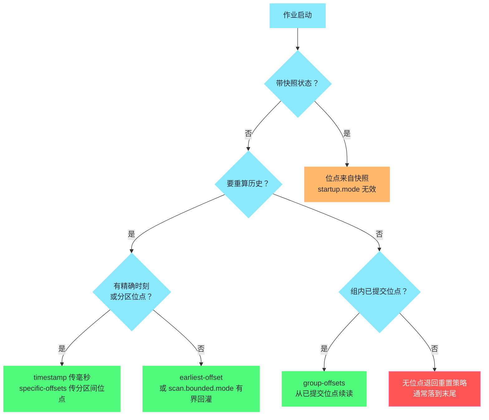
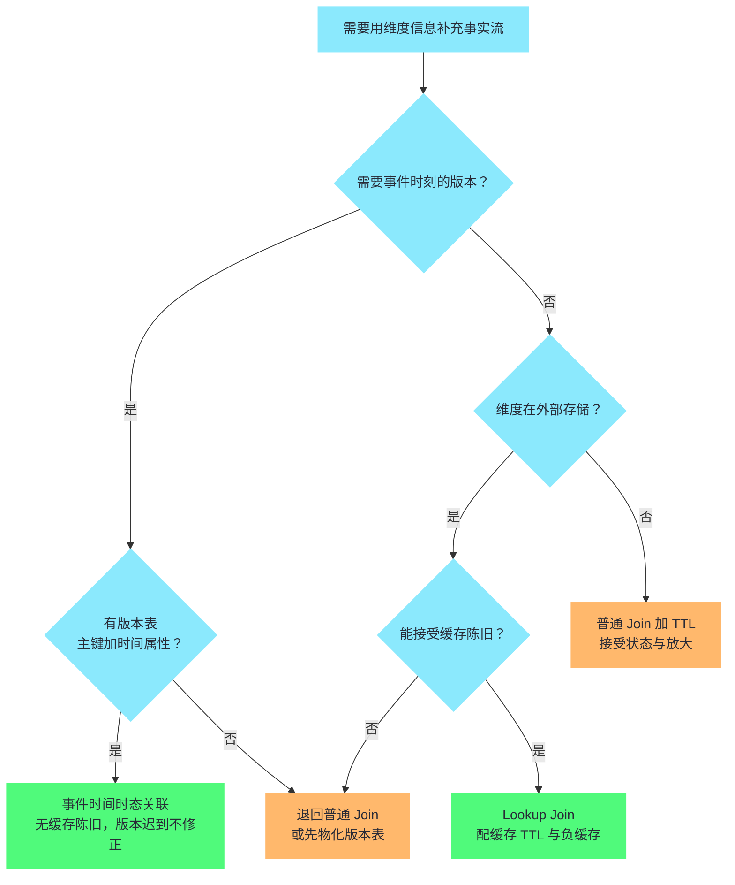
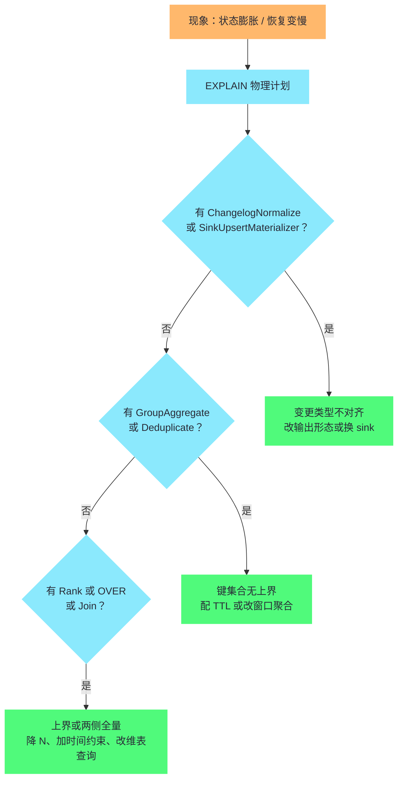
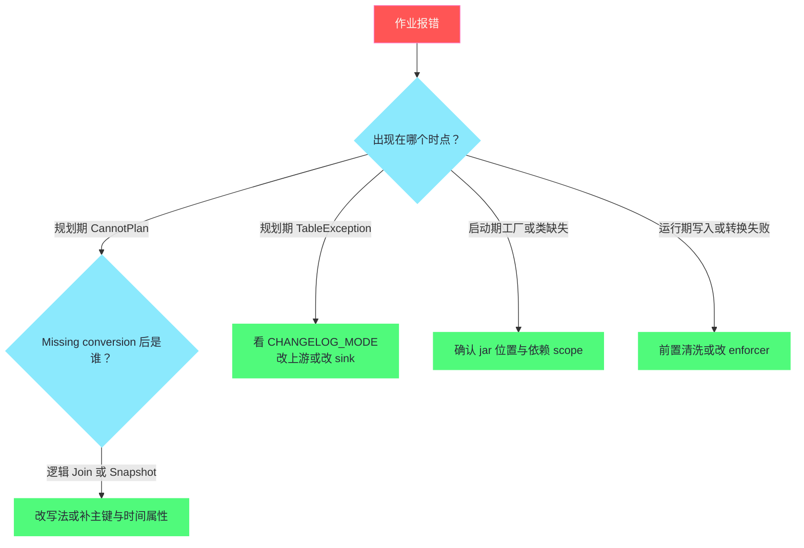

**摘要：**

一条 Flink SQL 作业出问题，九成以上的现场能在两条语句里找到答案：`CREATE TABLE` 的 `WITH` 块，以及 `EXPLAIN` 输出的那棵物理计划树。前者决定作业从哪里开始读、读进来是什么类型、时间从哪来、写出去是什么语义；后者决定这条 SQL 在运行时到底带几份状态、会不会多出两个既不写在 SQL 里也不写在配置里的算子。本篇站在实战列立场，只回答三个问题：怎么写对、怎么调、踩什么坑。写法部分覆盖建表与连接器配置（Kafka 源五个位点取值、format 容错开关、湖表分区提交）、时间属性的三种声明方式、维表关联的三条路径、去重与 TopN 的固定写法及其状态账；调参部分逐项拆开 MiniBatch、两阶段聚合、upsert 物化、会话时区四个高频参数的作用与副作用；排障部分给出 `CannotPlanException`、`Cannot generate a valid execution plan`、类型转换失败与连接器类缺失四类报错的判读顺序。SQL 怎么被翻译成算子、`ChangelogNormalize` 与 `SinkUpsertMaterializer` 为什么被插入，归原理列，本篇只在必要处给一句结论加一条双链。全文以"订单 CDC 入 Kafka、Flink SQL 出实时大屏并写入湖表"贯穿，量化数字均标注为示例推算。

---

## 第 1 章 一条 DDL 决定了四件事

### 1.1 三个故障，同一个源头

2023 年秋天，一个电商团队的实时大屏在灰度上线第三天被业务方叫停。现象有三层：大屏上的当日成交额比真实值大约四成，且从凌晨开始一路涨；商品维度那一列在白天某个时刻之后全部变空；到第二周，Checkpoint 开始超时，恢复时间从四十秒涨到六分钟。

三条线索追下去，落在同一个文件的三段 `CREATE TABLE` 上。成交额偏大，是源表的 `scan.startup.mode` 写成了 `earliest-offset`，灰度的新作业没有带状态，首跑把主题里三个月的订单重放了一遍，大屏于是从三个月前开始"补课"。维度列变空，是维表用了 `lookup.cache` 的 `PARTIAL` 档加负缓存，商品在 MySQL 里新建之后，缓存里"查不到"的那条记录还在过期期内持续命中。Checkpoint 超时，是去重写成了 `SELECT DISTINCT` 且没配状态 TTL，去重集合按订单号单调增长，两周后单个子任务的状态到了几十 GB。

三个故障的根因都不在 SQL 主体逻辑里，而在建表语句和几个配置项上。这也正是实战列与原理列的分界：一条 SQL 为什么被翻译成这棵算子树、状态为什么落在某个算子上，属于翻译机制的范畴，见 [[大数据/Flink/Flink原理深度解析与性能优化/08 Flink SQL 与 Blink Planner 深度解析|原理列第 08 篇]]；本篇关心的是，同样一段逻辑，配置项怎样影响它的行为、代价与故障形态。

### 1.2 DDL 是四组能力的协商结果

把 `CREATE TABLE` 拆开看，它并没有在"定义一张表"，而是在向规划器声明四组能力，缺一组或写错一组，后面所有查询都会以某种方式偏离预期。

第一组是**读取边界**，由 `connector` 与 `scan.startup.mode` 一族选项决定：从哪个位点开始、什么时候算读完、要不要跟随分区扩容。第二组是**类型契约**，由列定义与 `format` 子选项决定：外部字节怎么变成 `TIMESTAMP(3)`、`DECIMAL(12,2)`，字段缺失和解析失败时是报错还是静默丢弃。第三组是**时间来源**，由 `WATERMARK FOR`、`PROCTIME()`、计算列三者之一声明，它决定窗口、去重、区间连接这些算子能不能被规划出来。第四组是**写入语义**，由 sink 连接器在 `getChangelogMode` 里声明它能吃什么，规划器据此决定要不要在结果表之前插一个物化算子。

下图把这四组能力与配置位置画在一起，第 2 到第 4 章分别对应其中一支。



四组能力之间还有依赖：没有时间来源就规划不出窗口，写入语义协商不下来则前面算得再对也会在 sink 处失败，所以它们适合放在同一张上线检查单里审查。

### 1.3 主键不只是约束

DDL 里的 `PRIMARY KEY (...) NOT ENFORCED` 常被当成注释，实际在 Flink 侧至少承担四份职责。

一是 upsert 语义的推断依据：写 JDBC、HBase、upsert-kafka 这些支持更新的结果表时，规划器靠主键判断这条流是 append 还是 upsert。二是补变更语义时的键：上游给 upsert 流、下游要完整撤回流时，规划器插入的 `ChangelogNormalize` 就按主键存上一行、补出 `UPDATE_BEFORE`。三是时态关联的合法性条件：事件时间版本表做 `FOR SYSTEM_TIME AS OF` 时，主键必须出现在等值条件里，否则规划期就报错。四是列可空性——声明主键会把对应列改成非空，这在本篇第 9.3 节会变成一个真实的写入失败。

`NOT ENFORCED` 的含义是 Flink 不校验唯一性，它相信用户。主键声明错了不会有任何提示，只会在结果里出现"同键多行"或者"结果被旧值覆盖"这类需要倒推才能发现的偏差。判断主键是否写对有个便宜办法：看 `EXPLAIN` 里有没有出现意料之外的 `ChangelogNormalize` 或 `SinkUpsertMaterializer`，它们出现通常意味着上下游的键假设不一致。

### 1.4 METADATA 列与计算列都不能写

Kafka 源可以暴露记录元数据，最常见的用法是把记录时间戳提升为排查用的列：

```sql
CREATE TABLE orders_cdc (
  order_id    BIGINT,
  user_id     BIGINT,
  category    STRING,
  amount      DECIMAL(12, 2),
  order_time  TIMESTAMP(3),
  -- 记录写入 Kafka 的时刻，用于排查上游延迟；VIRTUAL 表示不落盘
  kafka_ts    TIMESTAMP_LTZ(3) METADATA FROM 'timestamp' VIRTUAL,
  proc_time   AS PROCTIME(),
  WATERMARK FOR order_time AS order_time - INTERVAL '5' SECOND
) WITH (
  'connector' = 'kafka',
  'topic' = 'order_created',
  'properties.bootstrap.servers' = 'kafka:9092',
  'properties.group.id' = 'gmv-dashboard-v2',
  'scan.startup.mode' = 'group-offsets',
  'format' = 'json'
);
```

这里有两类列容易被误用。`METADATA` 列与计算列都属于"源端到查询端"的扩展列，它们出现在 `SELECT *` 里，却不属于写入端 schema，`INSERT INTO` 时既不能被赋值也不能出现在列清单里；把 `proc_time` 写进结果表的列清单是常见的规划期错误，报文往往只说"列不存在"，不会直接指出这是虚拟列。

### 1.5 建表检查单

| 检查项 | 正确形态 | 写错的典型表现 |
| --- | --- | --- |
| 读取起点 | 生产用 `group-offsets`，回灌用 `earliest-offset` 或 `timestamp` | 首跑重放全量，或新组漏读历史 |
| 消费组 | `properties.group.id` 全局唯一且带版本号 | 不同作业共用组名，位点互相覆盖 |
| 格式容错 | `json.ignore-parse-errors` 默认关闭，开启时配监控 | 脏数据静默丢弃，量对不上却查不到 |
| 时间格式 | 用 `json.timestamp-format.standard` 或计算列显式解析 | 时间戳整体偏移，或解析失败 |
| 时间属性 | 三类声明只选一种，且落在正确的列上 | 窗口、去重、区间连接报"缺少时间属性" |
| 主键 | 与下游写入语义一致，且出现在关联等值条件里 | 出现意外的物化节点，或结果被覆盖 |
| 写入能力 | append sink 只接 insert-only 流 | 运行时拒绝 changelog，或重复累加 |
| 分区提交 | 湖表按分区时间提交并配好提取器与时区 | 分区被提前看见，或几小时不提交 |

---

## 第 2 章 连接器配置：位点、格式与提交

### 2.1 `scan.startup.mode` 的五个取值

这五个取值不只是"从头还是从尾"的区别，真正决定行为的是另外两个条件：这次启动有没有带状态，以及消费组里有没有已提交的位点。

| 取值 | 语义 | 无状态首跑的行为 | 带状态恢复时 | 典型事故 |
| --- | --- | --- | --- | --- |
| `group-offsets`（默认） | 读组内已提交位点 | 无位点时退回重置策略，实际落点通常是末尾 | 忽略，取快照位点 | 新组上线漏掉历史，看起来"一切正常" |
| `earliest-offset` | 读每个分区最早位点 | 全量重放 | 忽略，取快照位点 | 新作业首跑把整个主题重算一遍 |
| `latest-offset` | 读每个分区最新位点 | 只消费启动之后的数据 | 忽略，取快照位点 | 停机超过保留期，中间数据永久缺失 |
| `timestamp` | 按毫秒时间戳定位每个分区的位点 | 从指定时刻开始 | 忽略，取快照位点 | 把秒当毫秒传入，位点落到 1970 年 |
| `specific-offsets` | 按分区间精确指定位点 | 从指定位点开始 | 忽略，取快照位点 | 分区号变化后位点错位 |

"带状态恢复时一律忽略"这一列值得单独强调：Kafka 源的消费位点是检查点状态的一部分，只要从快照恢复，位点就来自快照，`scan.startup.mode` 完全不参与。这条规则解释了一类反复出现的困惑——改了起点配置、重启作业、数据仍然从原来的位置读起。处置方向应该先确认这次启动是否带了状态，继续改配置没有意义；要真正改变起点，只能丢弃状态重跑，或者另开一条链路做回灌。

默认值 `group-offsets` 是另一处容易误判的地方。它在组内没有提交位点时会退回重置策略，而这条策略由连接器固定，`properties.auto.offset.reset` 并不生效——Kafka SQL 连接器文档把它列在"会被 Flink 覆盖、不支持设置"的键里，DataStream 文档也写明 `auto.offset.reset.strategy` 会被起始位点的重置策略覆盖。指望用它给新组兜底并不可靠。上线前要么显式改成 `earliest-offset` 或 `timestamp` 跑一次首跑，要么先在消费者组里提交一个位点再切回 `group-offsets`。

`timestamp` 的两个细节值得记住。一是单位是毫秒，`scan.startup.timestamp-millis` 要传从 1970-01-01 00:00:00 UTC 起算的毫秒数，把业务方给的秒级时间戳直接填进去，位点会落到 1970 年附近，表现是"作业启动后水位停在半个世纪前"。二是它按分区定位，每个分区独立寻找第一个不早于该时刻的位点，用它回灌时各分区起点在事件时间上大致对齐，但不会精确到同一条记录。`specific-offsets` 用于故障定位后的精确回补，写法是 `'partition:0,offset:42;partition:1,offset:300'`，风险是与分区结构强耦合——主题扩容或从快照恢复后分区号含义可能已变，位点会落到错误位置，用它之前先把当时的分区数记录进变更单。

下图把五个取值与三条判据（有无状态、有无提交位点、是否回灌）画成一条决策路径，值班时按图走一遍就能定值。



还有一条与起点配套的能力：`scan.bounded.mode`。设成 `latest-offset`、`group-offsets`、`timestamp` 或 `specific-offsets` 之后源表变成有界表，读到边界就自行结束，作业随之完成，这是 SQL 侧做一次性回灌最省事的手段。配套要用 `scan.bounded.timestamp-millis` 与 `scan.bounded.specific-offsets`，并记住一个语义：`group-offsets` 的边界在开始消费那一刻求值，之后再提交位点也不会改变边界。

### 2.2 format 决定了脏数据怎么表现

JSON 格式的两个容错开关默认值需要背下来：`json.fail-on-missing-field` 默认 `false`，字段缺失按 `null` 处理；`json.ignore-parse-errors` 默认 `false`，解析失败直接抛异常让作业失败。前者意味着"少字段"永远不报错，如果缺的那一列恰好是时间属性，窗口不会报错，只会安静地把这些行归到不该去的地方；后者意味着一条脏数据就能让作业重启，生产上通常要打开，但被跳过的记录不产生指标、只在日志留一行 warning，打开的同时必须在上游按解析失败率打点。

时间字段是 JSON 源的高频坑。`json.timestamp-format.standard` 默认是 `SQL`，即 `yyyy-MM-dd HH:mm:ss` 形态；上游给的是 ISO-8601 的 `2024-05-01T12:00:00Z` 时，要么改成 `ISO-8601`，要么用计算列显式解析。

CDC 格式（`debezium-json`、`canal-json`、`maxwell-json`）与普通 JSON 的差别不在解析，而在变更语义：源表产出的是包含 `UPDATE_BEFORE`、`DELETE` 的完整 changelog，这会直接影响主键声明与 sink 选择。

### 2.3 Sink 侧：append 与 upsert 的分水岭

普通 `kafka` 连接器作为 sink 时只接受 insert-only 流。聚合、去重、维表关联这些会产生更新语义的查询，直接写进普通 Kafka 表会在运行时报错，信息通常指向"结果表不支持 changelog"或要求声明主键——不是连接器能力不足，而是语义上确实没法表达"撤回一行"。

`upsert-kafka` 把更新压缩成"同键覆盖"：`INSERT` 与 `UPDATE_AFTER` 写成正常消息，`DELETE` 写成 value 为 `null` 的墓碑消息，同键消息按主键分区保证顺序。它要求主键，或者显式给出 `key.fields`；配合主题的日志压缩，消费者读到的就是每个键的最新值。三个细节值得写进配置：`sink.buffer-flush.max-rows` 与 `sink.buffer-flush.interval` 都大于零时才启用缓冲刷新，同键多次更新会在缓冲里合并成一次写出，显著减少墓碑消息；`sink.delivery-guarantee` 默认 `at-least-once`，要到精确一次需显式改成 `exactly-once` 并配事务前缀，完整取舍见 [[大数据/Flink/Flink从入门到实战/08 Flink 与 Kafka 端到端精确一次实战|第 08 篇]]；`sink.partitioner='fixed'` 让每个子任务固定写同一分区，省连接开销，代价是把上游倾斜原样搬到 Kafka 分区上。

### 2.4 湖表 Sink：分区什么时候算写完

写到文件系统或湖表时，需要想清楚的不是格式，而是"分区什么时候对下游可见"。这套行为由四个选项加一个提取器决定，缺一项就会出偏差。

`sink.partition-commit.trigger` 有 `process-time` 与 `partition-time` 两个取值，前者用机器时间判断"分区创建后过了多久"，后者用水位与分区里提取出的时间比较；`sink.partition-commit.delay` 是提交前的等待时长；`sink.partition-commit.policy.kind` 决定提交动作，`metastore` 写元数据、`success-file` 落一个 `_SUCCESS`、`custom` 走自定义类；`partition.time-extractor.timestamp-pattern` 与 `timestamp-formatter` 负责把分区目录里的字符串还原成时间戳，`partition-time` 触发方式离不开它们。

三种常见组合对应三种可见性，配置时最好明确选一种，而不是照模板抄。

| 组合 | 可见性 | 代价与风险 | 适用 |
| --- | --- | --- | --- |
| `process-time` 加 `delay=0s`（默认） | 分区一有数据立刻可见，且可能被多次提交 | 下游读到半截数据，聚合结果偏小 | 仅供调试，或下游本就按增量读取 |
| `partition-time` 加 `delay=1h` | 水位越过分区时间加一小时后才提交 | 需要水位正常推进；提取器写错则永不提交 | 生产入湖，小时或天分区 |
| `process-time` 加 `delay=1h` | 近似准确，但补数与故障会导致提前提交 | 水位不可用时的退路 | 无事件时间的链路 |

还有一个不对称的时区陷阱：`sink.partition-commit.watermark-time-zone` 默认是 `UTC`，且只在 `partition-time` 触发方式下生效。当行时间是 `TIMESTAMP_LTZ` 列、这个参数又没配时，水位会被当成 UTC 时间去和分区时间比较，结果是分区在东八区晚八小时才提交——文档写得直白，"用户可能看到分区几小时之后才提交"。它与第 7 章的 `table.local-time-zone` 是两个独立参数，配了一个不等于配了另一个。

---

## 第 3 章 时间属性：三种声明方式与它们的分工

### 3.1 事件时间：`WATERMARK FOR` 能表达的和不能表达的

SQL 侧的事件时间只有一种声明语法，`WATERMARK FOR 列名 AS 表达式`。表达式能写出三种水位策略：写列名本身是严格递增，写 `列名 - INTERVAL '0.001' SECOND` 是等价于严格递增但留一毫秒余量，写 `列名 - INTERVAL 'N' SECOND` 是有界乱序。三者对应 DataStream 侧的三类生成器，语义与陷阱见 [[大数据/Flink/Flink从入门到实战/04 时间语义与 Watermark 实战|第 04 篇]]，这里只强调工程边界。

它能表达的只有"固定减量"。断点式生成器（按事务提交推进）与自适应生成器（按统计量调整容忍度）都写不出来，遇到这两类需求只有两条路：把这段降级成 DataStream，或者接受固定容忍度并把迟到数据交给下游兜底。它也不能表达"空闲分区"——判定空闲的超时是另一个配置项 `table.exec.source.idle-timeout`，与 DataStream 的 `withIdleness` 是两条互不相通的路径。

1.18 起 SQL 侧补上了水位对齐能力，选项挂在源表上：`scan.watermark.alignment.group` 指定对齐组名、`max-drift` 指定最大进度落差、`update-interval` 指定对齐时间的计算间隔（默认 1 秒），用途是限制多个源或多个分区之间的进度差，把"快源等慢源"期间攒下的状态控制在一个上界内。前提是连接器实现了分区级对齐（FLIP-217，1.17 起），否则任务直接报错，需要显式打开 `pipeline.watermark-alignment.allow-unaligned-source-splits` 退化成子任务级对齐。

水位表达式还有一个常被忽略的约束：返回值类型必须是 `TIMESTAMP(3)`，列本身必须是顶层列，可以是计算列——这最后一句让"原始字段不是时间类型"的场景有了标准解法，见 3.3 节。

### 3.2 处理时间：`PROCTIME()` 是计算列

处理时间没有专门的声明语法，写法是把一个计算列定义成 `PROCTIME()`：

```sql
CREATE TABLE page_events (
  user_id   BIGINT,
  page_id   STRING,
  -- 返回 TIMESTAMP_LTZ，由运行时在每条记录到达时求值
  proc_time AS PROCTIME()
) WITH (
  'connector' = 'kafka',
  'topic' = 'page_events',
  'properties.bootstrap.servers' = 'kafka:9092',
  'properties.group.id' = 'pv-dashboard',
  'scan.startup.mode' = 'group-offsets',
  'format' = 'json'
);
```

`PROCTIME()` 的返回类型是 `TIMESTAMP_LTZ`，从 1.13 起如此，原因是早期版本用不带时区的 `TIMESTAMP`，在东八区机器上会显示成 UTC 时间，看起来整体少了八小时；改成 `TIMESTAMP_LTZ` 之后显示值随会话时区变化，夏令时也能正确处理。

处理时间不能用于需要可重放的场景，这一点在第 04 篇已经讲透；在实战层面它还有另一个身份：**维表关联的入场券**。lookup join 与处理时间版本的时态关联都要求左侧有处理时间属性，因为"关联哪一刻的维表"这个问题只能由处理时间来回答。

处理时间的窗口边界会随会话时区变化。官方时区文档的例子是同一组数据在 `UTC` 与 `Asia/Shanghai` 下，十分钟窗口起点分别显示为 `14:00` 与 `22:00`：处理时间窗口本来就以本地墙上时钟为坐标系，而事件时间窗口在 `TIMESTAMP` 列上不受时区影响，只有 `TIMESTAMP_LTZ` 列才按会话时区平移。

### 3.3 计算列：把"不像时间"的字段接进时间体系

绝大多数上游给的时间不是 `TIMESTAMP(3)`，而是 epoch 毫秒、字符串，或者嵌在 JSON 里的一层字段，这三种都要靠计算列过渡。

epoch 长整型的标准写法如下：

```sql
CREATE TABLE orders_cdc (
  order_id    BIGINT,
  amount      DECIMAL(12, 2),
  -- 上游给的是 epoch 毫秒，先转成带时区的时间类型
  ts_ltz      AS TO_TIMESTAMP_LTZ(create_ms, 3),
  WATERMARK FOR ts_ltz AS ts_ltz - INTERVAL '5' SECOND
) WITH (...);
```

字符串时间写成 `TO_TIMESTAMP(str, 'yyyy-MM-dd HH:mm:ss')`，嵌套 JSON 则在计算列里用 `JSON_VALUE` 取值再转。两者都属于显式解析，好处是解析失败会当场报错，而不是把错误数据带进窗口。

DDL 层面还有一条硬规则值得记住：`WATERMARK FOR` 的列必须是 `TIMESTAMP(3)` 或 `TIMESTAMP_LTZ(3)` 类型的顶层列，且可以是计算列。可见计算列属于官方认可的正规通道，它同时解决了"原始字段类型不对"和"字段为 null 时水位怎么算"两个问题。代价是计算列不能被写入，也不能出现在 `INSERT INTO` 的列清单里；下游需要这个时间值，要在查询里再 `SELECT` 一次。

### 3.4 `ROWTIME` 与 `PROCTIME`：两种属性、一个位置

在物理计划、`DESC` 输出与 DataStream 转换的 schema 描述里，时间属性会以 `TIMESTAMP(3) *ROWTIME*` 或 `TIMESTAMP_LTZ(3) *PROCTIME*` 的形式标注。这两个标记是同一位置上的两种属性，不是两种类型的列：`ROWTIME` 表示这一列的事件时间语义已经建立（有水位生成器），`PROCTIME` 表示这一列由运行时在到达时求值。同一个表可以同时拥有两者，分别用在窗口与维表关联上。

"普通列不能当时间属性"是初学者最常撞的一堵墙。`TUMBLE(TABLE t, DESCRIPTOR(order_time), INTERVAL '5' MINUTE)` 里的 `order_time` 如果只是一列 `TIMESTAMP(3)` 而没有 `WATERMARK FOR`，规划期会直接报"要求时间属性"；去重的 `ORDER BY`、区间连接的时间条件、`OVER` 的排序键都有同样要求。这条限制有它的机制来由：窗口的关闭、去重的名次、连接的过期清理都要靠水位驱动，没有水位的列无法提供推进信号，细节见 [[大数据/Flink/Flink原理深度解析与性能优化/07 Flink 时间与 Watermark 底层机制|原理列第 07 篇]]。

### 3.5 三种声明方式的对照

| 维度 | `WATERMARK FOR` | `PROCTIME()` 计算列 | 计算列桥接 |
| --- | --- | --- | --- |
| 语义 | 事件时间，可重放 | 处理时间，不可重放 | 取决于被桥接的目标类型 |
| 典型用途 | 窗口聚合、事件时间去重、时态关联 | 维表关联、处理时间窗口、限流逻辑 | 把 epoch 或字符串接进上面两种 |
| 能表达的策略 | 固定减量（含严格递增） | 无策略可配 | 无策略，只做类型与解析 |
| 主要陷阱 | 容忍度无从测量、断点式写不出 | 时区影响窗口边界、重启不可重放 | 解析失败无兜底、虚拟列不可写 |
| 配错的症状 | 窗口不出数、迟到量暴涨 | 对账口径不可重放 | 时间整体偏移或全为 null |

---

## 第 4 章 维表关联：三条路径与各自的陈旧窗口

### 4.1 Lookup Join：外部系统承担"全量"

Lookup join 是最常见的一种维表关联，写法上借用处理时间版本的时态关联语法：

```sql
CREATE TEMPORARY TABLE dim_product (
  product_id  STRING,
  category    STRING,
  brand       STRING,
  PRIMARY KEY (product_id) NOT ENFORCED
) WITH (
  'connector' = 'jdbc',
  'url' = 'jdbc:mysql://mysql:3306/dim',
  'table-name' = 'dim_product',
  'username' = 'flink_ro',
  'password' = '******',
  -- 1.16 起的统一写法：先声明缓存档位，再配档位内的参数
  'lookup.cache' = 'PARTIAL',
  'lookup.partial-cache.max-rows' = '20000',
  'lookup.partial-cache.expire-after-write' = '10min',
  'lookup.partial-cache.cache-missing-key' = 'true'
);

SELECT o.order_id, o.amount, p.category, p.brand
FROM orders_cdc AS o
JOIN dim_product FOR SYSTEM_TIME AS OF o.proc_time AS p
ON o.product_id = p.product_id;
```

三条语法约束必须同时满足，缺一条就是规划期报错而不是运行期降级：右侧是 lookup 源（实现了 `LookupTableSource`），有一个处理时间属性作为 `AS OF` 的参数，存在等值连接条件。第三条常被误解为"可以写不等值"，实际不行：lookup 的本质是按键取数，没有键就没有"取哪一行"。

缓存的写法在 1.16 前后换过一代，这是很多老配置"看着配了其实没生效"的原因。旧写法 `lookup.cache.max-rows` 与 `lookup.cache.ttl` 已标记废弃，语义等价于新写法的 `PARTIAL` 档加 `partial-cache.max-rows`、`partial-cache.expire-after-write`。新写法把档位与参数分开，档位有 `NONE` 与 `PARTIAL`（部分连接器还支持整表缓存，以连接器文档为准），参数只在 `PARTIAL` 下生效。

三个缓存参数的实际语义值得逐个拆。`max-rows` 是容量上界，超出后按最近最少使用淘汰，它不决定新鲜度；`expire-after-write` 从写入那一刻计时、到点失效，它才是"陈旧窗口"的上界；`expire-after-access` 从最后一次访问计时，命中一次续期一次，在热点键上意味着缓存可能长期不刷新，用它就要接受"越热的维度越旧"。`cache-missing-key` 控制是否缓存"查不到"的负结果，默认开启，维表新增记录之后负缓存仍会命中直到过期，表现是关联结果一直为空——本篇开头案例里空维度列的根因就是它。

异步 lookup 是另一档能力，由连接器的 `lookup.async` 选项决定，默认关闭；SQL 侧的 `LOOKUP` hint 可以建议规划器选同步还是异步：

```sql
SELECT /*+ LOOKUP('table' = 'dim_product', 'async' = 'true',
                   'output-mode' = 'allow_unordered') */
       o.order_id, p.category
FROM orders_cdc AS o
JOIN dim_product FOR SYSTEM_TIME AS OF o.proc_time AS p
ON o.product_id = p.product_id;
```

hint 只提建议，连接器不支持异步时会被忽略，规划器仍用同步实现。这件事在 1.20 与 2.1 文档里口径一致：JDBC 连接器作为维表只支持同步查找；HBase 连接器的 `lookup.async` 只在 hbase-2.2 版本上可用。`output-mode` 默认 `ORDERED`，改成 `allow_unordered` 之后异步结果不保证顺序，吞吐更高，但下游若依赖顺序（譬如写 upsert 表且同键多次更新），乱序会导致最终值错。容量与超时的作业级参数是 `table.exec.async-lookup.buffer-capacity`（默认 100）与 `table.exec.async-lookup.timeout`（默认 3 分钟），hint 里的同名选项粒度更细，只作用于指定的那张表。

还有一组重试参数专门解决"维表数据比事实晚到"：`retry-predicate='lookup_miss'` 表示查不到就重试，配合 `retry-strategy='fixed_delay'`、`fixed-delay` 与 `max-attempts` 指定间隔与次数，四个值必须同时给全。它适合维表由另一条 CDC 链路异步写入、事实流先到的场景；不适合把"查不到"当常态的场景，那说明键或维表本身有问题。

### 4.2 事件时间时态关联：版本表

业务需要"用事件发生那一刻的维度值"时，lookup join 就不够了，因为外部系统只保留当前快照。这时要用事件时间版本的时态关联，右侧必须是一张版本表：有主键、有事件时间属性、并保留历史版本（CDC 变更流、压缩主题，或从版本视图物化出来的表）。

```sql
CREATE TABLE dim_product_versions (
  product_id  STRING,
  category    STRING,
  update_time TIMESTAMP(3),
  PRIMARY KEY (product_id) NOT ENFORCED,
  WATERMARK FOR update_time AS update_time - INTERVAL '10' SECOND
) WITH (
  'connector' = 'kafka',
  'topic' = 'dim_product_cdc',
  'properties.bootstrap.servers' = 'kafka:9092',
  'properties.group.id' = 'dim-versioned',
  'scan.startup.mode' = 'earliest-offset',
  'format' = 'debezium-json',
  'scan.bounded.mode' = 'latest-offset'
);

SELECT o.order_id, o.amount, v.category
FROM orders_cdc AS o
LEFT JOIN dim_product_versions FOR SYSTEM_TIME AS OF o.order_time AS v
ON o.product_id = v.product_id;
```

这段配置里有几个点只有实战里才会注意。`scan.bounded.mode='latest-offset'` 让版本表只读到启动时刻为止：版本表是"历史档案"，不需要跟着实时增长，读成有界表之后作业水位不会被维表的低频更新拖住。`format` 用 CDC 格式而不是普通 JSON，原因是版本表要求每条记录自带变更时刻与主键，CDC 消息天然带这两样；用普通 JSON 也能做，前提是消息体里有更新时间字段、在 DDL 里声明成水位列并给出主键。两侧都配了水位，关联才可能被触发——事件时间时态关联由两侧水位共同推进，任一侧不动结果就不出。

它的陈旧窗口与 lookup 完全不同：关联结果由事实行的时间戳决定，与该维表"当前是否已更新"无关，所以没有缓存陈旧问题，取而代之是两个新问题。一是**迟到版本**：某次维表变更若在事实行之后才到，事实行已经用旧版本关联过并输出，后续不会修正，结果是"用了错的历史版本"，误差方向与时间有关，越靠近变更时刻越容易错。二是**版本清理**：不再需要的版本会随水位推进被清掉，这控制了状态规模，也意味着不能回头查询任意旧的时点。

### 4.3 普通 Join：最贵的那条退化路径

第三种写法是把维表当普通表直接 `JOIN`，这是三条路径里唯一会退化成"双侧全量状态"的一种。它的语义是"任意时刻两条流的历史都参与匹配"，于是左流每一行、右流每一个版本都要留在状态里等待匹配；维表更新一次，所有历史事实行都可能重新匹配一遍并输出更新，形成典型的**关联放大**。下游收到的也不再是插入流，而是带撤回的 changelog，写入必须能处理更新。

代价可以用量级判断直接估出来。订单流日增五千万行、维表日变更两万次，按 100 字节行宽、30 天不清理算，仅左流状态就是 150GB 量级（示例推算）；每一次维表变更触发的重算量又与历史事实行数成正比，维表越活跃放大越厉害。三条路径里只有这一条的代价随数据量单调增长而没有上界。

### 4.4 三条路径的对照

| 维度 | Lookup Join | 事件时间时态关联 | 普通 Join |
| --- | --- | --- | --- |
| 右侧要求 | lookup 源（JDBC/HBase 等） | 版本表：主键加时间属性 | 任意表或流 |
| 时间属性要求 | 左侧处理时间 | 两侧事件时间 | 无 |
| 关联语义 | 处理那一刻的外部快照 | 事实时间点的版本 | 全历史交叉匹配 |
| 陈旧窗口 | 缓存 TTL 或 `expire-after-access` | 迟到版本的到达延迟 | 无陈旧概念，但结果持续变更 |
| 状态规模 | 无（缓存是堆内 LRU） | 版本数乘键数，随水位清理 | 两侧全量，无上界 |
| 外部压力 | 每次未命中一次远程查询 | 无 | 无 |
| 输出语义 | 仅插入 | 仅插入 | 带撤回，下游要能更新 |
| 典型故障 | 维表更新不刷新 | 迟到版本导致历史用错值 | 状态膨胀、结果放大 |

选型可以压缩成四个问题，下图按"要不要历史版本、维度在不在外部存储、能否接受缓存陈旧"的顺序给出判据。



### 4.5 非确定性更新：一条容易被忽略的告警

Lookup join 的左侧如果不是纯插入流，而是带更新的 changelog（譬如聚合结果、upsert 源），就会出现"非确定性更新"（Non-Deterministic Update，NDU）：同一行先后被更新两次，两次 lookup 命中的维表值可能不同，最终结果取决于查询时刻，重跑不一致。规划器能识别这类风险，`EXPLAIN PLAN_ADVICE` 会把它作为 warning 标出来。

处置手段是 `table.optimizer.non-deterministic-update.strategy`，默认 `IGNORE` 表示不做任何事；设成 `TRY_RESOLVE` 之后，优化器会为 lookup join 自动加物化、用状态把结果固定下来，同时把无法自动解决的场景（非确定性函数、CDC 元数据列）报成错误。打开它意味着多一份状态，换来结果可重放，对账链路上的维表关联值得打开。

---

## 第 5 章 去重与 TopN：写法固定，状态才可控

### 5.1 去重的四种写法

去重有四条常见路径，写法上的细微差别会直接决定它被识别成去重算子，还是退化成状态更大的聚合与排序。

`SELECT DISTINCT` 最直观，代价是它把去重集合当状态维护，规模等于不同键数乘行宽，且没有天然上界。`ROW_NUMBER()` 按处理时间取首行是官方推荐写法：

```sql
SELECT order_id, user_id, amount, order_time
FROM (
  SELECT *,
         ROW_NUMBER() OVER (PARTITION BY order_id ORDER BY proc_time ASC) AS rn
  FROM orders_raw
) WHERE rn = 1;
```

它能被识别成去重算子，条件是模式必须**严格一致**：`PARTITION BY` 给去重键、`ORDER BY` 给时间属性、外层过滤必须是 `rn = 1`。写成 `rn <= 1`、`rn + 0 = 1`，或在外层再套一层表达式，优化器识别不了，查询会退化成普通 `OVER` 聚合或排序，状态从"每键一行"变成"每键一批行"。`ORDER BY ... ASC` 保留首行，`DESC` 保留末行，状态量相同而语义不同。

第三条是把排序键换成 `order_time` 的事件时间版本。语义更符合"按业务时间判定先后"，代价也更大：要等水位越过某行时间才能确定它是不是首行，等待期间同键记录都要留在状态里按时间排序。因此它的状态不止"每键一行"，还要加上乱序容忍度窗口内的缓冲，量级通常比处理时间版本高出一到两倍（示例推算）。`FIRST_VALUE`、`LAST_VALUE` 这类窗口函数写法也能覆盖部分场景，但优化器识别面更窄、状态更难估算，新写去重不建议从这里入手。

### 5.2 去重必须配 TTL

去重算子的状态按 key 保存，key 的数量由业务决定，而业务通常不设上界：以订单号去重，订单号每天新增几千万个，状态就每天涨几千万行。Flink 没有理由主动删掉某个 key 的状态，因为它无法判断这个 key 还会不会再来，所以去重必须配 `table.exec.state.ttl`，让"多长时间没再出现"成为清理条件。

TTL 的取值有直接判据：它应略大于业务允许的重复窗口。上游 CDC 因至少一次投递，重复通常出现在故障恢复后几分钟内，取几十分钟到几小时就够；取一天以上等于没配，只是把状态膨胀往后推。TTL 到期的语义后果也要接受：某个键的状态被清掉之后，同一个键再来一条记录会被当成"第一次出现"重新计数，去重本身不受影响，但它若同时参与聚合，聚合值会从零开始。

CDC 链路还有一处相关配置。`table.exec.source.cdc-events-duplicate` 默认 `false`，打开后框架会按主键对 CDC 变更事件去重并规范化成完整 changelog，代价是多一个有状态算子，且**要求源表声明主键**。它解决的是 Debezium 故障恢复时重复投递导致的"同一变更出现两次"，与手工去重是两件事，不要用一个大的 TTL 去重语句同时兼做。

### 5.3 TopN：识别条件与状态上界

TopN 的固定写法是 `ROW_NUMBER()` 加外层范围过滤：

```sql
SELECT category, window_start, gmv, rn
FROM (
  SELECT category, window_start, SUM(amount) AS gmv,
         ROW_NUMBER() OVER (PARTITION BY category, window_start ORDER BY SUM(amount) DESC) AS rn
  FROM TABLE(TUMBLE(TABLE orders_cdc, DESCRIPTOR(order_time), INTERVAL '5' MINUTE))
  GROUP BY category, window_start
) WHERE rn <= 10;
```

识别条件与去重同源：`PARTITION BY` 是分区键、`ORDER BY` 是排序表达式、外层过滤是 `rn <= N` 或 `rn BETWEEN a AND b` 这类能表达成区间的形态。范围一旦被表达式包裹（`rn + 0 <= 10`），识别失败，退化成完整排序，状态从"上界 N"变成"分组内全部行"。

状态上界由 `rankEnd` 与分区键基数共同决定：每个分区键维护一个"位次到行"的映射，容量上界是 N，所以状态量约等于分区键数乘 N 乘行宽。这条算术给出两个约束：N 不能大，`rn <= 100000` 在语义上已不算 TopN，而是在做全量排序的近似；分区键基数不能大，按商品 ID（千万级）做 TopN，即使 N 只有 10，状态也是"千万乘十行"的量级，不如先按品类聚合再取 Top。

还有一个形态差异值得知道：上游仅插入时（典型是窗口聚合结果）Rank 走 `AppendRank`，不必处理输入撤回；上游是变更流时走 `UpdateRank`，每条输入可能带 `UPDATE_BEFORE` 或 `DELETE`，要先把旧行从位次映射里摘掉。"TopN 配窗口聚合更快"这句话是对的，原因不在窗口聚合本身，而在于它让 Rank 退化成了更简单的形态，机制细节见原理列第 08 篇。

### 5.4 `DISTINCT` 用在超高基数上

`COUNT(DISTINCT user_id)` 这类聚合的状态不是"每键一个累加器"，而是"每组一个去重集合"，规模等于分组数乘每组不同值数。亿级 UV 按省份分组时，每组集合可能到百万级元素，量级判断从 GB 起步，且随业务时间线性增长。

缓解路径有三条。打开 `table.optimizer.distinct-agg.split.enabled`（默认 `false`）把去重拆成两层：先按 `hash(distinct_key) % bucket-num` 分桶做局部去重，再对桶结果二次聚合，`bucket-num` 默认 1024，它把单点热点摊到多个桶上，代价是多一次 shuffle 与两个聚合算子，并且对 `HAVING`、`FILTER` 这类结构有识别边界。第二条是把精确去重换成近似去重，用 HyperLogLog 一类的 UDF 存草图，牺牲精度换状态量级。第三条最容易被忽略：换维度。大部分"UV 必须精确"的需求，在业务上其实可以按天、按渠道、按更粗粒度容忍近似，先换维度往往比调参数更有效。

### 5.5 量化：四种写法的状态对比

下面的数字是一组示例推算，用于比较量级与趋势，不能直接搬到别的参数组合上。场景沿用贯穿案例：日订单五千万行，去重键是订单号，行宽按 120 字节估，乱序容忍度 5 秒。

| 写法 | 每键状态 | 峰值键数 | 状态量级 | 备注 |
| --- | --- | --- | --- | --- |
| `SELECT DISTINCT` 无 TTL | 一行 | 累计 90 天约 45 亿 | 数百 GB 起 | 永不释放，随天数线性增长 |
| `ROW_NUMBER` 处理时间加 TTL 1 小时 | 一行 | 约 208 万 | 约 0.25GB | 每键一行，TTL 到期清理 |
| `ROW_NUMBER` 事件时间 | 一行加窗口内缓冲 | 约 208 万 | 约 0.4GB 到 0.6GB | 缓冲随容忍度与重复密度放大 |
| `COUNT(DISTINCT)` 按省份 | 每组一个集合 | 31 组乘百万级 | GB 级 | 与分组数、基数同时相关 |

表里最值得对照的是第一行与第二行：同样是"每个键一行"，有没有 TTL 决定了状态是"随业务时间增长"还是"随一小时流量波动"，这也是为什么去重的配置审查里，写法与 TTL 要一起看。

---

## 第 6 章 有状态 SQL 的 TTL

### 6.1 一个全局配置，多个算子买单

`table.exec.state.ttl` 是一条全局配置，作用面比名字听起来宽。它给"空闲状态"设一个保留时长：状态超过该时长没有更新之后，会在某次访问或后台清理时被回收；默认值 `0ms` 表示永不清理。

受它影响的算子至少包括以下几类，判断依据是"这个算子的状态是否随业务时间累积"。

| 算子 | 状态内容 | 不配 TTL 的后果 | 配 TTL 的语义代价 |
| --- | --- | --- | --- |
| 无窗口 `GROUP BY` | 每键累加器 | 活跃键数单调增长 | 键过期后聚合从零开始 |
| `Regular Join` | 两侧全量历史行 | 状态随两流流量累积 | 超过 TTL 的行不再参与匹配 |
| `DISTINCT` 与去重 | 去重集合或每键一行 | 键数无上界 | 过期的键重新计数 |
| `Rank` 与 `OVER` | 位次映射或窗口行 | 分区键数乘 N | 位次在 TTL 后重置 |
| 物化类节点 | 每键一份行状态 | 键数乘行宽 | 是否随 TTL 清理以版本文档为准 |

最后一行值得单独提醒：`ChangelogNormalize` 与 `SinkUpsertMaterializer` 的状态是补语义用的，能否被全局 TTL 清掉，各版本行为不完全一致，不要指望用 TTL 控制它们的体积。能控制的是让上下游变更类型对齐，从源头不产生这两个节点，判据见第 8.3 节。

### 6.2 语义代价要先接受

TTL 不是"清理缓存"，它改的是查询语义，配之前必须写清楚。对无窗口聚合，键过期之后再来的记录会让聚合从零重新开始，`SUM` 变小、`COUNT` 重计；对累计类指标（累计消费金额、累计登录天数），这意味着"一段时间不活跃之后金额归零"，通常不可接受，可接受的替代是把累计改成窗口分段，或把聚合粒度降下来（按天、按用户等级）。对 `Regular Join`，过期的行不再参与匹配，语义上等于承认"太老的记录不再关联"，若业务口径要求全历史精确匹配，TTL 就是错的。

判断标准可以写得很干脆：**TTL 的长度由业务能容忍的遗忘窗口决定**，而不是由状态目录的告警阈值倒推。反过来做（先看状态多大，再把 TTL 调到刚好压住）必然会在某次对账时暴露出"数据少了"。

### 6.3 算子级 TTL：`STATE_TTL` hint

全局 TTL 对所有算子一视同仁，但不同算子的合理保留期常常差一个数量级：订单主表的关联要留三天，商品维表的关联留一天就够。1.19 起提供 `STATE_TTL` hint，可以给 `Regular Join` 与 `Group Aggregation` 单独指定保留期，覆盖全局配置。

```sql
SELECT /*+ STATE_TTL('o' = '3d', 'p' = '1d') */
       o.order_id, o.amount, p.category
FROM orders_cdc AS o
LEFT JOIN dim_product_flow AS p
ON o.product_id = p.product_id;
```

使用规则有两条容易踩。键名要与 `FROM` 子句里的名字一致，用了别名就必须写别名，写表名不生效。级联 join 的语义并不对称：`A JOIN B JOIN C` 上给定的两个 TTL，会被解释成第一个 join 的左右状态加第二个 join 的右状态，第二个 join 的左状态取全局 `table.exec.state.ttl`；要让每一段都精确控制，得把查询拆成多个 `CREATE TEMPORARY VIEW`，让每个 view 成为独立查询块。

去重、`DISTINCT`、`Rank` 不在这个 hint 的覆盖范围内，只能走全局 TTL。这带来一个现实约束：一条作业里既有需要长 TTL 的累计聚合，又有需要短 TTL 的去重，共用全局值必然有一边不合适，拆作业通常比反复调参省事。

---

## 第 7 章 SQL 侧调优参数：作用与副作用

### 7.1 MiniBatch：用延迟换状态访问次数

三个参数配套使用：`table.exec.mini-batch.enabled`（默认 `false`）、`allow-latency`（默认 `0ms`）、`size`（默认 `-1`，表示不按条数限制）。打开开关之后，后两个必须都设成大于零，否则配置检查就过不去。

它的作用是把一小段时间内到达的同键记录攒成一批，一次读状态、合并、写回，把状态访问次数从"每条一次"降到"每批一次"。物理计划里会多出一个 `MiniBatchAssigner` 节点，聚合算子内部按批边界触发；触发条件是时间驱动为主、条数上限兜底，`allow-latency` 决定批边界，`size` 防止批在定时触发之前把内存撑爆。

副作用有三层。**输出延迟的下限**直接抬到 `allow-latency`，对要求秒级反馈的大屏，5 秒微批就是 5 秒延迟，加并行度补不回来。**输出节奏变了**：同一批内同键的多次更新被合并成一次，下游看到的更新次数大幅减少，若有下游逻辑依赖"每次更新触发一次动作"，行为会变。**能力边界**：官方文档明确写 MiniBatch 目前只对非窗口聚合生效，窗口聚合、去重、Rank 都不在覆盖范围内。把它当"万能加速开关"是错误的，它只对"无窗口聚合加重键"这一种形态有效。

### 7.2 两阶段聚合：`agg-phase-strategy`

`table.optimizer.agg-phase-strategy` 有三个取值：`AUTO`（默认，交给代价模型）、`TWO_PHASE`（强制两阶段）、`ONE_PHASE`（强制单阶段）。两阶段的物理形态是 `LocalGroupAggregate` 与 `GlobalGroupAggregate` 成对出现，前者在 shuffle 之前做本地预聚合，后者做全局聚合。

它解决的是 shuffle 数据量：热点键在单阶段聚合下会把大量原始记录全量搬到下游。收益前提是聚合可分解（`SUM`、`COUNT`、`MAX` 这类），`COUNT(DISTINCT)` 这类不可分解的聚合并不会被拆开，强制 `TWO_PHASE` 也不会让它变快。副作用有两处：多一次 shuffle 与两个算子，键重复度低时本地聚合几乎不减少数据量，纯亏网络；它会改变输出 changelog 的形态与更新频率，与 `Regular Join`、`Rank` 组合时可能影响下游对更新次数的预期。实践判据是：只有 `EXPLAIN` 里 `GroupAggregate` 单独出现、且键重复度足够高时，才值得强制 `TWO_PHASE`。

### 7.3 `upsert-materialize`：用状态换顺序

`table.exec.sink.upsert-materialize` 有三个取值：`AUTO`（默认）、`NONE`、`FORCE`，控制规划器是否在 upsert sink 之前插入 `SinkUpsertMaterializer`。

这个节点存在的原因很实在：分布式 shuffle 之后，同一个键的两条更新可能落到不同子任务，写出顺序不保证等于更新顺序，下游按 upsert 覆盖时就可能用旧值覆盖新值。物化算子按主键记住"上一次发出的行"，把乱序更新整理成有序 upsert。

`AUTO` 是"检测到键上发生乱序时才加"，`NONE` 是"永远不加"，`FORCE` 是"永远加"。`NONE` 的诱惑很具体——它能消掉一份按主键的行状态，Checkpoint 体积立竿见影变小；代价是上游确实存在乱序时结果可能悄悄错，而且这种错不报错、不留指标，只在对账或业务方发现数字回退时才暴露。`FORCE` 在键上没有乱序时白吃一份状态。判断依据是物理计划里有没有在 sink 之前出现 `Exchange(distribution=[hash[主键]])`：出现了就有乱序风险，`NONE` 需要极强的理由。

### 7.4 `table.local-time-zone`：默认不是 UTC

这个参数被误传得最厉害。默认值是字符串 `default`，含义是**使用 JVM 的系统默认时区**，也就是 `ZoneId.systemDefault()`，而不是 UTC。容器镜像通常把系统时区设成 UTC，于是很多人以为默认值是 UTC；一旦基础镜像或宿主机改成东八区，同一份配置的行为就变了。

作用范围可以列清楚：影响 `LOCALTIME`、`CURRENT_TIMESTAMP`、`NOW()`、`PROCTIME()` 这些时间函数的返回值；影响 `TIMESTAMP_LTZ` 与 `TIMESTAMP`、`STRING` 之间的相互转换；影响时间属性为 `TIMESTAMP_LTZ` 时的窗口切分——窗口实现里专门有一个"平移时区"的概念，只有 `TIMESTAMP_LTZ` 才按会话时区平移，`TIMESTAMP` 列上不平移。它不影响文件 sink 的 `sink.partition-commit.watermark-time-zone`，那是另一个参数，默认值确实是 UTC。

配错的表现很规律：整条时间曲线平移一个固定的钟头数，形状不变。东八区数据被当成 UTC 解析会整体早八小时；`TIMESTAMP_LTZ` 行时间配合默认 UTC 的提交时区，会让分区晚八小时提交。两种偏移的判据不同，前者看业务曲线与离线口径的对比，后者看提交延迟指标，处置都是显式写出时区而不是依赖默认值。

### 7.5 其它常改项与参数矩阵

`table.exec.sink.not-null-enforcer` 默认 `ERROR`，往非空列写 `null` 会直接抛异常，上游数据质量不稳时可改成 `DROP`，但丢多少没有指标；这一项常常不是主动配的，而是"作业突然开始失败"的原因。`table.exec.sink.type-length-enforcer` 默认 `IGNORE`，含义是 `VARCHAR(10)` 的长度声明不生效、超长字符串照样写进去，要真正裁剪或报错需设成 `TRIM_PAD` 或 `ERROR`——长度声明在 Flink 里首先是类型元信息，不是约束。`distinct-agg.split.*` 的用法见 5.4 节，`table.exec.source.idle-timeout` 与 DataStream 空闲检测互不相通，判据见第 04 篇。

| 参数 | 默认值 | 实际作用 | 主要副作用 | 何时开 |
| --- | --- | --- | --- | --- |
| `table.exec.mini-batch.enabled` | `false` | 合并同键记录，减少状态访问 | 输出延迟抬到 `allow-latency` | 无窗口聚合、重键、容忍秒级延迟 |
| `table.exec.mini-batch.allow-latency` | `0ms` | 批边界时长 | 延迟下限 | 与开关同时设 |
| `table.exec.mini-batch.size` | `-1` | 批内条数上限 | 内存占用 | 流量突增时需要设 |
| `table.optimizer.agg-phase-strategy` | `AUTO` | 是否两阶段聚合 | 多一次 shuffle、两个算子 | 键重复度高且只有单聚合时 |
| `table.exec.sink.upsert-materialize` | `AUTO` | 是否补 upsert 顺序 | 每键一份行状态 | 保持默认，`NONE` 需有理由 |
| `table.local-time-zone` | `default`（JVM 时区） | 时间函数与 LTZ 换算 | 不改数据，只改解释 | 有 LTZ 列或时间函数时显式设 |
| `table.exec.state.ttl` | `0ms` | 空闲状态回收 | 聚合归零、关联不匹配 | 有去重、无窗口聚合、Regular Join |
| `table.exec.sink.not-null-enforcer` | `ERROR` | 非空约束的执行方式 | `DROP` 会静默丢行 | 数据质量不稳且可接受丢弃 |
| `table.exec.sink.type-length-enforcer` | `IGNORE` | 长度声明的执行方式 | `ERROR` 会导致写入失败 | 需要严格长度约束时 |

---

## 第 8 章 `EXPLAIN` 的读法

### 8.1 五种视图各看一段

`EXPLAIN` 不是一条命令，而是一族。默认输出优化后的物理计划，日常最常用；`EXPLAIN PLAN FOR` 输出逻辑计划，用来确认窗口、Rank、去重有没有被识别；`EXPLAIN PLAN WITH DETAILS` 附加每个节点的代价估计、`changelogMode` 标注与优化建议；`EXPLAIN CHANGELOG_MODE` 单独列出每个节点的变更模式，是排查"下游接不了变更"的直读工具；`EXPLAIN JSON_EXECUTION_PLAN` 给机器读的完整计划，适合进流水线做基线比对。实战里只需记住一条选择原则：**逻辑计划看识别、物理计划看状态、changelog 模式看语义**。

### 8.2 从节点名读出状态来源

物理计划里的节点名与状态一一对应，认全了就不需要再猜。

| 节点 | 是否带状态 | 状态驱动因素 | 出现说明什么 |
| --- | --- | --- | --- |
| `TableSourceScan` | 否 | 无 | 源扫描，注意 `watermark` 标注 |
| `Calc` | 否 | 无 | 投影与过滤合并，通常说明下推成功 |
| `Exchange` | 否 | 无 | 重分区，`distribution=[hash[键]]` 可看键选对没 |
| `MiniBatchAssigner` | 否 | 无 | 微批生效 |
| `GroupAggregate` | 是 | 活跃键数乘累加器 | 无窗口聚合，单阶段 |
| `LocalGroupAggregate` 加 `GlobalGroupAggregate` | 是 | 同上，分两段 | 两阶段聚合生效 |
| `WindowAggregate` | 是 | 窗口数与切片数 | 窗口聚合，状态随窗口存活期 |
| `Rank` | 是 | 分区键数乘 `rankEnd` | TopN 被识别 |
| `Deduplicate` | 是 | 键数乘单行，或加缓冲 | 去重被识别 |
| `Join` 与 `IntervalJoin` | 是 | 两侧全量或区间内行 | 普通关联与区间关联 |
| `LookupJoin` | 否（缓存除外） | 堆内 LRU | 维表走外部查询 |
| `ChangelogNormalize` | 是 | 键数乘行宽 | 上游变更类型不完整 |
| `SinkUpsertMaterializer` | 是 | 键数乘行宽 | 下游只接受 upsert 而输入是完整变更流 |

这张表可以反过来用：拿到一条慢查询，先在物理计划里把带状态的节点标出来，再回表定位驱动因素，最后才决定调 TTL、改写法还是加资源。

下图把这条读法画成一条路径，入口是"状态膨胀"而不是报错——多数状态问题没有报错。



### 8.3 两个"补语义"节点说明什么

> [!info] 两个节点都不在 SQL 里
> `ChangelogNormalize` 与 `SinkUpsertMaterializer` 是规划器为了让上下游变更类型对齐而插入的算子，机制推导见 [[大数据/Flink/Flink原理深度解析与性能优化/08 Flink SQL 与 Blink Planner 深度解析|原理列第 08 篇]]。实战上只需记住两句话与两个动作。

出现 `ChangelogNormalize`，说明**输入侧**的变更类型不够完整：上游给的是 upsert 流（只有 `UPDATE_AFTER`，没有 `UPDATE_BEFORE`），而下游需要完整撤回，规划器只能按主键存下上一行、收到更新时先补一条 `UPDATE_BEFORE`。出现 `SinkUpsertMaterializer`，说明**输出侧**的能力不被接受：上游是完整变更流，结果表只接受 upsert，物化算子按主键存下上一次发出的行，撤回时用它拼出旧值。

两者都吃"每键一份行状态"，规模等于键数乘完整行宽。处置只有两个方向：让输入侧的变更类型完整（CDC 源加主键、避免上游先做一次丢失 `UPDATE_BEFORE` 的聚合），或者换一个能吃完整 changelog 的 sink（`upsert-kafka` 配主键、HBase、带主键的 JDBC）。第三个方向是关掉物化（`upsert-materialize=NONE`），但它换掉的是正确性，见 7.3 节。

### 8.4 一次逐步读法的示例

下面是某条"订单流关联维表后按品类聚合写 upsert 表"的物理计划片段，为示例构造，节点名取自 1.20 的输出风格。

```
GroupAggregate(groupBy=[category], select=[category, SUM(amount) AS gmv], changelogMode=[I,UA])
+- Exchange(distribution=[hash[category]])
   +- LookupJoin(table=[default_catalog, default_database, dim_product],
                 joinType=[LeftOuterJoin], lookup=[product_id=product_id])
      +- MiniBatchAssigner(interval=[2000ms], mode=[ProcTime])
         +- TableSourceScan(table=[[default_catalog, default_database, orders_cdc]],
                            fields=[order_id, product_id, amount, order_time, proc_time])
```

读法是自上而下逐层问三个问题。第一层 `GroupAggregate` 带 `changelogMode=[I,UA]`，说明输出有更新、下游必须是 upsert 或完整变更流，且带状态，状态量看品类基数。第二层 `Exchange(hash[category])` 说明按品类重分区，键选得对。第三层 `LookupJoin` 没有状态但有外部查询，要配缓存；`joinType` 是 `LeftOuterJoin`，说明维表查不到时会输出 `null` 列而不丢事实行。第四层 `MiniBatchAssigner(interval=2000ms)` 说明微批生效，输出延迟下限是 2 秒。最底层源扫描的字段里有 `proc_time`，那是 lookup 的处理时间属性。

如果这段计划的 sink 是 `upsert-kafka` 且主键与 `category` 一致，就不会出现物化节点；如果 sink 的主键是 `order_id` 而查询已按 `category` 聚合，键对不上就会出现 `SinkUpsertMaterializer`，这时要回头改 sink 的键而不是调参数。

---

## 第 9 章 常见报错与处置

### 9.1 `CannotPlanException`：算子不支持

规划期最常见的一类错误来自 Calcite，报文长这样（节点名随查询变化）：

```
org.apache.calcite.plan.RelOptPlanner$CannotPlanException:
There are not enough rules to produce a node with desired properties:
convention=STREAM_PHYSICAL, FlinkRelDistributionTraitDef=any,
MiniBatchIntervalTraitDef=None: 0, ModifyKindSetTraitDef=[NONE], UpdateKindTraitDef=[NONE].
Missing conversion is FlinkLogicalJoin[convention: LOGICAL -> STREAM_PHYSICAL]
```

判读方法是先看 `Missing conversion is` 后面跟着哪个逻辑节点，再看 trait 列表里缺哪一类属性，两者一起指向"这段逻辑没有对应的流式物理实现"。

`Missing conversion` 是 `FlinkLogicalJoin`，通常是区间连接没有等值条件、`FULL OUTER JOIN` 用在流上、非等值连接，或者时态关联的版本表缺少主键；是 `FlinkLogicalSnapshot`（时态关联的内部节点），通常是版本表的时间属性或主键没写对；是 `FlinkLogicalTableSourceScan`，通常是这张表被当 lookup 源使用时缺少处理时间属性。trait 列表里 `ModifyKindSet` 或 `UpdateKind` 异常，问题在变更类型而非算子缺失。报文里附带的逻辑计划片段比异常名有用得多，它把节点与字段编号一起打印出来，顺着编号能定位到 SQL 的哪一列。

### 9.2 `TableException`：变更模式不匹配

第二类报错在 1.x 与 2.x 上文案不同，含义同源：

```
org.apache.flink.table.api.TableException:
Cannot generate a valid execution plan for the given query:
<逻辑计划与字段列表>
```

这类报错在旧版本里把多种原因混在一起，读起来像"不支持"，实际多数是**变更模式不匹配**：某个算子要求输入带 `UPDATE_BEFORE`，上游只能提供 upsert；或者结果表只接受插入流，而查询产生了更新。较新版本改进了这类报文：一是把规划规则的拒绝原因提到报文最前面（FLINK-40540，2026 年），二是在非 sink 位置明确报出"变更模式不匹配"并附上带 changelog 标注的计划（FLINK-40112）。

处置顺序是三步。先用 `EXPLAIN CHANGELOG_MODE` 看每个节点的变更模式，找到上下游不一致的那条边；再判断是上游少了 `UPDATE_BEFORE`（CDC 源没声明主键、上游聚合丢掉了撤回），还是下游吃不下更新（用的 append sink）；最后改一侧——改上游要给主键或换写法，改下游要换 `upsert-kafka`、带主键的 JDBC 或 HBase。不要用关掉物化的方式绕过，那只是把错误从规划期推到数据里。

### 9.3 类型与隐式转换

类型问题在规划期与运行期各有形态。规划期的典型报文是"找不到合适的函数"或"无法应用运算符"，根源往往是隐式转换在有限类型对之间不成立，高频场景有三个：`TIMESTAMP` 与 `TIMESTAMP_LTZ` 混用，两者一个是不带时区的字面量、一个是绝对时刻，比较与相减都要先统一类型；字符串与时间戳的转换，`CAST('2024-05-01 12:00:00' AS TIMESTAMP)` 用标准格式，ISO-8601 字符串要在 JSON 格式选项或计算列里显式处理；整数除法，`amount / 100` 在整数类型上是整除，要小数结果必须先 `CAST(amount AS DOUBLE)`。

运行期的类型问题更隐蔽，因为它们要通过数据触发。`not-null-enforcer` 默认 `ERROR`，源数据某列的 `null` 一旦流到非空列，作业直接失败；`type-length-enforcer` 默认 `IGNORE`，超长字符串不会被拦下，等到落库被数据库截断或拒绝时，已经很难回溯是哪条数据。共同处置是把约束前置到清洗层：在 SQL 里显式 `COALESCE` 与长度校验，或在写 sink 之前加一层类型检查。

### 9.4 连接器与依赖找不到

第三类报错在启动阶段就会暴露，判读关键是分清"连接器没注册"和"连接器的依赖没加载"。

前者报工厂找不到，形态是 `Could not find any factory for identifier 'kafka' that implements 'org.apache.flink.table.factories.DynamicTableFactory' in the classpath`，后面通常列出当前 classpath 里可用的工厂标识。它说明连接器 jar 根本没进 classpath：SQL Client 场景看 `lib/`，应用场景看作业 jar 的打包方式。

后者报 `ClassNotFoundException` 或 `NoSuchMethodError`，典型是 `org.apache.kafka.clients.consumer.KafkaConsumer` 找不到，或某连接器的类版本与方法签名对不上。它说明连接器 jar 在，但它依赖的客户端库不在或版本冲突。SQL 连接器提供两类制品，一类是只含 Flink 侧代码的瘦 jar，一类是把客户端依赖一起打进去的 SQL 专用 jar，选错就会撞上这一类错误；依赖作用域也常是原因，把连接器声明成 `provided` 又指望它在运行时出现，只在集群已预置该 jar 时才成立。

字节码或方法签名类的错误还要多问一句版本，尤其 Planner 与连接器的大版本必须对齐。1.15 起 Planner 被放进独立的类加载器，与 Calcite 相关的冲突会表现为"类找到但行为不对"或 `NoSuchMethodError` 指向 `org.apache.calcite` 包，这时先怀疑有人把 Calcite 拉进了用户 classpath。

### 9.5 计划期看不出的问题

有一类问题在规划期完全正常，跑起来才暴露，判据与处置都不在 SQL 里。Checkpoint 超时或体积暴涨，判据是带状态节点的规模与键基数，处置见第 6 章与第 8.2 节；刚启动时状态很小、跑几天后膨胀，说明存在无上界的键集合。作业稳定运行但反压严重，判据是有状态聚合算子是否热点倾斜，处置是检查分区键或打开两阶段聚合。

### 9.6 报错处置表

| 报错或现象 | 判据 | 常见根因 | 处置 |
| --- | --- | --- | --- |
| `CannotPlanException` | `Missing conversion is` 后的节点名 | 算子无流式实现、缺少主键或时间属性 | 改写法或补主键时间属性 |
| `Cannot generate a valid execution plan` | 报文附带的 changelog 标注 | 变更模式不匹配 | `EXPLAIN CHANGELOG_MODE` 定位后改一侧 |
| 函数或运算符无法应用 | 报错里的两侧类型 | `TIMESTAMP` 与 `TIMESTAMP_LTZ` 混用、整数除法 | 显式 `CAST` 或计算列转型 |
| `Could not find any factory` | 可用工厂列表 | 连接器 jar 未进 classpath | 确认 jar 位置与打包方式 |
| `ClassNotFoundException` | 缺失的类名 | 客户端依赖未打进来或版本冲突 | 换 SQL 专用 jar，核对大版本 |
| 写入非空列失败 | 列名与 `null` 值 | 数据质量或上游关联未命中 | 前置清洗或改 `not-null-enforcer` |
| 分区长时间不提交 | 提交延迟指标 | 提取器缺失、水位时区未配 | 配提取器与 `watermark-time-zone` |

四类报错分属三个时点，下图给出判读顺序：先按报错出现的位置分族，再按每族的第一判据定位。



---

## 第 10 章 四个反例

### 10.1 用普通 Join 做维表

把维表当普通表直接 `JOIN`，理由通常是"这样写最自然"。代价在 4.3 节算过：两侧全量状态、维表每次变更触发历史行重算、下游必须处理撤回。故障形态很有特点——上线首周一切正常，第二周 Checkpoint 时长翻倍，第三周出现反压，而 SQL 一行没改。判据是三件事同时出现：`EXPLAIN` 里是 `Join` 而不是 `LookupJoin`，状态曲线随维表变更次数阶跃，下游出现同键多条记录。处置是改成 lookup join 或事件时间时态关联，而不是给普通 Join 配 TTL——TTL 只是把"状态无限涨"换成"老数据不匹配"，语义已经改了。

### 10.2 `DISTINCT` 用在超高基数上

用 `SELECT DISTINCT` 或 `COUNT(DISTINCT user_id)` 处理亿级基数，是状态膨胀最直接的来源，特殊性在于不报错、不变慢得明显，只是状态目录每天变大一点，直到某次 Checkpoint 超时。判据是状态监控按子任务看差异极大（热点分组集中在一个子任务），以及 `EXPLAIN` 里 `GroupAggregate` 带 distinct 聚合。处置按 5.4 节三条路径走，而"换维度"这一条最容易被跳过，却往往是唯一真正解决问题的。

### 10.3 不开 `local-time-zone`

不显式配置时区，行为由 JVM 默认时区决定。开发机默认东八区、容器镜像通常 UTC，于是"本地跑得好好的，上线就偏八小时"。这类问题在时间函数、`TIMESTAMP_LTZ` 换算、LTZ 时间属性的窗口切分、分区提交时区四处出现，表现都是整体平移。判据是曲线形状与离线口径一致、位置差整小时数，处置是把 `table.local-time-zone` 显式写成业务时区、把 `sink.partition-commit.watermark-time-zone` 一并核对，并在镜像里固定系统时区。

### 10.4 `scan.startup.mode=earliest` 上线即全量重放

这一条在开头案例演过，单列是因为诱因很正当：开发阶段为了方便复现把起点写成最早，上线时没改。首跑重放全量，窗口按事件时间正常触发，下游看到的是一段"从几个月前开始补课"的曲线，而作业本身没有任何异常指标。判据是上线后消费速率远高于生产速率、水位从历史时刻开始爬、下游数据量出现一次性尖峰；处置是生产表用 `group-offsets` 并核对是否有对应位点，回灌用独立表加 `scan.bounded.mode`。

---

## 第 11 章 上线检查单与收束判断

### 11.1 上线前的检查单

| 阶段 | 检查项 | 通过标准 |
| --- | --- | --- |
| 建表 | 起点与本作业身份匹配 | 生产 `group-offsets`，回灌独立表 |
| 建表 | 时间属性声明唯一且类型正确 | `WATERMARK FOR` 可写给计算列，`PROCTIME()` 仅一处 |
| 建表 | 主键与 sink 能力一致 | 无意外物化节点，`EXPLAIN` 可验证 |
| 建表 | 格式容错开关有监控 | 打开 `ignore-parse-errors` 时有失败率打点 |
| 连接器 | 湖表提交策略显式选择 | `trigger`、`delay`、`policy`、提取器、时区五项齐全 |
| 连接器 | upsert sink 有主键或 `key.fields` | 同键消息可压缩，墓碑语义明确 |
| 写法 | 维表走 lookup 或时态关联 | 物理计划无普通 `Join` 关联维表 |
| 写法 | 去重与 TopN 是固定模式 | 外层过滤是 `rn = 1` 或 `rn <= N` |
| 状态 | 有状态算子都有回收路径 | 去重、无窗口聚合、Regular Join 配 TTL 或 hint |
| 参数 | MiniBatch 有延迟预算 | `allow-latency` 与业务延迟口径对齐 |
| 参数 | 时区显式声明 | `table.local-time-zone` 与提交时区都写死 |
| 计划 | `EXPLAIN` 已读且留档 | 带状态节点清单、changelog 模式、Plan Advice 三项无异常 |

### 11.2 小结

SQL 作业的绝大部分故障不在查询逻辑里，而在建表语句与几个全局参数上。四组能力——读取边界、类型契约、时间来源、写入语义——决定了这条查询能被翻译成什么样的算子图，也决定了它在什么条件下会偏离预期。位点配置里唯一真正重要的规则是"带状态恢复时位点来自快照"，理解这一条就能解释一整类"改了配置没反应"的困惑。

时间属性只有三种声明方式，分工清楚：事件时间负责可重放，处理时间负责新鲜度与维表关联，计算列负责把不像时间的字段接进前两者。维表关联的三条路径是三种交易：lookup 用外部查询换状态，代价是缓存陈旧窗口；时态关联用版本状态换历史精确，代价是迟到版本无法修正；普通 Join 什么都不换，代价是两侧全量与结果放大。三者没有高下，只有与本业务口径的匹配度。

`EXPLAIN` 是这套配置体系的回读工具。带状态的节点就那十几个，认全之后一条查询的状态账可以在一分钟内读完；`ChangelogNormalize` 与 `SinkUpsertMaterializer` 的出现，则是上下游变更语义不一致的直接证据。实践顺序由此确定：先写对时间属性与位点，再选对维表路径与去重写法，然后才轮到调参数，最后用 `EXPLAIN` 与状态曲线验收；反过来做——先调参数再看现象——通常只是把问题从这一周推到下一周。

下一篇 [[大数据/Flink/Flink从入门到实战/08 Flink 与 Kafka 端到端精确一次实战|第 08 篇]] 讲端到端精确一次：两阶段提交在 Kafka 事务里的落地形态、Checkpoint 与事务超时的配合、以及精确一次在延迟与吞吐上的实际代价。本篇引用但未展开的窗口语义见 [[大数据/Flink/Flink从入门到实战/05 窗口完全指南|第 05 篇]]，水位生成与迟到处理见 [[大数据/Flink/Flink从入门到实战/04 时间语义与 Watermark 实战|第 04 篇]]，状态后端与快照细节见 [[大数据/Flink/Flink从入门到实战/06 状态管理与 Checkpoint 实战|第 06 篇]] 与 [[大数据/Flink/Flink原理深度解析与性能优化/05 Flink 状态后端深度解析|原理列第 05 篇]]，作业卡住时的整体排查顺序见 [[大数据/Flink/Flink从入门到实战/10 生产运维：监控、调优与常见问题排查|第 10 篇]]。

---

## 参考资料

1. Apache Flink 1.20 文档：Kafka SQL Connector，含 Connector Options、Start Reading Position（五个取值与默认值 `group-offsets`）、Bounded Ending Position、Sink Partitioning 与 Consistency guarantees。
2. Apache Flink 1.20 文档：FileSystem SQL Connector，含 Partition Commit（`sink.partition-commit.trigger`、`delay`、`watermark-time-zone`）、Partition Time Extractor 与三种提交组合的适用场景。
3. Apache Flink 1.20 文档：Upsert Kafka SQL Connector，含 tombstone 语义、`sink.buffer-flush.*`、`sink.delivery-guarantee` 与主键分区保证。
4. Apache Flink 1.20 文档：JSON Format，含 `json.fail-on-missing-field`、`json.ignore-parse-errors`、`json.timestamp-format.standard` 的默认值。
5. Apache Flink 1.20 文档：Joins（Regular Joins、Interval Joins、Temporal Joins、Lookup Join），含事件时间时态关联对主键与水位的要求、版本清理与迟到版本的行为说明。
6. Apache Flink 1.20 文档：SQL Hints，含 `LOOKUP` hint 的 `async`、`output-mode`、`capacity`、`timeout`、`retry-predicate` 选项与 `STATE_TTL` hint 的级联规则。
7. Apache Flink 1.20 与 2.1 文档：JDBC SQL Connector，含 `lookup.cache` 与 `lookup.partial-cache.*` 参数、废弃项对照，以及"目前只支持同步查找"的说明；HBase SQL Connector 的 `lookup.async` 仅支持 hbase-2.2。
8. Apache Flink 1.20 文档：Deduplication、Top-N、Windowing TVF、Time Attributes、Time Zone、CREATE Statements（`WATERMARK` 列必须是顶层列且可以是计算列）。
9. Apache Flink 1.20 与 2.1 文档：Configuration，含 `table.exec.state.ttl`、`table.exec.mini-batch.*`、`table.optimizer.agg-phase-strategy`、`table.exec.sink.upsert-materialize`、`table.optimizer.non-deterministic-update.strategy`、`table.local-time-zone`、`table.exec.sink.not-null-enforcer`、`table.exec.sink.type-length-enforcer` 的默认值与说明。
10. Apache Flink 1.20 文档：EXPLAIN Statements，含 `PLAN WITH DETAILS`、`CHANGELOG_MODE`、`PLAN_ADVICE` 的输出版式与 `changelogMode` 标注。
11. Apache Flink 源码：`TableConfigOptions.LOCAL_TIME_ZONE` 默认值 `default` 与 `TableConfig#getLocalTimeZone` 对 `ZoneId.systemDefault()` 的使用；`StreamExecDeduplicate` 对状态保留时间的读取；`WindowTimerService#getShiftTimeZone` 的时区平移说明。
12. Apache Flink 1.20 文档：DataStream Kafka Connector，含 `OffsetsInitializer.committedOffsets` 与 `auto.offset.reset.strategy` 会被起始位点覆盖的说明。
13. FLINK-15408、FLINK-20306、FLINK-22334：`CannotPlanException` 的真实报文形态与 `Missing conversion` 语义；FLINK-40112（变更模式不匹配的报错改进）、FLINK-40540（2026 年，把规则拒绝原因提到报文最前）。

---

> [!note] 思考题
> 1. 你的作业从检查点恢复之后，`scan.startup.mode` 无论改成什么都不影响读取位置，这时"重新跑一遍历史数据"应该用什么手段实现，代价是什么。
> 2. 维表更新后关联结果没有刷新，缓存参数里哪一项最可能是原因；如果把 `expire-after-access` 换成 `expire-after-write`，热点键的陈旧窗口会怎样变化。
> 3. 一条去重 SQL 的状态从每键一行变成每键几百行，最可能是在写法的哪一步上偏离了优化器的识别模式，如何用 `EXPLAIN` 证实。
> 4. 时态关联与 lookup join 都会给出"某一刻的维度值"，前者在维表变更迟到时结果会偏，后者在缓存过期前结果会旧，这两种误差在业务上分别应该由谁承担。
> 5. 如果一条查询同时需要 30 天的累计聚合与 1 小时的去重，全局 `table.exec.state.ttl` 无法同时满足，除了拆作业还有哪些可行的工程手段，各自改变的是什么语义。