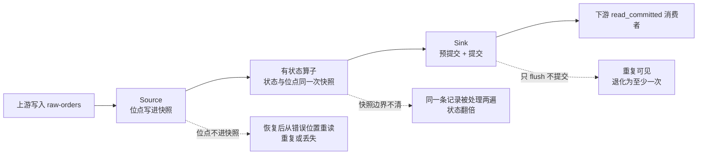
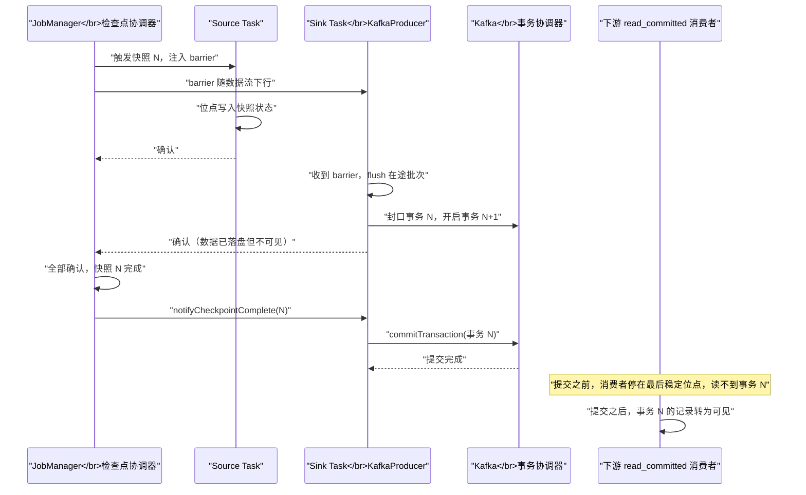
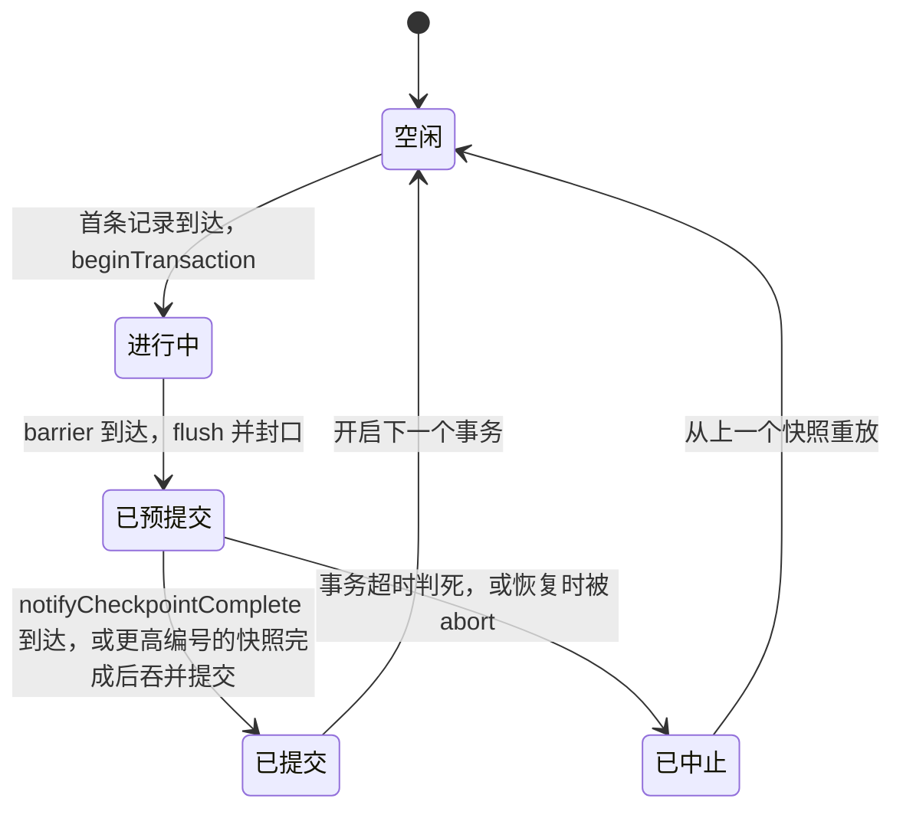
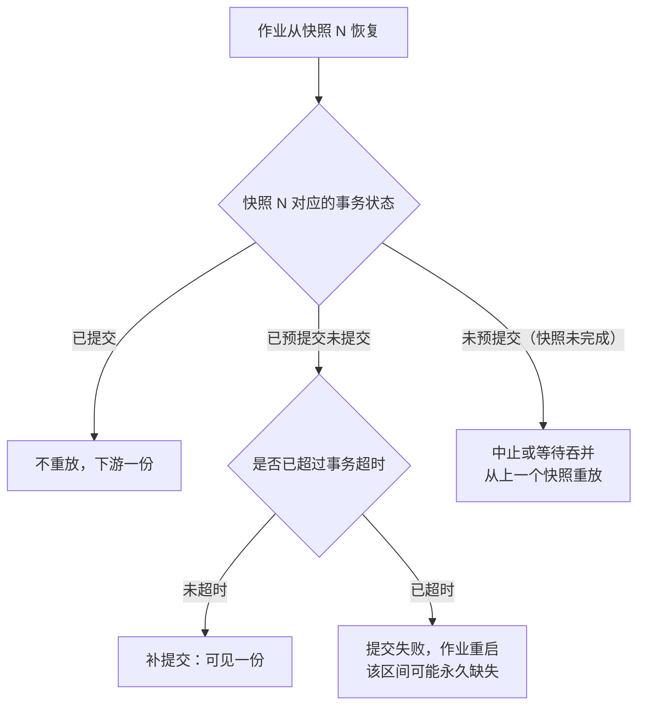
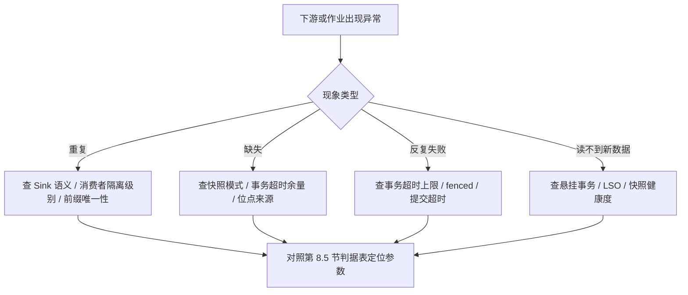

**摘要：**

端到端精确一次（Exactly-Once）在故障复盘会上出现的频率，远高于它在配置里真正成立的频率。它不是一个开关，而是三个条件同时成立的结果：Source 的位点随快照可重放、Flink 内部状态与位点在同一次快照里原子绑定、Sink 的写入要么落进可提交的事务、要么具备幂等能力。本文按"条件—时序—参数—判据"的顺序展开：先把这三个条件各自的位置讲清，再完整走一遍两阶段提交（Two-Phase Commit，2PC）的时序，指出 JobManager 在其中只是裁决者而非参与者；随后把 `TwoPhaseCommitSinkFunction` 的四条硬要求拆开，逐条对应到 Kafka 事务的具体参数；重点落在最容易"以为配了其实没配上"的地方——连接器把 `transaction.timeout.ms` 预置成一小时，而 broker 默认只允许十五分钟，事务寿命又受快照间隔与容忍失败次数共同放大；最后给出恢复后重复与丢失的边界、`EXACTLY_ONCE` 与 `AT_LEAST_ONCE` 的取舍，以及一张症状到配置的判据表。全文的落点是一句话：一致性不是配置出来的，是对齐出来的。

---

## 第 1 章 "端到端"到底指哪两端

有一类故障单读起来几乎一模一样：作业跑得稳稳的，下游表里却多出几千条重复订单；或者反过来，某个五分钟窗口的数据凭空少了一截，而上游 Kafka 里一条不少。两类现象的共同点是，运维第一时间会去翻作业配置，看到 `EXACTLY_ONCE` 那一行确实写在那里，于是结论变成"配置没问题，是 Kafka 的问题"。这个推论之所以常见，是因为"端到端"三个字被当成了一个点，实际上它是一段有起点、有终点、也有明确不承诺部分的区间。

先把区间画出来。笔者沿用一条贯穿全文的链路：订单库的变更数据捕获（Change Data Capture，CDC）把订单事件写进 `raw-orders`，Flink 作业消费它、补上用户与商品维表，写出 `enriched-orders`；`enriched-orders` 有两个下游，一个是实时大屏，要求秒级可见，另一个是入湖归档，要求一条不丢。这条链路上，"端到端"承诺的起点是 Flink 的 Kafka Source 读到的那条记录及其位点（Offset），终点是 Sink 把对应记录写入 `enriched-orders` 的那一次提交。区间之外的三件事，Flink 一概不负责：上游 CDC 采集器重复投递的记录、下游消费者已经读进内存或落进表里的数据、以及跨系统（Kafka 与 OLAP 库同时写）的原子性。把这三件事划出去之后，剩下的才是可以被工程手段承诺的东西，也才谈得上"配没配上"。

### 1.1 三个条件，各管一段

端到端精确一次成立的充要条件，可以拆成三个彼此独立的保证，缺一个都不会得到精确一次，只会得到某种"看起来像"的退化形态。

第一个条件是 **Source 的位点可重放**。Kafka Source 在每次快照时把"分区到当前消费位点"的映射写进算子状态，恢复时从快照里的位点重读。这里有两个容易被忽略的前提：其一，恢复期用的位点来自快照，而不是 Kafka 消费者组的提交位点——`commit.offsets.on.checkpoint` 打开的只是"顺便把位点提交给 Kafka 供观测"，恢复路径并不读它；其二，Kafka 的话题保留期必须覆盖"最坏恢复时间 + 快照间隔"，否则位点对应的日志段已经被清理，恢复只能退回到 `auto.offset.reset` 指定的位置，语义当场塌掉。这个前提在容量规划里常常被漏掉：`retention.ms` 按业务保留需求设成三天，而一次故障排查加回滚可能超过三天，位点过期就变成数据丢失。

第二个条件是 **Flink 内部状态的快照**。检查点（Checkpoint）用 barrier 在数据流里划出一条分割线，线上的状态被快照，线后的数据不进入这次快照，于是"状态"与"位点"被绑定在同一次快照里——这是整个语义的地基。barrier 如何在多输入算子处对齐、对齐期间的数据去了哪里、非对齐快照为什么只能在 `AT_LEAST_ONCE` 下使用，这些机制属于原理列，见 [[大数据/Flink/Flink原理深度解析与性能优化/06 Flink Checkpoint 机制深度解析]]，本篇只取结论：状态与位点必须同属一次快照，不能一个来自快照、一个来自外部提交。

第三个条件是 **Sink 侧的提交语义**。数据被重放过一次之后，Sink 必须让"第二遍写入"不产生第二份可见数据。达成方式只有两类：事务（把重放写进一个最终会被中止的事务里，或让提交动作与服务端状态对齐）和幂等（让重复写入在结果上等价于一次）。前者是 Kafka Sink 的 `EXACTLY_ONCE` 走的路径，后者是 upsert 类存储走的路径。二者不是同一种保证，第 7 章会逐项算它们的账。



### 1.2 缺一个会退化成什么

三个条件的组合有八种，其中只有一种给出精确一次。把常见组合与它们的退化形态列出来，排障时可以直接对号；这张表也是后文判据表的前置索引。

| 缺失的条件 | 实际得到的语义 | 典型症状 |
| --- | --- | --- |
| Sink 缺事务与幂等 | 至少一次（At-Least-Once） | 下游出现重复，重复量与快照间隔和故障次数正相关 |
| Source 位点不进快照 | 至多一次（At-Most-Once）或乱序重读 | 故障后一段数据凭空消失，或从很久以前的位置重读 |
| 内部快照边界不清 | 状态被重复累加 | 聚合值偏大，且偏差只在故障后出现 |
| Sink 有事务但消费者未设隔离级别 | 事实上的至少一次 | 下游读到后来被中止事务的数据 |
| 事务超时小于快照跨度 | 精确一次退化为"丢一段" | 作业反复重启，某几个快照区间的数据整段缺失 |
| 三者皆备 | 精确一次 | 下游可见记录恰好一份，代价是可见延迟 |

注意最后一行的措辞是"可见记录恰好一份"，不是"这件事只发生过一次"。两者的区别在第 6 章会讲透：已经提交并可见的数据不会因为后续故障被撤回，所以精确一次描述的是可见性而不是可撤销性。Kafka 专栏里对这三种语义有过更细的辨析，见 [[中间件/Kafka/07 消费语义——Exactly-Once 的实现路径]]。

### 1.3 参数写了，条件未必成立

这一节是全篇的引子，也是笔者认为最该先破除的一个误解。至少有三处地方，配置项的存在会让人误以为条件已经成立。

第一处是检查点模式。`env.enableCheckpointing(60_000)` 不显式指定模式时，`CheckpointConfig` 的默认模式本来就是 `EXACTLY_ONCE`。这一行为常被误读成"我已经开启精确一次了"，其实它约束的只是 barrier 是否对齐、快照期间在途数据如何处理，与 Sink 写出的事务没有任何关系。有人在代码里补一行 `setCheckpointingMode(CheckpointingMode.EXACTLY_ONCE)` 就觉得万事大吉，而他真正的开关在 `KafkaSink` 的 `DeliveryGuarantee` 上。

第二处是语义枚举的作用域。`DeliveryGuarantee.EXACTLY_ONCE` 只存在于 Sink 侧，Kafka Source 没有对应开关——它的一致性由"位点进快照"天然给出。反过来也成立：只把 Sink 设成精确一次，却不配置周期快照，事务就永远等不到裁决点，数据在事务里越积越多，最后撞上 Kafka 的事务超时被中止。这不是"配了没生效"，而是**根本没有裁决者**。

第三处最隐蔽：连接器源码替你设了一半参数。`KafkaSinkBuilder` 在构造时就把 `transaction.timeout.ms` 预置成一小时，而 Kafka broker 的 `transaction.max.timeout.ms` 默认只允许十五分钟。两边的默认值不匹配，结果不是数据重复，而是作业第一次初始化事务就失败。这条留到第 4 章展开，因为它的排障路径和语义退化完全不同。

---

## 第 2 章 一次两阶段提交的完整时序

把三个条件对齐之后，真正需要读懂的是它们在一次快照里如何咬合。Flink 的 Sink 事务不是凭空发起、凭空提交的，它的每一次"开始"和"结束"都由检查点驱动：快照触发时事务封口，快照完成时事务提交，快照失败时事务悬空。理解这条时序，比记住任何一个参数都重要。

### 2.1 barrier 既是分割线，也是提交点

JobManager 里的检查点协调器（Checkpoint Coordinator）按间隔触发一次快照，向所有 Source 注入 barrier。barrier 顺数据流下行，算子收到它就把状态快照出去、把 barrier 转发给下游，等到所有算子都回报确认，协调器宣布这次快照完成。对 Sink 而言，barrier 到达的那一刻就是"上一段数据到此为止"的分割线：此前写出的记录属于快照 N，此后写出的记录属于快照 N+1。这条分割线由数据流本身携带，不需要额外的时间戳或序号对齐，这是 Flink 用 barrier 而非全局时钟做快照的核心好处。

分割线确定之后，Sink 要做的动作恰好三件：把自己缓冲区里还没发出去的数据发完并等待 broker 确认（flush），把当前事务封口使它不再接受新写入，然后立刻开启一个新事务接收后续数据。封口之后、提交之前，这段数据在 Kafka 里的状态是"已写入但未提交"，`read_committed` 的消费者看不到它——这就是所谓预提交（Pre-commit）。请注意一个术语上的落差：Kafka 并没有数据库意义上的 prepare 协议，它只有"事务开着"和"事务结束"两种状态，Flink 说的预提交，本质上是"事务还开着，但写入到此为止"。

### 2.2 协调器是裁决者，不是参与者

很多人把两阶段提交想象成 Sink 与 Kafka 之间的一次协商，实际上这次协商里还有第三个角色，而且它才是裁决者。Sink 在 barrier 到达时只是完成了"封口"，是否提交要等 JobManager 收到全部确认、宣布快照 N 完成之后，再通过 `notifyCheckpointComplete(N)` 通知各个算子。也就是说，**提交由快照完成触发**，触发权在 Flink 的检查点协调器手里，Kafka 的事务协调器只负责执行提交或中止。

这个分工解释了为什么 `notifyCheckpointComplete` 的可靠性如此关键，也解释了它的契约措辞为什么是"尽力而为（best effort）"：通知可能因为 JobManager 故障、TaskManager 掉线、网络分区而丢失，实现者不能假设"快照完成就一定会收到通知"。更麻烦的是快照可能重叠，收到完成通知的编号未必是最近一次，实现必须能处理"通知迟到"的情形。`TwoPhaseCommitSinkFunction` 的做法是把待提交事务按快照编号排进一个有序结构，收到编号 N 的完成通知时，把所有编号不大于 N 的事务一并提交——这才是"快照吞并"的准确含义。

### 2.3 完整时序

把参与方与时序画在一起，可以看到有两条时间线在交错：一条是数据流的推进，一条是事务状态的推进。两者只在 barrier 处同步。



读这张图要注意两处停顿。第一处停顿在 Sink 收到 barrier 到汇报确认之间，这段时间被 flush 占用，而 flush 是同步阻塞在任务线程上的，所以 Sink 的 flush 速度直接决定快照耗时；第二处停顿在快照完成到提交完成之间，这段时间里数据对下游不可见，它的长度就是精确一次方案额外付出的可见延迟。

### 2.4 三条失败路径，三种归宿

正常时序只是理想路径。真正决定系统在生产里是否可靠的是三条失败路径，它们的归宿完全不同，排障时必须分清是哪一条。

第一条，barrier 之后 flush 失败或者快照超时。这次快照作废，但已经封口的事务不会立刻中止——Flink 对中止快照的处理遵守"吞并契约"：快照 N 失败不代表 N 到 N+1 之间的数据作废，下一次成功的快照会把这段区间一并覆盖。于是事务 N 继续悬挂，直到快照 N+1 完成时才被提交，或在作业重启时被中止。悬挂期间它对 `read_committed` 的消费者是一道墙，消费者只能读到它之前的位点。

第二条，快照完成但完成通知丢失。这时 Kafka 那边事务还开着，Flink 这边已经从快照里恢复了"待提交"的清单。恢复后的提交者会按清单补提交，Kafka 依据事务状态去重，补提交不会产生第二份数据。这条路径的结论是"靠 Kafka 的服务端状态兜底"，它也是第四条硬要求（提交幂等）的现实基础。

第三条，提交时事务已经超时。commit 请求到达协调器，协调器发现这个事务已被判死并推进了生产者纪元，返回的异常会一路抛到任务线程，作业重启。如果对应的快照已经被标记为完成，这条路径就直接变成数据丢失：数据只存在于那个被中止的事务里，而位点已经随快照前进，重放不会覆盖它。第 6 章会专门讨论这个窄窗口。

### 2.5 这套 2PC 与数据库的 2PC 差在哪

数据库的两阶段提交有准备阶段和提交阶段，协调者有持久化的日志，参与者投票后能明确回答"已准备"还是"未准备"。Flink 这套机制借用检查点当裁决者，Kafka 端并没有"已准备"这个状态，只有"未提交事务"这个悬空态。后果是两套超时逻辑各自为政：Flink 认为快照完成等于可以提交，Kafka 认为过了超时等于应当中止。两边都按自己的规则行事，冲突时数据就出现在"Flink 认为已提交、Kafka 已中止"的裂缝里。

补上这条裂缝的工作在 Kafka 社区与 Flink 社区分别推进：KIP-939 给 Kafka 增加了事务参与方的两阶段提交能力（准备态、不被超时自动中止、条件化的完成操作），FLIP-319 则让 Flink 的 KafkaSink 真正按这个协议参与，而不是像过去那样靠反射把生产者 ID 与纪元塞回客户端、再赌一把提交能成功。这套能力对 Kafka broker 版本有要求，具体从哪个 Flink 版本开始默认可用，需要按官方发布说明核对；在没有它的版本上，本节描述的三条失败路径都是真实存在的，配置策略必须按"会发生"来设计，而不是按"已被修复"来设计。

---

## 第 3 章 四条硬要求：一个 Sink 凭什么能参与 2PC

Flink 把一个抽象类放在那里给所有人抄，目的是把"能参与两阶段提交"这个模糊资格变成四条可检查的约束。这四条来自 `TwoPhaseCommitSinkFunction` 的设计假设，虽然这个类在新版本里已经标记为弃用、由 Sink V2 的 `TwoPhaseCommittingSink` 接手，但四条要求本身没有变，自研 Sink、评估第三方 Sink、乃至评估一个"看起来支持事务"的存储，都可以逐条对照。

### 3.1 第一条：预提交之后，数据必须不可见

预提交的语义是"写完了，但外面看不见"。这一条不成立，后面的三条都白搭，因为**未提交即不可见**才是中止的意义所在。Kafka 用事务标记加读取隔离级别实现它：未提交事务的记录写在日志里，`read_committed` 的消费者根据最后稳定位点（Last Stable Offset，LSO）把它们挡在外面。文件系统 Sink 用临时文件实现：写入以 `.part` 或 in-progress 前缀命名的对象，快照完成后再原子地重命名或提交清单，读取方只认正式路径。数据库 Sink 用本地事务实现：写入在事务里，提交前外部连接读不到。

反例比正例更有说明力。有团队给文件 Sink 写"两阶段"，做法是先写正式路径，再在快照完成时补一个校验文件——数据从第一条记录起就对下游可见，所谓提交只是打了个标记，中止时数据留在原地。这不算两阶段提交，它连"不可见"这一关都没过。另一类反例是把数据写进一个没有事务能力的存储（典型是 Elasticsearch），然后用"快照完成后再写标记字段"来模拟提交，读取方必须带着标记过滤才有语义；一旦有读取方不认这个标记，精确一次就在那个读取方眼里失效。这类方案不是不能用，但它承诺的对象是"遵守约定的读"，而不是"任何读"。

### 3.2 第二条：预提交必须能塞进一个快照间隔

预提交发生的时刻是 barrier 到达，完成的条件是"缓冲区里的数据全部发出并被确认"。这个动作是同步的，**同步 flush 直接决定快照耗时**，而它占用的正是任务线程——也就是本该处理数据的那条线程。于是有一条隐性的容量约束：Sink 的 flush 耗时必须稳定地小于快照间隔，且小于快照超时配置。

这条约束在实践中以两种方式被违反。一种是 Sink 侧攒得太多：为了吞吐把 producer 的 `linger.ms` 与 `batch.size` 调大，又碰上 broker 抖动，barrier 到达时缓冲里压着几十兆未确认数据，flush 一路等到快照超时。另一种是 flush 走了阻塞式的远程调用：JDBC 批次提交、HDFS 关闭文件、对象存储的多段上传收尾，任何一个的尾延迟都会传导到快照耗时上。判断方法不复杂，看快照耗时的分位数而不是均值，如果 P99 已经接近间隔的一半，说明 Sink 侧的预算快用完了。

### 3.3 第三条：事务必须能自己过期

这一条最容易被当成"Kafka 的运维细节"而忽略，其实是分布式环境里的必要设计。进程被 `kill -9`、机器断电、容器被驱逐，任何"来不及执行中止"的场景都会留下一个永远悬空的事务。如果这个事务没有外部仲裁让它失效，`read_committed` 的消费者会永久卡在它前面——因为消费者无法判断这些记录最终会被提交还是被中止。

Kafka 的事务超时就是这个外部仲裁：客户端在初始化事务时声明一个超时，协调器按它计时，到点中止。这也解释了为什么这个值不能设得太长：它同时是"孤儿事务阻塞下游"的时长上限。反过来，它也不能设得太短，因为它还必须覆盖"事务从打开到提交"的正常跨度，而这段跨度由快照间隔、容忍的连续失败次数、单次快照耗时共同决定，第 4 章会给出推导。

Flink 侧还有一层补救：恢复时对快照里记录的、未被提交的事务执行中止（`recoverAndAbort`），以及在提交失败时按事务年龄判断是否忽略异常。但这些补救都以"作业能恢复"为前提，作业彻底不上线、或者新作业换了事务前缀时，剩下的只有 Kafka 的超时这一道防线。

### 3.4 第四条：提交必须能重复执行

`notifyCheckpointComplete` 是尽力而为的通知，这一点在接口契约里写得很直白，**通知不保证送达**；它还可能为更早的快照迟到送达。两件事叠加，意味着提交动作必须对"重复执行"安全：同一批数据被提交两次，结果要与提交一次相同。

实现上有两种模式。一种是服务端保证幂等：Kafka 的事务提交由协调器裁决，重复提交一个已结束的事务不会让记录再写一遍，只会返回一个错误让调用方处理。另一种是客户端保证幂等：数据库 upsert 以主键为准、去重表以唯一键为准、文件系统以"重命名到同一路径"为准。反过来，如果 Sink 的提交动作是"往结果表里 append 一批记录"，那么重复提交就会重复落数据，这条要求就不成立，无论上游把事务做得多漂亮。



### 3.5 四条要求压成一张检查表

把四条要求翻译成可以在设计评审上直接问的问题，比背定义管用。下表左列是要求，中列是"做不到时下游会看到什么"，右列是自研 Sink 时必须回答的问题。

| 要求 | 做不到时的症状 | 设计评审要问的问题 |
| --- | --- | --- |
| 预提交不可见 | 中止后数据仍在，下游无法回滚 | 未提交数据的读取路径靠什么隔离，读取方是否都遵守 |
| 预提交在间隔内完成 | 快照反复超时，作业重启 | flush 的 P99 是多少，最坏情况下的未确认数据有多少 |
| 事务能超时失效 | 消费者永久卡住，积压只增不减 | 超时由谁裁决，进程被杀后谁负责清理 |
| 提交可重复执行 | 恢复后出现第二批重复数据 | 重复提交同一批数据，结果是否与一次相同 |

---

## 第 4 章 Kafka 事务参数：约束长在参数之间

到了这一章，问题从"语义是否成立"变成"参数是否互相咬得住"。Kafka 事务相关的配置有十来个，单独看每个都有默认值，但**默认值之间并不自洽**——它们分属客户端、连接器、broker 三个层次，各自按自己的局部最优设定，拼在一起就出现了前文提到的"开箱即失败"。这一章按约束关系而不是按参数表来组织。

### 4.1 两个超时，方向相反

客户端侧的 `transaction.timeout.ms` 声明"我这个事务最多开多久"，它会随初始化事务的请求发给协调器；broker 侧的 `transaction.max.timeout.ms` 声明"我最多允许你开多久"，默认值是 900000 毫秒，也就是十五分钟。两者**方向相反**：客户端希望它足够长，长到能覆盖一个完整的快照周期加上各种抖动；broker 希望它足够短，短到孤儿事务不会长期钉住消费者。配置工作的本质是在这两个方向的夹缝里找一个双方都能接受的值。

客户端超过 broker 上限的后果很干脆：初始化事务的请求被拒绝，返回 `InvalidTxnTimeoutException`，作业在启动阶段就失败，日志里通常伴随"请求的事务超时大于 broker 允许的最大值"一类描述。这个失败很显眼，反而好办。不过难办的是另一种——两个值都在允许范围内，但都小于事务实际需要存活的时长，于是事务在提交前被中止，表现为运行一段时间后莫名重启。

### 4.2 连接器替你预置了一小时

`KafkaSinkBuilder` 的构造函数里有一行不太起眼：把 `transaction.timeout.ms` 预置为一小时（连接器源码中的 `DEFAULT_KAFKA_TRANSACTION_TIMEOUT`）。这个预置的本意是让"快照间隔较长、状态较大"的作业不至于因为默认的六十秒客户端超时而失败，但它同时意味着：如果你用了 `KafkaSink` 且没有显式覆盖这个参数，而 broker 又是默认配置，那么两者的组合必然不成立，因为一小时远大于十五分钟。

这解释了一类很典型的现象：本地或测试环境一切正常（测试集群的 broker 参数被调过，或者根本没走到事务初始化的路径），一到生产就起不来，报的却是"事务超时超过上限"这种听起来像客户端配置错误的异常。处置有两条路，取舍不同。

一条路是把客户端的事务超时调小，落回 broker 允许的范围内，譬如十分钟。代价是事务寿命的上限被压到十分钟，快照间隔与容忍失败次数的乘积必须留足余量，否则会掉进"提交前过期"的坑；好处是孤儿事务阻塞下游的时间上限同样被压到十分钟。

另一条路是把 broker 的 `transaction.max.timeout.ms` 调大，譬如半小时或一小时。好处是客户端可以按"快照间隔 + 抖动"从容设置；代价是全局性的——这个参数对整个集群的所有事务型生产者生效，调大意味着任何一个进程被杀之后，悬空事务最长可以阻塞消费者一小时。生产集群上这个参数通常由平台团队统一管理，作业侧单方面依赖它是一项跨团队的隐式约定，必须写进变更记录。

### 4.3 事务寿命怎么算：间隔乘上容忍次数

把"事务多久提交一次"算清楚，两个超时值才有依据。事务的起点是快照 N 封口之后第一条记录到达的时刻，终点是快照 N+1 完成并且完成通知送达、提交动作执行完的时刻。正常情况下这段跨度约等于一个快照间隔加一次快照耗时；但快照会失败，失败时事务不会中止，而是等着被下一次成功的快照吞并，于是跨度被拉长。

拉长多少，取决于允许连续失败几次。设间隔为 $I$、允许的连续失败次数为 $T$、单次快照耗时为 $D$、完成通知与提交的延迟为 $L$，则事务最坏存活时长约为：

$$I \times (T + 1) + D + L$$

这个式子里最容易被低估的是 $T+1$ 这一项，**容忍失败次数会成倍放大事务寿命**。很多团队的配置习惯是"事务超时比快照间隔大就行"，于是出现间隔十分钟、事务超时十五分钟的组合；一旦第一次快照失败，事务就要跨两个间隔才能提交，二十分钟已经超过十五分钟，事务在提交前被中止，作业重启，重启后又走一遍同样的路径。把数字代进去看得更清楚，下表四组配置的差别只在几个数字，结果却分成安全与必然失败两类。

| 间隔 $I$ | 容忍失败 $T$ | 快照耗时 $D$ | 通知延迟 $L$ | 最坏存活 | 事务超时 | 判定 |
| --- | --- | --- | --- | --- | --- | --- |
| 60 秒 | 3 | 20 秒 | 5 秒 | 285 秒 | 600 秒 | 余量充足 |
| 60 秒 | 3 | 60 秒 | 10 秒 | 310 秒 | 300 秒 | 余量偏薄，抖动即失败 |
| 300 秒 | 1 | 60 秒 | 10 秒 | 670 秒 | 900 秒 | 勉强通过，一次连续失败即失败 |
| 600 秒 | 3 | 120 秒 | 10 秒 | 2530 秒 | 900 秒 | 必然在提交前过期 |

上表按公式做的示例推算，用于说明量级关系，不是压测数据。第四行正是"快照间隔十分钟、事务超时十五分钟"的配置，最坏存活四十多分钟，超时值只有十五分钟；即便不失败，一次正常提交也要跨一个间隔，余量同样很薄。合理的做法是让事务超时对最坏存活有至少两倍余量，再用"容忍失败次数"而不是"事务超时"去吸收抖动——容忍失败次数变大只影响恢复语义，不影响消费者阻塞时长，这一点比反过来调超时要安全得多。

### 4.4 transactional.id 的构成与唯一性边界

`KafkaSink` 不会让你直接指定 `transactional.id`，它只收一个前缀 `transactionalIdPrefix`，真正的 ID 由连接器拼出来，格式是"前缀-子任务编号-快照编号"，其中最后一段在默认命名策略下随快照递增。这个设计带来两个后果。

后果之一是**唯一性由前缀承担**。同一时刻不能有两个生产者用同一个 `transactional.id`，否则后启动的那个会在初始化时把纪元推高，前一个被隔离（fenced），它的提交全部失败。所以前缀至少要区分三件事：不同的作业、同一作业里写不同话题的多个 Sink、同一作业的不同版本。第三条最容易被忘掉——升级时新旧两个作业并行跑几分钟做灰度，前缀相同就意味着它们互相杀对方的事务，表现为两个作业交替重启，数据重复与丢失混杂在一起，查起来非常难受。

后果之二是事务名是有成本的。每个唯一的事务名都会让 broker 在内存与内部话题里保留一段元数据，连接器的注释里提到这个保留期按天计。事务名的数量大致等于"并行度 × 快照次数"，一条并行度一百、快照间隔一分钟的链路，一天就产生十几万个事务名。这不是不能承受，但值得知道它的代价，尤其当有人把快照间隔调到十秒时。较新的连接器版本提供了复用事务名的命名策略，要求 Kafka 版本与目标话题的读权限配合，属于需要按版本核对的优化项，不属于本文的必选配置。

### 4.5 fencing：同一个 ID 的两个生产者

`ProducerFencedException` 是这套机制里最值得单独记住的异常，因为它的含义非常明确：有另一个生产者用了相同的 `transactional.id`，并且比你更晚初始化，你的纪元已经过期。它不是网络问题，不是 broker 问题，**fencing 不可通过重试解决**，只有让前缀不冲突或者让旧实例先退出才能解决。

排障时它通常和两个场景绑定。一个是并行升级，新旧作业共用前缀，谁先谁后取决于调度顺序，于是出现"每次重启都能撑几分钟然后失败"的规律；另一个是作业被克隆，为了回刷历史数据，有人把同一份代码复制一份、改个消费组就上线，前缀忘了改，两个实例从此长期互杀。处置原则简单粗暴：前缀里带上作业名与版本号，并把它当成发布流程的一部分来管理，而不是留给某个人在代码里手写一个字符串。

### 4.6 read_committed 的连带责任

Sink 端的事务只解决"未提交数据不可见"的一半，另一半在消费者手里：消费者必须设置 `isolation.level=read_committed`，否则它连未提交的记录一起读，中止之后就出现了"读到了又消失"的怪现象。Kafka 消费者的默认值是 `read_uncommitted`，Flink 的 `KafkaSource` 也不会替你改这个值——它只强制关闭自动提交、把位点交给快照管理。

设置之后要接受一个连带后果：消费者能读到的位置被 LSO 限制，而未提交事务会把 LSO 钉住。**这条约束把上下游耦合在了一起**。上游作业的快照慢了，事务就晚提交，LSO 不前进，下游消费者就只能等着；下游等得越久，它自己的反压越严重，反压再传回上游，上游处理变慢、快照更慢，形成一个自我强化的环。笔者见过一条链路因为上游把快照间隔从一分钟调到十分钟，导致下游大屏作业积压报警，根因不在下游，而在上游那个"为了降低快照开销"的决定。

这个环的解锁手段只有两个：等事务超时被中止，或者让上游把事务提交掉。前者代价是数据丢失，后者要求上游快照恢复健康。所以监控上要把"上游快照耗时"与"下游消费延迟"放在同一张图上，否则永远只能看到症状层。

### 4.7 三个客户端超时与快照间隔的配比

除了事务超时，还有三个超时参数会参与这套配合，它们之间的关系在 Kafka 客户端文档里有明确约束，落到 Flink 场景还要再加一层与快照间隔的约束。

`max.block.ms` 默认六十秒，它约束的是 `initTransactions`、`commitTransaction`、`abortTransaction` 这些事务方法的阻塞上限。提交发生在完成通知之后，不占用快照路径，但它失败会触发作业重启。把它设得比事务剩余寿命还长没有意义，实际操作中保持在三十秒到一分钟，让提交失败尽快暴露。

`delivery.timeout.ms` 默认两分钟，它是单条记录从 `send()` 返回到成功或失败的时限，包含重试与等待确认。这条必须严格小于事务超时：如果一条记录在事务里等到超过事务超时，事务已经被中止，客户端再怎么重试都只会在一个死掉的事务里挣扎。默认的两分钟对十分钟的事务超时是安全的，但如果有人为了低延迟把事务超时压到六十秒，两分钟的投递时限就会成为新的失败源。

`request.timeout.ms` 默认三十秒，它约束单次请求的等待时间，客户端文档要求它不小于 broker 的副本滞后阈值、且投递时限不小于它与 `linger.ms` 之和。落到配置上就是一条链：事务超时 > 投递时限 ≥ 请求超时 + 攒批时间 > 请求超时。

| 参数 | 层次 | 默认值 | 相互约束 | 设错的症状 |
| --- | --- | --- | --- | --- |
| `transaction.timeout.ms` | 客户端（连接器预置一小时） | 60000，连接器预置 3600000 | 大于事务最坏存活，小于 broker 上限 | 过大则启动即失败，过小则提交前过期 |
| `transaction.max.timeout.ms` | broker | 900000 | 大于等于客户端声明值 | 调小则事务型作业集体起不来，调大则孤儿事务阻塞更久 |
| `isolation.level` | 消费者 | read_uncommitted | 事务下游必须设为 read_committed | 不设会读到中止事务的数据 |
| `delivery.timeout.ms` | 客户端 | 120000 | 小于事务超时，不小于请求超时加攒批 | 大于事务超时则记录在死事务里重试 |
| `request.timeout.ms` | 客户端 | 30000 | 小于投递时限 | 过大导致单次卡顿拖长整体恢复 |
| `max.block.ms` | 客户端 | 60000 | 小于事务剩余寿命 | 提交卡住而作业长时间无响应 |
| `enable.idempotence` | 客户端 | 新版本默认开启，事务下强制 | 与 `acks=all`、重试次数联动 | 试图关闭会与事务语义冲突 |

这张表里有一格值得特别说明：`enable.idempotence` 与 `acks` 在事务模式下不是可选项。**事务语义建立在幂等生产者之上**，而幂等生产者要求重试次数大于零、确认级别为全部副本。有人在 producer 配置里写 `acks=1` 想省一点延迟，结果是连接器显式抛错或者幂等性被静默关掉，事务的可靠性随之瓦解。

---

## 第 5 章 一次能通过验收的配置

参数之间的约束讲完，落到一份可以照着改的配置上。这里仍然用订单宽表那条链路，目标先定死：允许的数据丢失（Recovery Point Objective，RPO）不超过一分钟，下游可见延迟接受两到三分钟，下游大屏与入湖都使用 `read_committed`。

### 5.1 先定数值，再写代码

数值从约束反推，而不是从别人的配置里抄。RPO 一分钟意味着快照间隔定在六十秒；接受两到三分钟可见延迟意味着事务提交可以晚一个快照周期；容忍连续三次快照失败意味着事务最坏存活按四倍间隔算，即约四分钟，再留两倍余量，事务超时定在十分钟。broker 侧的上限默认十五分钟，十分钟落在范围内，不需要动 broker 参数——这是最省事的组合，也是本文推荐的默认起点。

### 5.2 DataStream API 的写法

下面这份配置把前文的约束都显式写了出来，包括几个"看起来多余、其实是把隐式默认显式化"的项。

```java
// 检查点配置：间隔决定 RPO，容忍失败次数决定事务最坏存活
env.enableCheckpointing(60_000);
env.getCheckpointConfig().setCheckpointingMode(CheckpointingMode.EXACTLY_ONCE);
env.getCheckpointConfig().setCheckpointTimeout(120_000);
env.getCheckpointConfig().setMinPauseBetweenCheckpoints(30_000);
// 容忍三次连续失败：只影响恢复语义，不影响消费者被阻塞的时长
env.getCheckpointConfig().setTolerableCheckpointFailureNumber(3);
env.getCheckpointConfig().setExternalizedCheckpointCleanup(
        ExternalizedCheckpointCleanup.RETAIN_ON_CANCELLATION);

Properties producerProps = new Properties();
// 覆盖连接器预置的一小时，落回 broker 默认允许的十分钟
producerProps.setProperty("transaction.timeout.ms", "600000");
// 投递时限必须小于事务超时，默认两分钟在这里是安全的
producerProps.setProperty("delivery.timeout.ms", "120000");
// 事务下幂等与全部副本确认不是可选项，显式写出以防被误改
producerProps.setProperty("enable.idempotence", "true");
producerProps.setProperty("acks", "all");

KafkaSink<EnrichedOrder> sink = KafkaSink.<EnrichedOrder>builder()
        .setBootstrapServers("kafka:9092")
        .setRecordSerializer(recordSerializer)
        .setDeliverGuarantee(DeliveryGuarantee.EXACTLY_ONCE)
        // 前缀带作业名与版本号：升级灰度时新旧作业不会互杀事务
        .setTransactionalIdPrefix("order-enrichment-sink-v3")
        .setKafkaProducerConfig(producerProps)
        .build();

enrichedOrders.sinkTo(sink).uid("kafka-sink");

// Source 侧不需要事务，但下游若是事务型上游，这里必须读已提交
KafkaSource<OrderEvent> source = KafkaSource.<OrderEvent>builder()
        .setBootstrapServers("kafka:9092")
        .setTopics("raw-orders")
        .setGroupId("order-enrichment")
        .setStartingOffsets(OffsetsInitializer.committedOffsets(OffsetResetStrategy.EARLIEST))
        .setProperty("isolation.level", "read_committed")
        .setDeserializer(deserializer)
        .build();

env.fromSource(source, WatermarkStrategy.noWatermarks(), "kafka-source").uid("kafka-source");
```

代码里有三处注释值得展开。`setCheckpointingMode` 那一行在默认值下其实可以省，写出来是为了让审阅者看到"模式"与"Sink 语义"是两件事；`setTolerableCheckpointFailureNumber(3)` 与事务超时的关系前文推过，它把最坏存活从两倍间隔（容忍一次失败）放大到四倍间隔，如果频率更高的快照更划算，就应该降这个值而不是加事务超时；`uid` 在纯 Kafka 到 Kafka 的链路里看起来只影响恢复，实际上它决定了 Savepoint 能否对齐状态，升级时状态接不上，位点就会回退，重复随之而来。

### 5.3 SQL 路径的等价写法

用 Flink SQL 写同一条链路，参数换到 DDL 的 `WITH` 子句里，语义不变但选项名随连接器版本改过。较新版本用 `sink.delivery-guarantee` 与 `sink.transactional-id-prefix`，更早的版本写作 `sink.semantic`，具体以所用版本的表连接器文档为准。

```sql
CREATE TABLE enriched_orders_sink (
    order_id     STRING,
    user_id      STRING,
    amount       DECIMAL(12, 2),
    updated_at   TIMESTAMP(3),
    PRIMARY KEY (order_id) NOT ENFORCED
) WITH (
    'connector' = 'kafka',
    'topic' = 'enriched-orders',
    'properties.bootstrap.servers' = 'kafka:9092',
    'format' = 'json',
    'sink.delivery-guarantee' = 'exactly-once',
    'sink.transactional-id-prefix' = 'order-enrichment-sink-v3',
    'properties.transaction.timeout.ms' = '600000'
);
```

SQL 路径有两个额外的注意点。其一，事务前缀只写在 Sink 表上，作业里有多个 Sink 表时要逐个设置且互不相同；其二，SQL 作业的检查点配置在集群或作业参数里，不在 DDL 里，容易漏——一个开启了精确一次 Sink 却没有周期快照的 SQL 作业，事务永远等不到提交点。

### 5.4 三条不等式自检

把配置提交评审前，用三条不等式过一遍，比逐项核对参数表快得多。

| 自检项 | 表达式 | 示例取值 | 判定 |
| --- | --- | --- | --- |
| 事务寿命 | 间隔 ×（容忍失败 + 1）+ 快照耗时 + 通知延迟 < 事务超时 | 60×4+20+5 = 265 < 600 | 通过 |
| 事务上限 | 事务超时 < broker 的 `transaction.max.timeout.ms` | 600 < 900 | 通过 |
| 投递时限 | `delivery.timeout.ms` < 事务超时，且不小于请求超时加攒批 | 120 < 600 | 通过 |

三条都通过之后，还有一条软性条件值得写进上线检查单：事务超时对最坏存活至少留两倍余量。上表第一行 265 秒对 600 秒，**余量超过两倍**，属于"还能吸收一次意外"的状态。

### 5.5 上线前值得做的四次演练

配置的对错只有在故障里才能验证，所以演练要设计成"可预期的故障"。第一次，`kill -9` 掉一个 Sink 子任务所在的 TaskManager，观察作业恢复耗时、以及下游 `read_committed` 消费者被卡住的时间是否与事务超时量级一致；如果卡住的时间明显超过事务超时，说明还有悬挂事务没被清理，需要查事务列表。

第二次，用相同前缀起第二个作业，观察第一个作业是否很快抛出 `ProducerFencedException`，并确认此时下游是否出现重复。这个演练的价值在于让团队亲眼看到"前缀冲突的后果"，而不是只在文档里读到。

第三次，把容忍失败次数临时设为 0、把快照存储指向一个不可写路径，制造连续快照失败，观察事务在第几个间隔后被中止、作业如何重启、下游损失多少。第四次，用 `read_uncommitted` 的消费者对照读同一话题，确认两边的差异只出现在快照边界附近；如果差异远大于一个快照批次，说明事务的可见性边界本身就没对上。

---

## 第 6 章 恢复之后：哪些会重复，哪些会丢

前面几章描述的是稳态。真正让人对这套机制建立信任的，是把它放到故障恢复的视角下走一遍：从快照恢复时，那些处于各种状态的事务分别会怎样，哪些动作会带来重复，哪些会带来丢失。这一章的回答会推翻一个常见的期待——精确一次不等于可以撤销。

### 6.1 悬挂事务的三种命运

恢复时，快照里记录的事务大致分三类，命运各不相同。

第一类是已经提交的事务。它们的数据在 Kafka 里已可见，位点也在快照里越过了它们，恢复后不会重放，也不会重复。这类事务唯一的问题是"提交被记录"与"提交被执行"之间可能有一段空窗，如果快照完成但提交没执行完，恢复时按快照里的待提交清单补提交，Kafka 去重，结果仍是一份。

第二类是已预提交、未提交的事务，对应的是"快照已完成、通知未送达"或"快照失败等待吞并"两种情形。前者补提交，后者等下一次成功快照吞并后提交，或者在恢复时被中止。中止意味着这一段的写入作废，如果这段数据的位点已经随某个已完成的快照前进，就出现了丢失窗口——这正是第 6.3 节要展开的部分。

第三类是恢复时已经超过事务超时、被 Kafka 判死的事务。补提交会失败，异常抛到任务线程，作业重启；重启后从快照恢复，位点与第三类之前的状态一致，于是这段区间被跳过的可能性取决于位点是否已经越过它。这条路径的结论很硬：事务超时是唯一真正"不可挽回"的边界，其他失败都能靠重放或补提交兜住。



### 6.2 已经可见的数据不会回滚

有一个必须说破的事实：事务被中止，只影响尚未提交的数据；已经提交、已经对下游可见的数据，**可见即不可回滚**，不会因为任何后续故障而撤回。下游消费者读进内存的记录、写进表里的行、被大屏渲染出来的数字，都不会自己退回去。

由此可以给精确一次一个更准确的定义：它保证的是"最终可见的记录恰好一份"，而不是"处理过程恰好发生一次"。这个区别在事故复盘时很重要——有人在发现重复后要求"把重复的那次回滚掉"，这在技术上无从下手，只能在下游做补偿删除，而补偿删除本身又需要唯一键，需要下游配合，属于另一个层面的工程。所以精确一次的验收标准应该写成两句：正常情况下下游可见记录数等于上游记录数；故障恢复后仍相等，且不依赖下游补偿。第二句才是真正的门槛。

### 6.3 快照完成而事务被判死：一个窄但致命的窗口

把两条时间线叠在一起看，会出现一个很窄的缝隙：**快照完成不等于数据可读**——快照 N 完成，协调器记录了完成状态；此时事务 N 尚未提交，而 Kafka 那边的事务超时到点，协调器中止了它并推进纪元。恢复时从快照 N 开始，位点已经越过事务 N 覆盖的数据，重放不会覆盖它；而事务 N 已经被中止，数据不可见。结果是这一段数据既不在下游，也不会被重算。

这个窗口的存在，根源是 2.5 节说的裁决权错位：Flink 用"快照完成"当提交依据，Kafka 用"超时"当中止依据，两个仲裁者没有商量过。避免它的工程手段只有把事务超时留足余量，让"超时"这个条件在正常故障模式下不触发；根治则需要对接到 broker 的 2PC 参与能力（KIP-939 与 FLIP-319 那套机制），让事务在准备态之后不再被超时单方面中止。前者是当下能做的，后者要看版本，两者不能混为一谈。

这个窗口的观测特征在于，它不产生异常：作业看起来恢复了、跑得也正常，只有对账才能发现某几分钟的数据缺失。所以对账不是可选项，而是这套方案的组成部分——以订单号或事件 ID 为单位做左右两侧计数，按分钟粒度比对，才能把"没有报错"和"没有丢数据"区分开。

### 6.4 重放与幂等 Sink 的接缝

如果 Sink 走的是幂等路径而不是事务路径，恢复的结论要换一套说法。重放会把同一批记录再写一遍，幂等写入让结果不变，于是"重复"这个风险被消掉了；但"丢失"的风险没有消掉，反而更依赖位点管理的正确性——因为幂等 Sink 通常不记录"写到哪了"，它只保证"写进来的不重复"。位点如果提前提交、或者在自定义 Source 里被错误地推进，重放就不会发生，丢失无从补救。

幂等路径还有一个接缝常被忽略：**幂等的前提是稳定唯一键**，也就是"同一条记录有稳定的唯一标识"。订单事件通常有订单号，日志类事件往往只有自增 ID 加分区，跨作业重放时自增 ID 可能变化；聚合类结果更是没有天然唯一键。这条接缝决定了幂等方案能覆盖的业务范围，第 7 章会就这一点做取舍。

---

## 第 7 章 EXACTLY_ONCE 与 AT_LEAST_ONCE 的取舍

把机制讲透之后，问题回到工程判断：这条链路到底该不该用两阶段提交。判断的依据不是"精确一次更高级"，而是三项代价能不能被业务接受，以及幂等方案能不能覆盖这条链路的形态。

### 7.1 三项代价

第一项是可见延迟。事务提交发生在快照完成之后，所以从记录产生到下游可见，**可见延迟至少一个快照周期**，实际是一个间隔加上快照耗时。间隔一分钟、耗时二十秒，可见延迟就在一分半到两分钟之间；如果下游是大屏，这个延迟会直接改变产品形态——从"实时"变成"准实时"。反过来，用至少一次加幂等，数据写完就可见，延迟只有网络与写入的那一段。

第二项是事务开销。每个快照周期、每个 Sink 并行度都要经历一次封口与提交，提交要经过事务协调器，再由协调器向涉及的分区副本写入事务标记。并行度一百、间隔一分钟，就是每分钟一百次提交，这个量级本身不算夸张；真正的开销在 flush 的同步等待与事务状态写入上，它们挤占的是处理数据的时间。吞吐影响属于量级判断，通常落在百分之几到百分之二十之间，取决于记录大小、快照频率与并行度，必须用压测而不是引用别人的数字来定。

第三项是隔离与耦合。下游必须设 `read_committed`，于是被上游的 LSO 牵着走；上游快照一慢，下游就积压。这条代价最容易被低估，因为它不出现在单条链路的压测里，只在多作业联动时爆发。第 4.6 节那个案例——上游把间隔从一分钟调到十分钟导致下游大屏报警——就是这项代价的典型账单。

### 7.2 幂等 Sink 的三种形态

如果业务能接受最终一致，"至少一次加幂等"往往比两阶段提交更划算。幂等有三种常见形态，覆盖能力不同。

第一种是主键覆盖写入。目标表以业务主键（订单号、用户 ID 加日期）为键，写入用 upsert 语义：重复的写入覆盖同一行，结果与写一次相同。适合明细宽表、维表、状态表。MySQL 的 `ON DUPLICATE KEY UPDATE`、HBase 的按行键写入、ClickHouse 的 `ReplacingMergeTree`、Iceberg 与 Hudi 的 upsert 都属于这一类，区别只在"覆盖"是立即生效还是查询时合并。

第二种是去重表。把"已处理"的标识（作业名 + 分区 + 位点，或事件 ID）写进一张带唯一约束的表，写入前先判重，重复的直接丢弃。它适合无法用业务主键覆盖、又必须严格不重复的场景，代价是多一次写入与一次查询，以及去重表的容量治理——标识需要按时间分区清理，否则会无限增长。

第三种是版本号覆盖。给每条记录带上版本或更新时间，写入时只接受更大的版本，天然抑制旧数据覆盖新数据。它适合乱序重放频繁的场景，但要求所有写入方都遵守版本约定，一旦有旁路写入不带版本，语义就破了。

三种形态的共同边界是"必须有稳定的唯一标识"，且下游查询能接受最终一致。聚合结果是个例外：五分钟窗口的成交额没有业务主键，重复累加会让数字翻倍。除非把窗口标识（窗口结束时间加维度键）当作主键、让每次重放覆盖整窗结果，否则聚合结果只能靠事务，这是两阶段提交真正不可替代的地方。

### 7.3 决策与混合

| 场景 | 建议语义 | 理由 | 主要代价 |
| --- | --- | --- | --- |
| 明细宽表、维表、状态同步 | 至少一次 + 主键覆盖 | 有稳定主键，幂等成本低 | 下游需支持 upsert，查询需接受合并 |
| 消息转发、事件总线 | 至少一次 + 去重表 | 重复不可接受，主键不稳定 | 多一次查重与去重表治理 |
| 窗口聚合、财务报表 | 精确一次 | 聚合值没有唯一键，重复即错 | 可见延迟与事务开销 |
| 实时大屏指标 | 至少一次 | 秒级可见优先，重复可由展示层容忍 | 指标可能短暂跳动 |
| 入湖归档 | 精确一次或至少一次 + 幂等写 | 一条不丢优先，湖表多做 upsert | 湖表小文件与合并开销 |

混合策略在实践中比"全链路统一"更常见：主链路（写 `enriched-orders`）用精确一次保证下游不再重复，旁路（写监控指标、写审计日志）用至少一次接受重复。判断哪条是主链路的标准不是数据量，而是"重复一次的业务成本"——订单重复会导致对账差异，指标重复只是曲线上多一个毛刺。

---

## 第 8 章 症状到配置：一张能直接用的判据表

排障时最耗时的不是修，而是定位到"该看哪一层"。这一章按症状组织，每个症状给出判据与处置，最后合并成一张表。

### 8.1 数据重复

重复是最常见的投诉，来源有四类。第一类，Sink 根本不是精确一次：`DeliveryGuarantee` 停留在 `AT_LEAST_ONCE`，或者虽然写了 `EXACTLY_ONCE` 但作业没有周期快照，事务从未提交，重放时数据直接以至少一次的方式落进下游。第二类，消费者隔离级别没设：Sink 是精确一次，但下游消费者用 `read_uncommitted` 读到了中止事务的数据，在它眼里就是"多出来又消失又出现"。第三类，事务前缀冲突导致 fencing：两个作业互杀事务，被 fenced 的一方重放自己那一段，重复与丢失同时出现。第四类，上游本身重复：CDC 采集器在源端重发，Flink 忠实转发，这不是 Flink 的问题，需要在源端或入仓侧解决。

判据上有一个好用的分流：看重复是否集中在快照边界附近。集中在边界，指向第二类与第三类；均匀分布在整个时间轴，指向第一类与第四类。

### 8.2 数据丢失

丢失的成因比重复更集中，也更危险。第一类，事务超时后快照仍完成：6.3 节那个窗口，表现为某几个连续区间整段缺失，且没有异常日志。第二类，位点提前提交：自定义 Source 在 `snapshotState` 之外提交了位点，或者用了消费者组提交位点做恢复，重放从错误位置开始。第三类，Kafka 保留期不足：恢复需要回退的位点已被清理，只能按 `auto.offset.reset` 走，跳过了数据。第四类，Sink 用了 `AT_MOST_ONCE`，不等确认就继续往下走，进程一挂就丢掉一截。

判据同样是看分布：整段连续缺失、时间边界与快照时间对齐，优先怀疑第一类；缺失点与故障恢复时间对齐，怀疑第二类与第三类。

### 8.3 作业失败

作业起不来或反复重启，日志里通常有明确线索。`InvalidTxnTimeoutException` 指向客户端事务超时超过 broker 上限，几乎总是"用了连接器预置的一小时而 broker 还是默认十五分钟"。`ProducerFencedException` 指向前缀冲突，查并行升级与作业克隆。`TimeoutException` 出现在提交阶段，指向 broker 不稳或 `max.block.ms` 到点，前者要查协调器所在 broker 的健康，后者要核对事务剩余寿命。快照超时则多半是 flush 太慢，回到 3.2 节那几条；如果快照耗时随状态规模一起上涨，那是状态规模与快照实现的问题，归 [[大数据/Flink/Flink原理深度解析与性能优化/05 Flink 状态后端深度解析]] 讨论。指标口径、告警配置与更完整的故障判据组合，见 [[大数据/Flink/Flink从入门到实战/10 生产运维：监控、调优与常见问题排查]]。

### 8.4 下游读不到数据

下游读不到新数据，与"作业没写"是两件事，需要分开验证。先看 Sink 侧指标，确认有记录写出；再看 Kafka 话题每个分区的末端位点（Log End Offset）是否在增长；最后看 LSO 是否停滞。末端位点在涨而 LSO 不动，说明有未提交事务把 LSO 钉住了，常见原因是作业快照一直失败、事务迟迟不提交，或者有一个已经死掉的进程留下的孤儿事务。这时用事务管理工具列出悬挂事务，确认它们的年龄，再决定等超时还是手工中止。

### 8.5 合并成表

| 症状 | 判据 | 根因 | 处置 |
| --- | --- | --- | --- |
| 下游重复，集中在快照边界 | 事务前缀重复、日志有 fenced | 并行升级或作业克隆共用前缀 | 前缀加版本号，先停旧再起新 |
| 下游重复，均匀分布 | `DeliveryGuarantee` 为至少一次 | Sink 未开事务 | 改语义并补上事务超时配置 |
| 下游重复，仅中止后出现 | 消费者 `read_uncommitted` | 隔离级别未设 | 消费者改 `read_committed` |
| 连续区间缺失 | 缺失边界与快照时间对齐 | 事务超时早于提交 | 按 4.3 节公式重算并留余量 |
| 恢复后缺失 | 缺失点与故障时间对齐 | 位点提前提交或保留期不足 | 位点只走快照，延长保留期 |
| 作业启动即失败 | `InvalidTxnTimeoutException` | 客户端超时大于 broker 上限 | 调小客户端或调大 broker，二选一并记录 |
| 运行一段后重启 | 提交阶段 `TimeoutException` | 事务临期、broker 抖动 | 提高事务超时余量，查协调器健康 |
| 下游读不到新数据 | 末端位点涨、LSO 不动 | 悬挂事务或快照持续失败 | 查事务列表，修快照，必要时中止 |



---

## 第 9 章 四个反模式

第一个反模式是**把语义枚举当成全部**。代码里写了 `DeliveryGuarantee.EXACTLY_ONCE`，就认为一致性已经到位，于是连接器预置的一小时事务超时、broker 的十五分钟上限、下游消费者的隔离级别，全部留给默认值。这类作业的典型结局是启动即失败，或者在运行几天后因为一次快照抖动开始丢数据。根治的办法是把第 5.4 节那三条不等式写进发布检查单，让"配了"变成"对上了"。

第二个反模式是事务前缀写死、且跨版本复用。前缀里不带作业名与版本号，或者带着版本号但升级时忘了改，结果新旧作业并行的那几分钟里互相 fencing。这个反模式的迷惑性在于它只在发布窗口出现，平时完全正常，所以总被当成偶发故障。处置上要么把前缀纳入发布流程作为必改项，要么采用蓝绿发布，让两个版本用不同前缀各自跑一段时间。

第三个反模式是拿"事务超时大于快照间隔"当判据。间隔十分钟、事务超时十五分钟，看起来满足条件，实际上一次快照失败就把事务存活推到二十分钟以上，直接越过十五分钟。正确的判据是 4.3 节那个式子，把容忍失败次数乘进去；如果业务要求快照间隔必须大，那就同步把容忍失败次数降下来，或者去调 broker 上限，而不是在两者之间凭感觉取一个数。

第四个反模式是用错的消费者验收精确一次。验证时随手起一个默认配置的消费者读输出话题，看到数据没有重复，就认为方案通过；而生产上的下游用的是另一套配置，或者干脆没设隔离级别。验收的正确做法是两侧都设 `read_committed`，再做一次注入故障的演练，看故障窗口前后数据是否恰好一份。这件事没有捷径，因为精确一次承诺的对象是"遵守约定的读"，验收必须把"约定"本身也验进去。

---

## 参考资料

1. Apache Flink 官方文档：Kafka Connector（Source 位点提交、Sink 投递语义与事务前缀），`https://nightlies.apache.org/flink/flink-docs-release-1.20/docs/connectors/datastream/kafka/`
2. Apache Flink 官方文档：Checkpointing 配置项与语义，`https://nightlies.apache.org/flink/flink-docs-release-1.20/docs/dev/datastream/fault-tolerance/checkpointing/`
3. Apache Flink API 文档：`TwoPhaseCommitSinkFunction` 的方法契约与 best effort 通知语义，`https://nightlies.apache.org/flink/flink-docs-release-1.20/api/java/org/apache/flink/streaming/api/functions/sink/TwoPhaseCommitSinkFunction.html`
4. Apache Flink 连接器源码：`KafkaSinkBuilder` 的 `DEFAULT_KAFKA_TRANSACTION_TIMEOUT` 与事务前缀校验，`https://github.com/apache/flink-connector-kafka`
5. Apache Flink JIRA：FLINK-30419，关于连接器默认事务超时一小时与 broker 上限不一致的讨论，`https://issues.apache.org/jira/browse/FLINK-30419`
6. Apache Flink 社区文档：FLIP-319，与 KIP-939 对接的两阶段提交参与，`https://cwiki.apache.org/confluence/display/FLINK/FLIP-319`
7. Apache Kafka 文档：Producer 配置项 `transaction.timeout.ms`、`delivery.timeout.ms`、`max.block.ms`，`https://kafka.apache.org/documentation/#producerconfigs`
8. Apache Kafka 文档：Broker 配置项 `transaction.max.timeout.ms`，`https://kafka.apache.org/documentation/#brokerconfigs`
9. Apache Kafka 设计文档：KIP-939，Support Participation in 2PC，`https://cwiki.apache.org/confluence/display/KAFKA/KIP-939`
10. 本仓库：[[大数据/Flink/Flink原理深度解析与性能优化/06 Flink Checkpoint 机制深度解析]]、[[大数据/Flink/Flink原理深度解析与性能优化/05 Flink 状态后端深度解析]]、[[大数据/Flink/Flink从入门到实战/06 状态管理与 Checkpoint 实战]]、[[大数据/Flink/Flink从入门到实战/10 生产运维：监控、调优与常见问题排查]]、[[中间件/Kafka/07 消费语义——Exactly-Once 的实现路径]]、[[中间件/Kafka/03 生产者——分区策略、acks 与幂等性]]

---

> [!note] 思考题
> 1. 事务最坏存活时长按"间隔 ×（容忍失败 + 1）"估算，如果业务同时要求 RPO 一分钟与容忍三次失败，你会在哪一侧让步——降容忍次数、缩间隔，还是去调 broker 上限？三种让步分别影响谁。
> 2. `notifyCheckpointComplete` 是尽力而为的，那么"提交幂等"能否完全替代"通知可靠"？如果不能，剩下那部分风险由谁承担。
> 3. 把上游作业的快照间隔从一分钟调到十分钟，下游 `read_committed` 作业会出现什么连锁反应，你会用哪几个指标把这条因果链指出来。
> 4. 幂等 Sink 覆盖不了聚合结果，但如果把窗口标识当主键做整窗覆盖，这条边界是否就被绕过了？代价是什么。
> 5. 在线 Kafka 集群上把 `transaction.max.timeout.ms` 从十五分钟调到一小时，会影响哪些既有作业与消费者，回滚路径是什么。