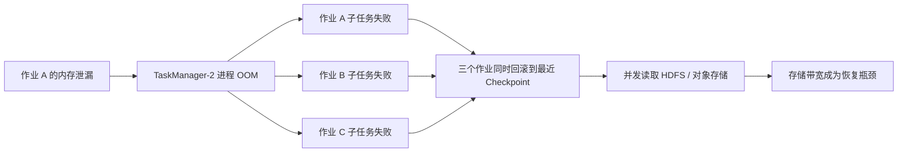
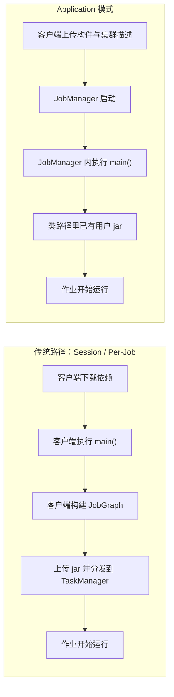
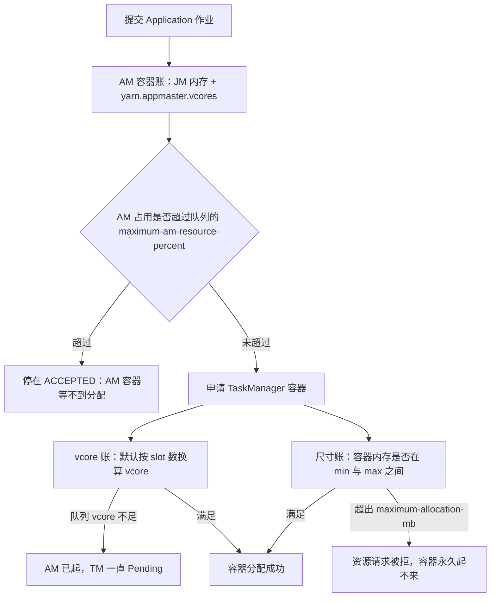
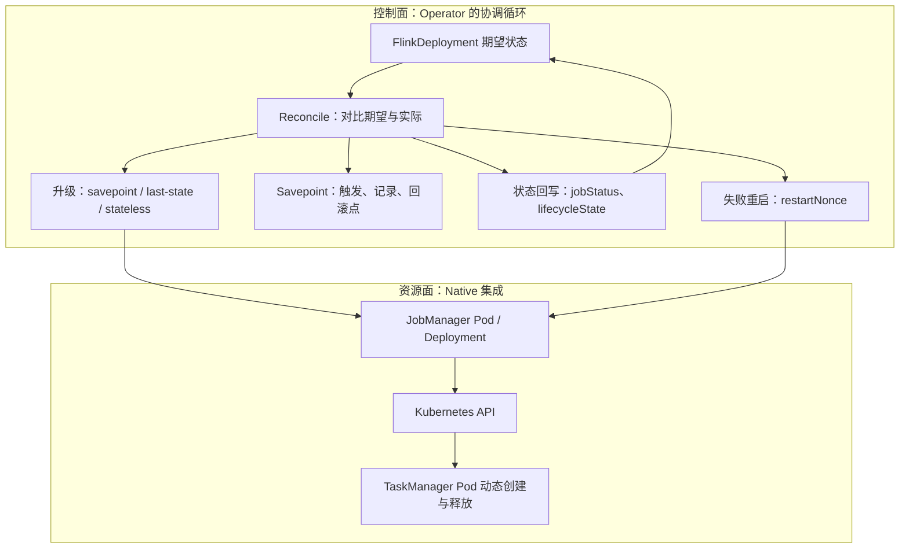

**摘要：**

Flink 的部署选型从来不是"把作业放到哪个资源管理器"这么简单，它真正决定的是四件事：集群的生命周期归谁、`main()` 在哪台机器上执行、用户依赖在哪里解析、以及版本升级时谁需要跟着重启。本文按这三条判别轴展开。先把 Session、Per-Job、Application 三种模式的差别拆到资源账本层面，说明 Session 共享集群在资源利用率上的收益为什么必须用隔离性和版本绑定来换，Per-Job 为什么在 Flink 1.15 被标记废弃、2.0 被彻底移除，Application 模式把 `main()` 搬进集群之后又带来了哪些新的约束。随后分别落到 YARN 与 Kubernetes 两条实操路径上：YARN 侧讲清 ApplicationMaster 也计入队列配额这个常被忽略的事实、vcore 与 slot 的默认换算、容器尺寸上下限、`yarn.application-attempts`、`ship-files` 与 `classpath.include-user-jar` 的语义；Kubernetes 侧讲清 Native 集成与 Flink Kubernetes Operator 的分工、`kubernetes.taskmanager.cpu` 与 `taskmanager.numberOfTaskSlots` 为什么不等价、ServiceAccount 权限缺失如何让 TaskManager 永远注册不上、以及 JobManager 高可用的 ConfigMap 选主细节。最后给出一套"资源拿不到、拿多了"的判据和处置顺序，并把监控暴露、日志、动态参数、优雅停止这些云原生边界一并划定。全文落点在权衡：资源效率与故障隔离之间存在结构性矛盾，选型的实质是决定把哪一侧的代价放在自己的运维账上。

---

## 第 1 章 一次 Pending 引出的三选一

2019 年底到 2020 年，Flink 的部署形态经历了一次不声不响的重构。在此之前，"一作业一集群"在 YARN 上要靠 Per-Job 模式实现，而客户端的职责一直很重——它要下载依赖、在本地执行 `main()`、生成 JobGraph，再把二进制和作业图一起推给远端集群。Flink 1.11（2020 年）引入 Application Mode（FLIP-85），把 `main()` 的执行位置从客户端搬到了集群的 JobManager 里；2022 年，1.15 把 Per-Job 标记为废弃；2025 年的 2.0 正式删掉了它。今天打开官方文档，能在部署模式一节看到的只剩 Session 与 Application 两种，Per-Job 的段落被明确标注为 deprecated。

但这段历史在读文档时很容易被压缩成一句"用 Application 模式就对了"，从而漏掉真正的判断依据。笔者见过一个很典型的现场：某电商的实时大屏链路要和同一个团队的三条离线回刷作业共用一个 YARN 队列，队列容量 200 vcore，某天新提交的两条作业一直停在 ACCEPTED，队列面板显示还有一百多核空闲，运维的第一反应是"调度器坏了"，实际上卡住的是 ApplicationMaster 的配额上限——队列里压着二十来个 Application 模式的作业，每个作业的 AM 连同 JobManager 的内存一起记在队列账上，正好触到 CapacityScheduler 默认 10% 的 AM 资源比例，作业连 AM 容器都申请不到，后面的 TM 自然无从谈起。这个案例后面还会反复出现，因为它同时踩中了三种模式选型、AM 配额、slot 与 vcore 换算三个知识点。

### 1.1 三条判别轴

把三种模式放进同一张表，差别其实只有三条轴，其余都是这三条的推论。

第一条轴是**集群生命周期归属**。Session 模式的集群先于作业存在，作业结束后集群仍在；Per-Job 与 Application 模式由提交动作触发建簇，作业结束（或应用结束）后集群销毁。

第二条轴是**`main()` 的执行位置**。Session 与 Per-Job 模式里，`main()` 在客户端进程里跑，客户端必须能解析全部用户依赖、能执行到 `execute()`；Application 模式里 `main()` 在集群的 JobManager 中跑，客户端只负责上传构件与提交描述。

第三条轴是**集群服务的作业粒度**。Session 服务任意多个作业，Per-Job 服务单个作业，Application 服务"一次提交所包含的那组作业"——这一点常被忽略，Application 模式支持在一个 `main()` 里通过多次 `execute()` 或 `executeAsync()` 提交多个作业，代价是这种多作业应用不支持 HA（后文详述）。

下面这张图把三条轴放在一起，可以看到 Application 模式的位置其实是"以应用为粒度的独占集群"，它同时具备 Per-Job 的隔离性和 Session 的集群内复用。


### 1.2 机制交给原理列

这一篇只回答"参数设成多少、出问题先看哪里"。至于 JobManager 进程内部 Dispatcher、ResourceManager、JobMaster 三个组件如何划分职责，TaskSlot 在 TaskManager 内部只是一份额度而不是一颗 CPU 核，子任务如何映射到槽位、区域故障恢复以什么为前提成立，这些属于机制层，归 [[大数据/Flink/Flink原理深度解析与性能优化/01 Flink 架构总览：JobManager、TaskManager 与执行模型|架构总览]] 那一篇；StreamGraph、JobGraph、ExecutionGraph 三张图的生成过程归 [[大数据/Flink/Flink原理深度解析与性能优化/02 从 StreamGraph 到 JobGraph 再到 ExecutionGraph|三张图的生成]]。本文在必要处只给一句结论和一处双链，不重复推导。

槽位这件事必须先钉住一句结论，否则后面所有资源配置都会算错：一个槽位是**一份内存与并发的记账额度**，槽位之间不隔离 CPU，也不隔离网络带宽；同一 slot sharing group 内的算子链共享一个槽位，因此一个作业需要的槽位下限是"各组最大并行度"，而不是各算子并行度之和。这条结论的完整依据在原理列，本文只把它当算术基础使用。

---

## 第 2 章 Session 模式：共享集群的账本

### 2.1 常驻集群先付一笔固定成本

Session 模式的第一步是起一个长期运行的集群：一个 JobManager 加上若干 TaskManager，每个 TaskManager 按 `taskmanager.numberOfTaskSlots` 切出槽位。这些进程一旦启动，内存就已经按 Flink 的统一内存模型分完了——堆、托管内存、网络内存、Metaspace、JVM 开销各归各位，其中托管内存再按槽位数量均分，每个槽位一份。

这一点决定了 Session 的"高利用率"有前提。假设一个 TaskManager 配 16GB 进程内存、4 个槽位，托管内存按 0.4 的比例从 Flink 总内存里切出大约 5.8GB（比例作用于 Flink 总内存，不是进程内存），4 个槽位均分，每个槽位名下就挂着约 1.45GB。空闲槽位不会把这 1.45GB 还给操作系统，托管内存是启动时向操作系统要的、按槽位切好的池子，删除作业只释放堆里的对象，不释放池子。所以一个只有两条作业的 Session 集群，如果按峰值起了 20 个 TaskManager，日常状态下这 20 台机器的内存是被占住的，省下来的只是"重复申请容器"的时间，不是内存。

### 2.2 提交快的原因

Session 模式之所以提交快，是因为一次提交跳过了一整串动作：不用等调度器分配容器，不用启动 JobManager 进程，不用重新建立 TaskManager 与 JobManager 的注册关系，也不用把用户 jar 分发到每个 TaskManager 节点。客户端解析完依赖、构建 JobGraph，把作业图交给已在运行的 JobManager，JobManager 在现有槽位里找位置，找不到再向资源管理器申请增量 TaskManager。整条路径的量级是秒级到十几秒，而新建一个 YARN Application 或一个 Kubernetes 应用集群通常在数十秒到分钟级，具体取决于镜像是否已在节点上、队列是否有余量。

这条快路径对开发调试的价值远大于对生产作业的价值。反复改逻辑、反复提交验证的场景里，一次几十秒的建簇开销会明显拖慢迭代；而生产流作业通常几天甚至几个月才提交一次，建簇开销摊到运行时长上可以忽略。

### 2.3 三个代价：连带、版本绑定、共享大脑

第一笔代价是**故障连带**。Session 集群里多个作业的槽位落在同一批 TaskManager 进程上，一个作业把 TaskManager 的 JVM 撑爆，或者某个用户函数把线程池打满，这个 TaskManager 上的所有子任务一起失败。更麻烦的是恢复过程本身：这些作业会同时回滚到各自最近的 Checkpoint，同一时刻向同一个 HDFS 或对象存储发起并发读取，存储侧的带宽和元数据服务成为新的瓶颈。官方文档把这条风险写得很直白——一个作业出问题，可能引发所有作业一起恢复、并发访问文件系统、把存储拖到不可用。图 2 是这个传导链的示意。



第二笔代价是**版本绑定**。Session 集群是由某个具体版本的 Flink 发行版启动的，客户端提交的 jar 必须与这个版本的二进制接口、序列化格式、连接器版本相匹配，槽位与内存模型也由集群侧的配置决定。这意味着升级 Flink 版本**只能整簇重建**：停掉 Session 集群，所有作业一起停，换发行版，重新起簇，再逐个重新提交。想做到"按作业灰度升级引擎"，Session 从结构上就做不到。同一件事在 Application 模式下是天然的——每个应用自带镜像，镜像里的 Flink 版本就是该作业的版本，两套版本可以并行运行。

第三笔代价是**共享大脑**。Session 集群只有一个 JobManager 进程，所有作业的作业主控、Checkpoint 协调、REST 请求都挤在里面。作业数量上到十几个之后，JobManager 的堆压力、RPC 队列长度、指标上报开销都变成公共资源：某个作业开启了大状态 Checkpoint，其协调线程会占用公共线程池；某个作业的 JobGraph 特别大，序列化与反序列化会在 JobManager 里制造可观测的停顿；JobManager 的 GC 停顿一旦超过心跳超时，TaskManager 会被误判失联，进而触发一轮与它无关的作业重启。这类问题在面板上的表现往往不是"JobManager 挂了"，而是"某个作业偶发重启"，非常难归因。

### 2.4 仍然该用 Session 的场景

把上面三条代价反过来读，就得到 Session 的适用判据。作业之间不存在失败预算的不对称（都能容忍一起重启）、版本升级节奏一致（同一个团队同一批作业）、单作业规模不足以打满整个集群（不会出现一个作业占满全部槽位），这三条同时成立时，Session 的资源效率优势是实打实的。

具体到工程场景，开发与联调环境是最典型的一类，一个共享集群承接所有人的临时作业，谁也不在意别人的作业把自己带崩一次；数据探索与临时分析是第二类，SQL Client 连上 Session 集群、跑一条探索性查询、看看结果、结束，这种交互式的用法如果每次都建簇，体验会难以接受；短生命周期的内部监控链路是第三类，作业本身几分钟到几小时，失败重跑的成本低于维护独立集群的成本。

反过来的判据同样清晰：只要集群里存在一条"不能陪别人重启"的链路——支付对账、订单状态机、大屏背后的核心聚合——它就不应该和探索性作业放在同一个 Session 集群里。把它单独开一个 Application 集群，多付的那点建簇时间，换的是故障半径的收敛。

---

## 第 3 章 Per-Job 模式与它的断代

### 3.1 它当年解决的是什么

Per-Job 模式的思路是"一作业一集群"：每次提交为单个作业申请一个 YARN Application，包含专属的 ApplicationMaster 与专属的 TaskManager，作业结束资源释放。它精确地解决了两件事——故障隔离（不同作业的 TaskManager 不共享）和资源按作业核算（作业申请多少、占多少，账目清晰）。

但它的实现方式在容器化时代显得笨重。`main()` 仍在客户端执行，客户端必须能访问全部依赖、必须能连上资源管理器、必须在提交期间保持存活（除非加 `--detached`），并且要把用户 jar 与 JobGraph 一起推给远端。这套流程在 2015 年前后是合理的，那时客户端往往就是一台提交机，依赖下载与 JobGraph 构建的成本可以接受；到了 2020 年前后，提交动作越来越多地发生在 CI 流水线里，流水线容器里既没有完整的 Flink 依赖，也不适合承担"执行用户 `main()`"这种不确定的负载。

### 3.2 断代的时间线

版本边界必须说清楚，因为直到今天仍有大量资料把 Per-Job 当作可选方案推荐，而按那些资料做出来的选型，在新版本上会直接失败。

| 时间 | 版本 | 事件 | 对部署参数的影响 |
| --- | --- | --- | --- |
| 2020 年 | 1.11 | Application 模式引入（FLIP-85） | 新增 `yarn-application`、`kubernetes-application` 目标 |
| 2022 年 | 1.15 | Per-Job 标记废弃（FLINK-25999） | `yarn.per-job-cluster.include-user-jar` 更名为 `yarn.classpath.include-user-jar` |
| 2023 年至 2024 年 | 1.16 至 1.20 | Per-Job 仅保留兼容 | Kubernetes 侧从未提供 per-job 目标，仅 session 与 application 两种 |
| 2025 年 | 2.0 | Per-Job 移除（FLINK-26000，提交 FLINK-36310） | `yarn-per-job` 目标不再存在，旧提交命令直接报错 |
| 2025 年之后 | 2.0、2.1 | 只剩 Session 与 Application | 2.1 于 2025 年 7 月发布，Java 17 为默认 |

按这张表，任何在 2026 年做的新技术选型都不应该把 Per-Job 写进方案；任何仍在 1.x 上运行的存量作业，也应当把 `-t yarn-per-job` 的迁移列入升级清单，因为它的终点是被删除，而不是被长期维护。

### 3.3 为什么会被判死刑

第一个理由是**平台不一致**。Per-Job 只存在于 YARN，Kubernetes 集成从设计之初就只提供 session 与 application 两种目标。同一套 Flink 代码要同时部署到两个平台，就必须维护两套提交语义，而 Per-Job 那套无法在 K8s 上复现——容器编排环境下"一作业一集群"本来就该由 Application 模式表达。

第二个理由是**客户端职责重复**。Application 模式把 `main()` 搬进集群，客户端从"重客户端"变成"轻客户端"；Per-Job 保留重客户端，却和 Application 一样追求"一作业一簇"的隔离性，两边的收益高度重叠，而成本多了一份。

第三个理由是**灰度能力**。Per-Job 的集群里跑的是某个发行版，作业 jar 作为用户类路径的一部分被分发进去，这个组合在升级引擎时同样要整簇重建——它与 Session 共享"版本绑定"的缺陷，却没有 Session 的资源效率。当 Application 模式把"引擎版本"变成镜像内容之后，Per-Job 剩下的唯一优势（隔离）被完整覆盖。

### 3.4 存量迁移的判据

迁移本身不复杂，但参数写法的对应关系必须逐条核。

| 迁移项 | Per-Job 写法 | Application 写法 | 备注 |
| --- | --- | --- | --- |
| 提交命令 | `flink run -t yarn-per-job` | `flink run-application -t yarn-application` | 2.0 起旧目标已不存在 |
| 并行度 | `-p 8` | `-p 8` | 语义一致 |
| 内存与槽位 | `-yjm`、`-ytm`、`-ys` 快捷参数 | `-Djobmanager.memory.process.size`、`-Dtaskmanager.memory.process.size`、`-Dtaskmanager.numberOfTaskSlots` | 快捷参数属于 `flink run` 的语法糖 |
| 用户 jar 类路径 | `yarn.per-job-cluster.include-user-jar` | `yarn.classpath.include-user-jar` | 1.15 更名，取值 DISABLED/FIRST/LAST/ORDER |
| 依赖分发 | 客户端上传 jar 到集群 | HDFS 路径或 `yarn.provided.lib.dirs`，再配合 `local://` | Application 模式的核心收益在这里 |
| 队列与命名 | `-yqu`、`-ynm` | `-Dyarn.application.queue`、`-Dyarn.application.name` | 名称要能与作业对账 |

迁移时最容易出错的是第三行：很多人把 `-yjm 2048` 直接换成 `-Djobmanager.memory.process.size=2048`，单位从 MB 变成了带单位的字符串，写成 `2048` 会被解析成 2048 字节。第四个坑在第五行，`local://` 前缀的含义是"容器内绝对路径"，如果镜像里没有把 jar 放到对应位置，提交能成功但 ApplicationMaster 启动后立刻失败，报找不到入口 jar。

---

## 第 4 章 Application 模式：`main()` 进集群之后的连带变化

### 4.1 客户端职责收窄到什么程度

在 Application 模式下，客户端做的事情被压缩成两件：把作业构件（jar、可能的 UDF 依赖）与集群描述（镜像、资源、配置）交给资源管理器；等待集群创建成功的应答。它不再下载依赖、不再执行 `main()`、不再构建 JobGraph，提交完成后即可退出。CI 流水线因此不必维持在线的长连接，也不需要为"构建 JobGraph"准备大堆内存。

顺带一个常被忽略的收益是恢复速度。在 Session 与 Per-Job 模式下，作业恢复时集群要把用户 jar 通过 RPC 分发给需要它的 TaskManager；Application 模式下 jar 已经在 TaskManager 的类路径里（镜像或 `usrlib` 目录），恢复过程跳过了这一步分发。对于状态大、恢复时间敏感的作业，这一步省下的时间是秒级到十几秒级的量级。

图 3 把两条提交路径并排放，可以看到 Application 模式把"依赖解析"与"作业图构建"两段从客户端搬到了集群。



### 4.2 代价一：镜像即版本

Application 模式的前提是"用户 jar 已经随发行版一起存在于集群组件的类路径上"，官方文档把这条假设写得很清楚。落到工程上，它意味着发布流程变了：镜像的构建成为发布动作的一部分，镜像里含有的 Flink 版本、连接器版本、用户代码版本构成一个不可分割的整体。

这带来的不是麻烦，而是约束的转移，代价落在**镜像即版本**上。以前升级 Flink 版本是"换 Session 集群的发行版，作业重新提交"；现在升级 Flink 版本是"重建每个应用的镜像"。对于一个有二十条作业的团队，这意味着二十次镜像构建与发布。缓解办法是把镜像分层：底层是固定版本的 Flink 发行版与常用连接器，上层只叠加用户 jar；引擎升级时只重建底层，上层镜像的 Dockerfile 不用改。分层之后，升级的构建成本能回到可接受范围，但发布动作的数量不会减少——这是 Application 模式换来的隔离性应付的账。

### 4.3 代价二：那些"客户端本地"的假设失效了

`main()` 在集群里执行，代码里所有依赖"客户端本地环境"的写法都会失效，这是**本地假设失效**。最典型的是 `registerCachedFile()` 注册的本地文件：在客户端执行时，这个文件就在客户端机器的磁盘上；在 Application 模式下，`main()` 在 JobManager 进程里跑，这个路径必须在 JobManager 容器内可见。类似的还有读取本地配置文件、读取客户端环境变量、依赖当前工作目录的相对路径。这类问题排查起来很费时间，因为异常出现在 JobManager 日志里，而提交命令的终端上只有一句"提交成功"。

### 4.4 代价三：多作业与高可用的取舍

Application 模式支持在一个应用里通过多次 `execute()` 提交多个作业，但官方文档明确写了两条限制：这种多作业应用不支持高可用，只有单 `execute()` 的应用才能开 HA；并且当多个作业中的任何一个被取消时，整个 JobManager 会关闭、所有作业一起停。这两条限制的组合意味着一个现实结论——需要 HA 的生产应用，就老老实实一个应用一个作业；把多个作业塞进一个应用来省资源开销，代价是整个应用变成一个更大的故障域。

**多作业与 HA 互斥**还带来一个操作层面的坑：在 Application 集群上取消作业，等同于停掉整个集群。文档里对 YARN 的表述是"取消作业会停止集群"。运维同学习惯了在 Session 集群上 `flink cancel` 单个作业，切到 Application 模式后同一个动作会连带停掉同应用的其他作业（如果有多作业），这条需要在 SOP 里写明。

### 4.5 三种模式的总账

把前面的结论收进一张表，选型时按行核对即可。

| 维度 | Session 模式 | Per-Job 模式 | Application 模式 |
| --- | --- | --- | --- |
| 集群生命周期 | 先于作业存在，常驻 | 单作业，作业结束销毁 | 单应用，应用结束销毁 |
| `main()` 执行位置 | 客户端 | 客户端 | 集群 JobManager |
| 依赖解析位置 | 客户端 | 客户端 | 集群（镜像或 usrlib） |
| 隔离粒度 | 槽位级共享，故障连带 | 作业级独占 | 应用级独占 |
| 版本绑定 | 整簇绑定 | 整簇绑定 | 镜像绑定，可按作业不同 |
| HA 范围 | 整簇 | 单作业 | 单应用（多作业应用不支持） |
| 提交延迟量级 | 秒级 | 数十秒到分钟级 | 数十秒到分钟级 |
| 资源利用率 | 高（可跨作业复用槽位） | 低（峰谷不能互补） | 中（应用内可复用） |
| 现状 | 支持 | 1.15 废弃，2.0 移除 | 主推，K8s 上的标准形态 |

---

## 第 5 章 YARN 侧：配额、AM 与槽位的三本账

### 5.1 ApplicationMaster 也吃队列配额

这是整篇文章里最值得单独记住的一条：**ApplicationMaster 也占队列配额**。很多人算 YARN 资源时只算 TaskManager 容器，把 ApplicationMaster 当作"调度器自带的小东西"，实际上 AM 是一个普通的 YARN 容器，它消耗的内存和 vcore 同样记在提交它的那个队列头上。Flink 在 YARN 上的 AM 容器大小由 `jobmanager.memory.process.size` 决定，vcore 由 `yarn.appmaster.vcores` 决定，后者默认 1。

更关键的是 CapacityScheduler 的第二道闸门：队列里 AM 容器占用的资源总和不能超过队列资源的某个比例，配置项是 `yarn.scheduler.capacity.maximum-am-resource-percent`，默认 0.1。它的设计初衷是**防止大量小应用各自占一个 AM**、把队列资源全变成"调度开销"，但在 Application 模式普及之后，这条限制变成了作业数量的硬上限。

算一笔账：队列容量 200 vcore，AM 比例 0.1，单个 AM 1 vcore，那么同时最多 20 个 Application 在跑；如果 AM 配了 2 vcore（有些团队为了让 `main()` 构建 JobGraph 更快而给 JM 加核），上限立刻掉到 10 个。此时队列面板上"已用 20 / 总 200"看起来空得很，新作业却停在 ACCEPTED，诊断信息里写的是 AM 容器等待分配。这类问题的处置只有两条路：请平台方调高该队列的 AM 比例（注意这会影响同队列所有用户），或者把若干小作业合并进一个 Session 集群以降低 AM 数量。

> [!warning] AM 配额限制的是作业数，不是资源量
> 不少人把它理解成"资源不够就加队列"，实际上在 Application 模式下它限制的是**同时存在的应用数量**。队列空闲率 90% 而作业起不来，先算一遍 AM 占比，比翻调度器日志快得多。临时把 AM 比例调到 0.3 以上是应急手段，长期解法是让作业粒度与小作业数量回到合理区间。

图 4 把三本账画在一起：AM 账、vcore 账、容器尺寸账，任何一本算错都会表现为"资源明明够却起不来"。



### 5.2 vcore 与槽位的默认换算

槽位数本身由 `taskmanager.numberOfTaskSlots` 决定，默认 1；YARN Session 用启动参数 `-s` 指定它，Application 模式写在 `-Dtaskmanager.numberOfTaskSlots` 里。Flink 向 YARN 申请的容器 vcore 数**默认按槽位数换算**，配置项是 `yarn.containers.vcores`，文档的表述是"默认等于每个 TaskManager 的槽位数，若未设置则取 1"。这条默认值在开 CPU 调度的集群上会立刻产生耦合：一个配了 4 个槽位的 TaskManager 会申请 4 个 vcore，8 个 TaskManager 就是 32 vcore。

于是出现一种典型错配：某个队列给了 100GB 内存但只给了 16 vcore，团队按"每 TM 4 槽、每 TM 8GB"提交了一条并行度 32 的作业，需要 8 个 TM、64 vcore——内存只用了 64GB，vcore 却要 64，超了 4 倍，作业永远只能等到 2 个 TM，其余一直 Pending。判断依据很直接：看 YARN 的队列面板里内存使用率与 vcore 使用率是否严重背离，背离就是配额维度错配，不是调度器故障。

反过来，如果集群没有开启 CPU 调度（`yarn.nodemanager.resource.cpu-vcores` 未配、调度器不认 vcore），vcore 只是记账，约束不会生效，此时"每 slot 一 vcore"的默认值无害，但也失去了 CPU 隔离的意义——一个 TaskManager 里的多个槽位会争抢同一批物理核。

### 5.3 容器尺寸的上下限

YARN 的调度器对单个容器的资源有最小与最大限制，Hadoop 的默认值是 `yarn.scheduler.minimum-allocation-mb` 1024、`yarn.scheduler.maximum-allocation-mb` 8192、`yarn.scheduler.maximum-allocation-vcores` 4。这三个数字在 Flink 场景下经常被撞上。

最典型的是大内存 TaskManager。团队为了让 RocksDB 有足够的托管内存，把 `taskmanager.memory.process.size` 设成 16GB，结果容器请求超过 `maximum-allocation-mb`，资源管理器直接拒绝这个请求。表现是 AM 已经启动、日志里能看到申请容器的动作，但 TM 一个都起不来，RM 的日志里是资源请求非法的报错。处置有两条：请平台方调高该队列的容器上限（属于集群级变更，需要评估其他负载），或者把 16GB 的 TaskManager 拆成 2 个 8GB 的——后者不影响总容量，但会**改变槽位与内存的分摊关系**，需要同步调整 `taskmanager.numberOfTaskSlots` 与并行度。

`maximum-allocation-vcores` 默认 4 也有同样的效果：一个配 8 个槽位的 TaskManager 会申请 8 个 vcore，超过上限直接失败。所以"slot 数不超过 4"这条经验法则，很多时候不是因为 CPU 核数，而是因为 YARN 默认的容器 vcore 上限。

### 5.4 `yarn.application-attempts`：整簇重启的次数

这个参数容易被误解成"作业重启次数"，它实际上是 ApplicationMaster 的重启次数。Flink 的文档写得很明确：默认值为 1，开启高可用后默认为 2，同时受 YARN 侧的 `yarn.resourcemanager.am.max-attempts`（Hadoop 默认 2）限制，两者**取较小值**；每次 attempt 都是整个 Flink 集群重启，客户端会失去连接。

理解这一点的意义在于区分两套重启语义。作业内部的重启由 Flink 的重启策略负责（固定延迟、指数延迟、故障率），TaskManager 挂掉、任务失败都在这一层处理，作业 ID 不变；而 AM 重启意味着 JobManager 容器本身没了，集群要重建，作业要从 HA 存储恢复。把 `yarn.application-attempts` 调大并不能让作业"更稳"，它只是给 JobManager 的崩溃多留几次机会，代价是故障期间集群反复重建、恢复时间成倍拉长。

Hadoop 2.6 之后有个细节值得知道：Flink 会把提交上下文的 attempt 失败有效性窗口设为自身的超时值，只有窗口内累计的失败次数才计入上限，避免一个运行了几个月、期间偶发重启的长作业把 attempt 额度耗尽。这个窗口在 YARN 侧对应 `yarn.application-attempt-failures-validity-interval`，Flink 侧也能显式指定。窗口缺失或设得过短时，一个运行一年的作业在经历两次 JobManager 崩溃后就再也得不到重启机会。

### 5.5 `yarn.ship-files` 与预置目录

`yarn.ship-files` 是一个分号分隔的本地文件或目录列表，提交时随应用一起分发到集群，落到容器的工作目录里。它的用途很具体：Keytab、Kerberos 配置、自定义 log4j 配置、信任证书这类"不能打进镜像、又不能放在 HDFS 上随便读"的小文件。注意它只负责"送到容器里"，不会自动进入类路径，配置里引用时要用相对工作目录的路径或绝对路径。

与之互补的是 `yarn.provided.lib.dirs`。这个参数指向一个 HDFS 目录，里面预置了 Flink 发行版（`flink-dist`）与常用依赖，提交时客户端只需要传作业 jar 和少量配置，不再把上百兆的发行版打包上传。官方文档把这种用法称为"让提交变得非常轻量"，它是 Application 模式在 YARN 上的标准搭配。一个团队如果每天要提交几十次，把发行版预置到 HDFS 能把单次提交时间从分钟级压到十几秒的量级。

### 5.6 用户 jar 该进哪个类路径

`yarn.classpath.include-user-jar` 决定用户 jar 放在系统类路径还是用户类路径，取值 DISABLED、FIRST、LAST、ORDER。默认 ORDER，即按文件名字典序放进系统类路径。这个默认值的含义是：用户 jar 与 Flink 自身的依赖在同一层可见，Flink 的内部类可能被用户 jar 里同名不同版本的类遮蔽，也可能反过来。

DISABLED 把用户 jar 移到用户类路径（child-first 加载），能显著降低"用户依赖与 Flink 内部依赖打架"的概率，代价是某些需要与 Flink 共享类型的场景（比如自定义序列化器要引用 Flink 的 TypeInformation）需要额外配置父类加载器策略。FIRST 与 LAST 则是显式指定顺序，用于处理同一个库的多个版本。

这个参数的历史名字是 `yarn.per-job-cluster.include-user-jar`，1.15 随 Per-Job 废弃一起更名——名字里去掉 "per-job-cluster"，因为它对所有模式都生效。处理存量配置时如果看到旧名字，说明这份配置至少是 1.14 及更早写的，里面大概率还有其他过时项，值得整份重审。

### 5.7 一份可核对的提交参数

把前六节的内容落成一条可执行的提交，参数之间的因果关系就清楚了。这段命令不是模板，而是逐行标注了"为什么这么写"。

```bash
# Application 模式提交：归属先定清楚，再谈性能
flink run-application -t yarn-application \
  -Dyarn.application.name=order-realtime-dashboard \
  -Dyarn.application.queue=realtime \
  -Djobmanager.memory.process.size=2048m \
  -Dtaskmanager.memory.process.size=8192m \
  -Dtaskmanager.numberOfTaskSlots=4 \
  -Dyarn.containers.vcores=2 \
  -Dstate.checkpoints.dir=hdfs:///flink/checkpoints/order-dashboard \
  -c com.example.OrderDashboardJob \
  hdfs:///flink/jars/order-dashboard-1.2.0.jar \
  --window-minutes 5
```

其中 `yarn.containers.vcores=2` 与 4 个槽位是**有意为之的错配**：这条链路的算子以网络与状态读写为主，CPU 调度已开启，按 2 个 vcore 申请把队列配额留给同队列的其他作业，代价是单 TM 实际能拿到的 CPU 取决于节点上容器的密度、以及 NodeManager 是否启用了 cgroup 资源限制，需要结合节点负载与容器限流指标核对。`yarn.application.name` 与队列必须与监控、账单的维度对齐，否则事后无法把资源消耗归到具体链路。末尾的 `--window-minutes 5` 是程序参数，走的是与 `-D` 完全不同的通道，这一点第 9 章还会展开。

| YARN 参数 | 默认值 | 约束对象 | 配错后的表现 |
| --- | --- | --- | --- |
| `yarn.application.queue` | `default` | 队列归属与配额 | 落到错误队列，配额与 ACL 全不对 |
| `yarn.appmaster.vcores` | 1 | AM 的 CPU 记账 | AM 占比高时作业数受限 |
| `yarn.containers.vcores` | 等于 slot 数 | TM 的 CPU 记账 | 队列 vcore 不足，TM 长期 Pending |
| `yarn.scheduler.maximum-allocation-mb` | 8192（Hadoop 默认） | 单容器内存上限 | 大内存 TM 请求被拒，容器起不来 |
| `yarn.scheduler.maximum-allocation-vcores` | 4（Hadoop 默认） | 单容器 vcore 上限 | 多槽位 TM 请求被拒 |
| `yarn.application-attempts` | 1，HA 时 2 | AM 重启次数 | 与 `yarn.resourcemanager.am.max-attempts` 冲突时取小值 |
| `yarn.ship-files` | 无 | 随应用分发的文件 | 文件不在容器里，keytab 或日志配置缺失 |
| `yarn.provided.lib.dirs` | 无 | 预置发行版目录 | 未设置时每次提交都要上传发行版 |
| `yarn.classpath.include-user-jar` | ORDER | 用户 jar 的类路径位置 | 依赖冲突，NoSuchMethodError 一类问题 |

---

## 第 6 章 Kubernetes 的两条路：Native 与 Operator

### 6.1 Native 集成：把 K8s 当资源提供者

Flink 的 Native Kubernetes 集成做的事情是：JobManager 启动后，直接通过 Kubernetes API 创建 TaskManager Pod，不需要用户维护任何 Pod 的 YAML。JobManager 本身以一个 Deployment 的形式被创建，TaskManager 的数量由 ResourceManager 根据槽位需求动态申请与释放。

这套集成的定位是"资源层的驱动"，与 YARN 集成在架构上对等：JobManager 内部有对应的 ResourceManager 实现，负责向外部系统申请容器、监控容器状态、在容器丢失时重新申请。它对使用者暴露的入口就是我们熟悉的两条命令——`flink run -t kubernetes-session` 提交到已有 Session 集群，`flink run-application -t kubernetes-application` 创建应用集群。

### 6.2 Operator：把"提交之后"接管过来

Native 集成能解决"起得来"，解决不了"管得住"。一个 Application 集群创建之后，谁负责在作业失败时重新提交、谁负责升级时先做 Savepoint、谁负责把作业状态同步到 Kubernetes 的资源状态里、谁负责删除时的顺序（先停作业再停集群），这些问题 Native 集成不回答，答案是 Flink Kubernetes Operator。

Operator 是一个独立的控制器进程，监听一组 CRD。核心资源是 `FlinkDeployment`，它可以表达"一个应用集群加它自己的作业"或"一个裸 Session 集群"；`FlinkSessionJob` 往 Session 集群里提交作业；`FlinkStateSnapshot` 表示对某个作业触发的 Savepoint 或 Checkpoint（较新版本中标注为实验性）；较新的版本还提供了 `FlinkBlueGreenDeployment` 做蓝绿发布，同样是实验性能力。这些资源都在 `flink.apache.org` 组的 `v1beta1` 版本下。

`FlinkDeployment` 的关键字段分工很清楚：`spec.image` 与 `spec.flinkVersion` 决定运行时版本，`spec.flinkConfiguration` 承载任意 Flink 配置项（注意这里是配置项键值，不是命令行 `-D` 语法），`spec.jobManager` 与 `spec.taskManager` 承载资源与副本，`spec.job` 承载作业定义（jar 地址、入口类、并行度、升级模式）。

### 6.3 Operator 的四个价值

第一个是升级。`spec.job.upgradeMode` 有三档：`savepoint` 表示先做 Savepoint、停作业、用新镜像重建、从 Savepoint 恢复；`last-state` 表示直接用最新的 Checkpoint 或 Savepoint 恢复，跳过停机做快照的等待，速度快但要求状态确实可用；`stateless` 表示不保留状态。三档的语义差异直接对应三种发布场景：状态结构变更用 savepoint、纯参数调整用 last-state、逻辑不兼容用 stateless。反过来说，如果不显式设置，默认行为可能不是你想要的，改动镜像后状态能否延续取决于这一项。

第二个是 Savepoint 生命周期。`spec.job.savepointTriggerNonce` 是一个"改数字就触发"的开关，把值改成任意不同的非空数字，Operator 就发起一次 Savepoint；`spec.job.initialSavepointPath` 指定首次部署或回滚部署时的起始状态；`spec.job.savepointRedeployNonce` 用于从指定 Savepoint 完整重部署，文档特别注明"重部署后无法回滚"。加上状态里保存的 Savepoint 历史与最近一次完成记录，运维不需要再手工记录路径。

第三个是状态回写。`FlinkDeployment` 的 status 里有作业状态（作业 ID、运行状态、最近的 Checkpoint 与 Savepoint 信息）、生命周期状态（稳定、协调中、升级中、失败等）与协调状态（最近一次 spec 变更是否已应用）。这些字段让 `kubectl get flinkdep` 与告警系统能直接拿到作业状态，而不必反查 Flink REST API。

第四个是失败处置与手动干预。Operator 观察作业状态，作业进入失败或结束时按策略重新提交；`spec.job.restartNonce` 提供一个手动重启入口，改数字触发一次完整重启；`spec.jobManager.replicas` 大于 1 时配合 HA 起备用 JobManager。

### 6.4 分工与常见误用

两者的关系不是替代而是叠加：Operator 调用的仍然是 Native 集成的客户端能力，它创建 TM Pod 的方式与 `flink run-application` 完全一致。所以"用了 Operator 就不用管 Native 配置"是错的——`kubernetes.taskmanager.cpu.amount`、ServiceAccount、Pod 模板这些参数在 Operator 下依然生效，只是写在 `spec.flinkConfiguration` 里。

图 5 把控制面与资源面的分工画开：Operator 在**控制面**做期望状态与实际状态的收敛，Native 集成在**资源面**做容器申请。



三类误用值得提前避开。把 Operator 当"K8s 版的提交器"，改完镜像直接 `kubectl apply`，不问 `upgradeMode`，结果状态被静默丢弃；在 `flinkConfiguration` 里写 `-Dkey=value` 这种命令行语法，Operator 不认，配置静默不生效；忽略删除顺序，直接删 Session 集群的 CR，而它上面还挂着 `FlinkSessionJob`，以为删干净了，实际上控制器会按顺序处理，期间作业状态如何变化需要事先想清楚。

| 能力 | Native 集成 | Flink Kubernetes Operator |
| --- | --- | --- |
| 创建集群与作业 | 支持，一条命令 | 支持，声明式 CR |
| TaskManager 动态申请 | 支持 | 支持（复用 Native 客户端） |
| 作业失败后重新提交 | 依赖作业重启策略与外部脚本 | 控制器观察状态后处理 |
| 升级时保留状态 | 手工先做 Savepoint | `upgradeMode` 三档可选 |
| Savepoint 管理 | 手工触发与记录 | 触发开关、起始路径、历史记录 |
| 多集群统一视图 | 无 | CR 状态与标签选择器 |
| 引入的额外组件 | 无 | 控制器、CRD、RBAC、可能的 Helm 发布 |

---

## 第 7 章 Kubernetes 关键配置：镜像、SA、CPU 与槽位

### 7.1 镜像：`kubernetes.container.image` 与它的新名字

Flink 用 `kubernetes.container.image.ref` 指定容器镜像，旧名是 `kubernetes.container.image`，1.17 起文档与源码改为带 `.ref` 后缀的新名字，旧名保留为兼容别名（源码里通过 deprecated keys 映射）。不显式配置时，Flink 会按当前发行版推导一个默认的官方镜像名，这在本地试用时方便，在生产里等于把版本交给隐式规则。

三个与镜像相关的坑值得逐条写。第一，**tag 必须不可变**，用 digest 或版本号，不要用 `latest`；第二，`kubernetes.container.image.pull-policy` 默认 `IfNotPresent`，它的含义是"节点上有就不拉"，配合可变 tag 会制造"同一 tag 在部分节点是旧内容"的漂移，这类问题的表现是部分 TaskManager 行为异常而另一些正常；第三，私有仓库需要 `kubernetes.container.image.pull-secrets`，取值是 Secret 名字的列表，Secret 必须与 Pod 在同一个命名空间，跨命名空间引用不生效，这一点在按团队划分命名空间的环境里经常被踩。

### 7.2 ServiceAccount：两个不同的身份

Kubernetes 上有两个角色需要不同的权限，配错一个就会出现"JobManager 起来了但 TaskManager 永远注册不上"。

JobManager 使用 `kubernetes.jobmanager.service-account` 指定的身份，它需要权限去创建、删除 TaskManager Pod，创建与更新 ConfigMap（HA 与集群配置），创建事件。TaskManager 使用 `kubernetes.taskmanager.service-account`，它需要权限去监听 ConfigMap——因为 TaskManager 是通过 ConfigMap 拿到 JobManager 的地址与 leader 信息的。两者都可以被 `kubernetes.service-account` 统一设置，也可以分开设置。

默认命名空间里有一个 `default` ServiceAccount，但它通常没有创建 Pod 的权限。用默认身份跑起来的表现是：JobManager 日志里出现 403 Forbidden，申请 TaskManager 的请求全部失败；如果只给了 JobManager 权限、没给 TaskManager 权限，表现会更隐蔽——TM Pod 起来了，但 CrashLoopBackOff，日志里是读取 ConfigMap 被拒绝，或者一直停在"无法发现 JobManager"的状态反复重试。

一个够用的最小权限集合大致是：对 pods 的 get、list、watch、create、delete；对 configmaps 的 get、list、watch、create、update；对 events 的 create。下面这份 Role 覆盖了前面列出的两类职责，把同一个角色绑给两个 ServiceAccount 即可先跑通；生产上再按"JM 建 Pod、TM 读 ConfigMap"的差异拆细。

```yaml
apiVersion: rbac.authorization.k8s.io/v1
kind: Role
metadata:
  name: flink-role
  namespace: flink-prod
rules:
  - apiGroups: [""]
    resources: ["pods"]
    verbs: ["get", "list", "watch", "create", "delete"]
  - apiGroups: [""]
    resources: ["configmaps"]
    verbs: ["get", "list", "watch", "create", "update"]
  - apiGroups: [""]
    resources: ["events"]
    verbs: ["create"]
```

生产环境用 Role 加 RoleBinding 绑定在命名空间上，不要图省事直接绑 cluster-admin——Operator 场景下这一点尤其重要，因为控制器本身也需要跨作业创建资源的权限。

### 7.3 `kubernetes.taskmanager.cpu` 与槽位为什么不等价

这是本篇最需要写透的一条配置。`kubernetes.taskmanager.cpu.amount`（旧名 `kubernetes.taskmanager.cpu`）控制的是 TaskManager Pod 的 CPU 请求，而 `taskmanager.numberOfTaskSlots` 控制的是这个 JVM 内部切出几个并发槽位。两者是完全不同层面的东西：前者是 Kubernetes 的资源账，后者是 Flink 的并发账。

默认行为是：不配置 `kubernetes.taskmanager.cpu.amount` 时，它取槽位数量。也就是说配 4 个槽位、不配 CPU，Pod 会申请 4 个 CPU；反过来如果显式把 CPU 配成 1、槽位仍是 4，Pod 只申请 1 个 CPU，而 JVM 内部却有 4 个槽位在跑，4 条子任务链共享 1 个核的时间片。

这种错配的后果不体现在"起不来"，而体现在"跑得慢且查不出原因"。4 个子任务各自在等 CPU 时间片，算子处理速率下降，下游看到的是背压，反压指标指向下游算子，运维去查下游却查不出问题；Checkpoint 的 barrier 传播也被拖慢，Checkpoint 时长上涨；而 `kubernetes.taskmanager.cpu.limit-factor` 默认为 1.0，limits 与 requests 相等，容器没有任何突发额度，CPU throttling 会持续出现在容器的 cgroup 指标里。

一段自洽的配置应当长这样，注释里写的是取舍而不是字段含义。

```yaml
taskmanager.numberOfTaskSlots: 2
# 槽位与 CPU 一一对应：并发账与资源账对齐，扩缩容粒度才可预测
kubernetes.taskmanager.cpu.amount: 2
# limits 默认等于 requests，改到 1.5 才有短时突发额度，代价是节点超卖
kubernetes.taskmanager.cpu.limit-factor: 1.5
```

反方向的错配同样存在：8 个 CPU 配 1 个槽位，资源账单很高，但并发只有 1，槽位成为瓶颈。Kubernetes 上的常见建议是"更多、更小的 TaskManager，每个一个槽位"，原因在于这样 CPU 与并发一一对应、扩缩容粒度最细、单个 TM 故障影响的子任务最少；代价是 Pod 数量与调度开销上升，JobManager 需要维护更多 TM 的注册与心跳。

| 参数 | 默认值 | 作用层 | 错配的表现 |
| --- | --- | --- | --- |
| `kubernetes.container.image.ref` | 按发行版推导 | 镜像 | tag 漂移，部分 Pod 行为异常 |
| `kubernetes.jobmanager.service-account` | `default` | JM 身份 | 创建 TM 被拒，403 Forbidden |
| `kubernetes.taskmanager.service-account` | 同 `kubernetes.service-account` | TM 身份 | 读不到 ConfigMap，TM 反复重启 |
| `kubernetes.taskmanager.cpu.amount` | 等于槽位数 | Pod CPU 请求 | 1 CPU 配 4 槽位，CFS 限流、背压误判 |
| `kubernetes.taskmanager.cpu.limit-factor` | 1.0 | CPU limits 与 requests 的比例 | 等于 1 时无突发额度 |
| `kubernetes.rest-service.exposed.type` | ClusterIP | REST 暴露方式 | LoadBalancer 把可执行代码的接口暴露公网 |
| `kubernetes.jobmanager.replicas` | 1 | JM 副本数 | 大于 1 但未开 HA，备用 JM 无意义 |
| `kubernetes.pod-template-file.taskmanager` | 无 | Pod 模板 | 主容器名不叫 `flink-main-container`，模板被拒 |

### 7.4 REST 服务的暴露方式

`kubernetes.rest-service.exposed.type` 有四个取值：ClusterIP、NodePort、LoadBalancer、Headless_ClusterIP，默认 ClusterIP。这个参数只影响 Flink Web UI 与 REST 端点的访问方式，与作业执行无关，但它的安全含义很重——官方文档在 LoadBalancer 这一项旁边明确警告：视环境而定，把 REST 服务暴露成 LoadBalancer 可能让集群对外可访问，而 Flink REST 允许提交与取消作业、上传 jar，等价于远程执行任意代码。

生产上的做法是保持 ClusterIP，用 `kubectl port-forward` 做临时访问，或者用 Ingress 加认证前置；如果确实需要 NodePort，还要配 `kubernetes.rest-service.exposed.node-port-address-type` 来选择用 InternalIP 还是 ExternalIP 拼访问地址。这类"为了看个 UI 就开公网"的操作，是很多安全事件的起点。

### 7.5 JobManager 高可用：ConfigMap 选主

Kubernetes 上的 HA 不需要 ZooKeeper，用的是 `high-availability.type: kubernetes`（1.x 早期版本用旧键 `high-availability`），配合两个必填项：`high-availability.storageDir` 存 JobManager 元数据（作业图引用、Checkpoint 指针、leader 地址），`kubernetes.cluster-id` 作为集群标识。要起备用 JobManager，把 `kubernetes.jobmanager.replicas` 设成大于 1，文档同时注明：起多个副本时必须开启 HA，否则备用副本没有意义。

选主的实现细节值得写一笔，因为它决定了故障切换的时间量级。Flink 的 Kubernetes 选主沿用 fabric8 客户端的 ConfigMap 锁：候选者在同一个 ConfigMap 上竞争写注解，注解里记录持有者身份、租约时长、续期时间与切换次数；持有者周期性续期，追随者周期性检查 `renewTime + leaseDuration > now` 是否成立，不成立就尝试抢占。与之相关的三个默认值是 15 秒的租约时长、15 秒的续期截止、5 秒的重试间隔。把这三个值与默认的 TaskManager 心跳超时放在一起考虑，就能估算一次 JM 故障的接管时间量级——十几秒的选主加上作业从最新 Checkpoint 恢复的时间。

还有一条容易忽略的行为：HA 相关的 ConfigMap 不带 owner reference，所以删除 JobManager 的 Deployment 不会连带删除它们。官方文档把这一点当作特性而非缺陷——重启集群时，之前运行的作业会从最新一次成功的 Checkpoint 恢复。反过来说，跨集群迁移或彻底重建时如果不清理这些 ConfigMap，可能出现"新集群恢复了旧作业"的意外，需要按 cluster-id 精确清理。

> [!info] 切换时间由三个时长共同决定
> 15 秒租约、15 秒续期截止、5 秒重试间隔的组合，意味着 Active JobManager 失联后大约十几秒才会被判定死亡；再加上作业从最新 Checkpoint 恢复的时间，才是一次 JobManager 故障的完整停机窗口。把这三个值调小可以缩短切换时间，代价是网络抖动时更容易误判主备；调大则相反。这是可靠性与灵敏度之间的经典取舍，没有两个参数能同时调到最优。

Kubernetes 自身控制面组件的选主用的是 `coordination.k8s.io/v1` 的 Lease 对象，与 Flink 这套 ConfigMap 锁语义等价、API 更专用。如果将来的版本改用 Lease，权限清单里就要补 leases 相关规则，升级前应当以对应版本的文档核对 RBAC。

### 7.6 Pod 模板与优雅停止

Flink 允许用 Pod 模板定制 JobManager 与 TaskManager 的 Pod 定义，配置项是 `kubernetes.pod-template-file.default`，可以按角色拆成 `.jobmanager` 与 `.taskmanager`。规则有两条必须记住：主容器必须命名为 `flink-main-container`，否则模板会被拒绝；Flink 会用配置项覆盖模板中的一部分字段（命名空间、镜像、副本数等），而未被覆盖的字段（如 `terminationGracePeriodSeconds`、`securityContext`、额外的 sidecar、卷挂载）会原样保留。这张"哪些字段会被覆盖"的清单在官方文档里有完整的表，改模板前应该逐项核对。

优雅停止就落在这个"未被覆盖"的区域里。Kubernetes 默认给 Pod 30 秒的终止宽限期，超时后 SIGKILL；Flink 的 TaskManager 收到 SIGTERM 后并不会自动完成一次 Checkpoint 再退出，正在处理中的数据与正在进行的快照都由恢复机制兜底。对于大状态作业，"杀掉再恢复"的代价可能是几分钟的重放与状态重建。

社区在 FLINK-40252 里提出了一个专门的配置项 `kubernetes.taskmanager.termination-grace-period`，思路是在 opt-in 的前提下给 TaskManager Pod 设置一个有界的宽限期与 preStop 钩子，让它在被驱逐（节点排水、竞价实例回收、滚动升级）时有机会完成退出流程，而不是与崩溃一视同仁。截至本篇写作时，这个键还没有出现在稳定版的配置表里，所以生产上可行的做法仍然是通过 Pod 模板设置 `terminationGracePeriodSeconds`，并把"停作业"的动作交给 `flink cancel -s`、`flink stop` 或 Operator 的 `upgradeMode: savepoint`，而不是直接删 Pod。是否已经有版本支持该键，以对应版本的配置文档为准。

---

## 第 8 章 资源拿不到、拿多了：判据与处置

### 8.1 Pending 的四类原因

资源拿不到的第一个表现是作业停在 Pending。把它当成一个笼统的"资源不足"去查，效率很低；正确的做法是**按容器层级往下剥**，因为不同层级卡住时的诊断信息完全不同。

第一层是 AM 容器卡住。YARN 的 application 详情里能看到"等待 AM 容器分配"一类的诊断，此时作业连自己的调度进程都没有起来。原因通常是队列配额不足、AM 资源比例触顶、或者队列 ACL 不允许该用户提交（后者往往直接提交失败而不是 Pending）。Kubernetes 上的对应现象是 JobManager Pod 处于 Pending，`kubectl describe pod` 的 Events 里是 `FailedScheduling`，原因可能是节点资源不足、节点亲和性不满足、或者节点有污点而 Pod 没有对应的容忍。

第二层是 AM 起来了但 TM 申请不到。此时 Flink 的 JobManager 日志里能看到申请容器的请求，YARN 的容器列表里是等待状态的请求，原因多为节点资源碎片（需要 8GB 单容器而每个节点的最大空闲块只有 6GB）、vcore 配额不足、容器尺寸超过 `maximum-allocation-mb`、节点标签不匹配。Kubernetes 上的现象是 TM Pod 一直 Pending，Events 同样是 `FailedScheduling`，但此时要看的是 request 与节点可分配量的差值。

第三层是容器分配到了但进程起不来。这不是调度问题，而是运行时问题：镜像拉不下来（`ImagePullBackOff`）、ServiceAccount 权限不足（`CreateContainerConfigError` 或容器内 403）、挂载的 ConfigMap 或 Secret 不存在、PVC 未绑定。这一层的特征是"有 Pod 但不在 Running"，与调度层的问题要分开看。

第四层是进程起来了但注册不上。TM 容器 Running 却在 JobManager 侧看不到，或者反复重启；常见原因是 TM 无法读取 ConfigMap（RBAC 不全）、网络策略阻断了 TM 与 JM 的通信、JM 的 RPC 端口被配置成不可达的地址。

### 8.2 TM 起不来的五类根因

把第三、四层展开，可以归成五类具体根因，每类的日志特征都很好认。

镜像类：私有仓库未配 pull-secret，Events 里是 `ErrImagePull`，随后退化成 `ImagePullBackOff`；镜像 tag 写错或 digest 不存在；节点的容器运行时与镜像的架构不匹配（多架构镜像缺失）。这类问题的排查动作是先 `kubectl describe pod` 看 Events，再在节点上手工 `crictl pull` 验证。

身份类：JobManager 的 SA 没有创建 Pod 的权限，Flink 日志里是 403；TaskManager 的 SA 没有读 ConfigMap 的权限，TM 日志里是"无法获取 leader 地址"并周期性重试，表现是 TM Pod 反复重启或长期不注册。这类问题在"先跑通再补权限"的开发环境里很常见，上了生产才暴露。

存储类：Pod 模板里挂了 PVC 但存储类没有可用卷，Pod 停在 ContainerCreating，Events 里是 `FailedMount`；挂载的 ConfigMap 键名写错，容器启动时找不到文件直接退出。Flink 的配置类 ConfigMap 由它自己管理，用户模板里额外挂的卷才是问题来源。

容量类：Pod 的 requests 超过任何节点的可分配量，永远是 `FailedScheduling`，Events 里明确写 `Insufficient cpu` 或 `Insufficient memory`。Kubernetes 的调度是按整块资源判断的，一个 16GB 的 TM 请求在没有 16GB 空闲的节点上永远排不到，哪怕集群总空闲有 100GB。

约束类：`kubernetes.taskmanager.node-selector` 指定的标签没有节点满足；节点有污点但没有配容忍；Pod 拓扑分布约束要求跨可用区而某个区没有节点。这类问题的特征是"资源够但就是不调度"，Events 里的 reason 是 `FailedScheduling`，message 里会写明是哪个约束不满足。

### 8.3 槽位与并行度的三种错位

第一类是槽位不够：作业的最大并行度超过集群总槽位，作业反复尝试部署然后失败，JobManager 日志里是资源不足的告警。这里要区分"槽位不够"和"内存不够"——如果槽位够但每个 TM 的托管内存不足以承载状态，作业能部署但跑起来就 OOM，这是两种完全不同的问题。

第二类是槽位富余：总槽位远大于实际并行度。它的代价不体现在账单的 CPU 上，而体现在内存上——托管内存是按槽位均分的，空槽位的那份份额被锁死，无法被其他作业或 RocksDB 使用。一个 Session 集群如果按峰值配置了 40 个槽位，日常只用到 16 个，剩下 24 个槽位名下的托管内存就是纯沉没成本。

第三类是槽位共享组拆开之后的下限变化。默认所有算子共享一个 slot sharing group，一个作业需要的槽位等于该组内的最大并行度；一旦为了隔离资源给某些算子单独设了组，需求就变成各组并行度之和。很多"并行度没变、槽位需求却翻倍"的困惑，根因都在这里。

### 8.4 "拿多了"的判据

资源拿多了不像拿不到那样有明确的报错，只能靠几个比值判断。

看托管内存的实际使用率。Flink 暴露了托管内存已用量与总量的指标，如果长期低于一半，说明按 slot 数配置的托管内存大幅超出需要，可以减小 `taskmanager.memory.managed.fraction` 或者减少槽位、增大单槽位状态容量。

看槽位利用率。运行中的子任务数除以总槽位数，长期低于 60% 说明集群或应用存在结构性富余；Application 模式尤其容易这样，因为它的资源按峰值配置、不会在谷底收缩——这正是 Application 与 Session 在资源效率上的本质差别，前者买的是隔离，后者买的是复用。

看 JobManager 的相对开销。小作业配大 JM（比如 4GB 的 JobManager 跑一条并行度 4 的作业）在 Application 模式下会同时抬高建簇时间与队列 AM 占比，属于典型的"拿多了还拖慢自己"。

看 TM 数量与并行度的比值。并行度 8、每 TM 2 槽、TM 数量 8，总槽位 16，一半闲着——这种情况通常是把"TM 数量"按机器数而不是按并行度算出来的，属于配置层面的粗放。

| 症状 | 先看什么 | 常见根因 | 处置方向 |
| --- | --- | --- | --- |
| 作业停在 ACCEPTED | YARN 诊断信息、队列 AM 占比 | AM 资源比例触顶、队列配额不足、ACL | 调 AM 比例或降低作业数 |
| AM 已起、TM 一直 Pending | 队列 vcore 与内存使用率对比 | vcore 配额不足、容器尺寸超上限、节点碎片 | 调整 slot 与 vcore 比值、拆小容器 |
| TM Pod 永远 Pending | `kubectl describe pod` 的 Events | 资源不足、亲和性、污点、标签选择器 | 调 requests、加容忍、改选择器 |
| TM Pod 反复重启 | TM 容器日志首屏 | ServiceAccount 缺权限、ConfigMap 缺失 | 补 RBAC、修映射 |
| 镜像拉取失败 | Events 里的 `ErrImagePull` | 私有仓库未配 secret、tag 或架构错误 | 配 pull-secrets、固定 digest |
| 作业反复 RESTARTING | JobManager 资源告警 | 槽位总数小于最大并行度 | 提高并行度上限或加槽位 |
| 反压但下游正常 | 容器 CPU throttling 指标 | CPU 请求配得低于槽位数 | 提高 CPU 或减少槽位 |
| 吞吐低、托管内存闲置 | 托管内存使用率、RocksDB 指标 | 槽位富余、内存份额浪费 | 减少槽位、调内存比例 |

### 8.5 三种模式的量级对比

下面的数字都是量级判断，用于建立直觉，不作为容量规划依据；真实数值受镜像是否预热、队列是否有余量、状态大小、Checkpoint 大小影响。

| 维度 | Session | Per-Job（已移除） | Application（YARN） | Application（K8s + Operator） |
| --- | --- | --- | --- | --- |
| 从提交到作业运行 | 秒级到十几秒 | 数十秒到分钟级 | 数十秒到分钟级 | 数十秒到分钟级，镜像预热后偏快 |
| 单作业资源效率 | 高，跨作业复用槽位 | 低，峰谷不能互补 | 中，应用内可复用 | 中，可配合 TM 副本弹性调整 |
| 故障隔离 | 差，TM 级连带 | 好，作业级 | 好，应用级 | 好，应用级，另有 JM 主备 |
| JM 故障恢复 | 整簇恢复，影响全部作业 | 单作业恢复 | 单应用恢复 | 单应用恢复，备用 JM 接管快 |
| 引擎升级方式 | 整簇重建 | 整簇重建 | 按镜像逐个升级 | 改 CR 触发 savepoint 升级 |
| 运维额外组件 | 无 | 无 | 无 | Operator、CRD、RBAC |

---

## 第 9 章 与云原生的边界：可观测、日志与参数传递

### 9.1 Prometheus 指标暴露

Flink 的 Prometheus 上报器是 pull 模式：每个进程在自己的端口上暴露 HTTP 端点，由 Prometheus 定期抓取。配置方式是 `metrics.reporter.prom.factory.class` 指向 `PrometheusReporterFactory`，端口由 `metrics.reporter.prom.port` 指定，默认 9249。文档建议在需要同宿主机多实例时使用端口范围（例如 9250 到 9260），让每个实例自动挑一个空闲端口。

容器环境下这件事变小了，也变难了。变小是因为每个 Pod 一个 IP，端口冲突不再常见，JobManager 与 TaskManager 各开 9249 互不影响；变难是因为抓取目标的发现方式变了——Kubernetes 上通常用 PodMonitor 或 ServiceMonitor 按标签选择，或者用 Pod 注解让采集器自动识别端口。Flink 的 Pod 默认带 `app`、`component`、`cluster-id` 一类标签，靠 `kubernetes.cluster-id` 区分应用，这正是多应用共享一套监控时需要的维度。

指标基数是 Operator 场景下的真实成本。Flink 的默认指标作用域包含 operator 名与 subtask 下标，一个并行度 64 的作业，算子级的记录数类指标就是 64 倍；十个作业就是六百多倍的标签组合。指标写进 Prometheus 之前应当先收敛作用域（`metrics.scope.*` 系列配置），并开启 `metrics.reporter.prom.filterLabelValueCharacters` 处理不合规的标签值字符，否则会出现指标写入被拒或基数爆炸。

### 9.2 日志到标准输出

Kubernetes 里的日志采集以容器的 stdout 与 stderr 为准，节点上的采集代理读取容器日志文件并转发。Flink 的官方镜像默认把日志打到控制台（通过 log4j console 配置），这是容器环境下的正确形态，不需要把日志写到容器内的文件——文件会随 Pod 删除而消失，排障窗口极短。

这与 YARN 的形态不同。YARN 有日志聚合能力，容器日志会被收集到 HDFS，作业结束后仍可查询；容器化之后这份责任转移给了日志系统（Loki、ES 一类），配置侧要做的是给日志加上集群 ID、作业 ID、组件名等标签，否则多应用混在一条流里无法定位。

Application 模式还有一个更具体的差别：`main()` 在集群里执行，提交阶段的异常打在 JobManager 日志里，而不是提交命令的终端上。CI 里执行 `flink run-application` 成功返回、作业却没起来，第一现场永远是 JobManager 的日志，这一点应当写进发布流水线的失败处理逻辑里——提交命令只校验"集群创建成功"，不代表作业启动成功。

### 9.3 动态参数传递：`-D` 是配置通道

`-D` 在 Flink 里的角色是**集群配置通道**，不是应用参数通道。它在提交时被解析、合并进集群配置，作用于集群组件的启动。要传业务参数给 `main()`，正确的方式是 jar 路径后面的 `--key value`，由 `ParameterTool.fromArgs()` 读取。

Application 模式把这条区分变得尖锐，因为 `main()` 在集群里跑：集群入口在解析启动参数时，从开头逐个识别 Flink 配置项，遇到第一个不认识的参数就停止，把剩下的全部当成程序参数。历史上有一个缺陷（FLINK-21024）正是这样暴露的——把 `-D` 写在程序参数之后，它会被当成用户参数塞进 `main()` 的入参列表，用户代码拿到一堆莫名其妙的字符串。修复之后顺序约束更明确了，但"两条通道混用"的坑还在。还有一个相关的限制：向已有的 Session 集群提交作业时，只支持执行类配置参数，集群级配置改了也不生效——集群配置在集群启动时就固定了。

实践上的分法是：影响集群与运行时行为的（内存、槽位、Checkpoint 间隔、状态后端）走 `-D` 或配置文件；影响业务逻辑的（源表名、时间窗长度、下游地址）走程序参数，或者通过 ConfigMap 挂载成文件由代码读取。Application 模式下后者的优势明显——参数变更不需要重建镜像，只需要改挂载内容并重启 Pod。

### 9.4 停作业的正确顺序

云原生环境下停作业有三条路，语义完全不同。`flink cancel` 直接取消，不给状态；`flink cancel -s` 或 `flink stop` 先做 Savepoint 再停；Operator 的 `upgradeMode: savepoint` 在升级时自动完成"快照、停、重建、恢复"。

不推荐的做法是删 Pod 或重启 Deployment 来代替停作业。TaskManager 被删除时正在处理的数据与正在进行的快照都会丢失，作业靠 Checkpoint 重放恢复，重放窗口取决于 Checkpoint 间隔；如果恰好在 Checkpoint 期间被杀，还可能触发一次额外的失败重试。节点排水、滚动升级这类"善意"的操作同样会走到这条路径上，这正是前文提到的优雅终止配置要解决的问题。

---

## 第 10 章 反例、判据与取舍

### 10.1 四个反例

第一个反例是把关键作业放进共享 Session 集群。判断失误的根源通常是"平时很稳"，而 Session 的风险恰恰在异常时集中释放：一个探索性作业把 TaskManager 的内存打满，关键作业跟着重启，恢复时三条作业抢同一份存储带宽，大屏断了十分钟。处置不是优化 Session 配置，而是把关键链路挪到独立的应用集群。

第二个反例是在新版本上按 Per-Job 做技术选型。2025 年之后，2.x 的部署目标里已经没有 `yarn-per-job`，照着旧文档写出来的方案会在第一步就失败；更隐蔽的是那些基于 1.14 及更早文档写的存量方案，里面还带着 `yarn.per-job-cluster.include-user-jar` 这种已经改名的键，迁移时如果只改命令不改参数，会出现"提交成功但类路径不对"的问题。

第三个反例是 CPU 与槽位配比错误。1 个 CPU、4 个槽位是最常见的形态，理由是"槽位是逻辑的，CPU 可以共享"。这句话只在纯 IO 场景下部分成立：如果算子里有反序列化、窗口聚合、状态序列化，CPU 就是实打实的瓶颈，共享的结果是四个子任务互相拖慢，而监控上表现为反压、Checkpoint 变慢、延迟上涨，唯独看不到"CPU 不够"的直接证据。稳妥的做法是让槽位数与 CPU 请求一一对应，需要节省 CPU 时通过 `limit-factor` 留出突发空间，而不是把槽位数堆上去。

第四个反例是 ServiceAccount 权限含糊。开发环境用 `default` 跑通了，生产上换了命名空间、加了网络策略、启用了 Pod 安全策略，TM 就再也注册不上了。这类问题的排查成本很高，因为从"作业起不来"到"读 ConfigMap 被拒"之间隔了好几层日志。正确做法是在部署清单里显式声明两个 SA、用 Role 精确授权，并把 RBAC 纳入发布前的检查项。

### 10.2 选型判据

把全文的判断压缩成一组问题，按顺序回答即可。第一问，这条链路能不能陪别的作业一起重启？不能，就走独占集群。第二问，引擎版本是否需要按作业灰度？需要，就走 Application 模式，让版本跟着镜像走。第三问，提交频率是否高到建簇开销不可接受？是，才考虑 Session。第四问，团队的发布体系能不能承接"镜像即版本"？不能，就先把镜像流水线补上，再谈 Application。第五问，是否已经有 Operator 这类控制面？有，把升级、Savepoint、失败重启交给它，不要再写脚本。第六问，资源是按峰值配置还是按实际配置？Application 模式不会自动缩容，这一点要在容量规划里显式承认。

### 10.3 落点

三条主线的结论最后都指向同一个事实：资源效率与故障隔离之间存在**结构性矛盾**，没有一种模式能同时两头占。Session 用共享换效率，代价是故障半径与版本绑定；Application 用隔离换确定性，代价是镜像发布流程与按峰值配置的资源浪费；Operator 用一层控制面换运维自动化，代价是多一个需要维护的组件和一套 RBAC。选型不是选"最好的模式"，而是选"自己愿意长期承担哪一笔运维账"。

机制层面的疑问，回到 [[大数据/Flink/Flink原理深度解析与性能优化/01 Flink 架构总览：JobManager、TaskManager 与执行模型|架构总览]] 与 [[大数据/Flink/Flink原理深度解析与性能优化/02 从 StreamGraph 到 JobGraph 再到 ExecutionGraph|三张图的生成]]；规模上去之后单 JobManager 的边界、键组与并行度天花板的约束，见 [[大数据/Flink/Flink原理深度解析与性能优化/10 Flink 大规模生产实践|大规模生产实践]]；作业投产后的指标解读与故障处置顺序，见 [[大数据/Flink/Flink从入门到实战/10 生产运维：监控、调优与常见问题排查|生产运维与排障]]；状态与快照本身的配置取舍见 [[大数据/Flink/Flink从入门到实战/06 状态管理与 Checkpoint 实战|状态管理与 Checkpoint 实战]]。部署只是把作业送上跑道，接下来跑得好不好，是另外两篇的问题。

---

## 参考资料

1. Apache Flink 1.20 Documentation — Deployment Overview（部署模式的定义与 Application 模式的多作业限制）：https://nightlies.apache.org/flink/flink-docs-release-1.20/docs/deployment/overview/
2. Apache Flink 1.20 Documentation — Flink on YARN（Application/Session/Per-Job 的提交方式、资源分配行为、用户 jar 类路径）：https://nightlies.apache.org/flink/flink-docs-release-1.20/docs/deployment/resource-providers/yarn/
3. Apache Flink 1.20 Documentation — Native Kubernetes（镜像、ServiceAccount、Pod 模板、REST 暴露）：https://nightlies.apache.org/flink/flink-docs-release-1.20/docs/deployment/resource-providers/native_kubernetes/
4. Apache Flink 1.20 Documentation — Kubernetes HA Services（ConfigMap 存储、选主前提、权限要求）：https://nightlies.apache.org/flink/flink-docs-release-1.20/docs/deployment/ha/kubernetes_ha/
5. Apache Flink 1.20 Documentation — Configuration（`yarn.application-attempts`、`kubernetes.taskmanager.cpu.amount`、HA 选主时长等默认值）：https://nightlies.apache.org/flink/flink-docs-release-1.20/docs/deployment/config/
6. Apache Flink JIRA — FLINK-25999 Deprecate Per-Job Mode：https://issues.apache.org/jira/browse/FLINK-25999
7. Apache Flink JIRA — FLINK-26000 Drop Per-Job Mode（2.0.0 移除）：https://issues.apache.org/jira/browse/FLINK-26000
8. Apache Flink JIRA — FLINK-40252 Graceful TaskManager termination on Kubernetes（`kubernetes.taskmanager.termination-grace-period` 提案）：https://issues.apache.org/jira/browse/FLINK-40252
9. Flink Kubernetes Operator Documentation（FlinkDeployment、升级模式、Savepoint 管理）：https://nightlies.apache.org/flink/flink-kubernetes-operator-docs-stable/
10. Apache Hadoop — Capacity Scheduler（`maximum-am-resource-percent` 与 AM 资源上限）：https://hadoop.apache.org/docs/stable/hadoop-yarn/hadoop-yarn-site/CapacityScheduler.html

---

> [!note] 思考题
> 1. AM 资源比例默认只有 0.1，在 Application 模式成为主流的今天，这条限制实际上限定了"一个队列能同时跑多少个作业"。如果让你来设计一个多团队共享的 YARN 队列，你会用"提高 AM 比例"还是"把作业合并到 Session 集群"来扩容作业数，各自的风险是什么？
> 2. Application 模式把引擎版本绑定进镜像，避免了 Session 的整簇升级，代价是每个应用各有一份发行版。当团队有几十条作业、镜像仓库有容量与拉取带宽限制时，"每应用一镜像"和"共享基础镜像加 jar 挂载"该如何取舍？
> 3. `kubernetes.taskmanager.cpu` 与槽位数在默认情况下相等，这看起来是合理的约定，为什么仍会频繁出现 1 CPU 配 4 槽位的配置？如果把并行度当作槽位的上限、把 CPU 当作成本上限，这两者的比值在什么负载形态下可以偏离 1？
> 4. Kubernetes 的选主依赖 ConfigMap 的租约，Hadoop 侧依赖 ZooKeeper 或 RM 的重启。两者在"JobManager 失联"的判定上用的是不同信号，这对作业的恢复时间与误判概率分别有什么影响？
> 5. 优雅停止需要在"给 TM 足够时间完成收尾"与"不让故障恢复被无限期拖住"之间取平衡。如果你来设计 `termination-grace-period` 的实现，宽限期该由谁来定、默认值该取多少、超过宽限期之后的状态该由谁负责？