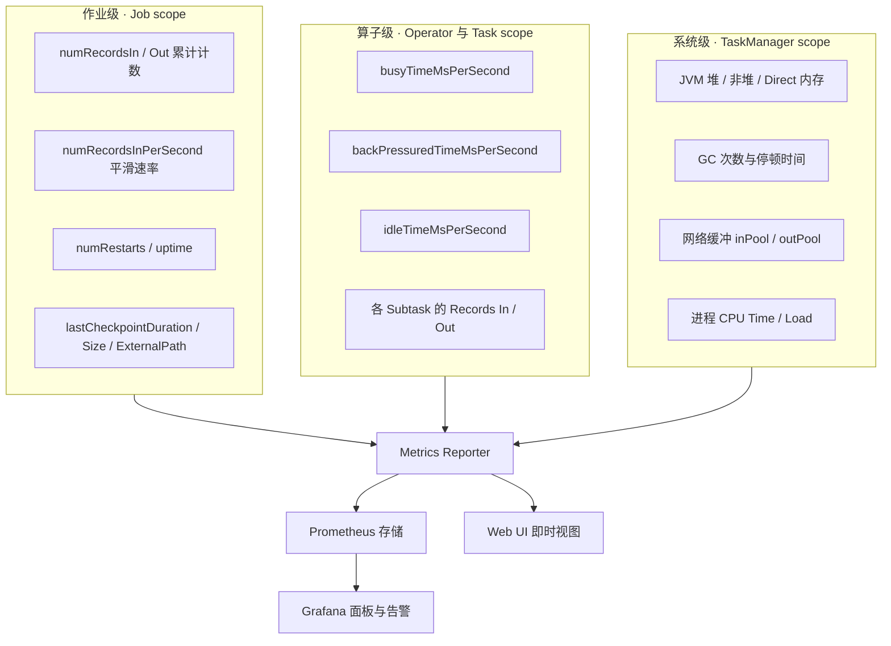
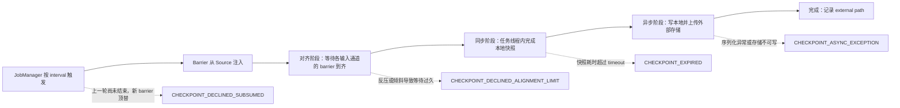
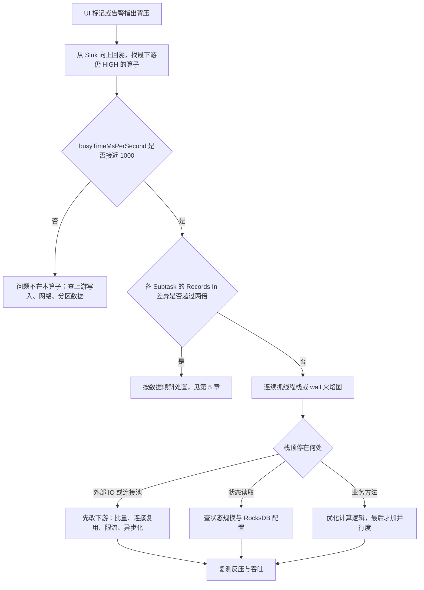
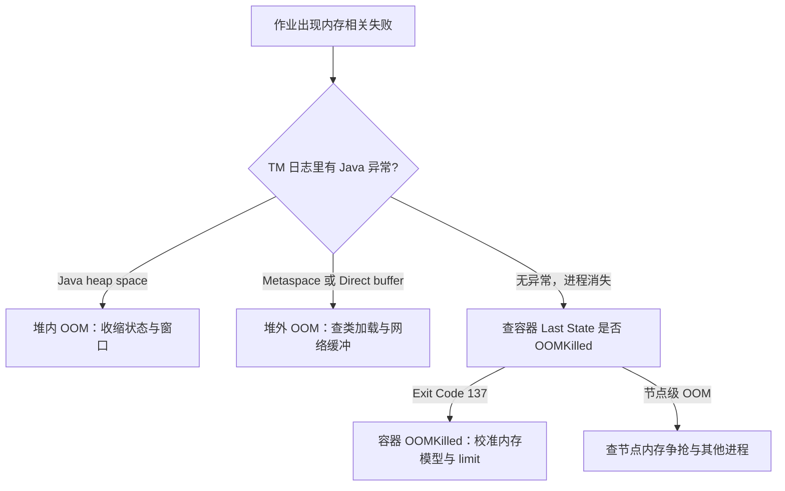
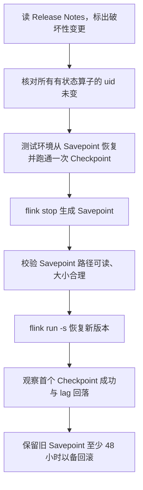

**摘要：**

Flink 作业上线之后，故障很少以"作业挂了"这种干净的方式出现，更常见的是吞吐悄悄塌下去、Checkpoint 连续失败几天没人察觉、某个 Subtask 的 CPU 一直跑满而其余九个闲着。这类问题的共同点是：面板上有数据，但没人能把数据翻译成判断。本文按运维的实际动作顺序组织，先把 Flink 自带指标拆成作业级、算子级、系统级三层，逐层交代采样口径与误读风险，尤其说明 Web UI 的背压标记是采样估算、速率类指标是平滑值；再把 Checkpoint 健康度当作排障的第一张名片，把四个指标与失败原因逐条对应到具体故障；接着给出反压的判定链与"先下游、再倾斜、最后并行度"的处置顺序，以及数据倾斜的三种形态与各自代价；然后落到重启策略、状态后端、Checkpoint 参数的配置判据，用一张故障判据表串起 OOM、积压、重启、掉线、水位不推进这些高频形态；最后讲 Savepoint 与状态兼容带来的升级边界。贯穿全文的判断只有一条：先确定问题在哪一层，再决定动哪个参数。

---

## 第 1 章 运维面对的不是"作业挂了"

Flink 在 2014 年底成为 Apache 顶级项目时，对外讲的故事是批流一体的执行引擎；十年过去，它在生产环境里的角色早已变成"准基础设施"——一条实时大屏链路、一条 CDC 入湖链路，背后都是几十个算子在几百个槽位上跑一年以上。基础设施的运维问题从来不是"能不能起来"，而是"看不看得见、判不判得准、救不救得活"。

这三件事恰好对应三种失败模式。看不见，是指监控只接了 Prometheus 却没有可用面板，故障发生时第一反应是登机器看日志；判不准，是指面板上全是数字，却分不清一条平缓的曲线是"稳态"还是"缓慢恶化"；救不活，是指知道作业在反压，于是把并行度翻倍，重启之后反压依旧，只是资源账单翻倍。三种失败模式的根源是同一个：**把指标当成结论**。

笔者用一个贯穿全文的场景来承载这些判断：某电商的实时大屏，源端是订单库的 CDC 流与埋点日志的 Kafka 主题，中间做了若干窗口聚合与维表关联，末端写进 OLAP 库供大屏查询，同时分一路落进数据湖做归档。这条链路有它天然的不对称——大屏要求秒级可见，归档要求一条不丢，两者共享同一批算子和同一份状态，于是任何一种调参都会同时影响两端。运维的判断力，就体现在能不能在不牺牲一端的前提下救另一端。

先把可观测的观测面画清楚。Flink 的指标不是一个平铺的列表，而是按作用域挂出来的三层结构：作业级回答"整体是否健康"，算子级回答"哪一段慢"，系统级回答"机器是否吃得消"。三层之间不是替代关系，任何一层单独看都会得出错误结论。



这张图有一个容易被忽略的细节：Web UI 和 Prometheus 读的是同一批指标的两种投影。UI 擅长看拓扑与单点，Prometheus 擅长看趋势与聚合，两者不能互相替代，也不能假设它们一致——UI 的背压标记是采样估算，Prometheus 里的 `backPressuredTimeMsPerSecond` 是计数器，取值口径不同，出现"UI 显示 HIGH 而面板显示 0.3"时不必惊慌，先分清看的是哪一个。

监控与判据的关系，有点像体检报告与诊断标准：报告上的箭头再多，没有标准就只能凭感觉猜，而凭感觉猜出来的结论，往往会把一个慢 Sink 治成一次无谓的扩容。

后面几章按"先建立观测面，再读第一张名片，然后练处置链，最后固化判据与变更边界"推进。机制层面的推导，本篇只给一句话与一个指向，凡是"代码里究竟怎么走的"，都在原理列的对应篇目里展开。

---

## 第 2 章 监控的三层指标与它们的采样口径

Flink 内置指标有个不太讨喜的设计取向：它假设使用者知道每个指标是怎么算出来的。于是同一个"速率"可能有三种含义，同一个"反压"可能有两种实现，照抄 Grafana 面板的人经常在错误的语境里读正确的数字。

### 2.1 作业级：计数器、速率与状态的三种时间尺度

作业级最常用的四个指标，分别站在三种时间尺度上。`numRecordsIn` 与 `numRecordsOut` 是单调递增的计数器（Counter），从 Task 启动那一刻开始累加，重启就归零；`numRecordsInPerSecond` 是从计数器派生出来的速率，由 Meter 维护，读数是按指数衰减计算的**滑动平均**，反映的是近一分钟量级的平滑吞吐；`numRestarts` 与 `uptime` 则描述作业的生命周期状态，用来回答"它是不是刚重启过"。

三种尺度混用是运维面板上最常见的错误来源。计数器不能直接用来判断吞吐，只能用 `rate()` 或 `increase()` 求增量；而一旦作业重启，计数器归零，`rate()` 会在重启点算出一个巨大的负值或者断崖，正确的做法是在查询里对计数器重置做容错，或者干脆用作业级速率指标看趋势。同样的道理，`uptime` 归零的瞬间说明作业刚刚重启，此时观察到的低吞吐是重启的后果而不是原因，把两者混为一谈就会去排查一个不存在的问题。

Meter 的平滑特性还带来一个判断上的陷阱：它对短时尖峰不敏感。一次持续五秒的流量脉冲在 Meter 上只会体现为一个不明显的抬升，而队列积压却是真实发生的。反过来，当问题已经恢复时，Meter 也要再过一到两分钟才回到基线。所以"速率恢复"永远滞后于"问题恢复"，用它来判断故障是否解除，最好配合源端的 lag 与端到端延迟一起看。

还有一个容易踩的坑在标签上。Flink 指标名里带着 `job_name`、`operator_name`、`subtask_index`、`task_attempt_id` 等标签，其中 `job_id` 每次重启都会变，`task_attempt_id` 每轮尝试都会变。Grafana 里用 `job_id` 过滤，重启后立刻"No Data"；用 `operator_name` 做 `sum`，同名算子的值会被叠加成双倍。稳定的过滤键是算子 uid 与作业名，`subtask_index` 只应在看单点分布时使用，不该参与全局聚合。

### 2.2 算子级：繁忙时间才是那只体温计

从 1.13 前后开始，Flink 陆续给每个算子补了一组时间口径的计数器（`idleTimeMsPerSecond` 在更晚的版本才补齐，以对应版本文档为准），它们把每一毫秒归入三类中的一类：处理数据的时间、等待下游的时间、没有数据可处理的时间。三个指标分别是 `busyTimeMsPerSecond`、`backPressuredTimeMsPerSecond` 与 `idleTimeMsPerSecond`，正常情况下三者之和接近 1000，也就是一秒的毫秒数。

这组指标的价值在于它把"CPU 忙"和"业务忙"区分开了。一个算子的 CPU 使用率高，可能是在做真实的计算，也可能是在做序列化、压缩、GC 或者 Checkpoint 的同步快照，这些在 `busyTimeMsPerSecond` 里都会被计入繁忙，但只有结合线程栈才能判断到底在忙什么。反过来，CPU 使用率低也不代表轻松：如果算子在等外部 IO，CPU 会闲着，`busyTime` 却接近满值，此时加机器毫无用处。

判读的分工很清楚：瓶颈算子的 `busyTimeMsPerSecond` 接近 1000，而它上游的算子表现为 `backPressuredTimeMsPerSecond` 升高、`busyTime` 下降；如果某个算子的 `idleTimeMsPerSecond` 长期接近 1000，说明它没有数据可处理，问题在更上游或者数据源本身。

> [!info] 一个常见误判
> `busyTimeMsPerSecond` 把 Checkpoint 同步阶段的耗时算进了繁忙。状态很大、Checkpoint 密集的作业，瓶颈算子的繁忙时间会周期性飙高，看起来像计算瓶颈，实际是快照开销。判别方法是看曲线的形状：计算瓶颈是持续高位，Checkpoint 开销是每个间隔出现一次的锯齿。

### 2.3 系统级：TaskManager 的四个观测面

系统级指标解决的是"机器是否吃得消"，它至少包含四个观测面。内存要看堆、非堆与 Direct 三块，从 1.10 起 Flink 用统一内存模型把 TaskManager 的内存切成框架堆、托管内存、网络缓冲与 JVM 开销几部分，任何一块配置失衡都会以 OOM 或频繁 GC 的形式暴露出来，内存模型的分区推导见 [[大数据/Flink/Flink原理深度解析与性能优化/03 Flink 内存模型深度解析]]。

网络缓冲要看两个池子。`outPoolUsage` 是本算子输出缓冲池的使用率，它高说明数据发不出去，原因要么是下游处理慢，要么是网络链路拥塞；`inPoolUsage` 是输入缓冲池的使用率，它高说明数据到达的速度快于本算子的消费速度。两者同时接近 1，基本可以判定这一对上下游之间存在持续的反压；`outPoolUsage` 高而 `inPoolUsage` 低，则更像是网络层或者下游 TaskManager 的接收端有问题。

GC 要看老年代。年轻代 GC 频率高本身不是问题，只要停顿时间短；真正需要介入的信号是老年代回收次数上升、单次停顿变长、以及 GC 总耗时占运行时间的比例抬头。看 `Status.JVM.GarbageCollector.<回收器名>.Time` 的增量比看瞬时值可靠，因为单次采样很容易落在两次 GC 之间。

CPU 则要绕开 Flink 自带的指标。Flink 暴露的 `Status.JVM.CPU.Time` 是进程累计 CPU 时间（纳秒），取 `rate()` 才能得到使用率；`Status.JVM.CPU.Load` 是系统负载，不是容器视角的 CPU 配额使用率。在 Kubernetes 里，容器被限制在 cgroup 配额内，最可信的 CPU 数据来自 cAdvisor 侧的 `container_cpu_usage_seconds_total`，Flink 指标只适合做交叉验证。

### 2.4 Reporter 与采集链路的口径对齐

指标从 Flink 内部走到 Prometheus，中间隔着 Reporter 的推送周期与 Prometheus 的抓取周期。Reporter 默认按十秒量级刷新一次快照，Prometheus 若配成十五秒抓取，每次抓到的都是最近一次刷新的值，抓得再密也只是重复采样同一个快照。合理的配法是抓取周期不小于上报周期，查询时把 `rate()` 窗口放到抓取周期的四到八倍，才拿得到稳定的速率。

```yaml
# flink-conf.yaml 片段：只保留与口径相关的项
metrics.reporters: prometheus
metrics.reporter.prometheus.factory.class: org.apache.flink.metrics.prometheus.PrometheusReporterFactory
metrics.reporter.prometheus.port: 9249
# 上报周期决定面板的时间粒度，抓取周期不要小于它
metrics.reporter.prometheus.interval: 10 SECONDS

# TaskManager 数量很多、抓取压力大时，可改用 PushGateway 推送
metrics.reporter.promgateway.factory.class: org.apache.flink.metrics.prometheus.PrometheusPushGatewayReporterFactory
metrics.reporter.promgateway.host: pushgateway-host
metrics.reporter.promgateway.port: 9091
metrics.reporter.promgateway.interval: 15 SECONDS
metrics.reporter.promgateway.jobName: flink-order-pipeline
```

```yaml
# prometheus.yml 片段：抓取周期与上报周期对齐
scrape_configs:
  - job_name: 'flink-taskmanager'
    scrape_interval: 15s
    static_configs:
      - targets: ['tm-host-1:9249', 'tm-host-2:9249', 'tm-host-3:9249']
    # Kubernetes 部署改用 kubernetes_sd_configs 自动发现 TM Pod，
    # 否则 Pod 重建后 IP 变化，静态列表会永久失效
  - job_name: 'flink-jobmanager'
    scrape_interval: 15s
    static_configs:
      - targets: ['jm-host:9249']
```

三层指标的分工与各自的误读风险，可以并到一张表里对照：

| 层级 | 代表指标 | 回答的问题 | 采样口径与误读风险 |
| --- | --- | --- | --- |
| 作业级 | `numRecordsIn`、`numRecordsInPerSecond`、`numRestarts`、`lastCheckpoint*` | 作业整体是否健康 | 计数器重启归零，速率是滑动平均，恢复判断滞后一到两分钟 |
| 算子级 | `busyTimeMsPerSecond`、`backPressuredTimeMsPerSecond`、`idleTimeMsPerSecond` | 哪一段是瓶颈 | 三者合计约 1000，Checkpoint 同步耗时计入繁忙，需看曲线形状 |
| 系统级 | 堆/非堆/Direct、GC Time、`outPoolUsage`、`inPoolUsage` | 机器是否吃得消 | 进程 CPU 要取 rate，容器配额要另取 cAdvisor |
| 采集层 | Reporter 周期、scrape 周期、指标标签 | 数据是否可信 | 抓取快于上报只会重复采样，重启导致 `job_id` 失效 |

### 2.5 Web UI 的背压标记是采样估算

Web UI 里每个算子节点会标出 OK、LOW、HIGH 三档背压，这个标记在生产排障里被引用得最多，也最容易被人当成精确刻度。它的实现方式是采样：早期版本在固定的观察窗内周期性抓取 Task 线程栈，判断线程是否卡在申请输出缓冲区的调用上，据此估算这段时间里"被阻塞"的比例；较新版本改用算子自己上报的背压计数器，取最近一段时间的占比。

采样参数在默认配置里通常是这样一组：刷新间隔约六十秒、每次刷新抓一百个样本、样本之间间隔约五十毫秒。折算下来，每个刷新周期里真正被观察的时间大约五秒，占整个周期的十二分之一，也就是百分之八左右的覆盖率。这意味着两个后果：一，标记只能表达"最近这段时间是否明显被卡住"，不能表达精确的反压率；二，短暂的瞬间反压很可能落在观察窗之外，而一次持续五分钟的严重反压一定会被标出来。

所以正确的用法是把它当**筛查工具**而不是**度量工具**：先用 UI 的标记定位到可疑算子，再用 `backPressuredTimeMsPerSecond` 拿到量化的占比，两者都指向同一个算子时才下结论。这条经验在跨团队协作时尤其重要，因为值班同学看到的往往是 UI 的那一档颜色，而排查的人需要的是数字。

### 2.6 从指标到告警：三条规则与一次分级

指标落到告警上只需要三条规则：作业消失、快照失效、消费能力不足。其余的指标更适合放在面板上人工判断，全部配成告警只会制造告警疲劳。分级同样服务于这个目的：作业停止或数据完全不通是 P0，Checkpoint 连续失败与 lag 持续增长是 P1，内存与 GC 抬头、偶发重启是 P2，单次失败与例行重启是 P3；级别决定的是半夜叫不叫人，而不是问题重不重要。

```yaml
# alert-rules.yml 片段：三条主告警
groups:
  - name: flink.critical
    rules:
      # 指标消失比 uptime == 0 更可靠
      - alert: FlinkJobDown
        expr: absent(flink_jobmanager_job_uptime{job_name="order-pipeline"})
        for: 2m
        labels:
          severity: critical
        annotations:
          summary: "作业 order-pipeline 的指标已消失，作业可能已停止"
      # 用增量比较，避免重启归零误判
      - alert: FlinkCheckpointFailing
        expr: increase(flink_jobmanager_job_numberOfFailedCheckpoints[15m]) > 3
        for: 5m
        labels:
          severity: warning
        annotations:
          summary: "15 分钟内 Checkpoint 失败超过 3 次，容错窗口正在缩小"
  - name: flink.capacity
    rules:
      # 用斜率，比绝对值更早发现恶化
      - alert: FlinkKafkaLagGrowing
        expr: deriv(flink_taskmanager_job_task_operator_KafkaSourceReader_KafkaConsumer_records_lag_max[10m]) > 0
        for: 10m
        labels:
          severity: warning
        annotations:
          summary: "Kafka 积压在持续增长，消费能力不足"
```

---

## 第 3 章 Checkpoint 健康度是第一张名片

如果只能保留一个面板，笔者会保留 Checkpoint。原因很实际：一个吞吐下跌但 Checkpoint 健康的作业，多数情况下还能撑到你有时间排查；而一个 Checkpoint 连续失败但吞吐正常的作业，等于在没有任何容错保护的状态下裸奔，一旦机器抖动，回滚点可能已经是几个小时之前。Checkpoint 健康度同时反映状态规模、IO 能力、反压程度与配置合理性，是信息密度最高的单项。

### 3.1 四个指标的读法

作业级的 Checkpoint 指标里，四个最值得放进面板顶部。`lastCheckpointDuration` 是最近一次成功 Checkpoint 从触发到完成的毫秒数，它与触发间隔的比值决定了作业有多少时间是"安全"的；`lastCheckpointSize` 是本次 Checkpoint 上传的数据量，对增量 Checkpoint 而言这是增量大小而非状态总量，要看总量得看 `lastCheckpointFullSize`；`lastCheckpointExternalPath` 是这次 Checkpoint 的持久化路径，它是否为空，直接决定作业失败后有没有状态可恢复；`numberOfFailedCheckpoints` 与 `numberOfCompletedCheckpoints` 的比值则给出失败率的趋势。

这四个指标里最容易被忽略、后果最严重的是第三个。`state.checkpoints.dir` 没有配置时，Checkpoint 会落在 JobManager 堆内存里，`lastCheckpointExternalPath` 是空的或者显示为 null。此时 Web UI 上的 Checkpoint 历史一片绿色，面板上的成功率百分之百，但作业一旦失败重启，没有任何外部状态可以恢复，**容错等于零**。上线检查清单里应该有一条硬性项：确认 `lastCheckpointExternalPath` 是一个可访问的路径。

失败原因（`checkpointFailureReason`）是另一条独立信息，它出现在 Web UI 的 Checkpoint 详情、JobManager 日志与 REST 响应里。Flink 内部把它归为若干枚举值，每个枚举值对应一类确定的故障，看懂了这一列，大部分 Checkpoint 问题不需要读日志。失败点落在生命周期哪个阶段，画出来更直观：



这张图值得停一下：失败可以发生在四个不同阶段，而四个阶段对应的处置完全不同。对齐阶段失败要治反压与倾斜，同步阶段失败要治状态规模，异步阶段失败要治存储与序列化，触发阶段被顶替则是间隔设得太密。把四种失败都归到"加大 Checkpoint 超时"这一个动作上，是最常见的错误处置。

| 失败原因 | 典型触发条件 | 首查位置 | 处置方向 |
| --- | --- | --- | --- |
| `CHECKPOINT_DECLINED_SUBSUMED` | 间隔小于上一轮 Checkpoint 的耗时 | `lastCheckpointDuration` 与 interval 的比值 | 拉长间隔，或减少单次快照的数据量 |
| `CHECKPOINT_DECLINED_ALIGNMENT_LIMIT` | 反压或数据倾斜导致 barrier 追不上 | `checkpointAlignmentTime`、背压标记 | 治反压与倾斜，或启用非对齐 Checkpoint |
| `CHECKPOINT_EXPIRED` | 整体耗时超过 timeout | 同步阶段耗时、状态大小 | 缩短单次快照、换增量、排查 GC 停顿 |
| `CHECKPOINT_ASYNC_EXCEPTION` | 存储写入失败、HDFS 或对象存储变慢、权限、磁盘满、序列化异常 | JM 日志中的异常栈、存储侧指标 | 修存储链路，检查 `state.checkpoints.dir` 权限与容量 |
| `CHECKPOINT_DECLINED_TASK_NOT_READY` | 任务初始化慢、外部连接建立超时 | 任务启动日志 | 放宽 timeout，排查初始化阶段的阻塞调用 |

### 3.2 间隔、超时与保留份数的配比

这三个参数的关系不是各自独立，而是一条不等式链。间隔必须大于单次 Checkpoint 的实际耗时，否则会出现"上一轮还没完成、下一轮已经触发"的持续顶替；超时必须大于耗时的上界，否则偶发的慢一次就变成失败；最小间隔与最大并发数则决定了两轮之间是否留了喘息时间。

一组可用的起点是：先用监控拿到最近一天的 `lastCheckpointDuration` 分布，取其九十分位作为基线，把间隔设为基线的三倍以上，超时设为基线的五到十倍，最大并发保持默认的一。以示例推算说明：若某作业状态五十个 GB、每次全量 Checkpoint 耗时两分钟，那么把间隔设成三分钟就已经贴着下限，任何一次存储抖动都会造成顶替；改成六到十分钟间隔、十分钟超时，才是稳定区间；而如果换成 RocksDB 的增量 Checkpoint，单次上传可能降到几百 MB、耗时十几秒，此时三分钟间隔才算合理。

`state.checkpoints.num-retained` 决定保留多少份历史 Checkpoint，它的作用是在最近一份损坏时有退路。保留份数不是越多越好：每份全量 Checkpoint 都占一份存储，增量 Checkpoint 则依赖历史 SST 文件，保留太多会让存储占用与恢复时的元数据扫描都变重。保留三份是常见做法，与业务约定的 RPO 一起决定。

RPO 的估算也要落到这条链上。正常运行时，最坏情况是作业在两次 Checkpoint 之间失败，回滚到上一次成功点，此时丢失的数据窗口约等于一个间隔加上失败检测与重启的耗时；如果最近几份 Checkpoint 连续失败，回滚点会继续往前退，丢失窗口可能变成两到三个间隔。所以"Checkpoint 间隔"从来不只是一个频率参数，它是 RPO 的直接决定项，业务方问"最多丢多少数据"时，答案应该是间隔乘上一个大于一的系数，而不是间隔本身。

### 3.3 状态太大时的三种收缩路径

`lastCheckpointSize` 持续增长，是状态没有边界的信号。判定为"太大"需要两条证据：增长曲线没有平台期，以及单次耗时随体积同步上升。处置有三条路径，代价依次递增。

第一条是给状态加 TTL（Time To Live）。窗口外的明细、过期的维表缓存、只用于去重的短期键，都应该有明确的生存期，TTL 的配置方式在 [[大数据/Flink/Flink从入门到实战/06 状态管理与 Checkpoint 实战]] 里有完整交代。这是最便宜的一条路，也是唯一不改变计算语义的一条。

第二条是把聚合方式从"攒全量"改成"增量"。用 `ProcessWindowFunction` 把窗口内所有元素攒在状态里，等窗口关闭再统一计算，在数据量大时几乎必然把状态撑爆；换成 `AggregateFunction` 与 `ProcessWindowFunction` 组合，状态里只留累加器，快照体积能降一到两个数量级。这条路的代价是业务逻辑要能表达成可结合的增量形式。

第三条是换状态后端。堆内状态受堆大小约束，状态总量一旦超过单机堆能承受的量级，就只能挪到 RocksDB，让状态落在本地盘上、Checkpoint 走增量。状态后端的内部结构、快照格式与增量机制在 [[大数据/Flink/Flink原理深度解析与性能优化/05 Flink 状态后端深度解析]] 里展开，本篇只讲选择判据，放在第 6 章。

---

## 第 4 章 反压的判定链与处置顺序

反压（Backpressure）是流处理里最容易被误诊的现象。它本身不是故障，而是一种保护机制：下游处理不过来时，上游被减速，数据留在缓冲区里而不是把内存撑爆。真正的问题永远在被反压掩盖的那个慢算子上，反压只是把它翻译成了"上游也慢了"。打个比方，它像楼里自来水管的末端阀门——上游水压再足，末端龙头拧得小，整条管子的流速就由它决定，此时该修的是龙头，不是加紧上游的水泵；比喻的边界在于水管里的水能排掉，Flink 缓冲区里的数据只能等，所以反压一定会沿链路一路传导到 Source。

### 4.1 从标记到数字：三步定位瓶颈

判定的第一步是找到最下游的那个 HIGH。反压沿数据流向上游传播，一条链路从 Source 到 Sink，如果 Sink 慢，它上游的算子会依次显示 HIGH，最上游的 Source 也会被限速；此时如果从 Source 开始往下找，会看到一片 HIGH，得不出任何结论。正确的方向是从 Sink 往 Source 回溯，第一个状态从 OK 变成 HIGH 的算子，才是瓶颈所在——换句话说，是最下游仍然 HIGH 的那个。

第二步是用 `busyTimeMsPerSecond` 确认它真的在忙。如果瓶颈算子繁忙接近满值，说明它确实处理不过来；如果它空闲时间很高却显示背压，说明数据根本没到它这里，问题在更上游的写入端或者网络链路上。这一步能排除掉一类假象：Source 端被限速并不总是因为下游慢，也可能是 Kafka 分区没有数据、或者消费组在 rebalance。

第三步是看这个算子内部在等什么。连续抓几次线程栈比读任何指标都直接：间隔五秒抓五到十次，观察它停在哪个栈顶。停在 socket 读写或者连接池等待上，瓶颈在外部系统；停在 RocksDB 的读取路径上，瓶颈在状态访问；停在业务方法内部，是计算密集；停在对缓冲区的申请上，说明它在等下游腾出空间。用 async-profiler 抓一段 wall clock 火焰图能更快看出分布，因为 wall 模式记录的是阻塞时间，而 CPU 模式会把大量时间耗在等待上的算子拍成一片空白，反而误导判断。把这条判定链整理成图，顺序一目了然：



### 4.2 处置顺序：先下游，再倾斜，最后并行度

处置顺序是这个话题里最该被固化的经验，因为它决定了你会不会白干一轮。笔者的排序是**先看下游**的外部系统，再看数据倾斜，最后才动并行度。

下游优先，原因在成本结构上。流处理作业的下游通常是数据库、OLAP 引擎、消息队列或者第三方接口，这些系统有各自的写入上限，而 Flink 侧能做的优化往往不需要重启作业、不需要状态重分布：把逐条写改成批量写、把连接池从默认值调大、把同步调用换成异步、给维表关联加本地缓存、在写不进去时做有限速的重试。这些改动的收益常常比加并行度更直接，代价却低得多。反过来，如果下游本身有硬上限，加并行度只会把压力更快地打到它身上，让它的过载从"慢"变成"拒绝"。

倾斜其次，是因为它和并行度属于同一层资源。存在倾斜时提高并行度，结果是把非热点分区的负载摊得更薄，热点 key 仍然压在一个 Subtask 上，瓶颈不动，状态总量和 Checkpoint 开销却翻倍。第 5 章会展开三种倾斜形态与对应手段。

并行度最后，是因为它最贵。提高并行度要占用更多槽位、扩大状态总量、改变网络连接数、让 Checkpoint 的 barrier 需要对齐更多通道，而且受制于上游分区数与下游并发能力。更隐蔽的代价是恢复时间：并行度变化会触发状态按 key group 重新分布，从 Savepoint 恢复的耗时会随状态规模上升。

两个反例值得记下来。其一，把并行度当万能药。设想一个作业在反压后把并行度翻倍，重启后上下游全部重建、Checkpoint 耗时跟着翻倍，反压标记依旧，最后发现瓶颈是维表 join 每次请求都走网络。其二，只看 CPU 判断瓶颈。另一类情形里 Source 的 CPU 一直很高，运维直觉是计算太重，实际是 Checkpoint 的同步快照把状态树遍历了一遍，CPU 全花在序列化上，真正的瓶颈在 Sink 的批量参数上。

反压的机制细节——信用制流控、缓冲区如何分配、Unaligned Checkpoint 如何绕开对齐——属于原理列的职责，见 [[大数据/Flink/Flink原理深度解析与性能优化/04 Flink 网络传输与反压机制深度解析]]。本篇只保留判定与处置，因为值班现场需要的是一张能照着走的顺序表，而不是一张调用链图。

---

## 第 5 章 数据倾斜的三种形态

数据倾斜（Data Skew）是流处理里最顽固的一类问题，因为它不违反任何配置规范，也不产生任何异常日志——它像一条十车道的桥，所有车却堵在同一个收费口，桥面再宽也无济于事。它只是让一部分 Subtask 忙到过载，另一部分闲到空转，整体吞吐被最忙的那个决定。它有三种形态，判据与处置各不相同，把三种混在一起谈是排查效率低下的主要原因。

### 5.1 形态一：key 分布倾斜

最常见的一种，`keyBy` 之后某个 key 的数据量远大于其他 key。电商场景里超大商家的订单量可以是普通商家的几个数量级，埋点场景里某个爬虫 IP 每秒产生的记录数可以顶得上几万个正常用户。这类倾斜的判据很直接：同一算子的各个 Subtask 上，`numRecordsIn` 的比值超过二到三倍，且长期稳定；配套信号是热点 Subtask 的 `busyTimeMsPerSecond` 接近满值，其余 Subtask 有空闲。

处置手段有四种，代价依次上升。给**热点 key** 加随机前缀做两阶段聚合，把热点 key 拆成若干个虚拟 key 打散到不同 Subtask，聚合完成后再按真实 key 合并一次；这个方案的代价是状态从"每个 key 一份"变成"每个 key 乘以盐数一份"，中间结果要再走一轮 shuffle，端到端延迟增加一个窗口的粒度。做本地预聚合再全局聚合，适合可以表达成"先局部汇总、再合并"的聚合，代价是要求聚合函数满足结合律。对热点 key 做旁路处理，把它单独分流到一条子链路、用独立的并行度处理，代价是代码复杂度上升、两条链路的结果要合并。用 `rebalance` 把数据均匀打散，代价最大，因为它彻底放弃了 key 的局部性，下游要能接受乱序且计算本身得与 key 无关。

盐数不是越大越好。加三十二个盐意味着状态膨胀三十二倍、Checkpoint 体积同步上升、合并阶段要处理三十二倍的中间结果；多数场景里四到八已经足够把热点摊平。判断依据是热点 key 的占比：若单 key 占总量的一半，加四到八个盐能让每个虚拟 key 的负载降到总量的十分之一以下，再往上加收益递减。

### 5.2 形态二：Source 并行度与分区不匹配

第二种倾斜不在 `keyBy`，而在数据入口。Kafka 的分区数决定了一个主题能被并行消费的上限，Source 并行度大于分区数时，多出来的 Subtask 拿不到分区，表现为 `idleTimeMsPerSecond` 长期接近满值、`numRecordsIn` 为零；Source 并行度小于分区数时，单个 Subtask 要消费多个分区，如果这些分区的数据量本身差异很大（老主题经历过扩容、或者分区键设计导致分布不均），就会呈现为入口处的倾斜。

这类问题的判据要看两侧：Source 各 Subtask 的 `numRecordsIn` 分布，以及 Kafka 侧各分区的 offset 增长速率。前者告诉你 Flink 侧不均衡，后者告诉你不均衡是分区本身造成的还是分配策略造成的。处置手段相对温和：并行度与分区数对齐；分区数据量差异大时，用自定义分区器或者在 Source 之后立刻 `rebalance` 拉平；如果主题的分区键设计本身有缺陷，那是上游要修的事，Flink 侧只能缓解。

还有一个容易忽略的关联：Source 并行度不匹配会影响水位线（Watermark）。水位线取所有输入通道的最小值，某个 Subtask 没有数据、水位线停在初始值，全局水位线就永远不推进，窗口永远不触发。这个问题在故障排查里表现为"作业运行正常但窗口不输出"，第 7 章会作为独立故障形态展开，水位线为何取所有通道的最小值，在 [[大数据/Flink/Flink原理深度解析与性能优化/07 Flink 时间与 Watermark 底层机制]] 里有推导。

### 5.3 形态三：没做两阶段聚合

第三种形态不表现为某个 Subtask 特别忙，而是表现为整体慢且状态大：聚合逻辑直接在 `keyBy` 之后做全局聚合，本地没有预聚合，于是所有明细都要经过网络 shuffle 到同一个 Subtask 上再归并。数据量越大，网络传输与状态写入的开销越重，倾斜反而不明显，因为每个 key 都均匀地慢。

判据是链路的网络指标与状态规模：`numBytesOut` 在聚合前异常高、聚合算子的状态随数据量线性增长、每个 Checkpoint 的增量都很大。处置是引入本地的两阶段聚合，把"先按 key 在本地累加、再按 key 全局合并"的两步显式写出来。这与形态一的加盐在结构上是同一类手段，区别在于形态三往往不需要随机盐，只需要一次本地聚合，代价更小。

三种形态的对照可以整理成一张表，值班时按判据对号入座：

| 形态 | 判据 | 首查指标 | 处置手段 | 代价 |
| --- | --- | --- | --- | --- |
| key 分布倾斜 | 同算子各 Subtask 的 Records In 相差两倍以上 | `numRecordsIn`、`busyTimeMsPerSecond` | 加盐、两阶段聚合、热点旁路、`rebalance` | 状态膨胀、多一轮 shuffle、代码复杂度 |
| Source 不均 | 部分 Subtask 空闲、Records In 为零 | `idleTimeMsPerSecond`、Kafka 分区 offset 增速 | 并行度对齐分区数、调整分区器、Source 后 `rebalance` | 需要上游配合，可能改变数据顺序 |
| 未做预聚合 | 聚合前网络字节高、状态线性增长 | `numBytesOut`、状态大小 | 本地预聚合加全局合并 | 聚合函数需满足结合律，状态结构要重构 |

### 5.4 处置倾斜的顺序与验证

倾斜的处置不能脱离第 4 章的判定链。正确的路径是先确认瓶颈算子在忙，再看它的各 Subtask 是否均衡，只有确认不均衡之后才进入本章的手段选择；如果各 Subtask 均衡而整体慢，那属于算力不足或者单条记录处理太贵，与倾斜无关。

验证环节要给出前后对照，而不是凭感觉。有效的对照至少包含三组数字：热点与普通 Subtask 的 Records In 比值是否收敛到两倍以内，瓶颈算子的 `busyTimeMsPerSecond` 是否下降，以及端到端延迟是否回到基线。只看到总吞吐上升不算验证成功，因为把资源摊薄到更多 Subtask 上同样会让总吞吐上升，而倾斜本身可能一点没变。

---

## 第 6 章 状态与重启策略的配置判据

这一章讨论的是"配多少"的问题，它比"哪里有瓶颈"更难，笔者的体会是它像开处方：剂量取决于体重与病情，抄别人的处方治不好自己的病。没有一组参数能适用于所有作业，判据只能来自对故障模式的权衡。参数之间的耦合关系，比如 Checkpoint 间隔与超时、重启策略与故障恢复时间、状态后端与内存模型，是配置判据的核心。

### 6.1 重启策略的三种取舍

Flink 的重启策略（Restart Strategy）决定失败之后怎么办，它直接决定了故障的暴露方式：重试太快会把一次外部抖动放大成持续的写压力，重试太慢会让积压堆到不可收拾，重试无上限则会让一个确定性失败永远循环。

`fixed-delay` 是固定延迟重试，配置重试次数与每次的等待时间，行为最容易预测，适合故障多半是瞬时的场景，比如网络闪断、下游短暂不可用。它的风险在"次数设成无限"这一档：如果失败是确定性的，比如代码里的空指针或者状态序列化不兼容，无限重试会让作业在重启与失败之间循环，直到有人注意到告警；而如果每次都从头回滚状态，回滚点会不断后移，积压越滚越大。

`failure-rate` 按时段统计失败次数，超过阈值就放弃，适合故障率本身有业务含义的场景。它比 `fixed-delay` 更贴近"这段时间内到底失败了几次"这个直觉，也更容易与告警阈值对齐，代价是参数之间互相影响：失败次数上限、统计区间、重试延迟三个值共同决定了作业对抖动的容忍度。

`exponential-delay` 是指数退避，初始延迟小、逐次翻倍、带随机扰动，适合大规模作业的集体失败。它的价值在防止**惊群**：一次集群级故障会让几百个作业同时失败，如果都以固定一秒的间隔重试，恢复瞬间的写压力会把下游再打挂一次。随机扰动与指数退避把这个尖峰摊平。这组策略在较新版本才提供，旧版本需要用自定义实现补齐，具体可用性以对应版本文档为准。

| 策略 | 关键参数 | 适用场景 | 风险 |
| --- | --- | --- | --- |
| `none` | 无 | 需要人工介入、失败即止损的作业 | 失败后作业停止，依赖告警与值班响应 |
| `fixed-delay` | 重试次数、延迟 | 瞬时故障为主、行为需可预测 | 次数设成无限时，确定性失败会无限循环 |
| `failure-rate` | 区间内失败上限、延迟 | 故障率有业务含义、需要与告警对齐 | 三个参数互相耦合，调参需要压测 |
| `exponential-delay` | 初始退避、上限、倍数、重置阈值、抖动 | 大规模作业、防止集体重启打挂下游 | 新版才提供；恢复时间被拉长，需与 RPO 一起评估 |

```yaml
# flink-conf.yaml：failure-rate 策略的典型配置
restart-strategy.type: failure-rate
restart-strategy.failure-rate.max-failures-per-interval: 3
restart-strategy.failure-rate.failure-rate-interval: 10 MINUTES
restart-strategy.failure-rate.delay: 10 SECONDS
```

```java
// 需要更细的控制时，在代码里显式声明指数退避
env.setRestartStrategy(RestartStrategies.exponentialDelayRestart(
    Time.milliseconds(1000),   // 初次失败的等待时间
    Time.milliseconds(60000),  // 退避上限，避免恢复太慢
    2.0,                       // 每次失败延迟翻倍
    Time.minutes(5),           // 连续五分钟无失败则重置计数
    0.1                        // 抖动系数，打散同时失败作业的重试时刻
));
```

重启策略必须和 Checkpoint 一起读。`fixed-delay` 无限重试加上 Checkpoint 持续失败，是一个很容易被忽略的组合：作业能一直"活着"，但每次失败都回滚到更早的状态，数据重复窗口在扩大，从面板上看不出来，只有对账时才会发现。判断这类问题的信号是 `numRestarts` 上升与 `lastCheckpointExternalPath` 对应的时间戳变旧同时出现。

### 6.2 Checkpoint 参数的配置判据

第 3 章讲了配比关系，这里补上几个常被忽略的开关。`execution.checkpointing.min-pause` 决定两轮 Checkpoint 之间至少留多少空闲，它的存在是为了给算子留出处理数据的窗口，间隔再合理、没有喘息时间也会让吞吐被快照拖住。`execution.checkpointing.max-concurrent-checkpoints` 默认是一，改成大于一意味着上一轮没完成就能开下一轮，代价是双份快照开销与更复杂的对齐，只有在状态很小、快照极快时才值得。

`execution.checkpointing.tolerable-failed-checkpoints` 决定连续失败多少次才让作业失败，默认是零，也就是一次失败就重启。对状态很大、快照偶发超时的作业，设成一到二能显著减少无效重启，代价是失败期间作业继续运行、容错窗口变长。这是典型的"用 RPO 换稳定性"的交易，需要业务方参与决定。

反压下还有一个开关值得一提：非对齐 Checkpoint（Unaligned Checkpoint）把缓冲中的数据一并快照，从而跳过对齐等待，代价是快照体积随缓冲数据增长、恢复时间变长。它的机制在 [[大数据/Flink/Flink原理深度解析与性能优化/06 Flink Checkpoint 机制深度解析]] 与原理列的反压篇里都有推导，本篇只给判据：持续的高反压、对齐阶段占比超过 Checkpoint 总耗时的一半、并且短期内治不好反压时，才值得启用。

### 6.3 状态后端的量级边界

状态后端（State Backend）的选择常被简化成"状态大就用 RocksDB"，实际上**量级边界**取决于三个量：状态总量、单条状态的访问频率、以及恢复时间的容忍度。

堆内状态后端（HashMapStateBackend）把状态放在 TaskManager 的 JVM 堆里，读写是内存操作，延迟最低；快照是全量的，每次 Checkpoint 都要遍历并序列化整个状态。它的边界由堆决定：单个 TaskManager 的堆通常配置在十几 GB 量级，扣掉框架与网络缓冲，能给状态的部分还要再小一截；状态总量超过这个量级，GC 压力会先表现出来——老年代占用升高、停顿变长、Checkpoint 同步阶段耗时上升。量级判断上，状态总量在几个 GB 以内、且访问非常频繁的场景，堆内是更优的选择。

RocksDB 状态后端把状态存在本地盘上的 LSM 结构里，堆里只留缓存与索引，因此状态总量可以到几百 GB 甚至更大；它支持增量 Checkpoint，每次只上传变化的 SST 文件，这让大状态的 Checkpoint 从"不可行"变成"可接受"。代价是三条：每次状态访问要经过序列化与反序列化，CPU 开销明显上升；本地盘成为故障域，磁盘满与 IO 抖动都会直接影响作业；恢复时要读 SST 并重建缓存，恢复时间与状态规模相关。

| 维度 | HashMapStateBackend | EmbeddedRocksDBStateBackend |
| --- | --- | --- |
| 状态容量 | 受堆限制，量级判断在几个 GB 到十几 GB | 受本地盘限制，可到几百 GB 以上 |
| 访问延迟 | 内存级，最低 | 需序列化，CPU 与 IO 双重开销 |
| Checkpoint 方式 | 全量快照 | 支持增量，只上传变化的 SST |
| 恢复时间 | 反序列化全量状态 | 读 SST 并重建缓存，随规模上升 |
| 主要风险 | GC 压力、堆 OOM | 磁盘满、Compaction 抖动、序列化开销 |
| 适用判据 | 状态小、访问频繁、延迟敏感 | 状态大、可容忍序列化成本、需要增量快照 |

```yaml
# flink-conf.yaml：RocksDB 后端的关键配置
state.backend.type: rocksdb
state.backend.incremental: true
state.checkpoints.dir: hdfs:///flink/checkpoints/order-pipeline
state.checkpoints.num-retained: 3
# 本地数据目录建议分散到多块盘，避免单盘写满导致整作业失败
state.backend.rocksdb.localdir: /data1/rocksdb,/data2/rocksdb
```

状态后端的内部实现（堆内状态的对象布局、RocksDB 的列族与 key group 映射）属于原理列，见 [[大数据/Flink/Flink原理深度解析与性能优化/05 Flink 状态后端深度解析]]；RocksDB 的参数调优与写放大控制属于性能调优体系，见 [[大数据/Flink/Flink原理深度解析与性能优化/09 Flink 性能调优体系]]。

---

## 第 7 章 常见故障的判据表

前面几章建立的是观测面与判据，这一章把它们压缩成可以照着走的表，作用类似急诊的分诊台：先按症状分流到对应科室，而不是一进门就做全套检查。每一种故障给四列：症状、首查位置、根因、处置。所谓首查位置，指的是打开面板或者登录机器后第一个该看的地方，它的作用是避免在错误的层级里兜圈子。

| 故障 | 症状 | 首查位置 | 根因 | 处置 |
| --- | --- | --- | --- | --- |
| 堆内 OOM | `OutOfMemoryError: Java heap space`，Task 失败重启 | TM 日志异常栈，Checkpoint 大小趋势 | 状态无 TTL、窗口攒全量、用户代码持有集合 | 加 TTL、改增量聚合、必要时换 RocksDB |
| 容器 OOMKilled | Pod 被 kill，无 Java 异常，退出码 137 | `kubectl describe pod` 的 Last State | 容器 limit 小于进程实际占用，堆外超配 | 校准内存模型与 limit，减少托管内存占比 |
| 元空间或直接内存耗尽 | `Metaspace`、`Direct buffer memory` 异常 | JVM 非堆指标与类加载数量 | 动态类加载泄漏、网络缓冲配置失衡 | 修类加载路径，复核网络缓冲与 Direct 上限 |
| Checkpoint 持续失败 | 历史里连续失败，失败率上升 | `checkpointFailureReason` 与对齐耗时 | 反压、状态过大、存储慢、间隔过密 | 按第 3 章的分阶段处置 |
| Kafka 消费积压 | lag 曲线单调上升，端到端延迟变大 | Source 各 Subtask 的 lag 与下游背压 | 并行度不足、分区不均、下游慢、突发流量 | 先治下游与倾斜，再对齐分区数扩并行度 |
| 作业反复重启 | `numRestarts` 快速上升，状态在 RESTARTING 循环 | 失败 Task 的异常栈 | 代码缺陷、状态不兼容、外部依赖不可用 | 先修确定性失败，再谈重启策略 |
| TaskManager 频繁掉线 | JM 日志出现失联心跳，任务重新调度 | TM 的 GC 日志与节点资源 | Full GC 停顿、节点过载、K8s 驱逐、网络抖动 | 治 GC 与资源争抢，放宽心跳超时，加优先级 |
| 水位线不推进 | 窗口长期不触发，下游无输出 | Source 各 Subtask 的水位线 | 空闲分区、时间戳提取错误、乱序参数过大 | 空闲检测、修正时间戳、复核乱序上限 |
| 磁盘写满 | RocksDB 写入失败，任务失败 | 本地盘使用率与 Checkpoint 存储 | 状态无边界、历史 SST 累积、多作业共享磁盘 | 加 TTL、清理保留份数、拆分本地目录 |
| 指标不更新 | 面板无数据但作业 RUNNING | Reporter 配置与抓取目标状态 | 端口不通、静态目标失效、标签用了 job_id | 改用服务发现，按作业名与 uid 过滤 |

### 7.1 OOM 的三种形态

OOM 是排查里最容易被笼统对待的一类，因为三种形态在告警上是同一句"内存不足"，处置却完全相反。第一种是堆内 OOM，日志里有明确的 `java.lang.OutOfMemoryError: Java heap space`，进程还活着，Task 失败重启；根因几乎总是状态或数据在堆里没有边界，处置方向是收缩状态，第 3 章的三条路径可以直接套用。

第二种是**容器 OOMKilled**。进程被操作系统直接杀掉，日志里没有任何 Java 异常，作业表现为"突然没了"，`kubectl describe pod` 里能看到 `Reason: OOMKilled` 与退出码 137。根因通常是容器内存 limit 设置得小于进程真实占用，而进程占用又因为堆外部分（托管内存、网络缓冲、RocksDB 的 native 内存、JVM 自身开销）被低估。处置是回到内存模型把各分区算清楚，把 limit 调到略高于 `taskmanager.memory.process.size`，而不是简单地把堆调大。

第三种是元空间或直接内存耗尽，异常信息是 `Metaspace` 或者 `Direct buffer memory`。前者多来自动态类加载没有回收，比如在算子里反复创建类加载器、使用脚本引擎、动态编译 SQL；后者多来自网络缓冲与用户代码里的直接内存分配。这两种形态的共同特征是堆 dump 看起来正常，容易被误判成"内存够用"，实际是堆外某一块先耗尽了。按日志特征分流，三条路各不相同：



### 7.2 Checkpoint 一直失败

这条故障在第 3 章已经拆过，这里补排查顺序：先看失败原因枚举，再看对齐耗时，最后看存储侧——原因枚举决定方向，对齐耗时判断是否与反压相关，存储侧决定要不要换目录。

如果失败原因是超时，但 `checkpointAlignmentTime` 很短，说明时间花在同步或者异步阶段，去查状态大小与存储带宽；如果对齐耗时占了绝大部分，说明是反压导致 barrier 追不上，回到第 4 章的判定链；如果失败原因里出现存储侧的异常（连接超时、权限拒绝、No space left），那和 Flink 无关，是存储链路的问题，此时加大超时只能让失败来得慢一点。

还有一种容易被忽略的情况：Checkpoint 一直失败但作业不重启。这通常是因为配置了可容忍失败次数，或者重启策略把失败吞掉了。面板上看起来一切正常，实际上容错窗口已经空了，判断信号是成功 Checkpoint 的时间戳不再前移。

### 7.3 Kafka 消费积压

积压（Lag）的判据是曲线形状，而不是绝对值。瞬时冲高后回落，是突发流量，属于正常现象；单调上升且斜率稳定，是消费能力不足；阶梯式上升之后停住，往往对应作业重启或者 Checkpoint 阻塞。

消费能力不足的排查顺序是：先看 Source 的并行度是否等于分区数，小于分区数意味着有分区在排队；再看下游是否有背压，下游慢会把 Source 的消费速率拖住，此时加并行度没有意义；然后看单个 Subtask 的 lag 分布，如果集中在少数 Subtask，是分区数据量不均，按倾斜处理；最后才考虑 Kafka 侧的问题，比如 broker 限流、消费组 rebalance、或者客户端参数不合理。

这里要提醒一个与 Checkpoint 的耦合：Checkpoint 的同步阶段会占用任务线程，大状态作业在快照期间消费速率会短暂下降，如果检查点很密（比如十秒一次）而状态又很大，消费曲线会呈现周期性的下沉，看起来像"消费能力不足"，实际是快照把处理时间吃掉了。判据是 lag 曲线的形状与 Checkpoint 时刻是否对齐，对齐就是快照问题，不对齐才是消费能力问题。

### 7.4 作业反复重启与 TaskManager 掉线

这两条故障经常被混为一谈，因为现象相似：作业在 RESTARTING 里循环，日志里既有任务失败又有心跳丢失。区分方法看第一现场：如果失败的是 Task 且带异常栈，根因在代码、状态或者外部依赖；如果是 TaskManager 被标记为失联、任务被重新调度，根因在资源、GC 或者节点。

反复重试的止损顺序是先判断失败是否确定。把失败 Task 的异常栈看一遍，如果是空指针、类型转换、序列化不兼容这类确定性错误，任何重启策略都救不了，应该立刻停作业改代码；如果是连接超时、存储不可用这类外部故障，重启策略才有意义，此时要确认重启不会把下游打得更惨。`fixed-delay` 无限重试是最危险的一档，因为它把确定性失败伪装成"还在恢复"。

TaskManager 掉线的第一现场是 GC 日志。一次超过十秒的 Full GC 足以让心跳超时，JM 认为节点失联，把这个 TM 上的所有任务重新调度；而重调度又会加剧资源竞争，形成连锁。处置顺序是先把 GC 停顿压下去（减少堆内状态、调整堆与托管内存的比例），再考虑放宽心跳超时——后者只是让判定变迟钝，不解决根本问题。在 Kubernetes 里还要看节点是否发生过驱逐，Pod 的 `Reason: Evicted` 与节点内存压力是关键证据。

### 7.5 水位线不推进

水位线（Watermark）停在某个时间点不动，窗口就永远不触发，下游表现为"作业在跑但没有输出"。四种成因在 [[大数据/Flink/Flink从入门到实战/04 时间语义与 Watermark 实战]] 里有详细展开，运维现场只需要记住一条判据：先看各 Subtask 的水位线是否一致。

不一致且某个 Subtask 明显落后，通常是那一路没有数据，空闲分区把全局最小值拉住了，处置是开启空闲检测，让长时间无数据的通道不再参与最小值计算。全部一致但整体停住，通常是时间戳提取出了问题，所有事件的时间戳都被解析成零或者同一个值，或者乱序上限设得过大导致水位线落后得离谱。如果水位线在缓慢推进但始终追不上事件时间，要看是否有一条输入通道的生产速率远低于其他通道，最小值永远由它决定。

水位线问题还有一个隐蔽的变种：Source 并行度与下游并行度不匹配导致水位线没有广播到所有 Subtask。这种情况下部分下游 Subtask 收到的水位线一直是最小值，窗口不触发，而 Source 侧看起来一切正常。判据是在下游算子的各 Subtask 上看水位线指标，出现明显的分叉就属于这一类。

### 7.6 SQL 结果与下游语义不符

还有一类故障不影响作业存活，只让结果错。最常见的是聚合结果里出现重复行：上游是 changelog 流，`GROUP BY` 把更新翻译成 UPDATE_BEFORE 与 UPDATE_AFTER 两条消息，下游 Sink 如果不认撤回消息、只做插入，旧值就和新值一起留在表里。判据是同一个主键在结果表里出现多条，处置是换成 upsert 语义的 Sink，或者在下游按主键覆盖写。

第二类是窗口结果比预期晚。原因往往不在窗口本身，而在水位线推进：空闲分区没有开启空闲检测、时间戳提取把毫秒与秒混淆、乱序上限设得过大，三者都会让窗口迟迟不关闭。第三类是维表关联读到旧数据，判据是维表侧的更新时间与结果里的取值对不上，先看 lookup 缓存的 TTL 与最大行数，再确认维表变更是否真的写进了被关联的那张表。

---

## 第 8 章 升级与变更：Savepoint 的兼容边界

生产环境里，比故障更常见的是变更：加一个字段、改一段逻辑、扩一次并行度、升一次版本。uid 在这里的角色像门牌号：楼可以翻新、可以加层，门牌号一改，寄给这户的信就全部退回。这些动作的风险不在于代码写错，而在于状态能不能接上。Flink 的容错模型把状态绑定在算子的身份上，身份一变，状态就找不回来，这个身份就是**算子 uid**。

### 8.1 uid 为什么是升级的前提

每个有状态算子在生成 JobGraph 时会有一个 uid，它决定状态在 Savepoint 里的键。显式设置 uid 时，它是稳定的字符串，与控制流无关；不设置时，Flink 会从算子在图中的位置推导出一个哈希，上游插一个算子、调整一次链化，哈希就全变，恢复时找不到对应的状态。

从 1.9 之后的多数发行版开始，有状态算子不设 uid 在恢复时会直接报错，这是好事，因为它把问题挡在了上线之前。但错误信息只在你尝试恢复时才出现，也就是说，如果第一次上线时没设 uid、也从来没做过恢复演练，问题会在第一次真正需要回滚时爆发——那时候你既没有可用的 Savepoint，也没有时间补。

笔者的建议是把 uid 当作接口来管理：一旦上线就不能改，改了等价于删掉这个算子的状态重新开始。命名上带业务含义而不是序号，避免重构时被迫调整；重建链路时宁可新增算子、保留旧算子的 uid 空转，也不要改动已有 uid。

### 8.2 状态 schema 演进

状态的序列化格式决定了字段能不能演进。Flink 内置的 POJO 序列化对字段增删有一定容忍度，但要求类型不变、字段顺序与名称稳定；Kryo 走的是另一套规则，兼容性更差；如果状态里用的是自定义序列化器，兼容性完全取决于实现有没有处理版本差异。对需要长期演进的业务状态，用 Avro 或者 Protobuf 这类带 schema 的格式承载，把兼容性交给 schema 演进规则，比依赖 Flink 的默认行为可靠。

类型变更是最危险的一类。把 `ValueState<Integer>` 改成 `ValueState<Long>`、把列表状态换成映射状态、把累加器的字段类型从整型改成浮点，都会让反序列化失败。这类变更没有无损路径，只能在业务上接受"该算子从零开始"，用 `--allowNonRestoredState` 跳过它的状态恢复，同时评估跳过之后的数据正确性——计数器归零、去重集合清空、窗口重新开始，这些后果要在上线前说清楚，而不是在恢复失败时临时决定。

```bash
# 优雅停止并生成 Savepoint，这是变更前的标准动作
flink stop --savepointPath hdfs:///flink/savepoints/ <jobId>

# 确认 Savepoint 路径可读，并记录到变更单
hdfs dfs -ls hdfs:///flink/savepoints/<savepoint-id>

# 从 Savepoint 恢复；仅在确认可以放弃某算子状态时才加 -n
flink run -s hdfs:///flink/savepoints/<savepoint-id> -c com.example.OrderJob new-job.jar
```

### 8.3 并行度变更的限制

并行度不是随便调的参数，它与状态的组织方式绑定。Flink 把 key 空间划分成 key group，状态按 key group 分布在各个 Subtask 上，key group 的总数由最大并行度（maxParallelism）决定。并行度可以在恢复时改变，状态会按 key group 重新分配，这个过程叫 rescale，代价是恢复时间随状态规模上升。

硬约束有两条。新并行度不能超过 maxParallelism，未显式设置时这个值有默认上限（量级在一百二十八这个档位），第一次上线时如果并行度已经接近上限，后续扩容就只剩一条路：放弃状态、以无状态方式重启并显式设定一个更大的 maxParallelism，而这个值一旦设定，同样不再允许更改。另一条是 Source 的并行度受分区数限制，超过分区数的部分会空闲，既浪费槽位又可能引发第 5 章的水位线问题。

变更分级可以整理成一张表，用来在变更评审时快速判断风险：

| 变更类型 | 是否影响状态 | 需要的动作 | 风险 |
| --- | --- | --- | --- |
| 调整并行度（不超过 maxParallelism） | 状态按 key group 重分布 | Savepoint 后恢复 | 恢复时间随状态增长，Source 受分区数限制 |
| 修改无状态算子逻辑 | 否 | 正常发布 | 低，但注意算子链变化导致 uid 推导失效 |
| 修改状态类型或结构 | 是，且不可兼容 | 评估放弃状态，或写迁移作业 | 高，可能丢正确性 |
| 修改已有算子的 uid | 是，等价于新算子 | 不允许，只能新增算子 | 极高，历史状态全部失联 |
| 修改 maxParallelism | 是，key group 数量变化 | 首次上线前设定，之后不可改 | 极高，通常只能无状态重启 |

### 8.4 升级流程与验证

升级的标准动作是"停、存、验、起、看"五步，每一步都有对应的检查点。停止要用 `flink stop` 而不是直接 `cancel`：前者把取快照与停止合成一个动作，后者直接终止作业，状态只能回退到最近一次成功的 Checkpoint；能否用 `stop` 还取决于 Source 是否支持优雅停止，新版连接器的支持情况以对应版本文档为准；存完之后要验证路径可读，这一步经常被跳过，而它恰好是最容易出问题的地方——路径写错、权限不对、存储配额满，都会在你需要回滚时才发现。升级流程本身是一条直线：



启动之后的验证要看三件事：第一次 Checkpoint 是否成功、lag 是否在合理时间内回落、关键业务指标是否连续。第一条验证状态接上了，第二条验证消费能力没有退化，第三条验证语义没有断。三者缺一，都应该停留在旧版本继续观察，而不是"先跑着看看"。

---

## 第 9 章 反模式：把参数当结论

运维的经验往往以反模式的形式沉淀下来，因为正确的做法要讲条件，错误的做法可以一句话传播。这一章收四个最常被传播的错误做法，它们的共同点是：都在用一个参数回答一个不属于它的问题。

第一个反模式是把并行度当万能药。并行度只解决"算力不足"这一种瓶颈，对下游慢、数据倾斜、外部 IO 等待、单条记录处理太贵这四类问题，提高并行度要么无效，要么让问题更贵。判断该不该提并行度，先要回答瓶颈算子的繁忙是否接近满值、各 Subtask 是否均衡、瓶颈是否在计算而不是等待；三个问题有一个答不上来，就不该动这个参数。

第二个反模式是 Checkpoint 间隔设得过密。间隔的作用是控制 RPO，但它同时消耗处理时间：每次快照的同步阶段要占用任务线程，状态越大占用越久。把间隔设成十秒，配上几十 GB 的状态，作业几乎一直处在快照中，吞吐下降的幅度可能超过故障时丢失十秒数据带来的收益。合理的做法是先算 RPO 需求，再用实测耗时反推间隔，而不是照抄别人的配置。

第三个反模式是只看 CPU 不看繁忙时间。CPU 使用率高可能是计算密集，也可能是 GC、序列化、快照；CPU 使用率低可能是等待 IO，也可能是真的空闲。`busyTimeMsPerSecond` 把"在处理"与"在等待"分开，配合线程栈才能回答"在忙什么"。只看 CPU 的后果是调错方向：把等待 IO 的算子加并行度，只是让更多线程一起等。

第四个反模式是 Savepoint 不带 uid。它的代价不在当时，而在半年后：一次重构、一次升级、一次回滚，任何一个动作都可能让状态失联，而那时候作业已经累积了几百 GB 的状态，重建意味着几天的数据重算。这个反模式的特殊性在于它几乎没有即时反馈，所以只能靠规范约束。

把这几条收在一起，能看出运维判断力的形状：它不是一张参数速查表，而是一组"先确定在哪一层、再决定动什么"的推理。指标是证据，判据是把证据连起来的规则，参数只是最后一步的落笔。同样一条反压告警，在一条下游是 OLAP 的链路上和在一条下游是消息队列的链路上，处置顺序可能完全不同；同样一个 OOM，在堆内和在容器层，修的地方相隔一层。所谓因地制宜，说的就是这种把判据放在参数之前的能力。

---

## 参考资料

1. Apache Flink 官方文档：Metrics 与 Metrics Reporter 配置，`https://nightlies.apache.org/flink/flink-docs-stable/docs/ops/metrics/`
2. Apache Flink 官方文档：Checkpointing 配置与失败原因，`https://nightlies.apache.org/flink/flink-docs-stable/docs/ops/state/checkpoints/`
3. Apache Flink 官方文档：Restart Strategies，`https://nightlies.apache.org/flink/flink-docs-stable/docs/ops/state/task_failure_recovery/`
4. Apache Flink 官方文档：State Backends，`https://nightlies.apache.org/flink/flink-docs-stable/docs/ops/state/state_backends/`
5. Apache Flink 官方文档：Savepoints 与状态兼容性，`https://nightlies.apache.org/flink/flink-docs-stable/docs/ops/state/savepoints/`
6. Apache Flink 官方文档：Kafka Connector 的指标与 offset 提交，`https://nightlies.apache.org/flink/flink-docs-stable/docs/connectors/datastream/kafka/`
7. 本仓库：[[大数据/Flink/Flink原理深度解析与性能优化/04 Flink 网络传输与反压机制深度解析]]、[[大数据/Flink/Flink原理深度解析与性能优化/06 Flink Checkpoint 机制深度解析]]
8. 本仓库：[[中间件/Kafka/10 Kafka 生产运维——监控指标、常见故障与容量规划]]

---

> [!note] 思考题
> 1. 背压标记是采样估算，`backPressuredTimeMsPerSecond` 是计数器，两者在什么情况下会给出相反的信号？如果只能信一个，你会怎么设计校验流程？
> 2. Checkpoint 间隔、超时、可容忍失败次数三个参数共同决定 RPO 与稳定性，如果业务方要求"最多丢一分钟数据"，你会怎么反推这三个值，又会向他们说明哪些代价？
> 3. 数据倾斜的加盐方案会让状态膨胀数倍，盐数怎么定才算合理？有没有一种场景，你宁可接受倾斜也不加盐？
> 4. 为什么说"重启策略无限重试"在确定性故障下是一种危险的配置？从面板上如何尽早发现作业处在"活着但一直在回滚"的状态？
> 5. 并行度变更受 maxParallelism 与上游分区数双重限制，如果作业上线时就把这两个值设小了，后续扩容还有哪些可行路径，各自的代价是什么？