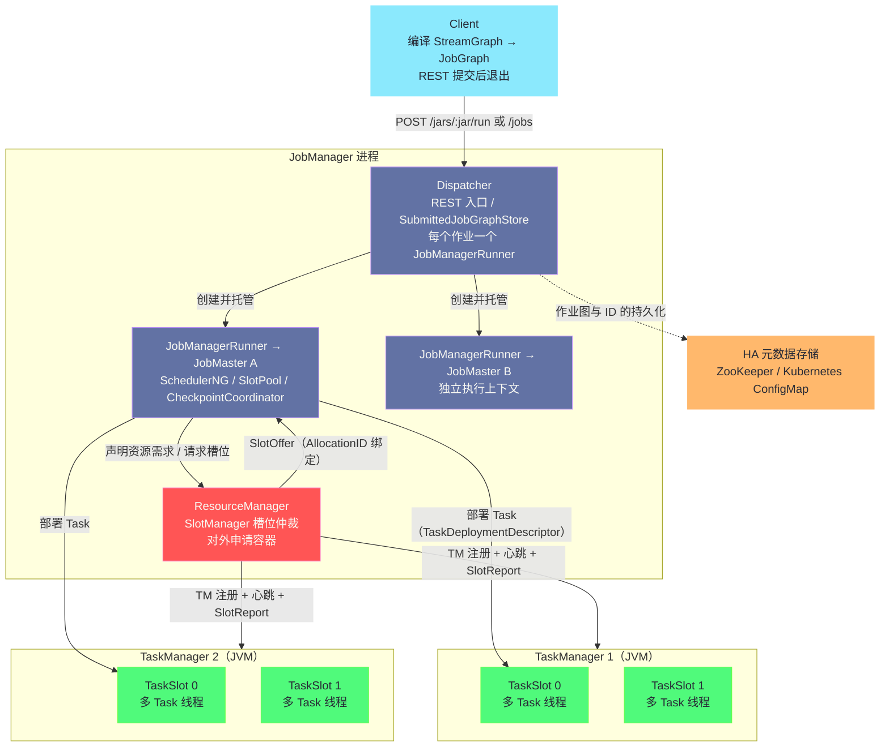
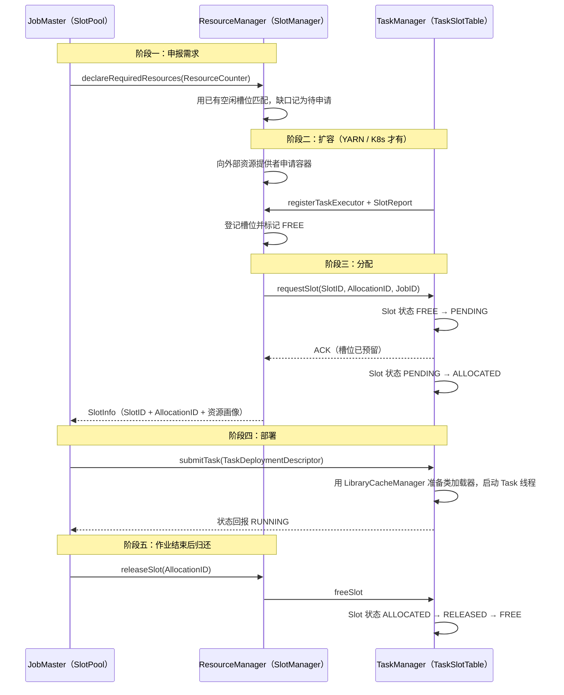
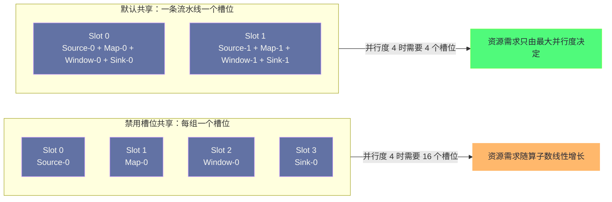
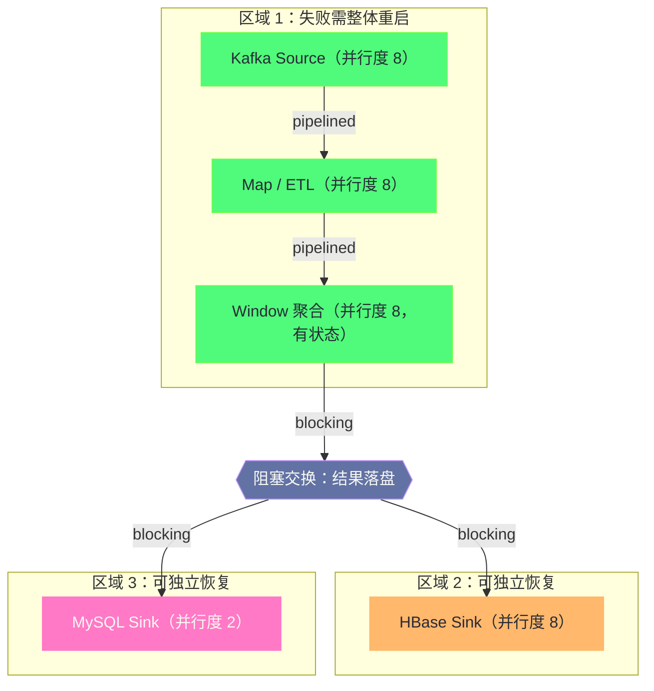

**摘要：**

Flink 的进程模型常被简化成“一个 JobManager 加若干 TaskManager”，但真正决定作业能否跑起来、跑歪了该从哪里查的，是这层简化之下的职责切分：JobManager 进程里并列着 Dispatcher、ResourceManager、JobMaster 三个子组件，各自的生命周期与故障影响面完全不同；TaskManager 是一个 JVM，里面的槽位（TaskSlot）只是资源账本上的一份额度，而不是一颗 CPU 核。本文沿着一次作业提交的完整时间线往下拆，先厘清三组件各自管什么、为什么必须分开，再进入 TaskManager 内部看槽位、内存与网络栈的共享边界，随后说明 StreamGraph、JobGraph、ExecutionGraph 三张图各自存在的理由（构造细节留给第 02 篇），并把 ExecutionGraph 的子任务如何落到槽位、调度策略如何在 eager 与按源惰性之间取舍讲清楚。最后落到两件最容易被误判的事：TaskManager 注册与心跳失联如何演变成作业失败，以及 1.9 之后默认的区域故障恢复（RegionFailover）到底以什么前提成立、什么情况下会退化成全局重启。全文的落点是权衡：Flink 这套架构换来的调度灵活性，代价都写在共享与解耦这两处。

---

## 第 1 章 从一次误判说起

### 1.1 杀掉提交进程之后

一个能当场验证、又常常被讲错的现象：在终端里用 `flink run -d` 提交一个流作业，作业跑起来之后，把提交命令所在的进程直接 `kill -9`，集群上的作业会怎样。

答案是它照常跑，Checkpoint 照常做，数据照常出。原因不是 Flink 有什么守护机制，而是提交这个动作在提交完成的那一刻就结束了：客户端把作业编译成 `JobGraph`，通过 REST 接口 POST 给集群，收到作业 ID 之后，它在运行时的职责就已经清零。作业状态、槽位分配、快照协调全部发生在 JobManager 与 TaskManager 两个进程侧，**客户端不在其中任何一条运行链路上**。

笔者愿意把这个现象放在开篇，是因为它一刀切开了“提交”与“运行”两件事，后面所有关于职责划分的讨论都是这条切线的延伸。把客户端当成运行时的一部分会犯两类错：以为它要常驻才能保证作业稳定，于是把提交脚本包成长驻进程，反而引入新的故障点；排查时去翻客户端日志找运行时异常，方向从一开始就偏了。

不过这条切线的形状不是一开始就长这样。要理解 Dispatcher、ResourceManager、JobMaster 为什么是三个而不是一个，需要回到 Flink 的组件模型被重写的那一次。

### 1.2 从单体 JobManager 到 FLIP-6

Flink 的前身是柏林工业大学等机构合作的 Stratosphere 项目，2014 年进入 Apache 基金会，2015 年更名为 Flink，2016 年 3 月发布 1.0。在 1.5 之前的很长一段时间里，JobManager 是一个单体进程：它既是接收作业提交的入口，又是资源分配的决定者，还是每个作业执行状态的维护者。这在单作业、小集群的年代没有明显问题，但一旦进入“一个集群跑多个作业、底层资源由 YARN 或 Kubernetes 动态提供”的场景，单体设计的三处硬伤就同时暴露。

第一处是故障影响面。所有作业的调度状态都住在同一个 JobManager 里，任何一处内部错误都可能让整个集群的作业一起中断，而作业之间本来没有任何耦合关系。第二处是资源模型的刚性：早期设计假定 TaskManager 的槽位数在集群启动时就固定下来，无法表达“资源按需向外部申请、用完归还”的语义，这与 YARN、Kubernetes 的弹性模型对不上。第三处是可扩展性：单体内所有逻辑共享同一套锁和线程，模块之间难以独立演进，也很难为不同部署模式复用。

Flink 1.5（2018 年）将 FLIP-6 提出的新组件模型变为默认，把单体 JobManager 拆成三个协作组件：Dispatcher 负责接收提交与作业生命周期，ResourceManager 负责槽位资源的仲裁与对外申请，JobMaster 负责单个作业的调度与执行。这次拆分的判断标准很朴素——把“变化的频率”和“涉及的资源”作为切分依据：Dispatcher 与集群同生共死，ResourceManager 与底层资源提供者一一对应，JobMaster 与单个作业的寿命严格一致。三种不同的生命周期，就不该住在同一个对象里。

这次重构还顺手解决了另一个问题：部署模式的统一。会话模式（Session Mode）、每作业模式（Per-Job Mode，1.15 起官方标记为废弃）、应用模式（Application Mode，FLIP-85，1.11 引入）三种提交形态，在旧的单体模型里需要三套不同的启动逻辑，在新模型里只是“谁先启动、谁执行 `main()`”的差异，内部组件完全复用。

### 1.3 三层角色与本文的边界

下图把三层角色与主要交互画在一起，注意两个 JobMaster 实例互相不可见，共享的只有同一个 ResourceManager。

本文只讲这层架构本身：三组件管什么、槽位抽象是什么、三张图各自为什么存在、子任务怎么落到槽位、心跳与故障恢复的粒度如何划定。三张图的逐层构造——即 `StreamGraphGenerator` 与 `StreamingJobGraphGenerator` 的转换、并行度展开的细节——归 [[02 从 StreamGraph 到 JobGraph 再到 ExecutionGraph]]；内存五大分区与托管内存算法归 [[03 Flink 内存模型深度解析]]；网络栈与反压归 [[04 Flink 网络传输与反压机制深度解析]]；Checkpoint 的屏障传播与状态快照归 [[06 Flink Checkpoint 机制深度解析]]。至于“参数该设成多少、作业卡住先看哪里”，那是 [[大数据/Flink/Flink从入门到实战/09 Flink on YARN 与 Kubernetes 生产部署|实战专栏]] 的职责，本文只在机制必需时给默认值，不做配置清单。文中类名与默认值以 1.x 文档与源码为准；2.x 在调度器与资源模型上继续演进，组件边界仍然适用，具体细节以对应版本文档为准。

---

## 第 2 章 JobManager：三个子组件的职责切分

### 2.1 Dispatcher：提交入口，不是执行者

Dispatcher 是 JobManager 进程内对外的服务门面，Flink 的 REST 端点（默认 `rest.port: 8081`）挂在它身上。它要做的事按顺序是四件：接收作业提交（jar 上传、`JobGraph` 反序列化）、把作业图与作业 ID 落到 `SubmittedJobGraphStore`、为这个作业创建并托管一个 `JobManagerRunner`、在作业结束后清理元数据。Web UI 上那份历史作业列表，就是 `SubmittedJobGraphStore` 里留下的记录，而不是某个正在运行的对象在内存里攒的。

这里有个容易漏掉的中间层：Dispatcher 并不直接创建 JobMaster，它创建的是 `JobManagerRunner`，JobMaster 由 Runner 在内部持有并负责它的启停、领导权确认和异常上报。多这一层是为了把“作业在集群里的登记”与“作业开始执行”解耦：作业图先落库，再启动执行；如果 Runner 启动失败，登记信息还在，恢复逻辑有据可依。高可用场景下这个顺序尤为关键——新当选的 Dispatcher 从存储里读出未完成的作业图，逐个重建 Runner，作业就能接着跑，而不依赖任何内存状态。

Dispatcher 的职责边界可以用一句话概括：它管作业的“进出与登记”，不管作业“怎么跑”。它不知道槽位、不知道并行度展开、不知道 Checkpoint，这些都属于 JobMaster。反过来说，一个 Dispatcher 可以同时服务多个 JobMaster，这也是会话模式（一个集群跑多个作业）能成立的结构前提。

部署模式改变的是 Dispatcher 的启动时机与 `main()` 的执行位置，不改变它的职责划分。

| 部署模式 | Dispatcher 何时存在 | 用户 `main()` 在哪里执行 | 与本文相关的差异 |
|---|---|---|---|
| 会话模式（Session） | 集群启动即存在，先于任何作业 | 客户端 JVM | 多个作业共享一个 Dispatcher 与一个 ResourceManager，槽位在作业间竞争 |
| 每作业模式（Per-Job，已废弃） | 为单个作业拉起集群时创建 | 客户端 JVM | Dispatcher 与作业一对一，资源天然隔离，代价是集群启动开销 |
| 应用模式（Application） | 集群启动即存在 | 集群内的 Dispatcher 侧 | 依赖与 `main()` 一起进集群，提交链路缩短，`ApplicationDispatcherBootstrap` 负责拉起应用 |

应用模式这一行改变了“谁在跑用户代码”的直觉。`flink run-application` 只负责把 jar 与依赖送到集群，真正的 `StreamExecutionEnvironment.execute()` 在集群内部执行，客户端甚至可以在作业启动前退出。1.11 之后官方推荐用它替代每作业模式，原因也在这里：依赖解析、类加载、提交带宽三件事同时被简化。

### 2.2 ResourceManager：只做槽位仲裁

Flink 的 ResourceManager 与 YARN 的 ResourceManager 同名不同物，这一点必须先钉死：前者是 Flink 自己的组件，管的是 Flink 槽位（slot）这笔内部账；后者是 YARN 的资源管理器，管的是容器（Container）。两者是上下游关系——Flink 的 ResourceManager 在需要扩容时，会作为一个客户端去向 YARN 的 ResourceManager 申请容器。

它的核心是 `SlotManager`，账本上记着每个 TaskManager 报上来的槽位、每个槽位当前绑给了哪个作业、哪次分配（`AllocationID`）。JobMaster 要用资源时不会直接找 TaskManager，而是把需求提交给 ResourceManager，由它在全局视角下决定把哪个槽位给谁。这层间接带来两个直接收益。

其一是全局视角。会话模式下多个作业同时要资源，若每个 JobMaster 各自去找 TaskManager 谈，就会出现互相不知道对方占了多少、谁也凑不齐一次完整申请的局面。集中仲裁让“谁先拿到、拿到几个”变成一次可整体判断的决策。

其二是屏蔽底层差异。Flink 为独立集群（Standalone）、YARN、Kubernetes 分别提供了 `ResourceManager` 的实现，对上层暴露同一套接口：在独立集群上它只能盘活已有的 TaskManager，没有槽位就只能等；在 YARN 与 Kubernetes 上它可以向外部申请新容器，容器起来后注册成新的 TaskManager，槽位凭空多出来。这个差异对 JobMaster 完全透明，作业代码不需要知道自己在哪种集群上跑。

早期实现在“申请”上是命令式的：JobMaster 发一个 `SlotRequest`，ResourceManager 回一个 `SlotOffer`，一来一回，作业频繁启停时会产生大量 RPC，“资源不足”也难以整体表达。FLIP-74 提出的**声明式资源管理（Declarative Resource Management）**（1.11 起落地）改成“申报需求”：JobMaster 声明总共需要多少资源（`ResourceCounter`），ResourceManager 负责把实际供给往需求上凑。两者的差别类似“每缺一件就喊一次采购”与“报一张物料清单让采购自己平衡”，后者在长跑作业与多作业混部时明显更省。

### 2.3 JobMaster：单作业的执行上下文

JobMaster 是三个组件里最重的那个，一个运行中的作业对应一个实例，作业结束它就销毁。它持有的东西可以按职责分成四块。

调度这块，1.9 之后的主线是 `SchedulerNG` 接口，默认实现是 `DefaultScheduler`，另有可选的 `AdaptiveScheduler`（`jobmanager.scheduler: adaptive`，1.15 起提供），后者的特点是不预先展开全部并行子任务，而是按可用槽位决定实际并行度，并支持运行中扩容。调度器内部把逻辑拓扑（`SchedulingTopology`）与调度决策分开，拓扑描述“有哪些执行顶点、它们之间怎么连”，策略描述“什么时候把哪些顶点放上去”。

资源这块，JobMaster 手里有一个槽位池（`SlotPool`）。它向 ResourceManager 申报需求，收到槽位后先自己记账，再决定把哪个子任务放到哪个槽位上；作业取消时由它把槽位归还。槽位池的存在还带来一个容错好处：ResourceManager 短暂不可用时，已经拿到的槽位不会丢，作业可以继续运行，只有“还缺资源”这条路径会暂时卡住。

执行这块的展开归 [[02 从 StreamGraph 到 JobGraph 再到 ExecutionGraph|第 02 篇]]，本文只取结论：JobMaster 把提交上来的 `JobGraph` 变成带并行子任务与中间结果的执行图，并维护每个子任务的状态机；子任务部署时它生成 `TaskDeploymentDescriptor` 发给对应的 TaskManager。

协调这块包括 Checkpoint 的触发与确认收集、心跳管理（它与每个 TaskManager 之间都有一条心跳通道）、故障判定与恢复决策。故障恢复的粒度选择（区域还是全局）就发生在这一块，第 8 章展开。

四块职责共享同一个生命周期，这是 JobMaster 设计上最关键的一点：作业 A 的 JobMaster 崩掉不会波及作业 B，因为两者除了共享 ResourceManager 的账本之外没有任何共同状态。

### 2.4 Dispatcher 与 JobMaster 的分工

这两个组件最容易被混为一谈，因为它们在 Web UI 上都表现为“作业列表里的那一行”，日志里也常常一起出现。区分的抓手是问一句：这件事与“这个作业的执行”有关，还是与“这个作业在集群里的存在”有关。

| 维度 | Dispatcher | JobMaster |
|---|---|---|
| 管的对象 | 提交上来的作业图与作业 ID | 单个作业的执行过程 |
| 生命周期 | 与 JobManager 进程一致，长期存在 | 与作业一致，作业结束即销毁 |
| 一个实例服务几个作业 | 多个（会话模式下是全部） | 严格一个 |
| 崩溃后的影响 | 该进程上所有作业的提交与状态查询受影响，运行中的任务会因失去 JobMaster 而失败 | 仅该作业失败，其他作业不受影响 |
| 高可用恢复动作 | 从 `SubmittedJobGraphStore` 恢复作业清单，重建 Runner | 从最近一次成功的 Checkpoint 恢复子任务状态 |
| 典型 REST 归属 | `/jars/*`、`/jobs/overview`、作业提交与取消入口 | `/jobs/:id/vertices/*`、Checkpoint 触发、`/jobs/:id/checkpoints` |
| 是否需要知道槽位 | 不需要 | 需要，槽位申请与释放都由它发起 |

一个具体的分界场景：作业停在 `CREATED`、槽位一个没拿到，该看 JobMaster 的日志与 ResourceManager 的账本，Dispatcher 那边只有“作业已接受”一条记录，它根本没参与资源协商；反过来，如果 `/jars/upload` 就失败，该看的是 Dispatcher 的 REST 层，离调度还很远。

### 2.5 生命周期与故障影响面

把三个组件放在一张表里对照，能看出 FLIP-6 那次拆分到底买到了什么。

| 组件 | 何时创建 | 何时销毁 | 单点故障的后果 | 会话模式下的实例数 |
|---|---|---|---|---|
| Dispatcher | JobManager 进程启动 | 进程退出 | 提交与查询不可用，运行中的作业因失联 JobMaster 而失败 | 1（HA 下为 1 主 N 备） |
| ResourceManager | JobManager 进程启动 | 进程退出 | 槽位申请卡住；已分配的槽位不受影响 | 1（HA 下为 1 主 N 备） |
| JobMaster | 每个作业提交时 | 作业终止时 | 仅该作业失败，需从 Checkpoint 恢复 | 等于运行中的作业数 |
| TaskManager | 集群或容器启动时 | 进程退出或被回收 | 其上的子任务全部失败，触发对应区域的恢复 | 由资源规模决定 |

会话模式下最脆弱的是 JobManager 进程本身：Dispatcher、ResourceManager 与全部 JobMaster 都住在这里，进程一挂，所有作业同时失去调度方。这正是高可用（HA）存在的理由——靠 ZooKeeper 或 Kubernetes 的选举选出主 JobManager，主挂掉后由备接管，接管方从持久化存储读出作业图与 Checkpoint 元数据，重建 JobMaster 继续跑。HA 保的是“作业能继续”而非“作业不中断”：从主挂掉到备接管完成，TaskManager 上的任务会因心跳超时而失败，之后从最近的 Checkpoint 恢复，这段延迟是实打实要付的。

---

## 第 3 章 TaskManager：一个 JVM 里的资源切分

### 3.1 进程内的构件

TaskManager 是一个独立的 JVM 进程，跑在工作节点上，是 Flink 里唯一执行用户代码的地方。它内部的构件按功能分四类。

执行侧是 `TaskExecutor`，作为 RPC 服务端接收 JobMaster 与 ResourceManager 的调用，负责槽位申请、任务提交、取消与状态回报；任务由 `TaskSlotTable` 登记索引，每个槽位在表里对应一个 `TaskSlot` 对象，记录当前装着哪些任务。

资源侧是内存与网络两套。`MemoryManager` 管理托管内存（Managed Memory），其总量按槽位数等分给各个槽位，供 RocksDB 状态后端、排序、哈希表这类需要自管理内存的算子使用；网络栈由 `NetworkEnvironment` 与底层的 `NetworkBufferPool` 构成，缓冲区池是整个 TaskManager 共享的，按需借还给各个输入通道与输出通道。

支撑侧是类加载与状态注册。`LibraryCacheManager` 负责把作业 jar 与依赖塞进独立的类加载器，这是同一进程能跑多个不同版本依赖作业的基础；`KvStateRegistry` 与 `BroadcastVariableManager` 则服务于状态与广播变量的注册。

四类构件的位置关系是理解后面所有“共享”与“隔离”的前提：执行侧隔离（每个任务有自己的线程与对象），资源侧部分隔离（托管内存按槽位分账，缓冲区池不分账），支撑侧共享（类加载器按作业隔离，同作业的多任务共用）。

### 3.2 Task、Subtask、Slot、线程

这四个词在中文资料里经常被互换使用，但它们在 Flink 里各指一层，混用会直接导致资源规划算错。

| 概念 | 指什么 | 数量关系 | 容易错在哪 |
|---|---|---|---|
| 算子（Operator） | 用户代码里的一个转换，如 `map`、`window` | 由 DAG 决定 | 把它当成执行单位，其实它只是逻辑节点 |
| 任务（Task） | 一串链合并后的算子，是部署与调度的最小单位 | 一个作业里若干 | 以为一个算子就是一个 Task，忽略链合并 |
| 并行子任务（Subtask） | Task 按并行度展开后的一个实例 | Subtask 数 = Task 并行度 | 把它和 Task 当成同一个东西，导致并行度算重 |
| 槽位（TaskSlot） | TaskManager 上的一份资源额度，可容纳多个 Subtask 的线程 | 由 `taskmanager.numberOfTaskSlots` 决定 | 当成线程或 CPU 核，得出“槽位越多并行度越高” |

关键的一层是最后两行的关系：一个槽位不是“一个线程”，而是一个可以容纳多个线程的容器。默认开启槽位共享之后，一个槽位里通常同时住着同一个流水线各个算子的一个并行实例——`source` 的一个子任务、`map` 的一个子任务、`window` 的一个子任务、`sink` 的一个子任务，它们各有自己的线程，共享这一个槽位的资源额度与所在的 JVM。

这也解释了一个常见困惑：为什么并行度调到 16，集群只需要 16 个槽位，而不是“16 乘以算子数”个槽位。因为共享把同一条流水线的各个阶段折叠进了同一份额度里，槽位数只需要等于作业里最大那个槽位共享组的并行度。

### 3.3 内存与网络栈的共享边界

槽位隔离做到什么程度，是个需要精确回答的问题，因为生产上的 OOM 与“莫名其妙变慢”大多源于对这条边界的误判。

**托管内存是按槽位分账的**。假设一个 TaskManager 配了 16 GB 总内存，其中托管内存 8 GB，槽位数配 4 个，那么每个槽位在账面上最多能用 2 GB 托管内存，`MemoryManager` 会按这个额度给该槽位内的算子发内存段（`MemorySegment`）。这条隔离是硬的：某个槽位的 RocksDB 写满了自己的额度，会阻塞或刷盘，不会去抢别的槽位的份额。

JVM 堆不是分账的。所有槽位、所有任务线程共享同一片堆，某个任务出现对象泄漏或者在堆里缓存了大量数据，最终会把整个进程撑到 OOM，同进程的其他槽位一起陪葬。堆外内存里的网络缓冲区池同样是全局的，缓冲区借出与归还跨越所有槽位，因此一个任务把缓冲区长期占住（典型是下游消费太慢、数据积压在输出缓冲里），会挤压其他任务的收发能力。网络层的细节归第 04 篇，内存分区的算法归第 03 篇。

磁盘与文件句柄也是共享的，只是不那么显眼。RocksDB 的本地目录、Checkpoint 的临时文件、日志文件都落在同一块盘上，同进程多个任务的写放大叠加起来，会把一个本来不慢的任务拖慢。这类问题在监控上表现为“所有任务同时变慢、但 CPU 与堆都正常”，很容易被误判成网络问题。

### 3.4 线程模型的真实含义

“Task 是线程，一个 Task 阻塞会影响同槽位的其他 Task”这句话方向没错，但需要说得更准，否则调优时会找错地方。

先说成立的部分。TaskManager 是单个 JVM，每个 Subtask 是一条独立的线程（严格说是执行该任务邮箱循环的那条线程），线程之间由操作系统按时间片抢占调度。一个任务如果陷入长时间的计算（譬如一个复杂度失控的正则、一次没有超时的同步外部调用），它占着 CPU 时间片不放，同 JVM 里其他任务的可用算力就被摊薄；如果它占着堆，其他任务的分配与 GC 成本一起上升。这是“影响”的真实来源——不是线程被阻塞，而是共享资源被挤占。

再说需要修正的部分。从 Flink 1.10 起，流任务的执行模型统一为**邮箱（Mailbox）模型**：每个任务持有一个邮箱队列，事件（数据到达、Checkpoint 触发、定时器到期、控制指令）被投递进邮箱，由任务的邮箱线程串行取出执行。这意味着一条任务线程内部是严格串行的：只要当前这次 `processElement` 不返回，同一任务的邮箱就不再推进，Checkpoint 屏障处理、水位线推进、定时器触发全部被推迟到它返回之后。这条性质只作用于自己这个任务，跨任务的线程并不会被挂起——同一个槽位里的其他任务照常按时间片运行，只是共享的 CPU、堆、缓冲区被分走一部分。

于是“同槽位互相影响”的真正传导链有三条，值得分开记：一是 CPU 抢占，属于软影响，表现为吞吐下降而不报错；二是堆与 GC，属于硬影响，一次长时间的 Full GC 会让整个 JVM 里所有任务同时停顿，心跳线程也可能被拖住，严重时触发误判失联（第 7 章展开）；三是共享的同步资源，譬如某些组件内部的线程池、类加载锁、文件系统的元数据锁，这类争用最难查，通常要靠线程栈对比才能定位。

反过来说，槽位之间也不存在真正的墙。把关键任务放进独立槽位、甚至独立 TaskManager，能改善 CPU 与堆的隔离，但网络缓冲区池、磁盘、宿主机都还是共用的。这也是为什么“资源隔离”在生产上从来不是一个开关，而是一串按代价递增的选择。

### 3.5 把槽位当 CPU 核的代价

最常见的错误配置是把 `taskmanager.numberOfTaskSlots` 直接设成机器的核数，理由听起来很顺：一核一槽，物尽其用。问题在于槽位不是核，一个槽位里可能住着整条流水线的多个线程，物理线程数远大于槽位数；而槽位数的真正语义是“这台 TaskManager 愿意把内存分成几份来记账”，它同时约束了托管内存的粒度与槽位共享的并行上限。

槽位数开得过大的直接后果是每个槽位的托管内存额度变小。一个 8 GB 托管内存的 TaskManager 配 4 个槽位，每槽 2 GB，RocksDB 的写缓冲与块缓存还够用；配成 16 个槽位，每槽只剩 500 MB，写缓冲频繁触发刷盘与压缩，状态访问延迟上升，反压随之出现，最终表现成“加大并行度反而更慢”。间接后果是共享同一 JVM 的任务线程数上升，堆内对象与 GC 压力一起变大，而调度器看到的是“槽位很充裕”，会毫不犹豫地把更多子任务堆进来。

槽位配得过少也有代价：共享默认开启时槽位数就是并行度上限，不足会让作业卡在申请阶段，或在会话模式下与其他作业争抢同一批槽位。所以这是一次关于内存粒度、并行上限与共享拥挤度的三方权衡——每个槽位对应一到两条物理执行线（约 1 到 2 个核的份额）是稳妥的起点，最终仍要按作业的 CPU 密度与状态规模实测修正。

---

## 第 4 章 槽位与资源的抽象

### 4.1 四张凭证

一次槽位分配在两个进程之间传递了好几层标识，它们的用途各不相同，混起来看会觉得“为什么一个槽位要这么多 ID”。Flink 的设计里，每一层标识都对应一种可能出错的场景。

槽位标识（`SlotID`）回答“是哪个物理槽位”，由 TaskManager 启动时分配，重启后会变。分配标识（`AllocationID`）回答“这一次分配是哪一次”，每次分配新生成——如果只有 `SlotID`，一个迟到的释放请求可能把已经重新分配给别的作业的槽位释放掉，`AllocationID` 让这种陈旧请求失效。请求标识（`SlotRequestId`）回答“这是 JobMaster 的哪一次申请”，用于需求变化时撤销或合并申请；资源画像（`ResourceProfile`）回答“槽位有多大”，早期用它表达差异化的 CPU 与内存需求，后来 Flink 简化成“同一作业的槽位等大”，画像退化为校验与展示。

这套标识体系的意义在于异步。槽位分配的整条链路全是异步 RPC：JobMaster 发请求、ResourceManager 处置、TaskManager 确认、JobMaster 再部署任务，中间任何一步都可能因为重启、超时、领导权切换而失效。幂等与去重只能靠“这次是哪一次”来判定，单靠物理 ID 无法表达时序。

### 4.2 申请与供给的握手

以默认调度器加声明式资源管理为例，一次完整的槽位获取会经过下面这条路径，注意 TaskManager 侧状态机的四个状态（FREE、PENDING、ALLOCATED、RELEASED）是如何被两边共同推动的。

这里有两个“看起来多余”的等待。TaskManager 先回 ACK 再改状态，是为了在分配与部署之间留一个可撤销窗口——ACK 之后若 JobMaster 已取消，ResourceManager 还能把槽位退回空闲，不必让 TaskManager 杀掉刚起来的任务。JobMaster 拿到 `SlotInfo` 才部署，是因为槽位使用权必须与部署指令绑定，它持有的是一份带 `AllocationID` 的凭证。

还有一个常被忽略的状态：PENDING。它存在的理由与上面的 ACK 窗口同源，是“已预留但未完成分配”的中间态。生产上如果看到槽位长期停在 PENDING，通常意味着 ResourceManager 与 TaskManager 之间的某次 RPC 丢了或者超时了，而不是资源真的不够。

### 4.3 槽位共享的机制

默认情况下，一个作业里所有没有被显式分组的算子都属于同一个**槽位共享组（`SlotSharingGroup`）**，组名就叫 `default`。共享关系不是调度器临时拍脑袋决定的，而是由 JobMaster 槽位池里的 `SlotSharingManager` 维护一棵可复用的槽位树：一个物理槽位先被包成一个多任务槽位（`MultiTaskSlot`），组内每个需要落位的子任务再在这个槽位里占一个单任务槽位（`SingleTaskSlot`），只有当组内所有子任务都能落进同一个物理槽位时，这个物理槽位才算被该共享组“用起来”。

这棵树的结构决定了三条规则。

第一条，**槽位共享只在同一个作业内部发生**。不同作业的子任务不会共用同一个物理槽位，即使它们在同一个 TaskManager 上。会话模式下，一个 TaskManager 的 4 个槽位可能被 3 个作业分别占走一部分，但每个槽位内部只住一个作业的任务。

第二条，一个共享组的并行度决定该组需要多少个物理槽位。共享组内所有子任务的并行度取最大值，就是这个组要的槽位数；因为同一个槽位里要放下组内每个并行实例各一个子任务，只有当每个并行实例都能找到一个槽位时，整组才能跑起来。

第三条，不同共享组之间不能合槽。这是显式隔离的唯一手段：给资源需求差异大的算子分到不同共享组，它们就必然落在不同槽位里，互不挤占托管内存额度。

下面的对照图展示同一个四算子作业在两种配置下占用的槽位差异，并行度取 4。

共享省下的不只是槽位数量，还有流水线的本地性。同一条流水线的相邻阶段住在同一个 JVM 里，链合并之后的算子本来就在一个线程里传对象，即使没有链合并，跨槽位的本地传输也仍然是内存拷贝而不是网络往返。这层收益在延迟敏感的场景里比槽位数量更值钱。

### 4.4 槽位数怎么算

把规则写成一个可以直接套的算法，比背结论更有用。

第一步，按 `slotSharingGroup` 把作业里的算子分组，未指定的归入 `default`。第二步，每个组内取所有算子并行度的最大值，得到该组的槽位数。第三步，把所有组的槽位数相加，得到这个作业需要的总槽位。第四步，与集群可用槽位比对，不足则扩容或降低并行度。

用一个贯穿全篇的案例算一遍：电商实时大屏加 CDC 入湖的同一条流水线，`Kafka Source`（并行度 8）→ `Map/ETL`（8）→ `keyBy + Window`（8，但状态很重，单独分到 `heavy` 组）→ `HBase Sink`（8）→ 另一条支路 `Window` 结果写 `MySQL`（2，轻量）。按上面的算法，`default` 组的最大并行度是 8，`heavy` 组是 8，两组不能合槽，所以需要 16 个槽位。

| 配置方式 | default 组需求 | heavy 组需求 | 总槽位 | 说明 |
|---|---|---|---|---|
| 全部默认分组 | 8 | 归入 default | 8 | 最省槽位，但重状态算子与轻量算子挤在同一份额度里 |
| 重状态算子单独分组（示例推算） | 8 | 8 | 16 | 隔离托管内存，代价是槽位数翻倍 |
| 重状态算子降并行度至 4 | 8 | 4 | 12 | 并行度与隔离各让一步的折中 |

这三行没有绝对优劣：第一行适合状态小的纯 ETL，第二行适合 RocksDB 状态大又想隔离的场景，第三行是承认“瓶颈不在这段”的务实选择——把并行度降下来通常比把槽位堆上去更省钱。真正要避免的是“既不分组、又把并行度拉满”的做法：槽位数量看着最小，实际把内存压力全压进同一份额度，出问题时连是哪个算子拖累的都分不清。

### 4.5 同位约束

`slotSharingGroup` 之外还有一个更硬的约束：**同位组（`CoLocationGroup`）**。它的语义与共享组相反——共享组说“可以住在一起”，同位组说“必须住在一起”。同一个同位组内的子任务必须被调度到同一个物理槽位上，如果凑不齐就整体等待，不会被拆开。

这个机制主要为迭代作业服务。Flink 的迭代（Iteration）在物理上表现为一个反馈边：迭代头（`IterationHead`）把初始数据推入，迭代尾（`IterationTail`）把结果回流到头部，形成环。环上的算子必须保证同一份并行度的两个端点在同一个槽位里，否则反馈数据要跨网络绕一圈回来，迭代的超步（Superstep）同步语义就难以维持，而且延迟会随网络往返放大。同位约束用“不满足就不调度”换来了这条链路的确定性。

普通流作业很少显式用到同位组，但它的存在解释了一个容易被当成 bug 的现象：某个作业一直卡在调度阶段，日志里能看到大量重复的槽位申请，最后超时失败。如果作业里含有迭代或反馈边，多半是同位约束凑不齐槽位，而不是资源总量不够。

### 4.6 共享的代价

共享机制不是免费的，它的代价正好落在“隔离”这个维度上，而这三处代价在容量规划时最容易被忽略。

隔离是假的。共享同一槽位的算子共用一份托管内存额度，重状态算子的 RocksDB 把额度用满，同槽位里那个只需要几十兆的 `map` 也会被连带影响，内存段申请排队，表现为处理延迟抖动。共享组能画出边界，画不出“额度内部谁先用完”。

倾斜会被放大。槽位里住着整条流水线，某个 key 在 `keyBy` 之后高度集中时，同槽位的下游算子全部承压，其他并行实例却很闲，反压随即从这个槽位向上游扩散，把整个作业拉到最慢槽位的水平。“一条流水线一条命”在共享之后成了字面意思。

资源画像的粒度变粗。同一个共享组里的算子共享同一份额度，无法为某一个算子单独申请更多内存；想做精细隔离只能分到不同共享组，而分组又会成倍增加槽位需求。这条约束在状态规模差异悬殊的作业里会变成一道选择题：要么多花槽位做隔离，要么接受挤在一起。

---

## 第 5 章 三张图各自存在的理由

### 5.1 StreamGraph：让用户的意图先被完整记下来

用户代码调用 `env.execute()` 时，第一件事是把 DataStream API 的调用链翻译成流图（`StreamGraph`）。这张图的节点（`StreamNode`）记录算子的类型、并行度、输入输出、序列化器、`uid`，边（`StreamEdge`）记录分区策略（`Partitioner`）与是否可链合并所需的属性。

它存在的理由只有一个：保住信息。用户写下的并行度、`uid`、`slotSharingGroup`、`disableChaining()`、`startNewChain()`、算子级别的资源配置，这些意图在后续两次转换中会被反复读取，任何一次丢失都会导致行为漂移。`uid` 尤其关键，它是状态与算子在 Savepoint 里的对应关系——改了 `uid` 就等于换了一个算子，旧状态无法恢复。流图作为“原样记录”的载体，让这些信息在编译期一次性固化下来，而不是散落在各个算子的成员变量里被顺手改掉。

流图同时也是批与流两条路径的共同上游：批模式的优化（阻塞交换选择、执行模式推导）与流模式的优化都以它为起点，差异到下一层才出现。

### 5.2 JobGraph：一次可序列化、可分发的提交合约

流图不能直接提交，因为它带着大量只在本进程有意义的对象引用，也无法表达“哪些算子被合并成了一个执行单元”。客户端在提交前会把它转成作业图（`JobGraph`），核心动作有两件：链合并与中间结果建模。

**链合并**把满足条件的相邻算子塞进同一个 `JobVertex`（对应一个 Task），条件是并行度相同、处在同一个共享组、数据以 `FORWARD` 方式直传、上游没有显式断链。合并之后，作业图里的顶点数远少于算子数，这才是集群真正要部署的东西。

合并省掉的是边界成本。未合并的两个算子之间必须走序列化、缓冲区与线程切换，一条记录要先从上游的对象变成字节数组，再在下游变回对象；合并之后就是一次方法调用，对象根本不离开这条线程。这也是链合并对吞吐与延迟同时有益的原因，而它唯一的代价是失去算子间的调度独立性——整条链共用一个线程，链上任何一段变慢，整条链一起变慢，监控上也只看到链的整体指标。`disableChaining()` 与 `startNewChain()` 就是用来在调试或隔离瓶颈时把这条边界重新切开的开关。

中间结果建模则把“数据从哪来到哪去”显式化。作业图里的 `IntermediateDataSet` 表示一个顶点产出的数据集合，`JobEdge` 表示下游消费方，边的类型决定了数据是否落地——流水线（pipelined）表示下游边产边消费，阻塞（blocking）表示上游写完之后下游才读。这个类型选择在运行时是生死攸关的：它既决定了调度能否分批进行，也决定了故障恢复时哪些数据还能复用（第 8 章）。

作业图之所以是“提交合约”，是因为它同时满足三个条件：可序列化（能通过 REST 传输、能写进 HA 存储）、与具体集群无关（同一个作业图可以提交给独立集群、YARN、Kubernetes）、自带执行配置（并行度默认值、重启策略、`ExecutionConfig` 都在里面）。客户端在生成作业图之后的主要工作就结束了，剩下的编译产物就是一个字节流。

### 5.3 ExecutionGraph：运行时的状态载体

作业图仍是“逻辑”的：它说这个顶点并行度是 8，但没有 8 个具体的执行实例，也没有“第 3 个实例现在跑到哪一步”这种信息。JobMaster 拿到作业图后按并行度展开，得到执行图（`ExecutionGraph`）：每个 `JobVertex` 展开成一个 `ExecutionJobVertex`，其下挂并行度个 `ExecutionVertex`，每个顶点还可能有多次执行尝试（`Execution`），每次尝试有自己的状态与失败原因；每个中间结果展开成带分区（`IntermediateResultPartition`）的物理对象，边展开成 `ExecutionEdge`。

执行图的核心价值是承载**状态机**。每个子任务的执行尝试在 `CREATED`、`SCHEDULED`、`DEPLOYING`、`RUNNING`、`FINISHED`、`FAILED`、`CANCELING`、`CANCELED` 之间流转，每次流转都有明确的前置条件与副作用。这个状态机不只用于展示，它直接决定恢复策略的计算：哪些子任务必须重启、哪些可以从中间结果继续读、重启后从哪个 Checkpoint 取状态，都得先知道当前每个顶点的确切状态。

1.9 之后的重构把这一层又拆了一次：调度器用 `SchedulingTopology` 描述“有哪些执行顶点与边”，用 `State` 快照描述“此刻各顶点什么状态”。好处是调度策略可以替换（eager 与惰性、默认与自适应）而不必重写状态维护，代价是多了一层从拓扑到物理执行图的对齐逻辑。

### 5.4 三张图的分工

把三张图放在一张表里对照，各自存在的理由就清楚了。

| 维度 | StreamGraph | JobGraph | ExecutionGraph |
|---|---|---|---|
| 生成者 | `StreamGraphGenerator`，客户端 | `StreamingJobGraphGenerator`，客户端 | JobMaster 的调度器 |
| 节点粒度 | 算子（`StreamNode`） | 链合并后的 Task（`JobVertex`） | 并行子任务（`ExecutionVertex`/`Execution`） |
| 是否含并行实例 | 不含，只有并行度数值 | 不含，只有并行度数值 | 含，按并行度展开为具体实例 |
| 是否持久化 | 否 | 是（HA 存储、提交报文） | 否，随作业重建 |
| 能否表达运行状态 | 不能 | 不能 | 能，每个尝试都有自己的状态机 |
| 编译期/运行期 | 编译期 | 编译期产物 | 运行期对象 |
| 缺失它的后果 | 用户意图（`uid`、分组、断链）在转换中丢失 | 无法跨进程提交，算子在集群上逐个部署，开销爆炸 | 无法做部分恢复，也没有地方记录“谁失败了” |

表格最后一行值得多看一眼：执行图不持久化，恢复时永远从作业图重新生成。原因不是它不重要，而是它记录的是瞬时调度状态，JobMaster 一挂就全部过期；能跨版本复用的只有“意图与契约”那一层。

---

## 第 6 章 子任务如何落到槽位

### 6.1 三条映射规则

从执行图到物理槽位的映射，规则只有三条，但组合起来足以解释绝大多数调度异常。

第一条，同共享组的子任务可以合槽，不同组的必须分开。调度器在给一个子任务找位置时，先看它所在共享组有没有已经分配到的槽位，有就塞进去，没有就为该组申请一个新槽位。这条规则决定了“一个槽位里到底装了什么”。

第二条，**共享组内按并行度成组落位**。同一个共享组的并行实例必须整批落位：要给并行度 8 的组分配槽位，就得凑齐 8 个能各装下整条流水线的槽位；凑不齐时整组等待，不会出现“4 个跑起来、4 个排队”的中间态（批量作业的惰性调度是例外，见 6.2）。这条规则解释了为什么槽位不足时作业会长时间停在申请阶段而不是部分运行。

第三条，同位约束优先于前两条。同位组内的子任务必须落在同一个物理槽位，如果该槽位被别的组占了，调度器只能换一个槽位重试，直到找到能把整组塞进去的位置。

三条规则叠起来有一个反直觉的结论：调度失败往往与“总量不足”无关。一个作业需要 16 个槽位、集群也有 16 个空闲槽位，但它们分散在 3 个 TaskManager 上且被别的作业切走了一部分，某个共享组就凑不齐完整并行实例。这种碎片化在会话集群里很常见，表现是“明明有空闲槽位，作业就是起不来”。

### 6.2 调度策略：一次全放还是按源推进

“什么时候把子任务放上去”这件事由 `SchedulingStrategy` 决定，Flink 提供了两种基本取向。

进取式（`EagerSchedulingStrategy`）在作业启动时把执行图里所有可调度的顶点一次性提交，等这些顶点都拿到槽位后统一部署。流作业走这条路，理由是流水线的各段必须同时在线才有意义：只启动上游不启动下游，数据只会堆在缓冲区里，反而制造反压；而且批量部署能减少中间结果分区更新的 RPC 次数。

按源惰性式（`LazyFromSourcesSchedulingStrategy`）只先调度源顶点，等源任务产出数据、下游的输入依赖满足之后，再调度下游。批量作业走这条路，因为它允许在资源有限时先跑起一部分，且能配合“上游先落盘、下游后读取”的阻塞交换，让同一批槽位在不同阶段被反复使用。FLIP-119 进一步把“按流水线区域批量申请槽位”引入批量调度，避免在一个大 shuffle 的两侧同时申请槽位而互相等待死锁。

两种策略对应两种资源观：流作业假设资源一次给足，因为它是常驻的；批作业假设资源滚动使用，因为阶段之间有边界。混着用会出问题——给流作业配上惰性调度看似省资源，实际会让流水线长期只跑一部分，延迟与状态大小都不可控。

`DefaultScheduler` 与 `AdaptiveScheduler` 的差异也在这条链路上。后者先放一部分子任务，按实际拿到的槽位决定真实并行度，槽位增加时扩容、被回收时缩容。它适合资源不确定且作业能接受并行度变化的环境，代价是并行度不再等于提交时的常量，状态恢复与 Savepoint 的假设都要重新审视。

### 6.3 部署报文里有什么

子任务落到槽位之后，JobMaster 会把一份 `TaskDeploymentDescriptor` 发给该槽位所在的 TaskManager。这份报文相当于“开工说明书”，含作业与顶点标识、执行尝试 ID、分配标识与槽位标识、算子链描述（含序列化后的用户函数）、输入通道与输出分区的部署描述（连哪个上游、用哪种分区、缓冲区怎么配），以及恢复时要注入的状态快照。

TaskManager 收到后的动作顺序是：确认分配标识有效、准备该作业的类加载器（同作业复用，跨作业隔离）、按描述创建输入门与输出分区、把状态快照交给任务初始化、启动任务线程。线程起来之后才真正处理数据，此时 JobMaster 收到 `RUNNING` 回报，状态机才推进。

这条链路里最容易被忽略的是**类加载器**。同一个 TaskManager 上可能同时跑着依赖不同版本连接器的多个作业，`LibraryCacheManager` 用作业级隔离把它们分开，“一个作业的依赖冲突不会污染另一个作业”正建立在这上面。反过来，两个作业一旦共用同一个类加载器（譬如都把 jar 放进集群 `lib/`），冲突会立刻显现，报错位置往往还与真正的冲突点相距很远。

---

## 第 7 章 注册、心跳与失联判定

### 7.1 注册交换了什么

TaskManager 启动之后第一件事是向 ResourceManager 注册。这份注册报文携带三样东西：TaskExecutor 的资源标识（集群内唯一，重启会变）、它声明的资源画像（内存、CPU 份额）、以及它对外提供 RPC 服务的地址。ResourceManager 校验之后返回一个注册响应，里面带 **ResourceManager 的标识**与心跳约定的参数，此后双方的通信都以此为准。

`ResourceManager` 标识这一项容易被忽略，却解决了一个真实的故障场景：TaskManager 可能因网络分区暂时与旧 ResourceManager 失联，之后连上新选举出来的那一个。带上标识后它能判断“我注册的还是不是同一个人”，旧连接的迟到消息不会污染新账本。

注册报文里还带一份**槽位清单（`SlotReport`）**，逐个说明本机槽位：槽位标识、分配标识、绑定的作业、当前状态（FREE、PENDING、ALLOCATED、RELEASED）。这份清单是账本的初始数据，此后每次心跳都会带上更新后的版本。它也解释了为什么账本上明明记着某槽位空闲、实际却部署不上去——账本与真实状态之间隔着心跳周期的延迟，TaskManager 若在此期间被外部重启，账本上留下的就是只能靠失联判定清掉的过期记录。

### 7.2 三条心跳通道

Flink 里的心跳不是一条线，而是三条，各自监控不同的对象，超时后的处理也完全不同。

| 通道 | 方向 | 监控什么 | 超时后的动作 | 关键配置 |
|---|---|---|---|---|
| TM ↔ RM | 双向，TM 主动发起 | TaskManager 存活 | ResourceManager 把该 TM 从账本移除，其槽位作废 | `heartbeat.interval` 默认 10 秒，`heartbeat.timeout` 默认 50 秒 |
| TM ↔ JM | 双向，TM 主动发起 | 作业级任务与 JobMaster 的连通性 | JobMaster 判定任务或 TaskManager 失联，触发该作业的故障恢复 | 同上 |
| JM → TM | JobMaster 主动发起 | 任务执行状态（是否卡住） | 连续无响应则判定任务失败 | 同上 |

默认值来自 `HeartbeatManagerOptions`：间隔 10 秒、超时 50 秒，也就是允许连续错过若干次心跳才判定失联。这个偏保守的取值是历史原因——早期版本里有不少阻塞操作跑在主线程上，GC 停顿也常常长达数秒，间隔太短会频繁误判。FLIP-185 讨论过把默认值调短以加快故障恢复，理由很直接：一个 TaskManager 真的挂掉之后，系统要等到超时才能把它清出调度视图，这 50 秒就是纯粹的恢复延迟。

三条通道的分工可以这样记：RM 那条关心“这台机器还能不能用”，JM 那条关心“这个作业的这部分还能不能跑”。两者独立判定，因此存在“RM 认为 TM 失联、作业却还在正常跑”的短暂窗口，JobMaster 只在自己那条通道也超时后才动作。

### 7.3 一次失联引发的连锁

把一个 TaskManager 直接 `kill -9`，看链条怎么传导，比看配置表更能理解各组件的关系。

第一步，RM 的心跳监控超时后把该 TaskManager 标记失联，作废它账本上的所有槽位，并通知持有这些槽位的 JobMaster。第二步，JobMaster 的槽位池发现槽位丢失，把落在其上的子任务标记为失败。第三步，调度器据此计算需重启的范围（第 8 章）。第四步，从最近的 Checkpoint 加载状态、重新申请槽位（YARN 或 Kubernetes 下这次申请会拉起新容器）、重新部署与消费。

这条链上有两处延迟是设计使然、很难消除的：心跳超时本身（数十秒量级），以及新 TaskManager 启动并注册的时间（容器拉起加 JVM 启动，同样是数十秒量级）。两者相加，构成了“单机故障到作业恢复”的基线延迟。想压低它只能从两头挤：调小心跳超时换取更快的判定，风险是 GC 抖动被误判成宕机；缩短容器启动时间，取决于镜像大小与 JVM 参数，属于部署形态的范畴。

### 7.4 假死与误判

心跳机制的固有风险是把“慢”当成“死”。TaskManager 若陷入长时间的 Full GC，或宿主机 CPU 被其他进程抢空，心跳线程可能几十秒发不出包，超时一到便被判定失联。后果比单纯重启更糟：作业从 Checkpoint 恢复，而原来的 TaskManager 其实还活着，稍后带着一身已作废的槽位与任务回来，还得额外清理。

Flink 对此的缓解手段有几层。`heartbeat.rpc-failure-threshold` 允许在连续若干次 RPC 失败后提前判定目标不可达，用“主动探测失败”替代“被动等超时”，代价是网络抖动时更容易误判。任务级心跳把“TaskManager 活着”与“任务在推进”分开判定，前者看进程、后者看线程。至于 GC 停顿，根本的解法不在心跳参数上，而在内存与堆的配置——把 Full GC 从分钟级压到百毫秒级，误判概率自然下降。

这里体现的是一条通用权衡：**故障检测的灵敏度与稳定性天然对立**，任何超时值都是在“发现得慢”与“误报得多”之间选一个点。没有既快又准的检测器，只有与自身 GC 特性、网络质量相匹配的检测器，会话集群与独占集群的合理取值本就不同。

---

## 第 8 章 失败恢复的两种粒度

### 8.1 全局重启

最朴素的恢复方式是：任何一个子任务失败，整个作业从头再来——所有子任务取消、所有状态回滚到最近的 Checkpoint、全部重新部署。这就是 `jobmanager.execution.failover-strategy: full` 的语义。

它的优点是无条件正确：无论失败在哪、拓扑多复杂，“全部重来”一定得到一致状态，不需要判断哪些数据还能用。在作业规模小、重启代价低、或正确性优先于恢复时间的场景里，这个选择并不丢人。

它的代价随规模放大得很快。一个 500 并行度的作业，只有第 3 个并行实例的某个 `map` 出问题，`full` 策略会把 500 个实例全部重启，正在处理中的在途数据全部丢弃，从 Checkpoint 重放的那一段数据量可能达到 GB 量级（量级判断）。故障恢复时间与作业规模成正比，这在生产上是很难接受的——作业越大，越经不起一次全量重启。

### 8.2 区域恢复成为默认

Flink 1.9（2019 年 8 月）把 `region` 设为默认的故障恢复策略，对应的 JIRA 是 FLINK-13223。它的思路是把作业切成若干互不影响的恢复单位，失败时只重启包含失败子任务的那个单位，其余部分继续运行。

这个“单位”叫**故障恢复区域（failover region）**，定义为：以阻塞交换（blocking exchange）为边界切分之后，由流水线交换（pipelined exchange）连通的极大顶点集合。沿流水线能一路走到的顶点属于同一区域，走到阻塞交换就断开：阻塞交换的上游已经把数据落了盘，下游重启时重新去读即可，不必让上游陪着重跑。

下图展示一条“CDC 入湖 + 实时大屏”的双支路作业被切成三个区域的样子，`Window` 聚合与两个 `Sink` 之间的阻塞交换是切割点。

区域 2 的 `HBase Sink` 挂掉时，只有它自己重启并从阻塞结果里继续读，上游的 `Source` 与 `Window` 完全不感知；区域 1 的 `Window` 挂掉时，`Source` 与 `ETL` 一起重启，因为它们之间是流水线连接、在途数据无法恢复。

### 8.3 前提：在途数据能不能复用

区域恢复能成立的全部依据，是“区域之外的数据仍然可用”。这句话在两类交换上的含义完全相反。

对阻塞交换，上游把结果写成可重复读取的数据集，下游消费的是已物化的数据：失败在下游，上游结果还在，重读即可；失败在上游，另一侧也是干净状态，等上游重跑完再读。这类边界天然是安全的切割点。

对流水线交换，数据只在网络上飞、在缓冲区里躺，从来没有物化。上游的子任务一旦重启，它之前发出去却还没被下游处理的那部分数据就永久丢失了——既不在上游的状态里（已经发出），也不在下游的状态里（还没读到）。为避免这种不一致，只能让下游一起回滚到 Checkpoint 状态，这就是“同区域必须整体重启”的由来。区域之所以按流水线连通性定义，不是设计上的偏好，而是数据可见性决定的。

由此可以推出一条判据：**恢复粒度由中间结果的物化程度决定**。想让恢复更精细，就要在拓扑里增加阻塞边界（把数据落下来），代价是延迟上升——阻塞意味着下游必须等上游写完。这里没有免费的精细恢复。

### 8.4 什么时候退化成全局

区域恢复在下面几种情况下会退到与全局重启等价，逐一看清才能避免对它抱有不切实际的期待。

第一种是全流水线作业。一个从 Kafka 读、经过若干算子、写到结果表的纯流作业，全程只有流水线交换，没有阻塞边界，那么整张图就只有一个区域。任何一个子任务失败，区域恢复要重启的就是整个作业，效果与 `full` 完全相同。这也是为什么很多流作业在监控上看不出区域恢复的好处——不是策略没生效，而是拓扑没有给它切割点。

第二种是区域之间的依赖被状态串起来。若某区域的下游持有对上游中间结果的状态引用（譬如把上游结果当广播状态分发），恢复时这份引用可能已失效，调度器只能把依赖链上的区域一起拉进来，区域随依赖传递而膨胀。跨区域的状态耦合越多，区域恢复的收益越小。

还有一种情况：失败发生在 JobMaster 侧。区域恢复是 JobMaster 内部的调度决策，JobMaster 自己挂掉就没有“内部”可言，整个作业随它一起重建，粒度回到全局。这也解释了高可用配置在“任务失败”与“JobMaster 失败”两类故障上的表现差异——后者要重新走一遍选举、恢复作业图、申请槽位的完整链路。

### 8.5 两种粒度的取舍

把两种策略放在一起对照，可以看清它们各自适用的边界。

| 维度 | 全局重启（`full`） | 区域恢复（`region`，1.9 起默认） |
|---|---|---|
| 重启范围 | 整个作业的全部子任务 | 以阻塞交换切分、含失败点的流水线区域 |
| 恢复时间 | 与作业规模成正比 | 与区域规模成正比，与作业总规模弱相关 |
| 正确性前提 | 无额外前提 | 区域外中间结果可重复读取 |
| 对流作业的效果 | 可预期但代价高 | 纯流水线作业退化为与 `full` 相同 |
| 对批作业的效果 | 浪费已完成阶段的结果 | 收益最明显，阻塞边界天然存在 |
| 状态回滚范围 | 全局回滚到最近 Checkpoint | 局部回滚，区域外状态不回退 |
| 配置项 | `jobmanager.execution.failover-strategy: full` | `jobmanager.execution.failover-strategy: region` |

两个选项都依赖 Checkpoint 提供的状态一致性：区域恢复决定“重启谁”，Checkpoint 决定“回到哪个状态”，合起来才是完整的恢复语义。屏障传播、对齐与非对齐、增量快照归第 06 篇，这里只需确认一点——区域恢复不减少 Checkpoint 的开销，只减少重启范围。

---

## 第 9 章 边界、反例与选型

### 9.1 三个诊断陷阱

在笔者看来，架构知识最终要在排障时兑现，而排障最容易踩的坑是把架构关系记反。下面三个陷阱都来自对前面那些关系的误解。

其一是把客户端当成运行时的一部分。表现是排查“作业为什么没起来”时反复检查提交脚本、调大客户端内存、给提交容器加资源，真正的问题却在 ResourceManager 的槽位账本上。判据很简单：客户端进程退出后作业仍在跑，就说明它不在运行时链路上，送进作业图之后的现象都与它无关。

其二是把槽位当 CPU 核。表现是按机器核数配槽位，然后用“并行度 × 算子数 ≤ 总槽位”去核算容量，算出来的结果与实际情况对不上。判据是看每个槽位里住了几条任务线程——只要共享开着，一条流水线上每个算子的一个并行实例都在同一个槽位里，线程数远大于槽位数。槽位数约束的是并行上限与内存粒度，不是算力。

其三是忽略共享带来的争抢。表现是给作业单独分了 TaskManager 就以为隔离完成，之后仍出现“关键任务被旁边的重状态算子拖慢”。判据是看托管内存的归属：同槽位共一份额度，跨槽位不共享，跨 TaskManager 才连堆也分开。“隔离”在这套模型里是分层的，想要哪一层，就得付对应那一层的部署成本。

### 9.2 假设失效的边界

本文描述的架构模型建立在若干假设之上，把假设写出来，比记住结论更能判断什么时候该怀疑它。

会话模式的假设是“槽位可以碎片化共享”。一个 TaskManager 的 4 个槽位被 3 个作业分走，第 4 个作业再来时可能凑不齐完整并行实例，于是出现“有空闲槽位但作业起不来”。这不是缺陷，而是碎片化的必然结果；缓解手段是让大作业独占集群，或用应用模式把资源域切开。

TaskManager 的生命周期假设是“进程与容器同生共死”。在 YARN 或 Kubernetes 上，容器被杀、节点被驱逐、镜像拉取失败都会让 TaskManager 非正常消失，作业端看到的是心跳超时与区域恢复的组合，而非一条清晰的错误信息；排障时要把容器侧事件与 Flink 侧日志对齐时间轴。

### 9.3 一组可以带走的判断

把全文的机制收束成几条可以直接用在决策上的判断，比复述组件清单更有价值。

| 决策场景 | 先看哪个机制 | 判断依据 |
|---|---|---|
| 作业起不来，卡在 CREATED | 槽位共享组 + 集群槽位碎片 | 是否有某个共享组凑不齐完整并行实例 |
| 加并行度反而变慢 | 槽位数与托管内存额度 | 每槽托管内存是否被摊薄到不足以支撑状态访问 |
| 单机故障后恢复慢 | 心跳超时 + 容器启动时间 | 判定延迟与拉起延迟各占多少 |
| 一个算子失败拖垮全作业 | 拓扑中有无阻塞交换 | 没有切割点则区域恢复等于全局重启 |
| 会话集群里作业互相干扰 | 共享组与 TaskManager 边界 | 干扰发生在托管内存层还是堆层 |

行文至此可以下一个结论：这套架构并没有让分布式流处理变简单，它只是把复杂性挪到了明确的边界上——把“提交”与“运行”切开，把“作业生命周期”与“集群生命周期”切开，把“资源账本”与“执行状态”切开。代价是组件变多、链路变长、误判的来源变多；收益是每个切面都能独立演进、独立失败、独立恢复。理解了这些切面的位置与它们之间的契约，后面每一篇关于内部机制的讨论，才落得下去。

---

## 参考资料

1. Apache Flink 官方文档，*Configuration*：`heartbeat.interval`、`heartbeat.timeout`、`taskmanager.numberOfTaskSlots`、`jobmanager.execution.failover-strategy` 等默认值的权威出处，[nightlies.apache.org/flink](https://nightlies.apache.org/flink/flink-docs-release-1.14/docs/deployment/config/)。
2. Apache Flink 源码，`org.apache.flink.configuration.HeartbeatManagerOptions`：心跳间隔 10000 毫秒与超时 50000 毫秒的默认值定义，[源码镜像](https://apache.googlesource.com/flink/+/72b63b5b1b54013fe968be4a23335e44d07287c0/flink-core/src/main/java/org/apache/flink/configuration/HeartbeatManagerOptions.java)。
3. FLIP-6 *Flink Deployment and Process Model*：Dispatcher、ResourceManager、JobMaster 三组件模型的原始设计，Flink 1.5 起成为默认，[cwiki.apache.org](https://cwiki.apache.org/confluence/display/FLINK/FLIP-6+Flink+Deployment+and+Process+Model)。
4. FLIP-74 *Declarative Resource Management*：以 `ResourceCounter` 申报需求替代逐条 `SlotRequest` 的方案，Flink 1.11 落地，[cwiki.apache.org](https://cwiki.apache.org/confluence/display/FLINK/FLIP-74%3A+Declarative+Resource+Management)。
5. FLIP-85 *Application Mode*：应用模式中 `main()` 在集群内执行的语义，Flink 1.11 引入；后续版本以 `ApplicationDispatcherBootstrap` 承载启动逻辑，[cwiki.apache.org](https://cwiki.apache.org/confluence/display/FLINK/FLIP-85+Flink+Application+Mode)。
6. FLIP-119 *Pipelined Region Scheduling*：按流水线区域批量申请槽位、避免批量作业死锁的调度方案，[cwiki.apache.org](https://cwiki.apache.org/confluence/display/FLINK/FLIP-119%3A+Pipelined+Region+Scheduling)。
7. FLIP-160 *Adaptive Scheduler*：按实际可用槽位决定并行度、支持运行中扩缩容的调度器，Flink 1.15 起可选，[cwiki.apache.org](https://cwiki.apache.org/confluence/display/FLINK/FLIP-160%3A+Adaptive+Scheduler)。
8. FLINK-13223 *Set jobmanager.execution.failover-strategy to region in default flink-conf.yaml*：区域恢复成为默认策略的变更记录，[issues.apache.org](https://issues.apache.org/jira/browse/FLINK-13223)。
9. Apache Flink 源码，`org.apache.flink.runtime.taskexecutor.SlotReport` 与 `SlotStatus`：槽位清单与四种槽位状态的数据结构，[源码镜像](https://apache.googlesource.com/flink/+/dcf9cc601f6ee1bb90a5d548043564a1a0522a25/flink-runtime/src/main/java/org/apache/flink/runtime/taskexecutor/SlotReport.java)。
10. FLIP-185 *Shorter heartbeat timeout and interval default values*：关于把心跳默认值调短以加快故障恢复的讨论与取舍，[cwiki.apache.org](https://cwiki.apache.org/confluence/display/FLINK/FLIP-185%3A+Shorter+heartbeat+timeout+and+interval+default+values)。

---

> [!note] 思考题
> 1. 会话集群里三个作业共享一个 TaskManager 的四个槽位，第四个作业提交后长期停在创建阶段。此时该查的是 ResourceManager 的账本还是 JobMaster 的日志，为什么。
> 2. 一个全程只有流水线交换的流作业启用区域恢复后，单任务失败的恢复范围与全局重启是否真的不同，依据是什么。
> 3. 把 TaskManager 的槽位数从 4 调到 16 之后作业变慢，可能经过哪几条传导链，如何用指标区分它们。
> 4. 若把 `heartbeat.timeout` 从 50 秒调到 10 秒，故障恢复会快多少，代价出现在哪类场景里。
> 5. Application 模式下客户端进程退出后作业照常运行，那么客户端在提交链路上还剩下哪些不可替代的职责。