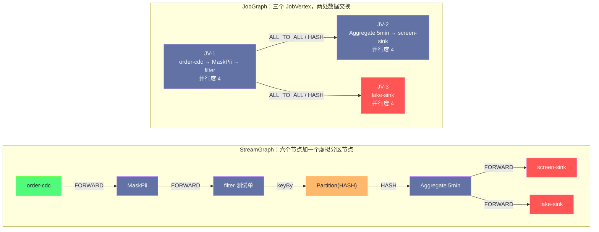
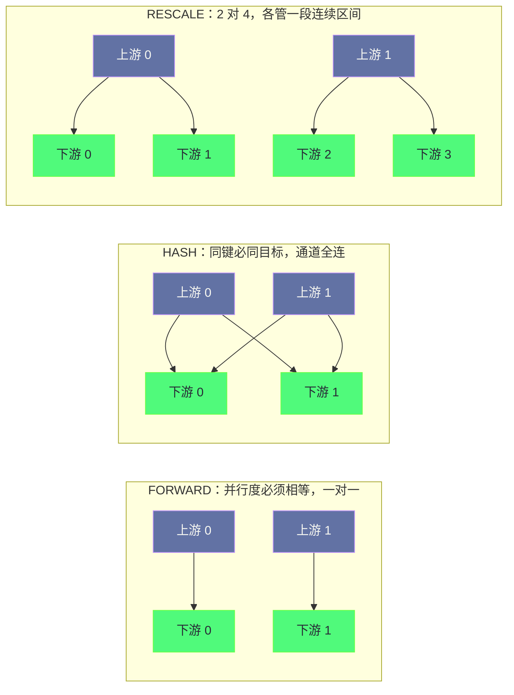
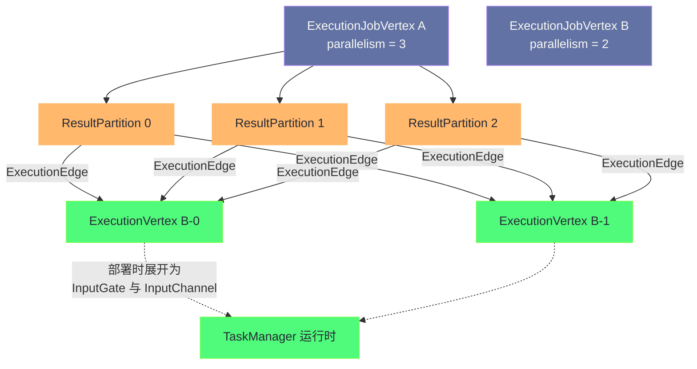
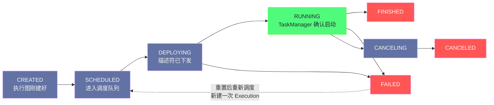

**摘要：**

一段 DataStream 代码从用户手里交出去，到变成 TaskManager 上的一条线程，中间被重写两次：`StreamGraph` 忠实记下用户写了什么，`JobGraph` 把它压成可以提交的 Task 与数据交换，`ExecutionGraph` 再按并行度把它拆成一个个可调度、可失败、可重试的执行实例。三次形态对应三种视角，混淆视角就会得出错的判断——在 Web UI 的 Plan 里数算子框，数到的永远是链接合并之后的 Task，而不是用户写的算子；在提交日志里找并行度展开的痕迹，也永远找不到，因为那件事发生在 JobMaster 里。本文沿着一条电商实时大屏加 CDC 入湖的链路，先拆 `StreamNode` 与 `StreamEdge` 的数据结构，以及 `keyBy` 为什么从不是一个独立算子；再讲清 `StreamGraph` 到 `JobGraph` 这一次重写里的算子链判据、槽位共享组推断与边交换形式的选择；最后进入 JobMaster，看 `JobVertex` 如何展开成 `ExecutionVertex`、结果分区如何记账、一次失败重试如何留下新的执行尝试。全文落在一个判断上：三张图的设计不是为了让编译流程好看，而是把"优化决策"和"物理绑定"这两类知识，放到**信息最齐全的那个时刻**去用。

---

## 第 1 章 从一次"算子去哪了"的误判说起

### 1.1 Plan 页面数出来的算子

一个几乎每个 Flink 使用者都会遇到、又几乎总被解释错的场景：作业提交成功，打开 Web UI 的 Plan 页面，数一数框的数量，发现代码里明明写了七个算子，页面上只剩三个框；有人据此判断"Flink 把我的算子合并了，所以逻辑没执行"，于是回头去查业务逻辑，把一个纯性能优化误当成功能缺陷。

这个误判的根源在于视角：Plan 页面展示的是 `JobGraph`，其中的一个框就是一个 `JobVertex`，而一个 `JobVertex` 等价于一个 Task、一条线程、一次调度与一次失败重试的单位；它可以包含一到多个原始算子，链接（Chaining）就是把多个算子压进同一个 `JobVertex` 的手段。框变少不代表算子消失，只代表它们不再各自拥有独立的线程与独立的数据交换。

与之对称的另一类误判出现在故障排查里：有人盯着提交日志找"并行度 8 的子任务是在哪一步被创建出来的"，找不到，就以为并行度在提交时已经确定。并行度这个数字在 `StreamGraph` 与 `JobGraph` 里都只是顶点上的一个属性值，真正的展开发生在 JobMaster 内部，展开时还会把每个顶点的输出切成一堆结果分区（Result Partition），而这些动作在客户端进程里一条日志都不会留下。

所以不妨先把三张图各自回答的问题分开，后面所有关于"为什么这样设计"的讨论才有落脚点。

### 1.2 三次形态、三种知识

Flink 的执行模型可以当成一个三级的中间表示（Intermediate Representation，IR）来看，但更准确的说法是：每一级 IR 只掌握某一段特定的知识，也只在这一段知识齐备时做决策。

在 `StreamGraph` 这一层，齐备的是用户意图：数据从哪来、经过哪些转换、按什么键分组、写到哪里去。此时集群还没有参与，槽位、机器、网络拓扑一概未知，所以这一层什么物理决策都不做。

到了 `JobGraph` 这一层，齐备的是"哪些开销可以在提交前消掉"：相邻算子能不能共用线程、能不能跳过一次序列化、槽位共享的边界划在哪里、边上要做点对点还是全连接。这些判断只需要编译期信息，不需要知道任何一台机器的状态，因此可以放在客户端做，做完之后作业描述就固定下来，成为可以序列化、可以持久化、可以重复提交的一份文件。

到了 `ExecutionGraph` 这一层，齐备的是"现在有哪些资源可以用"：哪个 TaskManager 报了槽位、哪个子任务放到了哪个槽位、哪个结果分区已经可以被消费。这一层的信息随集群状态持续变化，因此它只能活在 JobMaster 的内存里，作业结束就消失。

这三段知识的时间窗是错开的，这就是分层的全部理由。把槽位决策提前到客户端，客户端不可能知道；把链接决策推后到 JobMaster，等于每次重启都要重算一遍本可以离线算好的东西，还会让同一份代码在不同集群上产出不同拓扑。

### 1.3 三张图的位置、寿命与本文边界

下图把三张图的产生位置、持有者与它们之间的转换画在同一条时间线上，注意竖线左边全部发生在客户端进程内，右边全部发生在 JobManager 进程内，中间只有一次网络提交。

```mermaid
%%{init: {'theme': 'dracula'}}%%
graph LR
    classDef client fill:#8be9fd,stroke:#8be9fd,color:#282a36
    classDef jmcard fill:#6272a4,stroke:#bd93f9,color:#f8f8f2
    classDef graph fill:#50fa7b,stroke:#69ff47,color:#282a36
    classDef tm fill:#ffb86c,stroke:#ffb86c,color:#282a36

    subgraph CL["客户端 JVM（应用模式下为 JobManager 进程内的提交线程）"]
        A["用户 DataStream 代码"]:::client
        SG["StreamGraph<br/>StreamNode + StreamEdge<br/>逻辑拓扑，算子级粒度"]:::graph
        JG["JobGraph<br/>JobVertex + JobEdge<br/>链接后的 Task 级粒度"]:::graph
        A -->|"StreamGraphGenerator<br/>反向遍历 Transformation"| SG
        SG -->|"StreamingJobGraphGenerator<br/>链接 / 槽位组 / 边类型"| JG
    end

    subgraph JM["JobMaster（JobManager 进程）"]
        EG["ExecutionGraph<br/>ExecutionVertex + Execution<br/>并行展开 + 结果分区"]:::graph
        SCH["调度器 / 槽位池 / 检查点协调器"]:::jmcard
        EG --> SCH
    end

    TM["TaskManager<br/>Task 线程与 InputGate"]:::tm

    JG -->|"REST 提交序列化后的 JobGraph"| EG
    SCH -->|"TaskDeploymentDescriptor"| TM
```

三张图放在一张表里对照，差别一眼就出来。

| 维度 | StreamGraph | JobGraph | ExecutionGraph |
|---|---|---|---|
| 生成位置 | 客户端 JVM（`execute()` 时） | 客户端 JVM（同一调用内） | JobMaster 内部 |
| 核心元素 | `StreamNode` + `StreamEdge` | `JobVertex` + `JobEdge` + `IntermediateDataSet` | `ExecutionJobVertex` + `ExecutionVertex` + `Execution` + `IntermediateResult` |
| 粒度 | 每个算子一个节点 | 每条链一个 Task | 每个并行子任务一个顶点 |
| 是否含并行实例 | 否，只有 parallelism 属性 | 否，只有 parallelism 属性 | 是，已展开为具体实例 |
| 是否含资源绑定 | 否 | 否 | 是，含槽位与部署描述 |
| 是否持久化 | 否 | 启用高可用时写入 `SubmittedJobGraphStore` | 否，只在内存 |
| 主要回答的问题 | 用户写了什么 | 哪些开销能在编译期消掉 | 现在在哪跑、跑得怎么样 |

本文的边界划在这里：三张图的构造、两次重写的判据与代价、并行展开与结果分区的记账方式，全部写透。槽位如何被申请与仲裁、子任务如何落到具体机器、区域故障恢复与全局重启的判据，归 [[大数据/Flink/Flink原理深度解析与性能优化/01 Flink 架构总览：JobManager、TaskManager 与执行模型|架构总览与执行模型]]；网络栈、缓冲池与反压的传播路径归 [[大数据/Flink/Flink原理深度解析与性能优化/04 Flink 网络传输与反压机制深度解析|网络传输与反压]]；状态后端、key group 的内部结构与检查点的屏障机制归 [[大数据/Flink/Flink原理深度解析与性能优化/05 Flink 状态后端深度解析|状态后端]]与 [[大数据/Flink/Flink原理深度解析与性能优化/06 Flink Checkpoint 机制深度解析|Checkpoint 机制]]。至于"并行度该设多少、提交报错先查哪里"，那是实战专栏的题目，本文只在机制需要时给默认值，不列配置清单。

---

## 第 2 章 StreamGraph：用户写的东西如何落成一张图

### 2.1 从 Transformation 到 StreamNode

DataStream API 的每一次调用，都在后台追加一个 `Transformation` 对象：`map` 生成 `OneInputTransformation`，`keyBy` 生成 `PartitionTransformation`，`window` 生成带窗口算子的转换，`sink` 生成 `SinkTransformation`，两条流合并时生成 `TwoInputTransformation`。这些对象串成一棵以 sink 为根的树，用户在 `execute()` 之前看到的只是 `DataStream` 这个门面，真正的结构藏在 `env.getTransformations()` 里。

`execute()` 触发的是 `StreamGraphGenerator.generate(env, transformations)`。它**从 sink 开始反向递归**，逐个把 `Transformation` 翻译成 `StreamNode` 与 `StreamEdge`：每个转换子类对应一个 `TransformationTranslator`（譬如 `OneInputTransformationTranslator`、`PartitionTransformationTranslator`），翻译动作就是向 `StreamGraph` 里 `addOperator`／`addSource`／`addSink` 一个节点，再通过 `addEdge` 接上上游。反向遍历的顺序决定了节点 ID 的分配顺序，这也是为什么 Web UI 里靠后的算子有时反而拿到更小的 ID。

这里有一个容易被忽略的性质：`StreamGraph` 的构建是纯内存的、无副作用的，因此它可以在提交之前被反复取出观察。`env.getStreamGraph()` 拿到的是同一张图，`StreamGraph#getJobGraph()` 拿到的是重写后的产物，两者都可以在本地打印成 JSON（`JSONGenerator`）或导出成 DOT，用来核对"我以为的拓扑"与"Flink 理解的拓扑"是否一致。排查拓扑类问题时，这比读日志有效得多。

### 2.2 节点与边上的字段

`StreamNode` 与 `StreamEdge` 是 Flink 里最朴素的图结构，字段不多，但每一个都直接对应后续某一步决策。下表的字段取自官方 API 文档，说明栏写的是它在后面哪一步被消费。

| 结构 | 字段 | 含义与后续用途 |
|---|---|---|
| `StreamNode` | `id` | 节点编号，后续边与配置都以它索引 |
| `StreamNode` | `operatorFactory` | 算子工厂，最终被序列化进 `JobVertex` 的配置 |
| `StreamNode` | `operatorName` | 显示名，`JobVertex` 名称由链上各算子名拼接而成 |
| `StreamNode` | `parallelism` / `maxParallelism` | 并行度与并行度上限，直接带到 `JobVertex` |
| `StreamNode` | `slotSharingGroup` / `coLocationGroup` | 槽位共享与强制同址，是链接判据之一 |
| `StreamNode` | `inEdges` / `outEdges` | 入边出边，链接算法靠入度判断能否合并 |
| `StreamNode` | 输入输出类型序列化器 | 决定跨 Task 时用哪套 `TypeSerializer` |
| `StreamNode` | `minResources` / `preferredResources` | 细粒度资源需求，汇总到 `JobVertex` |
| `StreamEdge` | `sourceId` / `targetId` | 边的两端 |
| `StreamEdge` | `partitioner` | 分区器实例，决定下游哪个通道收到数据 |
| `StreamEdge` | `exchangeMode` | 数据交换形式（流水线还是批），与分区器是两件事 |
| `StreamEdge` | `outputTag` | 侧输出标签，普通边为空 |
| `StreamEdge` | `bufferTimeout` / `uniqueId` | 输出缓冲的等待时长与边标识 |
| `StreamEdge` | `intermediateDatasetId` | 与 `JobGraph` 的 `IntermediateDataSet` 对齐的标识 |

二手资料里常见的写法是"源 ID、目标 ID、分区器、侧输出标签列表"，方向没错，但有两处需要纠正：边本身持的是两端节点的引用而不只是 ID，侧输出也不是一个列表而是一个 `OutputTag` 字段（一个节点可以有多个侧输出，但每条边只有一个标签）。这类细节看着琐碎，可在读 Web UI 的 JSON、写自定义序列化器或核对侧输出拓扑时，差一个字段就会得出相反的结论。

### 2.3 keyBy 为什么不是一个算子

初学者最容易卡住的一个点：`keyBy` 在图上找不到对应的节点。原因是它确实不处理数据——它的语义是"把同键的数据送到同一个下游子任务"，这属于数据分发的职责，不属于计算。翻译器为此引入了一种特殊节点：虚拟节点（Virtual Node）。

`StreamGraph#addVirtualPartitionNode` 会插一个不持有算子工厂、不产生任何计算的节点，它唯一的载荷是分区器与交换形式；下游真正的算子通过这个虚拟节点接上游。虚拟节点在 `StreamGraph` 里占一个 ID，看起来像算子，但生成 `JobGraph` 时会被折叠进边里——分区信息落到 `JobEdge` 上，节点本身不产出 `JobVertex`。侧输出走的是同一套机制（`addVirtualSideOutputNode`），所以侧输出也不会多出一个 Task。

这套设计的价值在于把"分发"从"计算"里拆了出来。如果 `keyBy` 真的生成一个算子，它就得占用一条线程、参与链接判断、出现在 Plan 图上，还要为它分配输入输出缓冲；而它什么都不算，只是给下游的数据贴一个路由规则。**把不产生计算的东西挡在图外**，是这张图能被后续优化器干净处理的前提。

笔者的实践经验是：只要看到 `StreamGraph` 里出现 `Partition` 或 `SideOutput` 字样的节点，就该意识到它不会变成 Task，Plan 图上少一个框与它无关。真正需要在 Plan 图里核对的，是那些被链在一起的计算算子。

### 2.4 并行度的三个来源

并行度在 `StreamGraph` 里是一个普通整数属性，但它的**取值有优先级**：算子级 `setParallelism` 最高，其次是环境级 `env.setParallelism`，最后是集群配置里的 `parallelism.default`（默认 1）。用户什么都没设时，算子的并行度是 `ExecutionConfig.PARALLELISM_DEFAULT`（一个哨兵值），提交前由环境补齐，`JobVertex` 上的 `isParallelismConfigured` 记录了这个值究竟是"用户设过"还是"继承来的"。

这个标记有实际用途：自适应调度器与部分优化逻辑需要区分"用户明确要 8"与"默认落成 8"——前者在扩容时是硬约束，后者可以随可用槽位调整。同理，`maxParallelism` 也有来源之分——用户显式设过就尊重设置，没设就按并行度推一个默认值，规则是把并行度的 1.5 倍向上取到最近的 2 的幂，下限 128，上限 32768（`JobVertex` 的 `setMaxParallelism` 也明确要求不超过 `Short.MAX_VALUE + 1`）。

`maxParallelism` 的真正含义是"这个算子的键空间被切成多少份"，也就是键组（Key Group）的数量。键落到哪个键组由哈希决定，键组再按比例分给各个并行子任务；并行度可以小于等于 `maxParallelism`，状态迁移时按键组整体搬动。这条关系的完整推演属于 [[大数据/Flink/Flink原理深度解析与性能优化/05 Flink 状态后端深度解析|状态后端]] 的题目，这里只需记住一句：**改并行度改的是"谁负责哪几份键组"，改不了"键空间有多大"**，后者在作业第一次跑起来时就被 `maxParallelism` 钉死。

### 2.5 一张图能看见什么，不能看见什么

到这里可以给 `StreamGraph` 一个准确的定位：它是用户意图的完整记录，含全部算子、全部边、全部并行度与槽位组设置，也能反映 `disableChaining`、`startNewChain` 这类意图标记；但它不含任何"合并结果"，因为合并是下一次重写的事。想看自己写的七个算子长什么样，应该看 `StreamGraph`；想看它们会被切成几个 Task，得看 `JobGraph`。

两个视角对应两种调试场景：拓扑写错（少了一条流、侧输出接反、keyBy 的键选错）在 `StreamGraph` 上看得最清；性能问题（并行度、链接、分区方式）必须看 `JobGraph`。混着看，就会出现本章开头那种"算子被优化掉了"的误判。

---

## 第 3 章 第一次重写：从逻辑拓扑到可提交的作业

### 3.1 谁在执行这次重写

`StreamGraph` 到 `JobGraph` 的转换由 `StreamingJobGraphGenerator` 完成，入口是 `StreamGraph#getJobGraph()`。它做的事情按顺序分五步：确定链接边界并把算子分组、为每个组创建一个 `JobVertex` 并把链上各算子的配置序列化进去、为非链接的输出创建 `JobEdge` 与 `IntermediateDataSet`、汇总槽位共享组与资源需求、把作业级的提交信息（用户 JAR、检查点设置、Savepoint 恢复设置、算子协调器等）挂到图上。整个过程没有任何网络与集群交互，纯粹是**一次内存里的图重写**。

生成位置这件事在部署模式上有差别，值得先说清。会话模式与旧式每作业模式下，重写发生在提交端 JVM 里，客户端的 `main()` 跑完 `execute()` 就得到 `JobGraph`，再通过 REST 交给集群；应用模式（Application Mode）下，`main()` 本身就在 JobManager 进程里执行，重写也就在集群内完成。这解释了一个常见困惑：应用模式下客户端进程退出后，作业依然能启动，因为编译这一步根本不在它身上。三种模式的差异归 [[大数据/Flink/Flink从入门到实战/09 Flink on YARN 与 Kubernetes 生产部署|部署形态]] 那一篇，这里只需记住：`JobGraph` 一定生成在**执行 `main()` 的那个进程**里。

### 3.2 链接的四条判据与两条附带条件

算子链（Operator Chaining）是这次重写里唯一一处真正的结构优化：把满足条件的相邻算子压进同一个 `JobVertex`，让它们在一条线程里顺序执行，中间不经过序列化与网络缓冲。判据有四条，全部满足才允许合并。

| 判据 | 具体含义 | 不满足时的后果 |
|---|---|---|
| 同并行度 | 上游与下游的 parallelism 相等 | 无法建立一对一通道映射，只能走交叉传输 |
| 边为 forward | 边上的分区器是 `ForwardPartitioner` | 需要重分区，必然引入网络与序列化 |
| 同槽位共享组 | 两端属于同一个 `SlotSharingGroup` | 两者可能被调度到不同 TaskManager，无法同线程 |
| 未禁用链接 | 全局与算子级都没有关闭链接 | 强制断开 |

除这四条，还有两条附带条件常被忽略。其一是下游顶点的入度必须为 1：一条链是一条线程里自上而下串行执行的一串算子，它没有分叉能力，所以当下游同时接收多个上游的数据时，它不能并入任何单一上游的链。其二是边的交换形式不能是批（`StreamExchangeMode.BATCH`）：批模式下上游要先把结果整体产出并结束，消费者才被拉起，这种"生产完再消费"的关系与"同线程边算边传"的链接语义直接冲突。

还有一条与并行度上限相关的限制：两端的 `maxParallelism` 不一致时，默认不做链接。理由不难推——链接之后的 Task 只有一个 `maxParallelism`，两端上限不同意味着键空间划分不同，合并会破坏状态迁移时的键组对齐。放开这条限制有对应配置，但开关名与默认值在版本间有过调整，以对应版本文档为准，本文不展开。

### 3.3 用一条实时大屏链路走一遍

拿一个贯穿全文的案例：MySQL 的订单库变更通过 CDC 进入 Flink，脱敏、过滤掉测试单之后按 `userId` 分组，做五分钟滚动窗口聚合出成交额，一路写进 Kafka 供实时大屏消费，一路写进湖表供离线对账。

```java
// 只保留与拓扑有关的调用，注释写的是"它为什么影响图"，不是"它做了什么"
DataStream<Order> orders = env.fromSource(
        mysqlCdcSource, WatermarkStrategy.noWatermarks(), "order-cdc");   // p = 4
DataStream<Order> masked = orders.map(new MaskPii());                     // FORWARD，可链
DataStream<Order> valid = masked.filter(o -> !o.isTestOrder());           // FORWARD，可链
DataStream<OrderAgg> agg = valid
        .keyBy(Order::getUserId)                                          // 虚拟节点，HASH 边
        .window(TumblingEventTimeWindows.of(Duration.ofMinutes(5)))
        .aggregate(new AmountAggregate());                                // p = 4
agg.sinkTo(kafkaSink).name("screen-sink");                                // FORWARD，可链
agg.sinkTo(paimonSink).name("lake-sink");                                 // FORWARD，另一条支路
```

对应的 `StreamGraph` 有六个实数节点（源、脱敏、过滤、窗口聚合、两个 sink）加一个由 `keyBy` 引入的虚拟节点。执行重写时，链接算法从源开始沿出边探索：源到脱敏是 forward 且并行度同为 4，合并，脱敏到过滤同样合并，过滤到窗口聚合之间是 `keyBy` 产生的哈希边，断开。窗口聚合的两条出边都是 forward，但**一条链只能线性地往下延伸**，所以其中一条支路（Kafka sink）会挂在链尾，另一条（湖表 sink）独立成 Task。

下面的图把重写前后的拓扑并排画出来，左边是用户视角，右边是提交视角。



两个细节值得停下来说：第一，两个 sink 各成拓扑支路，但只有一个能与上游同链，另一条必须独立成 Task；Plan 图上因此出现一个"多出来"的框，这不是配置错了，而是"一条链只能是一条线"的直接后果。第二，`keyBy` 之后的哈希边把拓扑切成两段，这段边界上必须做一次真正的数据重分布：上游四个子任务的记录，按 `userId` 的哈希重新分发到下游四个子任务的通道里，谁也省不掉。

### 3.4 链带来的三笔节省

把两个算子放进同一条线程，省下的东西分三笔，且三笔的量级完全不同。

第一笔是序列化：跨 Task 的每一次传递都要走一遍类型序列化器，把记录对象写成字节、压进输出缓冲、对端读出字节、再反序列化成对象。链内传递只是把记录对象的引用交给下游算子的处理入口，一次方法调用而已。记录越小、序列化器越简单，这笔差距越小；带嵌套结构、字段多、字符串字段长的记录，差距会拉开到微秒量级。

第二笔是缓冲与线程：每条跨 Task 的边在运行时都要占一份网络缓冲配额、一组输入通道与输出通道，还要在 TaskManager 里维护对应的读写索引；同线程传递既不占缓冲也不建通道。线程这边同理：不链接时四个算子、并行度 4 就是十六条 Task 线程，全部链接之后只剩四条的链头线程在跑整条逻辑。

第三笔是调度与故障的边界：`JobVertex` 是调度、部署与失败重试的最小单位，链少了，部署描述符就少，检查点需要记录与确认的子任务也少，作业启动与恢复的固定开销随之下移。

我们举个量级上的示例推算：假设上述链路每秒处理 50 万条记录，单条记录的序列化加压缓冲加反序列化合计按 1 微秒估算（这个数字随记录大小、序列化器与是否跨节点差别很大，只作量级参考），那么每省掉一处跨 Task 边界，就相当于每秒省下约 0.5 个核的处理时间；源到过滤这段省掉两处边界，一秒就是约一个核的常驻算力。如果换成每秒五万条、记录更小的场景，这笔收益会缩到百分之几核，链的价值就从"省 CPU"退化成"少几个线程与缓冲"。这类推算只能给方向，不能当基准，真实收益应当用吞吐与 CPU 使用率的前后对比去测。

### 3.5 链不是越长越好

既然链接省序列化、省线程，那把所有算子链成一条是不是最优？不是，而且这是运维现场最常见的一类误判。

第一个问题是背压传染：同一个 Task 里的算子共享一条邮箱线程，数据从链头进、链尾出，串行推进；链尾的 sink 一旦被下游系统拖慢，输出缓冲写满，整条线程就停下来等，链头的源也随之停摆。这在结构上等价于"把整条流水线绑成了一根绳子"，而原本 sink 慢是可以被上游的缓冲与网络吸收一段的。反压的传播路径与缓冲阈值归 [[大数据/Flink/Flink原理深度解析与性能优化/04 Flink 网络传输与反压机制深度解析|网络传输与反压]]，这里只取结论：链越长，缓冲的"减震"层级越少。

第二个问题是故障域扩大与定位困难。链内任何一个算子抛出异常，整个 `JobVertex` 失败，其它算子的状态与进度一起回滚重来；排障时线程栈里堆着链上所有算子的调用，CPU 火焰图上链头与链尾混在一起，一个热点算子会把它前后邻居的耗时一起吃掉，看指标很容易把账算到错误的算子上。

第三个问题是对齐与断点变少：链内的屏障处理只在链头做一次对齐，链内不再有新的对齐点，这对检查点是好事；但它同时意味着链内没有可以"停下来等一下"的分界，一旦链内某个算子依赖外部系统的同步调用（一次没设超时的 JDBC 查询、一次同步 HTTP 请求），整条线程会被这次调用按在地上，链上所有算子的水位线推进、定时器触发、检查点响应一起延后。

所以链接的取舍是：在"记录形状一致、计算轻、无外部阻塞"的相邻算子之间，**链接几乎总是赚的**；一旦某个算子的耗时形态与邻居完全不同（重计算、状态扫描、外部 IO），**断开链接换回的是可观测性与故障隔离**。这与"没有银弹、架构即权衡"是同一件事的两面。

### 3.6 三个开关与它们的组合效果

控制链接的入口有三个，语义各不相同，混用会得到意料之外的拓扑。

`disableChaining()` 作用于调用它的那个算子，让它既不被并入上游的链，也不吸收下游的算子，等价于在这个算子上切一刀。`startNewChain()` 只切上游那一侧：从它开始起一条新链，但它自身仍可以与下游合并。全局的 `env.disableOperatorChaining()` 把所有链都拆开，通常只在排查期用，生产上很少作为长期配置。

`slotSharingGroup("name")` 看起来是资源设置，实际也参与链接判据：不同槽位共享组的算子不能链，因为链的前提是同一线程，而不同组意味着可能被调度到不同槽位。它同时改变槽位的复用关系——给某个重状态算子单独一个组，就等于让它独享槽位、不和别的算子挤在一起，代价是集群需要的总槽位数上升。

三者组合时有一条容易踩的坑：`startNewChain()` 只保证"从我开始是新的"，如果上游恰好是 forward 且同组，上游那条边依旧满足链接条件，于是链接算法会在上游那一侧继续保持原链，最终形成"上游链 + 新链"两段，而不是"新链独立"。想彻底隔离，得在算子上同时用 `disableChaining()` 或换槽位共享组。

### 3.7 槽位共享组的推断与强制同址

槽位共享组在 `StreamGraph` 里就存在（每个节点一个字段），到 `JobGraph` 才落到 `JobVertex` 上，成为调度期"哪些子任务可以塞进同一个槽位"的依据。默认情况下全作业只有一个 `default` 组，所有算子都往里挤，这正是"并行度 16 的作业只需 16 个槽位"的来源：同一条流水线的各阶段各拿一个子任务挤进同一个槽位，槽位只需等于最大组的并行度。

用户没显式指定时，算子通常继承上游的组；显式指定的话，那条边同时断开两件事——链接与槽位复用。这个耦合经常被误读成"设了槽位组就一定不链接"，方向是对的，但因果要理清：不是槽位组禁止链接，而是不同组意味着可能被放在不同机器上，同线程的前提不存在了。

与槽位共享组相邻的另一个概念是强制同址（`CoLocationGroup`），它要求两个顶点的第 i 个子任务必须落在同一台 TaskManager 上，比"同一槽位共享组"更严。它主要服务于迭代与批处理里需要严格配对的结构，流作业里很少主动设置；一旦设置，调度器可选的机器数会被显著压缩，资源不足时报的是"找不到满足同址约束的槽位"，而不是普通的资源不足。

### 3.8 边的两个属性：谁收到，以及怎么送

`JobGraph` 的边上其实带了两层信息，这两层经常被混为一谈。

一层是分区器（Partitioner），它回答"这条记录该进下游哪个通道"：`ForwardPartitioner` 一对一，`RebalancePartitioner` 轮询，`RescalePartitioner` 按比例划一段连续区间，`KeyGroupStreamPartitioner` 按键组取模，`BroadcastPartitioner` 复制到所有通道，`GlobalPartitioner` 全塞给 0 号子任务。它在 `StreamGraph` 的边上就已经确定，转成 `JobGraph` 时被折算成分发模式（`DistributionPattern`）：forward 与 rescale 折算成点对点（POINTWISE），其余折算成全连接（ALL_TO_ALL）。

另一层是交换形式，回答"这份数据以什么方式交给下游"：流水线方式下生产者与消费者同时在线、边算边传；批方式下生产者先算完落地、消费者再启动；还有介于两者之间的可重复消费与选择性消费形式。这一层在代码里由 `StreamExchangeMode` 枚举承载，全局默认由 `GlobalStreamExchangeMode` 决定，最终落到结果分区类型（`ResultPartitionType`）上，取值包括完全流水线、带界流水线、阻塞、混合等几种。

选择权在编译期被分派到两处：分区器由用户 API 或查询规划器指定，交换形式由执行模式与全局交换模式决定，两者都没表态（`UNDEFINED`）的边交给全局默认兜底。这解释了一个常被忽略的现象——同一份代码在流模式与批模式下产出的 `JobGraph`，边上的分区类型可以完全不同，拓扑看起来一样，运行时行为却是两回事。

把这两层分开之后，"FORWARD / RESCALE / REBALANCE / HASH / BROADCAST 是交换模式"这句话就该修正了：它们是分区方式，决定"送给谁"；交换形式决定"怎么送"；工程口语把两者混称并不影响使用，但排查问题时会指错方向——看到边上写着 ALL_TO_ALL 就以为是分区器配错了，其实那只是分发模式的描述；看到结果分区被标成阻塞，又以为是并行度问题，其实那是交换形式被批模式覆盖了。

顺带说一个容易忽略的默认值：上下游都不指定分区器时，并行度相等走 forward，不等走 rebalance。这个默认不是最优解，而是保守解：rebalance 保证每个下游子任务都能均匀收到数据，代价是全连接。社区里长期有诉求把它改成 rescale（FLINK-32872），理由是高并行度下全连接会带来大量额外通道与缓冲占用；这件事**截至 1.19 仍是开放状态**，想用只能在代码里显式指定，或者按版本支持情况调整全局交换形式。

### 3.9 被顺手做掉的其它事

除了链接与边，这次重写还完成了几件不显眼但必需的事。用户 JAR 的路径与 BLOB 键被挂到 `JobGraph` 上，提交时随图一起上传，TaskManager 再按作业维度建类加载器；检查点设置被序列化成 `JobCheckpointingSettings`，JobMaster 拿到之后才知道该按什么间隔、什么超时去触发；Savepoint 的恢复设置同样是图的一部分，这也是"从 Savepoint 恢复"在提交链路里表现为"带参数的提交"的原因。

此外，链上每个算子的 `StreamConfig`（算子工厂、输入输出类型、边配置、缓冲超时等）被逐份序列化进 `JobVertex` 的配置里，这就是 `JobGraph` 看起来"除了拓扑还塞了一堆字节"的原因；源与 sink 的算子协调器（Operator Coordinator）以序列化描述符的形式挂在 `JobVertex` 上，由 JobMaster 在作业启动时实例化。这些内容合起来说明一件事：**`JobGraph` 不是拓扑图，而是"重启这个作业所需要的一切"**，这也解释了为什么它必须可序列化、可持久化，而 `ExecutionGraph` 不需要。

---

## 第 4 章 分区方式如何决定运行时行为

### 4.1 FORWARD：在编译期就把话说死

`ForwardPartitioner` 的语义最窄：上游第 i 个子任务的输出，只送给下游第 i 个子任务。它要求两端并行度严格相等，且这个要求在编译期就校验——并行度不等却指定 forward，提交阶段就会抛出"forward 分区不允许改变并行度"之类的异常，而不是等到运行时才发现通道对不上。

这条约束的连带效果是：forward 边天然可以参与链接，因为"同并行度加一对一"正好满足链接判据里的两条；反过来，一旦链接成立，中间的边就不需要通道、不需要缓冲、不需要序列化。所以 forward 是"零成本边"的代名词，也是算子链能够成立的结构基础。

但零成本只在同机同线程时成立。如果两个相邻算子因为槽位共享组不同、被调度到两台机器上，即便边是 forward，数据也必须跨网络走一趟，这时省掉的只是"重分区"这一步，物理传输一点没少。很多人看到 forward 就以为没有网络开销，这是把"逻辑上的一对一"当成了"物理上的同进程"。

### 4.2 HASH：键组、通道与连接数的账

`KeyGroupStreamPartitioner` 是 `keyBy` 的产物，它的映射链条有三段：先对键做哈希得到键组编号，再按键组与并行度的比例算出目标子任务，最后在目标子任务上选定输出通道。整条链上，同一个键必然落在同一个键组、同一个子任务，这就是"同键数据一定进同一个并行实例"的保证，也是键控状态（Keyed State）能成立的前提。

它的代价写在分发模式上：哈希分区必须让每个上游子任务都能把数据送到任意一个下游子任务，于是分发模式是全连接（ALL_TO_ALL）。全连接意味着每个上游子任务都要与每个下游子任务各建一条通道，通道总数等于上下游并行度的乘积。

用示例推算感受一下量级：上下游都是 100 并行度时，一个全连接边就是一万条通道；每条通道在两端各占一份网络缓冲与索引结构，而 TaskManager 的缓冲池总量由网络内存决定、按通道分摊。通道多了，单条通道能分到的缓冲就薄，缓冲薄了，反压的触发点就提前，作业在高吞吐下会更容易因为瞬时抖动而陷入"传不动"的状态。并行度从 100 涨到 200，通道数不是翻倍而是四倍，这是"扩并行度反而更慢"的一种结构性解释。网络内存如何分配、缓冲池如何借还，归 [[大数据/Flink/Flink原理深度解析与性能优化/04 Flink 网络传输与反压机制深度解析|网络传输与反压]] 那一篇，这里只结算代价。

### 4.3 REBALANCE：默认不是最优，是保守

`RebalancePartitioner` 轮询地把记录摊到所有下游通道，同样是全连接，同样要序列化与网络，唯一的好处是负载均衡——不依赖键的分布，纯按条数摊。它是"并行度不等且没有指定分区器"时的默认选择，这个默认值经常被当成 Flink 的推荐值，其实它只是最不容易出错的兜底：无论上下游并行度是多少，rebalance 都能保证数据被摊开，不会出现某些下游子任务一条数据都收不到。

代价是全连接在大并行度下的通道爆炸。当上下游并行度成整数倍关系、且业务不要求按键聚合时，rescale 往往比 rebalance 更划算，这也是社区长期希望把默认值改掉的原因（FLINK-32872）。不过默认值的改动会改变既有作业的网络拓扑与性能特征，属于兼容性敏感事项，因此至今没有落地，需要的人只能显式指定。

### 4.4 RESCALE：按比例切一段，省网络但不对等

`RescalePartitioner` 走的是中间路线：把下游通道按比例划成若干连续区间，每个上游子任务只负责其中一段。上游 4 个、下游 8 个时，每个上游管两个下游，通道总数等于下游并行度，比全连接的 32 条少了四分之三；上游 8 个、下游 4 个时，每两个上游客一个下游。

它的分发模式是点对点，这一点常被误认为"和 forward 一样没有网络"。区别在于：forward 是严格的一对一且并行度必须相等，rescale 是"每对多"或"多对一"，上下游并行度不等，跨机器的可能性依然存在，只是每个子任务要连的对方变少了。真正省下的是通道数、缓冲占用与连接建立的固定开销。

它还有一个不可忽视的缺陷：**不整除时会倾斜**。上游 4 个、下游 3 个时，区间长度只能取 2、1、1 这样的分配，有的下游要接两个上游的流量，有的只接一个，负载天然不均。所以 rescale 适合"并行度成倍数、且已经确认各处流量相当"的场景，用之前先问一句整除关系，比事后调参更省事。

把三种最常用的映射结构画在一起，差别就不用靠文字描述了：forward 是互不相交的直连，hash 是四通八达的全连接，rescale 是各自管一段连续区间的分组。



三种结构在图上边数相差不大，落到运行时却完全不同：forward 的两条边可以缩成同一线程里的方法调用，hash 的每一条边都是一份缓冲与通道，rescale 的边数虽然也少，但每条边背后都可能是跨机器的网络传输。

### 4.5 BROADCAST、GLOBAL 与自定义

`BroadcastPartitioner` 把每条记录复制给所有下游通道，适合"小表广播"——维度表、配置表、黑名单这类需要与主流做本地关联的数据。它的成本随并行度线性放大：广播一份 10 MB 的配置给 100 个下游，就是 1 GB 的复制流量，因此广播流必须真的小、真的稳定。

`GlobalPartitioner` 把所有数据都塞给 0 号子任务，看起来能"汇总到一处"，实际是把并行度废掉了，只在下游确实只需要单点处理（譬如写一个不支持并发写的文件）时用，且必须接受 0 号子任务成为瓶颈。

自定义分区器通过 `partitionCustom` 注册，用户实现"给定键与通道数，返回通道号"的逻辑。它的风险在于可测试性差：分区函数写错不会报错，只会让数据静默地落进错误的子任务，进而让键控状态出现"同一个键在两个实例上各有一半"的怪象。

把七种方式放在一张表里对照，选择就变成查表而不是凭印象。

| 分区方式 | 通道映射 | 分发模式 | 可否参与链接 | 主要代价 |
|---|---|---|---|---|
| FORWARD | i 对 i，并行度须相等 | POINTWISE | 可以，且必须同并行度 | 无额外开销，但跨机仍需网络 |
| HASH | 按键组取模 | ALL_TO_ALL | 不可以 | 全连接通道数，缓冲摊薄 |
| REBALANCE | 轮询摊到所有通道 | ALL_TO_ALL | 不可以 | 全连接通道数，最均衡 |
| RESCALE | 按比例划连续区间 | POINTWISE | 不可以 | 通道少，不整除时倾斜 |
| BROADCAST | 复制到所有通道 | ALL_TO_ALL | 不可以 | 复制流量随并行度线性放大 |
| GLOBAL | 只发 0 号下游通道，其余通道空转 | ALL_TO_ALL | 不可以 | 单点瓶颈，并行度失效 |
| CUSTOM | 用户函数决定 | 视实现而定 | 不可以 | 正确性靠用户自己保证 |

### 4.6 分区方式在哪里被冻结

分区器在 `StreamGraph` 的边上确定，在 `JobGraph` 里折算成分发模式与结果分区类型，在 `ExecutionGraph` 里由边管理器（Edge Manager）展开成一条条具体的执行边。这条链路的关键性质是：**它在编译期冻结，运行期改不了**。作业跑起来之后想把某个哈希边改成 rescale，唯一的办法是改代码、重新编译、从 Savepoint 恢复。

SQL 路径上还有两个特殊分区器值得一提，它们说明"优化"不只发生在用户可见的算子层。一个是"未指定并行度时的 forward 分区器"：当上下游并行度都还是默认哨兵值、边也没指定分区器时，边按 forward 处理——因为运行时两者都会落成同一个环境默认值，相等是必然的，提前按 forward 处理可以让链成立。另一个是"连续同哈希的 forward 化"：当查询计划里出现连续多次相同的哈希重分区时，规划器会把除第一次之外的几次改写成 forward，让它们能链在一起，省掉中间几次完全重复的重分布。这两处优化都不是用户的职责，但理解它们能解释一个现象——同样的 SQL 逻辑，手写 DataStream 时看到的 shuffle 次数往往比 SQL 版本多。

---

## 第 5 章 第二次重写：从 Task 到可调度的执行实例

### 5.1 谁在哪里建这张图

`JobGraph` 到达 JobMaster 之后，由 `DefaultExecutionGraphBuilder` 把它展开成执行图。输入是三样东西：`JobGraph`、作业级配置、以及这个作业已完成的最新检查点（用于恢复状态）。输出是 `ExecutionGraph`，官方文档对它的一句话定义是"协调数据流分布式执行的核心数据结构"，这句话的分量在下一节会显现——它不是拓扑的副本，而是拓扑加上资源、状态与生命周期的复合体。

这里有一个与 01 篇呼应的分工：`JobGraph` 是"重启这个作业所需要的一切"，`ExecutionGraph` 是"这一次运行此刻的样子"。前者可以在作业之间传递、可以在高可用切换后被另一个 JobMaster 读出来重建，后者与当前这批机器强绑定，作业停了就消失。

例外只有一处：自适应调度器（`jobmanager.scheduler: adaptive`，1.15 起提供）不预先展开全部并行子任务，它维护的是调度拓扑，实际并行度按可用槽位在运行时决定。这让"ExecutionGraph 一旦生成就固定"的说法在开启该调度器后不再严格成立，也把一部分并行度决策从编译期推到了运行期。调度器的选择与槽位申请归 [[大数据/Flink/Flink原理深度解析与性能优化/01 Flink 架构总览：JobManager、TaskManager 与执行模型|架构总览与执行模型]]，本文只按默认调度器的模型讲。

### 5.2 结构对齐：两套名字，一一对应

两张图的元素几乎一一对应，只是粒度降了一级，名字也换了一套。把这些对应关系记牢，读 Web UI 的 JSON 与源码时就不会迷路。

| JobGraph 侧 | ExecutionGraph 侧 | 关系 |
|---|---|---|
| `JobVertex` | `ExecutionJobVertex` | 一对一的包装，后者多带并行实例与输出结果 |
| `JobVertex.parallelism` | `ExecutionVertex[]` | 一个并行度展开成同样多的执行顶点 |
| `IntermediateDataSet` | `IntermediateResult` | 顶点的一份输出，被展开成一组结果分区 |
| `JobEdge` | 执行边（`ExecutionEdge`）数组 | 一条 Job 边展开成上游子分区与下游顶点的连接关系 |
| `DistributionPattern` | 连接展开规则 | 点对点与全连接在此决定谁连谁 |
| `ResultPartitionType` | `IntermediateResult.resultType` | 结果分区的传输形式随边带下来 |

注意最后两行的分工：分发模式与分区类型在 `JobGraph` 上是"边"的属性，到了执行图里，一部分变成结果分区的属性（传输形式），一部分变成连接展开的规则（谁连谁）。这个拆分不是随手为之——传输形式是分区自己的事，连接关系是消费者的事，两者在运行时的生命周期完全不同。

### 5.3 并行展开：从顶点到实例

展开动作很直接：`ExecutionJobVertex` 为对应的 `JobVertex` 创建 parallelism 个 `ExecutionVertex`，每个执行顶点带一个从 0 开始的下标（`subTaskIndex`），并持有它将要产出的若干个结果分区、以及它要消费的上游执行边。

真正的复杂度在下一层：`ExecutionVertex` 本身不是"一次执行"，它更像一个"职位"，具体由谁在什么时候干这件事，由它当前持有的执行对象（`Execution`）表示。每次失败重试都会新建一个 `Execution`，带新的执行尝试标识（`ExecutionAttemptID`），旧的那次进入历史记录等待清理。这个设计**把位置与尝试分开**：位置是拓扑决定的、稳定的；尝试是运行期产生的、可失败的。历史记录容器有容量上限，不会无限增长——这也回答了一个常见的担心：一个反复失败的子任务不会把 JobMaster 的内存吃光。

`Execution` 上挂着的东西依次是：本次尝试的标识、当前状态、分配到的逻辑槽位、以及部署时用到的描述符。逻辑槽位是个抽象，它描述"这个任务被允许在哪个 TaskManager 上跑、占多少资源份额"，具体的物理槽位与容器归 ResourceManager 与 TaskManager 管，这条边界见 01 篇。

还有一处近几版里逐渐显形的变化：`JobVertex` 上有一个"是否支持并发执行尝试"的标记，配套的是支持推测执行的执行顶点类型。它意味着"一个子任务同一时刻只有一个尝试"不再是绝对前提——慢任务可以被额外拉起一个尝试，谁先完成算谁的。这让执行图的记账从"每顶点一个当前尝试"变成"每顶点一组活跃尝试"，也是近几版调度侧改动最集中的地方。

### 5.4 结果分区：谁的输出，谁在消费

`IntermediateResult` 是"某个顶点的一份输出"在执行图里的账本，它下面挂着一组结果分区（`IntermediateResultPartition`），数量等于该顶点的并行度：每个子任务产出一份分区，分区编号与 `subTaskIndex` 对齐。分区自己记着传输形式与当前状态（生产中、可消费、已消费完等），也记着下游有哪些消费者在等它。

下游一侧，`ExecutionVertex` 持有的是指向上游分区的执行边。一条执行边是"我要读某个上游子任务的某份分区"的声明，而不是一条已经建立的网络连接；真正的连接要到部署时由 TaskManager 按输入门描述符建立，这是"执行图只描述意图、运行时才建通道"的分界。



上图是一个全连接边（上游 3、下游 2）的展开结果：三份结果分区，每份都被两个下游执行顶点各声明一次读，合起来六条执行边。同样的拓扑若换成点对点，连接会被裁成"每份分区只给一个下游"，或者"每个下游只拿一份分区"，具体裁法由分发模式与并行度比例决定。这一步是"通道数"这个量的真正出处，也是为什么第 4 章里那句"通道数等于上下游并行度乘积"只在全连接时成立。

### 5.5 状态机与一次重试的账

执行尝试的状态机不复杂，但每一次迁移都有明确的触发者，记清触发者，看日志时才能对上号。



从 `SCHEDULED` 到 `DEPLOYING` 的关键动作是拿到槽位：JobMaster 从自己的槽位池里取一个已分配的槽位，把描述符发出去。`DEPLOYING` 到 `RUNNING` 靠 TaskManager 的回报，这也是"任务进程起了但作业还没 RUNNING"那段灰色时间的来源——描述符到了，类还没加载完，算子还没初始化。失败后回到的不是 `CREATED` 而是重新调度，因为执行图本身不需要重建，重建的只是那一次尝试。

失败的范围决定重试的规模：一个子任务失败，通常只重置它自己与依赖它的下游（区域恢复），这也是 01 篇里"区域故障恢复以什么前提成立"的另一半答案——前提正是执行图能按连接关系算出"哪些顶点受影响"。区域恢复的判据与退化成全局重启的条件归 01 篇，这里只指出：**能算清影响面，是因为完整的连接关系还在图里**。

### 5.6 一份描述符里的东西

部署时下发给 TaskManager 的描述符，是执行图与运行时之间的唯一契约，它要回答"起什么类、配什么参数、连谁"三个问题。内容分五块：作业级信息（作业 ID、名称、作业配置）、任务级信息（顶点名、并行度、当前子任务下标、链上各算子的序列化配置）、输入门描述（要读哪些上游子任务的哪些分区）、结果分区描述（要产出哪些分区、什么传输形式）、以及状态句柄（从检查点恢复时要读哪份状态）。

TaskManager 收到之后按顺序做：用作业维度的类加载器加载算子类、按序列化配置还原链上每个算子、按描述创建输出分区与输入通道、最后把 Task 线程挂到邮箱循环上开始处理。这条路径上的任何一步失败都会以"部署失败"的形式回到 JobMaster，而不是在算子代码里报错——这也是为什么"提交成功但作业起不来"多半要看部署描述而不是业务异常。

### 5.7 为什么这张图不持久化

三张图里只有 `JobGraph` 会被持久化，`ExecutionGraph` 只在内存里活着，这个不对称是个值得停下来想一想的决策。

`ExecutionGraph` 里最占分量的信息是运行时绑定：哪个子任务拿到了哪个逻辑槽位、槽位在哪个 TaskManager 上、每个分区当前的可消费状态、每次尝试的标识。这些信息在另一台 JobMaster 上、或者在这批 TaskManager 换过之后，几乎全部过期，持久化下来的价值接近于零，误用的风险却不小——恢复时如果照着旧绑定去调度，会得到一个"看起来有状态、实际上对不上"的执行图。

反过来，重建的成本并不高：JobMaster 拿到 `JobGraph` 与最新检查点，重跑一次展开，几秒到几十秒内就能得到一张新的执行图；状态从检查点搬到新实例，位置关系重新算，代价是这段时间的延迟，而正确性有保证。用一句白话概括：它选择**每次重新算一遍**，而不是记住一堆会过期的答案。

历史视图是另一个东西：Web UI 上能查到已结束作业的执行情况，靠的是归档后的执行图快照，那是**一份只读投影**，可序列化、可展示，与运行期那张能改状态、能重试的图不是同一份对象。把归档视图当成执行图本身，是另一个常见误判——归档图里没有槽位、没有活跃尝试，它只记录"当时跑成什么样"。

---

## 第 6 章 改并行度时，三张图各发生了什么

### 6.1 只有第一名能改

并行度这件事上，三张图的权限是严格递减的：`StreamGraph` 里的 `parallelism` 与 `maxParallelism` 是源头的两个数，到了 `JobGraph` 变成顶点上的属性（还带着"是否被显式设置"的标记），到了 `ExecutionGraph` 就已经被展开成固定数量的实例。所以"把并行度从 4 调到 8"在机制上的完整含义是：改代码或改提交参数、重新生成 `StreamGraph` 与 `JobGraph`、提交一个并行度不同的新作业、在 JobMaster 里展开成 8 个执行顶点、再把旧作业的状态搬过来。

搬状态这件事由执行图构建阶段的状态分配逻辑（`StateAssignmentOperation`）完成，分两条路：键控状态按"键组到子任务的映射"整体搬迁，键组是搬迁的最小单位，所以新并行度不能超过 `maxParallelism`，键组落在哪个新子任务上要在构建执行图时按新布局重算；算子状态没有键的概念，按列表拆分或合并后重新分配。前一条路的完整推演属于 [[大数据/Flink/Flink原理深度解析与性能优化/05 Flink 状态后端深度解析|状态后端]]，后一条路上界与恢复流程属于 [[大数据/Flink/Flink原理深度解析与性能优化/06 Flink Checkpoint 机制深度解析|Checkpoint 机制]]。

### 6.2 天花板在第一次启动时就浇筑好了

`maxParallelism` 是键空间的切分份数，它在作业第一次跑起来时就被写进 `JobGraph`，之后只能通过"不带状态重启"来改。原因是键与键组、键组与子任务的映射被固化在状态里：一份检查点记录的键组编号是按旧的上限算出来的，换一个上限，同一个键算出的组号就变了，旧状态会挂到错误的组上。

这也是"并行度调不上去"的一类真实原因：业务想从 64 扩到 256，发现扩不动，因为当初 `maxParallelism` 用了默认推导值（64 的 1.5 倍向上取 2 的幂，落成 128），128 就是天花板。这个问题没有运行期的解法，只有提前规划——上线前把上限设得比预期峰值大一些，代价是键空间更碎、每份状态的键组元数据更多，属于"预留空间"与"元数据开销"之间的取舍。

### 6.3 为什么不能就地改

有人会问：执行图里不就是一个数字吗，改一下再重新展开不行吗。不行，原因不在那个数字，而在它牵连的结构。

并行度一改，链的判据就变了：原本同并行度的 forward 边可能变成不等，链接必须断开；原本因为 `rescale` 存在的点对点连接可能变成不整除的倾斜布局；`JobVertex` 的数量、每个顶点的槽位共享组所需槽位数全部随之变化。这些都不是"改个数字"能表达的变化，而是一次重新编译。换句话说，**并行度不是执行期参数，它是编译期输入**，把它当运行期参数调，必然要付出重新编译与状态重分配的代价。

### 6.4 运行期改动的那条例外

唯一的例外是自适应调度器：它把"展开多少实例"推迟到资源到位之后，先拿槽位，再按拿到的槽位决定实际并行度，运行中还可以按新到位的资源继续加实例。这条路上，执行图确实被改写了，但改写的语义与"重新提交"不同——它不需要从 Savepoint 恢复，状态按新的子任务布局就地重新分配。

代价同样明确：正在进行的检查点必须等这次布局变化处理完之后才有意义，屏障要面对的是一张"边长变了的图"；状态重分配期间的数据一致性依赖检查点协调器与状态分配逻辑的配合，一旦这次分配失败，回退路径比默认调度器更少。这条路的适用条件是资源弹性、负载波动大、且作业本身能容忍并行度频繁变化，不是所有作业都该开。

---

## 第 7 章 四个反例与一张判据表

### 7.1 以为链越多越好

把整条链路关进一个 Task，省下的序列化确实最多，但第 3 章已经结算过三笔反向代价：缓冲的减震层级被删掉、故障域被放大、外部阻塞会按住整条线程。一个具体的判据是：链上如果有任何一个算子在做同步外部调用（写数据库、调 HTTP 接口、读对象存储），就不该与邻居同链——它一旦慢下来，占的是整条链的线程时间，而链路本身既没有输入缓冲也没有"插队"的能力。

反过来的判据同样成立：如果整条链都是"取一条记录、算几个字段、往下传"这种同构处理，那么这条链越长越省，因为省掉的是重复的序列化与线程切换，而减震需求本来就不存在（上游是源、下游是 sink，中间没有可积压的环节）。

### 7.2 以为 keyBy 之后还能 FORWARD

这是一个在代码评审里经常出现的假设：上下游并行度都是 4，`keyBy` 之后为什么不能一对一传？因为 `keyBy` 的语义不是"保持原样往下传"，而是"按键重新分配"，哪怕并行度相同，同一个上游子任务手里的键也可能属于任意一个下游子任务——除非上游此前已经按同样的键分过区。Flink 里没有自动的"同分区识别"，`keyBy` 边一律是全连接的哈希分发；只有在 SQL 计划器那侧，连续相同的哈希重分区才会被改写为 forward。

误判的后果不止是性能：如果因为看到"并行度相同"就手工把这条边改成 forward，键控状态会立刻错乱——同一个键的两个实例各持一半状态，聚合结果会出现重复或缺失，且不会报错。

### 7.3 以为 RESCALE 可以替代 HASH

`rescale` 便宜的原因是**它不看键**，只按比例切一段连续区间。正因为不看键，它不能承担按键聚合的分发职责：把它用在 `keyBy` 之后，同一个键会被送到随机的下游子任务，键控状态随之散架。它的正确用法是"不需要按键亲和、但要避免全连接"的场合，譬如纯 map 类算子在并行度变化时的过渡、或者确认无状态的算子之间的再平衡。

还有一层更隐蔽的代价：`rescale` 的映射依赖于上下游并行度的比值。今天 4 对 8 时每个上游连两个下游，明天上游扩到 5，比值变成 5 对 8，区间长度不再整齐，倾斜与"某些子任务连接数突然变多"会一起出现。用 `rescale` 的地方，平行扩缩容的余量要提前算。

### 7.4 以为 Plan 图就是代码拓扑

回到第 1 章那个误判：Plan 页面是 `JobGraph` 的投影，它回答"会被切成几个 Task"，不回答"写了几个算子"。核对拓扑要看 `StreamGraph`，核对并行实例要看顶点展开后的子任务列表。三张图对同一个作业给出三个正确答案，用错图去问问题，得到的每个答案都是错的。

### 7.5 从症状找图

排查时先定位"该看哪张图"，比直接翻日志有效得多，下表按症状归纳。

| 症状 | 先看什么 | 常见根因 |
|---|---|---|
| Plan 图上的算子比代码少 | `JobGraph` | 链接合并，属正常 |
| Plan 图上的算子比代码多 | `StreamGraph` 与 `JobGraph` 对照 | 虚拟节点被误读为算子，或链被拆开 |
| 某个算子与预期不在同一条线程 | 链判据四条的任一条 | 并行度不等、边非 forward、槽位组不同、被显式断开 |
| 作业提交即报并行度相关异常 | 边与并行度设置 | forward 边遇到并行度不等 |
| 键控状态结果重复或缺失 | 键的分区方式 | 误用 rescale 或自定义分区器覆盖了哈希边 |
| 扩并行度后吞吐反而下降 | 全连接边的通道数 | 哈希或轮询边在高并行度下的通道爆炸 |
| 作业长期卡在部署阶段 | `ExecutionGraph` 的尝试状态 | 槽位未就绪、类加载失败、描述符被拒 |
| 并行度调不上去 | `JobGraph` 上的 `maxParallelism` | 键空间上限低于目标并行度 |

笔者的经验是，这张表里没有一条要求"读懂全部源码"，但它们要求分清三张图的职责。分清之后，大部分拓扑类困惑会退化成一句"我看的是哪张图"。

---

## 第 8 章 收束：两次重写各自关掉了什么

把两次重写放回它们各自的时间窗里看，结论会清楚很多。

第一次重写关掉的是"结构上的不确定性"：把 N 个算子收敛成少数几个 Task，把边的分区方式与传输形式定死，把槽位共享的边界划好。做完之后，提交物就定型了——同一份 `JobGraph` 在任何集群上展开出的拓扑完全一致，只有并行实例的落点不同。这正是"一次编译、多处部署"能成立的原因。

第二次重写关掉的是"资源与状态上的不确定性"：给每个 Task 找到槽位、把执行实例与尝试分开、把结果分区记成可查询的账本、把失败重试变成"新建一次尝试"。做完之后，作业不再是一份描述，而是一个能被观测、能被局部重启、能被检查点协调的活体。

两次重写之间那条界线，恰好是"编译期"与"运行期"的界线。Flink 没有试图用一张图同时表达逻辑与物理，而是愿意维护三份表示、承担三份同步成本，换来的是每一层都能在信息最齐全的时刻做它最擅长的判断。这是分层架构的常规收益，也是它的常规代价：三份表示意味着三处可能不一致，调试时需要在三个视角之间来回切换。

拿一句权衡收尾：`StreamGraph` 保住表达力，`JobGraph` 换来效率与可移植，`ExecutionGraph` 换来可控与可恢复，三者之间没有谁更重要，只有"此刻你要回答哪个问题"。下一篇 [[大数据/Flink/Flink原理深度解析与性能优化/03 Flink 内存模型深度解析|内存模型]] 会从 TaskManager 内部往下看，解释网络缓冲、托管内存与堆内对象如何在同一个 JVM 里分账，以及为什么那张账本决定了并行度与状态规模的上限。

---

## 参考资料

1. Apache Flink 官方文档，*Operator Chaining*（1.19），说明聚合算子与 Task 的关系以及三个链接开关的语义。
2. Apache Flink 1.19 API：`org.apache.flink.streaming.api.graph` 包（`StreamGraph`、`StreamNode`、`StreamEdge`、`StreamingJobGraphGenerator`、`GlobalStreamExchangeMode`）。
3. Apache Flink 1.19 API：`org.apache.flink.streaming.api.transformations.StreamExchangeMode`（枚举取值与语义）。
4. Apache Flink 1.19 API：`org.apache.flink.runtime.jobgraph` 包（`JobGraph`、`JobVertex`、`JobEdge`、`DistributionPattern`、`IntermediateDataSet`）。
5. Apache Flink 1.19 API：`org.apache.flink.runtime.executiongraph` 包（`ExecutionGraph`、`ExecutionJobVertex`、`ExecutionVertex`、`Execution`、`IntermediateResult`、`IntermediateResultPartition`、`EdgeManager`）。
6. Apache Flink 源码：`StreamGraphGenerator`、`StreamingJobGraphGenerator`、`DefaultExecutionGraphBuilder`（1.19 分支）。
7. Apache Flink JIRA：FLINK-32872，*Add option to control the default partitioner when the parallelism of upstream and downstream operator does not match*，默认分区器从 rebalance 改为可配置的讨论。
8. Apache Flink 源码：`org.apache.flink.streaming.runtime.partitioner` 包，`ForwardForUnspecifiedPartitioner` 与 `ForwardForConsecutiveHashPartitioner` 的注释。

---

> [!note] 思考题
> 1. 如果链的前提是"同一条线程"，那么一个算子同时向两个下游支路发送数据时，为什么拓扑里必然有一条支路要独立成 Task？反过来想，如果允许链分叉，运行时的输出缓冲与屏障处理会遇到什么麻烦？
> 2. `keyBy` 之后并行度相同，为什么仍然是全连接而不是一对一？假如你负责设计 Flink，能否安全地识别出"上游已按同样键分区"从而把这条边降级为 forward？需要哪些额外信息？
> 3. `ExecutionGraph` 不持久化的理由是"会过期"，但归档执行图又确实被保留下来了，这两者为什么能共存？如果让你在 HA 场景下优化恢复速度，会不会考虑持久化执行图的某个子集，持久化哪一部分才安全？
> 4. 自适应调度器把并行度决策推迟到运行期，这与"并行度是编译期输入"的判断是否矛盾？它改写执行图时，检查点与键组分配要额外满足什么条件？
> 5. 一个作业的 `maxParallelism` 在首次启动时就固定了，这让"先上线再扩"的路径存在天花板。除了把它设大，还有什么办法能给未来的扩容留下空间？代价分别是什么？