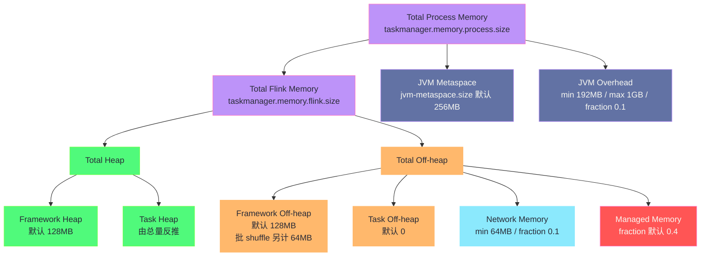
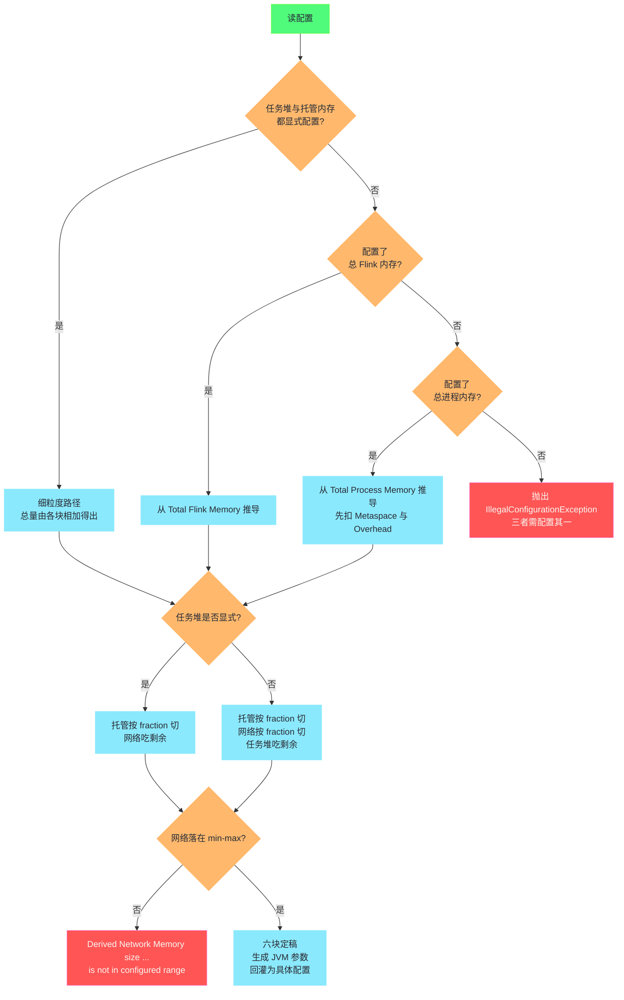
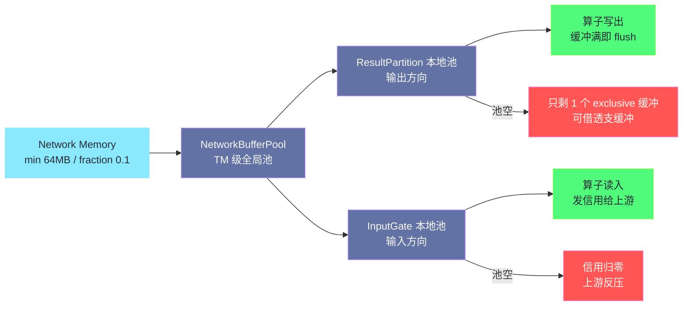
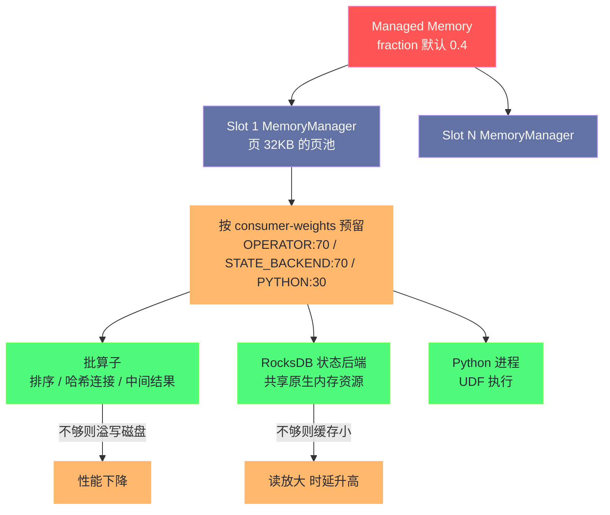
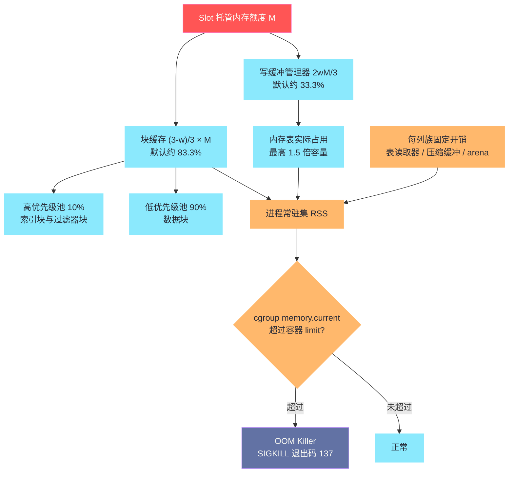

**摘要：**

Flink 在 1.10 版本用一套统一内存模型（FLIP-49）替换了此前由若干互不相干的参数拼凑出来的内存配置，把 TaskManager 进程的内存切成六块：框架堆、任务堆、框架堆外、任务堆外、网络内存、托管内存，再用 JVM Metaspace 与 JVM 额外开销两块把进程账本补齐。这套模型的特别之处在于它不只是"把内存挪到堆外"，而是给每一块内存起了名字、定了上限、并在启动时用一个可校验的推导过程把总量算平。本文从 JVM 堆在流处理场景下的三处结构性困境讲起，先给出六块内存的完整账本与各自的配置键，再逐层拆开启动时的分配顺序、`Total Flink Memory` 与 `Total Process Memory` 的层级关系、以及配置矛盾时抛出的 `IllegalConfigurationException` 具体文案；随后分别深入网络内存的缓冲池记账、托管内存的页池与消费者权重、RocksDB 的原生内存分割公式这三处最容易配错的地方，最后归纳 OOM 的三种形态与判据，说明 Flink 自动推算的 `-Xmx`、`-XX:MaxDirectMemorySize` 与手工 JVM 参数的冲突边界。全文落在一个判断上：内存模型的价值不是让利用率逼近极限，而是把"随机死亡"换成"可计算的边界"。

---

## 第 1 章 为什么 Flink 不肯把内存交给 JVM

### 1.1 堆内状态的三处结构性困境

流处理作业对内存的需求有两种截然不同的形状：一类是每处理一条记录就要申请、随即丢弃的短命对象，譬如反序列化出来的 `OrderEvent`、字符串拼接产生的临时数组；另一类是活得比记录久得多、容量随数据量线性增长的状态，譬如按 `userId` 累积的窗口聚合结果、去重用的 `MapState`。把这两类东西放进同一个堆里，JVM 的垃圾回收器只能按同一套启发式规则去应付。

第一处困境是停顿与堆大小之间的矛盾。堆越大，一次完整回收要扫描的存活对象越多，停顿越长，而流处理作业的端到端延迟预算通常以秒甚至毫秒计。一个配置 32GB 堆、状态占用十几 GB 的作业，一旦触发老年代回收，停顿几秒是常态，恢复期还要重新预热 JIT 与缓存，期间上游缓冲被填满、反压向上游传导、Checkpoint 因为算子线程停摆而超时，超时又触发重启与状态恢复，恢复过程本身再次制造大量临时对象，形成"回收—停顿—超时—重启—再回收"的闭环。运维侧看到的是一串毫无规律的 Checkpoint 失败告警，根因却只是堆太大。

第二处困境是内存使用的不可预测：JVM 的回收有延迟，对象从"不再被引用"到"内存真正可用"之间隔着至少一次回收动作；在高吞吐场景下，对象创建速率可能高到新生代来不及清理，晋升到老年代的对象把回收推向更长的停顿。Flink 需要的是一种"申请即得、归还即还"的确定性，而堆内存给不了这种确定性。

第三处困境是隔离缺失：一个 TaskManager 里跑着若干槽位（TaskSlot），每个槽位里可能塞着不同算子的子任务，它们共享同一个堆。某个槽位因为数据倾斜导致状态膨胀，会把整个进程拖进 GC 地狱，其余槽位无辜受累；而进程一旦被内核杀掉，故障面是整个 TaskManager 上的所有作业分片，重启代价与故障定位难度都被放大。

### 1.2 1.10 之前的旧模型为什么必须换掉

要理解统一内存模型的形状，得先看一眼它取代了什么。Flink 1.10 之前的 TaskManager 内存配置是一组各自为政的参数：`taskmanager.memory.size` 直接指定总内存，`taskmanager.memory.fraction` 指定堆内状态可用的比例，`taskmanager.memory.off-heap` 开关堆外内存，网络缓冲则用 `taskmanager.network.num-buffers` 这样的条数来表达，堆大小还得靠 `env.java.opts` 里手写 `-Xmx`。

这套参数的问题是彼此不知道对方的存在：把 `taskmanager.memory.fraction` 调大，可能让实际堆需求超过手工写的 `-Xmx`；把网络缓冲条数调大，可能在容器里挤掉堆空间却没有任何提示；堆外内存是否启用、启用了多少，与 RocksDB 的实际占用之间没有换算关系。结果是配置能启动、能跑，但账算不平，出问题时只能靠经验试。FLIP-49 的设计目标写得很直白：用一个统一的、可推导、可校验的内存模型，替代这堆互相冲突的开关，并明确区分"Flink 自己用的内存"与"JVM 自己要用的内存"。

### 1.3 自管理的两层含义

Flink 从 JVM 手里接管内存，做的其实是两件事。第一件是把大块、长生命周期、不需要对象语义的数据挪到堆外，网络缓冲直接操作字节而不经过对象转换，托管内存用内存段（`MemorySegment`）承载排序与哈希的中间结果，RocksDB 的状态更是完全住在 C++ 侧的原生内存里。第二件，也是更容易被忽略的一件，是**建立账本**：每一块内存都有独立的配置键、有默认值、有上限，启动时由一个推导过程把各块相加并与总量核对，任何一块超支都会在进程启动阶段以配置异常的形式爆出来，而不是等到运行三天之后被内核杀掉。

笔者愿意用机房供电来类比这套设计：把总闸交给电工（JVM 的自动内存管理），你能得到的是"够用就好"的平均分配；而给每个机柜装独立电表与断路器（Flink 的内存分区与上限），你失去的是一点峰值利用率，换来的是任何一路过载都不会烧掉整排机柜。第二件事才是这套模型真正的价值所在，也是后面所有配置键、所有校验异常、所有 OOM 判据的来源。

---

## 第 2 章 六个区块：TaskManager 内存的完整账本

### 2.1 三层结构与六个区块

统一内存模型的层级关系可以概括成一句话：进程内存减去 JVM 自己要用的两块，剩下的全部归 Flink 支配，而这部分再按"堆内还是堆外"、"框架用还是任务用"切成六块。下图把这层关系画全，注意托管内存与网络内存都落在堆外一侧，而 Metaspace 与额外开销不在 Flink 内存之内。

这张图里最容易被读错的是"托管内存在堆外"这一条：它既不在 JVM 堆里，也不在 JVM 的直接内存限额里，而是 Flink 通过 `Unsafe` 向操作系统申请的本地内存，属于**原生（native）内存**的一类。因此在容器里它照样占进程的常驻集（RSS），照样会被 cgroup 记账，只是不受 `-Xmx` 与 `-XX:MaxDirectMemorySize` 的约束。理解了这一条，后面关于"堆没满但容器被杀"的讨论才有落脚点。

### 2.2 六块各自负责什么

框架堆（Framework Heap）是 Flink 运行时自己用的堆内存，装的是 JobManager 与 TaskManager 之间 RPC 的请求响应对象、Checkpoint 协调用的元数据、算子与任务描述符这些框架级对象，默认 128MB，对应 `taskmanager.memory.framework.heap.size`。文档明确把它标为高级选项，只有确认框架自身确实不够用时才调，用户代码不应指望这块空间。

任务堆（Task Heap）是用户算子代码跑的地方，装处理中的记录对象、用户代码里的临时集合、以及使用堆内状态后端（`HashMapStateBackend`）时的全部状态。它的配置键 `taskmanager.memory.task.heap.size` 是一个"可选显式项"：不设时由总量反推得到，设了则优先尊重。用堆内状态后端时，这块内存的大小直接决定了作业能承载多大的状态，也直接决定了 GC 的压力曲线。

框架堆外（Framework Off-heap）是框架侧的直接内存，Netty 的 RPC 缓冲、部分本地传输的缓冲都从这里出，默认 128MB。批处理还有一项独立的框架堆外额度，键名是 `taskmanager.memory.framework.off-heap.batch-shuffle.size`，1.20 文档里默认 64MB，早期版本是 32MB，专供批模式的网络 shuffle 使用。

任务堆外（Task Off-heap）留给用户代码自己申请的堆外内存，默认 0。凡是算子内部直接用 `ByteBuffer.allocateDirect` 或者第三方库（譬如某些序列化库、本地缓存库）申请的直接内存，都应该显式记在这块额度上；不记也不会立刻出错，只是这部分内存实际不受任何限制，出问题时账本对不上。

网络内存（Network Memory）是任务之间交换数据用的缓冲，键是 `taskmanager.memory.network.min`、`.max` 与 `.fraction` 三个一组，默认值分别是 64MB、1GB（1.20 起改为无上限）、0.1。它是唯一一块**不足就会立刻表现为反压**的内存，第 4 章单独展开。

托管内存（Managed Memory）由 Flink 自己管理、以原生内存形式向操作系统申请，服务三类消费者：流作业里的 RocksDB 状态后端，流与批作业里的排序、哈希表、中间结果缓存，以及 Python 进程里执行的用户自定义函数。它的键是 `taskmanager.memory.managed.size` 与 `.fraction`，默认走 fraction 0.4，第 5、6 章展开。

### 2.3 两块 JVM 自用内存为什么必须单列

JVM Metaspace 存类元数据，Java 8 之后从永久代搬到本地内存，配置键 `taskmanager.memory.jvm-metaspace.size` 默认 256MB，Flink 会把它翻译成 `-XX:MaxMetaspaceSize`。这块内存与用户代码的膨胀方式有关：加载的类越多、动态生成的类越多，它涨得越快。

JVM 额外开销（JVM Overhead）是这套模型里最像"预留机动"的一块，装的是线程栈、JIT 编译产物与代码缓存、GC 自身的辅助数据结构（记忆集、卡表、标记位图）、JNI 调用返回的结构体等等，这些项目的共同特点是无法在启动时精确计算。配置方式同样是 min/max/fraction 三元组，默认 `taskmanager.memory.jvm-overhead.min` 192MB、`.max` 1GB、`.fraction` 0.1。它的存在意义是把"JVM 运行本身要花的钱"从 Flink 的账本里划出去，这样容器申请的额度才能覆盖真实常驻集，而不是只覆盖堆加堆外。

### 2.4 版本差异：三处会咬人的变化

内存模型的骨架从 1.10 到 2.x 没有变过，但具体参数在三处发生过变化，配置时必须以对应版本文档为准。其一是网络内存的上限：1.14 一代的文档里 `taskmanager.memory.network.max` 默认 1GB，1.20 与 2.0 的配置表里这一项已改成无上限（infinite），意味着网络内存可以随总量线性增长，不再被 1GB 卡住。其二是缓冲条数的配置项：1.14 一代还有 `taskmanager.network.memory.buffers-per-channel`（默认 2）与 `taskmanager.network.memory.floating-buffers-per-gate`（默认 8），1.20 的配置表里已经找不到这两项，官方把调优入口收敛到网络内存总量与缓冲大小上。其三是缓冲去膨胀（buffer debloat）机制，1.14 引入 `taskmanager.network.memory.buffer-debloat.enabled`（默认关闭），用吞吐预测动态调节在途数据量，把"该开多少缓冲"从人工经验变成运行时自适应。

把这三处变化记住的实际好处是：拿到一份别人的配置模板时，能判断它写于哪个版本，哪些键在目标版本上已经失效。

---

## 第 3 章 分配顺序：启动时这笔账怎么算

### 3.1 三条合法路径与一条死路

Flink 启动 TaskManager 时，第一件事是把配置解析成一个确定的内存规格。这段逻辑在 `ProcessMemoryUtils` 里，判断顺序只有三层：如果细粒度必填项（任务堆与托管内存）都显式配了，就走细粒度路径；否则如果配了总 Flink 内存（`taskmanager.memory.flink.size`），就从它往下推；否则如果配了总进程内存（`taskmanager.memory.process.size`），就从总进程内存往下推；三者都没有，直接抛异常。异常文案保留了这三个键的完整说明，大意是"以下三者必须显式配置其一"，分别是细粒度的任务堆与托管内存、总 Flink 内存、总进程内存。

这条判断顺序解释了一个常见困惑：为什么"明明配了 `task.heap.size`"还是会启动失败。原因是细粒度路径要求任务堆与托管内存**同时**显式配置，只配其中之一，既走不进第一条路径（不满足"全部包含"），又没有总量可以反推，于是落到死路上。

### 3.2 两条推导分支的正反向

拿到总量之后，六块内存的推导分两条分支，取决于任务堆是否被显式指定。

任务堆显式指定时，托管内存按 fraction 从总量里切出（默认 0.4），网络内存取剩余部分，也就是"总量减去框架堆、框架堆外、任务堆、任务堆外、托管内存之后剩下的全部"。这条分支的隐含约束很硬：剩下的那部分必须落在网络内存的 min/max 区间内，否则抛"推导出的网络内存不在配置区间内"的异常。换句话说，一旦显式钉死任务堆，网络内存就没有 fraction 可用了，它只能吃残羹，且残羹的多少必须刚好合规。

任务堆未指定时，顺序反过来：先按 fraction 切托管内存，再按 fraction 切网络内存，两者都分别与自己的 min/max 求交，最后任务堆拿剩下的部分。这条分支里网络内存是按总量乘 0.1 算的，所以调大托管内存比例、或者把总量调小，都会同时压缩网络内存与任务堆。

两条分支都用到了同一组工具函数：按比例算并夹到区间内，以及按"反比例"算。反比例的公式是 `base × f / (1 − f)`，用在"已知其余部分、要把目标块补成总量的 f"这种场景，JVM 额外开销与细粒度路径下的网络内存都走这个公式。它和正比例的区别在于基准：正比例以总量为基准，反比例以"除目标块之外的其余部分"为基准，所以同样的 0.1，用反比例算出来的绝对值更大。

### 3.3 下图是完整的推导流程

图中把三条入口、两条分支、四类校验画在一起，箭头上的文字是触发条件。

### 3.4 校验失败时到底报什么

这套推导有四五处校验点，异常类型统一是 `IllegalConfigurationException`，抛出的位置多在 `TaskExecutorProcessUtils` 与 `TaskExecutorFlinkMemoryUtils`，而最外层会被包一层"TaskManager memory configuration failed: "的前缀。把常见文案与其含义对上号，排障时能省掉一轮猜测。

| 报错文案（片段） | 触发条件 | 该改什么 |
| --- | --- | --- |
| `Either required fine-grained memory (...) , or Total Flink Memory size (...) , or Total Process Memory size (...) need to be configured explicitly` | 三类入口一个都没配全 | 补 `taskmanager.memory.process.size`，或同时配任务堆与托管内存 |
| `Sum of configured Framework Heap Memory (...), ... and Managed Memory (...) exceed configured Total Flink Memory (...)` | 各块显式值相加超过总量 | 调小某块显式值，或调大总量 |
| `Derived Network Memory size (...) is not in configured Network Memory range [...]` | 网络内存吃剩余后超出 min/max | 放宽 min/max，或调整任务堆 |
| `Configured and Derived memory sizes (total ...) do not add up to the configured Total Process Memory size` | 总量与各块之和对不上 | 去掉互相冲突的显式项，只留一套口径 |
| `Inconsistently configured ... and its min (...), max (...)` | min 大于 max，或 fraction 落在区间外 | 修正 min/max/fraction 三元组 |
| `The configured Total Process Memory size (...) is less than the sum of the derived Total Flink Memory size (...) and ... JVM Metaspace size` | 总量连 Metaspace 都装不下 | 调大总进程内存 |

这张表的价值不在于背文案，而在于它揭示了校验的方向：Flink 不接受"配了但算不平"的状态，任何一处显式配置都会触发一次全面的账目核对。所以配置内存时最省事的姿势是只给一个总量，其余全交给推导；一旦开始显式钉死某一两块，就得同时接受"其余各块由剩余量决定"这个连带后果。

### 3.5 推导结果会被写回配置

推导完成后，Flink 会把六块的具体字节数重新写回 TaskManager 进程的动态配置，网络内存的 min 与 max 都被写成推导出的同一个值，托管内存被写成具体 size，JVM 额外开销的 min/max 同样被钉成推导值。这一步的意义是消除二义性：后续所有组件只读"确定值"，不必各自再算一遍比例，也就不会出现两个组件对同一块内存理解不一致的情况。

紧接着生成 JVM 参数，规则只有三条：`-Xmx` 与 `-Xms` 取框架堆加任务堆，`-XX:MaxDirectMemorySize` 取框架堆外加任务堆外加网络内存，`-XX:MaxMetaspaceSize` 取 Metaspace 配置值。请特别注意**托管内存**不在这三条里的任何一条中出现，它既不占堆，也不占直接内存限额，只占进程的原生内存。源码里这几个参数是拼成字符串一次性传给 JVM 的，顺序与数值都可以在启动日志里查到，这也是核对配置是否生效最快的手段。

### 3.6 一个 8GB 进程的完整账本

把公式落到数字上更容易看出各块的关系。假设 `taskmanager.memory.process.size` 配 8192MB，其余全默认，走总进程内存路径，推导过程如下（示例推算，未考虑各版本默认值差异）。

| 步骤 | 计算 | 结果 |
| --- | --- | --- |
| JVM 额外开销 | 8192 × 0.1，落在 [192, 1024] 内 | 819.2MB |
| Metaspace | 默认值 | 256MB |
| Total Flink Memory | 8192 − 819.2 − 256 | 7116.8MB |
| 托管内存 | 7116.8 × 0.4 | 2846.7MB |
| 网络内存 | 7116.8 × 0.1（1.20 之前还要受 1GB 上限约束） | 711.7MB |
| 框架堆 / 框架堆外 | 默认值 | 128MB / 128MB |
| 任务堆 | 7116.8 − 2846.7 − 711.7 − 256 | 3302.4MB |
| Xmx | 128 + 3302.4 | 3430.4MB |
| MaxDirectMemorySize | 128 + 0 + 711.7 | 839.7MB |

账最终是平的：堆 3430MB、直接内存 840MB、Metaspace 256MB、额外开销 819MB、托管内存 2847MB，五者相加正好 8192MB。这张表还暴露了一个常被忽略的事实：在默认比例下，一个 8GB 的 TaskManager 只有不到 3.3GB 的堆给用户代码，而托管内存占了 2.8GB。如果作业用的是堆内状态后端，这 2.8GB 就是纯浪费，第 5 章会讲怎么把它归零。

---

## 第 4 章 网络内存：数据在途那一段路

### 4.1 缓冲池的形状

网络内存不是"给每条记录分配一块内存"，而是预先切成固定大小的缓冲（`NetworkBuffer`，本质是包着 `MemorySegment` 的引用计数对象），再由缓冲池统一出借。`NetworkBufferPool` 是 TaskManager 级别的全局池，池容量由网络内存除以缓冲大小得出，缓冲大小取 `taskmanager.memory.segment-size`，默认 32KB；一个 711.7MB 的网络内存大约切成两万两千多个缓冲（示例推算）。除了全局池，每个输出端的结果分区（`ResultPartition`）与每个输入端的输入门（`InputGate`）各有一个本地池，本地池的目标容量按下式估算：

`目标缓冲数 = 通道数 × taskmanager.network.memory.buffers-per-channel + taskmanager.network.memory.floating-buffers-per-gate`

按 1.14 一代的默认值，前一项系数是 2、后一项是 8。这条公式解释了一件反直觉的事：网络内存的需求与并行度是乘数关系，上下游并行度一涨，通道数就涨，需要的缓冲数随之线性上升；这也解释了为什么同一份配置在小规模压测里够用，上线扩到几十个并行度之后开始报"缓冲不够"。

### 4.2 输入侧与输出侧的两套规矩

缓冲不够时会发生什么，输入与输出两侧的规矩并不一样，这一点常被混为一谈。输入侧有"必需"与"可选"之分：目标缓冲数中低于某个阈值的部分算必需，拿不到必需缓冲的任务直接失败；阈值由 `taskmanager.network.memory.read-buffer.required-per-gate.max` 控制，流模式的默认值极大（等于把所有请求都当必需），批模式默认 1000。所以流作业在网络内存不足时表现为任务部署失败并抛 `IOException: Insufficient number of network buffers`，批作业则可能悄悄降级——官方文档对这种降级的描述是"任务不失败但性能可能下降"，且明确不建议随意改这个阈值。

输出侧宽松得多：exclusive 与 floating 的配置值只当作建议值，缓冲紧张时每个输出子分区拿一个 exclusive 缓冲、零个 floating 缓冲也能继续推进。此外每个输出子任务还能额外借最多 5 个"透支缓冲"（`taskmanager.network.memory.max-overdraft-buffers-per-gate`，官方网络缓冲调优文档给出的默认值是 5），专门应付单条记录大到装不进一个缓冲、或者 FlatMap 类算子一条输入炸出大量输出这类场景；没有这几个透支缓冲，子任务线程会卡在反压上，连非对齐 Checkpoint 都无法收尾。

### 4.3 缓冲不足为什么会变成反压

信用制流量控制（Credit-based Flow Control）的细节归第 04 篇，这里只取与内存记账相关的那一环：下游的输入通道必须先从池里拿到缓冲，才能向上游发放相应数量的信用（Credit）；上游只有拿到信用才允许发送。当池子见底，输入通道拿不到新缓冲，能发的信用降到零，上游的输出缓冲随即填满，算子线程阻塞在写出调用上，反压就此形成。

这个过程的关键在于它发生在应用逻辑之外：算子的处理速度没问题，上下游的吞吐也匹配，唯一的问题是"没有可用的容器来装这段在途数据"。因此"网络内存不足导致的反压"有一个很有辨识度的特征——反压出现在所有链路上、呈全局性、与数据分布无关，而增大并行度只会让通道数增加、缓冲更紧张，反而恶化。第 04 篇会把这条判据与真实的数据倾斜型反压对照着讲。

### 4.4 在途数据量的两难

网络内存的大小直接决定了**在途数据量（in-flight data）**，而在途数据量同时牵动三个指标，方向还不一致。在途数据多，流水线不容易断流，吞吐与抗抖动能力都好；但对齐式 Checkpoint 的屏障必须排在这些数据后面才能传到下游，在途越多、屏障越慢、Checkpoint 越长；非对齐式 Checkpoint 则要把在途数据一并持久化，在途越多、快照体积越大。这个三角关系是网络内存最本质的取舍，也解释了 1.14 引入缓冲去膨胀的动机：与其让用户拍一个固定条数，不如让运行时按"当前吞吐下这些在途数据够消费多久"来反推条数，目标时长由 `taskmanager.network.memory.buffer-debloat.target` 控制，默认 1 秒。

去膨胀机制并非万能，官方文档自己列了三条限制：一个子任务有多个输入或做了 union 时，按子任务汇总吞吐会把低速输入的缓冲估多、高速输入的缓冲估少；并行度超过两百左右时，默认配置下浮动缓冲数可能不够，需要把浮动缓冲数提到不小于并行度（这是 1.20 之前仍有该配置项时的建议）；它只调整"在途数据能占多少"，不改变缓冲大小与缓冲总数，所以并不能降低网络内存的占用。

### 4.5 缓冲数怎么估

官方给了一个估算式：`所需缓冲数 = 期望吞吐 × 缓冲往返时延 / 缓冲大小`。以 320MB/s、1ms 往返、32KB 缓冲为例，算出 10 个缓冲就足以打满带宽。这个数字远小于"通道数 × 2 + 8"这类配置给出的总量，原因是后者要覆盖多通道并存与数据倾斜的尾部场景。理解两者的差别，就不会把"配置的缓冲数"误当成"并发在途数"。

下图从内存记账的角度，把网络这块内存的来路与去向画清楚。

### 4.6 网络内存该给多少

把上面的机制收成三条判断：流作业里网络内存是"必须够、不必多"的一块，够的标准是启动不报缓冲不足、压测时反压不呈全局性；扩并行度时必须同步核对网络内存，因为它随通道数增长；需要极致 Checkpoint 时长时，宁可缩短在途数据（调小缓冲大小或关掉部分 exclusive 缓冲），也不要靠压缩网络内存总量去换——后者会把问题从"Checkpoint 慢"变成"任务起不来"。

---

## 第 5 章 托管内存：Flink 自己当分配器

### 5.1 定位与它不在哪里

托管内存是这套模型里唯一一块"Flink 完全拥有"的内存：它由 Flink 向操作系统申请，由 Flink 自己切成页、自己借还、自己记账，既不进 JVM 堆，也不受 `-XX:MaxDirectMemorySize` 约束。三个"不在"值得反复确认：不在堆里，所以不参与 GC；不在直接内存限额里，所以不会抛 `Direct buffer memory` 的 OOM；不在 GC 的扫描范围内，所以它的回收时机由使用方显式归还决定。

这种"显式归还"的语义带来一个副作用：托管内存的账本很准，但一旦使用方忘了归还，症状是内存慢慢被占满而不是立刻崩溃，排查时容易误判成泄漏。Flink 的 `MemoryManager` 会按所有者记录已分配的页集合，任务结束时统一回收，所以真正会漏的是"任务长期不结束而反复申请不释放"的算子实现。

### 5.2 每个槽位一个分配器

托管内存按槽位切分，每个槽位在创建时建立自己的 `MemoryManager`，容量取该槽位的托管内存额度，页大小取 `taskmanager.memory.segment-size`（默认 32KB）。源码里 `MemoryManager` 对页大小有两条硬性约束：不得小于 4KB，且必须是 2 的幂，因为它内部用位运算把页索引与地址互相换算。页池之下是一层 `UnsafeMemoryBudget`，负责把"已预留但尚未使用"与"已使用"两类额度分开记账，这也是为什么从外部看托管内存的占用曲线总是先抬到预留值、再随实际使用爬升。

按第 3 章的账本，一个 8GB、四槽位的 TaskManager 有 2846.7MB 托管内存，每个槽位约 711.7MB。这 711.7MB 是这个槽位里所有托管内存消费者的总池子，RocksDB 状态后端、批算子、Python 进程都要从这里分，分法由消费者权重决定。

### 5.3 消费者权重：一池水怎么分给三家

`taskmanager.memory.managed.consumer-weights` 的默认值是 `OPERATOR:70,STATE_BACKEND:70,PYTHON:30`，三个消费者分别是批算子的内置算法（排序、哈希连接、中间结果缓存）、流作业的 RocksDB 状态后端、Python 用户自定义函数。Flink 按权重比例预留，但只对"作业里真实存在"的消费者预留——一个只有 RocksDB 的流作业，托管内存全归状态后端；一个用堆内状态后端又带 Python UDF 的作业，权重里的状态后端项不生效，全部托管内存留给 Python。

这个机制解释了托管内存配置里最容易踩的坑：为了给 RocksDB 多留内存而把 fraction 调高，结果同一个 TaskManager 上还跑着带排序的批作业，批算子按权重分到的那份托管内存不够用，于是频繁溢写磁盘，批阶段慢得离谱。反过来，把权重里的 OPERATOR 调低以偏向 RocksDB，又会让批算子失去原本的内存预算。权重是"分蛋糕的刀"，不是"加蛋糕的手"。

下图把托管内存从账本到三个消费者的路径画出来。

### 5.4 size 与 fraction 的取舍

托管内存既可以用绝对值 `taskmanager.memory.managed.size` 指定，也可以用比例 `taskmanager.memory.managed.fraction` 指定，两者同时配置时**绝对值优先**。这个优先级不是"随便选的"，它决定了配置的可移植性。

| 口径 | 适用场景 | 代价 |
| --- | --- | --- |
| `fraction`（默认 0.4） | 同一份配置要跑在多种规格的容器上；只想管住总量 | 容器规格一变，RocksDB 实际拿到的内存跟着变，难以给出确定的状态容量承诺 |
| `size` 绝对值 | 状态规模已知、需要给 RocksDB 固定预算；需要与容器规格解耦 | 换大容器时不会自动变大，容易在大规格机器上浪费内存；与总进程内存同时配置极易算不平 |
| 归零 | 纯计算作业、或使用堆内状态后端 | 省下的份额全给堆，但一旦作业里出现需要托管内存的批算子，会因为没预留而直接申请失败 |

第三行是官方文档明确给出的建议：无状态作业或使用堆内状态后端时，把托管内存设为 0，以便把堆内存最大化地留给用户代码。常见的折中是把它降到 0.1 这一档，其实没有必要——托管内存不给任何消费者预留时，那部分只会被闲置，不会自动变成堆。

### 5.5 批处理里的托管内存

批模式对托管内存的依赖比流模式更直接：排序、哈希聚合、哈希连接这些算子会把中间数据以二进制的形式放在内存页里而不反序列化成对象，省下的不仅是对象头开销，还有 GC 扫描成本。文档对这个机制的评价很克制——Flink 会"尽量用满配置的托管内存，但不会越过这条线"，因此内存不足时的行为是优雅溢出到磁盘，而不是 OOM。这句话反过来读就是：批作业跑得慢，第一顺位要怀疑的不是 CPU 不够，而是托管内存不够导致频繁溢写。

批模式还有一笔独立账要提：框架堆外内存里有一项专供批 shuffle 的额度（`taskmanager.memory.framework.off-heap.batch-shuffle.size`），1.20 文档默认 64MB。它与托管内存不是同一块，调批作业的 shuffle 性能时两者都要看。

---

## 第 6 章 RocksDB 的内存账

### 6.1 为什么 RocksDB 是这套模型里最特殊的消费者

RocksDB 是 C++ 实现的嵌入式存储引擎，通过 JNI 在 Flink 进程内运行，它申请内存走的是自己的原生分配器，Flink 既看不到它的每一次分配，也无法用 GC 去回收它。这就产生了一个不对称：Flink 的内存账本是用"预留额度"来约束的，而 RocksDB 的原生内存是"想涨就涨"的，除非有人给它设一条上限。

1.10 之前的做法是让 RocksDB 自己管自己，效果就是键值状态越大、RocksDB 的块缓存与写缓冲越膨胀，直到进程被内核杀掉，而堆监控曲线一切正常。统一内存模型给出的方案是把 RocksDB 的内存纳入托管内存账本：`state.backend.rocksdb.memory.managed` 默认为 true，此时 Flink 从托管内存里为 RocksDB 预留一份原生内存，再由这份额度去构造 RocksDB 的块缓存（Block Cache）与写缓冲管理器（WriteBufferManager）的容量上限。

### 6.2 预留与共享的四种模式

预留的粒度由三个配置项组合决定，组合结果直接决定"一个 TaskManager 上有几份 RocksDB 额度、它们之间是否共享"。

| 配置组合 | 预留粒度 | 是否受托管内存约束 | 说明 |
| --- | --- | --- | --- |
| `managed: true`（默认） | 每个槽位一份，槽位内共享 | 是 | 按槽位托管内存申请一份共享资源，槽位内所有 RocksDB 实例共用同一块缓存与写缓冲管理器 |
| `fixed-per-slot` 设值 | 每个槽位一份，槽位内共享 | 否 | 直接给每个槽位钉死原生内存额度，绕过托管内存账本 |
| `fixed-per-tm` 设值 | 整个 TaskManager 一份 | 否 | 所有槽位共享一份总额度，适合状态规模与槽位数无关的部署 |
| 以上都不设且 `managed: false` | 每个列族各自申请 | 否 | 每个实例、每个列族独立分配，没有任何总上限，最危险 |

默认那一行需要特别说明：**按槽位预留、槽位内共享**，所以同一个槽位里的多个 RocksDB 实例（比如同一个 TaskManager 上不同作业的不同算子）共用一份缓存。这带来一个容易被忽视的后果：状态热度的分布会影响彼此，某个算子把块缓存占满，另一个算子的读命中率就会掉，二者在监控上表现为"互相拖累"，而在配置上却是完全独立的两个作业。

### 6.3 一份额度怎么切成缓存与写缓冲

拿到预留额度后，Flink 按两个比例把它切成两部分：写缓冲比例 `state.backend.rocksdb.memory.write-buffer-ratio` 默认 0.5，高优先级池比例 `state.backend.rocksdb.memory.high-prio-pool-ratio` 默认 0.1。切法不是简单的一半对一半，源码里的注释给出了推导：写缓冲管理器的实际占用可以达到其容量上限的 1.5 倍（因为刷新时不可变的内存表要一直持有到落盘完成），于是设总额度为 M、写缓冲比例为 w，可得块缓存容量与写缓冲管理器容量：

- 块缓存容量 = (3 − w) / 3 × M
- 写缓冲管理器容量 = 2 × w × M / 3

代入默认的 w = 0.5，块缓存拿到 M 的约 83.3%，写缓冲管理器的容量上限是 M 的约 33.3%，实际写缓冲占用最高可达容量的 1.5 倍即约 M 的 50%。两个比例不是任意可取的，源码里有一条校验：`2w / (3 − w) + high-prio-ratio` 必须小于 1，否则直接判配置非法。按默认值代入，0.4 + 0.1 = 0.5，留有余量；如果把写缓冲比例提到 0.7，0.7 × 2 / 2.3 ≈ 0.609，加上 0.1 仍然合规，但块缓存就只剩 M 的 76.7%，读多写少的场景会明显吃亏。

高优先级池的比例作用在块缓存内部：它的 10% 留给索引块与过滤器块，其余 90% 留给数据块。索引与过滤器一旦被淘汰，每次查找都要多读一次索引，因此把这两个东西钉在高优先级池里是划算的；反过来，如果查询模式以顺序扫描为主、点查很少，这个比例可以调低，让更多缓存留给数据块。

以第 3 章的账本为例，一个槽位 711.7MB 托管内存全部留给 RocksDB 时（示例推算）：块缓存约 593MB，其中索引与过滤器约 59MB、数据块约 534MB；写缓冲管理器容量约 237MB，实际写缓冲占用最高约 356MB。这两项加起来约 949MB，超出 711.7MB 的那部分是写缓冲"容量与实际占用"的差额，属于有意的超额记账，也正是"缓存容量不等于进程常驻内存"的原因。

### 6.4 每实例的原生内存与 cgroup 记账

把额度算对只是第一步，真正决定容器会不会被杀的是进程的原生内存总量，也就是常驻集。RocksDB 的原生内存至少包含四块：块缓存（即上面计算的容量）、写缓冲管理器约束下的内存表、索引与过滤器块在缓存中的驻留、以及每实例的固定开销（表读取器、日志缓冲、压缩与刷新的临时缓冲）。其中最后一块**与列族数成正比**——在 Flink 里每一个按键状态（`ValueState`、`ListState`、`MapState` 各算一个）对应一个列族。

这里就出现了"RocksDB 不设上限"这一反例的量化版本。设 `state.backend.rocksdb.writebuffer.size` 保持默认 64MB、`writebuffer.count` 保持 2，则单个列族的写缓冲上限是 128MB；一个用了 20 个按键状态的作业就是 20 × 128MB ≈ 2.56GB（示例推算，未计块缓存与压缩缓冲）。在关闭托管内存的情况下，这 2.56GB 只是写缓冲一项，块缓存还要按列族另算，进程常驻集突破容器 limit 只是时间问题。开启托管内存后，写缓冲管理器在所有列族之间共享一个总容量，这笔账才被封住——这也是为什么"RocksDB 一定要走托管内存"不是调优建议，而是稳定性的前提。

cgroup 的记账口径是进程的常驻集加上可回收的页缓存，前者包含堆、直接内存、Metaspace、代码缓存、线程栈、RocksDB 原生内存与 glibc 的分配器池。官方故障排查文档专门提到一种情形：托管内存已开启、平时原生内存稳定，但在做全量 Checkpoint 或 Savepoint 时原生内存上涨，根因是 glibc 的多线程分配器（arena）在高并发下扩张且不归还，处理办法是给 TaskManager 加环境变量 `MALLOC_ARENA_MAX=1`，或者调大 JVM 额外开销。这条现象很有代表性——内存模型管住了"Flink 自己申请的内存"，管不住"libc 替它申请的内存"。

下图把 RocksDB 这笔账从托管内存到容器限额的路径画出来，注意最后一步是内核的判定，不在 Flink 的控制范围内。

---

## 第 7 章 OOM 的三种形态

### 7.1 判据比结论重要

进程内存出问题的表象高度相似：TaskManager 失联、作业重启、日志里可能什么都没有。要把三种形态分开，靠的不是"看日志里有没有 OutOfMemoryError"，而是把四条证据串成链：异常类型与堆栈、监控曲线上哪条线在涨、内核与容器的记账数据、以及现象发生时作业正在做什么（Checkpoint、扩缩容、批量回灌）。四条证据对上了，根因基本就跑不掉；只凭一条，误判概率极高。

### 7.2 形态一：堆 OOM

堆 OOM 是三种里最好认的，因为 JVM 会在日志里留下异常：`java.lang.OutOfMemoryError: Java heap space`，偶尔伴随 `GC overhead limit exceeded`。它的含义很直接——任务堆（加框架堆）不够，且对象确实还活着，回收不出来。

判据有两条辅助线：一条是监控，堆已用量（Used）贴着上限锯齿形波动、老年代占用长期高位、Full GC 后堆占用几乎不下降，这三件事同时出现，说明不是瞬时峰值而是存活集超限。第二条是 GC 日志：回收频率上升但每次回收带回的空间越来越少，这是"存活集接近上限"的典型形状。

处置顺序有个讲究：先确认是不是状态膨胀，再谈调大堆。使用堆内状态后端时，状态规模随业务增长而增长，调大堆只能推迟问题；正确的方向是把状态迁到 RocksDB，让状态离开堆，堆只留处理中的记录。如果状态本来就在 RocksDB 里，堆还 OOM，那么可疑对象变成三样：算子里的无界集合（本地缓存、`Map` 累积）、未清理的定时器、以及序列化框架的缓冲。第 05 篇会讲状态后端的选择逻辑，第 06 篇讲 Checkpoint 期间的状态对象生命周期。

### 7.3 形态二：原生内存，两种截然不同的死法

原生内存出问题有两种表象，机理完全不同，处置也完全不同，混起来会做无用功。

第一种是直接内存超限，JVM 会抛 `java.lang.OutOfMemoryError: Direct buffer memory`。这里的"限额"就是 Flink 生成的那个 `-XX:MaxDirectMemorySize`，它等于框架堆外、任务堆外与网络内存三者之和。所以这条异常的含义是"Flink 账本上的堆外额度被用穿了"，常见来源是用户代码或第三方库自己申请直接内存却没记在任务堆外额度上，以及 Netty 的池化分配器（4.0 之后引入的 `PooledByteBufAllocator`）在高并发连接下多占了一点池化内存。这类问题有日志可查，处置方向是把额外占用显式记进 `taskmanager.memory.task.off-heap.size`。

第二种是容器被杀，日志里什么都没有。内核的 OOM Killer 直接发 `SIGKILL`，进程来不及写任何东西，Kubernetes 侧看到的是容器退出码 137，节点上 `dmesg` 里能查到 oom-kill 事件，cgroup 的 `memory.events` 里 `oom_kill` 计数增加。这条路径的根因几乎总是同一类：进程常驻集超过了容器 limit，而超出的部分来自账本之外的原生内存——RocksDB 未走托管内存、glibc 的 arena 扩张、JNI 库的自有分配、或者 JVM 额外开销估得太乐观。

区分**这两种死法**有一个简单办法：有异常堆栈的是第一类，没有异常、进程突然消失、重启计数增加的是第二类。二者的处置方向相反，前者要往账本里补额度，后者要往账本外找漏账。

### 7.4 形态三：Metaspace

`java.lang.OutOfMemoryError: Metaspace` 表示类元数据区域被用穿，限额来自 `taskmanager.memory.jvm-metaspace.size`（默认 256MB），Flink 会把它翻成 `-XX:MaxMetaspaceSize`。Metaspace 的增长只有两个来源：加载的类变多，或者类加载器无法被回收导致其加载的类元数据一起留下。

这里要纠正一个流传很广的说法：SQL 作业里"每次 DDL 变更都会重新生成代码、Metaspace 一直涨"。Flink SQL 的代码生成发生在作业编译期，一个作业一次，运行期不会因为表结构变化而反复生成类。真正会推动 Metaspace 增长的是长时间运行的会话模式集群：同一个 JVM 上先后跑过大量作业，每个作业自带依赖与用户类，作业结束后类加载器若因缓存、线程上下文、静态引用而无法回收，类元数据就会累积。另一种来源是大量注册的自定义函数与连接器依赖。

处置上，短期是把 Metaspace 调到 512MB 这一档观察是否收敛，长期是查类加载器泄漏，用 `jcmd` 的类直方图或堆转储比对作业前后的类加载器数量。把 Metaspace 无限调大只是把泄漏变成更晚发生的故障。

### 7.5 判据矩阵

| 现象 | 关键证据 | 根因方向 | 处置 |
| --- | --- | --- | --- |
| 日志有 `Java heap space` | 堆 Used 贴顶、Full GC 后不降 | 存活集超限或状态在堆内 | 迁状态到 RocksDB；确认无界集合与定时器；最后才调大总量 |
| 日志有 `Direct buffer memory` | 直接内存已用接近 MaxDirectMemorySize | 堆外额度被用穿 | 把额外直接内存记入任务堆外；核对网络内存是否被池化分配器挤占 |
| 无异常、退出码 137 | `dmesg` 有 oom-kill、`memory.events` 计数增加 | RSS 超容器 limit | 打开 RocksDB 托管内存；`MALLOC_ARENA_MAX=1`；对齐容器 limit |
| 日志有 `Metaspace` | 类加载数持续增长 | 类加载器泄漏 | 调大 Metaspace 只是缓冲；查会话模式下的作业残留 |
| 任务部署失败、`Insufficient number of network buffers` | 启动阶段即失败 | 网络内存不足 | 调大网络内存或减小通道数、缓冲大小 |
| 托管内存申请失败 | `Not enough memory left to reserve from the slot's managed memory` | 槽位托管内存被其他消费者分光 | 调大 fraction 或调小消费者权重占比 |

### 7.6 一次容器被杀的复盘

把上面的判据串到一个具体场景里。某电商的实时大屏作业，源是订单库的 CDC 流，中间做分钟级聚合，结果既推大屏也写数据湖，状态用 RocksDB，TaskManager 容器 limit 8GiB，配置沿用了一份 1.9 时代迁移过来的模板。运行两周后开始出现"每三到五天随机挂一个 TaskManager"，重启后能恢复，日志里搜不到 `OutOfMemoryError`。

第一步看退出码，137，容器被内核杀。第二步看节点 `dmesg`，有 oom-kill 记录，被杀进程正是该容器的主进程。第三步看监控：堆已用常年在 40% 上下小幅波动，堆没有嫌疑；容器工作集（working set）曲线呈阶梯状，每隔几小时抬升一档、从不回落，这是原生内存缓慢增长的特征。第四步查配置，发现迁移模板里留着 `state.backend.rocksdb.memory.managed: false`，等于让 RocksDB 自己管自己。

第一处修正就是打开托管内存，让块缓存与写缓冲管理器都有上限。改完观察一周，阶梯消失，但全量 Checkpoint 期间工作集仍会短时抬升到 limit 附近——这时第二处修正进场：给 TaskManager 加 `MALLOC_ARENA_MAX=1`，抑制 glibc 在高并发分配下的 arena 扩张（官方故障排查文档给的就是这个办法），同时把 JVM 额外开销从默认的 10% 略上调，给 Checkpoint 期间的临时原生内存留出余量。两次修正之后，这个作业的容器再也没有被内核杀过，滚动重启的次数归零。

这个复盘的普适之处在于：内存模型管的是"Flink 申请多少"，而容器杀不杀取决于"进程实际占多少"，两个数字之间隔着原生内存、libc、JNI 这一段落差。只盯堆的监控，永远解释不了 RSS 那条阶梯曲线是怎么长出来的。

---

## 第 8 章 与 JVM 参数的关系

### 8.1 Flink 替你生成的参数

第 3 章已经列出三条规则，这里补上启动时能直接观察到的形态：Flink 在拉起 TaskManager 进程时，把推导出的内存规格拼成 JVM 参数，`-Xmx` 与 `-Xms` 同值（避免运行期扩堆带来的抖动），`-XX:MaxDirectMemorySize` 与 `-XX:MaxMetaspaceSize` 紧随其后。也就是说，堆与直接内存的上限完全由内存模型决定，不存在"JVM 参数覆盖模型"的合法路径。

这条设计的意义在于一致性：监控上看到的堆上限、容器申请的额度、账本上的各块，三者来自同一份推导结果。只要有人手工插入一个 `-Xmx`，这个一致性就断了。

### 8.2 手工插入 JVM 参数会发生什么

Flink 生成的参数与 `env.java.opts.all`（以及按进程细分的 `env.java.opts.taskmanager` 等）会被拼接进同一条启动命令行，同名参数由后出现者生效。这意味着手工写 `-Xmx` 的结果是不确定的：在某些版本与部署形态下它覆盖掉 Flink 的值，进程堆变大、其他块不变、总量超出容器 limit；在另一些情况下它被 Flink 的值覆盖，用户以为调了其实没调，于是在错误的前提上继续排查。

比"不确定"更糟的是它**与校验机制脱节**。内存模型的所有校验都发生在推导阶段，手工参数不参与推导，所以 `-Xmx` 调大不会触发任何"账算不平"的异常，只会安静地把进程常驻集推过容器限额。等异常出现时，形式是容器被杀，而不是配置报错。

因此结论很硬：不要手工设 `-Xmx`、`-XX:MaxDirectMemorySize`、`-XX:MaxMetaspaceSize`。要加堆就改 `taskmanager.memory.process.size` 或 `taskmanager.memory.task.heap.size`，要让框架用更多堆外就改对应的框架堆外额度，要让网络缓冲更多就改网络内存。

### 8.3 JVM 参数该用在什么地方

排除掉内存边界之后，`env.java.opts.*` 剩下的用途都是"模型之外的行为调优"：选择垃圾收集器与调它的目标停顿（JDK 9 之后默认 G1，流作业对停顿敏感时通常沿用默认再调目标停顿即可）；打开 GC 日志与 OOM 时的堆转储（`-XX:+HeapDumpOnOutOfMemoryError` 配 `-XX:HeapDumpPath`，注意转储文件本身要占磁盘，且大堆转储是分钟级操作）；关闭偏向锁之类在 JDK 17 上已无意义的开关；以及通过环境变量而非 JVM 参数设置 `MALLOC_ARENA_MAX`。共同点是：这些参数不改变"哪块内存有多大"，只改变"内存怎么被使用"。

### 8.4 谁负责什么

| 边界 | 由谁决定 | 变更入口 |
| --- | --- | --- |
| 堆上限（-Xmx / -Xms） | 内存模型推导 | `taskmanager.memory.process.size` 或 `.task.heap.size` |
| 直接内存上限 | 内存模型推导 | 网络内存、框架堆外、任务堆外三项 |
| Metaspace 上限 | 内存模型推导 | `taskmanager.memory.jvm-metaspace.size` |
| 进程总额度（容器申请） | 内存模型推导 | `taskmanager.memory.process.size` |
| 收集器、GC 日志、转储 | 用户 | `env.java.opts.all` |
| 线程数与栈大小 | 用户代码与并发模型 | 算子并行度、异步客户端线程池 |
| 原生分配器行为 | 运行环境 | 环境变量 `MALLOC_ARENA_MAX` 等 |

这张表最后两行是提醒：线程栈与原生分配器是账本里"估"的部分，估得准不准取决于对作业形态的了解，而不取决于配置写得多细。

---

## 第 9 章 反例与配比

### 9.1 反例一：把托管内存比例拉到 0.8

有人为了让 RocksDB 的缓存更大，把 `taskmanager.memory.managed.fraction` 从 0.4 提到 0.8。还是那份 8GB 的账本：托管内存变成 5693.4MB，网络内存仍按 0.1 切出 711.7MB，框架两块各 128MB，任务堆只剩 7116.8 − 5693.4 − 711.7 − 256 = 455.7MB（示例推算），于是 `-Xmx` 只有 583.7MB。这个作业的算子每条记录要构造几个对象，堆在几百兆的量级上会持续处于高水位，Full GC 频率陡增，最终以 `GC overhead limit exceeded` 收场。

调内存时最危险的直觉是"某一项越大越好"。六个区块里五块的额度是**此消彼长**的关系，任何一块的显式调大都是对另一块的压缩，除非同时调大总量。

### 9.2 反例二：RocksDB 不设内存上限

把 `state.backend.rocksdb.memory.managed` 关掉，或者从旧版本迁移时根本没配这一项，等价于把 RocksDB 的原生内存从账本里摘出去。第 6 章算过，20 个按键状态、默认写缓冲参数下，光写缓冲一项的理论上限就是 2.56GB 量级，块缓存与压缩缓冲再叠加，突破容器 limit 是时间问题。这类故障的迷惑性在于堆监控完全正常，只有容器工作集曲线在缓慢爬升。

### 9.3 反例三：只看堆不看 RSS

堆只是常驻集的一部分。一个 8GB 的 TaskManager，堆约 3.4GB、直接内存约 0.8GB、Metaspace 0.25GB、托管内存 2.8GB、额外开销 0.8GB，托管内存这 2.8GB 是原生内存，在堆监控里连影子都没有。只盯堆的监控体系会漏掉三分之一以上的常驻集，而恰恰是这部分最容易失控。可观测的正确做法是三条线并看：堆已用、直接内存已用、容器工作集，后者才是内核判定的依据。

### 9.4 反例四：容器 limit 与 Total Process Memory 不对齐

`taskmanager.memory.process.size` 的语义是"这个进程该被给多少内存"，在容器化部署里它应当与容器内存限额一致（官方建议容器化部署配置总进程内存，正是因为它对应容器请求大小）。常见错配有两种：一种是容器 limit 大于 process.size，看起来安全，实则把"账本外的原生内存"藏在了容差里，等到原生内存涨过容差才暴露；另一种是单位混淆——Flink 的 `g` 按 1024 进制解析，`8g` 是 8GiB，而 Kubernetes 的 `8G` 是 8×10⁹ 字节，比 8GiB 少约 6.9%，账本从第一秒起就是负的。

还有一处较新的坑：1.20 起 `taskmanager.memory.network.max` 默认无上限，网络内存会随总量线性增长，同样的 `process.size` 下堆的剩余空间比以前更小。从旧版本升级上来时，只改版本不动配置，很可能得到一份"网络内存更大、堆更小"的账本，行为变化却没有任何提示。

### 9.5 典型配比

下面的配比是量级判断，不是可直接抄的模板，用之前必须按第 3 章的账本算一遍。

| 作业形态 | 托管内存 | 网络内存 | 堆的取向 | 说明 |
| --- | --- | --- | --- | --- |
| RocksDB 状态为主的流作业 | 0.5 至 0.6 | 0.1 | 剩余，够算子对象即可 | 状态越大托管越高；同时要核对槽位数与每槽额度 |
| 堆内状态或纯计算作业 | 0 | 0.1 | 尽量大 | 官方建议归零托管内存；堆内状态要评估 GC 停顿 |
| 批作业（排序、连接密集） | 0.5 以上 | 0.1 至 0.2 | 剩余 | 托管不足会优雅溢写，表现为慢而不是崩 |
| 多级 shuffle、高并行度 | 0.2 至 0.4 | 0.2 至 0.3 | 剩余 | 通道数随并行度线性增长，网络内存要跟得上 |
| 带 Python UDF 的作业 | 按 UDF 规模 | 0.1 | 剩余 | Python 进程也从托管内存分，权重别漏配 |

### 9.6 五步核对法

把前面几章的机制收成一套可重复的检查顺序，遇到内存相关故障时按序执行，能避免在没有证据的情况下改配置。

第一步定范式：确认作业用的是哪条配置路径（总量、总 Flink 内存、还是细粒度），路径混杂的配置先统一。第二步算账：用第 3 章的推导顺序把六块算出来，与启动日志里实际生成的 `-Xmx` 与 `-XX:MaxDirectMemorySize` 对照，不一致说明有人手工插了参数。第三步看 RSS：把容器工作集曲线与账本对照，差距大说明账本外还有原生内存。第四步看缓冲：反压全局性出现时核对网络内存与通道数，而非并行度。第五步才动配置，**一次只改一项**，改完观察至少一个完整的 Checkpoint 周期。

---

## 第 10 章 边界：内存模型管不到的地方

### 10.1 账本之外的空白

这套模型覆盖的是进程内可命名、可预留的内存，有四处天然在它之外。其一是 JVM 与 libc 的内部行为，线程栈按线程数线性增长、glibc 的 arena 在高并发下扩张且不归还，这些只能通过额外开销的保守估计与环境变量去缓解。其二是页缓存，RocksDB 与文件系统交互产生的页缓存计入 cgroup 的 `memory.current`，虽然是可回收的，但在内存压力下会参与判定，容器工作集曲线因此会包含这部分抖动。其三是内核与网络栈的缓冲，`socket` 缓冲区、`sendfile` 相关的临时页都在进程账本之外。其四是 JNI 与第三方原生库的自有分配，除了 RocksDB 之外，压缩库、加密库、本地缓存库都会向操作系统直接要内存。

这四处空白解释了为什么"账算平了仍然可能被容器杀"——模型的边界是 Flink 的申请，不是进程的常驻集。也因此，内存配置必须与容器限额、运维侧的监控口径三者对齐，任何一环脱节，模型给出的确定性都会打折。

### 10.2 与相邻篇章的分工

本篇讲的是"内存被切成几块、每块怎么算、算错了报什么错"。状态后端如何选、RocksDB 的调优参数怎么配、增量 Checkpoint 与状态大小的关系，归 [[05 Flink 状态后端深度解析]]；网络层的信用制流控、反压的传播路径与非对齐 Checkpoint 的网络代价，归 [[04 Flink 网络传输与反压机制深度解析]]；Checkpoint 的屏障对齐与快照生命周期，归 [[06 Flink Checkpoint 机制深度解析]]；把这些机制组织成一套调优方法论，归 [[09 Flink 性能调优体系]]。至于"参数在生产上到底该填多少、容器怎么申请、出问题按什么顺序排查"，那是实战专栏的职责，见 [[大数据/Flink/Flink从入门到实战/09 Flink on YARN 与 Kubernetes 生产部署|实战专栏的部署一篇]]。

### 10.3 落点

内存模型这类基础设施的共同特征是：它不提升性能上限，只把不确定性换成**可计算的边界**。付出的代价是配置变复杂——六个区块、三组 min/max/fraction、两套消费者权重、四种 RocksDB 预留模式，比一个 `-Xmx` 复杂得多；换来的收益是故障形态从"随机被杀"变成"启动时报配置异常"、"日志里报具体哪块不够"、"容器被杀时能反查是账本外哪一笔"。这笔交易是否划算，取决于作业规模：小作业用一个总量配置就够了，多大规模、多长生命周期、多少种状态消费者的作业，才值得把账本算到这一层。

按官方文档的建议选择口径本身也是权衡：容器化部署配总进程内存，因为要对应容器请求；独立部署配总 Flink 内存，因为 JVM 额外开销不受部署环境控制、只有物理机资源才有意义。这两种口径的差别，正是"内存模型 = 部署形态的下游"这句话的具体体现——先确定部署形态，再决定账本怎么记，顺序反了，配置怎么调都不顺。

---

## 参考资料

1. Apache Flink 官方文档：Memory Configuration 之 [Set up Flink's Process Memory](https://nightlies.apache.org/flink/flink-docs-release-1.20/docs/deployment/memory/mem_setup/)、[Set up TaskManager Memory](https://nightlies.apache.org/flink/flink-docs-release-1.20/docs/deployment/memory/mem_setup_tm/)、[Memory Tuning Guide](https://nightlies.apache.org/flink/flink-docs-release-1.20/docs/deployment/memory/mem_tuning/)、[Troubleshooting](https://nightlies.apache.org/flink/flink-docs-release-1.20/docs/deployment/memory/mem_trouble/)（1.20 版，默认值以该版配置表为准）
2. Apache Flink 官方文档：[Network Buffer Tuning](https://nightlies.apache.org/flink/flink-docs-release-1.20/docs/deployment/memory/network_mem_tuning/)（缓冲条数、去膨胀机制、透支缓冲与缓冲数估算式）
3. Apache Flink 官方文档：Configuration 配置表（`taskmanager.memory.*`、`taskmanager.network.memory.*`、`state.backend.rocksdb.memory.*` 的默认值出处）
4. FLIP-49：Unified Memory Model for TaskManager（Flink 1.10 引入统一内存模型的设计文档）
5. 源码（release-1.20）：`ProcessMemoryUtils`、`TaskExecutorFlinkMemoryUtils`、`TaskExecutorProcessUtils`（推导顺序、校验异常与 JVM 参数生成）
6. 源码（release-1.20）：`MemoryManager`、`TaskSlot`、`NetworkBufferPool`（页池、按槽位的分配器与网络缓冲池）
7. 源码（release-1.20）：`RocksDBMemoryControllerUtils`、`RocksDBSharedResourcesFactory`、`RocksDBMemoryConfiguration`（块缓存与写缓冲管理器的容量公式与比例校验）

---

> [!note] 思考题
> 1. 一个 8GB 的 TaskManager 在默认配置下只有约 3.3GB 堆，托管内存却占了 2.8GB。如果作业使用堆内状态后端，这 2.8GB 是闲置还是会被别的消费者用掉？把它归零之后，账本上哪一项会变大？
> 2. 网络内存与托管内存都从堆外拿，但前者受 `-XX:MaxDirectMemorySize` 约束、后者不受。请从分配方式的角度解释这个差异，并说明它对"调大网络内存能否缓解直接内存 OOM"这个问题的答案。
> 3. RocksDB 的块缓存容量公式是 (3 − w) / 3 × M，写缓冲管理器容量是 2wM / 3，两者相加超过了 M。这个"超记"是设计缺陷还是有意为之？结合写缓冲的实际占用解释。
> 4. 容器被 OOM Killer 杀掉时日志里通常什么都没有，此时可以依次查哪几处证据把根因锁定到某一类原生内存？如果 `dmesg` 被禁用了，还有别的办法吗？
> 5. 一个会话模式集群上先后提交了上百个带独立依赖的作业，TaskManager 的 Metaspace 持续上涨。这与内存模型的哪一块有关，属于账本内的额度问题还是账本外的泄漏问题？