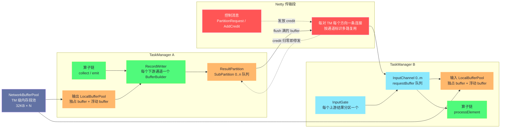
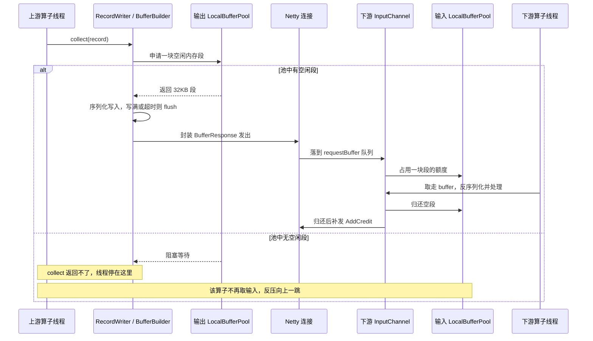
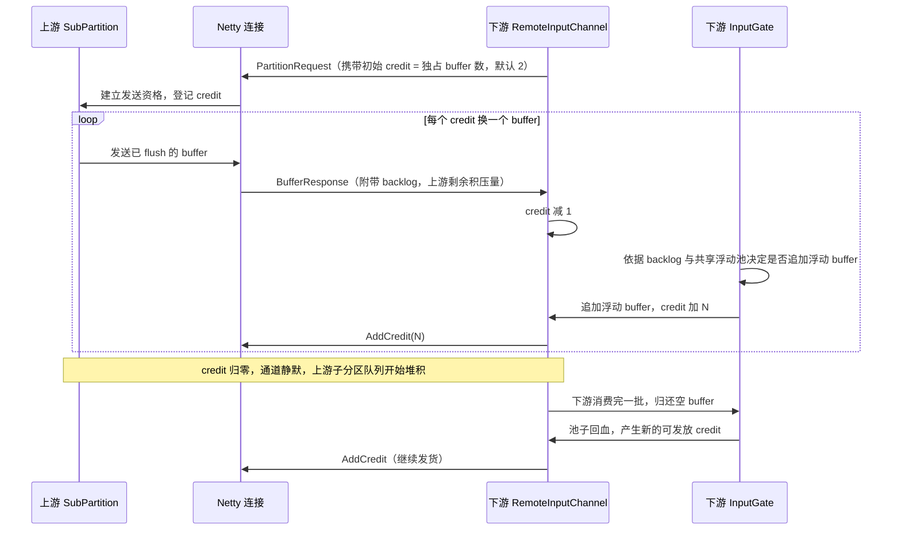
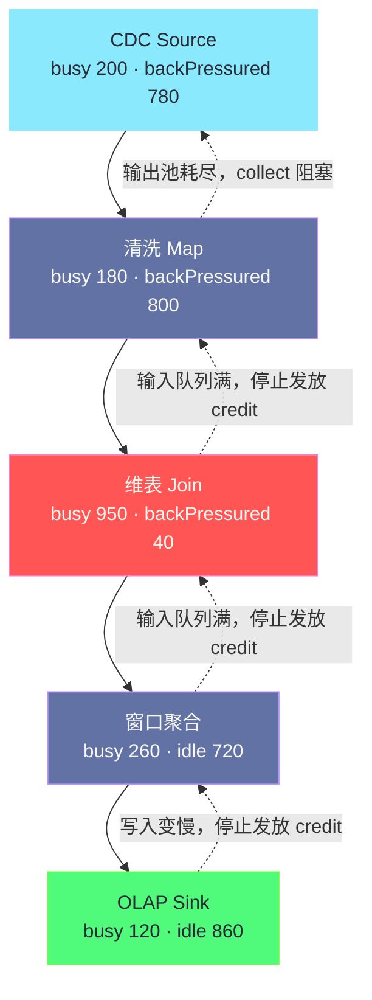
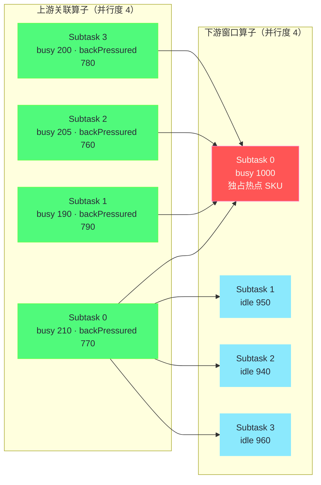

**摘要：**

Flink 的反压没有独立机制：没有 pause 消息，没有丢弃策略，也没有一个专门负责"检测到慢就通知上游"的模块。它是信用制流控（credit-based flow control）这个设计的自然结果——上游手里没有 credit 就发不出数据，发不出数据就卡在申请 buffer 的那一行上，线程停了，输入自然不再被消费，于是阻塞沿管道逐跳传回 source。本文沿着这条因果链往下拆：先厘清网络栈三层的边界与它们共享的唯一种通货（固定 32KB 的内存段，以及 TM 级与 task 级的两层缓冲池），再逐条解释 credit 的账本与消息序列，说明归零之后阻塞究竟停在哪个方法调用上；随后把"反压既是保护又是症状"这件事说清楚，包括 Web UI 三档标记的采样口径、`busyTimeMsPerSecond` 三个指标的分账方式，以及用什么判据把全局反压、数据倾斜与单机问题分开；最后落到两条缓解路径和四个缓冲区参数的代价交换。贯穿全文的判断只有一条：反压标记是症状，`busyTime` 才是体温计，所有"把参数调大一点"的建议都是在拿内存、延迟或 Checkpoint 时间换吞吐。

---

## 第 1 章 反压不是一个机制，是一个结果

### 1.1 把 Sink 改成逐条写之后

有一个很容易复现的现场：一条实时大屏链路，末端写 OLAP 库，原本攒批写，为了把可见延迟从三秒压到一秒，改成逐条写。作业没有报错，没有重启，没有异常日志，但 Web UI 上的拓扑开始变色——Source 与 Map 变成黑色，Window 变成暗红，Sink 变成蓝色。这就是反压在面板上的样子：黑色代表背压饱和，红色代表繁忙饱和，蓝色代表空等。

此时去代码里找"暂停"这两个字是找不到的。整个作业没有任何一处逻辑写着"下游慢了就上游别读"，Kafka 的消费位点也没有被程序主动暂停。真正发生的事情朴素到近乎无趣：Sink 每写一条要 2 毫秒，上游每秒能生产两万条，于是下游的输入队列在三秒内被填满，填满之后不再向上游发放额度，上游的额度用完之后申请不到缓冲区，序列化一个记录时就阻塞在那里，线程停在那一行上不动了。

换句话说，反压不是 Flink 主动施加的机制，而是"缓冲区耗尽之后线程无法前进"这件事在整条管道上的传播。理解了这一点，后面所有关于参数与调优的讨论才有落点：这些参数调的不是某种流控算法，而是缓冲区的数量、大小与发放节奏。

### 1.2 三层边界与唯一的通货

Flink 的跨任务数据传输由三段落构成，每一段都有自己的队列，但三段之间只有一种通货。

产出端是结果分区（`ResultPartition`），一个上游任务对每个下游任务一条边建一个结果分区，分区内部按下游并行度切成若干子分区（`SubPartition`），每个子分区一个队列。传输段是 Netty，同一对 TaskManager 之间按方向各建一条 TCP 连接，所有通道的数据靠通道标识在同一连接上多路复用。消费端是输入门（`InputGate`），每个消费的上游结果分区对应一个输入门，门内按上游并行度切成若干输入通道（`InputChannel`），每个通道一个等待队列。

三段之间流动的东西永远是同一种：一块默认 32KB 的内存段（`MemorySegment`）。记录被序列化进内存段，内存段被打包成消息在网络上传，到对端再被拆回内存段交给算子反序列化。缓冲区不从属于某条连接、某个队列，它属于池子——TM 级一个全局池，每个 task 的每个输入门、每个结果分区各有一个本地池。反压的本质，就是这些池子被借空之后，申请方只能在原地等——**反压的终点是线程阻塞，不是队列增长**。

下图把三段的边界、缓冲归属与两个池子的位置画在一起，注意 `NetworkBufferPool` 只出现一次（每个 TM 一个），而本地池出现了两次（输出侧与输入侧各一）。

### 1.3 本文的边界

本文只讲机制：缓冲区怎么分配、credit 怎么记账、阻塞停在哪一行、指标怎么算出来。TaskManager 内存五大分区与网络内存的推导规则归[[大数据/Flink/Flink原理深度解析与性能优化/03 Flink 内存模型深度解析]]；屏障的传播、对齐与非对齐快照的取舍归[[大数据/Flink/Flink原理深度解析与性能优化/06 Flink Checkpoint 机制深度解析]]；状态后端造成的 GC 压力与堆外内存占用归[[大数据/Flink/Flink原理深度解析与性能优化/05 Flink 状态后端深度解析]]；"参数设成多少、值班时先看哪个面板"属于实战列的[[大数据/Flink/Flink从入门到实战/10 生产运维：监控、调优与常见问题排查]]。

---

## 第 2 章 网络栈的分层：buffer 是唯一的通货

### 2.1 两个池：全局的与局部的

TaskManager 启动时，网络内存被一次性切成等大的内存段，交给网络缓冲池（`NetworkBufferPool`）保管。切多少块由网络内存总量除以段大小决定，段大小的配置项是 `taskmanager.memory.segment-size`，默认 32KB；网络内存总量由 `taskmanager.memory.network.fraction`（默认 0.1）、`.min`（默认 64MB）与 `.max` 共同决定。这份内存是堆外的，按段分配，不参与 JVM 堆的垃圾回收，所以它不会被 GC 停顿波及，但也不会因 GC 而回收——池子借出去多少、还回来多少，是纯粹的账。

真正与任务绑定的是本地池（`LocalBufferPool`）：每个结果分区一个，每个输入门一个。本地池不直接持有内存，它向全局池申请段，用完再还；它的目标容量有公式：通道数 × `taskmanager.network.memory.buffers-per-channel` + `taskmanager.network.memory.floating-buffers-per-gate`。这个公式值得记住，因为后面关于"并行度调大反而更慢"的全部分析都从它出发。

本地池的容量是弹性目标值，不是硬保证。全局池不够分的时候，本地池拿不到足额的段，只会拿到一部分——这正是高并行度作业启动时报 "Insufficient number of network buffers" 的由来：不是配置写错了，需求总量算下来超过了池子。

### 2.2 产出端：BufferBuilder 与子分区队列

上游算子调用 `collect()`，`RecordWriter` 把它序列化进一个缓冲区构造器（`BufferBuilder`），构造器背后是从本地输出池借来的一个内存段。写满 32KB，或者等待时间超过 `execution.buffer-timeout.interval`（默认 100 毫秒），这块段就被封装成一个 buffer，挂到目标子分区的队列上，随后由网络层取走。

注意这里的关键动作：**序列化需要一块空闲内存段**。池里有，拿走；池里没有，就阻塞等。1.18 的代码里，这条路径的名字直白得很——`PipelinedResultPartition#requestBufferBuilderBlocking`，阻塞申请一个缓冲区构造器。整个 Flink 网络栈的反压，最终都收敛到这一行调用上。

子分区队列的长度受 `taskmanager.network.memory.max-buffers-per-channel`（默认 10）约束。超过这个数，配置文档的措辞是会让任务"不可用"，从而产生反压并阻塞数据处理——这句话相当于承认了扇出算子会被单个慢下游拖住，第 4 章会展开它的后果。

顺带区分一下结果分区的类型。流式的流水线交换（pipelined shuffle）里，上游产出即发送，队列满就阻塞；批式的阻塞交换（blocking shuffle）把结果落盘，下游消费前上游可以退出，反压表现为磁盘上的积压而不是线程阻塞。本文讨论的都是前者。

### 2.3 传输段：Netty 只做搬运

Netty 在 Flink 网络栈里的角色很轻：把已封装的 buffer 搬运到对端。它自己也有写队列与水位线，不过应用层不希望它成为排队的地方——TCP 写缓冲与 Netty 的待发队列都是"看不见的缓冲"，堆在那里既不计入任何池子，也无法按通道精细控制，一旦拥塞就退化成连接级的队头阻塞。信用制流控的作用之一，就是把这些不可见的缓冲压到最小，让排队发生在池子里，而池子是可观测、可配额的。

连接的建立与复用方式如下：同一对 TaskManager 之间，每个方向一条 TCP 连接，所有需要传数据的通道共用这一条连接，靠输入通道标识区分归属。首次通信时下游发 `PartitionRequest`，报文里带着初始 credit；上游收到后为该通道建立发送资格，此后按 credit 发货，货到之后下游再补发 credit。队列里的积压量也会被回传：`BufferResponse` 报文带一个 backlog 字段，另有 `BacklogAnnouncement` 这类消息专门通报积压，下游据此决定是否为这个通道追加浮动 buffer。

### 2.4 消费端：requestBuffer 队列的长度就是 credit

输入侧的结构与输出侧对称。`SingleInputGate` 管一个上游结果分区，内部每个输入通道维护一个待处理队列，队列里的 buffer 从本地输入池借。算子线程从输入门取数据的方式是轮询：哪个通道有可取的数据就取哪个，取完的空段归还本地池，池子回血之后才补发 credit。

这里有一个容易被忽略的闭环：队列的长度是被 credit 限定的。下游不会无限接收上游数据，它能收多少取决于它手里有多少块空闲段可借；上游发多少，取决于它收到了多少 credit。两侧因此不会失控——这是信用制与"下游收下再说"的根本区别，也是内存不会被在途数据吃光的原因。

把三段串起来，一条记录从 `collect()` 到被下游 `processElement` 的完整旅程如下图。注意分支出现在哪里：申请内存段这一步，是整条链路上唯一会停住线程的地方。

### 2.5 链内传递、本地通道与远端通道

三种传递看起来都是"上游给了下游"，代价差得很远，混为一谈是读反压时的常见错误来源。

链内传递发生在算子链内部，两个算子共享同一个任务线程，记录以对象的形式直接交给下游，既没有序列化，也没有 buffer，更没有 credit。链条一旦断开，这条路就没了。

本地通道（`LocalInputChannel`）发生在同一个 TaskManager 内的两个任务之间。数据不经过网卡，但**仍然要序列化**——因为跨越了任务边界，两边的内存段必须能独立回收；它仍然占用缓冲区，仍然走 credit 记账。省掉的是 Netty 与 TCP 这一段，不是序列化。

远端通道（`RemoteInputChannel`）才是完整的网络路径：序列化、Netty、TCP、对端反序列化。

| 维度 | 链内传递 | 本地通道 | 远端通道 |
|---|---|---|---|
| 记录形态 | Java 对象直传 | 序列化进内存段 | 序列化进内存段 |
| 是否占用网络 buffer | 否 | 是 | 是 |
| 是否受 credit 约束 | 否 | 是 | 是 |
| 传输介质 | 同线程调用栈 | 同进程内存段交接 | TCP 连接 |
| 反压传播 | 直接函数调用阻塞 | 池子耗尽即阻塞 | 池子耗尽即阻塞 |
| 断链后的代价 | — | 序列化开销 | 序列化 + 网络 + 更长的反压链路 |

最后一行解释了一个工程上的取舍：断链能换来独立伸缩与更清晰的算子边界，代价是每条记录多一次序列化与一次跨线程交付，反压的传导链也跟着变长——原本一次函数调用就能把阻塞传上去，断链之后要经过池子、Netty、对端池子三跳。第 7 章会把这条代价与"减链缓解反压"的说法对照。

---

## 第 3 章 信用制流控：反压是账本归零的结果

### 3.1 1.5 之前的反压：借 TCP 的窗口

在信用制落地之前（Flink 1.5 之前），Flink 的反压完全借用 TCP 的窗口机制：接收缓冲区满，接收方通告零窗口，发送方停发，发送方的套接字写缓冲随之积满，写操作阻塞，于是上游任务的 `collect()` 被阻塞。这条路能走通，但有两处结构性缺陷。

第一处是粒度。一对 TaskManager 之间只有一条连接，所有通道的数据挤在同一个 TCP 窗口里。某个下游实例处理慢，接收方的整体窗口归零，这条连接上的所有通道一起停摆——包括那些下游很快、完全无关的通道。这种队头阻塞与 HTTP/1.1 里"一个慢请求堵住整条连接"是同一类问题。

第二处是 Checkpoint。屏障（barrier）是随数据流一起注入的，与普通记录共用同一条通道、同一批 buffer。当通道被反压堵住，屏障也只能排在队列里等，对齐快照于是被拖到超时。这一点常被讲错：信用制并没有让屏障获得优先通行的特权，屏障依旧在数据流里排队；真正解决反压下的 Checkpoint 问题的是 1.11 引入的非对齐快照（Unaligned Checkpoint），它干脆不等对齐，把在途数据一并写进快照。两件事属于不同时期的两个方案，不能互相顶替。

信用制的目标因此很清晰：把流控从 TCP 层搬到应用层，把粒度从"连接"细化到"通道"，把"看不见的套接字缓冲"换成"可记账的池子"。至于屏障，它的问题要留到快照机制里去解。

### 3.2 为什么 credit 以 buffer 个数计

credit 记的是"还能发几个 buffer"，不是"还能发多少字节"。这个选择值得停一下，因为它决定了反压的形状。

按字节记账看起来更精细，实际会漏。一条记录哪怕只有一个字节，也要独占一块内存段——段是按块分配的，不存在"半个段"。如果 credit 记的是字节数，上游发一堆小记录时，字节数远未用尽额度，内存段的占用却可能已经翻了几倍，记账与实际内存脱钩，池子照样被借空，反压照样发生，只是来得毫无预兆。

按 buffer 个数记账，**credit 与池子里的段一一对应**：发了几个段，就消耗几个 credit；下游还回几个段，才补发几个 credit。账实相符，反压的触发点与内存的真实边界重合。这是信用制能"自动"产生反压的结构性原因。

### 3.3 一次握手与之后的消息流

下图是一次通道建立到进入稳态的完整消息流，注意 credit 的三个来源：首次握手携带的独占额度、下游主动补发的浮动额度、以及消费归还之后补发的额度。

这张图里有三个数字值得对齐：初始 credit 等于独占 buffer 数（默认 2），浮动额度来自输入门共享的浮动池（默认 8），两者叠加构成一个通道在稳态下的在途上限。如果某个通道的上游积压特别多（backlog 大），输入门会优先把浮动 buffer 借给它，这就是倾斜场景下"热点通道被优先喂饱"的机制来源。

### 3.4 账本上的五个数字

把与 credit 相关的参数与账目放在一起，反压的"形状"就具体了。

| 名称 | 默认值 | 归属 | 作用 |
|---|---|---|---|
| `buffers-per-channel` | 2 | 每通道独占段数 | 稳态在途量的基座，保证通道不至于饿死 |
| `floating-buffers-per-gate` | 8 | 每输入门共享浮动段数 | 按积压量弹性分配给最需要的通道 |
| `max-buffers-per-channel` | 10 | 每通道占用上限 | 防止单个热点通道吃光全池 |
| `max-overdraft-buffers-per-gate` | 5 | 每输出门透支段数 | 大记录或一对多输出时避免线程被彻底卡死 |
| `segment-size` | 32KB | 段大小 | 在途量换算成字节的乘数 |

账目本身比参数更简单：一个通道的可发送额度等于"已发放但未消耗的 credit"；下游手上有几块空闲段，就最多能发几个 credit；上游有几块空闲段，就最多能发几个 buffer。两边都只能发自己有的东西，任何一边先耗尽，通道就静默。

关于版本差异要留一句：在较新的版本里，入向通道的独占段数不再是固定的 2，而是由 `taskmanager.network.memory.read-buffer.required-per-gate.max` 与运行时算出的需求动态推算，`buffers-per-channel` 退化为上限值。也就是说，同一份配置在不同版本上的实际在途量并不相同，读参数时要看对应版本的文档口径。

### 3.5 credit 归零之后的阻塞链

现在可以把一条完整的阻塞链写出来了，笔者按阻塞发生的顺序拆成五步，每一步都是被动的。

第一步，某个下游实例处理慢，它的输入通道队列不被消费，本地输入池的段迟迟不归还。第二步，输入门手里没有空闲段，就无法为该通道产生新的 credit，`AddCredit` 不再发出。第三步，上游该通道的 subpartition 队列逐块堆积，直到 `max-buffers-per-channel` 的上限。第四步，上游本地输出池被借空，`requestBufferBuilderBlocking` 拿不到段，算子线程停在序列化这一步，`collect()` 返回不了。第五步，这个上游算子既不再产出，也不再调用输入门取数据，于是它自己的输入通道也不再归还段、不再补发 credit，阻塞向上游再跳一格。

这五步里没有任何一处判断"下游慢不慢"，也没有任何一处发出"暂停"指令。反压之所以看起来像是系统主动做的事情，只是因为阻塞在代码里沿着调用栈自然地向上传染：**写不出去就不往下写，不读上游上游就写不出去**。

这里有一处容易错位的地方：阻塞点与反压标记并不是同一个位置。UI 上判定一个任务处于反压，依据是它有没有可用的输出 buffer；也就是说，被标记为反压的是"卡在第四步"的那一批任务，而真正的瓶颈是"让第一步变慢"的那个下游实例。这两者永远不是同一个任务，第 5 章会把这个错位讲透。

### 3.6 "自动"的含义与代价

信用制流控的收益可以概括成三条：粒度到通道，慢通道不再连累同一连接上的其他通道；账实相符，credit 与内存段一一对应，内存不会被在途数据吃穿；无状态，通道静默不需要额外的暂停/恢复协议，credit 一补就自然恢复。

代价也有三条。其一，控制消息本身有开销，每次补发 credit 都是一次网络往返，虽然被批处理摊薄，在跨机房这类高延迟链路上仍然可观——它决定了在途量必须足够大，才能在 1 毫秒以上的往返时间里维持吞吐。其二，在途数据量的上限与 Checkpoint 的快慢之间存在张力：在途越多，对齐越慢，非对齐快照的体积也越大，第 8 章的缓冲区参数调优实际上就是在调这条张力线。其三，反压把代价转移给了最容易观测的那个位置——线程阻塞，而不是队列增长，于是"看队列水位"这类传统手段在 Flink 上基本失效，必须改看 buffer 池占用与时间占比两类指标。

---

## 第 4 章 传导路径：从最慢的一个实例顶到 source

### 4.1 四跳

用一个贯穿全文的场景来画这条链：订单库的变更流经 CDC 进入 Flink，先清洗字段，再与商品维表关联，然后按 SKU 做十分钟滚动窗口聚合，最后写 OLAP 给大屏用，同时分一路落数据湖归档。某天运营改了维表关联逻辑，每次关联要做两次远程查询，关联算子从每秒两万条掉到每秒五千条。

下图把每个环节的时间分账与 credit 状态画在一起，箭头方向是数据流方向，虚线方向是反压方向。

图里的时间分账值得逐行读：`busy` 接近满载的是维表关联，它是瓶颈；它的上游（清洗、Source）`backPressured` 高、`busy` 低，因为它们大部分时间卡在写出上；它的下游（窗口、Sink）`idle` 高，因为拿不到足够的数据。三类数字各就各位，反压的"病因"就在 `busy` 满格的那一行上。

四跳链路的顺序因此是：Sink 写不动 → 窗口的输入通道队列满 → 窗口停止向它的上游（关联）发 credit → 关联的输出池耗尽、`collect` 阻塞 → 关联不再读清洗的输出 → 清洗阻塞 → Source 阻塞 → Kafka 位点停住、堆积上涨。

### 4.2 扇出放大：一个下游堵住整个上游

上一节讲的是单通道的传导。真实作业里更常见的是放大效应：一个上游算子把数据分发给许多下游实例，**只要有一个下游实例变慢，整个上游算子都可能被拖住**。

机制在 2.2 节已经埋下了：输出池是结果分区级的共享池，子分区队列长度受 `max-buffers-per-channel` 限制；当某个子分区队列顶到上限，Flink 会让任务"不可用"，也就是在写这个子分区时阻塞。而写出动作发生在上游算子唯一的任务线程里——一个线程被某个子分区堵住，其他子分区的写出也一并停摆。

这个放大效应解释了两个常见的误判。其一，倾斜看起来像全局反压：热点 key 集中到一个下游实例，那个实例慢，于是所有上游实例看起来都在被反压，面板上一片黑色，容易被误判成"整个算子都不够快"。其二，一个慢下游会让上游的吞吐掉到与它无关的水平，于是"加并行度"这种手段在倾斜场景下往往只把排队分散了一下，并不提升吞吐。

### 4.3 反压是比率，不是开关

Web UI 上的三档标记很容易被当成布尔量：HIGH 就是"有反压"，OK 就是"没有"。实际它是采样窗口内的比率，50% 的比率既可能来自持续一半时间被堵，也可能来自稳定但轻微的拥堵与偶发尖峰的混合；短促的脉冲在记账上被摊平，看不出峰值。

比值口径反过来也带来一个好处：它天然过滤了偶发抖动。真正需要处理的是持续处于高比率且 `busyTime` 也高的组合，而不是任何一次短暂的颜色变化。这也是为什么排障时不能只看一眼面板截图，而要看一段时间的曲线。

### 4.4 传到 source 之后

反压传到 source 之后的表现取决于源的实现。对于基于拉取的连接器，阻塞发生在拉取与发送之间：消费线程本来在 `poll` 之后逐条发送，`collect` 被阻塞后发送停住，`poll` 也就不再被调用，位点停在原地，消费者组 lag 开始上涨。对于推送型或自带缓冲的源，反压只能在发送处生效，源内部可能仍在收数据，这时的表现是源内部的缓冲增长而不是 lag 增长。

新一代的源接口把"有没有数据可读"做成了异步契约（`SourceReader#isAvailable`），任务线程在没有数据可读时不会空占着线程，控制类消息（包括屏障）有更多机会被处理。这条演进的动机与 3.1 节提到的 Checkpoint 问题是同一个：让反压尽量不阻塞控制面。

### 4.5 与 Checkpoint 的回环

反压与 Checkpoint 之间不是单向下游影响上游的关系，而是一个回环。

一方面，反压拖慢 Checkpoint：屏障与数据排队在同一条通道上，对齐要等前面所有在途数据被消化，在高反压场景下对齐时间可以从毫秒涨到分钟；非对齐快照绕开了等待，但代价是快照体积随在途数据增长。

另一方面，Checkpoint 又反过来加剧反压：快照期间要同步状态、写远程存储、抢占 CPU 与带宽，恰好发生在最不该增加负担的时刻。于是形成"反压 → 快照慢 → 快照期间的额外开销 → 处理更慢 → 反压更重"的循环。这条回环的机制与化解办法属于[[大数据/Flink/Flink原理深度解析与性能优化/06 Flink Checkpoint 机制深度解析]]，此处只需记住它对本文的推论：缓冲区参数不能只按吞吐调，还要按快照时间约束调。

---

## 第 5 章 既是保护机制，也是症状

### 5.1 反事实：没有它会怎样

设想三种替代设计，代价立刻显形。

第一种是无界缓冲：上游不管下游，数据全塞进内存队列，短时间的处理抖动被队列吸收，看起来吞吐不受影响。代价是内存没有上界，一次持续十分钟的积压就能把 TM 打挂，而且崩溃发生在远离病因的地方。

第二种是有界队列加丢弃：队列满就丢记录。这在流处理里近乎不可接受，精确一次语义直接作废，而且丢弃是静默的——大屏少几个数字不会报警。

第三种是回到 TCP 隐式反压：可行，但要重新承受连接级队头阻塞与屏障被堵这两件事。

信用制的取舍是第四条路：宁可让线程停下来，也不让内存无界增长，也不丢弃数据。反压因此是这套取舍的必然副产品，它的存在恰恰说明保护机制在工作。

### 5.2 三档标记是怎么采出来的

Web UI 上那三档颜色有两代实现，口径不同，混用会得出矛盾结论。

最早的做法是采样任务线程的栈：反复看线程是不是卡在写出路径上，据此估算被堵的样本比例。栈采样的问题在于判据绕了一圈——采到的是线程停在哪里，而不是线程为什么停；改成直接问"还有没有可用的输出 buffer"之后，判据回到因果关系上，采样成本也降了下来。今天说"Flink 的背压是采样出来的"并不算错，但要知道后来采的是 buffer 可用性，不是线程栈。

1.13 之前的实现是采样：JobManager 反复调用任务的 `isBackPressured()`，默认每 50 毫秒采一次、共采 100 次（约 5 秒完成一轮），判据是任务当时有没有可用的输出 buffer——一块都没有就算被反压。采完之后算比率：0 到 0.1 为 OK，0.1 到 0.5 为 LOW，0.5 到 1.0 为 HIGH。为了不给 TaskManager 添负担，采样结果缓存 60 秒才刷新，相关配置是 `web.backpressure.num-samples`、`web.backpressure.delay-between-samples`、`web.backpressure.refresh-interval`。

1.13 起改为读时间指标：每个子任务持续抛出 `busyTimeMsPerSecond`、`backPressuredTimeMsPerSecond`、`idleTimeMsPerSecond` 三个数，三者之和约等于 1000。背压比率直接由时间占比算出，阈值口径不变（0.1 与 0.5 两条分界线），但采样从"数样本"变成"记时间"，不再有 5 秒采样窗口与 60 秒缓存的滞后。1.13 的文档里这个名字还写作 `backPressureTimeMsPerSecond`，后续版本改为现在这个拼法，照抄旧面板查询时会遇到指标名对不上的问题。

| 标记 | 比率区间 | 含义 | 典型误读 |
|---|---|---|---|
| OK | 0 至 0.1 | 输出 buffer 基本可用 | 当成"这个算子没问题"，其实可能是下游瓶颈导致的空闲 |
| LOW | 0.1 至 0.5 | 间歇被堵 | 当成"可以忽略"，稳态下 30% 的等待已经在吃掉吞吐 |
| HIGH | 0.5 至 1.0 | 大部分时间被堵 | 当成"病根在这里"，其实它只是瓶颈的上游 |
| 颜色 | 黑色/红色/蓝色 | 背压饱和/繁忙饱和/空等 | 红色才是瓶颈候选，黑色是受害者 |

### 5.3 三个指标的分账

`busyTimeMsPerSecond` 是三件套里最有信息量的一个：它统计的是这个子任务真正在处理数据的时间，不包含等输出与等输入。为行文方便，下文把三个指标简写为 `busyTime`、`backPressuredTime`、`idleTime`。判读的分工因此很清楚。

瓶颈算子的特征是 `busyTime` 接近 1000、`backPressuredTime` 不高（它自己的下游多半很快）、`idleTime` 接近 0。它上游算子的特征是 `backPressuredTime` 高、`busyTime` 低。它下游算子的特征是 `idleTime` 高。

这组特征直接纠正了一个流传很广的经验法则——**背压标记标的是受害者，busyTime 才是体温计**："沿数据流方向找第一个自身 HIGH 而下游 OK 的算子，那就是瓶颈"。按上面的分账，自身 HIGH 的是瓶颈的上游，下游 OK 说明下游没被堵——那个算子恰恰是受害者而非病根。正确的定位是找 `busyTime` 满格的那个，然后看它的上游是否全部 HIGH。

另一个需要注意的细节是聚合口径：UI 的拓扑视图取的是同一算子的所有子任务中的最大值，所以只要有一个实例繁忙，整块算子就按最坏情况着色。看到红色不等于所有并行实例都慢，这一点与倾斜判定直接相关。

### 5.4 线程栈与火焰图

时间指标回答"哪里慢"，线程栈回答"慢在做什么"。两者的分工类似体温计与影像学检查。

抓线程栈时看栈顶落在哪个方法上，能区分几种完全不同的等待：停在 `requestBufferBuilderBlocking` 上，是输出池耗尽，典型的下游反压；停在外部系统的 socket 读上，是同步 IO 阻塞，CPU 会闲着而 `busyTime` 却接近满格，加机器没用；停在 RocksDB 的读路径上，是状态访问慢，方向在状态后端；停在 JVM 的安全点或 GC 相关帧上，是停顿。这几种形态在面板上的表现都是"慢"，处置手段却相反，火焰图的作用就是把它们分开——操作步骤与面板约定归实战列，机制侧的判断依据是栈顶位置。

---

## 第 6 章 反压与数据倾斜：两种局部慢

### 6.1 判据是 busyTime 的分布

反压是全局现象还是局部现象，不能看背压标记的总量，要看同一算子各并行实例的 `busyTime` 分布；这一点笔者在值班现场纠正过太多次，教训是背压颜色只说明有地方堵了，说明不了堵的是一部分还是全部。

判据可以压缩成一句话：**全局反压看全员饱和，倾斜看少数饱和**。真正的全局反压，是所有实例的 `busyTime` 都接近满格、上游全部 HIGH——瓶颈是这个算子的整体处理能力，加并行度或加资源有明确收益。

数据倾斜，是少数实例 `busyTime` 满格、其余实例 `idle` 很高——瓶颈是 key 分布，加并行度通常无效，因为多出来的实例分不到热点 key 的数据，热点仍旧压在原来那个实例上。

还有一种容易被当成倾斜的形态是个别实例所在的机器有问题：它的 `busyTime` 并不高，但 `backPressured` 高、下游也正常，往往是宿主机 CPU 被抢、磁盘抖动或网络异常。判据是同一作业的其他算子在相同机器上是否也异常，这已经超出网络层，属于部署与资源隔离问题。

### 6.2 倾斜如何被网络层放大

倾斜之所以在面板上看起来像全局反压，是因为第 4 章讲的扇出放大。散列分区把热点 key 固定送到同一个下游实例，那个实例的输入队列先满，然后停止发放 credit，于是所有上游实例到它的那个子分区都写不进去，输出池被借空，整个上游算子阻塞。

下图画的是同一时刻两个并行实例的状态，注意上游四个实例全部被标记为背压，只有下游的 Subtask 0 是真正繁忙的那个。

图里有两条信息：第一，上游四个实例的指标几乎一样，因为它们都被同一个子分区堵住，从它们的视角看不出谁是真凶；第二，下游只有一个实例繁忙，另外三个几乎全闲。判断倾斜的唯一依据是下游那一排 `busy` 与 `idle` 的分裂，而不是上游的背压颜色。

### 6.3 五种形态的判据矩阵

把网络层能看到的形态放在一起对照，判断顺序才不至于乱。

| 形态 | busyTime 分布 | backPressuredTime | 关键旁证 | 处置方向 |
|---|---|---|---|---|
| 全局反压 | 所有实例都接近满格 | 上游普遍高 | 单实例吞吐已到硬件上限 | 加并行度或加资源 |
| 数据倾斜 | 少数实例满格、多数空闲 | 上游普遍高 | 各实例输入记录数差一个数量级以上 | 打散 key 或两阶段聚合 |
| 同步外部 IO | 全部实例 busy 高但 CPU 低 | 上游高 | 线程栈停在 socket 读 | 异步化或批量查询 |
| JVM 停顿 | busy 忽高忽低、周期性塌陷 | 周期性尖峰 | GC 日志有长停顿 | 换状态后端或调堆 |
| 网络内存不足 | 偏低且不稳定 | 波动大 | 启动或运行日志出现 insufficient number of network buffers | 调网络内存或调 buffer 数 |

这张表的作用不是替代排障，而是把网络层的判据与算子层的判据对齐：网络层只能证明"堵了"，证明不了"为什么堵"。要回答为什么，必须回到时间指标与线程栈。

---

## 第 7 章 缓解路径：加资源与改逻辑

### 7.1 加资源的三个前提

加资源（并行度、槽位、内存）之所以经常无效，是因为它成立需要三个前提同时满足。

前提一，瓶颈在 CPU 且工作可切分。`busyTime` 满格说明算子在算，如果算的是可以按 key 拆开的工作，加并行度就有用；如果算的是全量状态上的重活（譬如窗口内全局排序），加并行度只会让每个实例都做一遍。

前提二，扩容不引入新的瓶颈。源的并行度受分区数限制，Sink 的并行度受下游写入能力限制，维表关联的并行度受维表大小与广播代价限制。这几处任一顶住，扩上去的并行度就只是在制造更多排队。

前提三，缓冲区够用。并行度提高意味着通道数提高，本地池目标容量按公式线性增长，网络内存需求随之上涨；加并行度与加网络内存通常要成对做，否则作业会以启动失败或频繁的 buffer 申请失败告终。

### 7.2 加并行度为什么更慢

在几种典型场景里，**加并行度会让指标更难看**。

第一条链路是缓冲区摊薄。浮动 buffer 是每输入门共享的 8 个，通道数从 50 涨到 200，摊到每个通道的浮动额度从 0.16 掉到 0.04；本来靠浮动 buffer 吸收突发流量的通道，现在只能靠 2 个独占段硬撑，稍有抖动就进入反压。官方文档对此有一句提示：并行度超过两百左右时，建议把浮动 buffer 数从默认值提高到不少于并行度的数量。

第二条链路是空 buffer 的固定开销。每个 buffer 都有固定的打包与解包成本（消息头、调度、反序列化准备），有效载荷越少，这部分开销占比越高；并行度提高后每通道吞吐下降，32KB 的段填满所需时间变长，在 `bufferTimeout` 到点就 flush 的规则下，越来越多的段是半满甚至接近空的。文档里"buffer 太小或 flush 太频繁会掉吞吐"说的就是这条链路。

第三条链路是 Checkpoint 的面变大。并行实例数增加，对齐需要等待的通道数增加，非对齐快照要保存的在途 buffer 也增加；原本十秒量级的快照可能成倍拉长（示例推算），而快照期间的额外开销又反过来压制吞吐。

第四条链路不在 Flink 内部：下游外部系统的连接数与并发写压力随并行度上升，对方限流之后，写得更慢，反压更重。

### 7.3 改逻辑的三条路

与加资源相比，改逻辑往往更有效，因为它动的是产出与消费的速率关系本身。

断链（`disableChaining`、`startNewChain`）常被当作缓解反压的手段，其实它的主要价值在定位与独立伸缩：把慢算子从长链里拆出来，让它可以单独扩并行度，也让线程栈与时间指标能把它与其他算子分开。代价是新增一次序列化与跨线程交付，反压链路随之变长。用它来"缓解"反压，只有在后续确实要为该算子单独扩容时才划算。

异步 IO 把同步等待换成回调，用外部系统的并发能力换本算子的等待时间。收益上限由外部系统的并发容量决定，不是由 Flink 侧参数决定；`orderedWait` 与 `unorderedWait` 的差别在乱序代价，前者要维护顺序缓冲，后者放弃顺序换吞吐。异步化之后 `busyTime` 依然可能很高（回调处理与反序列化仍在算），但下游看到的吞吐会明显改善。

打散 key 针对倾斜：加盐（给热点 key 拼随机后缀）把热点拆成多份做局部聚合，再二次聚合成最终结果；或者对已知热点做特判走旁路。它的代价是状态规模与两阶段聚合的额外延迟，只有在确认倾斜之后才值得付。

| 路径 | 成立前提 | 典型动作 | 代价 | 失效信号 |
|---|---|---|---|---|
| 加并行度 | 瓶颈在 CPU 且工作可切分、源与汇有余量、网络内存足够 | 提并行度、加槽位 | 缓冲区摊薄、快照面变大、外部压力上升 | 扩完之后 busy 降但吞吐不涨、反压不变 |
| 加内存缓冲 | 反压来自突发抖动而非持续超载 | 提网络内存、提浮动 buffer | 延迟上升、快照变慢变大 | 反压峰值变钝但基线不降 |
| 断链独立伸缩 | 只有个别算子是瓶颈 | 断链、单独设置并行度 | 序列化开销、反压路径变长 | 总吞吐不变、CPU 上升 |
| 异步 IO | 外部系统能承受更高并发 | 异步客户端、批量查询 | 乱序、超时与背压语义变复杂 | 外部系统开始报错或限流 |
| 打散 key | 确认是倾斜而非全局慢 | 加盐两阶段聚合、热点旁路 | 状态变大、端到端延迟上升 | 各实例 busy 依旧分裂 |

---

## 第 8 章 四个参数与一个时间窗

### 8.1 buffers-per-channel 与 floating-buffers-per-gate

这两个参数一起决定在途数据量，也就是"允许有多少数据已经发出但还没被消费"，而**在途数据量就是吞吐的上限**。

`taskmanager.network.memory.buffers-per-channel`（默认 2）给每个通道的独占段数，是稳态在途量的基座。它保证一条通道至少有两个段可用：一个在网络上飞，一个在被填。独占段越多，在途越多，能够支撑的吞吐越高；代价是内存占用按通道数线性放大，同时对快照时间不友好。

`taskmanager.network.memory.floating-buffers-per-gate`（默认 8）是输入门内共享的浮动段，按积压量借给最需要的通道，承担倾斜与突发。

两者叠加的上限决定了单通道能支撑的带宽。官方文档给了一个可用的估算式：维持吞吐所需在途 buffer 数约等于 `期望吞吐 × buffer 往返时间 ÷ 段大小`，并按 320MB/s、1ms 往返、32KB 段算出 10 块——这正好是默认值 2 加 8 的量级（示例推算，实际取决于链路往返与段大小）。

按这个思路反向算一遍本地池容量会更直观：一个输入门接了 100 个上游通道，独占段 100 × 2 加浮动 8 共 208 个，约 6.8MB；一个四槽位的 TM 若每个槽位都有这样一个输入门和一个同规模的输出池，网络内存需求约 4 × 2 × 208 × 32KB ≈ 53MB（示例推算），已经逼近 64MB 的下限；并行度翻到 200 时需求翻倍到约 106MB，默认下限显然不够。这就是"高并行度作业起不来"的算术原因。

### 8.2 max-buffers-per-channel 与 max-overdraft-buffers-per-gate

`taskmanager.network.memory.max-buffers-per-channel`（默认 10）限制单个通道能占多少段。它的存在是为了防止热点通道把整个输出池吃光——没有这个上限，一个慢下游可以让它的子分区无限堆积，其他子分区一块都借不到。调大它的收益是热点通道能吸收更长的抖动，代价是倾斜时反压来得更晚、但恢复时积压更多，同时对齐快照的等待时间更长。它并不严格成立，跨多个段的大记录、`flatMap` 式的一进多出、以及定时器批量输出等场景都可能突破它。

`taskmanager.network.memory.max-overdraft-buffers-per-gate`（默认 5）是给输出门的透支额度。它只在一种情况生效：下游正在反压，而上游手里的活又必须超过一块段才能收尾，譬如序列化一条跨多个段的大记录、`flatMap` 一次产出一批记录、窗口触发器一次吐出大量结果。没有透支额度，这种情况会彻底卡死线程，进而让非对齐快照无法完成；有了透支额度，最多再多借几块把手头的活干完。它只对流水线交换生效，而且完全可以设为 0，只是设 0 之后上述场景的停顿会更明显。

顺带纠正一个常见的配置误记：文档里没有 `taskmanager.network.memory.max-buffers-per-gate` 这个键，与"每门能占多少段"相关的就是上面这两个——一个按通道限流，一个给输出门透支。

### 8.3 bufferTimeout 的三档语义

这是全文唯一一个显式暴露"延迟与吞吐"交换的旋钮，配置项是 `execution.buffer-timeout.interval`（默认 100 毫秒）与 `execution.buffer-timeout.enabled`。

| 配置 | 行为 | 延迟 | 吞吐 | 适用 |
|---|---|---|---|---|
| `enabled: true`，`interval: 100ms` | 周期性 flush，最快 100 毫秒一次 | 中 | 中 | 默认，延迟与吞吐的折中 |
| `enabled: true`，`interval: 0` | 每条记录都 flush | 最低 | 最低 | 极低延迟实验，或流量极小的调试 |
| `enabled: false` | 只在段写满时 flush | 最高 | 最高 | 追求吞吐、能接受秒级延迟的批量型作业 |

三档之间的差别可以用一个数字感受（示例推算）：单通道吞吐 8MB/s 时，100 毫秒内积压 800KB，远大于 32KB，段总是写满即发，超时规则几乎不起作用；吞吐降到 200KB/s 时，100 毫秒只积 20KB，段用了六成多就被 flush，有效载荷比下降；再降到 32KB/s 时，100 毫秒只积 3.2KB，段只填了一成，固定开销被放大近十倍。这解释了为什么小流量作业把 `bufferTimeout` 调大不一定变快——流量本来就填不满段，真正该调的是段大小或在链路上合并。

### 8.4 buffer debloat：把在途量交给反馈环

手动算在途量的麻烦在于它随负载变化。1.14 引入的缓冲区瘦身（buffer debloating）试图自动化这件事：它持续测量子任务的实际吞吐，据此估算"在途数据需要多少块 buffer 才能在目标时间内被消费完"，然后调整在途量，目标时间由 `taskmanager.network.memory.buffer-debloat.target`（默认 1 秒）给出，调整周期、采样数与变化阈值分别由 `.period`、`.samples`、`.threshold-percentages` 控制。新的大小通过网络层的 `NewBufferSize` 消息通告对端。

它的默认值是关闭的，启用后也要清楚三条局限：**瘦身只压实际用量，不减少内存占用**，因为段大小与段数都不变，省下的是池子里闲置的那部分；多输入或合并输入的算子里，低吞吐的那一路可能被压得过小，高吞吐的那一路可能仍然太大；并行度超过两百左右时默认配置可能算不准，需要手动提高浮动 buffer 数。监控这件事靠两个指标：估算的在途消费时间与当前 buffer 大小。

### 8.5 一张参数总表

把与反压直接相关的参数放在一起，看的是"调它动的是哪一端"。

| 参数 | 默认值 | 动的是什么 | 调大的收益 | 调大的代价 |
|---|---|---|---|---|
| `taskmanager.memory.segment-size` | 32KB | 单块段大小 | 单位开销摊薄、大记录更省 | 单块延迟变大、小流量更浪费、快照更大 |
| `buffers-per-channel` | 2 | 每通道独占在途量 | 吞吐更稳、抗抖动 | 内存线性增长、快照变慢 |
| `floating-buffers-per-gate` | 8 | 门内共享浮动量 | 倾斜与突发更耐受 | 内存增长、热点通道占更多 |
| `max-buffers-per-channel` | 10 | 单通道上限 | 长抖动可吸收 | 倾斜恢复更慢、对齐更久 |
| `max-overdraft-buffers-per-gate` | 5 | 输出门透支 | 大记录场景少卡死 | 内存峰值上升 |
| `execution.buffer-timeout.interval` | 100ms | flush 时机 | 吞吐上升（延迟上升） | 延迟上升、快照变慢 |
| `taskmanager.memory.network.fraction` | 0.1 | 网络内存总量 | 高并行度可启动 | 挤占托管内存与堆 |
| `buffer-debloat.enabled` | false | 在途量自适应 | 免手工估算 | 多输入场景可能算错 |

这张表最右一列是重点：八个参数里没有一个只带来收益。文档里那句"除非真观测到网络瓶颈（下游空闲、上游反压、输出队列满、输入队列空四个条件同时成立），否则不建议动段大小与超时"是这套取舍的浓缩版。

---

## 第 9 章 反例与边界

### 9.1 五个反例

看到背压就加并行度，是第一个反例，也是最常见的一个。**背压证明堵了，不证明算力不够**；如果堵来自倾斜、外部 IO 或单实例慢，加并行度只会扩大资源账单，同时按 7.2 的几条链路把指标变得更难看。判断顺序应该是先看 `busyTime` 分布，再看线程栈，最后才谈扩容。

只看 CPU 不看 `busyTime`，是第二个反例。同步调用外部系统时 CPU 闲着，`busyTime` 满格，此时 CPU 利用率低会被误读成"资源还有余量"，于是继续加机器；正确的读法是 CPU 低而 `busyTime` 高意味着线程在等外部，方向在异步化。

把 `bufferTimeout` 调到很大换吞吐，是第三个反例。它确实能提高有效载荷比，但延迟同步上升，而且半满的段会推迟屏障的传播、增大非对齐快照的体积，把问题从吞吐转移到了 Checkpoint 上。真正的吞吐瓶颈如果在算子，调超时只是把队列拉长。

不看倾斜就动网络参数，是第四个反例。倾斜的时候提浮动 buffer 会让热点通道占得更多，暂时看起来平稳，实际把恢复时间拉长；而 `max-buffers-per-channel` 这类限制被调大之后，热点通道能吃掉更多池子，其他通道更容易饿死。

把背压当成需要消除的故障，是第五个反例。反压是保护机制的副产品，微秒级的偶发背压在绝大多数作业里都正常；真正该追的指标是端到端延迟与源端 lag 是否持续恶化，而不是把面板上的黑色全部刷成绿色。

### 9.2 假设失效的地方

本文的推导建立在三个假设上，它们在若干场景里会失效。

假设一，反压能够一路传到源，源也能被降速。对于不支持降速的源（部分推送型连接器、内部自带大缓冲的源），阻塞停在源的发送处，源内部仍在接收，此时 lag 不涨而源内存涨，判据必须换成源侧的内存指标。

假设二，缓冲区是瓶颈的唯一去处。在批式阻塞交换里，反压表现为磁盘上的中间结果积压，线程不阻塞，面板上也不显示为背压，机制完全不同。

假设三，作业的拓扑在观测期间不变。动态扩缩容、改并行度重启、算子链调整都会让在途量的基线变化，跨变更前后比较指标没有意义。

还有一处边界属于版本：入向独占段数的计算方式、Web UI 背压的采集方式、缓冲区瘦身的默认开关，在 1.13 到 1.18 之间都发生过变化，跨版本读参数与读指标时要按对应版本的文档核对，不要在旧面板上套新口径。

### 9.3 可带走的一组判断

**反压是信用制流控的产物而非独立机制**，因此它不能被"关闭"，只能被理解；理解的核心是缓冲池耗尽之后线程在 `requestBufferBuilderBlocking` 上停下来这件事。

背压标记标的是受害者，`busyTime` 才是瓶颈的体温计；两者错位是绝大多数误判的根源。

区分全局反压与倾斜的依据是同一算子各实例的 `busyTime` 分布，不是背压颜色的多少。

所有缓冲区参数的调整都是在拿三样东西换吞吐：内存、延迟、快照时间。因此调参之前先确认瓶颈真的在网络层，调参之后盯住端到端延迟与 Checkpoint 时长这两个代价指标。

行文至此，网络层的机制已经讲完。下一步该看的是快照：反压与 Checkpoint 的那条回环，只有在理解屏障如何与数据共用通道、对齐如何等待、非对齐如何把在途数据卷进快照之后，才能判断一次反压是否值得动用非对齐快照，这部分推到[[大数据/Flink/Flink原理深度解析与性能优化/06 Flink Checkpoint 机制深度解析]]。至于内存分区与网络内存的推导规则，以及参数之间的相互约束，分别见[[大数据/Flink/Flink原理深度解析与性能优化/03 Flink 内存模型深度解析]]与[[大数据/Flink/Flink原理深度解析与性能优化/09 Flink 性能调优体系]]。

---

## 参考资料

1. Apache Flink 官方文档，*Network memory tuning guide*：在途数据的定义、缓冲区瘦身机制、本地池容量公式、`number_of_buffers = throughput × roundtrip ÷ buffer_size` 的估算示例，[nightlies.apache.org](https://nightlies.apache.org/flink/flink-docs-release-1.18/docs/deployment/memory/network_mem_tuning/)。
2. Apache Flink 官方文档，*Monitoring Back Pressure*：三档标记的阈值（0.1 与 0.5）、三个时间指标的语义、"背压以内核输出 buffer 是否可用为判据"，[nightlies.apache.org](https://nightlies.apache.org/flink/flink-docs-release-1.18/docs/ops/monitoring/back_pressure/)。
3. Apache Flink 1.12 文档，*Monitoring Back Pressure*：采样式实现的原始口径——100 次采样、50 毫秒间隔、60 秒刷新，以及 `web.backpressure.*` 三个配置项，[nightlies.apache.org](https://nightlies.apache.org/flink/flink-docs-release-1.12/ops/monitoring/back_pressure.html)。
4. Apache Flink 官方文档，*Configuration*：`taskmanager.network.memory.buffers-per-channel`（2）、`floating-buffers-per-gate`（8）、`max-buffers-per-channel`（10）、`max-overdraft-buffers-per-gate`（5）、`execution.buffer-timeout.*` 的默认值与官方描述，[nightlies.apache.org](https://nightlies.apache.org/flink/flink-docs-release-1.18/docs/deployment/config/)。
5. Apache Flink 源码，`NettyMessage.java`：`PartitionRequest` 携带初始 credit、`AddCredit`、`BufferResponse` 的 backlog 字段、`BacklogAnnouncement`、`NewBufferSize` 等控制报文的结构与语义，[github.com](https://github.com/apache/flink/blob/release-1.18/flink-runtime/src/main/java/org/apache/flink/runtime/io/network/netty/NettyMessage.java)。
6. Apache Flink 源码，`NetworkBufferPool.java` 与 `LocalBufferPool.java`：TM 级全局池的内存段切片、task 级本地池的弹性申请与阻塞申请接口，[github.com](https://github.com/apache/flink/blob/release-1.18/flink-runtime/src/main/java/org/apache/flink/runtime/io/network/buffer/NetworkBufferPool.java)。
7. Apache Flink 源码，`PipelinedResultPartition.java` 与 `ResultPartition.java`：`requestBufferBuilderBlocking` 阻塞路径与 `getAvailableFuture` 可用性接口，[github.com](https://github.com/apache/flink/blob/release-1.18/flink-runtime/src/main/java/org/apache/flink/runtime/io/network/partition/PipelinedResultPartition.java)。
8. FLIP-76 *Unaligned Checkpoints*：反压下对齐等待被拖长的问题陈述，以及把在途数据并入快照的方案，Flink 1.11 起可用，[cwiki.apache.org](https://cwiki.apache.org/confluence/display/FLINK/FLIP-76%3A+Unaligned+Checkpoints)。
9. 本仓库：[[大数据/Flink/Flink原理深度解析与性能优化/03 Flink 内存模型深度解析]]、[[大数据/Flink/Flink原理深度解析与性能优化/06 Flink Checkpoint 机制深度解析]]、[[大数据/Flink/Flink从入门到实战/10 生产运维：监控、调优与常见问题排查]]。

---

> [!note] 思考题

> 1. 一个通道的 credit 用完了，上游线程停在申请 buffer 的那一行上；如果上游算子同时有两条输出边，其中一条堵住而另一条通畅，这个算子的 `busyTime` 会怎么记，`backPressuredTime` 又怎么记，两者的比例能否反推出哪条边在堵。
> 2. `max-buffers-per-channel` 被调大之后，倾斜场景下的反压出现得更晚，但恢复可能更慢。请说明"更晚"与"更慢"分别对应哪两个可观测量的变化，以及它们对 Checkpoint 对齐时间的影响方向是否相反。
> 3. 把 `execution.buffer-timeout.enabled` 设为 `false` 能拿到最高吞吐，但对齐快照会变慢。若一条链路既要求吞吐又要求分钟级的快照稳定，还有哪些参数与机制可以替代这个开关的部分作用。
> 4. 缓冲区瘦身在多输入算子上可能算错，因为它按子任务级吞吐统一调整。设想一个两路输入、吞吐相差十倍的算子，被压得过小的一路与仍然过大的一路分别会出现什么现象，能否用指标区分。
> 5. 如果某个作业的反压标记长期 HIGH 但端到端延迟与源端 lag 都没有恶化，这种状态应当按故障处理还是按稳态接受，判据是什么。
> 6. 批式阻塞交换下反压表现为磁盘积压而非线程阻塞，那么第 5 章的三档标记与 `busyTime` 分账在批模式下还能否照用，哪些结论需要重写。