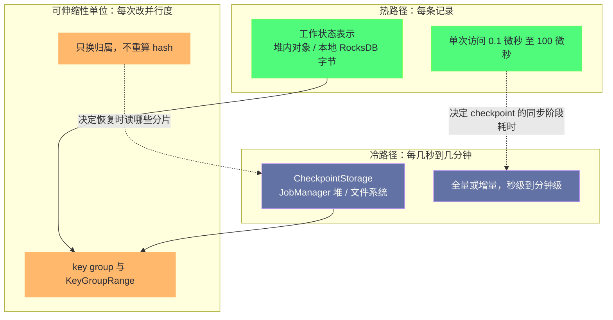
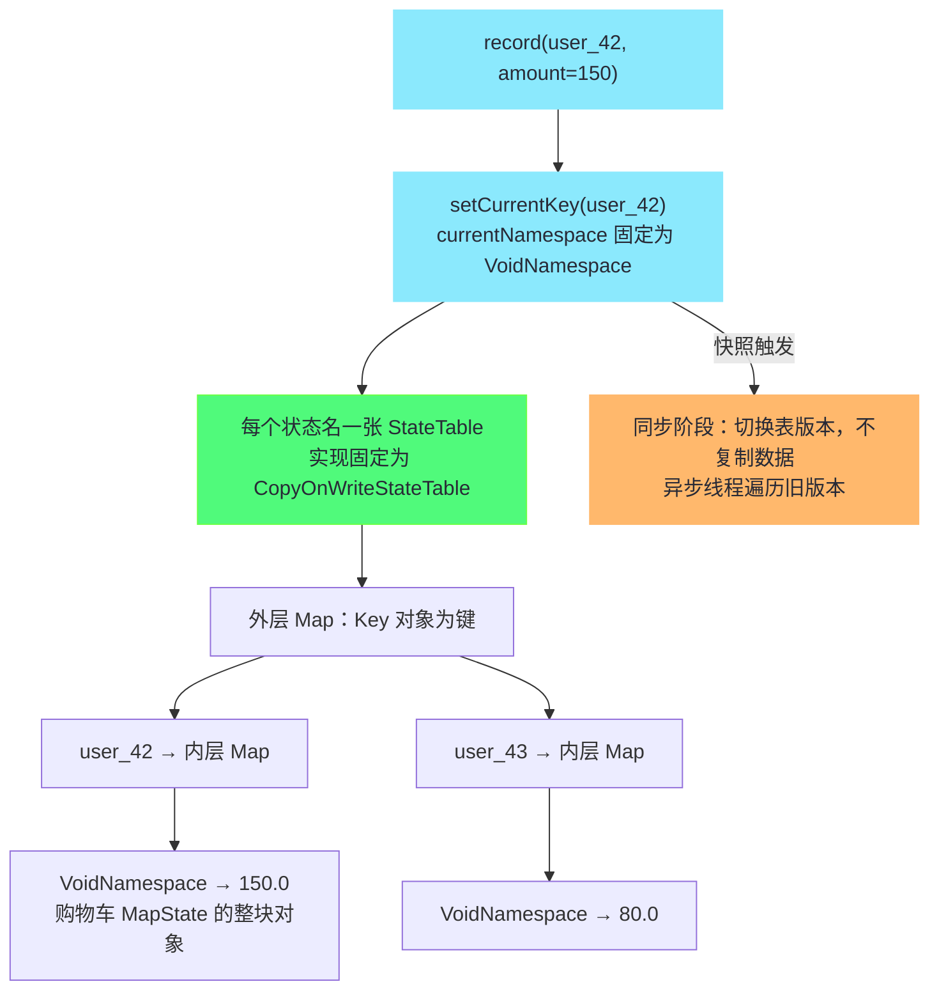
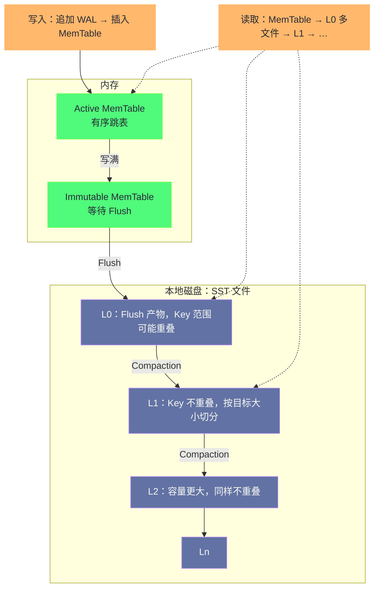
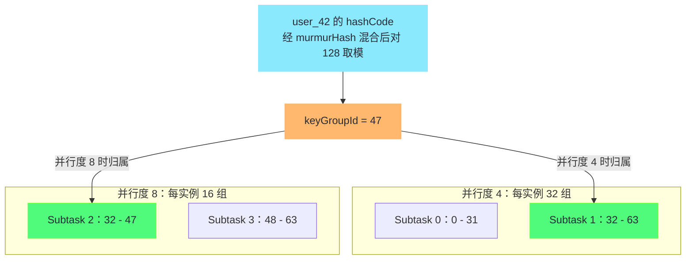
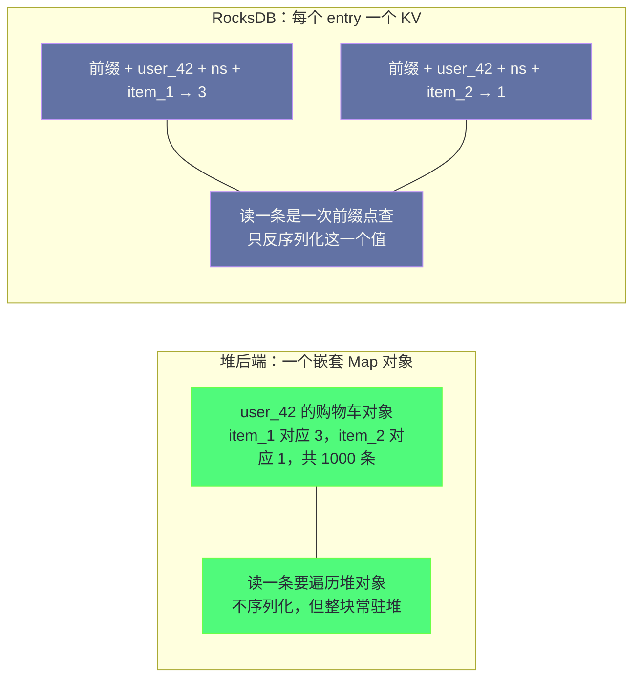
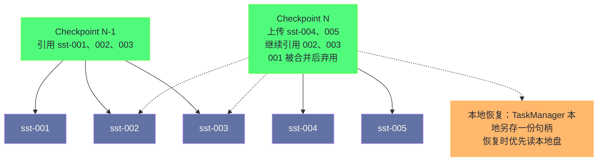

**摘要：**

**状态后端**（State Backend）这个名字容易让人以为它只回答“状态放在哪”，但从 2021 年 Flink 1.13 按 FLIP-142 把三个后端收拢成两个之后，这个位置实际承担了三件彼此正交的事：运行时的工作状态用什么形式承载、快照写到哪个持久化存储、以及一批状态以什么单位在并行实例之间分配。本文沿这三条线展开。先拆 `HashMapStateBackend` 的堆内结构，说明状态在这里是一张按 Key 与 Namespace 分层组织的对象图，读写快在“不序列化、不拷贝”，贵也贵在“对象常驻堆、快照同步阶段要切版本”；再拆 `EmbeddedRocksDBStateBackend`，说明状态在这里是“带 key group 前缀的字节串”，读写要过序列化与 JNI，痛点从 GC 转移到写放大与 compaction。随后进入本文最核心的一层间接：key group 与 `maxParallelism`——状态为什么不按并行实例存、`keyGroupId = murmurHash(hash) % maxParallelism` 这行取模换来了什么、又为什么让 `maxParallelism` 变成一个几乎不可返工的常量。最后落到状态的物理形态、序列化代价、TTL 的真实语义（过期不等于腾出空间）、增量快照与本地恢复的量级关系，以及四条可以拿来判断“该不该换后端”的判据。全文落点在权衡：堆后端把成本押在延迟与容量上，RocksDB 把成本押在 CPU 与运维上，而 key group 那层间接，是 Flink 用一次性的 `maxParallelism` 决定换来的可重分配性。

---

## 第 1 章 状态后端到底回答几个问题

### 1.1 三个名字合并成两个的那次整理

2021 年 5 月发布的 Flink 1.13 里，状态后端从 `MemoryStateBackend`、`FsStateBackend`、`RocksDBStateBackend` 三个名字，收敛为 `HashMapStateBackend` 与 `EmbeddedRocksDBStateBackend` 两个，配置项也从后端类名变成了 `state.backend` 加 `state.checkpoint-storage` 的组合。FLIP-142 给出的理由很直白：旧的三分法把两件互相独立的事捆在一个对象里，以至于用户长期分不清“状态放在哪里”与“快照存到哪里”，FLIP 正文自己就列了三类典型误解。

一是以为 `FsStateBackend` 会把状态溢写到本地文件系统，实际上它的工作状态一直住在 JVM 堆里，“Fs” 指的是快照写文件系统。二是以为 `RocksDBStateBackend` 的构造参数决定了 checkpoint 目录，那只是历史包袱遗留下来的耦合。三是以为换后端必须改业务代码，其实运行时实现没变，变的只是配置的表达方式。这三点误解至今仍在各种材料里流传，所以本文不从 API 讲起，而从职责讲起。

### 1.2 三件彼此正交的事

把旧概念拆开看，状态后端这个位置其实要回答三个问题。

其一，运行时的工作状态用什么形式承载，这是**热路径**问题。每条记录进来都可能触发若干次状态读写，承载形式决定了单次访问是“读一个堆内对象引用”还是“序列化、过 JNI、查 LSM 树”，两者的延迟差一个数量级以上。

其二，快照落到哪里、怎么落，这是**冷路径**问题。全量还是增量、写 JobManager 堆还是写 HDFS/S3、要不要在本地额外留一份，这些选择的频率以秒到分钟计，与热路径的成本模型完全不同。

其三，一批状态按什么单位在并行实例之间分配，这是可伸缩性问题。它不出现在任何业务 API 上，却决定了改并行度时状态要不要重写、从 savepoint 恢复时状态能不能对得上。

前两件事在 1.13 被明确切开，第三件事从来没有被切开过——它一直由 key group 这套机制在底下默默承担，只是过去被“状态后端”这个笼统的词盖住了。下图把这三个关注点与它们各自的时间尺度画在一起。



这张图值得记住的只有一句：热路径的账算在延迟和堆上，冷路径的账算在带宽和存储上，可伸缩性的账算在 `maxParallelism` 上，三本账不能混在一起算。

### 1.3 本文的边界与贯穿场景

本文讲机制：状态在两种后端里的物理结构、key group 的映射与切分、`maxParallelism` 的默认值与约束、五种状态类型的形态差异、TTL 的清理路径、序列化器如何进入热路径、增量快照与本地恢复的内部依据。Checkpoint 的 barrier 传播、对齐、两阶段提交与恢复流程归 [[大数据/Flink/Flink原理深度解析与性能优化/06 Flink Checkpoint 机制深度解析]] 负责；堆内堆外的内存分区与托管内存算法归 [[大数据/Flink/Flink原理深度解析与性能优化/03 Flink 内存模型深度解析]] 负责；“参数设成多少、作业卡住先看哪里”归实战专栏的 [[大数据/Flink/Flink从入门到实战/06 状态管理与 Checkpoint 实战]] 与 [[大数据/Flink/Flink从入门到实战/10 生产运维：监控、调优与常见问题排查]]，本文只在机制必需时给出默认值，不列配置清单。

贯穿全文的例子固定为一个场景：电商实时大屏与 CDC 入湖同跑在一个 Flink 集群上。大屏侧要对每个用户维护购物车（`MapState`）、对每个订单做去重（`ValueState`）、对每个商品算滚动成交额（`AggregatingState`）；入湖侧要把 MySQL 的 binlog 按主键去重后写成湖表的 upsert 流，去重状态按主键基数增长。这两条链路的状态特征正好相反：大屏的状态条目少而被高频访问，入湖的状态条目多而每条只碰一两次，后面所有关于“该用哪个后端”的讨论，最终都落在这种访问模式的差异上。

---

## 第 2 章 HashMapStateBackend：状态是一张堆上的对象图

### 2.1 结构：三层 Map 与一张 StateTable

堆后端的入口是 `HeapKeyedStateBackend`，每个并行实例持有一个这样的后端对象。它内部为每个注册过的状态名维护一张 `StateTable`，这张表的键是“Key + Namespace”的二元组，值是该状态在这个 Key 与 Namespace 下的对象。落到数据结构上就是两层嵌套的 Map：外层按 Key 分区，内层按 Namespace 分区，最里层才是状态值，所以一个 `ValueState` 在堆里实际是“Key 对象 → Namespace 对象 → 值对象”这条引用链。

Namespace 这一层不是多余的。窗口算子是它的主要用户：同一个 `user_42` 在 `[12:00, 12:05)`、`[12:05, 12:10)` 两个窗口里各有一份累加值，如果状态表只有 Key 这一层，两份值就会互相覆盖。非窗口算子的 Namespace 固定为 `VoidNamespace`，那一层退化成单元素，但结构仍在。

1.19 的 `HeapKeyedStateBackendBuilder` 里，这张表的实现被固定成 `CopyOnWriteStateTable`。早期版本还有 `NestedMapsStateTable` 作为同步快照的实现，1.14 把同步快照的选项彻底删除（FLINK-21935）之后，堆后端只有这一种表结构，这为后文解释异步快照的代价提供了依据。把这条引用链画出来，Key、Namespace 与状态值三者的层次关系就清楚了。



### 2.2 读写的真实成本：快在“什么都没发生”

一次 `state.value()` 在堆后端展开成三步：框架把当前记录的 Key 设为活跃 Key、以 `(Key, Namespace)` 查两次哈希表、把命中的对象引用交回给用户代码。整个过程没有序列化、没有内存拷贝、没有 JNI 调用，量级在 0.1 到 1 微秒之间（量级判断，随对象图深度与 CPU 缓存命中情况浮动）。

快的原因同时也埋下了两个陷阱，它们都不是性能问题，而是语义问题。

第一个陷阱是对象复用不安全。堆后端存的就是引用本身：读出来的对象是状态里的那一个，写进去的对象也会被原样保存，此后你再去改它，改的仍然是状态。官方文档对这条差异的措辞是“堆后端存的是对象，因此复用对象是不安全的”，而 RocksDB 每次读写都做一次拷贝，复用反而无害。第二条链路上的去重算子如果写成“把 `value()` 的结果缓存到成员变量里跨 Key 复用”，线上表现就是状态莫名其妙地串了。

第二个陷阱是引用语义与快照的一致性。异步快照的同步阶段只切换表版本，如果此后用户代码继续修改那些已经被快照版本引用的对象，快照里读到的就是修改后的值，与实际提交点的语义对不上。`CopyOnWriteStateTable` 的处理办法就是**写时复制**：快照进行期间，任何被写入的条目先复制一份，再把新值写进副本，旧版本继续供异步线程遍历，这样快照与后续写入互不干扰。

### 2.3 内存成本：堆后端最贵的地方不是数据

把状态放心堆里，最容易被低估的是**对象开销**。一个 8 字节的 `long` 计数器，在堆后端的账面上至少包含：HashMap 节点对象（数组槽位加链表或红黑树节点，JVM 上 32 字节上下）、装箱后的 `Long` 对象（对象头加 8 字节载荷，16 字节）、内层 Namespace Map 的节点、以及状态表为 COW 维护的版本包装。一个逻辑上 8 字节的状态，实际占用可能落在 80 到 200 字节之间（示例推算，随 JVM 与对象布局浮动）。

把这个换算放大：一亿个 Key 各带一份 8 字节的计数值，账面数据 800MB，堆内实际占用落在 8 到 20GB，两者差一个数量级。这也是为什么堆后端看起来“省事”，实际能承载的 Key 基数远低于按数据量估算的直觉。CDC 入湖场景里的去重状态恰好是这种形态——每个主键一条布尔值，条目数等于表的主键基数——堆后端在这里最先撞墙。

GC 的压力则来自另一侧。这些状态对象是典型的长期存活对象，几轮年轻代回收之后全部晋升到老年代，老年代占用越高，G1 的并发标记周期越长、混合回收越频繁，一旦晋升速率超过回收速率就会退化到 Full GC，停顿从几十毫秒跳到秒级。这是一个**非线性**过程：状态占堆的三分之一时几乎没有感觉，占到一半之后停顿开始不可预测。第 03 篇讲内存分区，那里讨论的是“堆外那几块怎么分”，这里要提醒的是“堆内这块怎么被状态吃掉的”。

### 2.4 容量边界与托管内存为什么该设成 0

堆后端的容量上限不是“TaskManager 内存”，而是堆内留给用户代码的那一块。一台 32GB 的 TaskManager，按 Flink 的内存模型通常配 16GB 堆，扣掉框架堆、用户代码的临时对象峰值、序列化缓冲区、异步快照期间的 COW 副本，真正能长期驻留的状态大约在 10GB 出头，如果再按 4 个 Slot 均摊，每个 Slot 的状态预算只有 3GB 上下（示例推算）。

官方文档对堆后端有一句容易被忽略的建议：把托管内存（managed memory）设为 0。原因是托管内存是给 RocksDB、排序、哈希表这类需要堆外内存的算子预留的，堆后端用不上它，留着只会从总内存里切走一块却不产生任何收益；设成 0 之后这块内存回到 JVM 堆，直接扩大状态容量。反过来说，如果一个作业配了大块托管内存却仍用堆后端，说明内存配置与后端选型没有对齐，第 03 篇里那套“先定后端再分内存”的顺序，说的就是这件事。

### 2.5 异步快照：同步阶段很短，但并非免费

堆后端的快照分两段。同步阶段在 Task 线程上执行，做的是切换表版本、记录需要遍历的范围，工作量与状态条目数无关，是个近似 O(1) 的动作；异步阶段在单独的线程里遍历旧版本、逐条序列化、写出到 CheckpointStorage，这一段才与状态大小成正比。

“同步阶段很短”常被简化成“堆后端的 checkpoint 不影响处理”，这句话只对了一半。异步阶段虽然不占 Task 线程，却要占 CPU 与内存带宽，与业务处理争同一颗核；更实际的是 COW 带来的内存增量——异步阶段里每一条被写入的条目都要复制一次，复制量与“这段时间内的写入速率”成正比。高峰期一次持续数秒的异步快照，可能让堆占用短时上涨几个 GB，如果堆本来就紧，这段上涨足以触发一次 Full GC。

顺便纠正一个流传很广的说法：堆后端的异步快照会让内存“临时翻倍”。翻倍只在写入速率极高、几乎每条状态都在快照期间被改写时才可能出现，通常情况下复制的是被改动的那部分条目，而不是整个状态。真正需要为它留的余量，与写入吞吐相关，与状态总量关系不大。

---

## 第 3 章 EmbeddedRocksDBStateBackend：状态是一串带前缀的字节

### 3.1 从“对象”切换到“字节”意味着什么

换成 RocksDB 之后，`KeyedStateBackend` 的实现变成 `RocksDBKeyedStateBackend`，每个并行实例在自己的本地目录里打开一个 RocksDB 实例（默认落在 TaskManager 的临时目录，可用 `state.backend.rocksdb.localdir` 指定到本地 SSD）。状态不再以对象形式存在，而是以字节数组存在，于是三件事同时改变。

第一件是访问路径。每次读写都要“用户对象 → 序列化 → 字节 → JNI → LSM 树 → 字节 → 反序列化 → 用户对象”，官方文档对此的措辞是平均性能比内存后端慢一个数量级。第二件是内存占用。状态的主体在磁盘上，堆里只剩反序列化产生的临时对象，老年代占用骤降，GC 停顿随之消失。第三件是键的比较方式。堆后端用 `hashCode()` 与 `equals()`，RocksDB 用字节序比较，这让“前缀范围扫描”成为可能，而前缀范围扫描正是 key group 分片与并行度调整的基础。

### 3.2 LSM 树的读写路径与两处放大

RocksDB 是 LSM 树（Log-Structured Merge-Tree）结构的嵌入式 KV 引擎，写入先进内存里的 MemTable（跳表），同时追加 WAL 保证崩溃可恢复；MemTable 写满后转为只读，异步 Flush 成 L0 的 SST 文件；后台 Compaction 再把 L0 逐层合并到 L1、L2 直到 Ln。下图是这套结构的样子，注意写入与读取走的是两条完全不同的路径。



写入侧没有随机写，WAL 与 SST 都是顺序追加，所以单次写的速度很快；代价被推迟到后台 Compaction——一次数据的更新在 LSM 里表现为“旧版本留原处、新版本写新文件”，合并时同一份数据会被反复读出、重写、再落盘。按 level multiplier 取 10、层次在四到五层估算，**写放大**落在 10 倍量级（示例推算，随 compaction 策略与层数变化）；**空间放大**在峰值时接近 2 倍（示例推算）。这两个数字解释了为什么 RocksDB 的磁盘容量要按“状态大小乘以 2 左右”规划，也解释了为什么 compaction 抢 IO 时读写延迟会一起抖动。

读取侧的最坏情况是逐层查找：先查 MemTable，未命中查 L0（L0 的文件 Key 范围可能重叠，需要查完所有相关文件），再逐层向下。Bloom 过滤器在这里作用很大，能让“不存在的 Key”在不读文件的情况下被排除；块缓存（Block Cache）则让热点数据块不必落盘。命中块缓存的点查在几微秒量级，真正落到 SSD 的点查在几十到上百微秒（量级判断）。

### 3.3 Flink 在 RocksDB 里的编码方式

Flink 没有把 LSM 树直接暴露给用户，而是在它之上铺了一层编码约定。每个状态在每个算子里占一个 Column Family，列族名就是状态名；一个列族内的 KV 由三部分组成：一到两字节的 key group 前缀、序列化后的用户 Key、序列化后的 Namespace，值则是序列化后的状态值，开启 TTL 时还要多 8 字节的时间戳。

前缀字节数由 key group 总数决定，源码里是 `totalKeyGroups > 128 ? 2 : 1`：默认 `maxParallelism` 为 128 时占 1 字节，调到 32768 时占 2 字节。这一字节的差别看起来微不足道，但按十亿条 KV 计算就是 1GB 的额外磁盘与缓存占用（示例推算），这也是后来讨论“要不要把默认 key group 数从 128 提到 32768”时被反复提到的成本项。

把 key group 放成前缀而不是放在值的元数据里，直接决定了三件事：同一分片内的 Key 在磁盘上连续，按 key group 取状态就是一段前缀范围扫描；改并行度时按区间切分文件即可，不必重算每个 Key 的归属；快照可以按 key group 为单位切分成多个状态句柄，恢复时按需读取。第 4 章会把这条线展开。

### 3.4 序列化进入热路径后的代价结构

堆后端只在快照与跨网络传输时序列化，RocksDB 后端每次读写都序列化。这条差异把序列化器的选择从“快照时的一次性成本”变成了“每条记录的常态成本”，同一个作业换一个 `TypeSerializer`，吞吐可能差出一截。第 7 章专门讨论序列化器怎么选，这里先记住结论：RocksDB 后端下，状态的字节表示与 CPU 开销由 `TypeSerializer` 决定，容器类型的选择（用 `MapState` 还是 `ValueState` 包一个 Map）也由它决定物理分片。

### 3.5 托管内存：RocksDB 的内存账必须有人管

RocksDB 是原生库，它申请的内存直接从进程里拿，不经过 JVM 堆的管理。如果不加约束，它会按自己的默认参数申请一大块，堆内的 Flink 与堆外的 RocksDB 加起来超过容器限额，结局是容器被 OOM Killer 干掉。

Flink 的办法是**托管内存**接管：`state.backend.rocksdb.memory.managed` 默认为 true 时，按 Slot 把托管内存额度交给 RocksDB，用一个共享的块缓存加一个写缓冲管理器统管三类内存——块缓存、索引与 Bloom 过滤器、MemTable。默认的分配比例是写缓冲占 50%（`write-buffer-ratio`）、索引与过滤器在共享缓存里占 10% 的高优先池（`high-prio-pool-ratio`），后者不建议设成 0，否则索引与过滤器会和数据块抢缓存，读延迟立刻变差。

这里有一个常被忽略的覆盖关系：托管内存开启时，通过 `PredefinedOptions` 或 `RocksDBOptionsFactory` 手工设置的块缓存与写缓冲会被覆盖。也就是说，“我既开了托管内存，又手工调了 block cache 大小”这种做法，后半句并不生效。要么关掉托管内存自己算总账（此时必须确保进程内存限额里给 RocksDB 留够了空间），要么就只调托管内存的额度与比例。

```java
// 托管内存接管时，这里只该动 compaction 与线程一类的参数
// 块缓存与写缓冲会被托管内存覆盖，写了也不生效
public class CompactionOptionsFactory implements ConfigurableRocksDBOptionsFactory {
    @Override
    public DBOptions createDBOptions(DBOptions current,
                                     Collection<AutoCloseable> handlesToClose) {
        return current.setMaxBackgroundJobs(4);   // compaction 与 flush 的后台线程数
    }

    @Override
    public ColumnFamilyOptions createColumnOptions(ColumnFamilyOptions current,
                                                   Collection<AutoCloseable> handlesToClose) {
        return current
                .setLevel0FileNumCompactionTrigger(4)   // L0 文件数达到阈值即触发合并
                .setTargetFileSizeBase(64L * 1024 * 1024) // 控制单文件大小，间接控制合并粒度
                .setCompressionType(CompressionType.LZ4_COMPRESSION);
    }

    @Override
    public RocksDBOptionsFactory configure(ReadableConfig configuration) {
        return this;
    }
}
```

### 3.6 定时器也存在这里

事件时间定时器（timer）在 Flink 里是键控状态的一种，默认与业务状态存在一起。用堆后端时它们住在一个按 Key 分区的优先队列里；用 RocksDB 后端时，默认也写进 RocksDB（`state.backend.rocksdb.timer-service.factory` 默认是 `rocksdb`），这样定时器数量可以随磁盘扩展而不会撑爆堆。

把定时器切回堆（设为 `heap`）能在定时器数量少时降低访问延迟，但有两个明确代价：定时器状态不再参与异步快照，checkpoint 的同步阶段会因此变长；以及作业里若存在对原始键控状态（raw keyed state）的写入，checkpoint 与 savepoint 可能直接失败。可见“把 timer 放回堆”不是一条无损优化，而是一次有前提的取舍。

### 3.7 一条硬限制：2^31 字节

RocksDB 的 JNI 接口以 `byte[]` 为边界，单个 Key 与单个 Value 的上限都是 2^31 字节。这条限制对 `ValueState` 是显式的——塞一个超过 2GB 的值会失败；对 `ListState` 这类依靠合并操作追加的状态是隐式的——追加时不校验总长度，超限之后在下一次读取时才失败。这意味着“状态里存超大 value”不仅慢，而且会在一个与写入无因果关系的时间点上炸掉，排查起来非常费劲。第 10 章会把它作为一个反例展开。

---

## 第 4 章 key group：状态与并行度之间的那层间接

### 4.1 一个反事实：如果状态直接按实例存

设想一个最朴素的设计：状态的归属由 `hash(key) % parallelism` 决定，第 i 个实例只存落在自己余数上的 Key。这个设计在并行度不变时完全正确，但在两个场景下立刻失效。

改并行度时，所有 Key 的归属都可能变化。从 4 改到 8，原来的 `hash % 4 = 1` 现在可能落在 1、5 等若干个新实例上，而且没有任何办法从“旧实例存了什么”直接推出“新实例该拿什么”，只能把所有状态读出来、按 Key 重新计算、再通过网络重分发一遍。其次，checkpoint 的元数据里记的是“实例 3 的状态文件”，实例编号本身就是布局的一部分，恢复时并行度一变，文件与实例的对应关系全部失效。

这两个问题指向同一个缺陷：状态的组织单位与并行实例绑定得太紧。Flink 的解法是在两者之间插一层固定粒度的中间单位——**key group**。

### 4.2 两级映射

第一级把 Key 映射到 key group，公式在 `KeyGroupRangeAssignment` 里只有一行：

```
keyGroupId = murmurHash(key.hashCode()) % maxParallelism
```

这里用 `murmurHash` 而不是直接取模用户的 `hashCode`，是为了把质量参差的用户实现“摊平”：`hashCode` 分布不均时，取模之后仍然不均，而 murmur 混合之后的分布要稳定得多。第二级把 key group 映射到并行实例，`maxParallelism` 数量的 key group 被切成 `parallelism` 段连续区间，第 i 个实例拿到 `[ceil(i × M / P), floor(((i + 1) × M - 1) / P)]` 这一段（M 为 `maxParallelism`，P 为并行度，源码用前缀切分保证区间连续且不重叠，除不尽时余数摊给靠前的实例）。把这两级映射画在一起，才能看清“归属变了、编号没变”这件事。



关键在图中那个不变的数字 47。并行度从 4 调到 8 时，`user_42` 依然落在 key group 47，变的只是“47 号分片段归哪个实例”。状态在磁盘与快照中的分片单位是 key group 而不是实例，所以重分配退化成一次文件归属的重新划分。

### 4.3 改并行度时实际发生了什么

从 Savepoint 或 Checkpoint 以新并行度恢复时，JobManager 先按新并行度为每个算子算出各自的 `KeyGroupRange`，再让每个新实例声明“我要范围 [a, b) 内的 key group”。状态句柄按 key group 区间组织，于是每个实例要读的文件集合是确定的。

堆后端的做法是遍历旧状态，按 key group 过滤出落在自己区间内的条目，反序列化后重新放回自己的状态表；RocksDB 后端的做法更省事，SST 文件里的 KV 以 key group 前缀有序排列，直接按前缀区间扫描或切分文件，不必逐条重新计算归属。这就是“改并行度不需要重写状态”的确切含义——不是状态不需要移动，而是移动的粒度被固定成 key group，归属计算不必重做。

### 4.4 checkpoint 元数据也按这个单位切

checkpoint 里键控状态的部分不是一个整体句柄，而是一组按 `KeyGroupRange` 划分的句柄（全量格式下是 per key group range 的状态句柄，RocksDB 增量格式下是 per key group range 的 SST 引用集合）。这带来两个直接好处：恢复时可以并行地从不同句柄读取，不必由一个线程串行拉完；缩放时可以只取需要的那几个区间，跳过多余的数据。如果状态句柄是一个整体，“按区间取”就无从谈起。

### 4.5 operator state 不走这条路

不是所有状态都按 key group 组织。**算子状态**（`CheckpointedFunction` 用的那种，典型如 Kafka Source 记录的分区位点）与 Key 无关，它在恢复时按另外两种规则重分配：均分（even-split，把所有实例的列表拼起来再均分给新实例）与联合（union，每个实例都拿到全量）。广播状态是算子状态的特例，每个实例都保留一份完整副本。

这两种方案各有代价。均分的粒度是“列表元素”，元素太少时会出现空实例；联合要求每个实例都放得下全量，文档明确提醒高基数数据不要用联合，因为 checkpoint 元数据会记录每个列表元素的偏移，元数据本身就可能撑爆 RPC 帧或内存。键控状态不需要在这些方案里做选择，因为它有 Key 这个天然的分片依据——这正是 key group 存在的意义：把“怎么分”这个问题，从每个算子各自决定，变成框架统一决定。

| 状态类别 | 是否按 key group 分片 | 恢复时的重分配规则 | 典型规模 |
| --- | --- | --- | --- |
| 键控状态（`ValueState`/`MapState` 等） | 是，`murmurHash % maxParallelism` | 按新并行度重算区间归属，粒度为 key group | Key 基数决定，可达亿级 |
| 列表算子状态（even-split） | 否 | 拼接后均分给新实例，粒度为列表元素 | 通常与分区数同阶 |
| 联合算子状态（union） | 否 | 每个实例拿全量 | 只适合小规模规则类数据 |
| 广播状态 | 否 | 每个实例保留完整副本 | 与规则集大小同阶 |

### 4.6 它不解决热点

有一点必须说清：key group 解决的是“重分配”，不解决“倾斜”。同一个 Key 的 hash 是确定的，它永远落在同一个 key group，也就永远由同一个实例处理，无论把并行度调到多大。一个日订单量占全站三成的商家 ID 作为 Key，即使并行度是 128，处理它的仍然只有一个 Subtask。

这个区分很重要，因为很多关于“加并行度没效果”的困惑，其实与状态后端、key group 都无关，而是 Key 的分布本身有问题。Key group 只保证“加并行度时状态搬得动”，不保证“加了并行度负载会变均匀”。遇到热点要走的是 Key 加盐或两阶段聚合，那是另一个话题。

---

## 第 5 章 maxParallelism：一个几乎不可返工的常量

### 5.1 默认值是怎么算出来的

`maxParallelism` 的语义是 key group 的总数，它同时是“并行度的上限”：并行度不能超过它，否则 `KeyGroupRangeAssignment` 的前置检查直接报错。默认值由 `computeDefaultMaxParallelism` 给出：

```
M = min( max( roundUpToPowerOfTwo(P + P / 2), 128 ), 32768 )
```

也就是说，并行度小于 128 时默认 128；超过 128 之后，按并行度的 1.5 倍向上取到 2 的幂；上限 32768（`1 << 15`）。几个典型值如下表。

| 算子并行度 P | 计算过程 | 默认 maxParallelism | key group 前缀字节 |
| --- | --- | --- | --- |
| 4 | 4 × 1.5 = 6，下限钳到 128 | 128 | 1 |
| 64 | 64 × 1.5 = 96，下限钳到 128 | 128 | 1 |
| 128 | 128 × 1.5 = 192，向上取 2 的幂 | 256 | 2 |
| 200 | 200 × 1.5 = 300，向上取 2 的幂 | 512 | 2 |
| 1000 | 1000 × 1.5 = 1500，向上取 2 的幂 | 2048 | 2 |
| 20000 | 20000 × 1.5 = 30000，超过上限 | 32768 | 2 |

这张表里最容易被忽略的是第三行开始的前缀字节变化。并行度一旦超过 128，默认 `maxParallelism` 就跳到 256，RocksDB 的每个 KV 都要多一个字节的前缀；对于 KV 数量以十亿计的入湖作业，这一字节是实打实的磁盘与缓存成本。

### 5.2 为什么不能随便改

`maxParallelism` 不像并行度那样能随时调整，原因在映射公式本身：key group 的编号是 `murmurHash(hash) % M`，M 一变，每个 Key 的编号几乎全部改变，旧分组与新分组之间不存在“整体平移”或“区间包含”的关系，Flink 也无从推断“旧的 47 号分组现在应该并入哪个新分组”。

所以从 savepoint 恢复时，Flink 会比对 savepoint 里记录的 key group 布局与算子当前的 `maxParallelism`，不一致就拒绝恢复，异常信息大意是“savepoint 状态与当前程序的 max parallelism 不匹配，无法映射到新的 key group”。这不是保守，而是**取模映射**的数学性质决定的：状态文件是按 key group 编址的，编址规则变了，文件就失去了意义。

改这个值的唯一出路是把状态读出来重写一遍——用 State Processor API 把旧 savepoint 读成数据集、按新的 `maxParallelism` 写回，或者干脆把状态丢掉重灌历史数据。两条路都不便宜，这也是“一次性决定”这个说法的由来。

### 5.3 上限 32768 与那一字节

上限取 32768 有三个来源。一是 key group 前缀的编码需要，前缀字节数在 128 处从 1 字节跳到 2 字节，若再抬高上限就要占 3 字节，每个 KV 的固定开销继续抬升。二是堆后端要为每个 key group 维护区间元数据与状态表的分组结构，key group 数越多，这些结构的规模越大——FLINK-21695 在讨论把默认值从 128 提到 32768 时就明确算过这笔账：状态表按 key group 分组的数组长度会从 128 涨到 32768。三是 key group 数大于实际 Key 数量时，大量分组是空的，恢复时空分组仍然要占位与调度。

反过来说，“默认 128”是一个历史折中：对绝大多数作业够用，对少数要扩到上千并行度的作业不够用。Flink 为此提供了作业级的 `pipeline.max-parallelism` 与算子级的 `setMaxParallelism`，允许在提交前把上限抬高。这条配置属于“上线前定好、之后别动”的那一类，具体怎么取值、取值时怎么预估未来容量，归实战专栏讨论，本文只强调约束本身：它只能设得比当前并行度大，且一旦有状态落盘就不能再改。

### 5.4 一个连带的经验值

把 `maxParallelism` 设为“未来两三年可能达到的峰值并行度”，而不是当前并行度，是这类问题的常规做法。设得太小，扩容时状态搬不动；设得过大，RocksDB 的前缀与堆后端的元数据都要多付一点成本，但这点成本与“扩不了容”相比通常可以接受。

需要提醒的是，这个取值只在“有状态且需要从快照恢复”的算子上有意义。无状态算子改并行度不受任何限制；有状态算子一旦有了第一次 checkpoint，`maxParallelism` 就被固化在那份快照里了。

---

## 第 6 章 物理形态：同一个 API，两种形状

### 6.1 五种状态的两种物理表示

同一段 `MapState` 的代码，在两种后端里展开成完全不同的结构。理解这张对照表，比记住任何调优参数都有用。

| 状态类型 | HashMapStateBackend 的物理形态 | EmbeddedRocksDB 的物理形态 | 单次读写的实际动作 |
| --- | --- | --- | --- |
| `ValueState` | 状态表里的一个对象引用 | 一个 KV，值是一段字节 | 点查或覆盖一个 KV |
| `ListState` | 一个 List 对象，整块驻留 | 一个 KV，整列表存在同一值里，追加走合并操作 | 读要反序列化整列表，追加只写增量 |
| `MapState` | 一个嵌套 Map 对象，整块驻留 | 每个 entry 一个 KV，前缀是 Key 与 Namespace | 只碰目标 entry 对应的那个 KV |
| `ReducingState` | 一个聚合值对象 | 一个 KV，增量合并由合并操作完成 | 读一个 KV，写走合并 |
| `AggregatingState` | 一个累加器对象 | 一个 KV，累加器整体序列化 | 读一个 KV，写覆盖或合并 |

### 6.2 MapState 的差别最大

购物车是典型场景：`MapState<String, Integer>` 存用户加购的商品与数量。在堆后端，整个购物车是一个 `HashMap` 对象，读写某个商品就是在这个 `HashMap` 上做一次 `put` 或 `get`，不涉及序列化，代价只是这个对象整块占着堆，条目越多占得越多。

在 RocksDB 后端，Flink 把每个 entry 拆成一个**独立的 KV**，Key 由前缀、用户 Key、Namespace、Map 的用户 Key 拼成。查一个商品是一次前缀点查，只反序列化这一个 entry 的值；写一个商品也只覆盖这一个 KV。购物车里有 1000 个商品时，改一个数量只碰千分之一的字节，这个差异在热路径上非常显著。下图把同一个购物车在两种后端里的存储形态并排放置。



这也解释了一个常见疑问：“`ValueState<Map>` 和 `MapState` 到底差在哪”。在堆后端，两者的差别主要是语义与内存表示，访问延迟没有数量级差异，因为都不序列化；在 RocksDB 后端，`ValueState<Map>` 把整个 Map 塞进一个值，改一个 entry 也要反序列化、修改、再序列化整块，而 `MapState` 只碰一个 entry。所以“用 `MapState` 不要用 `ValueState<Map>`”这条建议的适用条件，是 RocksDB 后端。

### 6.3 ListState 在 RocksDB 上并不是分片的

`ListState` 常被误以为和 `MapState` 一样“按元素存”。实际上在 RocksDB 后端，一个 Key 的整个列表存在同一个 KV 里，追加通过合并操作在 LSM 层完成，读取时要把整个列表反序列化出来。这意味着“最近 1000 条行为”这样的状态，每读一次就要反序列化 1000 个元素，列表越长越贵。

如果访问模式是“按索引或按子键访问”，把长列表改成 `MapState<Long, T>`（用序号做子键）在 RocksDB 上通常更划算，因为读取粒度从整列表变成了单个 entry。而如果只需要聚合结果，`AggregatingState` 只存一个累加器，连列表都不必保留。这条取舍是形态问题，不是参数问题，换多少个 compaction 线程都改不了。

### 6.4 TTL 在集合类型上是逐条目的

集合类型的 TTL 不是“整个列表一起过期”，而是列表元素与 Map entry 各自独立计时。这一点在实现上意味着每个 entry 都带自己的时间戳，`MapState` 在 RocksDB 上的每个 KV 都要多 8 字节；堆后端则是每个条目多一个 Java 对象加一个 `long`。状态条目基数大时，这笔开销要先算进去，再谈 TTL 能省多少。

---

## 第 7 章 序列化：决定 RocksDB 那一半性能的隐藏变量

### 7.1 序列化在两条路径上的位置不同

堆后端里，序列化只出现在三个时刻：写 checkpoint、从 checkpoint 恢复、跨网络传输。业务处理期间状态是对象，序列化器好坏只影响快照耗时与恢复耗时。

RocksDB 后端里，序列化出现在每一次 `get` 与 `put`：一次 `value()` 要反序列化一次，一次 `update()` 要序列化一次，而“先读出来改完再写回去”这类最常见的用法就是一次反序列化加一次序列化。序列化器因此从“快照的成本项”变成“**吞吐的乘数**”。同一个 `MapState` 换一种值类型，字节数可能相差数倍，CPU 开销也可能相差数倍。1.13 之后还多了一条直接的观测手段：打开 `state.backend.rocksdb.latency-track-enabled`，就能采到 RocksDB 单次访问的延迟分位（采样实现，开销很小），把“慢在状态访问”与“慢在别处”区分开。

### 7.2 POJO、Kryo 与专用序列化器

Flink 的类型系统会优先为已知类型生成专用序列化器：`Long`、`String`、`Tuple`、以及满足 POJO 规则的类，都有对应的字段级序列化器，直接按字段顺序写字节，不带字段名、不带类型标记、不反射。这类序列化器的字节数接近紧凑编码，`(de)serialize` 的耗时在几十纳秒到几百纳秒量级（量级判断）。

Kryo 是兜底方案。它处理 Flink 类型系统识别不了的类型，代价有三层：序列化后的字节里通常带类信息或类型标记，体积明显增大；走反射或动态生成的编码器，CPU 开销高于字段级序列化；最要命的是兼容性——类结构一变（增删字段、改字段类型、改类名），旧字节就可能反序列化失败，而状态是长期存在的，一次不兼容的升级就意味着 savepoint 作废。

`enableGenericTypes()` 是一个把 POJO 也推给 Kryo 的开关。它的存在是为了兼容极少数“POJO 规则识别失败但 Kryo 能处理”的类型，代价是把这个类型从字段级序列化降级为 Kryo：字节变大、变慢、并且失去 POJO 的兼容性保证。没有明确的失败案例支撑，不要打开这个开关。

| 序列化器来源 | 字节紧凑度 | 单次 (反)序列化开销 | 结构演进兼容性 | 适用面 |
| --- | --- | --- | --- | --- |
| 基础类型专用序列化器 | 最高 | 最低 | 由类型本身保证 | `Long`、`String`、`Double` 等 |
| POJO 序列化器 | 高 | 低 | 加字段可兼容，删改字段不可 | 满足 POJO 规则的类 |
| 用户自定义 `TypeSerializer` | 取决于实现 | 取决于实现 | 需自行实现类型快照 | 有极致字节要求时 |
| Kryo（通用类型） | 低 | 高 | 不保证 | 兜底，不宜作为常态 |

### 7.3 类型快照与恢复时的兼容检查

Flink 1.7 之后，每个 `TypeSerializer` 都要提供一个类型序列化器快照（`TypeSerializerSnapshot`），恢复时用它判断“旧快照里的类型表示”与“当前程序的类型表示”是否兼容。不兼容就抛异常，而不是让反序列化在运行中随机出错。

这套机制的意义在于把兼容性问题提前到恢复阶段暴露。但它只能检查“序列化器自己报告的信息”，POJO 序列化器的检查粒度是字段的类型与顺序，Kryo 的检查几乎只能靠类名与注册号。所以“能不能从 savepoint 恢复”这件事，最终取决于序列化器的可实现程度，而不是 Flink 的检查有多严。

### 7.4 Key 的序列化还要满足一个额外条件

键控状态的 Key 除了要被哈希，还要被写进状态表的键或 RocksDB 的前缀。堆后端用 `hashCode()` 与 `equals()` 定位条目，Key 的这两个实现必须稳定且一致；RocksDB 后端把 Key 序列化成字节做比较，要求“同一个逻辑 Key 序列化出的字节完全相同”。

第二条要求比看上去严格。用 `String`、`Long` 这类类型做 Key 没有问题；用自定义复合对象做 Key 时，如果对象里含 `HashMap`、`Set` 这类无序容器，序列化出的字节顺序可能随插入顺序变化，同一个逻辑 Key 就会落到两个不同的条目上，表现为状态“写进去读不出来”。这类问题在堆后端不会出现（`equals` 仍然成立），迁移到 RocksDB 之后才暴露，排查成本很高。

### 7.5 一个量级对比

用 `ValueState<Long>` 存订单去重标记，值域 8 字节，堆后端占用约 100 字节（示例推算），RocksDB 后端磁盘占用约 8 字节加键与元数据，序列化开销几次纳秒。若换成 `ValueState<HashMap<String, Object>>` 且走 Kryo，值域可能涨到几百字节，每次读写都要做反射式的编码与解码，单次开销进入微秒量级（量级判断）。同样的业务逻辑，状态表示的选择能拉开一个数量级的差距——这比换后端的影响还大，而且改动成本更低。

---

## 第 8 章 State TTL：过期是一种语义，不是一次删除

### 8.1 它保证什么，不保证什么

给状态设置 TTL 之后，Flink 保证的是“**过期值在读取时不可见**”，而不是“过期值立刻从存储里消失”。这两句的区别，是 TTL 相关误解的总根源。

机制上，TTL 在状态值旁附带一个最后访问时间戳：RocksDB 后端为每个值、每个列表元素、每个 Map entry 多写 8 字节；堆后端为每个条目多一个 Java 对象与一个 `long`。读取时先判断是否过期，过期就按配置的可见性策略返回 `null` 或返回旧值，并在读路径上顺手清理。至于什么时候真正腾出空间，取决于后端与清理配置。

TTL 只支持处理时间（processing time）。这意味着过期判断跟着机器时钟走，不跟事件时间水位走；一个用于“最近 7 天”的窗口状态，如果数据延迟严重，TTL 与业务语义可能对不齐。这也是为什么用 TTL 做业务口径时要格外小心。

### 8.2 两个配置维度

更新策略决定时间戳什么时候刷新。`OnCreateAndWrite`（默认）只在创建与写入时刷新，等价于“从最后一次写开始计时”；`OnReadAndWrite` 在读时也刷新，等价于“滑动过期”，读得越勤活得越久；`Disabled` 表示不刷新，只在创建时计时。

可见性决定过期值还能不能被读到。`NeverReturnExpired`（默认）把过期值视作不存在，适合隐私数据这类“到期必须不可见”的合规场景；`ReturnExpiredIfNotCleanedUp` 在清理之前仍返回旧值，适合“读到旧值也不会出错、随后会被覆盖”的幂等写入场景。

```java
// 去重状态：从最后一次写入起 7 天过期，过期即不可见
StateTtlConfig ttl = StateTtlConfig
        .newBuilder(Duration.ofDays(7))
        .setUpdateType(StateTtlConfig.UpdateType.OnCreateAndWrite)
        .setStateVisibility(StateTtlConfig.StateVisibility.NeverReturnExpired)
        .cleanupInRocksdbCompactFilter(1000)   // 每处理 1000 条查一次当前时间
        .build();

ValueStateDescriptor<Boolean> seen =
        new ValueStateDescriptor<>("seen", Boolean.class);
seen.enableTimeToLive(ttl);
```

### 8.3 四条清理路径

TTL 的清理不是一个动作，而是四条互相独立的路径，各自在不同后端上生效。这项能力在 1.x 早期由 FLIP-25 引入，最初只有读时清理，增量清理、全量快照清理与压缩过滤器是后续版本逐步补齐的，所以读旧版本的材料时要注意某条策略当年可能还不存在。

| 清理路径 | 触发时机 | 生效后端 | 代价与限制 |
| --- | --- | --- | --- |
| 读时清理 | 访问到该 Key 时判断并删除 | 两种后端都生效 | 只清理被访问的 Key，冷数据永远等不到 |
| 全量快照清理 `cleanupFullSnapshot` | 生成全量快照时过滤 | 两种后端 | 只减小快照体积，本地状态不变；对增量快照无效 |
| 增量清理 `cleanupIncrementally` | 状态访问时推进全局迭代器 | 只对堆后端生效 | 默认每次访问检查 5 条，不按记录触发；RocksDB 上设置无效 |
| 压缩过滤器清理 `cleanupInRocksdbCompactFilter` | Compaction 读取条目时 | 只对 RocksDB 生效 | 默认每 1000 条查一次时间戳；只在该条目参与 compaction 时才被扫到 |

这四条路径合起来的效果，与“立刻释放空间”相距甚远。堆后端只清理被访问到的 Key，没有访问就没有清理，除非开启增量清理并付出处理延迟的代价；RocksDB 后端只在 compaction 经过该条目时才丢弃它，而 compaction 是分层的、由文件大小与层数驱动的，一个冷 Key 可能几个月都不被任何一次 compaction 覆盖。

周期压缩是缓解这个问题的旋钮：`cleanupInRocksdbCompactFilter` 的第二个参数控制“多久强制把文件压一遍”，默认 30 天。设小可以加快冷数据的过期清理，代价是更多 compaction、更多 IO 与 CPU。设成 0 则关闭周期压缩，冷数据几乎不会被清理。

### 8.4 checkpoint 里仍然带着过期数据

这是最反直觉的一点。全量快照默认会把状态里的所有条目都写出去，包括那些在读取时已经“逻辑过期”的条目；只有开启 `cleanupFullSnapshot`，全量快照才会在遍历时过滤掉过期条目——而这个选项对 RocksDB 的增量快照不生效，因为增量快照上传的是 SST 文件，文件里的字节是 compaction 的产物，快照阶段不重写。

于是“TTL 到期后 checkpoint 体积应该下降”这个预期，在 RocksDB 增量快照上通常不会发生，至少要等到包含这些条目的文件被 compaction 重写。把 TTL 当容量治理手段的团队，往往会发现磁盘与 checkpoint 体积远高于按保留期算出来的值，原因就在这条链路上。

### 8.5 三个容易被忽略的约束

其一，恢复兼容性。用开启 TTL 的描述符去恢复一份没有 TTL 的状态，或者反过来，会触发 `StateMigrationException`。TTL 配置本身不进 checkpoint，它只是当前作业的解释方式，但状态值的字节布局带不带时间戳是由描述符决定的，两者必须一致。

其二，`StateDescriptor` 的默认值失效。开启 TTL 之后，描述符上那个 `defaultValue` 不再起作用，因为“状态不存在”与“状态已过期”对框架来说都是空，直接返回默认值会掩盖过期的语义。需要默认值的场景要自己在业务代码里处理。

其三，把 TTL 从短改长再恢复，官方明确不建议。原因是旧快照里的时间戳是按短 TTL 写入的，恢复后按长 TTL 解释，可能把本该过期的数据重新判为有效。

### 8.6 正确的用法是“按峰值估算”

TTL 真正稳定提供的价值是“让状态规模有上界”，而不是“让状态变小”。设 7 天保留期时，峰值占用取决于“7 天内的写入量”加上“过期但尚未被清理的部分”，后者在 RocksDB 上可能是一个可观的比例。按“写入速率乘以保留期，再乘一个 1.3 到 2 的清理滞后系数”估算容量（示例推算），比按保留期直接乘要靠谱得多。

---

## 第 9 章 增量快照与本地恢复：状态规模怎么变成恢复时间

### 9.1 全量与增量的差别在“上传什么”

全量快照的逻辑最简单：把整个状态按 canonical 格式序列化一遍，写到持久化存储。1.13 统一 savepoint 的二进制格式之后，全量快照的格式与后端无关，这也是“换后端只需要换 savepoint”的前提。

增量快照则利用了 LSM 的一个性质：SST 文件一旦生成就不再修改，后续更新写新文件，旧文件在 compaction 时被合并。于是每次 checkpoint 只需要记录“上次之后新增的 SST 文件”，对没有变化的文件只记一个引用，并在共享状态注册表里维护引用计数。compaction 会把历史增量不断合并，所以增量链不会无限变长，这是官方所说的“**自合并**”特性。下图示意相邻两次快照之间的文件引用关系，以及本地恢复在这条链路上的位置。



增量快照的开关不在 `state.backend.rocksdb.*` 前缀下，而是后端级的 `state.backend.incremental: true`（代码里是 `new EmbeddedRocksDBStateBackend(true)`）；`state.backend.rocksdb.*` 那一组管的是本地目录、托管内存、定时器与 compaction 一类的细节。这个区分在排查配置不生效时很有用——写成 `state.backend.rocksdb.incremental` 不会生效，checkpoint 仍然是全量。

### 9.2 增量快照的一个副作用

compaction 会把旧数据重写进新文件，所以在“业务写入量很小”的时间段里，增量快照仍可能上传大量字节——那是 compaction 的产物，不是新写入的数据。这解释了运维上常见的困惑：凌晨没有流量，checkpoint 体积反而比白天大。

另一个副作用在监控上。开启增量之后，Web UI 里 “Checkpointed Data Size” 显示的是本次增量大小，而不是状态总大小；把它当成“状态变小了”来解读，会得出完全错误的容量结论。判断状态规模要看本地 RocksDB 目录的占用、或全量快照的大小，而不是增量快照的大小。

### 9.3 恢复时间取决于瓶颈在哪

“增量快照恢复更慢”是个不完整的说法。恢复时需要下载最新 checkpoint 引用的全部有效 SST 文件，数据量通常比一份全量快照更大，因此当瓶颈是网络带宽时，增量恢复确实更慢；但恢复的第二步是把数据“装回”状态后端——全量快照要按 canonical 格式逐条反序列化再写进本地 RocksDB，重建整棵 LSM 树，而增量快照拿到的是 SST 文件本身，可以直接以文件形式挂给 RocksDB，省掉了重建这一步。所以当瓶颈是 CPU 或本地 IOPS 时，增量恢复反而更快。

这两种情况在同一套集群上会随负载变化而切换，所以“该不该开增量”不能只看恢复时间，要看 checkpoint 上传耗时与恢复耗时的组合，以及状态规模是否已经让全量快照的秒级停顿变得不可接受。这条权衡的配置面在实战列，机制面到此为止。

### 9.4 第三条路：状态变更日志

全量与增量之外，Flink 1.15 按 FLIP-158 引入过一条独立的路子：状态变更日志（State Changelog）。做法是把状态的每一次变更持续写成 changelog 并上传，checkpoint 时只上传与本次快照相关的那一段 changelog，被配置的状态后端在后台周期性做一次物化（materialize），物化完成后截断 changelog。

它的收益在于把“快照要一次搬完所有字节”这件事摊平：异步阶段上传的数据量下降，长尾延迟更稳，故障回放的数据量也更少。代价是资源占用整体上移——DFS 上的文件更多、上传与序列化消耗更多带宽与 CPU、TaskManager 需要额外内存缓冲变更。限制也很明确：同一时刻只允许一个并发 checkpoint、只有文件系统实现、不支持恢复时的 NO_CLAIM 模式。

这条路线与增量快照解决的不是同一个问题：增量快照压缩的是“每次上传多少”，changelog 压缩的是“快照本身要不要等状态落盘”。它属于仍在演进的选项，采用前建议以对应版本文档为准，屏障传播与提交细节归第 06 篇。

### 9.5 本地恢复：把最后一份状态留在最近的地方

本地恢复（local recovery）解决的是“恢复要重新下载几十 GB”的问题。开启之后，TaskManager 在完成 checkpoint 时会在本地额外保留一份状态句柄的副本；故障恢复时，如果本地副本还在，就直接从本地盘加载，不再走远端存储。

它的边界条件需要说清：只覆盖键控状态后端，算子状态不在其中；只对 checkpoint 生效，savepoint 不参与本地恢复；远端的那份快照照常写入，所以本地磁盘丢失只会退化为远端恢复，不会丢数据；代价是本地磁盘占用与一次额外的本地写。与区域故障恢复（region failover）配合时效果最好，因为只有故障区域需要重读状态，本地副本正好覆盖。

配置项在 1.x 是 `state.backend.local-recovery`。FLIP-406 在 1.19 把这一项拆成两个：`execution.checkpointing.local-backup` 控制“要不要在本地留副本”，`execution.state-recovery.from-local` 控制“恢复时要不要优先用本地副本”，旧键在 1.19 与 1.20 兼容保留、2.0 移除，实际配置以对应版本文档为准。

### 9.6 一个示例推算

把三条链路的状态规模摆在一起看。假设入湖作业的去重状态有一亿个主键、每个主键在 RocksDB 里的条目（前缀、Key、值、元数据）约 60 字节，本地 SST 占用约 6GB，加上空间放大按 1.5 倍计约 9GB；大屏侧购物车状态有 300 万活跃用户、每人 200 个 entry、每个 entry 约 40 字节，约 2.4GB；加上定时器与其他状态，单并行实例的状态在 10GB 量级，全作业按 16 并行度算约 160GB（以上均为示例推算，只用于说明量级关系）。

在这个量级下，全量快照每次要写 160GB 量级的数据，按 10 分钟一次、单次上传带宽 1GB/s 估算，光上传就要两三分钟，几乎占满整个间隔；换增量之后，平均增量取决于这段时间的净写入量，若日增状态 50GB，则平均每次约 350MB，但 compaction 峰值可能到几个 GB（示例推算）。恢复侧，全量恢复要重建 160GB 的 LSM，增量恢复要下载有效 SST 总和，两者谁快取决于当时是网络紧还是 CPU 紧。这组数字的作用不是给出结论，而是说明为什么“状态上了百 GB 就必须认真算 checkpoint 账”。

---

## 第 10 章 量级边界：什么时候必须换后端

### 10.1 四条判据

判断该不该从堆后端换到 RocksDB，看四个信号，按可靠性排序。访问模式不算判据，但它决定后端的延迟劣势会被放大多少，所以一并列进表里。

一是状态规模与可用堆的比例。先算出单个 Slot 的状态预算：堆大小减去框架堆、减去用户代码临时对象峰值、减去网络与序列化缓冲，再除以 Slot 数。稳态状态下，状态占用超过这个预算的三分之一，就该开始评估 RocksDB；超过一半，堆后端基本不可持续（量级判断）。堆后端的对象开销还要单独算：按每条目 80 到 200 字节的额外开销，一亿条目光开销就是 8 到 20GB（示例推算）。

二是 GC 的可观测症状。老年代占用曲线长期贴着上限、混合回收频率明显上升、出现秒级的 Full GC 停顿、GC 时间占比超过百分之五到十（量级判断），这些都是堆被状态压住的直接证据。反过来，如果只有年轻代回收频繁而老年代平稳，说明压力来自短命对象，换后端没有用。

三是 checkpoint 同步阶段的耗时。堆后端的同步阶段本该很短，但它要切换表版本、要为异步阶段的复制做准备，堆越紧、写入越密，这一段的抖动越明显；当同步阶段开始出现秒级尖峰，通常意味着堆后端的余量已经耗尽。

四是状态的增长速率与容量预期。CDC 入湖这类作业的状态规模由上游表的主键基数决定，而主键基数只会涨；如果按当前增速估算半年后要翻倍，那么即便现在还没撞墙，也应当在下次发版时切到 RocksDB，避免在业务高峰期做状态迁移。

| 信号 | 堆后端仍然合适 | 该切 RocksDB | 说明 |
| --- | --- | --- | --- |
| 稳态状态占单 Slot 堆预算 | 低于三分之一 | 超过一半 | 对象开销要单独计入 |
| 老年代占用与 GC 停顿 | 平稳，无秒级停顿 | 长期贴顶，出现秒级停顿 | 只认老年代，不认年轻代 |
| checkpoint 同步阶段 | 毫秒到百毫秒级且稳定 | 出现秒级尖峰 | 与写入速率相关 |
| 状态增长预期 | 半年内基本持平 | 半年内可能翻倍 | 迁移要留出窗口期 |
| 访问模式 | 高频、每次访问少量字节 | 低频、大批量扫描 | 决定延迟敏感度 |

### 10.2 反例一：用堆后端扛 TB 级状态

最典型的错误是把“状态后端”当成一个不影响正确性的配置项，先用默认值跑起来，等状态涨到几百 GB 再说。堆后端在这个规模下的表现不是“慢”，而是不可用：状态对象把老年代占满，G1 反复进入并发标记与混合回收，Full GC 以分钟级停顿出现，TaskManager 的心跳被停顿挡住，JobManager 判定失联并触发重启，重启后状态从 checkpoint 恢复，恢复过程又要重新序列化几百 GB，于是进入“反复重启、永远恢复不完”的循环。

这个反例的判据很清楚：状态规模按序列化后的大小估算就超过堆的一半，就不该选堆后端。真正的难点是“估准”——很多人按业务数据的原始大小估算，忽略了堆后端的对象开销，把 10GB 的数据算成“状态 10GB”，实际占用可能是 30 到 50GB。

### 10.3 反例二：改 maxParallelism 后从 savepoint 恢复失败

第二类错误发生在扩容时。作业最初并行度是 8，默认 `maxParallelism` 是 128，跑了一年状态涨到几百 GB，团队决定把并行度提到 32，同时“顺手”把 `maxParallelism` 从 128 提到 1024，理由是“以后可能还要扩”。从 savepoint 恢复时作业起不来，异常大意是 savepoint 里的 key group 布局与当前 `maxParallelism` 不匹配。

这个错误的根在于把 `maxParallelism` 当成了并行度的一个可调项。它决定的是 key group 的编址规则，编址规则一变，旧状态文件里的每个条目都失去了归属。摆脱困境只有两条路：用 State Processor API 离线重写 savepoint，或者放弃状态重灌。两条路都要停机窗口，而如果当初把这个值按“未来峰值”设好，这次扩容本来只需要改并行度。

同一个错误的另一种形态是“没有出错但状态对不上”：某些旧版本对不匹配的检查较松，或者经过了手工改写，恢复后部分 Key 的状态落在错误的实例上，表现为“部分用户的数据看起来丢了”。这类问题比直接报错更难查，因为它不报错。

### 10.4 反例三：把 TTL 当成省空间的手段

第三类错误是把 TTL 写进描述符，然后在容量规划里按“保留期乘以写入速率”计算状态大小，指望过期数据自动消失。前文已经拆过清理路径：堆后端只清理被访问的 Key，RocksDB 只在 compaction 经过时清理，冷数据可能跨月不消失，增量快照里仍然带着这些字节。

这个反例的代价往往是容量规划失准后的一次紧急扩容，或者一次因为磁盘写满导致的作业失败。正确的做法是把 TTL 当语义约束（“过期数据不可见”），容量按峰值加清理滞后系数估算，如果确实要控制磁盘，靠的是 compaction 策略与周期压缩的调优，而不是把 TTL 设短。

### 10.5 反例四：MapState 里存超大 value

第四类错误是形态选择错误。购物车里存商品快照、特征状态里存整个用户画像、规则状态里存一整份配置，都是“把大对象塞进状态”的表现。在堆后端，这直接转化为堆占用与 GC 压力；在 RocksDB 后端，问题更隐蔽——单个 entry 的值被反复反序列化，一次访问就要搬运几百 KB 到几 MB，吞吐被单条记录拖垮；如果单个 Key 的列表或 Map 累积到 2^31 字节，还会撞上 JNI 的硬限制，而且 `ListState` 这类合并型状态是在读取时才失败。

正确的做法是把大对象拆成多个 entry 存进 `MapState`，或者干脆不放进状态——把只读的维度数据放到广播状态或外部存储，状态里只保留键与偏移量。判断标准是“一次访问需要搬运的字节数”，超过几十 KB 就该重新审视形态。

### 10.6 反例五：把 RocksDB 放在网络盘上

第五类错误在部署形态上。RocksDB 的本地目录必须是本地盘，原因在 LSM 的读写模式：compaction 会大量随机读写，块缓存未命中时还要落盘取块，网络文件系统把每一次这样的访问都变成一次网络往返。放在 NFS 或网络 PVC 上，表现是 checkpoint 一直超时、compaction 积压、读写延迟大幅上升，而 CPU 与内存看起来都很空闲。

在 Kubernetes 上要特别注意存储类型的选择：`emptyDir` 落在节点本地盘上，性能可接受，但 Pod 重建后数据丢失（对本地恢复不友好）；`hostPath` 能保留但受调度约束；网络 PVC 则是典型的错误选择。这个反例的排查特征是“所有指标都正常，只有 RocksDB 相关指标异常”，因为瓶颈不在计算资源上。

### 10.7 落点：三本账与一次不可返工的决定

回到开头那三件事上。工作状态的表示形式决定了热路径的延迟与堆的压力，这一本是延迟账；快照的存储方式决定了 checkpoint 的体积与恢复的耗时，这一本是带宽与存储账；key group 与 `maxParallelism` 决定了状态能不能跟着并行度一起伸缩，这一本是可返工性账。

三本账之间没有免费的转换。堆后端用“状态常驻堆”换来了微秒级访问，代价是容量受 GC 约束；RocksDB 用“每次访问都序列化”换来了容量与 GC 的解放，代价是单次延迟抬高一个数量级、以及 compaction 带来的 IO 与运维复杂度；key group 那层间接用“一个几乎不能改的 `maxParallelism`”换来了“改并行度不用重写状态”。

选型因此不是“哪个更快”，而是“**把成本押在哪一边**”。大屏侧的状态条目少、访问密，堆后端的账算得过来；入湖侧的状态条目多、访问稀，RocksDB 的容量优势压过延迟劣势。同一个集群里两个作业用两个后端，是完全正常的事——这也正是 1.13 那次拆分想表达的：状态放哪、快照存哪、怎么伸缩，本来就是三个可以分别决策的问题。

---

## 参考资料

1. Apache Flink 文档：State Backends（1.19），https://nightlies.apache.org/flink/flink-docs-release-1.19/docs/ops/state/state_backends/
2. Apache Flink 文档：Working with State（1.19，含 State TTL 全部清理策略与限制），https://nightlies.apache.org/flink/flink-docs-release-1.19/docs/dev/datastream/fault-tolerance/state/
3. Apache Flink 文档：Tuning Checkpoints and Large State，https://nightlies.apache.org/flink/flink-docs-release-1.19/docs/ops/state/large_state_tuning/
4. FLIP-142: Disentangle StateBackends from Checkpointing（1.13），https://cwiki.apache.org/confluence/display/FLINK/FLIP-142%3A+Disentangle+StateBackends+from+Checkpointing
5. FLIP-25: Support User State TTL Natively，https://cwiki.apache.org/confluence/display/FLINK/FLIP-25%3A+Support+User+State+TTL+Natively
6. FLIP-158: Generalized Incremental Checkpoints（State Changelog，1.15），https://cwiki.apache.org/confluence/display/FLINK/FLIP-158%3A+Generalized+incremental+checkpoints
7. FLIP-406: Reorganize State & Checkpointing & Recovery Configuration（1.19 / 2.0），https://cwiki.apache.org/confluence/display/FLINK/FLIP-406%3A+Reorganize+State+%26+Checkpointing+%26+Recovery+Configuration
8. FLINK-21695: Increase default value for number of KeyGroups，https://issues.apache.org/jira/browse/FLINK-21695
9. FLINK-21935: Remove "state.backend.async" option（1.14），https://issues.apache.org/jira/browse/FLINK-21935
10. Flink 源码：`KeyGroupRangeAssignment`、`CompositeKeySerializationUtils`、`HeapKeyedStateBackendBuilder`、`RocksDBKeyedStateBackend`（release-1.19 分支）
11. RocksDB Wiki：Memory usage in RocksDB、Block Cache、Write Amplification，https://github.com/facebook/rocksdb/wiki

---

> [!note] 思考题
> 1. 堆后端的状态对象开销按条目算是 80 到 200 字节，如果一个作业的状态条目数是十亿级但每条只有几字节，扩容 TaskManager 堆与切换 RocksDB 这两条路，你会怎么比较它们的成本与风险？
> 2. `maxParallelism` 在第一次 checkpoint 之后就被固化了。在没有 State Processor API 改写的条件下，有没有办法通过“先改并行度、再改 maxParallelism”的两步操作绕开这个限制？
> 3. RocksDB 的写放大与空间放大都在数倍量级，而增量快照又依赖 compaction 的产物。有没有可能通过调整 compaction 策略，让“写放大低”与“增量快照小”同时成立？
> 4. TTL 的清理在 RocksDB 上依赖 compaction 是否经过该条目。如果业务要求“过期一周内必须释放磁盘”，除了调小周期压缩，还有哪些可行的手段，各自代价是什么？
> 5. 同一个作业里，大屏侧用堆后端、入湖侧用 RocksDB，两段之间用网络传输衔接。这种混合形态在 checkpoint 与恢复时会引入哪些额外的复杂度？
> 6. key group 解决了重分配但解决不了热点。如果一个 Key 的流量占全站三成，你会从哪一层（Key 设计、状态形态、算子拆分）入手，各自的副作用是什么？