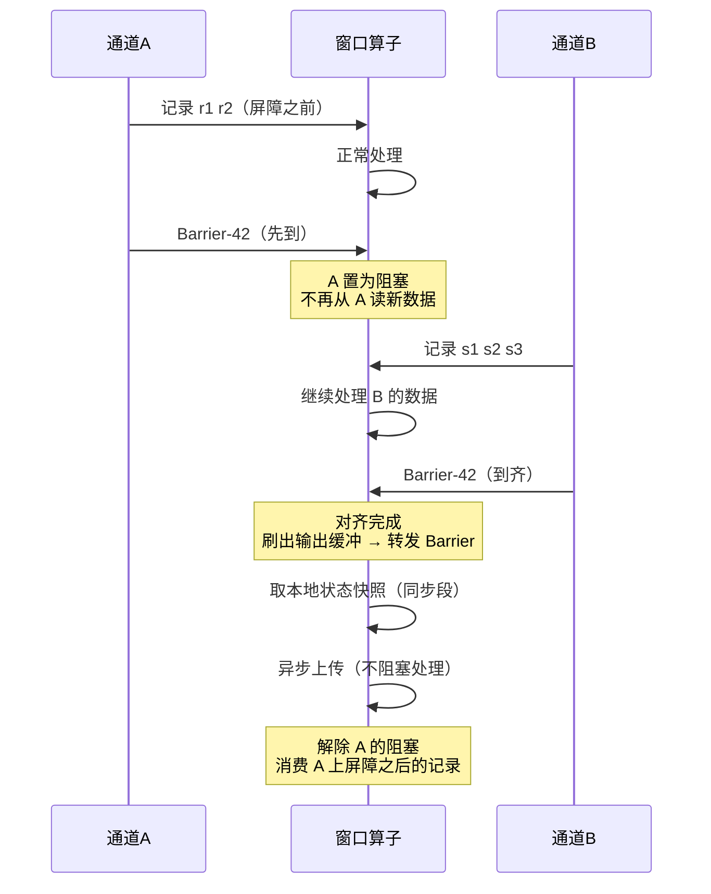
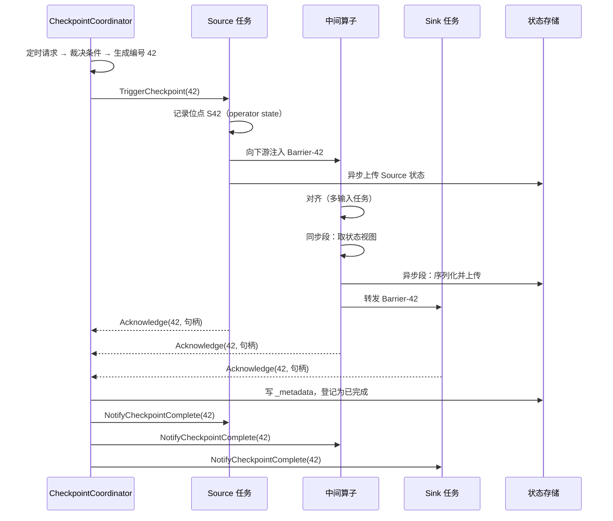
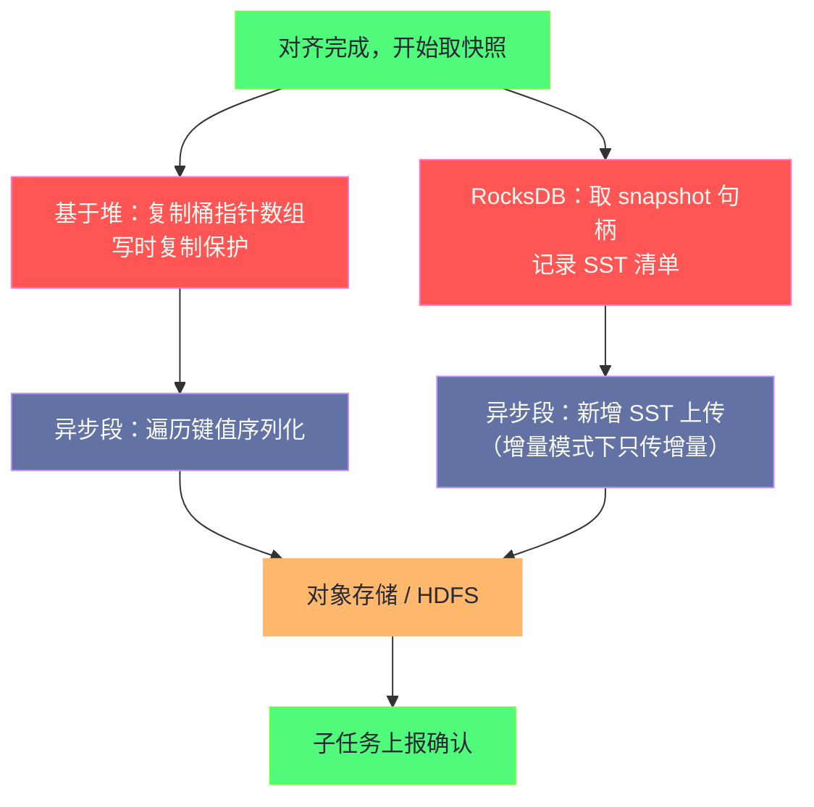
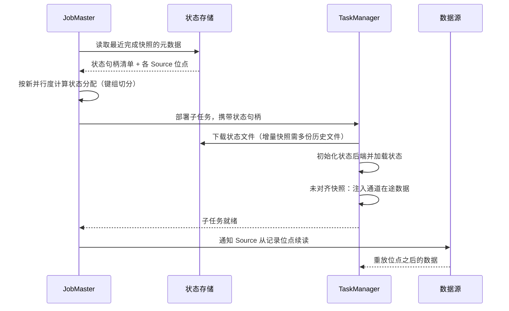

**摘要：**

Checkpoint（检查点）是 Flink 容错体系的地基，它要回答的问题看似简单：当作业必须一直跑、状态分散在成百上千个子任务里、网络上还有一批既不属于上游也不属于下游的在途记录时，怎么给整个作业拍一张口径一致的照片。本文沿一次快照的完整生命周期往下走。先回到 1985 年 Chandy-Lamport 的经典算法，看它为什么需要"标记消息"与"记录通道状态"两个动作，再看 Flink 的三处改造——通道 FIFO 让记录通道状态变得不必要、barrier 顶替标记消息并兼任分割线、快照被拆成同步与异步两段——各自省掉了什么、又新增了什么前提。随后进入调用链：协调器如何触发、Source 何时记录位点并注入 barrier、算子如何对齐或跳过对齐地取快照、ack 如何汇总成一次完成的快照、超时与失败如何分流。最后落到配置与恢复：哪些参数组合互斥、从哪个快照恢复、并行度变化时状态如何按 key group 重新落位、Savepoint 与 Checkpoint 的契约差在哪里，以及 checkpoint 变慢的五种成因如何分流。全文的落点是一句权衡：快照开销、恢复时要重放的数据、运行时能忍受的停顿，三者只能选两个。

---

## 第 1 章 快照要回答的那个问题

### 1.1 一次"卡住"的快照

先看一个几乎所有 Flink 值班的人都遇到过的现象：作业本身吞吐正常，业务数据也在出，但 Checkpoint 的耗时从十几秒一路涨到几分钟，最后开始超时，日志里刷出 `Checkpoint expired before completing`，随后作业失败重启，重启又从更早的快照恢复，重放一段数据，再慢一次。

本能反应是去调大超时时间，或者把快照间隔拉长。这两招有时能压住症状，但共同点是**把问题从快照挪到了恢复**：快照更少意味着故障后重放的数据更多，超时更宽意味着卡死的快照要占用更久资源才被放弃。要判断往哪边调，得先弄清一次快照在做什么。

笔者用一个贯穿全文的案例承载后面的讨论：一套电商实时数仓作业，双支路，一条从 Kafka 读订单与支付事件，按分钟窗口聚合后写入大屏指标表；另一条接 MySQL 的变更数据捕获（Change Data Capture，CDC）流，去重合并后写入数据湖。两条支路各有一个多输入的窗口算子，末端是两个 Sink。它同时具备三个特征：状态不小、有 shuffle、有外部写入，Checkpoint 机制里需要辨析的东西在它身上都能找到落点。

### 1.2 在途数据的两难

单个进程拍快照很简单：停下来，把内存写盘，恢复时读回来。分布式系统里没有这个"停下来"的选项，因为每一刻都有数据在网络上飞。

设想一条只有两个子任务的链路：上游 A 向下游 B 发送记录，A 已发出第 100 条，B 只处理到第 80 条，第 81 到 100 条正在通道里。分别给 A 和 B 拍照，两个顺序都出问题。先拍 A 再拍 B，A 的照片含第 100 条的效果，B 的照片停在处理第 80 条之前，而第 81 到 100 条既不在 A 的状态里，也不在 B 的状态里，这批记录从全局视角蒸发。反过来先拍 B 再拍 A，B 的照片停在第 80 条之前，恢复后 B 会重新消费第 81 到 100 条，这批记录被算了两遍。

悖论的根源在于快照缺少一个全局的切割面：两个子任务的拍照时刻之间存在时间差，而这段时间里数据在动。1985 年 Chandy 与 Lamport 在《Distributed Snapshots: Determining Global States of Distributed Systems》里给出的答案是：不需要让所有节点在同一时刻停手，只需让**每个节点在一条逻辑分割线的同一侧拍照**，把这条线画在数据流里，而不是画在时钟上。这条线后来在 Flink 里有了具体形状，叫 barrier。

### 1.3 "精确一次"在这个语境下的确切含义

围绕 Checkpoint 的讨论经常滑向一个含糊的说法：精确一次（Exactly-Once）就是数据只处理一次。这个说法既不准确，也不足以支撑排障。

准确表述是：故障恢复之后，所有算子状态与数据流的位点，等价于这条作业从未发生过故障。恢复时数据会被重放，第 81 到 100 条会被再处理一遍，这没关系；只要副作用不重复进入状态、不重复落到外部系统，从结果上看就等价于只处理了一次。这类语义有时被称为有效一次（effectively-once），它由三件事共同保证：状态快照一致、Source 可回退到指定位点、Sink 的写入对外部系统幂等或走事务。三者缺一，端到端的精确一次就不成立，而 Checkpoint 只负责第一件。

这也解释了 Flink 文档里那句容易被跳过的前置条件：Checkpoint 需要可持久化、能重放的数据源，以及持久化的状态存储。不具备回退能力的 Source，譬如只能读 socket 的源，快照做得再漂亮，恢复后也只能从当前时刻继续，前面那段数据就是丢了。

### 1.4 本文的边界

这一篇只讲机制：barrier 怎么在拓扑里走、算子在什么时刻取快照、同步与异步两段各自发生了什么、ack 如何汇总、恢复时状态如何落位、Savepoint 与 Checkpoint 的契约差在哪。

具体的参数该设成多少、作业卡在 Checkpoint 上先看哪个面板、Kafka 事务的隔离级别怎么配，属于工程侧的问题，本篇只在机制必需处给默认值，不展开配置清单；那部分归 [[大数据/Flink/Flink从入门到实战/06 状态管理与 Checkpoint 实战|实战篇的状态管理与 Checkpoint]] 与 [[大数据/Flink/Flink从入门到实战/10 生产运维：监控、调优与常见问题排查|生产运维排障]]。状态后端的内部结构、键组（Key Group）的哈希空间与 RocksDB 的存储布局归 [[大数据/Flink/Flink原理深度解析与性能优化/05 Flink 状态后端深度解析|状态后端]]；反压的传播路径与网络缓冲池归 [[大数据/Flink/Flink原理深度解析与性能优化/04 Flink 网络传输与反压机制深度解析|网络传输与反压]]；端到端写入 Kafka 的事务配置归 [[大数据/Flink/Flink从入门到实战/08 Flink 与 Kafka 端到端精确一次实战|Kafka 端到端精确一次实战]]。

---

## 第 2 章 Chandy-Lamport 与 Flink 的三处改造

### 2.1 没有全局时钟的快照

Chandy-Lamport 面对的是异步消息传递系统：进程之间没有共享时钟，消息传输时间不确定，通道不保证先进先出。算法只有两个动作。第一，由某个进程发起，向所有出边通道发送一条特殊的标记消息（marker）；每个进程收到第一条标记时记录本地状态并向所有出边转发标记，此后从每条尚未收到标记的入边继续到达的消息都被记录下来，直到那条入边的标记到达。第二，这些被记录下来的消息就是该通道状态的一部分。

两个动作对应两张纸：本地状态与通道状态，拼起来就是一个一致的全局快照。进程在收到标记之前不需要停手，收到之后也不需要停手，只是多做一份记录。

Flink 面对的执行模型与它有实质差别：算子之间是流式的、有界缓冲的单向通道，通道内先进先出；快照不留在本地，而要序列化到远端对象存储；作业规模动辄上千个并行子任务。于是有了 2015 年论文《Lightweight Asynchronous Snapshots for Distributed Dataflows》里的三处改造，每一处都省掉一部分成本，也各自换来一个前提。

### 2.2 改造之一：通道 FIFO 让"记录通道状态"消失

第一处改造最省事，也最容易被忽略：Flink 的算子间通道是先进先出的，因此不必记录通道状态。

推理很短。如果一条通道严格 FIFO，那么当算子从某条入边收到标记（Flink 里叫屏障，Barrier）时，可以断定：这条通道上排在屏障之前的记录**已经全部到达并被处理**，排在屏障之后的记录**一条都还没到**——因为 FIFO 通道不允许后发的记录赶超先发的屏障。于是"屏障之后这条通道还会来哪些数据"这个信息，等价于"通道里剩下的那部分数据本身"，而这部分数据反正还躺在网络上或上游的输出缓冲里，不需要此刻抄一份进快照。算子只要在收到屏障的那一刻取自己的状态，一致性就成立：屏障之前的效果都在状态里，屏障之后的都还在路上，不会被算进这张快照。

这也是 Flink 与论文那套模型的分水岭：论文的通道不保证顺序，必须显式记录通道上的消息，Flink 用一个更强的 FIFO 假设把这份成本换掉了。代价是，一旦某条链路上出现不保序的处理（譬如自定义算子内部并行发出），这个结论就不再成立。

### 2.3 改造之二：barrier 既是标记，也是分割线

第二处改造是把抽象的标记消息变成一种可以精确定位的流内事件。

在 Flink 里，屏障（Checkpoint Barrier）是一个特殊的流元素，与水位线（Watermark）、流状态更新属于同一族，都在数据流里占一个位置。它携带三样信息：所属快照的编号（Checkpoint ID）、触发时刻的时间戳、这一轮快照的选项（对齐或非对齐、是否 Savepoint、是否强制全量）。因为它占着流里的一个确定位置，它之前与之后各有多少条记录，对每条通道都是明确的。

```
通道 A：  r1  r2  r3  [B42]  r4  r5
通道 B：  s1  s2  [B42]  s3  s4
```

上图里，编号 42 的屏障把两条通道各自切成两段。所谓一致快照，就是找一个切割面，使快照覆盖"每条通道屏障之前那一段"的并集，且这个并集在恢复后能拼成等效的执行历史。标记在论文里是逻辑概念，在 Flink 里落到具体位置，于是"屏障的位置"就是"快照的切割线"。

还有一条性质同样重要：**屏障不打断数据流**。它不要求上游停止发送，也不要求下游立即处理，它只是排在队列里往前走。这正是"不停作业"这个词在实现层面的含义。也正因为屏障与普通记录同队列，多个不同编号的屏障可能同时存在于网络中，对应多个正在进行的快照，这一点直接决定了后面并发快照参数的意义。

### 2.4 改造之三：快照拆成同步段与异步段

第三处改造来自 Flink 的部署形态：状态不在本地磁盘，而在远端对象存储。

论文里的"记录本地状态"是内存或本地磁盘操作，代价可控；Flink 里"把状态写进 HDFS 或 S3"是跨网络的批量序列化与上传，状态大时可持续几十秒到几分钟。若整段放在算子线程里做，作业就等于在快照期间停摆，于是快照被劈成两段：同步段只取得一个此后不再变化的视图（引用、快照句柄、复制表结构），异步段由独立线程完成序列化与上传。同步段必须短，因为它占着算子线程；异步段可以长，因为它不占数据处理的时间片。

这处改造换来吞吐，代价是复杂度：快照从一次操作变成一个状态机，中间可能出现部分失败、重复上传、共享文件引用计数、以及恢复时按引用清单还原等问题，后面几章都在处理这些分支。

### 2.5 三处改造的账

| 维度 | Chandy-Lamport 原版 | Flink 的实现 |
|---|---|---|
| 标记的形状 | 特殊的标记消息，需与业务消息区分 | 流内的屏障事件，携带快照编号、时间戳与快照选项 |
| 通道假设 | 不保序，需记录通道状态 | 单条结果分区内 FIFO，故不需要记录通道状态 |
| 快照存放 | 进程本地 | 远端持久化存储（HDFS、S3、本地文件系统） |
| 快照执行 | 一次同步完成 | 同步取视图 + 异步序列化上传 |
| 触发者 | 任意进程发起 | JobMaster 中的 CheckpointCoordinator 统一发起 |
| 一致性结论 | 一致的全局快照 | 一致的全局快照（在 Source 可重放、Sink 幂等或事务的前提下） |

### 2.6 一致性论证与它的前提

把三处改造合起来，我们可以得到一个比"看起来对"更结实的论证。

设第 42 轮快照的屏障在每条通道上都有确定位置。每个算子在收齐所有入边的 42 号屏障后才取状态，那么对它而言，屏障之前到达的记录全部处理完、之后的一条没处理，状态恰好对应这个时刻。逐层推上去，Source 记录位点 S42，中间算子的状态对应"处理完 S42 之前全部记录"，Sink 收到屏障时上报的也是同一侧。于是整张图存在一致的切割面，快照覆盖的事件集合在恢复后能重放成与无故障执行相同的历史。

这个论证有三个前提，缺一个就漏：Source 能回到位点重放，否则切割面上游没有可重放的输入；每条算子间通道在快照期间保持 FIFO，否则 2.2 节的推理失效；屏障不会被算子吞掉或重复消费，这要求转发时严格保持每个输出通道各发一份。生产上大部分状态不一致的事故，追到底都是某条前提被业务代码破坏了——一个在算子内部异步发送数据、绕过输出通道的 UDF，一个把屏障当作普通数据过滤掉的算子，都能让快照在机制上"成功"、在语义上失效。

---

## 第 3 章 Barrier 在拓扑里的传播与对齐

### 3.1 算子链内部没有对齐问题

先说一个常被忽略的事实：**算子链内部不需要对齐**。

开启算子链之后，一条链里的若干算子被合并成同一个任务，它们在同一个线程里串行执行，中间不经过网络通道。屏障进入链头之后，会沿着链依次穿过每一个算子，途中没有第二条输入通道，也就没有"等谁"的问题。因此对齐只发生在任务边界上，具体是两类位置：有多个输入通道的任务，以及经过 shuffle 之后需要从多个上游子任务收数据的任务。

这也解释了一个直觉上的矛盾：并行度 64、算子链很长的作业，对齐耗时不按算子数放大，因为链内只是一次穿过，真正的等待只发生在少数几个多输入点上。

### 3.2 单输入算子：直接穿过

单输入算子最干脆：收到屏障，把待输出的记录刷出去，向下游转发屏障，然后取快照。没有缓冲也没有等待，只有一次"先刷再转"的顺序要求——若屏障先于尚未发出的记录被转发，那些记录会落到下一个快照里，而副作用已在当前快照的状态里，一致性就破了。

无状态算子几乎无成本，快照只是一个标记；有状态算子的成本落在取快照这一步，也就是第 5 章要拆的同步段与异步段。

### 3.3 对齐：多输入算子的等待

到了多输入任务，不妨把机制的重心摊开看。

一个窗口算子从两条上游通道收数据。编号 42 的屏障从通道 A 先到，通道 B 的屏障还压在队列里。此时算子有两个选择：立刻取快照，或者等 B。判据来自第 2 章的论证：若此刻取快照，A 在屏障之后仍会来数据，其中一部分会在 B 的屏障到达前被处理，这部分记录的效果既进了 42 号快照，又会在恢复后因 B 侧位点回退而被重放，重复就发生了。所以必须等。

对齐（Alignment）就是对这段等待的实现，它的动作可以拆成五步。

1. 通道 A 的屏障到达，记下"已收到 42 号屏障"，并**把这个通道置为阻塞**：不再从 A 读取新数据。注意这里是不读，而不是读出来缓存；A 上屏障之后的记录留在输入缓冲或网络里，读不动时反压会顺着通道传回上游 A。
2. 通道 B 的数据继续处理，直到 B 的屏障到达。这期间算子照常工作，吞吐并没有停。
3. 所有入边的 42 号屏障到齐，对齐完成。此刻算子把输出缓冲里待发的记录全部刷出（保证它们属于 42 号快照），再向每个下游通道转发一份 42 号屏障。
4. 取本地状态快照（同步段），交给异步线程上传。
5. 解除通道 A 的阻塞，开始消费 A 上屏障之后的记录——这些记录属于 43 号快照的区间。

下图把这段交互摊开。注意等待期间 A 的数据并没有被读进内存，这一点决定了内存压力的来源不是"对齐缓冲"，而是"反压"。



### 3.4 不对齐：AT_LEAST_ONCE 的重复从哪来

把等待去掉，就得到至少一次（At-Least-Once）模式：收到任何一条入边的屏障就立刻取快照并转发，不等其他通道。

省掉的等待换来了两样东西。一是快照快，不再受最慢通道的拖累；二是语义退化。沿用上面的例子：A 的屏障先到，算子立刻拍下 42 号快照，状态只包含 A 上 r2 之前的处理结果；随后 B 的屏障才到，但在这段时间里，A 上屏障之后的记录 r3、r4 已经被处理，它们的效果进了 43 号快照的状态。故障恢复时，B 侧的位点回退到 42 号快照对应的位置，r3、r4 会被重新投递并再次处理，而它们的效果已经部分体现在 43 号状态里，重复由此产生。

因此不对齐模式只适合两类场景：Sink 侧有幂等或去重能力（按主键 upsert、带唯一键的写入、下游可按消息 ID 去重），或者状态更新本身可覆盖（最后一次写入生效，重复不改变结果）。实时大屏的指标表按主键覆盖写就属于后者，这也是很多团队敢把大屏支路设成至少一次、把入湖支路设成精确一次的原因。风险在于模式是作业级配置，两种语义不能在一个作业里混用。

### 3.5 三种跳过对齐的情形

除了显式配置成至少一次，还有三种情况在机制上不需要对齐。

其一是单输入（含链内）算子，3.2 节已经解释，没有第二个入边可等。其二是未对齐快照（Unaligned Checkpoint），第 6 章展开，它没有取消等待，而是把等待的那段数据写进快照，从根上拆掉了等待的必要性。其三是广播流的输入通道：通过广播状态模式接入的流，其数据是上游对每条下游通道的完整复制，同一个上游子任务在广播时对每条通道写入同一个屏障，位置天然一致，广播状态又在算子的快照里整体写入，不依赖逐通道等待对齐。需要区分的是，一个算子可能同时有普通输入与广播输入，此时普通输入通道之间仍要对齐，广播通道不参与这轮等待。

### 3.6 对齐的时间量级

对齐耗时不是常数，它由入边之间的进度差决定，而进度差会被反压急剧放大。

给一个可算的模型。设某个双输入算子，下游处理速率为 2 万条每秒，两条入边的进度差为 5 万条，那么快的那条先把屏障送到，慢的那条还要处理 5 万条才轮到自己，对齐等待约 2.5 秒（示例推算）。这个数与数据量成正比、与处理速率成反比，一旦反压使处理速率掉一个数量级，等待就涨一个数量级，再叠加队列积压，等上几十秒并不罕见。

对齐等待超过超时时间，这一轮快照就被判失败，而失败会占掉下一次触发机会（并发默认是 1），快照节奏被打乱，恢复窗口随之拉长。第 1 章那个"耗时一路涨到超时"的现象，机制上的解释往往不在快照本身，而在这条链路上游某个环节变慢了。

---

## 第 4 章 一次 Checkpoint 的完整调用链

### 4.1 触发：CheckpointCoordinator 的决策

快照由谁发起，决定了整个流程的控制面。答案是运行在 JobMaster 里的检查点协调器（CheckpointCoordinator），它随 JobMaster 一起创建、一起销毁，作业之间互不可见。

它的工作方式是一个周期性提交的请求：定时器按配置的间隔生成触发请求，请求进入 JobMaster 的邮箱（Mailbox）后由主线程串行裁决，裁决是一串条件的与——作业是否处于运行状态（恢复中、取消中都不触发）、正在进行的快照数是否达到并发上限、距上一轮完成是否已过最小间隔、连续失败次数是否未越阈值。全部满足，它递增快照编号，创建一个待定快照对象（PendingCheckpoint），记录时间戳与参与本轮的子任务清单，再逐个向没有输入的 Source 任务发送触发消息。

这里有个细节：触发是"请求 - 裁决"两段，而不是定时器直接发消息。触发时 JobMaster 可能正在处理恢复、扩缩容或取消，这些操作都会改变参与快照的子任务集合，只有与触发放进同一个串行队列，才能保证参与者清单不中途变化。待定快照对象记着"哪些子任务还没上报"，它同时是收集器与超时计时器，这一轮的成败由它裁定。

### 4.2 注入：Source 的两个动作

触发消息只发往 Source 任务，这是有意的：快照的位点必须由数据流的起点定义，中间算子无从判断"我的上游读到了哪里"。

Source 任务在邮箱线程里收到消息后，做两件事，顺序不能颠倒。

先把自己的位点写进 operator state，Kafka Source 写的是每个分区对应的 offset，文件 Source 写的是文件路径与偏移量。随后向所有下游输出通道各发一份屏障。先记录后发屏障，保证了"屏障在流里的位置"与"状态里记录的位点"是同一个点：位点之前的记录都会被处理并体现在状态里，位点之后的一条都没处理。

状态序列化与上传同样异步，Source 的 operator state 通常很小（一个分区到 offset 的映射），同步段开销可以忽略，但仍走第 5 章那套同步取视图、异步上传的流程。

### 4.3 算子侧：取快照与立即返回

屏障顺着数据流往下走，每个算子都要在自己的任务线程里完成一次取快照。这一段是整条链路里最需要看清楚的地方，因为它同时涉及阻塞与不阻塞两种代价。

对多输入算子，先做第 3 章讲的对齐；对齐完成之后，任务调用一次取检查点的动作，内容是依次做三件事：给需要预提交的算子一次回调（两阶段提交的预提交就挂在这里，第 10 章会讲它为什么必须发生在状态快照之前）；对每个状态后端取一份快照视图；把这些视图交给异步线程，然后**立刻返回继续处理数据**。

所谓"交给异步线程"，在实现上是一组待完成的句柄：键控状态、算子状态、定时器状态的句柄，加上每个句柄对应的上传任务。任务线程不等待它们完成，只负责后续汇总上报。等所有句柄完成，子任务向 JobMaster 发送确认消息（AcknowledgeCheckpoint），消息里带的是状态落到了哪个存储位置，而不是状态数据本身。确认不等于全局可见：它只说明自己那份写完了，整轮快照是否成立还要等协调器汇总。

### 4.4 汇总与完成

当所有参与者——包括全部 Source、全部中间算子、全部 Sink——都确认之后，协调器把待定快照转成已完成快照，随后做四件事。

第一步，写元数据。把本轮每个子任务的状态句柄、各 Source 的位点、快照编号与时间戳汇总成一份文件写进存储；它是恢复时唯一的入口，决定了"从哪个文件恢复哪个子任务"。

第二步，登记到已完成快照集合。协调器维护一个按完成顺序排列的集合，默认只保留最近一个（由 `state.checkpoints.num-retained` 控制），更早的被新快照取代后清理。清理是引用计数式的，只有不再被任何保留快照引用的文件才删除，这是增量快照能复用历史文件的机制基础。

第三步，通知完成。协调器向所有子任务发送完成通知，子任务据此回调算子上注册的完成钩子——这是外部事务正式提交的唯一正确时机，第 10 章展开。

第四步，更新统计。耗时、大小、对齐期间被缓冲的数据量在这一刻落账，它们是诊断变慢的原始数据。

下图把这条调用链按参与者摊开，注意时间轴上并行发生的部分：协调器的触发是串行的，但各子任务的取快照、上传、确认是完全并行的，整轮耗时由最慢的那条支路决定。



### 4.5 存储布局与一个常见的过时说法

早期目录是"一个快照一个目录"，形如 `chk-42/0_0`；现在按文件生命周期分共享、任务独占、快照独占三块，外加每个快照的编号目录，共享目录里的文件被多轮快照引用，是增量快照的公共底座。所以排查"磁盘为什么涨"时，占空间的往往不是最新一轮，而是共享目录里被多轮引用的文件；恢复入口则永远是元数据文件，而不是目录结构。

### 4.6 失败路径的分流

并非每一轮快照都能走完，失败的处理方式与失败发生的位置强相关，这条区分对排障很关键。

失败大致分三类：超时，即从触发到完成超过配置的超时时间（默认 10 分钟），协调器主动放弃这一轮；异步段失败，某个子任务上传状态时遇到 IO 错误；协调器侧失败，元数据写不进存储，或协调器与子任务之间的连接断开。

三类失败的共同处置是中止本轮（AbortCheckpoint）：通知相关子任务清理已上传的部分文件，把这一轮从待定集合移除，并计入连续失败次数。计数的规则有个精确边界：只有这三类计入容忍计数，同步段的失败不走这个通道——同步段出问题意味着算子线程本身出了状况，对应子任务直接被判定失败并触发恢复，不受阈值保护。这条边界的意思是：容忍阈值能挡住存储抖动、网络慢这类外部原因，挡不住算子代码在取快照时抛异常这类内部原因。

连续失败次数越过阈值（默认 0）后作业进入故障恢复，未越过则等下一次触发。默认值值得留意：任何一次超时都会直接导致重启，对状态很大的作业过于激进，实践中通常把阈值调到与快照间隔、恢复代价相称的水平。

---

## 第 5 章 同步段与异步段

### 5.1 同步段：取一个不再变化的视图

同步段的唯一目标，是在算子线程里取得一份"此后不会被业务写入破坏"的状态视图。它的耗时决定了算子线程被占用多久，因而直接体现为延迟尖峰。

对基于堆的状态后端，取视图靠的是写时复制（Copy-on-Write）。状态表内部是分桶的哈希结构，取快照时并不复制数据，而是复制一份桶指针数组，登记"这里有一份快照引用"；此后业务写入先检查目标桶是否被快照引用，若是则复制该桶再改，保证快照看到旧桶。因此同步段成本与桶数量、以及快照期间被改动的桶数量相关，不与状态总量线性相关，这也是这类后端在小状态、高吞吐作业上同步段往往只有毫秒级的原因。

对基于嵌入式 RocksDB 的状态后端，取视图更轻：直接向 RocksDB 要一个快照句柄。RocksDB 的快照建立在 SST 文件不可变这一性质上，取快照只是记下当前的序列号，之后的新写入进入内存表与新的 SST，旧文件在快照释放前不会被删除。同步段因此极短，几乎只包含一次元数据操作与若干句柄的登记。

两种实现的共同点是：同步段里不做序列化工作。状态对象、键值对都还是原样，真正的"读出来变成字节"发生在异步段。

### 5.2 异步段：序列化与上传

异步段由独立线程执行，做两件事：把状态视图序列化成字节流，把字节流写到远端存储。这两件事的量级差异很大，通常上传是大头，但在状态对象多、序列化器慢的场景里，序列化也可能成为瓶颈。

对基于堆的后端，异步段要遍历快照视图的所有键值，逐条序列化再按块上传；状态越大、序列化器效率越低，这一段越长。它对算子线程的影响不体现在阻塞上，而体现在 CPU 与 GC 竞争上，效果是吞吐下降、GC 频率上升。

对 RocksDB，异步段分两种模式：全量把所有 SST 文件读出来上传；增量只记录"本轮与上一轮的差异"，上传新增的 SST，历史文件通过共享目录复用。增量模式的成本由"这一轮新增了多少数据"决定，而不是"状态总量有多大"，这一点是理解第 6 章与第 11 章的前提。但要留意一个副作用：增量快照的可用性依赖共享目录的完整性，一旦共享文件被误删，本轮及之后若干轮快照可能同时失效，只能回退到更早的全量快照或 Savepoint。

下图把两个后端在同步段与异步段上的分工画在一起。



### 5.3 状态大就慢的三个乘数

"状态大导致快照慢"这个说法对，但不够用，因为它是三个乘数叠出来的结果，而三个乘数的调节方式各不相同。

第一个乘数是同步段的视图成本：对堆内后端，与桶数量和并发写入相关；对 RocksDB，几乎为零。第二个乘数是异步段要序列化与上传的量：全量后端等于状态总量，增量后端等于本轮增量。第三个乘数是对齐等待，与状态大小无直接关系，与前文所说的进度差相关。

用一个示例把三者放到一起（以下为示例推算，用于说明量级关系，非实测数据）。某作业状态 300 GB，用 RocksDB 增量快照，每轮新增约 3 GB，对象存储有效写入带宽 200 MB/s，异步段约 15 秒；同步段可忽略，对齐约 1 秒，整轮约 16 秒，配 60 秒间隔、10 分钟超时显得宽裕。某天写入量翻倍，后台合并跟不上，单轮新增涨到 30 GB，异步段变成 150 秒；并发默认为 1 时下一轮被推迟，实际节拍变成"150 秒快照 + 60 秒间隔"，快照开销占比过半，吞吐下降，单轮耗时逼近超时阈值。变化的其实是"每轮增量"这个乘数，而它由写入量、合并策略、键的局部性决定，调快照参数解决不了。

### 5.4 两种代价，两种判断

混为一谈会导致错误处置。同步段过长，表现是周期性的延迟尖峰：每到快照时刻算子线程被占用、处理暂停，端到端延迟抬升一次再恢复，判断依据是延迟曲线与快照时刻的周期性对齐，处置方向是缩小视图成本（换后端、减少快照期间的热点写入），而不是调大间隔，后者只是把尖峰摊薄，幅度没变。

异步段过长，表现是吞吐下降与资源争抢：CPU 被序列化线程分走，带宽被上传占走，RocksDB 的磁盘 IO 与合并争抢加剧；判断依据是快照大小与上传速率、以及快照期间 TaskManager 的磁盘与网络指标，处置方向是减少上传量或提升带宽。

---

## 第 6 章 Unaligned Checkpoint

### 6.1 反压之下，屏障追不上数据

第 3 章的对齐模型有一个隐含前提：屏障总能在可接受的时间内走完全程。反压打破的正是这个前提。

反压的本质是下游处理不过来，上游的输出缓冲与网络缓冲逐渐堆满，数据在通道里排起长队；屏障作为队列里的一个元素只能按顺序往前走，前面压着多少条记录就要等多久。对齐等待因此从"两条入边的进度差"变成"整条链路积压的清算时间"，严重时可以是几十秒到几分钟。

Flink 1.11 引入的未对齐快照（Unaligned Checkpoint，UAC，对应 FLIP-76）换了一个思路：既然等不到屏障走完全程，那就**不让它等**——让屏障超越记录，直接走到算子，把被它超越的那段在途数据，作为快照的一部分一起存下来。

### 6.2 机制：第一个屏障到达即取快照

UAC 的规则可以概括成两句话：收到**第一个**入边的屏障就立刻取快照并向下游转发，不等其他通道；快照的内容除了算子状态，还包括**在途数据**——每条输入通道里屏障之后尚未处理的数据，以及输出通道里已产生但尚未发出的数据。

因为屏障不再排队，它就有了超越记录的能力：上游发出屏障后，屏障可以越过自己输出缓冲里那批还没发出去的数据，先一步到达下游，下游收到屏障时，一部分上游数据其实还在路上。这些"本该在屏障之前到达却还没到"的数据就是被超越的那段，必须写进快照，否则恢复时它们既不在上游状态里（上游已写进输出缓冲，认为发出了），也不在下游状态里（下游还没读到），就丢了。

在途数据的记录粒度是缓冲区块而不是单条记录，实现上要记录"哪个通道、第几个缓冲块、块内偏移"，并在恢复时按原顺序重新注入。这也是 UAC 与状态后端耦合更紧的原因：在途数据不经过状态后端的键值接口，而是作为通道状态单独序列化，与算子状态一起写进同一轮快照。

### 6.3 恢复时怎么用这份数据

恢复流程比对齐快照多出一步，这一步也是 UAC 复杂度的主要来源。

正常恢复的顺序是：下载状态、初始化状态后端、Source 从位点续读、算子开始处理。UAC 在"开始处理"前插入一步：把快照里的在途数据按通道注入，输入侧放回对应输入通道的队首，输出侧重新发给下游的输入通道。注入之后，算子看到的世界与故障前那一刻一致，重新处理的过程与原来的过程等价。

输出侧的数据需要额外处理。上游在屏障之前发出、但下游已经处理过的那部分数据，如果在恢复时被重新注入，就会被处理两次。Flink 的做法是给输出缓冲的数据编号，下游按编号判断"这段我已经处理过"，恢复时裁掉。这套编号与裁剪逻辑是 UAC 实现上比对齐快照复杂得多的根本原因，也是某些版本上它与特定连接器组合出现兼容问题的来源。

### 6.4 代价清单

UAC 用空间与恢复时间换快照时间，代价可以列清。

- 快照体积变大：与积压量成正比，反压越重、在途数据越多，快照越大，极端情况下可能比正常状态大一个数量级。
- 存储写入量增加：每轮都要多写通道数据，增量快照的优势在这里被部分抵消。
- 恢复时间变长：多一步注入与重放，注入的数据本身还要重新处理。
- 与并发快照不兼容：Flink 不支持并发的未对齐快照，`maxConcurrentCheckpoints` 必须为 1；Savepoint 也不能与它并发，触发 Savepoint 会等当前快照结束。
- 与水位的恢复语义有交互：注入发生在水位生成之前，依赖"最新水位"的算子在恢复后的结果可能与对齐快照不同。
- 对长记录无解：屏障可以超越记录，但不能打断正在处理的一条记录，若单条记录处理很久（一次触发大量定时器，或单条记录塞不进一个网络缓冲），屏障仍要等它处理完。

### 6.5 什么时候该用

> [!warning] 判据
> 快照慢的主因是反压导致的屏障传播与对齐等待时，用 UAC；慢在存储写入本身时不要用，因为它只增加要写的数据量。这条判据直接来自官方文档对 UAC 适用条件的说明，也符合第 5 章的成本结构。

实践中通常不直接从"始终对齐"跳到"始终未对齐"，而是先做两件更便宜的事：一是降低在途数据量，Flink 1.14 的缓冲区去膨胀（Buffer Debloating，`taskmanager.network.memory.buffer-debloat.enabled`）会把在途数据控制在一个目标时延内，对齐等待与 UAC 体积同时下降；二是先治反压本身，根因往往是数据倾斜、下游写入慢、状态访问放大，那属于 [[大数据/Flink/Flink原理深度解析与性能优化/04 Flink 网络传输与反压机制深度解析|网络与反压]] 与 [[大数据/Flink/Flink原理深度解析与性能优化/09 Flink 性能调优体系|性能调优]] 的题目。

在此基础上再启用 UAC，并配合"对齐超时后降级"：每轮快照先按对齐开始，若全局耗时超过阈值仍未完成，则切成未对齐继续。前提是先开启未对齐快照、再设这个超时值，效果是正常情况下不多付体积代价，反压严重时自动放弃对齐。

---

## 第 7 章 参数不是独立的旋钮

### 7.1 一张参数表与它们的连带后果

Checkpoint 的配置项不多，但相互之间有耦合，单独理解任何一个都会误判。

| 参数（Java API / 配置键） | 默认值 | 管什么 | 连带后果 |
|---|---|---|---|
| `setCheckpointInterval` / `execution.checkpointing.interval` | 不开启 | 触发节拍 | 决定恢复点的时间粒度，也决定快照开销占运行时长的比例 |
| `setCheckpointTimeout` / `execution.checkpointing.timeout` | 10 分钟 | 单轮快照的存活上限 | 设小了把抖动变成失败与重启，设大了让卡死的快照长期占资源 |
| `setMinPauseBetweenCheckpoints` / `min-pause` | 0 | 上一轮完成到下一轮触发的最小间隔 | 定义它即隐含并发为 1，与并发上限互斥 |
| `setMaxConcurrentCheckpoints` / `max-concurrent-checkpoints` | 1 | 同时进行的轮数 | 大于 1 时不能再用最小间隔；与未对齐快照不兼容 |
| `setTolerableCheckpointFailureNumber` / `tolerable-failed-checkpoints` | 0 | 连续失败容忍次数 | 只覆盖协调器侧 IO、异步段失败与超时，同步段失败直接触发恢复 |
| `enableExternalizedCheckpoints` / `externalized-checkpoint-retention` | 不保留 | 作业取消后是否留快照 | 不启用则取消即删，后续无法从它恢复 |
| `state.checkpoints.num-retained` | 1 | 保留的已完成快照数 | 多留一份换来回退能力，代价是存储与清理开销 |
| `state.checkpoints.dir` 与检查点存储 | JobManager 堆 | 快照落在哪里 | 堆内存储仅适合开发与极小状态，生产必须指向持久化文件系统 |

表里最容易被误读的是前两行的组合。触发间隔描述的是"多久想拍一次"而非"多久能拍一次"：并发为 1 时，一轮没结束就不会有下一轮，实际节拍由单轮耗时决定。所以把耗时 90 秒的快照配成 60 秒间隔，得到的不是更密，而是持续排队、每次都在超时边缘试探。

### 7.2 最小间隔与并发上限为什么互斥

这两个参数描述的是同一件事的两种写法，因此不能同时生效。

最小间隔的语义是"上一轮完成后至少等这么久再开始下一轮"，一旦成立，任何时刻最多只有一轮快照在跑，并发上限自然被钉成 1；反过来允许两轮并发，就必然存在"上一轮没完成、下一轮已开始"的时刻，最小间隔的语义随之瓦解。文档把这条关系写成"定义了最小间隔即隐含并发为 1"，两者是同一枚硬币的两面。

理解了这层互斥，选型逻辑也就清楚了。想要稳定的运行时开销占比，用最小间隔，让快照之间的处理时间有下限；想要更密的恢复点且能容忍重叠，用并发上限。后者的代价常被低估：多轮并发意味着同一份状态在内存里可能同时存在多份快照视图，堆内后端上尤其明显，增量后端则要多维护几份文件引用。

### 7.3 三个反例

反例一：并发上限调到 2，同时保留 30 秒最小间隔。这组配置在语义上互斥，行为要么被配置层拒绝，要么退化成其中一个生效，现象是"间隔参数改了但节拍没变"。想解决的是"快照太密影响吞吐"，方向应是缩小单轮耗时（第 5 章）或调长间隔，而不是加并发。

反例二：把间隔设得比作业恢复时间还长。某作业状态 400 GB，从快照恢复到可服务需要 20 分钟，团队为了"减少快照对吞吐的影响"把间隔设成 30 分钟。这组数字合起来意味着：一次故障后业务最长等 20 分钟，恢复到的是最多 30 分钟加一轮耗时的状态，数据空洞可达 50 分钟量级。间隔的选择不是"快照开销"与"零开销"之争，而是"平时多付一点"与"故障时多丢一段"之争，这个交换必须对着业务的时间容忍度来定。

反例三：不启用外部化快照。默认策略下，快照只在作业失败时用于自动恢复，作业被主动取消（发布新版本、调整并行度、迁移集群）时会被清理。此时能用的只有此前手工打的 Savepoint；连它也没有，就只能从数据源最早的可读位点重放。这个坑在"临时重启一下"的运维动作里出现频率极高，因为取消与失败是两条路径，失败保留、取消不保留。

---

## 第 8 章 恢复：选哪个快照，状态怎么落位

### 8.1 选哪一个快照

恢复时选中的是**最近一次完成的**快照，而不是最近一次触发的。一轮快照从触发到完成可能耗时很久，期间若发生故障，这一轮因未完成、元数据没写而不可用，恢复只能回到上一轮已完成的快照；所以数据空洞等于"上一轮完成时刻到故障时刻"。

已完成快照的集合由协调器维护，按完成顺序排列，保留数量由 `state.checkpoints.num-retained` 决定。编号递增，但完成顺序可能与编号顺序不一致（并发时尤其如此），恢复依据的是完成顺序而非编号大小。

### 8.2 恢复的完整动作

恢复是一串有严格顺序的动作，不是"下载状态然后开跑"。



顺序上有两处不能颠倒：**状态先于数据**，子任务必须在开始消费前完成状态加载，否则第一条记录就会访问到空状态；**位点先于重放**，Source 必须从快照记录的位置开始读，而不是从最新位置，否则位点之前的数据就永久跳过了。

### 8.3 并行度变化：键组是搬运单位

恢复时允许改并行度，这是 Flink 相对很多流处理系统的一个实用能力，它的实现依托键组。

键组（Key Group）是键空间的固定切分：作业首次提交时用最大并行度（`maxParallelism`）把哈希空间切成固定份数，此后并行度怎么变，键组数量不变，变的只是"哪个子任务负责哪几段"。恢复时，新并行度下每个子任务分到一段连续区间，状态按区间整体搬运，键到子任务的映射由哈希重算，归属与搬运后的区间一致，访问因此仍然正确。完整推演在 [[大数据/Flink/Flink原理深度解析与性能优化/05 Flink 状态后端深度解析|状态后端]] 里，此处只取结论：**并行度可以改，键空间的大小改不了**。

算子状态（Operator State）没有键可以分，它按分配模式重新落位。三种模式的含义与适用场景差别很大。

| 分配模式 | 恢复时的行为 | 典型使用者 | 注意点 |
|---|---|---|---|
| 均分（Even Split） | 所有元素按新并行度尽量平均切分 | Kafka Source 的分区位点、文件 Source | 并行度变化会改变每个子任务拿到的元素数 |
| 联合（Union） | 每个子任务拿到全量元素 | 需要全量视图的算子状态 | 并行度调大后，同一份状态被复制多份，内存与恢复时间随并行度放大 |
| 广播（Broadcast） | 每个子任务拿到全量，且要求各子任务状态一致 | 广播状态模式的规则集 | 恢复时校验一致性，不一致会直接失败 |

### 8.4 恢复时间的组成

恢复时间由四段叠加：元数据读取（秒级）、状态下载（与状态量、带宽、并行下载度相关）、状态加载与重建（RocksDB 需要把 SST 装回本地，堆内后端需要反序列化）、积压重放（与故障期间堆积的数据量、重放吞吐相关）。

给一个量级估算（示例推算）：状态总量 100 GB，20 个子任务并行下载，单流有效带宽 50 MB/s，下载约 100 秒；RocksDB 装载与预热数十秒；若故障期间积压 5 分钟数据、重放吞吐 20 万条每秒，重放还要几十秒。四段相加，从故障到可服务往往是分钟级而非秒级，这也印证了第 7 章反例二的判断依据：恢复时间必须与快照间隔一起算。

---

## 第 9 章 Savepoint 与 Checkpoint

### 9.1 同一套机制，两种契约

Savepoint 常被讲成"手工触发的 Checkpoint"，这个说法在实现上成立，在契约上不成立。

2016 年的 FLINK-4322 把独立的 Savepoint 协调器并入了 CheckpointCoordinator，此后两者走同一条快照流水线，差别只剩两条：Savepoint 会写出完整的根元数据，且始终是全量的、不增量的。两条差别的目的都是可迁移性——一份 Savepoint 必须能独立解释自己，不依赖同目录下其他快照留下的文件。

### 9.2 触发方式与保留策略

Checkpoint 由定时器自动触发，Savepoint 只由外部命令触发：命令行工具、REST 接口、SQL 客户端里的对应语句。触发时通常要指定目标目录（与 `state.checkpoints.dir` 分开配置），并可以选择立即停止作业。

保留策略也不同。Checkpoint 的默认生命周期是"服务故障恢复"，作业取消时被清理；Savepoint 不会被自动清理，它是运维资产。这条差异决定了发布流程：改代码、改并行度、迁移集群之前先打一份 Savepoint，等于给状态留一个可解释的版本。

### 9.3 uid：算子身份的锚点

Savepoint 能用于升级，靠的是状态与算子的映射关系，而映射的锚点是算子的唯一标识（uid）。

Flink 为每个算子生成标识用于匹配状态。若代码里没有显式指定，标识由算子在拓扑里的位置与结构推导出来，任何改变推导结果的动作——调整算子顺序、增删算子、把匿名内部类换成 lambda——都会让标识变化，恢复时便出现"快照里有一份状态，当前拓扑里找不到对应算子"。显式设置 uid 之后，标识与代码结构解耦，小幅重构不再影响恢复。与之配套的开关是允许跳过无法映射的状态（`--allowNonRestoredState`），代价是这部分状态被静默丢弃；它是"我知道我在删什么"的确认动作，不该长期打开。

### 9.4 两者的对照

| 维度 | Checkpoint | Savepoint |
|---|---|---|
| 触发者 | 定时器自动，可手工触发一次 | 只由外部命令触发 |
| 默认保留 | 仅用于自动恢复，取消时清理 | 长期保留，需人工清理 |
| 增量 | RocksDB 后端可增量，依赖共享文件 | 始终全量，自包含 |
| 元数据 | 完整元数据，但可依赖共享文件 | 完整根元数据，可独立解释 |
| 主要用途 | 故障自动恢复 | 版本升级、并行度调整、集群迁移、状态备份 |
| 跨状态后端 | 增量快照绑定原后端 | 格式与后端无关，可换后端恢复 |
| 存储位置 | `state.checkpoints.dir` | 单独配置的 Savepoint 目录 |
| 与未对齐快照并发 | 受并发上限约束 | 未对齐快照进行中不能并发触发 |

### 9.5 升级流程里的机制约束

把上面几条落成一次发布动作，顺序是有讲究的：先打 Savepoint（作业保持运行，快照完成后确认元数据可读），再停作业，部署新版本，最后从 Savepoint 恢复并核对关键状态。

这条链上两个机制约束值得记住。一是 Savepoint 与 Checkpoint 的目录要分开，混在一起会让清理策略互相干扰，增量 Checkpoint 的共享文件被引用计数误判时，可能删掉不该删的文件。二是并行度变化只改变键组归属、不改变键空间，所以"从 32 调到 64"是安全的，"把最大并行度改大"则不是——后者相当于换了一套键空间，旧状态无法映射。

---

## 第 10 章 快照完成之后：外部提交的位置

### 10.1 预提交与提交为什么被快照劈成两半

前面的章节都在讲状态，但生产上真正被用户看见的是外部系统里的数据。Checkpoint 与外部写入之间的桥是两阶段提交（Two-Phase Commit，2PC），两个阶段分别挂在快照的两个时刻上。

预提交发生在取状态快照之前：算子把这一批数据写进外部事务或暂存位置，让数据对外不可见，同时把"这个事务已开启"写进算子状态。提交发生在收到完成通知之后：快照已确认落盘，事务才正式生效。

这个顺序保证了一件事：外部可见的数据永远对应一个已经落盘的快照。若在预提交之后、快照完成之前故障，快照没有成立，事务回滚或超时作废，恢复后从上一个快照重放并重新预提交，外部看到的仍然只有一次；若在快照完成之后、提交之前故障，快照已经成立，恢复后 Sink 在初始化状态时核对未完成事务并把它提交掉，数据补上。

### 10.2 通知可能丢，提交必须幂等

协调器写完元数据后向所有子任务发通知，这条链路可能断。若协调器在发通知时崩溃，本轮快照已完成且可恢复，但部分子任务收不到通知，它们持有的预提交事务既没提交也没回滚；恢复后这些事务的归属要靠 Sink 从状态里读回"我有哪些未提交事务"逐一对账。这就是带事务的 Sink 必须实现"恢复时对账"的原因，不能只依赖通知。

另一个方向是通知重复：协调器可能因重试对同一编号发多次通知，网络也可能重复投递，因此提交必须幂等。Kafka 靠事务标识与生产者幂等能力提供这个保证，数据库类 Sink 通常靠可安全重试的提交或写入幂等键；这不是实现的自由选择，而是 2PC 能成立的前提。

### 10.3 外部系统能力的边界

端到端精确一次对存储侧有硬要求：能开事务、能回滚、提交幂等、事务有超时。四条缺一，2PC 就不成立，只能退回"至少一次加业务侧幂等"。

这解释了为什么写 Kafka 能精确一次，写 HBase 或 Elasticsearch 往往只能近似：后者没有事务语义，能提供的只有按主键覆盖（天然幂等），覆盖意味着重复写不产生重复行，但不保证一批写入的原子性。连接器怎么配归实战篇；机制侧的分界只有一句：快照保证内部状态一致，2PC 把外部可见性钉在快照完成这一刻。

---

## 第 11 章 变慢的五种成因

### 11.1 先分解，再判断

"Checkpoint 变慢"不是一个问题，而是至少五个问题的共同表象，它们的处置方向互相冲突。判断的第一步不妨先把一轮快照的耗时拆开，而不是急着调参数。

一轮快照的耗时可以拆成四段：启动延迟，从触发到所有子任务收到触发消息；对齐耗时，多输入任务等待所有屏障到齐；同步段，算子线程取状态视图；异步段，序列化与上传。四段之和近似等于总耗时，哪段占大头就落在哪类成因上。这段分解在监控面板上通常以若干指标呈现，指标名随版本略有差异，以对应文档为准。

### 11.2 五种成因与判据

| 成因 | 症状 | 关键判据 | 机制解释 | 处置方向 |
|---|---|---|---|---|
| 状态总量过大 | 每轮耗时稳定偏长，快照大小缓慢增长 | 快照大小与耗时同步上升 | 全量上传量为状态总量，序列化成本随之上升 | 换增量后端、清理无用状态、缩短状态保留窗口 |
| 状态后端写入慢 | 异步段长且抖动大 | 快照大小正常但上传速率低；磁盘与合并指标吃紧 | RocksDB 的合并与快照上传抢同一块盘 | 独立磁盘、调合并策略、降低写放大 |
| 网络或存储带宽不足 | 上传速率贴着带宽上限 | 快照大小除以耗时接近链路容量 | 上传被带宽钳住，与状态结构无关 | 提升带宽、错峰上传、压缩 |
| 屏障被反压追不上 | 启动延迟与对齐耗时同时升高 | 反压指标高、对齐耗时远大于同步与异步段 | 积压把屏障压在队列后部，对齐等待等于清算时间 | 先治反压，再考虑未对齐快照 |
| 对齐阻塞 | 对齐耗时高但其他段正常 | 对齐期间缓冲数据量指标高 | 多输入任务等最慢入边，快通道被阻塞 | 减小入边进度差、拆分热点、未对齐快照 |

表里前两行最容易混淆，因为症状都是"耗时变长"。区分点在于看快照大小：大小跟着涨，是状态与写入量的问题；大小平稳而耗时涨，是后端或链路的吞吐问题。这个判据比看机器负载可靠，因为负载高不等于快照慢。

### 11.3 三处常见误判

误判一：把异步段慢当成对齐问题，于是上未对齐快照。未对齐快照会增加写入量，原本就受限于存储带宽的作业会进一步恶化，表现为快照更慢、恢复更久；对齐耗时占比不高时，它换不来任何收益。

误判二：把对齐慢当成状态后端问题，于是换后端。换后端改变的是同步段与异步段，对对齐等待几乎没有影响，若瓶颈是某条入边长期落后，换十次后端也不会好。

误判三：把状态总量当成唯一变量，忽略每轮增量。增量后端的成本由增量决定，而增量由写入模式决定：同一份 300 GB 状态，按小时分区且写入集中在前五分钟的作业，与写入均匀的作业，快照成本可能差一个数量级。

### 11.4 量化：恢复点粒度与阻塞量级

把几个量级关系算清楚，参数选择就不必靠猜。

恢复点的最坏空洞（示例推算）可近似写成：单轮成功时约为"间隔 + 单轮耗时"，连续失败 k 次后约为"(k+1) × 间隔 + 单轮耗时"。以间隔 60 秒、单轮耗时 20 秒为例，正常时最坏空洞约 80 秒；连续失败 3 次才越过阈值并触发恢复时，空洞可达 260 秒量级。这说明容忍阈值不是"多给几次机会"，它把恢复点粒度乘了一个系数，取值要和业务能接受的数据重复窗口一起定。

对齐阻塞的量级（示例推算）由进度差除以处理速率给出：下游稳定处理 2 万条每秒，快慢两条入边的进度差 10 万条，对齐等待约 5 秒；反压使处理速率降到 2 千条每秒，同样的进度差要等 50 秒。这解释了反压与快照超时为何总是成对出现：反压既拉长了进度差，又降低了消化速度。

### 11.5 收束：三笔账一起算

> [!note] 一句判断
> Checkpoint 的设计从来不是"让快照更快"，而是把三笔成本摆上天平——快照期间的运行时开销、故障恢复时的重放量、恢复本身需要的时间，三者互相挤压，任何一组参数都只是选了一个支点。

由此有两条推论。其一，参数没有普适最优值，只有相对于 SLA 的合适值：RPO 是分钟级还是秒级、RTO 是两分钟还是二十分钟，决定了间隔、容忍阈值、后端选择与是否启用未对齐快照的组合。其二，机制层面的改进方向是减少每轮要写的数据、缩短对齐等待、缩短恢复路径，选哪条取决于第 11.1 节那次耗时分解。

---

## 参考资料

1. K. M. Chandy, L. Lamport, *Distributed Snapshots: Determining Global States of Distributed Systems*, ACM Transactions on Computer Systems, 1985：标记消息与通道状态记录的原始算法，[lamport.azurewebsites.net](https://lamport.azurewebsites.net/pubs/chandy.pdf)。
2. P. Carbone, G. Fóra, S. Ewen, S. Haridi, K. Tzoumas, *Lightweight Asynchronous Snapshots for Distributed Dataflows*, 2015：Flink 快照机制的直接设计依据，barrier 与异步快照的出处，[arxiv.org/abs/1506.08603](https://arxiv.org/abs/1506.08603)。
3. Apache Flink 官方文档，*Stateful Stream Processing*：barrier 注入、对齐的四个步骤、未对齐快照与水位的交互，[nightlies.apache.org](https://nightlies.apache.org/flink/flink-docs-release-1.19/docs/concepts/stateful-stream-processing/)。
4. Apache Flink 官方文档，*Checkpointing*：启用方式、超时、最小间隔、可容忍失败次数、并发上限与外部化快照的语义，[nightlies.apache.org](https://nightlies.apache.org/flink/flink-docs-release-1.19/docs/dev/datastream/fault-tolerance/checkpointing/)。
5. Apache Flink 官方文档，*Checkpointing under backpressure*：未对齐快照的适用条件、并发限制、对齐超时与缓冲区去膨胀，[nightlies.apache.org](https://nightlies.apache.org/flink/flink-docs-release-1.19/docs/ops/state/checkpointing_under_backpressure/)。
6. Apache Flink 官方文档，*Checkpoints*：检查点存储、保留策略与 FLINK-8531 之后的目录布局，[nightlies.apache.org](https://nightlies.apache.org/flink/flink-docs-release-1.19/docs/ops/state/checkpoints/)。
7. FLIP-76 *Unaligned Checkpoints*：让屏障超越记录、把在途数据写入快照的方案与代价，Flink 1.11 落地，[cwiki.apache.org](https://cwiki.apache.org/confluence/display/FLINK/FLIP-76%3A+Unaligned+Checkpoints)。
8. FLIP-158 *Generalized Incremental Checkpoints*：把检查点存储从状态后端解耦、支持通用增量快照的方案，Flink 1.13 落地，[cwiki.apache.org](https://cwiki.apache.org/confluence/display/FLINK/FLIP-158%3A+Generalized+Incremental+Checkpoints)。
9. FLINK-4322 *Unify CheckpointCoordinator and SavepointCoordinator*：Savepoint 与 Checkpoint 共用一条流水线、差别仅在完整元数据与全量快照的原始记录，[issues.apache.org](https://issues.apache.org/jira/browse/FLINK-4322)。
10. Apache Flink 官方文档，*Checkpoints vs. Savepoints*：触发方式、保留策略与适用场景的官方对照，[nightlies.apache.org](https://nightlies.apache.org/flink/flink-docs-release-1.19/docs/ops/state/checkpoints_vs_savepoints/)。

---

> [!note] 思考题
> 1. 若某算子有两条入边，一条持续快、一条持续慢，对齐等待会稳定在什么量级，它与"两条入边都慢但速度一致"的情形有何机制差别。
> 2. 把 `maxConcurrentCheckpoints` 调到 2 并去掉最小间隔，同时启用未对齐快照，配置层会发生什么，为什么。
> 3. 一个作业的快照大小平稳、耗时却在两周内翻了三倍，你会按什么顺序排除五种成因。
> 4. 从 Savepoint 恢复到一个并行度翻倍的拓扑，哪些状态可以平滑迁移，哪些会失败，失败点由什么决定。
> 5. 若业务要求 RPO 在 30 秒以内、RTO 在 5 分钟以内，间隔、容忍阈值与状态后端这三项应如何联动取舍。
