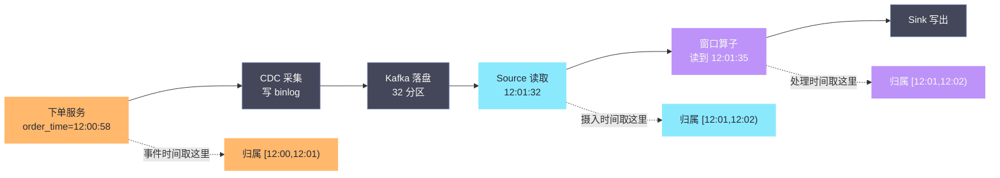
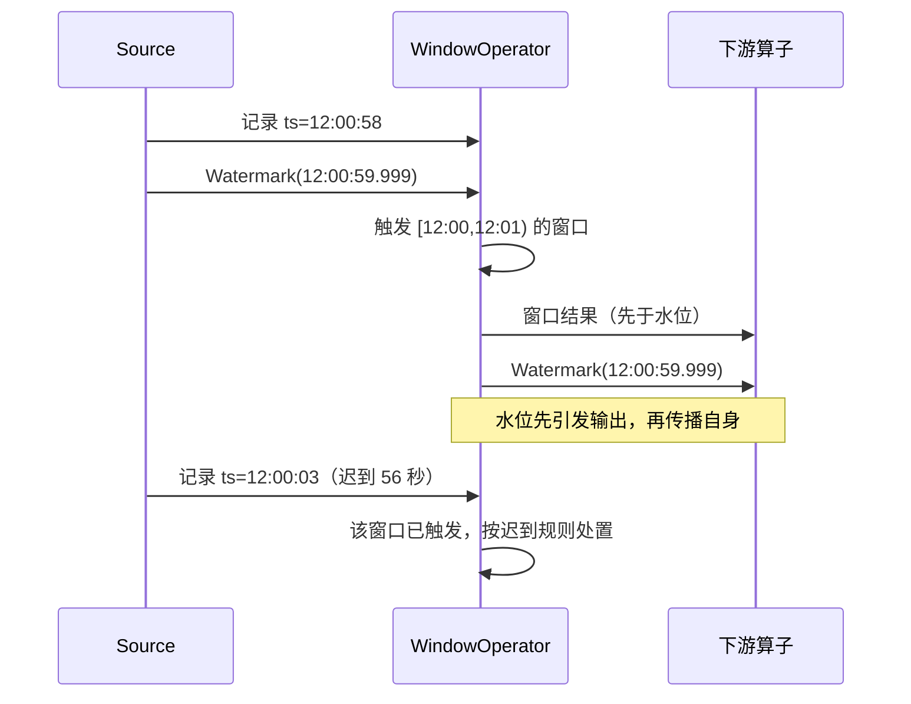
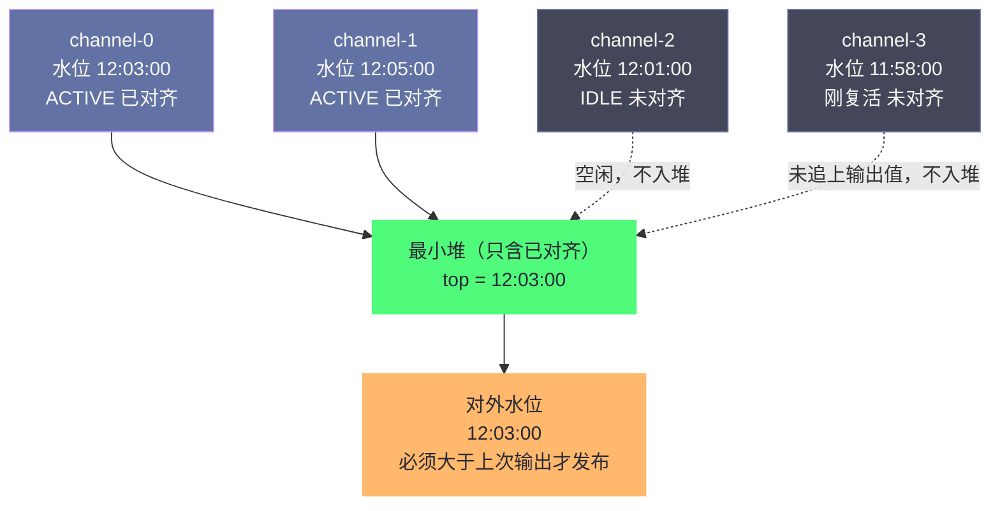
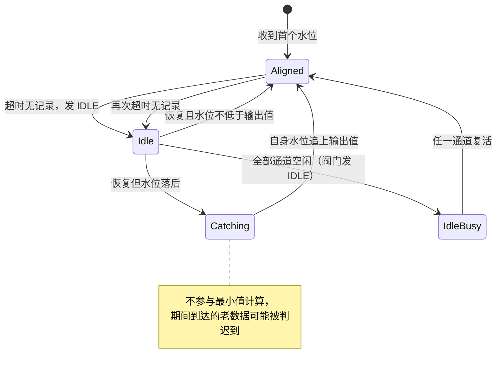
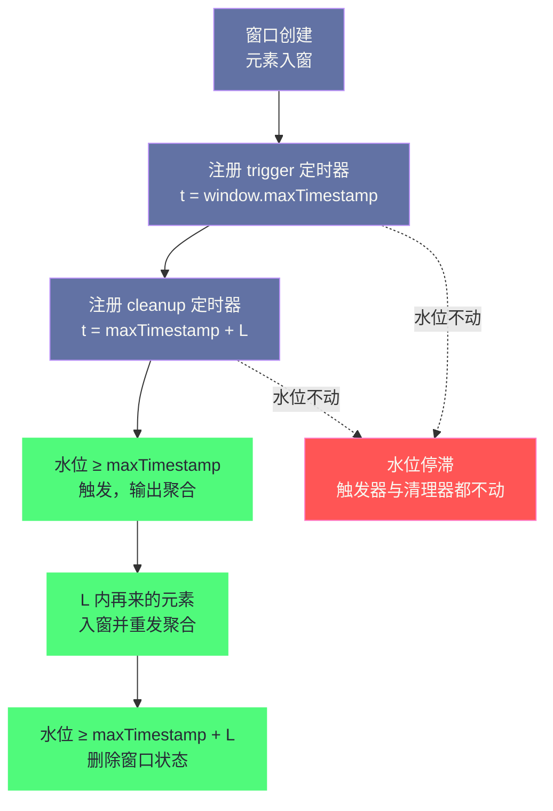
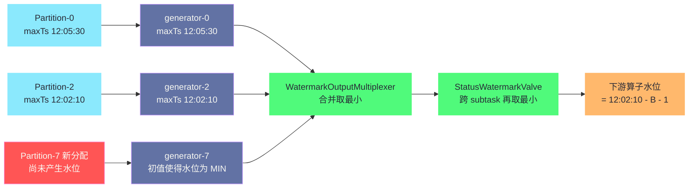

**摘要：**

流处理里最难讲清的不是窗口怎么写，而是系统凭什么相信"某个时间点之前的数据已经到齐了"。本文把 Watermark 当作一条**不可撤销的进度断言**来拆解：先说清事件时间、摄入时间、处理时间三者的差别不在精度而在正确性保证，再说清这条断言为什么必须单调、为什么断言覆盖等号、为什么它是无限流上做有界计算的唯一手段。落到机制层面，则逐层拆开断言的生成（`WatermarkStrategy` 的两个职责、两种内置生成器的公式与初始值、周期性发射的节拍）、合并（`StatusWatermarkValve` 的对齐集合与最小堆、算子级与 task 级两层合并、chain 内的直接传播）、失效（空闲源与 `WatermarkStatus`、恢复后的重新对齐、水位对齐的反向问题），以及断言出错之后的三种处置与它们各自的状态代价。篇末把"水位不推进"归纳成五种成因与对应判据，并给出乱序容忍度、空闲超时、迟到容忍三者的量化权衡与四个典型反例，最后划清水位能保证什么、不能保证什么。

---

## 第 1 章 三种时间语义：不是精度差异，是保证差异

### 1.1 一笔差了 37 秒的订单

2013 年，Google 在 MillWheel 的论文里把 low watermark 写成了流处理系统的一等概念，用它来表达"某段事件时间的数据已经不可能再来了"；两年后的 Dataflow 模型把这条思路系统化成事件时间与水位线的完整语义。Flink 的时间体系基本沿着这条脉络长出来，所以讲 Watermark 之前，得先把"时间"这件事本身拆干净。

先看一笔真实的偏差。电商实时大屏按分钟统计成交额，订单在下单服务里写入 `order_time = 12:00:58`，binlog 经 CDC 采集成一条 `order_created` 事件投进 Kafka，主题有 32 个分区。由于那一刻正好赶上一批大促流量涌进来，消费者排队，这条消息直到 `12:01:35` 才被窗口算子读到。如果算子拿"我被读到的时刻"算窗口，这笔钱会落进 `[12:01, 12:02)`，于是 12:00 这一分钟少一笔、12:01 这一分钟多一笔，大屏上两个数字同时错位。运营在 12:05 对账的时候发现差额 86 万，然后来问数据组"是不是丢了单"。

数据没丢，是"用哪个时钟说了算"的问题：这笔订单在业务上属于 12:00，在系统里被读到的时刻属于 12:01，中间的 37 秒是排队、序列化、网络、调度共同造成的。

### 1.2 三个时钟的定义

**事件时间（Event Time）**取记录自带的业务时间戳，也就是事件真正发生的那一刻。这个时间戳与 Flink 什么时候读到它毫无关系，因此一条晚到一小时的记录，仍然会被正确地放回它所属的那一小时。代价是允许乱序：后发生的事件可能先到，先发生的事件可能后到，而且同一份数据在重放时可能再来一遍。

**摄入时间（Ingestion Time）**取记录进入 Flink 数据流那一刻的系统时钟，由 Source 打上时间戳，后续算子一律沿用这个值。它与处理时间的关键差别在于"戳在哪里打"：摄入时间在入口打一次，之后流内部的处理快慢不再影响窗口归属；处理时间是每个算子各自读自己的系统时钟，同一份数据在不同算子眼里属于不同时刻。Flink 1.20 里 `TimeCharacteristic` 的注释把这个权衡写得很直白：摄入时间"不需要任何手动的 Watermark 生成"，因为事件在到达算子时通常并不怎么乱序，真正的乱序只可能由 shuffle、union 这类拆分合并操作引入。

**处理时间（Processing Time）**取算子所在机器的系统时钟。窗口触发看墙上时钟，窗口内容是"那一刻恰好到达算子"的元素。它对延迟最友好、开销最小，但结果不可复现：同一份输入重跑两次，落在窗口里的元素就可能不同。

| 维度 | 事件时间 | 摄入时间 | 处理时间 |
| --- | --- | --- | --- |
| 时间戳来源 | 记录自带业务字段 | Source 读取时打戳 | 算子本地系统时钟 |
| 允许乱序 | 允许，需水位兜底 | 仅 shuffle 引入的有限乱序 | 无乱序概念 |
| 结果可复现 | 是 | 重放时取决于入口时刻 | 否 |
| 正确性保证 | 断言成立范围内正确 | 入口之后不再偏移 | 不保证 |
| 主要代价 | 缓冲数据、等待水位、状态放大 | 中等 | 最低 |
| Flink 现行地位 | 1.12 起为默认语义 | 已并入事件时间路径 | 始终可用 |

### 1.3 保证的差别在哪里

把三者并列写成"精度从低到高"，是很多资料留下的坏习惯，因为它掩盖了真正的分歧点。三者的分歧不在误差大小，而在**给定同一条记录，系统愿不愿意为它的归属负责**。

处理时间只保证"窗口按墙上时钟闭合"，不保证记录归属正确。它的语义里没有"这笔订单属于 12:00"这句话，只有"12:00 到 12:01 之间算子看到的都算 12:00 这一分钟"。所以一旦有排队、反压、重启补数，窗口边界就会移动，而移动之后无从察觉。

事件时间则给出一个有条件的承诺：只要水位断言成立，窗口结果就是对的；断言不成立时，错误会被显式地暴露出来——迟到数据要么进侧输出、要么被计数丢弃、要么触发窗口重算。换句话说，事件时间把"不准"从静默的必然变成了可观测的例外。这个转变是它全部复杂度的来源，也是它配得上这套复杂度的理由。

摄入时间介于两者之间，但它的问题在于承诺含糊：它保证"入口之后不再有偏移"，却不保证入口之前的排队不算偏移；而现实中造成大偏差的恰恰是入口之前的那一段（采集延迟、跨机房投递、MQ 堆积）。Flink 1.12 把默认语义切到事件时间、把 `TimeCharacteristic` 标为废弃，1.20 里它仍然带着 `@Deprecated` 存在，2.x 里已经移除。今天要"模拟摄入时间"，等价写法是在源上用处理时间赋值再配一个单调水位策略，这说明它已经没有独立机制，只剩一条配置路径。

> [!info] 边界声明
> 本文是机制篇：只回答水位的语义、合并、失效与代价。`WatermarkStrategy` 的参数怎么选、连接器怎么配、反压怎么排，属于 [[大数据/Flink/Flink从入门到实战/04 时间语义与 Watermark 实战|实战专栏第 04 篇]]；窗口类型的选择与状态清理策略属于 [[05 窗口完全指南]]；Timer 与状态如何写入快照属于 [[06 Flink Checkpoint 机制深度解析]]。文中出现的类名与默认值以 Flink 1.x（1.20 为主要参照）源码为准，2.x 的模块划分有调整，机制结论不变。

下图把三种时钟在同一条链路上落在哪里画出来，可以看到事件时间取的是最左侧的业务字段，摄入时间取的是 Source 读到的瞬间，处理时间则是每个算子各自读表。



---

## 第 2 章 Watermark 的本质：一条不可撤销的进度断言

### 2.1 断言的准确措辞

社区里常见的说法是"Watermark 表示允许乱序的最大延迟"，这个说法能用，但它把机制讲成了配置项。更接近本质的表述来自 Flink 源码里 `Watermark` 类的注释：水位是流中的进度指示器，它意味着**时间戳小于等于水位值的元素，在水位之后不会再出现**。注意这两个细节：比较用的是"小于等于"而不是"小于"，作用域是"水位之后"而不是"永远"。

"小于等于"直接决定了生成器里的那个减一。以 `BoundedOutOfOrdernessWatermarks` 为例，它已经见过的最大的时间戳是 `maxTimestamp`，乱序上界是 B，那么"比 `maxTimestamp - B` 更早的元素不会再来"这句话里，等号那一端并没有被保证，因为一条时间戳恰好等于 `maxTimestamp - B` 的记录仍然可能到达。而水位断言覆盖等号，所以它只能发 `maxTimestamp - B - 1`。等价的单调策略 `forMonotonousTimestamps` 对应 B 取零，发出去的是 `maxTimestamp - 1`，理由完全相同：同一毫秒内可能还有后来者。

这个减一看上去是边界上的锱铢必较，但它解释了一大类"窗口为什么不多不少刚好在这一刻触发"的问题。

### 2.2 为什么必须单调

水位不能回退，这一点经常被写成一条实现约定，实际上它是语义自洽的必要条件。理由有三层，一层比一层硬。

第一层，断言是累积的。一旦系统宣布"≤ 12:05:00 的数据到齐了"，再说"其实 ≤ 12:03:00 的数据到齐了"并不构成新信息，它比前者更弱。弱断言没有存在的价值。

第二层，输出已经发出去了，撤回不了。窗口在 `12:05:00` 触发过一次，结果已经写进下游的存储、可能已经被大屏读走、也可能已经进了 ODPS 明细表。此时若水位回退到 `12:03:00`，逻辑上等于要求"把刚才那批输出当没发生过"，而分布式系统里没有这种操作。可回退的时间不是时间，是版本。

第三层，状态可能已经被释放。事件时间窗口在触发之后会注册一个清理定时器，水位一旦越过清理时刻，窗口里的聚合值与元素就被删掉了。删掉之后再回退水位，算子手上连重算所需的原始数据都没有。

三层叠起来，结论是运行时必须把"不递增"当作非法输入处理。`TimestampsAndWatermarksOperator` 内部那个 `WatermarkEmitter` 的做法很干脆：新水位的值若不大于当前值，直接返回，既不报错也不记录，静默丢弃。同一段逻辑在 `StatusWatermarkValve` 里也有一份——每个输入通道记录自己的上次水位，小于等于它的水位同样被忽略。所以排查"水位为什么不涨"时要注意，你看到的"没涨"可能是被守卫吞掉了，而不是没产生。

### 2.3 无限流上做有界计算的唯一手段

流是无限的，而任何一个有意义的聚合结果都必须对应一个有界的输入集合。窗口做的就是把无限切成有限：按时间切片，每一片算一次。切片本身不难，难的是判断"这一片是不是已经收完了"。

没有水位的时候只有两个办法。一是按处理时间猜：等到墙上时钟走过窗口末端就触发，问题在 1.1 节已经演过。二是等：一直缓存到内存撑爆，这显然不是方案。水位提供了第三种可能——由数据自己声明边界，声明方是上游，验证方不存在，但正因为声明是显式的，它可以被观测、被质疑、被补偿。

笔者常用一个不太精确但好用的类比：水位像火车站的检票广播。广播喊"本次列车停止检票"，工作人员据此关闸；广播可能喊早了（真有人还在跑），也可能喊晚了（闸关得比实际晚），但只要有这条广播，检票口就有一个明确的动作时点，事后也能追溯是谁在什么时候喊的。没有广播，检票员只能看表猜。

### 2.4 断言必然可错

水位不是事实，是承诺。承诺由 Source 侧的生成器给出，链路上没有任何环节能验证它；被承诺方（下游算子）唯一能做的是在违约时把损失记下来。所以工程上追求的目标不是"零迟到"，而是"迟到可被发现、可被修正、代价可估"。

下图把一次水位推进的完整时序画出来，重点是顺序：算子必须先把这次水位引发的所有输出发完，然后才把水位本身转给下游。



---

## 第 3 章 断言的生成：WatermarkStrategy 的两个职责

### 3.1 为什么要绑在一起

`WatermarkStrategy` 同时是 `TimestampAssignerSupplier` 和 `WatermarkGeneratorSupplier`，也就是一个策略里装两件东西：决定"这条记录属于哪个时间"的赋值器，和决定"我们相信时间走到了哪里"的生成器。把两者绑在同一个接口里，不是为了少写一个类，而是因为它们必须共享同一套时间口径。

分开配的代价很直观。假设赋值器读的是订单的 `order_time`，生成器却按到达时刻推进，那么水位代表的是"入口时间进度"，而窗口切的是"业务时间"，两套坐标混用，窗口会在业务时间远未到齐时就被关闭。反过来，赋值器用秒级时间戳、生成器里又按毫秒理解，水位立刻偏到 1970 年附近。这种错位在生产上并不罕见，表现就是"水位一直停在一个看不懂的值"。

一个容易被忽略的默认行为：如果不显式给 `TimestampAssigner`，`WatermarkStrategy` 默认返回 `RecordTimestampAssigner`，也就是直接取记录上已有的时间戳。这对 Kafka 是合理的，因为 `KafkaSource` 会把 `ConsumerRecord` 的 `timestamp` 放进 `StreamRecord`，而那个值取决于 Kafka 的 `message.timestamp.type`（`CreateTime` 还是 `LogAppendTime`）——换句话说，省略赋值器并不等于"用业务时间"，而是等于"用 Kafka 里的那个时间"。

### 3.2 两种内置生成器的语义

内置策略只有两个真正有语义的入口，外加一个"完全不发水位"的开关。

`forBoundedOutOfOrderness(Duration B)` 的语义是一句承诺：一旦见到时间戳为 T 的记录，此后不会再有早于 `T - B` 的记录。它的实现短到可以整段抄下来，但每一行都有理由。

```java
// 摘自 Flink 1.20 BoundedOutOfOrdernessWatermarks，去掉空行
private long maxTimestamp;                       // 已见最大时间戳
private final long outOfOrdernessMillis;         // 乱序上界 B

// 构造时初始化成「减掉 B 之后刚好等于 Long.MIN_VALUE」，
// 这样一条记录都没来时，发出的水位也恰好是 Long.MIN_VALUE，而不是溢出翻正
this.maxTimestamp = Long.MIN_VALUE + outOfOrdernessMillis + 1;

public void onEvent(T event, long eventTimestamp, WatermarkOutput output) {
    maxTimestamp = Math.max(maxTimestamp, eventTimestamp);   // 只记最大，不发
}

public void onPeriodicEmit(WatermarkOutput output) {
    // 再减 1：断言是「≤ W 的元素已到齐」，等号那一端没有被保证
    output.emitWatermark(new Watermark(maxTimestamp - outOfOrdernessMillis - 1));
}
```

`forMonotonousTimestamps()` 不是另一个实现，它是 `AscendingTimestampsWatermarks`，而后者直接继承 `BoundedOutOfOrdernessWatermarks` 并把 B 传成 `Duration.ofMillis(0)`。于是水位恒等于"已见最大时间戳减一"。这里要纠正一个流传很广的说法：它并不是"每来一条记录就推进水位"，`onEvent` 依旧只更新 `maxTimestamp`，真正的发射只发生在周期性回调里。这一点在数据稀疏时特别重要，也是第 5 章那条"水位停止发声"的根源之一。

`noWatermarks()` 返回 `NoWatermarksGenerator`，一个水位都不发。纯处理时间的作业可以这么配，同时把 `pipeline.auto-watermark-interval` 设成 0 也能达到同样效果。

| 维度 | `forBoundedOutOfOrderness(B)` | `forMonotonousTimestamps()` |
| --- | --- | --- |
| 隐含假设 | 乱序不超过 B | 时间戳严格递增 |
| 水位公式 | `maxTs - B - 1` | `maxTs - 1` |
| 类实现 | `BoundedOutOfOrdernessWatermarks` | `AscendingTimestampsWatermarks`（继承前者，B=0） |
| 无数据时水位 | `Long.MIN_VALUE` | `Long.MIN_VALUE` |
| 额外延迟 | B 加发射间隔 | 仅发射间隔 |
| 假设被打破时 | 超过 B 的迟到 | 任何一次乱序 |

### 3.3 发射节拍与代价

水位不是逐条发出的，否则每条记录都要向下游广播一次，网络开销不可接受。Flink 用 `ProcessingTimeService` 注册一个周期定时器，间隔取自 `pipeline.auto-watermark-interval`，默认 200 毫秒；`TimestampsAndWatermarksOperator` 在 `open` 里注册第一次，此后 `onProcessingTime` 里调一次 `onPeriodicEmit` 再续订下一次。作业结束时 `finish()` 会再补一次 `onPeriodicEmit`，把最后一段水位推出去。

这个节拍同时是延迟的下界与开销的上界。窗口触发的最坏延迟约等于"乱序容忍 B + 一个发射间隔 + 处理耗时"，把间隔从 200 毫秒压到 50 毫秒能省下 150 毫秒，代价是水位消息频率翻四倍；而水位消息在链路上走的是与数据相同的通道，密集发射会挤占带宽，在反压边缘尤其明显。把间隔设成 0 则彻底关闭周期发射，此时除了结束时的补发，一个水位都不会产生——这是排查"窗口不触发"时必须先确认的一项。

`onEvent` 与 `onPeriodicEmit` 的分工还带来一个时间语义上的细节：`onEvent` 里的 `output` 是"立即输出"通道，`onPeriodicEmit` 里的是"延迟输出"通道。对 FLIP-27 源来说，这两条通道分别对应 `WatermarkOutputMultiplexer` 的 immediate 与 deferred 输出，前者每条记录都可能改动合并水位，后者只在周期合并时才生效。这个区分是第 8 章分区水位合并的机制基础。

### 3.4 单调性的执行点

前面说过水位不能回退，具体执行在生成器的出口。

```java
// TimestampsAndWatermarksOperator.WatermarkEmitter（1.20）
public void emitWatermark(Watermark watermark) {
    final long ts = watermark.getTimestamp();
    if (ts <= currentWatermark) {
        return;                       // 非递增的水位被静默吞掉
    }
    currentWatermark = ts;
    markActive();                     // 发过水位说明活过来了，顺手补一个 ACTIVE
    output.emitWatermark(new org.apache.flink.streaming.api.watermark.Watermark(ts));
}
```

`markActive()` 这一行要单独说。它负责在"之前被判为空闲"的情况下补发一条活跃状态，因为一个能发出水位的源按定义不可能是空闲的。1.14 之后的这套状态元素叫 `WatermarkStatus`，更早的版本叫 `StreamStatus`，第 5 章会完整交代它的来龙去脉。

### 3.5 生成器放在哪里

同一个策略放在源里和放在源后面，行为并不相同。

`env.fromSource(source, strategy, name)` 把策略交给源算子，由 `SourceOperator` 内部按分区（split）实例化生成器，这是 FLIP-27 源的标准路径。而 `stream.assignTimestampsAndWatermarks(strategy)` 会插入一个独立的 `TimestampsAndWatermarksOperator`，此时有一处反直觉的实现：这个算子的 `processWatermark` 会**忽略所有来自上游的水位**，只放行长整型的最大值（表示上游永久结束）。

忽略上游水位有它的道理——既然这个算子要重新定义时间口径，上游的水位就没有意义了。但它带来的后果是很多人踩过的：在一个 `union` 了订单流与支付流的合并流后面调用 `assignTimestampsAndWatermarks`，两个源各自的进度信息被一次性抹掉，新的生成器看到的是交织在一起的混合流。它会在数据密度最高的那条流驱动下推进，安静的那条流的进度不再参与任何判断。这个位置选择，本质上决定了"水位是分区级进度还是算子级进度"，第 8 章会把两种粒度的差别展开。

---

## 第 4 章 断言的合并：多输入取最小值

### 4.1 最小值语义的推导

一个算子的多个输入各有自己的水位，算子对外只能有一个水位。取值规则是取所有输入的最小值，理由可以用反证法给出。

设订单流 O 的水位已达 `12:05:00`，支付流 P 的水位还停在 `12:03:00`，两流按 `order_id` 汇合到一个算子。若算子对外宣称水位是 `12:05:00`，那么任何一个以事件时间为触发条件的窗口，都可能在该时刻被判定为可以关闭。但 P 的水位停在 `12:03:00` 意味着 P 上游还可能有时间戳在 `12:03:00` 之后、`12:05:00` 之前的记录未发出。一旦窗口关闭，这批记录到达时就只能算迟到，结果永久缺失。取最小值则不会有这个问题：`12:03:00` 这个断言只覆盖所有输入都已确认到齐的部分，安全但保守。

保守的代价是"最慢的输入决定整条链路的进度"。这句话是后面所有问题的种子：空闲分区会拖住全局，慢分区会拖住全局，反压会拖住全局。

| 方案 | 是否会漏计 | 触发速度 | 适用 | 实际选择 |
| --- | --- | --- | --- | --- |
| 取所有输入最大值 | 会，且无法察觉 | 最快 | 无 | 否 |
| 取所有输入最小值 | 不会 | 受最慢输入限制 | 有正确性要求 | 是 |
| 只取主输入 | 会漏掉副输入 | 快 | 单流主导且副流可容忍缺失 | 需业务确认 |
| 最小值 + 空闲豁免 | 空闲输入不参与 | 快 | 分区流量极不均 | 需设超时 |

### 4.2 实现：对齐集合与最小堆

Flink 把合并逻辑放在 `StatusWatermarkValve` 里，1.20 的实现比早期版本精细得多，要从数据结构看起。

每个输入通道（在 task 层对应一个上游 channel，在源内部对应一个分区）维护一份 `SubpartitionStatus`，记录三样东西：这个通道最后的已知水位、它的状态是活跃还是空闲、以及它当前是否"已对齐"。已对齐的通道会被放进一个按水位排序的最小堆，堆顶就是全局最小值。

"已对齐"是理解这套实现的关键。它并不等于"可用"，而是指这个通道的水位不低于阀门上次输出的水位——也就是说，它的水位一旦成为堆顶，就可以安全地对外发布。空闲的通道不对齐，刚恢复且水位落后于当前输出的通道也不对齐。于是合并逻辑退化成三步：新水位进来，比该通道记录的水位大才接受；接受后若它已对齐就调整堆，未对齐但已追上输出值则转为对齐；最后看堆顶是否严格大于上次输出值，是就发布。

这套不变式（堆内所有元素都不小于最后输出值、堆非空时堆顶等于最后输出值）保证了输出序列必然单调，也让"从空闲恢复"这种麻烦场景有了干净的解法。`StatusWatermarkValve` 的注释里还写明了一条专门为复活场景准备的处理：所有通道都空闲时，它会把所有通道中最大的水位推出去，然后才发空闲状态。这样"全部空闲"这个结果就与各通道转为空闲的先后顺序无关，否则同样一组数据、不同的空闲次序会得到不同的最终水位，快照之间无法对齐。

下图把两个输入通道的对齐状态与堆的关系画出来，可以看到未对齐的通道虽然有自己的水位，却不参与最小值计算。



### 4.3 两层合并

容易混淆的是"到底有几层合并"。以窗口算子为例，从上游到它内部经过了两道关口。

第一道在输入侧。task 从网络上读数据时，每个上游 channel 的每条水位都会经过 `StatusWatermarkValve`，按上面那套规则合成一个 task 级水位。这一层的粒度是 channel，一个上游 subtask 对应一个 channel，如果上游算子有 8 个并行实例，这里就有 8 份水位。

第二道在算子侧。两输入算子（`TwoInputStreamOperator`）的两个输入各有水位，`AbstractStreamOperatorV2` 用 `CombinedWatermarkStatus` 取两者的最小值；一旦某个输入转为空闲，这个组合状态也会相应调整。这一层的粒度是"输入支路"，与上面那层 channel 数量无关。

两层合起来的效果是同样的——取最小的那条线——但观测位置不同：task 级看的是"哪个上游 subtask 落后"，算子级看的是"哪个输入支路落后"。排查时先分清是哪一层在拖，才能对上正确的指标。

### 4.4 chain 内的传播

如果上下游算子被 chain 在一起（同一个线程里），水位不经过网络，而是本地方法调用：上游的 `output.emitWatermark` 直接调到下游算子的 `processWatermark`。没有序列化、没有缓冲、没有额外合并，也就不存在"水位在路上排队"这回事。`StreamOperator` 的默认实现把这件事做得极简——有 `InternalTimeServiceManager` 就先推进它，然后原样往下转发。

相比之下，跨 task 的水位要走网络栈，且是广播：一个上游 subtask 的水位会发给下游所有 subtask。所以下游每个 subtask 看到的永远是自己所有输入里最慢的那条，《04 Flink 网络传输与反压机制深度解析》里讲的反压传播与这里的水位停滞，经常会同时出现在一次故障里，只是观测指标不同。

### 4.5 "完全处理"这个承诺

文档里有一条朴素但严格的规则：算子必须在把水位转发给下游之前，先把这次水位引发的所有处理做完。窗口算子的表现就是先算出并发出所有该触发的窗口结果，然后才把水位交给下游。这与第 2 章那张时序图是同一件事。

1.20 起这条规则有了一个务实的补充。`MailboxWatermarkProcessor` 允许在触发定时器的过程中被打断：如果 mailbox 里有别的信件（譬如 checkpoint 的屏障、数据记录），就先让出去，稍后从断点继续推进水位。中断期间可能有新记录被处理，这是被明确接受的取舍——否则一个水位要触发几十万个定时器时，整个 task 会被长时间独占，checkpoint 超时、延迟飙升都在所难免。

对观测者来说，这个机制会表现成一个反直觉的现象：**水位明明已经收到，输出的 watermark 指标却停着不动**。原因不是合并卡住，而是这个水位还在触发定时器，没走完那一步。此时去看 `numFiredTimersPerSecond` 这个指标，若它很高，就能确认是这个原因。

---

## 第 5 章 空闲源：断言停止发声

### 5.1 症状与成因

第 4 章的结论是"最慢的输入决定进度"，于是最慢的那种情况——某个输入根本没数据——会把整个链路的时间冻住。这就是空闲源问题。

大屏场景里这几乎是必然出现的：32 个 Kafka 分区按地区拆分，凌晨两点到四点，某些地区的订单分区完全静默。静默分区的生成器没有新记录喂进来，`maxTimestamp` 不动，水位停在最后一条记录附近；它所在 subtask 的对外水位也跟着不动；下游取最小值，于是全部窗口都不触发。作业没报错、没反压、CPU 也闲着，就是不出数。这类故障的排查成本很高，因为它没有任何异常信号，只是"时间停了"。

### 5.2 空闲的表达方式与版本变迁

要让下游知道"这个输入暂时不会有水位了"，需要一个独立于水位的信号。这个信号在 Flink 历史上有过一次改名，很多资料还停留在更早的说法上。

社区里流传过一个绕过它的做法：让赋值器在空闲时发一个极大的水位（`Long.MAX_VALUE` 级别），因为取最小值的逻辑天然会忽略最大值。这个技巧能用，但它污染了水位的语义：最大值本应表示"上游永久结束、不会再有元素"，而临时空闲与永久结束是两件事。

Flink 1.3 起运行时就有独立的流状态元素，早期类名叫 `StreamStatus`，取值 `IDLE` 与 `ACTIVE`；1.14 起改名为 `WatermarkStatus`。1.20 里它们在 `org.apache.flink.streaming.runtime.watermarkstatus` 包下，`StatusWatermarkValve` 与它们同包；2.0 把这两个类连同阀门一起挪到了 `flink-runtime` 模块，包名不变。而 `Watermark.MAX_WATERMARK` 的语义被收窄成"时间尽头"：`Watermark` 的注释明确写着，源到达输入末尾时发一个 `Long.MAX_VALUE` 的水位表示结束；`WatermarkStatus` 的注释则专门提醒，要通知下游"永久关闭"仍应发 `MAX_WATERMARK`，状态元素只表达临时状态。

所以本节的结论是：空闲靠状态元素表达，不靠大水位。这条区分在排查时很实用——如果某个源在作业运行中发了 `MAX_WATERMARK`，那它意味着"这个源不会再有任何数据"，下游会一路推进到时间尽头并触发所有窗口，而不是被忽略。

### 5.3 withIdleness 的检测机制

暴露给用户的入口是 `WatermarkStrategy.withIdleness(Duration)`，它返回 `WatermarkStrategyWithIdleness`，把底层生成器包进 `WatermarksWithIdleness`。真正干活的是后者的 `onPeriodicEmit`：先问空闲计时器"我闲了吗"，闲了就调 `output.markIdle()` 并且**不再调用底层生成器的周期回调**；没闲就照常让底层生成器发水位。`onEvent` 里除了转发给底层生成器，还要给计时器记一次活动，并清掉"当前是否已空闲"的标记。

计时器本身有两个细节要知道。第一，它只在周期性回调里被检查，所以从"最后一条记录"到"被判定空闲"的延迟不是恰好等于超时值，而是"最后一条记录到下一次探针"加"探针到超时"，最坏情况约等于超时值加两个发射间隔。

第二，它用的时钟是可暂停的相对时钟。`TimestampsAndWatermarksOperator` 在 `open` 时把自己注册为反压监听者，一旦算子处在反压状态，这个时钟就停走；FLIP-27 源里更细，每个分区有自己的 `PausableRelativeClock`，反压与被水位对齐暂停都计入暂停时间。这解决了一个隐蔽的误判：如果一个分区其实有数据，只是下游反压导致它读不动，那么"没有记录推进"并不等于"没有数据"，若按墙上时钟判空闲就会错杀。这个设计意味着空闲判定问的是"这个输入是否真的没东西可读"，而不是"这个算子是否闲着"。

### 5.4 恢复时的重新对齐

空闲之后的复活才是真正麻烦的地方。设想分区 A 从 02:00 静默到 03:00，期间其余分区把全局水位推到了 03:00。03:00 分区 A 恢复，`WatermarkStatus` 转成 `ACTIVE`，可它自己的水位还停在 02:00 附近。

阀门这里做了一件很克制的事：只有当这个通道的水位不低于当前输出水位时，才把它重新标记为已对齐；否则它留在未对齐集合里，不参与最小值计算。也就是说，恢复不会把 A 的水位"抬"到 03:00，也不会让全局水位回退，A 需要靠自己的数据把水位追上来，追上之后才重新进入堆。

在这段追赶期里，A 读到的老时间戳记录会流入下游。此时下游的全局水位已经在 03:00，窗口清理定时器可能早已越过了这批记录所属窗口的清理时刻。按第 6 章的判据，它们会被判为迟到——要么进侧输出，要么被计数丢弃。这正是"开了 `withIdleness` 之后突然冒出大量迟到数据"的机制解释：不是 idleness 让数据变迟到，而是它让全局水位在 A 静默期间正常前进，从而把 A 恢复后补上的历史数据显性地暴露成了迟到。

`withIdleness` 的超时取值因此是个双向权衡。设得太短，正常的流量抖动（譬如某个分区的高峰间隙三十秒）会被误判为空闲，全局水位跳过去，抖动结束后的那批记录全部变成迟到；设得太长，静默期仍然会拖住全局水位，只是拖得短一些。笔者的量级判断是取正常最大间隙的三到五倍，日常间隙在十秒量级就配一到两分钟，一批数据的批间隔在五分钟量级就配一刻钟以上，并且用 `watermarkLag` 指标回看这个取值是否偏小。

下面的状态机把通道在活跃、空闲、未对齐、已对齐之间的迁移画全，可以看到恢复并不是"回到活跃"这么简单。



### 5.5 另一个极端：水位对齐

空闲是"太慢"的一侧，"太快"那一侧同样有问题，而且更隐蔽。某个分区因为数据量小而水位跑得飞快，其余分区还在慢慢追；下游算子取的是最小值，于是它必须把快分区送来的数据全部缓冲在状态里，等慢分区追上来。这段缓冲没有上限，慢分区一旦卡住，状态就会持续膨胀，最终表现为 checkpoint 越来越大、RocksDB 落盘抖动、甚至写满磁盘。

Flink 用 FLIP-182 引入的水位对齐（watermark alignment）来处理这件事。用法是在 `WatermarkStrategy` 上挂 `withWatermarkAlignment(group, maxAllowedDrift, updateInterval)`：同一组内的源周期性把自己的水位上报给协调者，协调者算出组内最小值并下发一个允许的最大水位，超前的源被暂停消费，等慢的追上来再恢复。注意手段是暂停消费而不是丢弃数据，因此不损失正确性。1.20 的 `SourceOperator` 里能直接看到这段逻辑：收到 `WatermarkAlignmentEvent` 就把其携带的最大水位存下来，逐个检查各分区的水位，超了就把分区暂停，追平了再恢复。

它的代价也很实在。组内最慢的成员决定了所有人的读取速度，吞吐会下降；状态里不再堆积快分区的数据，但排队挪到了 Kafka。上报与下发默认一秒一次，作业规模大时协调消息本身就是负担，`updateInterval` 调大能省消息、调小反应更快。另外文档明确写了两条限制：只对 FLIP-27 源生效，通过 `DataStream#assignTimestampsAndWatermarks` 在源之后挂对齐不起作用；分区级对齐从 1.17 起支持，需要连接器实现暂停与恢复分区的接口。

下面这段代码把两种手段叠在同一个策略上，注释说明各自解决哪一侧的失衡。

```java
WatermarkStrategy<OrderEvent> strategy = WatermarkStrategy
    .<OrderEvent>forBoundedOutOfOrderness(Duration.ofSeconds(5))
    // 解决「太慢」：五分钟无记录就把该分区标为空闲，不再拖住全局水位
    .withIdleness(Duration.ofMinutes(5))
    // 解决「太快」：同组内领先超过 30 秒的分区被暂停消费，避免下游状态被快分区撑大
    .withWatermarkAlignment("order-cdc", Duration.ofSeconds(30), Duration.ofSeconds(2));
```

---

## 第 6 章 迟到数据：断言出错之后的三种处置

### 6.1 窗口过期与元素迟到

迟到数据的判定不在生成器里，而在消费水位的算子手里。以事件时间窗口为例，`WindowOperator` 里其实有两道判定，基准不同，很多资料把它们混成了一条。

第一道是窗口级的：窗口的清理时刻是窗口末端加允许迟到量，即 `window.maxTimestamp + L`，水位越过这个时刻，窗口就被认定为过期（`isWindowLate`），它的状态也已经或即将被删除。窗口还没过期的元素照常入窗，哪怕它的时间戳已经小于当前水位，这类元素照样会在窗口自己的定时器上被计入。

第二道是元素级的：元素时间戳加允许迟到量若不大于当前水位（`isElementLate`），这个元素就被认定为迟到。它只在元素没有被任何窗口接受时才会被用到，用来决定送进侧输出还是记入丢弃计数。

两者是蕴含关系而不是等价关系。由 `element.ts ≤ window.maxTimestamp` 两边同加 L 可得 `element.ts + L ≤ maxTimestamp + L`，所以窗口一旦过期，属于它的元素必然满足元素级判据，侧输出那条路径上不会漏掉"其实还该算"的数据。反过来不成立：元素时间戳小于水位，并不等于它所属的窗口已经过期，这类元素仍会被正常计入。换句话说，**决定一笔数据还能不能算进去的是窗口是否已过清理时刻**，元素时间戳只是第二道筛子。

### 6.2 allowedLateness：保留窗口并重发结果

设置允许迟到量之后，窗口在触发之后不会立刻删除状态，而是注册一个清理定时器到 `window.maxTimestamp + L`。这段时间里到达的迟到元素仍然会被加进窗口状态，并且触发一次重新输出。

这里有个语义细节要说清：重新输出的是**整个窗口的完整聚合结果**，不是增量。`EventTimeTrigger.onElement` 的逻辑是，若当前水位已经越过窗口末端就直接返回 `FIRE`，而 `FIRE` 在 `WindowOperator` 里意味着把窗口里的聚合值整体取出并发出。所以下游拿到的是一条与之前完全相同键（key 加窗口）的新记录，值可能变大。这意味着下游必须是可覆盖的（比如按主键 upsert 的存储），append-only 的明细表会因此出现重复行；大屏这类按 key 覆盖的展示型消费方则天然合适。

允许迟到量还直接决定状态规模：窗口触发后状态要保持 L 这么久，任一时刻并存的窗口数约为"窗口长度加 L"除以步长。

### 6.3 side output 与丢弃

如果元素迟到得太多，窗口已经清理掉了，再保留也没有意义：算子不可能凭空恢复已删除的聚合值。这时有两种去处。

配了 `sideOutputLateData(OutputTag)` 的元素会被写进侧输出流，主流程跳过。侧输出是唯一能拿到"原始迟到记录"的通道，所以它适合配一条离线对账链路：侧流落进对象存储或一张明细表，由离线任务按天修补宽表或重新计算分区。它的代价是额外一条链路要维护，且补数逻辑必须能处理重复。

没配侧输出时元素被直接丢弃，只在一个计数器上留痕：`numLateRecordsDropped`。这个指标没有任何告警语义，它就是一个数字，但它是"大屏对账差了 86 万"这类问题最直接的线索。很多团队把允许迟到量设成零、也不配侧输出，然后靠肉眼对账发现差异，原因就是没人看这个计数器。

| 处置方式 | 生效条件 | 结果语义 | 状态代价 | 可修正性 |
| --- | --- | --- | --- | --- |
| 允许迟到 | 元素迟到但窗口未清理 | 重发整窗聚合，值变大 | 状态多留 L 时长 | 在线可修正 |
| 侧输出 | 元素所属窗口已清理 | 原始记录旁路流出 | 无额外窗口状态 | 需离线补数 |
| 直接丢弃 | 未配侧输出 | 永久缺失 | 无 | 不可修正 |
| 允许迟到加侧输出 | 按迟到程度分流 | 近的在线修、远的离线修 | 状态多留 L 时长 | 在线加离线 |

### 6.4 三者的组合关系

三者不是互斥选项，而是按迟到程度分层。一笔迟到三秒的订单，允许迟到量足以覆盖，在线重算即可；一笔迟到两小时的订单（比如某个机房断网后补传），允许迟到量不可能设到两小时，只能进侧输出交给离线补数；而两者都没配的作业，两种都丢。

分层的分界点由业务的对账口径决定。大屏这种分钟级展示，允许迟到量配五分钟、侧输出配一条按天补数的链路，是常见组合；而入湖这种要求最终一致的链路，往往直接把 L 设为零、所有迟到一律进侧输出，由批处理重刷分区，理由是"实时链路不该背历史包袱"。

条件允许时，一个便宜的自检是把 L 与迟到分布对齐：先在侧输出上统计迟到时长的分位数，若九成迟到在两分钟以内，L 配五分钟就能覆盖绝大部分，剩下的交给离线。这比凭感觉配一个"半小时"要可靠得多。

---

## 第 7 章 水位与窗口触发、状态释放的耦合

### 7.1 触发条件

事件时间窗口的触发完全由水位驱动，机制上是"注册一个时间戳等于窗口末端的定时器，水位越过它时触发"。`EventTimeTrigger` 只有两个分支：元素进来时若水位已越过窗口末端就立即触发（这是迟到重算的路径），否则注册定时器；定时器回调时，时间戳恰好等于窗口末端才返回 `FIRE`。

```java
// EventTimeTrigger（1.20），合并了两处分支
public TriggerResult onElement(long time, TimeWindow window, TriggerContext ctx) {
    if (window.maxTimestamp() <= ctx.getCurrentWatermark()) {
        return TriggerResult.FIRE;           // 迟到元素进来时直接补一次整窗输出
    } else {
        ctx.registerEventTimeTimer(window.maxTimestamp());
        return TriggerResult.CONTINUE;
    }
}

public TriggerResult onEventTime(long time, TimeWindow window, TriggerContext ctx) {
    return time == window.maxTimestamp() ? TriggerResult.FIRE : TriggerResult.CONTINUE;
}
```

`onEventTime` 用的是相等比较而非小于等于，因为定时器本身就按 `maxTimestamp` 注册，水位推进时弹出的正是这个时刻，相等比较反而避免了合并窗口场景下的重复触发。

### 7.2 清理同样由水位驱动

窗口状态的释放不靠垃圾回收，靠另一个事件时间定时器。`WindowOperator.registerCleanupTimer` 注册在 `cleanupTime(window)` 上，事件时间窗口的这个值是窗口末端加允许迟到量。水位越过它时，定时器触发，对应 key 与窗口的聚合状态被删除。

把触发与清理放在一起看，就得到下面的生命周期。这个图要记住，因为它解释了"水位不推进"的第二种后果——不是不出结果，而是状态不释放。



水位停滞时，`cleanupTime` 这个定时器永远不触发，窗口状态就一直挂着，**状态释放与水位推进是同一个开关**。一个分钟级窗口、水位冻结一小时的作业，会有六十批窗口状态同时存活，每个 key 六十份。状态后端不大时表现为 checkpoint 体积缓慢上涨，RocksDB 场景下表现成本地磁盘占用上涨与 compaction 压力，最终往往以"作业 OOM 或写盘失败"的形式暴露，离真正的病因已经隔了好几层。

### 7.3 定时器存在哪里

窗口触发与清理都靠定时器实现，定时器本身是有状态的。1.20 的实现里，事件时间与处理时间各有一个 `KeyGroupedInternalPriorityQueue<TimerHeapInternalTimer<K, N>>`，也就是按 key group 分区的优先队列：堆内存后端用堆化集合，RocksDB 后端用有序的 RocksDB 队列。定时器的唯一标识是时间戳、key、namespace 三元组，namespace 装的就是窗口对象。

水位推进时 `InternalTimerServiceImpl` 的动作很直接：把当前水位记下，然后循环 `peek`，只要堆顶时间戳不大于水位就弹出并回调 `onEventTime`，直到堆顶大于水位为止。这个循环在 4.5 节说过，是可以被打断的。

定时器属于作业状态，会进快照；恢复后它们重新装载，等水位再次推进到相应位置时继续触发。这意味着"作业重启后窗口为什么没有立刻出数"有一个标准答案：水位需要从源重新推进到窗口末端，之前那些定时器才会响。

顺带把一个常被讲错的事实修一下。定时器按 key group 分区存放，而 key group 的总数由 `maxParallelism` 决定，这个值在作业创建时定下、随快照固化，之后不能改。它并不是固定的一百二十八：默认值按当前并行度算，取"并行度的一点五倍向上取整到二次幂"，再夹在 128 与 32768 之间，所以并行度 4 的作业默认是 128，并行度 200 的作业默认是 512。要扩容到超过这个数，必须在第一次启动前设好。key group 与并行度变更的完整推导属于快照层面的话题，见 [[06 Flink Checkpoint 机制深度解析]]。

---

## 第 8 章 Kafka 分区上的水位

### 8.1 每个分区一个生成器

Flink 文档对 Kafka 场景的描述是：水位在 Kafka 消费者内部**按分区**生成，分区水位再以与 shuffle 时相同的方式合并。为什么必须按分区，文档也给了解释——多个分区被并行消费时，事件会被交织在一起，分区内部那种"时间戳基本递增"的规律在交织之后荡然无存。如果一个 subtask 只用一个生成器处理它负责的全部分区，`maxTimestamp` 就会变成"所有分区最大值的最大值"，最慢分区的时间进度被完全掩盖。

1.20 的 FLIP-27 源把这个粒度落到了代码里。`ProgressiveTimestampsAndWatermarks` 内部有一个按分区组织的输出结构，分配到一个新分区时，它会为新分区单独创建活动时钟、注册到多路复用器，并且**单独实例化一个 `WatermarkGenerator`**。每个分区的生成器各自维护自己的 `maxTimestamp`，互不干扰。

合并发生在多路复用器里。周期到了的时候，先把每个分区的生成器跑一遍 `onPeriodicEmit`，各自算出候选水位（写进 deferred 输出，只更新内部状态），然后统一调一次合并，取出所有分区的最小值对外发布。逐条记录触发的 immediate 输出则不同，它会立刻参与合并并在必要时更新对外水位。

下图把从分区到下游的完整合并路径画出来，注意新加入的分区会以 `Long.MIN_VALUE` 起步。



### 8.2 新分区与重平衡

上图里那条红色路径就是一类高发的线上问题。新分配的分区在水位合并里以最小值起步，而对外水位只增不减，于是表现为"水位原地不动"——不是倒退，是停住。等这个分区读完自己的第一条记录并发出第一个水位，合并值才会跳上去。

几种常见触发场景：主题被扩容了分区、消费者组发生 rebalance 导致分区重新分配、作业从 savepoint 恢复后分区归属变化、以及从 `earliest` 位点启动时新分区有一段很旧的历史数据。最后一种最麻烦，因为那个分区的 `maxTimestamp` 会长期停留在历史时间点，只要它还在追积压，全局水位就一直在原地等它。

处置思路分两类。若是短暂的重平衡，等它追平即可，但要确认窗口的允许迟到量能否覆盖这段停滞期，否则追平瞬间会有大量记录被判迟到。若是长期存在的旧数据积压，就要考虑缩窄启动的时间范围（按时间戳位点启动）、把历史数据交给批任务回灌，或者干脆为回灌作业单独起一条链路，避免污染实时水位。

### 8.3 两种 API 的粒度差异

把源内生成与源后生成放在一起对比，会看到粒度差异带来的行为差异。

`env.fromSource(kafkaSource, strategy, name)` 是 FLIP-27 路径，生成器按分区实例化，`withIdleness` 检测的是分区，`withWatermarkAlignment` 也能下沉到分区级。而先 `fromSource` 再 `assignTimestampsAndWatermarks` 是另一条路径：生成器跑在源之后的算子里，而源已经把多个分区的记录交织成了一条流，算子分不清来源，只能维护一个 `maxTimestamp`，`withIdleness` 检测的是这个算子的整体输入活动度，某个分区静默它感受不到。

| 维度 | 源内生成（FLIP-27） | 源后生成（assign 算子） |
| --- | --- | --- |
| 生成器粒度 | 每分区一个 | 每 subtask 一个 |
| 时间进度含义 | 分区级最小进度 | 混合流的最大进度 |
| 空闲检测粒度 | 分区 | 算子整体输入 |
| 水位对齐 | 支持，可到分区级 | 文档明确不支持 |
| 上游水位 | 源自身产生 | 忽略上游，只放行结束标记 |
| 典型问题 | 新分区拖住全局 | 慢分区进度被掩盖 |

老版本遗留的 `FlinkKafkaConsumer` 配合 `assignTimestampsAndWatermarks` 就属于右列。它在功能上能跑，但把"分区进度"这个信息丢掉了，遇到流量极不均的多分区的主题时，水位会被最活跃的分区一路推高，安静分区的数据几乎全部迟到。这也是社区把 FLIP-27 源作为推荐路径的原因之一，连接器版本与 API 演进属于实战话题，见 [[大数据/Flink/Flink从入门到实战/08 Flink 与 Kafka 端到端精确一次实战|实战专栏第 08 篇]] 与 [[大数据/Flink/Flink从入门到实战/04 时间语义与 Watermark 实战|第 04 篇]]。

---

## 第 9 章 "水位不推进"的五种成因与判据

水位停滞是这类作业最高频的故障形态，排查时要**按指标分岔而不是按经验猜**，把成因拆成五类，每类都配上可观测的判据，排查时按顺序对号即可。

### 9.1 成因一：分区空闲且未开空闲检测

表现是整条链路的水位停在一个固定的值上，作业无异常、无反压、CPU 很低。判据有三条同时成立：`currentInputWatermark` 长期不动、源的 `sourceIdleTime` 持续增长、出问题的分区 `pendingRecords` 接近于零（没有积压，是真的没数据）。

处置是给策略挂 `withIdleness`。这里有个默认值坑：SQL 作业里对应的是 `table.exec.source.idle-timeout`，默认值为零，含义是"不启用空闲检测"，所以 DataStream 里配了 idleness 不等于 SQL 里也配了，两条链路要分别确认。

### 9.2 成因二：某个分区消费滞后

表现与成因一很像，但判据相反：`pendingRecords` 在涨，源的 `watermarkLag`（连接器上报时给出水位与当前时间的距离）在涨，`currentFetchEventTimeLag` 也大。这说明分区有数据但读得慢，可能是下游反压传导回来、可能是消费线程不够、也可能是个别分区数据量远大于其他分区。

这类问题的定位要顺着反压走，见 [[04 Flink 网络传输与反压机制深度解析]]。从水位角度能提供的判断是：只有某些 subtask 的 `currentInputWatermark` 落后，问题就在那些 subtask 对应的分区上；全部 subtask 一起慢，问题更可能在下游的通用瓶颈。

### 9.3 成因三：新分区或重平衡

判据是时间相关性：水位开始停滞的时刻与分区分配变化、主题扩容、作业重启的时刻吻合。看源的指标能看到新分配的分区的位点与时间戳远低于当前水位。处置见 8.2 节。

### 9.4 成因四：时间戳抽取错误

这类最容易被误判成"机制问题"，实际上是数据问题。典型形态有四种：时间戳字段取错（用了入库时间而不是业务时间）、单位不一致（业务给秒级，代码按毫秒解释）、时区错位（东八区时间被当成 UTC 解析，整体偏移八小时）、解析失败后被兜底成零或最小值。

判据是水位落在一个"不像话"的值上：要么贴近 1970 年，要么比当前时间早整整八小时或者若干小时，要么恰好等于某个常量。处置不复杂但有纪律要求：在赋值器里抽样打印原始字段与解析结果的对照，并且对超出合理范围的时间戳直接抛异常，而不是兜底成默认值。兜底会让错误以"水位不对"的形式出现，反而掩盖了真正的原因。

### 9.5 成因五：配置与位置错误

这一类是纯人为的，但占比不低，常见四种。

第一，`pipeline.auto-watermark-interval` 被设成 0。此时周期发射被彻底关闭，除作业结束时的补发外不会产生任何水位，窗口只有在有界数据结束、源发出结束标记之后才可能出结果。

第二，赋值器放的位置不对。在 `union` 之后、`join` 之后调 `assignTimestampsAndWatermarks`，会丢掉上游的分区级进度，退化成第 8 章右列的行为。

第三，水位对齐配得太紧。组内有一个慢成员，`maxAllowedDrift` 又设得很小，快成员被反复暂停，整体水位推进速度被压到最慢成员的水平，看起来就是"水位不涨"。判据是 `watermarkAlignmentDrift` 指标贴着上限、源的读取速率周期性归零。

第四，SQL 作业里根本没有声明水位。`WATERMARK FOR ts AS ts - INTERVAL '5' SECOND` 缺失时，表上没有时间属性，事件时间窗口无从谈起；从较新版本起也可以让源提供水位，具体写法以对应版本文档为准。

把五类成因与判据汇总成一张表，排查时从上往下过一遍，绝大多数情况能在十分钟内定位到方向。

| 成因 | 关键判据 | 区分要点 | 处置方向 |
| --- | --- | --- | --- |
| 分区空闲未检测 | `sourceIdleTime` 涨、`pendingRecords` 为零 | 无积压、无反压 | 开 idleness，注意 SQL 默认关闭 |
| 分区消费滞后 | `pendingRecords` 与 `watermarkLag` 同涨 | 有积压 | 查反压与分区数据倾斜 |
| 新分区或重平衡 | 停滞时刻与分配变化吻合 | 时间相关 | 等追平或调整起始位点 |
| 时间戳抽取错误 | 水位落在固定异常值 | 数值离谱 | 抽样核对字段、单位、时区 |
| 配置与位置错误 | 指标正常但水位恒定 | 人为配置 | 查间隔、位置、对齐、SQL 声明 |

### 9.6 观测面在哪里

水位相关的可观测信号集中在三处。

最直接的是任务指标里的 `currentInputWatermark` 与 `currentOutputWatermark`，按 subtask 暴露。Web UI 上某个算子显示的 watermark 数值就来自这里，1.20 的 REST 接口是按 subtask 取 `currentInputWatermark` 组装成列表返回的。注意它显示的是"这个 subtask 当前看到的输入水位"，与源内部某个分区的进度不是一回事，前者永远受最慢输入限制。

第二处是源的结构化指标：`pendingRecords`、`pendingBytes` 反映积压，`currentFetchEventTimeLag`、`currentEmitEventTimeLag` 反映事件时间落后程度，`watermarkLag` 若连接器有上报，可直接给出水位与当前处理时间的距离，`sourceIdleTime` 是空闲判定的事后证据。

第三处是算子内部的定时器指标：`numFiredTimersPerSecond` 高而输出水位不动，说明水位正在触发大量定时器（4.5 节的机制），不是卡住；`watermarkAlignmentDrift` 则专用于判断对齐是否成为瓶颈。

---

## 第 10 章 反例、量化与边界

### 10.1 反例一：把乱序容忍度设成半小时

"设大一点总没错，反正能保证正确"是这类反例的心理动因。设 B 为三十分钟的后果分三层。

窗口层面，所有窗口的平均输出延迟增加三十分钟，大屏的实时性从分钟级退化到半小时级，业务方通常不能接受。

状态层面，窗口要保留到"窗口末端加 B"之后才可能触发，而触发之后才轮到清理，于是在任一时刻存活的窗口数量从"一个窗口"变成"一个窗口加三十分钟"对应的批数。以一个一分钟滚动窗口、一百万个活跃 key、单 key 聚合两百字节估算，正常情况状态约两亿字节量级（示例推算），B 取三十分钟后变成三十一批并存，状态约六十二亿字节量级，涨了三十一倍。checkpoint 体积、RocksDB 写放大、恢复时长会同步恶化。

正确性层面，收益比想象的小。迟到分布几乎总是长尾的，把 B 从五分钟提到三十分钟能覆盖的中位数以下的迟到确实变多，但尾巴上的迟到照样存在，而尾巴才是造成对账差异的部分。真正需要修的是尾巴，那要靠侧输出加离线补数，而不是靠一个更大的 B。

### 10.2 反例二：不处理空闲源，或者处理过头

不处理的后果已在第 5 章演过：夜间某分区静默，全链路时间冻结，大屏停在凌晨两点。这类事故的特点是"没有任何告警"，只有业务发现数据不动了，所以更稳妥的做法是把"水位与处理时间的距离"做成常规监控项，超过阈值就告警。

处理过头的后果是另一头：把 `withIdleness` 设成一秒，正常的分区间隙被误判成空闲，间隙结束后的那批记录全部迟到，表现为迟到量与业务流量波动同频。

### 10.3 反例三：用处理时间做本该事件时间的聚合

有一类需求看起来很适合处理时间：实时看板，晚几秒无所谓。但"晚几秒"和"错了"是两件事。用处理时间做成交额按分钟聚合，在下列情形都会错：Kafka 消费积压时，积压期间的数据会被算进它被处理的那一分钟；作业重启补数时，补的历史数据会全部涌入当前窗口；同一份数据重放会导致结果与上次不同。更麻烦的是，这些错误没有任何可观测的痕迹，因为处理时间语义下"迟到"这个概念不存在。

反过来，也有用事件时间硬套的场景：纯粹的心跳检测、会话超时、定时清理，这些逻辑关心的是"多久没动静"而不是"事件属于哪一刻"，用处理时间更简单也更准确。选型的判据不是"哪个更准"，而是"业务口径是否依赖事件发生时刻"。

### 10.4 反例四：迟到容忍与状态 TTL 打架

窗口状态可以额外配置状态 TTL，而 TTL 的计时起点通常是状态最后一次写入的时刻。两者叠在一起会出现两种相反的问题。

若 TTL 短于允许迟到量，窗口状态可能在允许迟到期内就被删掉，此时迟到元素进来，`EventTimeTrigger` 会立即 `FIRE`，但窗口里的聚合值已经没了，只能重新从这一个元素开始累积，输出的结果比真实值小，且没有任何报错。这类"静默偏小"最难查，因为结果看起来一直是合理的。

若 TTL 远长于允许迟到量，TTL 实际不起作用，白白占用内存还让配置产生误导。正确做法是让 TTL 与"窗口末端加允许迟到量"对齐，或者干脆不给窗口状态设 TTL，让它完全由水位清理逻辑负责。

### 10.5 量化：三个参数的关系

把三个关键参数与代价的关系列出来，方便估算。

| 参数 | 增大的收益 | 增大的代价 | 量级参考 |
| --- | --- | --- | --- |
| 乱序容忍 B | 覆盖更多迟到，减少丢弃 | 输出延迟线性增加，状态按 B 除以窗口步长放大 | 常见取 P99 迟到时长，量级判断 |
| 空闲超时 | 减少误判空闲 | 静默时拖住全局水位的时长变长 | 三到五倍正常间隙 |
| 允许迟到 L | 在线修正更多迟到 | 窗口状态多留 L 时长，放大倍数约 L 除以步长加一 | 与对账口径对齐 |
| 水位对齐 drift | 状态更省 | 吞吐受最慢成员限制 | 数百毫秒到数秒 |

一个可以随手做的自检：把状态总大小除以单窗口单 key 的平均大小，得到当前存活的窗口数，再除以活跃 key 数，就得到每个 key 平均存活的窗口数。这个数应当约等于"窗口长度加允许迟到量加乱序容忍"除以步长。远超说明水位停滞，过小则说明状态被提前清掉。

### 10.6 边界：水位解决不了什么

水位是给"有界乱序"设计的机制，它有几处明确的失效边界。

乱序无上界时，B 无法覆盖，水位永远会误判一部分数据为迟到。典型场景是跨机房多活写入同一个主题，两个机房之间的时钟不同步或者链路抖动，迟到分布没有可用的上界。这时要么在链路层做归拢（按机房分流、各自水位），要么放弃在线精确、全部走侧输出加离线修正。

事件时间回填时，水位会停在最早的分片。历史数据回灌是批任务的特征，用流任务做回灌需要把窗口语义降级为"迟早算对"，而不是"按水位关闭"。

时钟漂移时，处理时间与事件时间的关系不可靠。多机房的机器时钟若没有严格同步，`watermarkLag` 这类跨越两个时钟的指标会失真，用它判断"水位落后多少"可能在两个方向上同时出错。

最后一点容易被忽略：水位只解决"时间进度"，不解决"数据完整性"，**这两件事必须分别建账**。上游如果真的丢了一条记录，水位照样会推进，窗口照样会关闭，结果照样会偏小，而且完全合规。水位能保证的是"不因为乱序而漏"，不能保证"上游没漏"。这个区分决定了对账体系必须建在链路之外，而不是建在水位之上。

---

## 小结

Watermark 的全部内容可以压成一句话：它是上游对"时间进度"的公开承诺，承诺覆盖等号，只能向前，无法撤回。

三种时间语义的分野不在精度，而在系统愿不愿意为记录的时间归属负责；事件时间之所以配得上那套复杂度，是因为它把误差从静默的必然变成了可观测的例外。

机制层面有三层要记住：生成的减一来自断言的等号；合并取最小值是因为取最大值会静默漏计；空闲与复活靠独立的状态元素表达，而复活不抬高水位、只等它自己追上。

工程层面，水位停滞的排查顺序是先看指标判断是"没数据"还是"读得慢"，再对时间点判断是不是新分区，最后才怀疑时间戳抽取与配置位置。参数层面，B、超时、L 三者都在拿延迟与状态换覆盖范围，没有一个能单独调优。

下一篇 [[08 Flink SQL 与 Blink Planner 深度解析]] 转到查询优化层，看 SQL 如何编译出这些算子、Blink Planner 在计划树上做了什么改写。

---

## 参考资料

1. Apache Flink 1.20 源码：`org.apache.flink.streaming.runtime.watermarkstatus.StatusWatermarkValve`、`WatermarkStatus`、`org.apache.flink.api.common.eventtime.BoundedOutOfOrdernessWatermarks`、`WatermarkStrategy`、`WatermarksWithIdleness`、`CombinedWatermarkStatus`、`WatermarkOutputMultiplexer`，以及 `ProgressiveTimestampsAndWatermarks`、`TimestampsAndWatermarksOperator`、`MailboxWatermarkProcessor`、`WindowOperator`、`EventTimeTrigger`、`InternalTimerServiceImpl`、`KeyGroupRangeAssignment`。
2. Apache Flink 1.20 文档：Generating Watermarks（含 Dealing With Idle Sources、Watermark alignment、Watermark Strategies and the Kafka Connector、How Operators Process Watermarks），nightlies.apache.org。
3. Apache Flink 1.20 文档：Timely Stream Processing，事件时间与处理时间的概念部分。
4. Apache Flink 源码：`PipelineOptions#AUTO_WATERMARK_INTERVAL` 默认 200 毫秒；`ExecutionConfigOptions#TABLE_EXEC_SOURCE_IDLE_TIMEOUT` 默认 0。
5. Apache Flink 源码：`MetricNames` 中 `currentInputWatermark`、`currentOutputWatermark`、`watermarkLag`、`sourceIdleTime`、`watermarkAlignmentDrift` 等指标定义；REST 接口 `JobVertexWatermarksHandler`。
6. Tyler Akidau 等，The Dataflow Model: A Practical Approach to Balancing Correctness, Latency, and Cost in Massive-Scale, Unbounded, Out-of-Order Data Processing，VLDB 2015。
7. Tyler Akidau 等，MillWheel: Fault-Tolerant Stream Processing at Internet Scale，VLDB 2013（low watermark 概念的来源）。
8. Apache Flink 2.0 源码结构：`flink-runtime` 模块下的 `streaming.runtime.watermarkstatus` 包，与 1.x 的模块归属差异。

---

> [!note] 思考题
> 1. 水位断言覆盖等号，所以生成器要减一。如果某个业务的时间戳精度只到秒（整秒对齐），减一毫秒是否还够，减一毫秒与"减一整秒"在窗口触发时机会差多少。
> 2. `StatusWatermarkValve` 在全部通道空闲时先把所有通道的最大水位推出去再发空闲状态，这个顺序如果反过来会造成什么后果，为什么作者要专门写注释说明"与空闲次序无关"。
> 3. 一个分区静默两小时后复活，其间全局水位前进了两小时。若把这批老数据全部送进侧输出，离线补数的窗口边界应该用事件时间还是水位时间，两者的差异会导致什么重复或缺失。
> 4. 水位对齐通过暂停快分区来限制状态增长，但它让吞吐受最慢成员约束。如果组内有两个数据中心、链路质量相差一个数量级，是否应该把它们放进同一个对齐组，判断依据是什么。
> 5. 定时器按 key group 分区存放，而 key group 总数由 `maxParallelism` 决定且不可变。若作业最初以并行度 4 启动、未显式设置 `maxParallelism`，之后想扩到 512，会发生什么，应该在第几次启动前修正。