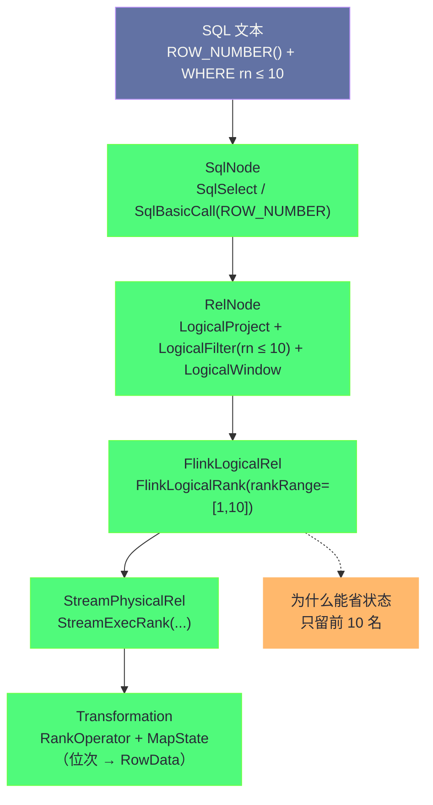
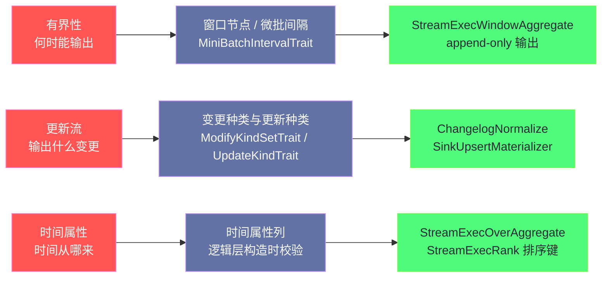
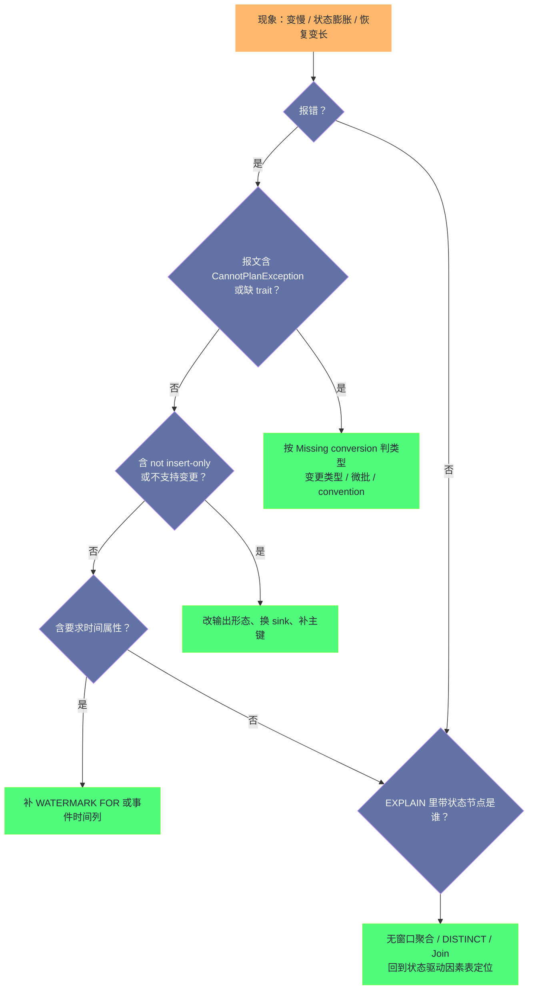

**摘要：**

一条 Flink SQL 在变成算子之前，会依次在四种中间表示里成形：Calcite 的 `SqlNode` 只认语法，`RelNode` 把语义和类型定下来，`FlinkLogicalRel` 挂上窗口与变更类型这类流式信息，`StreamPhysicalRel` 再按物理属性选出具体算子，最后由 `Transformation` 落到运行时的算子工厂与序列化器上。每一段只掌握一段知识，所以每一段能做的优化也各不相同，把某一段的职责张冠李戴，就会得出错误的调优结论。本文沿着一条"电商实时大屏加 CDC 入湖"的链路，先讲清两代 Planner 的替换：旧规划器为什么需要 DataSet 与 DataStream 两套翻译器，Blink 如何用统一的物理层与属性体系把它们收成一套，1.14 为什么删掉旧规划器，1.15 又为什么把 planner 拆进独立类加载；再逐段拆开四段翻译，把流式 SQL 相对批 SQL 多出的三条硬约束——有界性、更新流、时间属性——落到 planner 的属性匹配上，解释 `Cannot generate a plan` 一类报错到底缺了什么；末了结算 MiniBatch、LocalGlobal、Rank、Over 四类改写的触发条件与失效条件，以及状态大小与 SQL 写法之间的对应关系。全文回答两个问题：一条 SQL 为什么能被翻译成流式算子图，以及翻译过程中哪些无界的语义被迫换成了有界的约定。

---

## 第 1 章 从"这条 SQL 怎么变慢的"说起

### 1.1 一个不报错、只变慢的现场

实时数仓的典型链路在 2019 年之后基本定型：MySQL 的业务表经 CDC 抽到 Kafka，Flink 订阅变更流做清洗与关联，结果一份打进实时大屏，一份写进数据湖。这条链路里最容易被低估的一段，是那条看起来最像传统 SQL 的语句：

```sql
SELECT user_id, COUNT(*) AS order_cnt, SUM(amount) AS gmv
FROM orders_cdc
GROUP BY user_id;
```

在 MySQL 里这是一条查询，在 Flink 里它成了持续运行的算子。上线首日一切正常，第三天开始 Checkpoint 超时，第五天状态目录涨到几百 GB，重启恢复要十几分钟。运维的第一反应是调 RocksDB、加并行度、拉长 Checkpoint 间隔，三项做完，曲线只平了半天坡——问题不在参数上：这条 SQL 在流模式下的语义是"每个用户每次下单都产生一条变更记录"，状态里要一直记着每个用户的累计值，而用户集合随时间单调增长，永不收缩。

把它当成"SQL 写法问题"同样不对。这条语句在批模式里完全正确，在 MySQL 里也完全正确，错的只是隐含假设：批处理的世界里"表"有界、可以反复扫；流处理的世界里"表"是随时间变化的集合，查询回答的是"此刻这个集合长什么样"。两种世界共用同一套语法，差异不在语法，而在语义怎么落到算子上。同一份合同模板，批的世界里签字归档就完事，流的世界里签完还要一直改，且每次改都要通知所有读过它的人。

所以真正需要解释的问题，不是这条 SQL 该不该加窗口，而是：一条 SQL 从文本到算子图，中间被翻译了几次，每次翻译把哪些语义丢掉了、又把哪些语义强行固定下来。想清楚这条路径，"加了窗口为什么就好了""为什么 `toDataStream` 会报错""为什么 `EXPLAIN` 里多了一个 `ChangelogNormalize`"这些问题才有统一的答案。

### 1.2 四个身份，四种知识

同一段查询在 Planner 内部会依次落成四层中间表示，最后再变成算子图，下图把它们串在一条横线上，并标出每一层结束时所掌握的知识。


这张图最重要的部分是箭头上的字，而不是方框里的字。每一次箭头都是一次**知识交接**：`SqlParser` 交出来的是语法结构，它连 `orders` 这张表存不存在都不知道；`Validator` 补齐 schema 与类型之后，`SqlToRelConverter` 交出来的是关系代数；Flink 的逻辑重写把窗口、位次、去重这些流式概念附着到关系代数上；物理转换把"要不要两阶段聚合""能不能用 append 模式的 rank"这类取舍定下来；最后一步才决定用哪个算子类、用哪种序列化器。

每一次交接都会丢弃信息，而被丢弃的那部分，往往正是排障时最想看的：语法树里没有表结构，逻辑计划里没有物理属性，物理计划里没有并行度与算子链。这些差异也正是 Flink 的 `EXPLAIN` 要分四种视图输出的理由，每一段自己看。

### 1.3 三段翻译、三种视角与本文边界

把这条路径按职责重新切一刀，会得到三段：第一段是"SQL 语义到关系代数"，由 Calcite 完成，Flink 主要在语法扩展与类型系统上插手；第二段是"关系代数到流式算子"，是 Planner 的核心，也是两代 Planner 差别最大的地方；第三段是"物理节点到运行时算子图"，由代码生成、序列化与 `Transformation` 承担，落点是 02 篇讲的 `StreamGraph`。

本文的边界划在这里：三段翻译的机制、流式 SQL 的三条硬约束、`Dynamic Table` 的双重身份、四类流式改写与状态大小的关系，全部写透。窗口的语义与写法归 [[大数据/Flink/Flink从入门到实战/05 窗口完全指南|窗口一篇]]；事件时间与水位线的生成传播归 [[大数据/Flink/Flink原理深度解析与性能优化/07 Flink 时间与 Watermark 底层机制|时间与 Watermark 一篇]]；状态后端的内部结构与 TTL 的配置细节归 [[大数据/Flink/Flink原理深度解析与性能优化/05 Flink 状态后端深度解析|状态后端一篇]]；SQL 怎么写、connector 怎么配、作业跑不起来先看哪个日志，归 [[大数据/Flink/Flink从入门到实战/07 Table API 与 Flink SQL 实战|实战篇的 SQL 一篇]]。本文只在机制必需处给配置项与默认值，不列调参清单。

---

## 第 2 章 两代 Planner：为什么旧的那套必须换掉

### 2.1 旧规划器：一个语义，两套翻译器

Flink 1.9 之前只有一套 Planner，模块名就叫 `flink-table-planner`。它的骨架相当直接：Calcite 解析 SQL 得到 `SqlNode`，`SqlToRelConverter` 转成 `RelNode`，然后交给 Calcite 的 `HepPlanner` 跑一批固定顺序的规则，最后按"当前是批还是流"分派给两套完全独立的翻译器——一套把 `RelNode` 翻成 `DataSetRel` 家族（`DataSetAggregate`、`DataSetJoin`、`DataSetSort` 等，走批执行器），另一套翻成 `DataStreamRel` 家族（`DataStreamAggregate`、`DataStreamWindowAggregate` 等，走流执行器）。

这个结构的问题不在于某一处实现不好，而在于它把"流"和"批"当成了两种语言来处理。同一句 `GROUP BY`，流上要翻译成带撤回语义的聚合，批上要翻译成排序或哈希聚合，两套物理节点、两套规则集、两套优化逻辑，各自演进。窗口聚合在两边的行为差异、Join 策略在两边的不对称支持，很大程度上都是这个"**双份维护**"的后遗症：改一处语义要改两张翻译表，修一个 bug 要在两条路径上各修一次，而两条路径的测试覆盖又很难对齐。

另一处结构性缺陷是优化能力：`HepPlanner` 是纯启发式优化器，规则按固定顺序匹配，匹配上就改写，改写完再从头扫一遍，它没有代价模型，也就没有"在若干等价物理实现里挑一个更便宜的"这种能力。对 Join 来说等于放弃顺序选择，对聚合来说只能在"哈希聚合"一条路上走到底。

### 2.2 Blink 的三处结构性改动

2019 年，阿里巴巴把内部基于 Flink 改造的 Blink 分支的 Planner 贡献回社区，随 1.9 版本合入，模块名为 `flink-table-planner-blink`，1.11 起成为默认 Planner。这次替换之所以不是"加几个规则"，是因为它动的是三段结构。

第一处是统一物理层。Blink 不再为流和批各写一套物理节点，而是让逻辑层只有一套 `FlinkLogicalRel`，物理层按 convention 分两种：流是 `STREAM_PHYSICAL`，批是 `BATCH_PHYSICAL`，两边的物理节点分别实现 `StreamPhysicalRel` 与 `BatchPhysicalRel`，共享同一套逻辑重写规则与属性（trait）框架。语义对齐由此有了结构保证：同一段逻辑计划换一个 convention，就是另一种执行方式。

第二处是引入代价模型。Blink 把 Calcite 的 `VolcanoPlanner` 接了进来（Flink 侧的 `FlinkVolcanoPlanner`），逻辑规则仍用启发式的 `HepPlanner` 跑，物理阶段则交给 Volcano 做"属性匹配 + 代价比较"的搜索。代价从哪来？从 Calcite 的 metadata handler 来，Flink 实现了一批 `FlinkRelMdXxx`，其中最关键的是行数估计 `FlinkRelMdRowCount`：它向 Catalog 要表统计、向 `TableSource` 要 `getStatistic()`，拿不到就退化成默认估计值。这条链路也顺带解释了 3.2 节的结论：流上 CBO 不可靠，不是因为"流不支持 CBO"，而是无界输入没有可信的行数。

第三处是把流式约束写成了物理属性。Blink 定义了四类 trait：分布（`FlinkRelDistribution`，如 hash、singleton、broadcast、any）、变更种类集合（`ModifyKindSet`，说明输出里可能出现 insert、update、delete 中的哪几种）、更新种类（`UpdateKind`，说明是否需要 `UPDATE_BEFORE`）、微批间隔（`MiniBatchInterval`，说明输入是否按批对齐）。物理节点必须声明自己能满足什么、需要输入满足什么，Volcano 在匹配失败时会把缺的属性原样抛出来。这是 Blink 最"工程"的一步：约束从散落各处的校验代码，变成了可以参与搜索、也能在报错里被读出来的**物理属性**。

下面这张表把两代 Planner 的关键差别对齐。

| 维度 | 旧规划器（1.9 之前唯一，1.14 移除） | Blink 规划器（1.9 合入，1.11 默认，1.14 后唯一） |
| --- | --- | --- |
| 解析与逻辑表示 | Calcite | Calcite，同一套解析器与 Validator |
| 优化引擎 | `HepPlanner`，固定规则顺序，无代价模型 | 逻辑规则走 `HepPlanner`，物理搜索走 `VolcanoPlanner` 并带代价模型 |
| 物理节点 | `DataSetRel` 与 `DataStreamRel` 两族，聚合、窗口、Join 各写一套 | `StreamPhysicalRel` 与 `BatchPhysicalRel` 两套 convention，共用一套 trait 体系 |
| 流批关系 | 两套翻译器、两套规则集，行为长期不一致 | 一套逻辑层、两套物理 convention，语义由 convention 区分 |
| 流式改写 | 窗口聚合之外基本没有 | MiniBatch、LocalGlobal、Rank、Deduplicate、切片窗口聚合 |
| 依赖形态 | 单个 `flink-table-planner` jar | 1.15 起由 `flink-table-planner-loader` 在独立类加载器中加载 |

### 2.3 1.14 的删除与 1.15 的拆包

Blink 成为默认后，旧规划器以废弃状态留了三个版本。1.14 做了切割：删除旧规划器，同时去掉模块名里的 blink 后缀，`flink-table-planner-blink` 改名 `flink-table-planner`，`flink-table-runtime-blink` 改名 `flink-table-runtime`（FLINK-22879、FLINK-14437）。直接影响是依赖坐标变了：以 1.14 为界，同一个坐标在新旧版本里指向完全不同的实现，作业 jar 锁着旧坐标时，升级会撞上"类找不到"或更隐蔽的"类找到但行为不对"。

1.15 又做了一次更彻底的隔离：把 Planner 连同它依赖的 Calcite 打进一个独立的 `flink-table-planner-loader` jar，由独立类加载器加载，用户作业的 classpath 里不再直接出现 Calcite 的类。动机很实在——Calcite 是编译期依赖，用户自己的业务代码、UDF 依赖的第三方库、以及 Hive connector 都可能拖进不同版本的 Calcite，共享一个类加载器时冲突几乎无法避免；隔离之后，Planner 用自己那份 Calcite，用户用用户的。

隔离的代价同样具体：任何需要直接和 Calcite API 打交道的扩展都会被挡住。1.15 到 1.17 期间，要用 Hive 方言就得按文档把 loader jar 换回 planner jar，这种做法既不优雅也不适合生产分发（FLINK-31575 记录了这个痛点）；后来的方向是用 `flink-table-calcite-bridge` 把"与 Calcite 交互"这件事抽成一层薄接口（FLIP-216），让方言与计划器插件不必依赖完整 Planner。行文至此可以给一条实践判据：如果作业启动时报 `NoSuchMethodError` 或 `ClassNotFoundException` 且栈里带 `org.apache.calcite`，先怀疑是不是有人把 Calcite 拉进了用户 classpath，而不是先怀疑版本不兼容。

### 2.4 怎么确认自己跑的是哪一代

版本从 jar 名单上就能读出来，三种形态不会同时出现：`flink-table-planner-blink` 说明是 1.9 到 1.13 带 Blink 的版本；`flink-table-planner` 说明是 1.14 及以后；`flink-table-planner-loader` 说明是 1.15 及以后。`lib/` 目录里同时出现 loader 与 planner 时，通常意味着有人手工换过 jar，方言能力与类冲突的表现都会变得难以预测。

`EXPLAIN` 的输出是第二个判据。旧规划器的物理计划里出现的是 `DataStreamAggregate`、`DataSetJoin` 这类节点名，Blink 的流式物理计划里出现的是 `GroupAggregate`、`GlobalGroupAggregate`、`Rank`、`ChangelogNormalize` 这类节点名，两代之间几乎没有重叠。

第三个判据是报错文案。旧规划器在无法翻译时给出的是 `TableException: Cannot generate a valid execution plan for the given query`，后面跟一段逻辑计划和一个"此查询使用了不支持的 SQL 特性"的建议；新规划器抛的是 Calcite 的 `CannotPlanException`，报文里逐条列出没有满足的属性，形如 `convention=STREAM_PHYSICAL, FlinkRelDistributionTraitDef=any, MiniBatchIntervalTraitDef=None: 0, ModifyKindSetTraitDef=[NONE], UpdateKindTraitDef=[NONE]`，再加一句 `Missing conversion is ...`。读新版报文有方法可循，那是 3.4 节的内容。

---

## 第 3 章 四段翻译：每段只能做本级的事

### 3.1 SqlNode：只认语法的语法树

第一段是纯解析。Flink 用 Calcite 的解析器，通过 `SqlParserImplFactory` 机制换成自己的 `FlinkSqlParserImpl`，在标准 SQL 之上补了 Flink 独有的一批语法：DDL 的 `CREATE TABLE ... WITH (...)`、`WATERMARK FOR ts AS ...`、表值函数形式的窗口 `TUMBLE(TABLE t, DESCRIPTOR(ts), INTERVAL '1' MINUTE)`、`MATCH_RECOGNIZE`、`SHOW`/`USE`/`DESCRIBE` 这类管理语句，以及 `INSERT INTO` 与 `INSERT OVERWRITE` 两类写入语句。方言由 `SqlDialect` 决定，默认实现是 `FlinkSqlDialect`，另有 Hive 方言；这一点在 2.3 节的类加载隔离下会变成一个有前提的能力。

解析产物是 `SqlNode` 树：`SqlSelect` 下面挂 `SqlNodeList`（选择列表）、`SqlIdentifier`（标识符）、`SqlBasicCall`（函数与运算调用）、`SqlDataTypeSpec`（类型声明）。这棵树上没有任何类型信息，`user_id` 就是一个字符串标识符，`orders` 就是一张可能根本不存在的表；`SUM(amount)` 的返回类型此刻也不存在。这一段只能报语法错，Calcite 给出 `Encountered "xxx" at line N, column M` 的定位。

这一段唯一能做的"变换"是 Calcite 在语法层面的重写（比如把 `BETWEEN` 展开成比较、把 `CASE` 规范成统一形式），任何涉及表结构与等价的变换都做不了，因为没有 schema，也无从判断等价。这就是本文反复强调的那条线索的第一个例证：**只能做本级的事**，跨段去做，正确性就没有依托。

### 3.2 RelNode：语义、类型与 Catalog

第二段先把语法树"类型化"，再转成关系代数。类型化由 `SqlValidator` 完成：它从 `CatalogManager` 找到 `orders_cdc` 对应的 `CatalogTable`，取出 `TableSchema`（字段名与类型、主键、时间属性列、水位线表达式），再逐节点推断类型——`SUM(amount)` 的结果类型由 `amount` 类型与 Calcite 推导规则决定，`COUNT(*)` 恒为 `BIGINT`，比较要求两侧类型可比。校验的规则是标准 SQL 语义，与流批无关：选择列表里的非聚合列必须出现在 `GROUP BY` 里，`WHERE` 里不能出现聚合函数，`HAVING` 里可以。

> [!note] 一处需要纠正的常见说法
> 不少资料把这条规则写成"`GROUP BY` 的字段必须出现在 `SELECT` 列表中"，方向恰好反了。标准 SQL 允许 `GROUP BY` 出现选择列表里没有的列，禁止的是选择列表里出现既不在 `GROUP BY` 中、也没被聚合函数包住的列。Calcite 的报错文案是 `Expression 'xxx' is not being grouped`，读起来正好与上述说法相反，误记之后排查方向就会跑偏。

类型化之后，`SqlToRelConverter` 把 `SqlNode` 树翻成 `RelRoot`（一棵 `RelNode` 树加输出字段顺序），叶节点是 `LogicalTableScan`，中间节点是 `LogicalProject`、`LogicalFilter`、`LogicalAggregate`、`LogicalJoin`、`LogicalSort`，窗口 TVF 会变成 `LogicalWindow`，`MATCH_RECOGNIZE` 会变成 `LogicalMatch`。为什么要绕到关系代数这一层？因为只有代数才有可靠的等价律：投影与过滤可以交换、过滤可以下推到扫描、聚合与 Join 在特定条件下可以互换顺序。规则的正确性由代数律保证，而不依赖"作者觉得这样更快"；这一步像把各种措辞的合同先归成同一套结构图，之后图纸之间的改动才能用尺子量，而不是靠感觉。

这一段还会用到统计信息给后续 CBO 铺路，但流式表基本拿不到：`FlinkRelMdRowCount` 会问 Catalog 要行数，Catalog 里的统计来自 Hive metastore 的统计信息或 `ANALYZE TABLE` 的结果，Kafka 这类流式源既没有行数也没有 NDV，`TableSource#getStatistic()` 在多数 connector 上返回 unknown，于是行数估计退化成默认值。这解释了 2.2 节提到的现象：流上 CBO 不是被禁用了，而是它拿到的输入不可信，join 重排因此默认关闭（`table.optimizer.join-reorder-enabled` 默认为 false），需要显式开启并承担估算失准的后果。

### 3.3 FlinkLogicalRel：把流式语义挂到逻辑层

第三段是 Flink 自己的逻辑重写。Calcite 产出的通用逻辑节点会被替换成 `FlinkLogicalRel` 家族：`FlinkLogicalAggregate`、`FlinkLogicalOverAggregate`、`FlinkLogicalRank`、`FlinkLogicalDeduplicate`、`FlinkLogicalWindowAggregate`、`FlinkLogicalTableSourceScan` 等等。这些类大多只是继承了对应的 Calcite 逻辑节点再加一个接口，看起来薄，作用却关键：它们是流式语义第一次在计划里留下可识别的痕迹。

痕迹之一是"窗口是否声明"。TVF 窗口语法写出来的聚合会成为 `FlinkLogicalWindowAggregate`，没有窗口的 `GROUP BY` 只是 `FlinkLogicalAggregate`，两者在物理阶段的路径完全不同：前者能产出 append-only 的结果、有确定的输出时机，后者只能产出变更流。痕迹之二是"位次"与"去重"：`ROW_NUMBER() OVER (...)` 加外层 `WHERE rn <= N` 会被识别成 `FlinkLogicalRank`，`ROW_NUMBER() OVER (PARTITION BY k ORDER BY 时间属性)` 取第一条会被识别成 `FlinkLogicalDeduplicate`——这两个改写决定了后续能不能用有界状态，而不是全量维护。

这一段跑的规则集是 `FlinkStreamRuleSets.LOGICAL_OPT_RULES`，典型的成员有投影合并（`FlinkProjectMergeRule`）、表达式下推（`FlinkJoinPushExpressionsRule`）、Calc 合并（`FlinkCalcMergeRule`）、聚合删除（`FlinkAggregateRemoveRule`，分组键覆盖唯一键时聚合可以直接去掉，因为每个键只有一行）。谓词下推在这一段要小心两件事：一是源是否支持（`SupportsPushDownFilters`），推到不支持的源上等于白推；二是变更类型，带 `DELETE` 的流在 outer join 上移动过滤可能改变语义。

逻辑层还负责把计划切成多个子树供物理阶段逐个转换，产物是一棵"逻辑上已定、物理上未定"的树，物理属性约束还没落到具体实现上。

### 3.4 StreamPhysicalRel：规则匹配与属性满足

第四段是物理转换，也是 `CannotPlanException` 的产生地。规则集换成 `FlinkStreamRuleSets.PHYSICAL_OPT_RULES`，每条规则把一种 `FlinkLogicalXxx` 换成一种或几种 `StreamExecXxx`，例如 `FlinkLogicalAggregate` → `StreamExecGroupAggregate`，`FlinkLogicalWindowAggregate` → `StreamExecWindowAggregate`，`FlinkLogicalRank` → `StreamExecRank`，`FlinkLogicalDeduplicate` → `StreamExecDeduplicate`，`FlinkLogicalJoin` → `StreamExecJoin` 的几个变体（哈希 Join、广播哈希 Join、嵌套循环 Join）。

每个物理节点都实现 `StreamPhysicalRel` 与 `StreamExecNode`，并声明两件事：自己需要输入满足什么属性，自己输出什么属性。属性就是 2.2 节那四类 trait。举个具体的例子：无窗口聚合的物理节点要求输入满足"变更种类不超过它处理的范围"，如果上游是仅 insert 的源，它可以省掉撤回处理；如果要插两阶段聚合，它要求输入满足"微批间隔不为空且与自己的间隔一致"，这条约束的载体正是 `MiniBatchIntervalTraitDef`。当没有任何一条规则能产出满足下游要求的节点时，Volcano 就抛 `CannotPlanException`，报文里那句 `Missing conversion is ...` 指向的正是"缺哪一条转换"。

这就是读新版报错的方法：不要看"不支持"三个字，去看 **trait 列表** 与 `Missing conversion`。缺 `convention=STREAM_PHYSICAL` 说明这段逻辑没有对应的流式物理规则（多见于较新语法或自定义源）；缺 `ModifyKindSetTraitDef`/`UpdateKindTraitDef` 是变更类型对不上，典型例子是下游要完整撤回、上游只给 upsert；缺 `MiniBatchIntervalTraitDef` 是微批间隔不匹配，多出现在两阶段聚合与微批的组合被打破时；缺 `FlinkRelDistributionTraitDef` 最少见，通常是广播 Join 的强制约束没人满足。

物理阶段还会顺带插入两类"补语义"的节点，它们不在 SQL 里出现，却直接决定状态大小：一类是 `ChangelogNormalize`，把 upsert 输入补成带 `UPDATE_BEFORE` 的完整变更流；另一类是 `SinkUpsertMaterializer`，把下游需要的 upsert 语义在 sink 前物化。这两个节点都在 4.2 与 5.3 节展开。

### 3.5 Transformation：算子、序列化与并行度

最后一步把物理节点翻成 `Transformation`。每个 `StreamExecNode` 实现 `translateToPlanInternal(PlannerBase, boolean inputChangelog)`，返回一个 `Transformation`：单输入的 `OneInputTransformation`、双输入的 `TwoInputTransformation`、源的 `SourceTransformation`、汇的 `SinkTransformation`。`Transformation` 里装着算子工厂（`StreamOperatorFactory`）、并行度、输出类型与序列化器，还没有算子链、没有槽位、没有网络交换——那些是 02 篇讲的 `StreamGraph` 与 `JobGraph` 的事。

这一步的产物决定了三件运行时才会暴露的事。第一是算子实现：窗口聚合用 `SlicingWindowOperator`（切片窗口，增量聚合），Rank 用 `RankOperator` 加 `RankProcessFunction`，两阶段聚合用 `LocalGroupAggregate`/`GlobalGroupAggregate` 两个算子，表达式与反序列化逻辑由代码生成（`GeneratedOperator`，Janino 在提交端编译）产出。第二是行格式与序列化器：`BinaryRowData` 加 `BinaryRowDataSerializer`，键的选择与比较用 `GeneratedRecordComparator` 一类生成类。第三是 `inputChangelog` 这个布尔量：它告诉算子"上游会给你撤回消息"，无窗口聚合据此决定是否产出 `UPDATE_BEFORE`、Rank 据此决定用 `AppendRank` 还是 `UpdateRank`。

这四段的分工用一张表收拢，注意最后两列——"看不见什么"往往比"能做什么"更能解释排障时的困惑。

| 段 | 输入 | 输出 | 这一段能做的判断 | 这一段看不见的信息 |
| --- | --- | --- | --- | --- |
| 语法 | SQL 文本 | `SqlNode` 树 | 子句结构、Flink 扩展语法是否用对 | 表是否存在、字段类型、时间属性 |
| 逻辑 | 类型化 `SqlNode` | `RelNode` 树 | 语义合法性、类型推导、唯一键与时间属性 | 哪个物理实现更便宜 |
| 逻辑重写 | `RelNode` | `FlinkLogicalRel` | 窗口是否声明、位次与去重的语义、变更类型 | 具体算子与并行度 |
| 物理 | `FlinkLogicalRel` | `StreamPhysicalRel` | trait 匹配、算子选择、两阶段聚合是否插入 | 序列化器、算子链、网络交换 |
| 算子图 | `StreamPhysicalRel` | `Transformation` | 算子工厂、代码生成、行格式 | 槽位、并行展开、内存与反压 |

### 3.6 一次 Top-N 在四段里的形态

把最常见的实时榜单查询放进去走一遍，形态变化会变得直观。SQL 是这种写法：

```sql
SELECT * FROM (
    SELECT user_id, category, amount,
           ROW_NUMBER() OVER (PARTITION BY category ORDER BY amount DESC) AS rn
    FROM orders_cdc
) WHERE rn <= 10;
```

语法树阶段，它是"外层 `SELECT` 套一个带窗口函数的内层 `SELECT`"，`ROW_NUMBER() OVER (...)` 只是一个 `SqlBasicCall`；逻辑阶段变成 `LogicalProject` 套 `LogicalFilter(rn <= 10)` 套 `LogicalWindow`（窗口函数在 Calcite 里被展开成 `LogicalWindow` 加 `LogicalProject`）；Flink 逻辑重写把它压成 `FlinkLogicalRank`，`rankType=[ROW_NUMBER]`、`rankRange=[rankStart=1, rankEnd=10]`，分区键与排序键分别落在 `partitionBy` 与 `orderBy` 上；物理阶段生成 `StreamExecRank`，`EXPLAIN` 里显示成 `Rank(rankType=[ROW_NUMBER], rankRange=[rankStart=1, rankEnd=10], partitionBy=[category], orderBy=[amount DESC])`。

下图把这条查询在四段里的形态画出来，注意 `rankRange` 是第四段之后才出现的东西——在逻辑计划里它还只是"过滤条件 `rn <= 10` 与窗口函数"的组合，是 Flink 的规则把它识别成了有界的状态约束。



这条查询的收益与代价在 6.3 节结算，此处只指出一点：**改写发生在第三段与第四段之间**，而不是发生在 SQL 文本上。SQL 文本只提供了"位次加过滤"这个模式，能不能识别、识别之后用哪种 rank（append 还是 update），取决于 Planner 的规则与上游的变更类型。反过来说，凡是改写模式被打破的写法（比如把 `rn <= 10` 换成 `HAVING row_number() ...`、或者在窗口函数外层套一层无法下推的表达式），这个优化就会失效，退化回全量状态维护。

---

## 第 4 章 流式 SQL 的三条硬约束

### 4.1 有界性：这条查询什么时候能说"输出完了"

批 SQL 的输出时机是作业结束，自然到很少被当成设计决策；流 SQL 没有"结束"，于是所有"要看完所有输入才能给答案"的算子都失去了输出时机，聚合、排序、去重、Top-N 都属于这一类，要么改写成"能阶段性出结论"的形式，要么无限期地攒着。

Flink 给出的答案有三种，对应三类算子，下表先把结论摆出来，后面逐条讲机制。

| 手段 | 典型写法 | 输出时机 | 输出的变更类型 | 状态上界 |
| --- | --- | --- | --- | --- |
| 窗口加水位线 | `GROUP BY TUMBLE(ts, ...)` | 水位线越过窗口结束时间 | 仅 insert | 窗口大小乘活跃键数 |
| 变更流 | 无窗口 `GROUP BY` | 每条输入到达即输出 | 带撤回或 upsert | 活跃键数，随键增长 |
| 有界状态加位次 | `ROW_NUMBER() ... WHERE rn <= N`、`Deduplicate` | 每条输入到达即输出 | 带撤回或 upsert | 位次上界乘键数 |

第一种是窗口。窗口的本质不是"分组"，而是**给流水账设一个账期**：把无界流切成一段段有界区间，水位线越过区间末尾时这段就"结账"，结果只发一次，所以输出是 append-only 的，下游不需要处理撤回。水位线怎么推进、乱序怎么容错、迟到数据怎么处理，归 [[大数据/Flink/Flink原理深度解析与性能优化/07 Flink 时间与 Watermark 底层机制|时间与 Watermark 一篇]] 与 [[大数据/Flink/Flink从入门到实战/05 窗口完全指南|窗口一篇]]，本文只取它的计划意义：窗口把"有界性"从语法约定变成了算子属性。

第二种是变更流。无窗口的 `GROUP BY` 无法结账，于是 Flink 换一种交付方式：每次结果变化就发两条消息，一条撤回旧值（`UPDATE_BEFORE` 或 `DELETE`），一条写入新值（`UPDATE_AFTER` 或 `INSERT`）。结果不再是"一张表"，而是"一张表的变更历史"，下游按变更应用，就能一直得到当前快照。代价是下游必须能消费撤回——这就是第二条硬约束。

第三种是有界状态加位次。Top-N 与去重都属于这一类：结果确实是无界的（榜单随时在变），但维护结果所需的状态是有界的（只留前 N 名、每个键只留最新一行），于是"什么时候输出"这个问题被绕开了——每次变化都输出，状态永远不膨胀。这类算子的输出同样带撤回，新记录挤进前十名时会挤掉原来的一条。

三种手段的共同点是都在做同一件事：把一个"需要看完全部输入"的问题，换成一个"只看有界窗口或有限状态"的问题。三种手段之外的那条路——既不上窗口、也不输出变更、也不限量——在流上是走不通的，最典型的表现是全局排序：对一个非时间列做 `ORDER BY`，要读到"最后一条"才知道该先输出谁，而"最后一条"永远不会到来。Flink 在流模式下对排序的限制（只接受时间属性升序，等价于声明"数据已按时间到达"）不是保守，是拒绝为一个不存在的时间点做承诺。

### 4.2 更新流：输出的到底是什么

第二条硬约束关乎**输出的类型**。批 SQL 的输出是行集合，流 SQL 的输出是变更日志（changelog），每一行都带一个变更标记 `RowKind`：`INSERT` 表示新增，`UPDATE_BEFORE` 表示被更新前的旧行，`UPDATE_AFTER` 表示更新后的新行，`DELETE` 表示删除。四种标记的组合方式被抽象成 `ChangelogMode`，Flink 里常用的取值有三个。

`INSERT_ONLY` 最省事，只有 `INSERT`，等价于传统意义的追加流，窗口聚合、`UNION ALL`、从 append-only 源投影都产这种流。`RETRACT` 是最完整的一种，包含 `UPDATE_BEFORE`、`UPDATE_AFTER`、`DELETE`、`INSERT`，下游要按"先撤回再插入"的顺序应用，无窗口聚合默认落在这里。`UPSERT` 是中间形态，只发 `INSERT` 与 `UPDATE_AFTER`（可能加 `DELETE`），要求上游有主键，下游按主键覆盖，省掉一半消息。

这三种模式在计划期是有类型含义的，对应 2.2 节提到的 `ModifyKindSet` 与 `UpdateKind` 两个 trait。于是规划器要在两件事之间做取舍：上游能给什么，下游要什么。下游要 `UPDATE_BEFORE` 而上游只会给 upsert 时，规划器会插入 `ChangelogNormalize`，让它按主键把上一行存下来，收到 `UPDATE_AFTER` 时先补一条 `UPDATE_BEFORE` 再发新行——语义补齐了，代价是每个键一份行状态，而且这份状态不能过期得太早，否则撤回会撤回错。

输出侧还有一层协商。结果表在 `DynamicTableSink#getChangelogMode(...)` 里声明自己能吃什么，规划器据此决定要不要在结果表之前插一个 upsert 物化算子（`SinkUpsertMaterializer`）：上游给的是完整变更流，结果表只接受 upsert，物化算子就按主键存下"上一次发出的行"，撤回时用存下的行拼出 `UPDATE_BEFORE`。这个行为由 `table.exec.sink.upsert-materialize` 控制（`NONE`/`AUTO`/`FORCE`，默认 `AUTO`，以对应版本文档为准），它带来的状态与 `ChangelogNormalize` 同源：都是用状态换变更语义的完整性。

由此可以给一条判据：`EXPLAIN` 里出现 `ChangelogNormalize`，说明输入侧的变更类型不够完整，状态被用于补撤回；出现 `SinkUpsertMaterializer`，说明输出侧的变更类型不被接受，状态被用于补 upsert。两者都不在 SQL 里写，却都吃状态，这是"SQL 写法与状态大小"之间一条隐蔽的因果链。

### 4.3 时间属性：时间从哪来、可信不可信

第三条硬约束是时间。批 SQL 里时间只是一个普通列；流 SQL 里时间是一个**属性**，必须由建表语句显式声明，否则窗口、位次、时间区间连接这些算子根本没有依据。Flink 的时间属性只有两种。

处理时间用 `PROCTIME()` 声明，通常写成计算列 `proc_time AS PROCTIME()`，类型是 `TIMESTAMP_LTZ(3)`。它由算子在本机按墙钟生成，不进入数据、不进状态、不参与 Checkpoint 的一致性语义。事件时间用 `WATERMARK FOR` 声明，形如 `ts TIMESTAMP(3), WATERMARK FOR ts AS ts - INTERVAL '5' SECOND`，水位线公式决定了乱序容忍度，`ts` 必须是 `TIMESTAMP(3)` 或 `TIMESTAMP_LTZ(3)`。

两者的根本差别不在精度，而在**可否重放**。处理时间在作业重启后继续按墙钟走，同一个窗口在恢复前后可能对应完全不同的数据区间；事件时间由数据里的时间戳与水位线推进，从 Checkpoint 恢复后会把没处理完的那段时间重放一遍，窗口边界与结果都一致。把 `PROCTIME()` 当成事件时间用，故障恢复后窗口会错位、与离线对账对不上，而且这种错误在小流量测试时看不出来——测试里没有重启。

类型与时区是另一处容易踩空的地方。`TIMESTAMP` 表示不带时区的字面时间，`TIMESTAMP_LTZ` 表示绝对时刻，两者在做窗口边界计算时的语义不同；`table.local-time-zone` 默认是 `UTC`，决定 `PROCTIME()`、`CURRENT_TIMESTAMP` 这类函数的显示与计算基准。用 `TIMESTAMP` 存本地时间、又按 UTC 计算窗口，会得到整体偏移的窗口边界，单时区场景下表现为"数据都落到相邻窗口"，多时区下则无从解释。

时间属性的第三个作用是门禁。没有时间属性的列不能进 `TUMBLE`/`HOP`/`CUMULATE`，不能做 `OVER` 的排序键，不能做区间连接的边界，也不能做去重排序。违反时的报错很直白，形如"窗口函数要求的列不是时间属性"。这类报错常被当成"Flink 不支持这个写法"，实际缺的是一行 `WATERMARK FOR`——门禁之所以在，是因为没有它就没有确定的窗口边界。

### 4.4 三条约束如何变成计划期的类型检查

把三条约束放到一起看，会发现它们其实是同一个问题的三个面：有界性说"什么时候算完"，更新流说"结果怎么交付"，时间属性说"时间从哪来"。Blink 的设计把这三件事都翻译成了物理属性，于是它们在计划期的表现不是散落的校验，而是 trait 匹配。

下图画出三者的映射关系，注意每条约束最终都落在某一类 trait 上，而 trait 又是物理节点选择方案的输入。



好处在排障时体现得最明显：报错不再笼统说"不支持"，而是说"这个节点需要 `ModifyKindSet=[INSERT_ONLY]` 的输入，但没有规则能产出它"。代价是学习曲线——读懂 trait 要先理解这三条约束，而约束往往在第一次踩坑时才被意识到。

---

## 第 5 章 Dynamic Table 的双重身份

### 5.1 表是变更日志的视图

动态表（Dynamic Table）这个概念之所以重要，是因为它同时解释了两件看起来矛盾的事：SQL 是面向表的，流是面向记录的，凭什么同一套语法能用？答案是把"表"重新定义成一个随时间变化的东西——任一时刻的表是一个静态快照，快照之间的差别是一串变更，于是"流"就是"表的变化过程"，"表"就是"流在某一刻的积分"。

在这个定义下，查询不再是一次求值，而是连续查询（Continuous Query）：对每一时刻的表快照求值一次，结果本身也是动态表。这与物化视图的增量维护是同一件事——查询被编译成一组算子，算子不保存结果，只保存"维护结果所需的状态"，输入变化时增量修正输出。窗口聚合、无窗口聚合、Top-N 都是它的特例。

理解这一点之后，"为什么 `GROUP BY` 会撤回""为什么 `toDataStream` 报错""为什么结果表要主键"就有同一个答案：结果是变更日志，不是最终集合。

### 5.2 toChangelogStream 与 toDataStream

把动态表交回 DataStream API 时，两个方法的分工正是双重身份的边界。`toChangelogStream(table)` 返回 `DataStream<Row>`，每行带 `RowKind`，能把整条变更历史交出去，也能接受带主键的 `Schema` 声明 upsert 语义——声明主键后 `UPDATE_BEFORE` 不再发送，消息量砍掉近一半。`toDataStream(table)` 只接受仅 insert 的表，遇到变更流会直接抛 `TableException`，提示信息的意思是"这张表不是仅插入的，请改用 `toChangelogStream()`"。

这句报错出现频率很高，场景往往是"查询没问题，只是结果要交给一段 DataStream 代码处理"。它不是在挑剔写法，而是在陈述事实：`DataStream` 的元素类型没有变更标记，按 `map`/`filter` 写的下游代码无法表达"这一行是撤回"，交出去就丢语义。要么改用 `toChangelogStream` 并把变更类型显式处理掉，要么在 SQL 侧把结果变成 append-only（加窗口、加去重、取 Top-N），要么换一个支持 upsert 的 sink。

反方向的 `fromChangelogStream` 同理：它接受一段带 `RowKind` 的 `DataStream` 并解释成动态表，可以显式声明输入的 changelog mode。默认按 `all`（四种标记都接受）解释，声明主键后可退化为 upsert，从而省掉一半消息。CDC 场景里这条路径很常用——把 Debezium 的变更事件直接映射成动态表，避免在 DataStream 层手写状态。

### 5.3 下游能力协商与一次 CDC 入湖的变更之旅

变更类型的匹配发生在结果表与算子之间，用一张表把常见组合列出来，比逐个记结论更省事。

| 上游产出 | 下游 sink 能力 | 规划器的动作 | 代价 |
| --- | --- | --- | --- |
| 仅 insert（窗口聚合） | 任意 sink | 直接连接 | 无 |
| 完整撤回（无窗口聚合） | 接受撤回的 sink | 直接连接 | 无 |
| 完整撤回 | 仅接受 upsert 的 sink | 插入 `SinkUpsertMaterializer` | 每键一份行状态 |
| upsert（CDC 源） | 需要完整撤回的下游 | 插入 `ChangelogNormalize` | 每键一份行状态 |
| 完整撤回 | 仅接受 insert 的 sink | 报错或要求改写查询 | 需要改 SQL |

把这套机制放回贯穿案例里，一次 CDC 入湖的链路大致是这样走的：MySQL 的 `orders` 表变更被 Debezium 抽成带 `RowKind` 的事件写进 Kafka；Flink 侧建一张带主键的源表，声明 `PRIMARY KEY (id) NOT ENFORCED`，于是源被解释成 upsert 流；清洗与关联阶段用的是无窗口 `GROUP BY`，输出变成完整撤回；一路写进实时大屏的 Kafka 主题（sink 接受 upsert，规划器插了物化算子），另一路写进数据湖的 Hudi 表（sink 需要主键 upsert，规划器在两条分支上分别协商）。同一条查询、两个 sink，产出两种 changelog 模式——这就是"表是变更日志的视图"在工程上的样子。

---

## 第 6 章 四类关键改写：把无界换成有界

### 6.1 MiniBatch：攒一批再动状态

无窗口聚合的朴素实现是"来一条记录动一次状态"：读聚合值、算新值、写回。RocksDB 的每次读写都要经过序列化与查表，吞吐上到每秒百万级时，状态访问本身就能吃掉大半 CPU。MiniBatch 的思路很直接：既然相邻记录往往打在同一批键上，那就先把它们攒在本地缓冲里，按批合并之后再读写一次状态。

机制上有两个角色。`MiniBatchAssigner` 在物理计划里被插在源之后，按 `table.exec.mini-batch.allow-latency` 把每条记录的时间戳对齐到批边界上，`EXPLAIN` 里能看到 `MiniBatchAssigner(interval=[5000ms], mode=[ProcTime])`；聚合算子内部的触发器在批边界到达时把本地缓冲合并成一次状态读改写。三个配置项是配套的：`table.exec.mini-batch.enabled`（默认 false）、`table.exec.mini-batch.allow-latency`（默认 0，必须大于 0 才生效）、`table.exec.mini-batch.size`（单个批的缓冲元素上限，默认 -1 表示不限制，达到上限即提前触发）。一种流传很广的说法是"MiniBatch 只按处理时间定时器触发、不按数据量"，这与 `size` 配置矛盾；准确的说法是**时间驱动为主、条数上限兜底**，前者决定批边界，后者防止批在定时触发之前把内存撑爆。

收益可以用一个示例推算感受量级：假设 100 万条每秒、活跃键 20 万个、批间隔 5 秒，一个批里有 500 万条记录。逐条处理需要 500 万次读加 500 万次写；按批处理后每个键只碰一次，约 20 万次读加 20 万次写，状态访问量降了两个数量级。这个数字强烈依赖键的重复度：几乎每条记录都落在不同键上时（比如按订单号聚合），批处理省不下任何访问，只剩延迟代价。

失效条件要记全：`allow-latency` 为 0 时机制不生效（默认值就是不生效，最常见的"配了没效果"）；算子无状态（`Project`、`Filter`）时没有可省的东西；延迟敏感场景不能用，批内数据最多要等一个 `allow-latency`，p99 大致增加这个量级；窗口聚合不走这条路；两阶段聚合的本地阶段是否插入取决于微批间隔 trait，配错会退化成单阶段。

### 6.2 LocalGlobal：两阶段聚合与它的边界

数据倾斜是聚合的另一半问题。全局聚合（`SELECT COUNT(*) FROM ...`）物理上只有一个并发，所有数据汇到同一子任务；按键聚合虽分散，热点键仍会压垮单个子任务。LocalGlobal 把聚合拆成两段：`keyBy` 之前先做本地预聚合（`LocalGroupAggregate`，类似 MapReduce 的 Combiner），只把"部分聚合值"发往下游；`keyBy` 之后用 `GlobalGroupAggregate` 合并。

部分值的结构决定了这套改写能不能成立：`SUM` 的部分值是部分和，`COUNT` 是部分计数，`AVG` 要拆成 `(sum, count)` 两个分量，`MIN`/`MAX` 直接取局部极值。这些聚合满足**可分解性**，合并顺序不影响结果。反过来，`COUNT(DISTINCT)` 的部分值不是"部分去重计数"——两个子任务各算出 100 个不同的值，合起来可能是 150 个，因此它不能拆成两阶段，规划器会退回单阶段；`AVG` 之所以要拆成两个分量，也是因为"平均值的平均"不等于"总平均"。

开关是 `table.optimizer.agg-phase-strategy`，默认 `AUTO`（按代价决定），`TWO_PHASE` 强制两阶段，`ONE_PHASE` 强制单阶段。另一种流传很广的说法是"LocalGlobal 依赖 MiniBatch、必须同时开启"，它并不成立：两阶段聚合本身是独立优化，MiniBatch 关掉时照样生效，只是本地阶段没有攒批、收益小一些；两者叠加时，本地阶段攒批、全局阶段合并部分值，才是收益最大的组合。

与 MiniBatch 的关系可以用下图对齐，注意 `LocalGroupAggregate` 在 `Exchange` 之前，这一位置差异决定了它省的是网络流量还是状态访问。


量化仍然用示例推算：50 个并行子任务、每批每子任务产生 1 万条部分值，直接送去全局聚合就是 50 万条；本地预聚合把同键的多个部分值合成一条后，送出的量通常能降一到两个数量级，热点越集中降得越多。但这个收益只在"键的重复度足够高"时成立，每条记录一个键时，本地阶段等于什么都没做，只多了一次算子与一次序列化。

失效与退化条件：聚合函数不可分解（`COUNT(DISTINCT)`、`COLLECT`、未实现合并的自定义聚合函数）；显式设了 `ONE_PHASE`；分组键为常量时下游本来就是单并发，本地阶段只能减少网络量、不能消除单点；`COUNT(DISTINCT)` 这类场景要另走 distinct 拆分（7.2 节）。另外，本地聚合结果必须按"部分值"语义被下游合并，自定义 `AggregateFunction` 没实现 `merge` 时，两阶段会在运行期报错或给出错误结果——这类问题在测试里常被小数据量掩盖。

### 6.3 Rank：把"排序"换成"位次维护"

Top-N 是流式 SQL 里被改写幅度最大的一类。需求是"每个品类金额前十"，批里的写法是排序加 `LIMIT`，流里的排序没有输出时机，于是 Flink 把它改写成按位次维护：`ROW_NUMBER() OVER (PARTITION BY category ORDER BY amount DESC)` 加外层 `WHERE rn <= 10` 被识别成 `FlinkLogicalRank`，物理节点是 `StreamExecRank`，`EXPLAIN` 里显示成 `Rank(rankType=[ROW_NUMBER], rankRange=[rankStart=1, rankEnd=10], ...)`。

状态结构是理解这个算子的关键。它按分区键维护一个"位次到行"的映射（`MapState<Long, RowData>`，键就是第几名），容量上界是 `rankEnd`，每条新记录与当前边界位次比较：比边界差就直接丢弃，比边界好就插入并挤出原来的一条。挤出的那条要发 `DELETE`（撤回旧结果），插进来的这条要发 `INSERT`，于是输出是带撤回的变更流，下游必须能消费。状态大小是 `rankEnd` 乘分区键数乘行宽，不随数据总量增长——这是它相对"全量排序"的根本收益。

同一个算子有两种形态，取决于上游变更类型：上游仅 insert（譬如窗口聚合）时用 `AppendRank`，不必处理输入的撤回，实现更简单；上游是变更流（无窗口聚合）时用 `UpdateRank`，每条输入可能带 `UPDATE_BEFORE` 与 `DELETE`，要先把旧行从位次映射里摘掉再插入。"Top-N 配窗口聚合更快"这句话是对的，原因不是窗口聚合本身快，而是它让 Rank 退化成了更简单的形态。

失效条件集中在改写模式上：外层过滤必须能表达成 `rankRange`（`rn <= 10` 或 `rn BETWEEN 11 AND 20` 都可以，但 `WHERE rn + 0 <= 10` 这类表达式可能破坏识别）；`rankEnd` 不能太大，`rn <= 1000000` 意味着每个键最多存一百万行，这已经不算 Top-N 了；分区键基数乘以 `rankEnd` 决定状态总量，大基数维度上的 Top-N 即使 N 很小也会吃满状态；`RANK`/`DENSE_RANK` 与 `ROW_NUMBER` 语义不同，并列时的名次跳号需要额外维护，状态也略大。

### 6.4 Over 聚合：帧边界决定状态量

`OVER` 聚合是另一类高频改写，`StreamExecOverAggregate` 处理的是"每条记录都要看它前 N 行或前一段时间"的需求，典型写法是"最近三次下单的平均金额"或"过去十分钟的累计成交额"。它的状态不是按分组键存一个聚合值，而是按分区键存一个"行序列"，加上一个按顺序维护的聚合值。

窗口定义决定了状态上界：`ROWS BETWEEN 1 PRECEDING AND CURRENT ROW` 只需要留两行；`ROWS BETWEEN 100 PRECEDING AND CURRENT ROW` 留一百行；`RANGE BETWEEN INTERVAL '10' MINUTE PRECEDING AND CURRENT ROW` 按时间跨度留数据，能留多少取决于这段时间内的到达速率，是三者中最难估的。`UNBOUNDED PRECEDING` 表示从分区开头累计，状态随分区历史单调增长，只能靠状态 TTL 兜底——这与 7.1 节的无窗口聚合是同一个病灶，只是换了算子名字。

流模式对 `OVER` 的排序键有限制：`ORDER BY` 需要落在时间属性上（具体到 `ROWS` 与 `RANGE` 的差别，以对应版本文档为准），因为只有按时间单调推进，才能定义"前 N 行"这个边界；按业务字段排序的"前 N 行"在乱序到达的流上没有确定含义，需要先有确定顺序才有窗口。这与 4.1 节"全局排序走不通"是同一条硬约束的两种表现。

量化用示例推算：某分区每秒 1000 条记录、窗口跨度 10 分钟、行宽 200 字节，`RANGE` 窗口的状态大致是 60 万行乘 200 字节，量级判断在百 MB；如果平均速率翻十倍，状态也乘以十。这类算子在大促期间状态暴涨，往往不是写错了 SQL，而是窗口跨度按"业务上够用"定，没按流量峰值算过账。

### 6.5 四类改写的共同点

四类改写看起来各管一摊，操作对象其实一致：都在把无界的问题换成有界的账本。MiniBatch 换的是状态访问次数，LocalGlobal 换的是 shuffle 数据量，Rank 换的是状态上界（从全量换成前 N），Over 换的是窗口边界（从全部历史换成前 N 行或前一段时间）。四者能成立的前提也高度相似：聚合要可分解、上游最好仅 insert、键的重复度要够、时间属性要可用。

把触发条件与失效条件并排列出来，方便对着 `EXPLAIN` 的输出来判断"该生效的为什么没生效"。

| 改写 | 触发条件 | 收益来自 | 失效或退化条件 |
| --- | --- | --- | --- |
| MiniBatch | `enabled=true` 且 `allow-latency>0`，算子带状态 | 合并同键记录，减少状态读写次数 | 键重复度低、延迟敏感、算子无状态、窗口聚合 |
| LocalGlobal | 聚合可分解，`agg-phase-strategy` 为 `AUTO` 或 `TWO_PHASE` | 本地预聚合减少 shuffle 量与全局并发压力 | `COUNT(DISTINCT)` 等不可分解聚合、显式 `ONE_PHASE`、自定义函数未实现合并 |
| Rank | `ROW_NUMBER` 加外层 `rankRange` 过滤，过滤可识别 | 状态上界由 `rankEnd` 决定，不随数据量增长 | `rankEnd` 过大、分区键基数大、过滤表达式破坏识别 |
| Over | `OVER` 的排序键是时间属性，窗口有限 | 只保留窗口内的行与聚合值 | `UNBOUNDED PRECEDING`、排序键非时间属性、窗口跨度过大 |

最后一条判断：这四类改写都不是"配置开关"意义上的优化，而是**由查询结构决定的算子选择**。配置只能影响它们的形态（间隔、阶段、上界），不能凭空创造它们——一条按订单号聚合的查询，把 `allow-latency` 调到十秒也不会变快；一条 `COUNT(DISTINCT user_id)` 的查询，把 `TWO_PHASE` 强制打开也拆不成两阶段。

---

## 第 7 章 状态大小与 SQL 写法的对应关系

### 7.1 无窗口聚合：状态是每个键的累加器

无窗口 `GROUP BY` 的状态结构最朴素：每个键一个累加器，`COUNT` 存计数、`SUM` 存和、`AVG` 存两个分量、`COUNT(DISTINCT)` 存一个去重集合。状态总量等于**活跃键数**乘每键大小，与数据总量无关，但活跃键数本身可能无界——用户表可以一直长，订单表里每个订单号都是新键。第一章那条查询慢下来，机制上就是键集合在扩张，而 Flink 没有理由主动删某个键的状态，因为它无法判断这个键还会不会再来。

`table.exec.state.ttl` 是这里唯一的减法。它给状态设一个空闲存活时间（默认 0，表示永不过期，需显式配置，以对应版本文档为准），空闲超过阈值的状态会在后续访问或后台清理时被回收。语义后果要提前接受：键的状态被清掉之后，这个键的聚合会从零重新开始，`SUM` 会变小、`COUNT` 会重计。对"累计消费金额"这类业务，这意味着金额会在一段时间不活跃后归零；能接受才配 TTL，不能接受就应该改用窗口（把累计变成分段累计）或者把聚合粒度降下来（按天、按用户等级），而不是把 TTL 设成一年这种既不能控住状态又失去语义的折中值。

### 7.2 DISTINCT：去重集合的基数问题

`COUNT(DISTINCT user_id)` 的状态是"每个分组的去重值集合"，基数等于分组键数乘每组的不同值数。亿级 UV 按省份分组时，每组的集合可能有百万级元素，状态量级判断从 GB 起步。这类查询的状态驱动因素与 `GROUP BY` 不同：不是"有多少键"，而是"每个键下面有多少不同的值"，后者往往比前者更难预估，因为它随业务时间线性增长。

Flink 给了两条缓解路径。一条是 distinct 拆分（`table.optimizer.distinct-agg.split.enabled`，默认 false）：把 `COUNT(DISTINCT user_id)` 改写成"先按 `hash(user_id) % bucket` 分桶做局部去重，再对桶结果做二次聚合"，`bucket-num` 默认 1024，`filter-threshold` 默认 100000 控制是否启用过滤；它把单点热点摊到多个桶上，也让局部去重结果可以提前合并，但要求外层没有破坏拆分的结构（`HAVING`、`FILTER`、与其他聚合混用都有边界，以版本文档为准）。另一条是把精确去重换成近似去重——用 HLL 之类的 UDF 存草图而不是存原始值，牺牲精度换状态量级。

### 7.3 Regular Join：两侧都要留全量

普通双流 Join（`Regular Join`）的语义是"任意时刻两条流的历史都参与匹配"，于是两侧都必须保留全部历史行，状态无界且随两条流的流量累积。更麻烦的是 outer join：`LEFT JOIN` 为了在右表后到时补出匹配行，必须存下左表未匹配的行，等于在两侧全量之外再加一份。

把无界换成有界有三条路。一是加时间约束，改用区间连接（`BETWEEN` 上下界），状态只需保留时间区间内的行，区间的宽度就是状态上界；二是把一侧换成维表查找（`LOOKUP JOIN`），用外部存储承担"全量"这件事，代价是每次探测一次外部 IO 与缓存一致性；三是给 Join 配 TTL，让超过阈值的行被清掉，语义上等于承认"太老的记录不再参与匹配"。三条路都在做同一笔交易：**用语义的让步换状态的有界**，选哪条取决于业务能不能接受"历史不再匹配"。

### 7.4 其它状态入口与一张总表

除上面三类，还有几个容易忽略的状态入口：去重算子（按时间属性排序取第一条，每键保存当前最优行）、窗口聚合的切片状态（每个切片保留累加器，切片越多状态越大）、`ChangelogNormalize` 与 `SinkUpsertMaterializer`（每键一份行状态）、Rank 与 Over（6.3、6.4 已结算）。它们共同说明：SQL 里看不见状态，状态却由每个算子的语义决定；判断状态量等于把 `EXPLAIN` 里每个带状态的节点找出来，各算一遍"每键多大、键有多少"。

| SQL 写法 | 状态驱动因素 | 控制手段 | 主要风险 |
| --- | --- | --- | --- |
| 无窗口 `GROUP BY` | 活跃键数乘每键累加器 | 状态 TTL、改为窗口聚合 | TTL 到期后聚合归零 |
| `COUNT(DISTINCT)` | 键数乘每组去重值数 | distinct 拆分、近似去重 | 拆分对 `HAVING` 等结构有限制 |
| Regular Join | 两侧全量历史，outer join 再加未匹配行 | 区间连接、维表查找、TTL | 时间约束过窄会丢匹配 |
| `Deduplicate` | 键数乘单行大小 | 状态 TTL、只保留必要列 | 去重语义依赖时间属性 |
| Rank / Over | 位次上界或窗口行数乘键数 | 缩小 `rankEnd`、收窄窗口 | 大基数维度吃满状态 |
| `ChangelogNormalize` / 物化 | 键数乘完整行宽 | 让上下游变更类型对齐 | 物化状态不过期导致膨胀 |

这张表的用法是反向的：拿到一条慢查询，先按 `EXPLAIN` 找出带状态的节点，再回表定位驱动因素，最后才决定是调 TTL、改写法还是加资源。跳过前两步直接调参，通常只是把问题推迟到下一次大促。

---

## 第 8 章 代码生成与内存布局

### 8.1 为什么要把查询编译成代码

如果走"通用解释器"路线，一行数据的处理是：从 `Row` 里按下标取字段（返回 `Object`，要拆箱）、判断类型、调虚方法、构造输出行。每一步都是虚调用加堆分配，JIT 很难优化，因为类型与分支到运行期才确定。

代码生成的思路是：既然查询结构在编译期已经确定，就为这条查询生成专用的 Java 代码——字段按下标直接以原始类型读写、类型判断在生成期消掉、循环内联、比较直接用原始类型。这样 JIT 看到的是"针对这条查询写死的直筒代码"，分支可预测、无装箱、无虚调用。这类从"解释执行"到"编译执行"的迁移，在数据库领域被反复验证过：收益主要来自消除解释开销与改善指令缓存局部性，而不是来自某种算法上的改进。

### 8.2 生成链路：从表达式到字节码

Flink 的代码生成分两步。第一步是生成 Java 源码：`CodeGenContext` 管理生成类的骨架、字段与方法，`GeneratedExpression` 负责一个表达式的片段与返回类型，算子实现（聚合函数、排序比较器、反序列化器）在 `generateOperators` 一类的入口里拼成字符串。生成出来的类通常长这样：一个 `BinaryRowData` 子类带 `getLong(int)`、`getString(int)` 这类直接按偏移访问的方法；一个算子类持有输入输出与聚合函数实例。

第二步是编译：提交端用 Janino（`CompileUtils`）把源码编译成字节码并加载，产物是 `GeneratedOperator`/`GeneratedFunction` 这类包装对象。编译在客户端完成，所以作业一提交就能看出代码生成有没有问题；生成类名带查询哈希，便于在异常栈里定位是哪条查询、哪个算子。

这条链路有两个边界。一是生成代码的规模：超宽表（数百列）或超长表达式拼接出来的方法可能触碰 JVM 的方法字节码上限，Janino 会报 "method too large" 一类错误，解法通常是拆小算子或减少一次投影里的表达式数量。二是 UDF 无法内联：用户函数通过 `FunctionContext` 调用，每次调用仍是一次虚分发，所以"SQL 加 UDF"的性能永远不会与"纯内置函数"在同一水平，这是设计上的取舍而不是实现缺陷。

### 8.3 BinaryRow：紧凑布局与它的约束

Flink SQL 的行格式是 `BinaryRowData`，它不是对象图，而是一段连续内存的视图：头部是 8 字节对齐的 null 位图与定长槽，定长字段的槽里直接放原始值，变长字段的槽里放"4 字节偏移加 4 字节长度"，字节内容追加在行尾。这样的布局让定长字段按偏移直接以原始类型读写，变长字段按偏移加长度切一段内存，不必为每个字段建对象。

最关键的性质是**行对象不拥有数据**：`BinaryRowData` 只持有对底层内存段（`MemorySegment`）的引用和一个起始偏移，在算子之间传递时传的是引用而不是拷贝。这让传递成本接近零，也带来一条容易踩的约束——行对象不能长期持有。底层内存段会被上游复用或回收，缓存的 `BinaryRowData` 引用在下一批数据到达后可能指向被覆盖的内容。凡需在算子内部跨调用保留一行（`ChangelogNormalize` 的上一行、`Rank` 的位次映射、去重的当前行），都必须做一次显式拷贝（`copy`），这些拷贝的状态大小在 7.4 节的表里已经记过账。

与状态的关系要讲清：堆内状态用 `BinaryRowData` 直接存，读写接近零成本；RocksDB 状态要按 `BinaryRowDataSerializer` 序列化成字节写入，读回时反序列化进新内存段。两者格式同源，但拷贝与序列化开销是真实的，这也是 MiniBatch 在 RocksDB 上收益明显、在堆内状态后端上收益有限的原因。

### 8.4 代码生成的边界与排障提示

代码生成不覆盖三件事：状态序列化、网络序列化、UDF 调用。前两者走独立序列化器（`BinaryRowDataSerializer`、`TypeSerializer`），是运行时性能的另一块大头，归 03 与 04 两篇；后者是用户代码，无法编进生成类。理解这条边界，就不会指望"开了代码生成一切都快"。

排障提示：生成代码的异常栈里类名形如 `GeneratedAggregateFunction` 加一段哈希，看不出原始 SQL，需要配合 `EXPLAIN` 与算子 UID 对齐；若异常落在生成类的某一行，通常是输入数据的类型与 schema 声明不一致（比如 `TIMESTAMP` 列里存了空串），而不是代码生成出错。

---

## 第 9 章 Planner 配置、EXPLAIN 与常见错误

### 9.1 配置从哪里进

Planner 的所有配置都挂在 `table.` 前缀下，通过 `TableEnvironment#getConfig()` 拿到的 `TableConfig` 或自建的 `Configuration` 设置，SQL 里也可以用 `SET 'table.exec.mini-batch.enabled' = 'true'` 临时改。与规划器相关的配置分三组：优化开关（MiniBatch、两阶段聚合、distinct 拆分、join 重排）、状态与资源（`table.exec.state.ttl`、`table.exec.resource.default-parallelism`）、规划期行为（`table.local-time-zone`、`table.optimizer.*`）。connector 选项写在 DDL 的 `WITH` 里，与 planner 配置是两套命名空间，混用是"配了没生效"的常见原因。

`EnvironmentSettings` 决定规划器按流还是按批工作（`inStreamingMode()`/`inBatchMode()`），同一段 SQL 在两种模式下会走到不同的物理 convention，状态行为与输出语义也随之不同。这也是为什么"批里跑得好好的 SQL 搬到流上行为变了"不是 bug：规划器换了 convention，有界性假设没了。

### 9.2 EXPLAIN 的四种视图

`EXPLAIN` 的四种形式各看一段，对应第 3 章的四段翻译。

`EXPLAIN PLAN FOR <query>` 输出逻辑计划（逻辑优化后、物理转换前），用来确认窗口、rank、去重有没有被识别；`EXPLAIN` 默认输出优化后的物理计划，日常最常用；`EXPLAIN ESTIMATED_COST` 附加代价估计，用来判断 CBO 的输入是否可信；`EXPLAIN CHANGELOG_MODE` 输出每个节点的变更模式，是排查"下游接不了变更"的直读工具；`EXPLAIN JSON_EXECUTION_PLAN` 输出机器可读的完整计划，供工具链集成。

读物理计划要认几个高频节点：`Exchange(distribution=[hash[user_id]])` 是重分区，可以看出键是否选对；`MiniBatchAssigner` 出现说明微批生效；`LocalGroupAggregate` 与 `GlobalGroupAggregate` 成对出现说明两阶段聚合生效，只有 `GroupAggregate` 说明没有；`Rank` 出现说明 Top-N 被识别；`ChangelogNormalize` 与 `SinkUpsertMaterializer` 出现说明变更类型在补语义，同时意味着额外的状态；`Calc` 是投影与过滤合并后的节点，出现在扫描上方通常说明下推成功。把这些节点与第 7 章的表对上，一条查询的状态来源基本就能读出来。

### 9.3 错误族与判读顺序

规划期的错误可以归成四族，判读顺序按"先看是语义问题还是能力问题"来分。

第一族是无法生成计划：`CannotPlanException`，报文里带 trait 列表与 `Missing conversion`。判读方法是先看缺哪类属性——缺 `ModifyKindSet`/`UpdateKind` 是变更类型对不上，缺 `MiniBatchInterval` 是微批组合被打破，缺 `convention=STREAM_PHYSICAL` 是这段逻辑没有对应的流式规则。旧规划器时代的同类文案是 `Cannot generate a valid execution plan for the given query`，语义相同而诊断信息量小得多。

第二族是变更语义不匹配：`The Table is not insert-only`（交回 DataStream 时）、sink 不支持变更（写结果时）、upsert 需要的键缺失。这类错误都指向 4.2 与 5.3 两节：要么改输出形态，要么换 sink，要么补主键。

第三族是时间属性缺失：窗口、`OVER`、区间连接、去重排序都会报"要求时间属性"。这类错误最容易被误判为"功能不支持"，实际缺的是一行 `WATERMARK FOR` 或一个计算列。

第四族是运行时暴露的规划后果：Checkpoint 超时、状态超过阈值、恢复时间过长。这类现象要在 `EXPLAIN` 里找带状态的节点，回到第 7 章定位，而不是在 Planner 配置里找答案。

### 9.4 四个反例

反例一：无窗口 `GROUP BY` 不打 TTL。症状是状态目录持续增长、Checkpoint 从增量变全量、恢复时间线性变长；判据是 `EXPLAIN` 里只有 `GroupAggregate` 且状态监控显示键数持续上升；处置是配 TTL（接受聚合会重置）、改窗口聚合（把累计拆成分段）、或把维度降下来。这条反例的根源是第一章那条查询，它不报错，只变慢。

反例二：把 `PROCTIME` 当事件时间。症状是恢复后窗口结果与恢复前对不上、与离线对账有系统偏差、回放历史数据结果每次都不同；判据是 DDL 里只有 `PROCTIME()` 而没有 `WATERMARK FOR`；处置是补事件时间列与水位线，重跑历史。这类问题的隐蔽之处在于小流量测试时不会重启，看不出差异。

反例三：`Regular Join` 不做时间约束。症状是两侧状态同时膨胀、Join 结果里出现"很老的行与很新的行匹配"；判据是 `EXPLAIN` 里是 `Join` 而非 `IntervalJoin` 或 `LookupJoin`，且没有 TTL；处置是加时间区间、改维表查找、或配 TTL 并接受语义让步。

反例四：`DISTINCT` 用在超大基数上。症状是单个子任务状态远超其他、Checkpoint 被最长的那一个拖住；判据是状态监控按子任务看差异极大、`EXPLAIN` 里 `GroupAggregate` 带 distinct 聚合；处置是开 distinct 拆分、改用近似去重、或把去重维度从用户 ID 换成更粗的粒度。

下图把判读顺序画成决策树，入口是现象而不是报错——多数状态问题没有报错。



---

## 小结

一路写下来，主线只有三条。其一是分工：四段翻译各自掌握一段知识，语法树管结构、逻辑计划管语义、逻辑重写管流式概念、物理计划管属性与算子、算子图管运行时绑定，任何跨段的"优化"都不成立，排障时先判断问题该在哪一段解决。其二是约束：流式 SQL 相对批 SQL 多出的三条硬约束——有界性、更新流、时间属性——不是附加特性，而是无界输入下"结果是什么"这个问题的三个必要答案，Blink 把它们编码成 trait，于是错误能在计划期被精确指出。其三是代价：四类改写（MiniBatch、LocalGlobal、Rank、Over）都在把无界换成有界，换来的是状态与 shuffle 的节省，付出的是延迟、可分解性的要求与写法上的约束。

把这三条合起来看，Planner 的设计取向就清楚了：它没有试图让流式 SQL"看起来像批 SQL"，而是把流式语义的额外负担显式化——用 changelog 表达更新，用时间属性表达时间，用 trait 表达能力，用 `EXPLAIN` 暴露状态。这些设计让问题变得可见，但不会让问题消失。优化到什么程度、在哪个环节让步，取决于这条链路对延迟、成本与结果精度的取舍。

---

## 参考资料

1. Apache Flink 官方文档：Table API & SQL，包括 Dynamic Tables、Changelog、Time Attributes、EXPLAIN、Configuration 各节（1.14 及以后版本口径）。
2. Apache Flink JIRA FLINK-14437（Drop the legacy planner）、FLINK-22879（Remove "blink" suffix from table modules）：旧规划器移除与模块改名的依据。
3. Apache Flink JIRA FLINK-31575（Don't swap table-planner-loader and table-planner to use hive dialect）与 FLIP-216（Decouple Hive with Flink planner）：planner 类加载隔离与 `flink-table-calcite-bridge` 的背景。
4. Apache Flink JIRA FLINK-26461：`CannotPlanException` 报文中 trait 与 `Missing conversion` 信息的实例。
5. Apache Calcite 官方文档与 Begoli 等人的论文 "Apache Calcite: A Foundational Framework for Optimized Query Processing Over Heterogeneous Data Sources"（SIGMOD 2018）：关系代数作为中间表示与 Volcano 优化框架的理论来源。
6. Apache Flink 源码：`flink-table-planner` 模块中 `PlannerBase`、`FlinkStreamRuleSets`、`StreamPhysicalRel`、`StreamExecNode`，以及 `flink-table-runtime` 中的 `BinaryRowData` 与代码生成相关类。

---

> [!note] 思考题
> 1. Blink 用 trait 把流式约束编码进物理计划搜索。如果把状态大小也做成一种 trait（每个节点声明自己的状态上界），规划器是否能在编译期就拒绝一条注定膨胀的查询？这样做会缺哪些信息？
> 2. 无窗口 `GROUP BY` 的 TTL 会让聚合值在空闲后归零，窗口聚合不会。有没有一种写法能同时拿到"状态有界"与"累计值不丢"？代价分别落在哪一侧？
> 3. `ChangelogNormalize` 与 `SinkUpsertMaterializer` 都在用状态补变更语义，它们的触发条件一个在上游、一个在下游。如果一条链路上下游都缺变更信息，会不会出现两个物化节点串联、状态翻倍的情况？如何从 `EXPLAIN` 里提前发现？
> 4. 两阶段聚合对 `COUNT(DISTINCT)` 不成立，distinct 拆分是另一套机制。这两种"分而治之"在状态量与结果精度上的差别是什么？什么场景下近似去重比拆分更划算？
> 5. MiniBatch 的收益取决于键的重复度，而键的重复度在运行期才稳定下来。有没有可能让 Planner 用运行期观测到的基数来反过来调批间隔？这样做会引入什么新的不确定性？
> 6. 本文把"四段翻译"当作一条流水线，但物理计划阶段的规则匹配本质上是搜索。如果放宽"每段只能做本级的事"这个约束，让逻辑层直接参与算子选择，会得到什么、失去什么？
