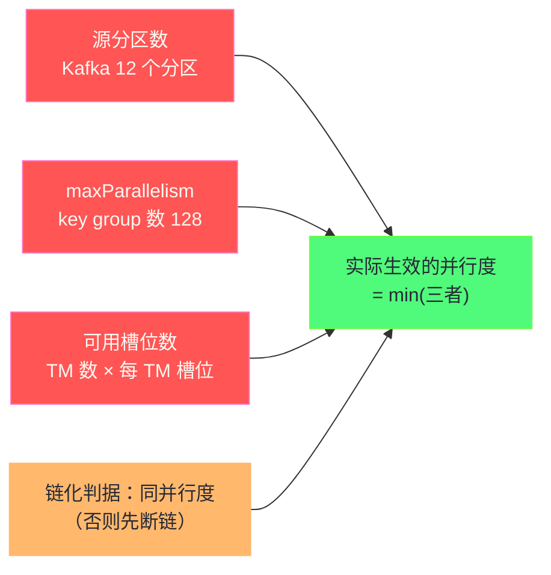
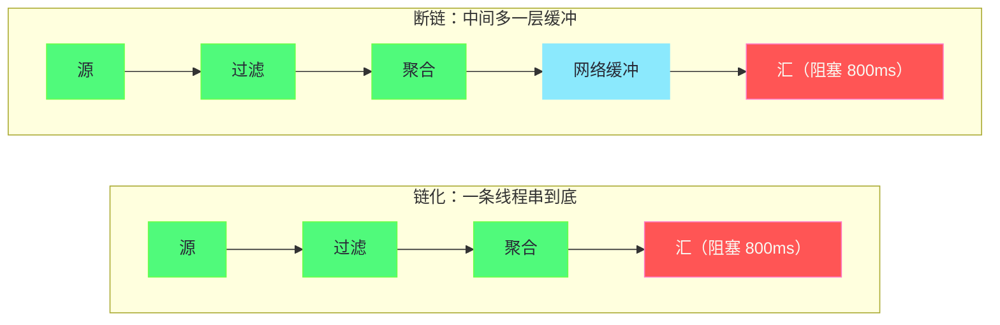
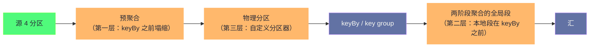
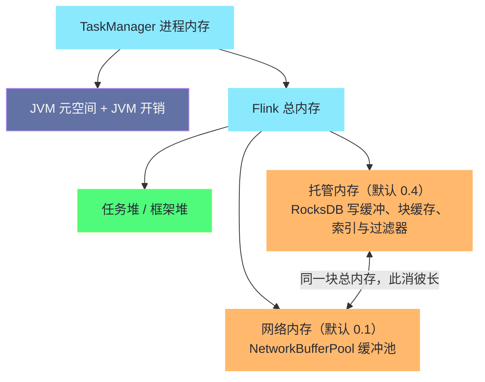
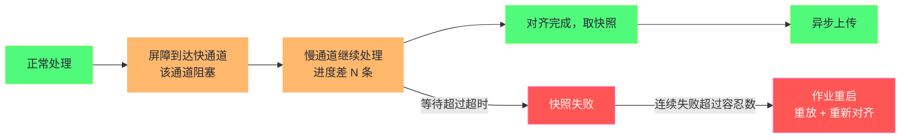

**摘要：**

把 TaskManager 的内存从 8GB 抬到 32GB，把并行度从 16 提到 32，改完重启，吞吐曲线几乎没动——这类事在流处理的调优现场反复出现，事后往往说不清是哪个动作起了作用，也说不清为什么没起作用。问题不在于参数记得不够多，而在于旋钮与机制之间隔着一条因果链：每个参数先改变某个中间量，中间量再去影响可观测的现象，如果这条链的末端根本不在瓶颈路径上，调什么都是空转。本篇按数据形状、并行度与拓扑、资源、系统参数四层组织这条链，逐层拆开并行度的两个上限、算子链换来的序列化节省与失去的调度独立性、数据倾斜三层解法各自的作用点、序列化器降级的判定路径、内存分块之间的零和关系、缓冲超时与检查点参数对吞吐与延迟的双向牵制，最后给出各层收益的量级与失效条件。上层的病因无法用下层的参数治，这是本篇要论证的核心命题。

---

## 第 1 章 一次没有起作用的调参

### 1.1 从资源翻倍、吞吐不动说起

先看一个在值班记录里反复出现的场景。一条电商实时大屏链路，MySQL 订单库的变更经 CDC 进入 Flink，脱敏、过滤测试单之后按 `userId` 分五分钟滚动窗口算成交额，结果一路写 Kafka 供大屏消费、一路写湖表供离线对账。大屏端的 P99 延迟从正常的 1.2 秒涨到了 4 秒，运维的第一反应是资源不够，于是把 TaskManager 的内存翻倍、并行度从 16 提到 32，重启之后延迟降到 3.6 秒，吞吐没有任何变化，Checkpoint 时长反而从 12 秒涨到了 21 秒。

这个结果看起来像"调优无效"，其实是一次典型的层级错配。真正的问题出在数据形状上：某个头部商家的订单占了全量的四成，按 `userId` 哈希之后，这些记录全部落到同一个子任务上，那个子任务的繁忙时间长期贴着 1000 毫秒每秒的上限，其余十五个子任务有一半在等数据。把并行度从 16 提到 32，只是把十五个闲位扩成三十一个，热点子任务还是那一个；把内存翻倍，等于给一条本来就不缺内存的链路多塞了一堆用不上的缓冲，同时把每次全量快照要写的状态撑得更大。

那 0.4 秒的改善来自哪里？来自新增的 16 个槽位让调度器把一部分非热点 key 匀到了新子任务上，仅此而已。这种"歪打正着"的收益不稳定，换个 key 分布就消失。

### 1.2 旋钮与机制之间隔着一条链

调参这件事之所以让人困惑，是因为参数的说明书只写"它是什么、默认值多少"，不写"它先改了什么、再改了什么"。以 `taskmanager.memory.network.fraction` 为例，把它的完整因果链摊开是这样一个序列：

1. 它决定 TaskManager 的网络内存总量（还要过一遍 `network.min` 与 `network.max` 的截断）；
2. 网络内存总量除以单个缓冲的字节数，得到 `NetworkBufferPool` 里缓冲的总个数；
3. 缓冲总个数扣掉各条输入通道的专属缓冲，剩下的进入浮动池；
4. 浮动池的余量决定了下游读得慢时，上游还能往前跑多远；
5. 上游能跑多远，决定了反压从哪一级开始往上冒。

这条链的末端是"反压"和"缓冲等待"，如果瓶颈是窗口算子的 CPU 算力，末端根本不在瓶颈路径上，链条前面几环怎么调都不会体现在吞吐上。反过来，如果瓶颈确实是缓冲不足（表现为启动就因为缓冲分配失败而报 `InsufficientResourcesException`，或者浮动池长期枯竭导致通道反复等 credit），那么这条链上的每一步都有效，而且效果立竿见影。

所以判断一个参数该不该动，标准不是"它是不是性能参数"，而是它所在的**因果链是否穿过当前瓶颈**。这句话是后面所有章节的判据。

### 1.3 本篇的边界

本篇讲的是机制层面的耦合关系：每个旋钮调动的是哪个中间量，不调它的时候有什么替代手段，以及各类手段的收益量级与失效条件。至于"作业出问题了先看哪个指标、按什么顺序处置"，那是运维动作的编排问题，归 [[大数据/Flink/Flink从入门到实战/10 生产运维：监控、调优与常见问题排查|生产运维与排障]] 那一篇。

四个需要往深处读的分支也在这里点明：内存各区域的完整切分算式见 [[大数据/Flink/Flink原理深度解析与性能优化/03 Flink 内存模型深度解析|内存模型]]，缓冲、credit 与反压传播的逐级机制见 [[大数据/Flink/Flink原理深度解析与性能优化/04 Flink 网络传输与反压机制深度解析|网络传输与反压]]，状态后端的存储结构与选型见 [[大数据/Flink/Flink原理深度解析与性能优化/05 Flink 状态后端深度解析|状态后端]]，barrier 对齐的完整流程见 [[大数据/Flink/Flink原理深度解析与性能优化/06 Flink Checkpoint 机制深度解析|Checkpoint 机制]]。本篇只取这些机制与调参动作相接的那一段。

---

## 第 2 章 四层因果链

### 2.1 从数据长什么样到系统等多久

把影响作业性能的因素按"改动代价"和"作用范围"排成一个序列，会自然浮出四层。这四层的划分不是为了分类整齐，而是因为它们之间确实存在支配关系，而且从下往上改，越过层级去改，就是无效调参的主要来源。

| 层 | 包含什么 | 由谁决定 | 改动代价 |
|---|---|---|---|
| 数据形状 | key 分布与基数、单条记录的字段与大小、源分区数、乱序程度 | 业务语义与上游写入方式 | 最高，往往要改上游或改口径 |
| 并行度与拓扑 | 各算子并行度、算子链边界、分区方式、`keyBy` 位置 | 作业代码与提交参数 | 高，需要重启，可能牵动 Savepoint |
| 资源 | 总内存切块、每 TM 的槽位数、容器 CPU 限额 | 集群配置与提交参数 | 中，改配置后重启生效 |
| 系统参数 | 每通道缓冲数、缓冲超时、Checkpoint 间隔与超时、各类阈值 | 运行配置 | 低，作用面也最窄 |

第一章那个案例可以做一次反向验证：热点 key 属于第一层，提并行度属于第二层，翻倍内存属于第三层。动作全部落在被支配的层上，所以只换来 0.4 秒的噪声级改善。

### 2.2 支配关系：下层救不了上层

四层之间不是并列关系，而是上层给下层划定可用空间。这一点决定了调参的方向性。

**数据形状决定并行度的可达上限**。`keyBy` 之后，一个 key 的全部记录只能落到一个子任务，因为它的状态是按 key 分片存放的。key 的基数如果是 1，无论并行度设成 8 还是 800，真正干活的子任务只有一个：按 key 的哈希值对 `maxParallelism` 取模得到 key group，再由 key group 落到子任务，基数 1 意味着只有一个 key group 有数据。这是"并行度治不好倾斜"的全部机制理由，后面第 5 章会反复用到。

**并行度决定资源的需求规模**。并行度翻倍，槽位数翻倍，每个槽位要分一份托管内存、要占一组输入输出通道、要在检查点里占一条确认条目。资源层只能决定"这些需求能不能被满足"，不能决定"需不需要"。

**资源决定系统参数的生效空间**。网络内存总量不够时，把每通道缓冲数从 2 提到 4 会直接导致子任务启动失败，参数改得再"合理"也没有落脚点。

反过来看，下层能解释上层现象，所以诊断是自上而下走的：吞吐上不去，先问数据形状是否让负载集中在少数子任务上，再问并行度与拓扑是否匹配，再看资源够不够，最后才动系统参数。修复顺序却常常也是自上而下，因为把上层的病因修掉之后，下层的参数往往不需要动。

### 2.3 用现象反推层级

把可观测现象映射回层级，能省掉大量试错。下面这张对照表里的判据都来自运行时的真实指标，不是经验口诀。

| 现象 | 最可能的层 | 机制解释 |
|---|---|---|
| 少数子任务的繁忙时间接近 1000 ms/s，其余偏低 | 数据形状 | 分区决定负载，key 分布不均 |
| 所有子任务繁忙时间均匀接近上限，反压一路传到源 | 并行度 | 计算能力整体不足 |
| 子任务繁忙时间不高，但反压明显 | 资源或数据形状 | 缓冲不足、状态 IO 慢或单条记录过大 |
| 延迟周期性尖刺，周期与 Checkpoint 间隔一致 | 系统参数 | 对齐阻塞与屏障强制刷出 |
| 序列化耗时占比高，CPU 高但算子逻辑简单 | 数据形状 | 类型信息降级，走了泛型序列化 |
| 加并行度后吞吐只涨一小截，槽位却翻倍 | 并行度与拓扑 | 断链点、源分区数或全连接通道数封顶 |

有一处容易读错的地方需要点出来：记录数差异只是倾斜的代理指标，不是判据。一个子任务收到的记录数是别人的三倍，但每条记录都只是往累加器上加一，它未必是瓶颈；另一个子任务记录数只多两成，但每条要走一次 RocksDB 读改写，它才是瓶颈。真正的判据是繁忙时间，因为繁忙时间衡量的正是"这个子任务有多少时间被占住了"。

### 2.4 三种层级错配

第一种是用系统参数治数据形状。典型动作是把 `bufferTimeout` 从 100 毫秒调到 0，指望大屏延迟从 4 秒降到 2 秒。缓冲超时影响的是单条记录在缓冲里等待的时间，量级在几十毫秒；4 秒的延迟里绝大部分是热点子任务排队的时间，调缓冲超时只能削掉最外面那层几十毫秒，代价是缓冲被频繁刷空、网络头开销上升、吞吐下降。

第二种是用并行度治数据形状。前面已经论证过，key 不可分时并行度无效。更隐蔽的一种是用并行度治记录大小：某条链路的记录里带了一个几百 KB 的 JSON 快照字段，每次 `keyBy` 都要序列化并跨网络搬运。把并行度提高一倍，网络字节总量不变，反而因为通道数按平方增长而把缓冲需求顶上去，最后是"扩了并行度之后启动失败"这种更难解释的现象。

第三种是用资源治拓扑。链内某个算子做同步外部调用，一次几百毫秒，整条链的线程被按在地上，反压直接怼回源头。加内存只是把积压从网络缓冲搬进堆里，延迟更高、GC 更频繁，吞吐一点没变。这类问题只能靠断链（第 4 章）或改异步 IO 解决。

这三种错配有一个共同特征：动作发生在被支配的层，现象出现在支配层。识别它的方法也简单——把"我改的那个量"和"我观察的那个量"之间画一条因果路径，如果路径上有一个环节与瓶颈无关，这次改动就不该期待效果。

---

## 第 3 章 并行度：两端能力的较小者

### 3.1 第一个上限：源的分区数

在改并行度之前，先数一遍源的分区数。Kafka 的消费并行度上限就是分区数：一个分区在同一时刻只能被一个消费者实例消费，这是由消费组的分区分配协议决定的，不是 Flink 的限制。当作业并行度超过分区数时，多出来的源子任务分不到任何分区，它们会以"空闲"状态存在。

空闲的源子任务不是没有成本。它照样占一个槽位、占一份托管内存的份额、在检查点里占一条位点记录，作业恢复时也要为它重建状态。更要紧的连带效应在水位线：多输入算子取水位线的最小值作为进展，一个永远不产出记录的空闲子任务如果没被标记为空闲，它的水位线就停在初始的负无穷附近，整条链路的事件时间窗口再也不会触发。这类问题的表象是"窗口不出结果"，很容易被误判成水位线生成逻辑写错了，实际上根因在并行度与分区数不匹配。空闲源的处理手段归 [[大数据/Flink/Flink原理深度解析与性能优化/07 Flink 时间与 Watermark 底层机制|水位线机制]] 那一篇。

### 3.2 第二个上限：key group 的天花板

有状态算子还多一道上限。Flink 把整个 key 的哈希空间切成固定数量的 key group，数量等于 `maxParallelism`，一个 key 归属的 key group 由 `hash(key) % maxParallelism` 决定，key group 再到子任务的映射是 `keyGroup × parallelism / maxParallelism` 的整数除法。这套设计的意义在于：并行度变化时状态的重分布可以按 key group 整块搬运，不需要逐 key 迁移，这正是 Savepoint 支持改并行度的数学基础。

它同时带来**两条硬约束**。第一，并行度不能超过 `maxParallelism`，否则会有一部分子任务分不到 key group，状态为空、只消耗资源。第二，`maxParallelism` 一旦随作业启动被固化，就只能在新作业里改，而这个改动会破坏与旧 Savepoint 的键组对齐——从旧 Savepoint 恢复到一个 `maxParallelism` 更大的作业时，状态无法映射到新的键空间，恢复会被拒绝。

`maxParallelism` 的默认值由并行度推算：并行度不超过 128 时取 128，超过时按并行度的一点五倍向上取整并封顶 32768，具体行为以对应版本文档为准。这意味着一个并行度 64、状态规模中等、未来可能扩到 256 的作业，如果不在提交时显式指定 `maxParallelism`，默认值 128 会在扩到 128 以上时挡住去路，届时只能放弃状态、从零开始。真正需要提前规划容量的场景，这一项值得在第一次上线时就写死在提交参数里。

### 3.3 并行度沿链传导

并行度不是一个可以逐算子树状配置的自由变量，算子链的存在让它变成"整段一致"。链化要求上下游并行度相等（这是四条判据之一，推导见 [[大数据/Flink/Flink原理深度解析与性能优化/02 从 StreamGraph 到 JobGraph 再到 ExecutionGraph|三张图的生成]]），因此链内任何一个算子想提高并行度，整条链都得跟着提，或者先断链。

下图把并行度实际受的三重约束画在一起，最终生效的并行度是三者的最小值。



这也解释了一种常见的不对称：源侧并行度 32、聚合侧并行度 8，链路中间一定有一处发生重分布。如果这个重分布恰好落在断链点上，代价是一次序列化加一组网络通道；如果落在链内，链根本建不起来，视觉上表现为 Plan 图里多出一堆本该合并的方框。

### 3.4 算出一个可用的并行度

并行度的取值可以算，不必猜。需要的输入有三个：目标吞吐 `T`（条每秒）、瓶颈算子的单子任务处理能力 `c`、可用的槽位预算。

`c` 可以从两个指标反推：瓶颈算子的 `numRecordsInPerSecond` 除以 `busyTimeMsPerSecond / 1000`。一个繁忙时间 950 ms/s、每秒处理 1.9 万条的子任务，其单子任务处理能力约为 2 万条每秒。目标是 40 万条每秒，则至少需要 20 个子任务，留一点余量取 24 到 28。

然后逐项封顶：源分区数 12，说明整条链路不可能超过 12 个源子任务，除非上游扩容分区；`maxParallelism` 128 不构成限制；槽位预算是主要成本项，24 个子任务的默认槽位共享组需要 24 个槽位，如果每个 TaskManager 有 8 个槽位，那就是 3 个 TaskManager。

这里有个容易被忽略的反向计算：槽位定下来之后，每个槽位能分到的托管内存也定了。3 个 TaskManager、每个 16GB 进程内存、托管内存占比 0.4，总托管内存约 18GB，摊到 24 个槽位是每槽 750MB 左右（示例推算，未扣其他区域）。如果状态后端是 RocksDB 且每槽状态量在 GB 级，这个份额会直接决定读写放大与 compaction 频率，此时"加槽位提并行度"和"每槽状态性能"是一对反比关系，第 7 章会把这笔账算清。

### 3.5 提升不是线性的

并行度翻倍而吞吐只涨四成，是常态而非异常，原因有三层。

第一层是串行段。源端从外部系统读数的速度、汇端写外部系统的速度、以及全连接 shuffle 本身的成本，都不随下游并行度线性增长。阿姆达尔定律在这里照样成立，只是"串行比例"由数据管道的形状决定，不由 CPU 决定。

第二层是**通道数按平方增长**。一个并行度 `P` 的全连接边有 `P × P` 条通道，每条通道要占专属缓冲，浮动缓冲的总需求也随通道数上升。并行度从 16 到 32，通道数从 256 到 1024；按每通道 2 个 32KB 缓冲估算，仅专属缓冲就从 16MB 涨到 64MB（示例推算）。网络内存没有同步扩大时，缓冲不足会以反压的形式吃掉一部分并行度收益。

第三层是状态与检查点的固定开销。每个有状态子任务持有一份状态句柄与一组 RocksDB 实例，实例数上升意味着更多内存表、更多 compaction 线程竞争同一批磁盘 IO；检查点要记录与确认的子任务数上升，JobManager 侧的确认聚合压力也随之上升。这些开销在大并行度下会变成可感知的固定成本。

---

## 第 4 章 算子链：省序列化，失调度

### 4.1 链内传递省下的三笔

链化的**三笔收益**量级差别很大，值得分开算。

第一笔是序列化。跨任务的每次传递都要把记录对象写成字节、压进输出缓冲，对端再读出来反序列化成对象；链内传递只是把对象引用交给下游算子的处理入口。对一条只有十几个字段、以基本类型为主的订单记录，这一步的量级在亚微秒到微秒之间（量级判断，随记录形状与序列化器变化很大），对带嵌套集合或长字符串的记录可以到几微秒。

第二笔是缓冲与通道。每条跨任务的边在运行时都要占一组输入输出通道、一份专属缓冲配额，以及 TaskManager 里对应的读写索引与水位线跟踪结构。链内传递既不建通道也不用缓冲。

第三笔是调度面。`JobVertex` 是部署、失败重试与检查点确认的最小单位，链越少，部署描述符越短、检查点条目越少、作业启动与恢复的固定开销越低。这笔收益在中小规模作业上几乎看不见，在几百并行度、几十个算子的作业上会变成几十秒级的启动差异。

### 4.2 共享线程意味着共享停顿

链化的代价不在平均情况，而在尾部。一条链里的所有算子跑在同一个任务的邮箱线程上，数据从链头进、链尾出，串行推进；链上任何一个算子停下来，整条线程就停下来。

这个性质在链尾对接外部系统时最致命。汇算子写 Kafka 或写湖表，遇到下游抖动、分区重选、连接超时，写操作会阻塞几百毫秒到几秒；同一条链上的源算子此时无法继续取数，它的水位线不推进、定时器不触发、检查点屏障的处理也一并延后。原本这些抖动可以被汇算子前面的网络缓冲吸收一段，断链之后就多出了一层减震。



图里被吸收的那段缓冲并不改变汇算子的慢，它改变的是"慢"向上传播的速度。对于偶发抖动，这段时间足够让上游继续产出、让水位线继续推进；对于持续性变慢，缓冲迟早写满，反压照样会传上去，那时候该治的是汇算子本身。

### 4.3 什么时候该断链

断链的判据可以写成四条，满足任意一条就值得动刀。

其一是阻塞形态不同。链内某个算子要做同步外部调用，而它的邻居是纯计算，两者放在一条线程上等于让纯计算陪着等。断链之后，慢算子独占一条线程与一组缓冲，抖动被隔离在链内。更彻底的做法是把同步调用改成异步 IO，那样连线程都不占，属于改实现而不是改拓扑。

其二是需要独立并行度。链化要求同并行度，想让聚合算子跑 32 而源算子只跑 8，必须在这一刀上断开。

其三是需要独立观测与独立故障域。链内算子的指标混在一起，CPU 火焰图上链头与链尾的耗时叠在一起，一个热点算子会把它前后邻居的账一起吃掉。线上定位到某个算子可疑时，用 `disableOperatorChaining()` 跑一轮对照是常见手法，但它属于诊断手段，不该成为长期配置。

其四是状态量与检查点写出。有状态算子的状态快照由所在任务负责，把它单独成一个任务，可以让它的快照与邻居并行写出，减少同步段对链内其他算子的阻塞。这一条的收益在大状态下才明显。

### 4.4 断链的代价

断链不是免费的。多出来的一次序列化与一组通道，在中等吞吐下大约是 5% 到 20% 的 CPU 开销（量级判断，取决于记录形状与通道数）；多出来的任务边界意味着更多的指标条目、更多的检查点确认、更长的部署描述符；如果是多输入算子，还会多出一个对齐点。

`startNewChain()` 与 `disableChaining()` 的差别在这件事上很具体：前者只切上游那一侧，算子自身仍可与下游合并；后者在算子两侧各切一刀。想彻底隔离某个算子，需要在它身上同时断两侧，或者换一个槽位共享组让它与邻居分居——后者的副作用是槽位需求上升，因为不同共享组的子任务不能挤进同一个槽位。

有一类断链需要警惕：为了让链内两个算子各自拥有不同的并行度而断链，结果两段各自的并行度都不高，重分布成本却翻倍。断链之前先确认两端并行度确实需要不同，否则不如整段同并行度。

---

## 第 5 章 数据倾斜：三层解法的作用点

### 5.1 倾斜发生在哪一步

倾斜的机制位置可以用一句话定位：`keyBy` 之后，同一个 key 的记录必定落到同一个子任务，因为它对应的状态只能有一份。这条性质是流处理精确一次语义的基础，也是倾斜无法靠并行度解决的根源。

从 key 到子任务要经过两步映射：`hash(key) % maxParallelism` 得到 key group，再由 key group 的区间归属决定子任务。倾斜因此有两种粒度：单 key 过热（一个 key 就占了大部分流量，任何映射方式都救不了），以及 key 群聚（一批 key 恰好落进同一区间，换哈希函数或调 `maxParallelism` 有可能缓解，但不可控）。

三层解法分别作用在不同的位置，下图把它们标在同一条流水线上。



顺序值得注意：真正把量减下去的两个环节（本地预聚合与两阶段聚合的本地段）都发生在 `keyBy` 之前，即在数据被"钉"到某个子任务之前先削小它；而 `keyBy` 之后的手段只剩改分区方式这一个方向。

### 5.2 第一层：本地预聚合与加盐

最有效的手段是在 `keyBy` 之前就把记录量减下来，让跨网络的不是原始记录而是中间结果。这在 MapReduce 时代叫 Combiner，在 Flink 的 DataStream API 里没有开箱即用的算子，只能自己实现：在 `keyBy` 之前挂一个 `ProcessFunction`，用一张有界的哈希表按 key 维护局部聚合值，达到阈值或定时触发时再向下游发射。

关键在于这张表的边界。表放在堆内，容量由"活跃 key 基数 × 单条中间结果大小"决定；热点 key 基数小的时候这张表极小，效果极好；key 基数大且分布均匀时，这张表本身就变成内存压力源，此时也不存在倾斜问题，属于误用。表的有界性还要配合淘汰策略，否则长时间运行之后它会退化成全量 key 的缓存。

第二层里的"加盐"是同一条思路的变体，区别在于它改的是 key 的形状而不是引入本地表：给 key 拼上一个 0 到 N-1 的随机后缀，把热点 key 拆成 N 个逻辑 key，让它们分别落到 N 个子任务的 keyed state 上，各自做局部聚合，再由下游按原始 key 合并这 N 份结果。

加盐的前提是聚合可分解。求和、计数、最大值这类可结合可交换的聚合天然满足；平均值需要同时维护和与计数；去重类（`COUNT(DISTINCT)`）、中位数、分位数没有可分解的中间表示，加盐之后合并不出正确结果。**可分解性**不是实现细节，是数学性质。

加盐的代价有三笔，第二笔常被忽略。第一笔是状态放大：每个热点 key 在 N 个子任务上各有一份状态，热点 key 的状态总量变成 N 倍。第二笔是窗口语义的变化：加盐之后，同一个窗口的 N 个分片各自触发、各自输出部分结果，合并阶段必须能接受"部分结果先到、其余后到"，下游看到的不再是每个窗口一条完整结果，而是 N 条部分结果加一条合并结果。第三笔是代码复杂度，合并逻辑、乱序处理、迟到数据的口径都要重新想一遍。

### 5.3 第二层：两阶段聚合

两阶段聚合（LocalGlobal）把聚合拆成本地段与全局段：本地段在 `keyBy` 之前按子任务把同 key 的记录先聚一次，输出条数从"记录数"降到"key 数"；全局段在 `keyBy` 之后只处理这些中间结果。

它和第一层的区别在于本地段聚的是"本子任务收到的同 key 记录"，不需要一张跨批次维护的表，而是在一批数据内完成。这也是它依赖微批的原因：没有攒批就没有本地聚合的对象。SQL 侧由优化器负责插入本地聚合算子，配置项是 `table.optimizer.agg-phase-strategy=TWO_PHASE`，前提是开了微批（`table.exec.mini-batch.enabled`），具体推导见 [[大数据/Flink/Flink原理深度解析与性能优化/08 Flink SQL 与 Blink Planner 深度解析|Blink Planner]]。

两阶段聚合能对付的倾斜形态与加盐不同。它治的是"shuffle 数据量过大"，而不是"单个 key 的处理能力不足"。举例来说，对一个虚拟常量 key 做全局 `COUNT(*)`，本地段每个子任务先把自己那份数完，全局段只处理 `P` 条中间结果，倾斜被彻底消掉；但对一个热点 key 做需要保留明细的处理（比如给每个用户维护最近 N 次点击的列表），本地段无法把明细压成标量，两阶段聚合用不上。

它的代价有三项。其一，只有可分解的聚合才能拆，与加盐同一条数学限制。其二，本地段引入额外延迟——微批的等待时间直接加到结果延迟上，配置的 `allow-latency` 就是这条链路的延迟下限。其三，中间结果的类型与原始记录不同，状态 schema 与 Savepoint 兼容性需要在升级时单独回归，改口径往往意味着放弃旧状态。

### 5.4 第三层：放弃 key 语义的自定义分区

`partitionCustom` 提供的是物理分区，不是 `keyBy`。它的机制含义是：数据按你写的规则分发，Flink 不再保证同 key 同子任务。

这条性质决定了它的适用边界极窄。一旦某个 key 的记录散落到多个子任务上，这个 key 的 `KeyedState` 就没有唯一归属，算子不能是有状态的键控算子；如果下游还要 `keyBy`，一次哈希重分布会把你精心设计的分区彻底打散。它只能用于无状态算子，或者状态本身可以按子任务独立维护、由下游自行合并的场景。

还有一条更硬的限制与恢复有关：键控状态的重分布依赖 key group 的哈希对齐，自定义分区器绕开了这套映射，因此带键控状态的作业不能靠它做倾斜治理。想在恢复后保持状态正确，状态的归属必须由哈希决定。

自定义分区器真正合适的场景是：热点 key 的集合是已知且稳定的，处理逻辑无状态（过滤、富化、转码），且允许同一 key 的记录在不同子任务上并行处理。把超级大商家的流量轮询到 16 个子任务上做无状态解析，是它能发挥作用的地方。

### 5.5 三种解法的选型

| 解法 | 作用位置 | 前提 | 主要代价 | 适合的倾斜形态 |
|---|---|---|---|---|
| 本地预聚合表 | `keyBy` 之前 | key 基数有界、聚合可分解 | 表容量与淘汰策略、乱序口径 | 记录量大但 key 数有限 |
| 加盐 + 二次合并 | 改 key 形状 | 聚合可分解、下游能接受部分结果 | 状态放大 N 倍、窗口语义变化 | 单 key 极热且聚合可拆 |
| 两阶段聚合 | 本地段在 `keyBy` 前 | 聚合可分解、可微批 | 额外延迟、中间结果 schema | shuffle 量过大 |
| 自定义分区器 | 替换分区方式 | 算子无状态 | 破坏 key 语义、无法带键控状态 | 已知热点、无状态处理 |

选型的顺序不是从表头往下走，而是先回答一个问题：这个倾斜是"量"的问题还是"语义"的问题。量的问题（shuffle 太大）用两阶段聚合；语义的问题（单 key 的处理必须串行）只能加盐或改业务口径；两样都不是、只是物理分发不合理，才轮到自定义分区器。

---

## 第 6 章 序列化：类型信息决定的那条路径

### 6.1 决定发生在作业启动之前

序列化器的选择发生在**提交之前**。`DataStream` 每建一个算子，`TypeExtractor` 就会对输入输出类型做一次推断，产出一个 `TypeInformation`，再由它生成对应的 `TypeSerializer`；这个结果在生成 `StreamGraph` 时就被写进了算子的配置，随 `JobGraph` 一起提交，运行期无法更改。

这意味着序列化是数据形状层的问题，而且它的"修复"必须改类结构或改注册方式，不能靠调参。反过来，它一旦降级，代价会沿着三条路径同时体现：网络字节数变大、状态存储变大、检查点上传变慢。

推断的结果按优先级排下来大致是四档：Flink 内置的特化序列化器（基本类型、`Tuple`、`Row`、满足条件的 POJO）、Avro 或 Protobuf 这类带 schema 的类型、Kryo、以及最后兜底的 Java 原生序列化。

### 6.2 POJO 的三条规则及其动机

Flink 对 POJO 的判定有三条硬规则，缺一条就降级到泛型序列化。

第一条，类是 public 且独立的，不能是非静态内部类。动机是反射：序列化器要能直接构造并访问这个类型，非静态内部类隐含一个外部类引用，构造路径不确定。

第二条，有 public 的无参构造。动机是反序列化：从字节流还原对象时要先建实例再填字段，没有无参构造就得走反射的私有构造路径，性能与可移植性都不可靠。

第三条，所有非静态、非 transient 字段要么是 public（且非 final），要么有遵循命名规范的 public getter 与 setter。动机是字段可写：反序列化要逐个字段赋值，字段不可访问就只能整体走对象流。

```java
// 满足三条规则：public 独立类、无参构造、字段 public
public class OrderEvent {
    public String orderId;
    public String merchantId;
    public double amount;
    public long eventTime;
}
```

嵌套结构要逐层满足。一个字段类型本身不满足 POJO，整个外层类型就一起降级——这是"我明明写了 POJO 却还是慢"的最常见原因。Scala 的 case class 通常没有无参构造，除非额外处理，否则直接落到 Kryo；`java.util.Date`、`ArrayList` 这类 JDK 类型有内置处理，但自定义的集合包装类没有。

### 6.3 Kryo 回退的征兆

Kryo 回退不会报错，它只会变慢，所以判定要靠主动检查。三个征兆值得记住。

第一是启动日志。`TypeExtractor` 在推断失败时会打出警告，说明某个类"不能作为 POJO 处理"并列出原因（缺少无参构造、字段不可访问、类型不受支持），随后 `GenericTypeInfo` 接手。这类日志在作业启动时一闪而过，需要主动去翻。

第二是泛型类型被禁用的表现。`env.getConfig().disableGenericTypes()` 会让"需要泛型序列化"这件事在提交期直接抛异常，把运行期的性能问题提前成编译期或提交期的失败。这是一种快速失败策略，适合在开发阶段开启，用它在测试环境把类型问题一次性扫干净。

第三是状态的兼容性。泛型序列化走的是"类结构"而不是"字段语义"，一旦某个状态类型落到 Kryo，它**与类结构强耦合**，改它的字段（哪怕只是加一个字段）就可能导致旧 Savepoint 无法恢复。这条后果比性能下降严重得多，很多团队是在升级要恢复状态时才发现的。

### 6.4 最后一档：Java 原生序列化

Kryo 自身无法处理的类型最终仍会退回 Java 原生序列化，Flink 为这条链路预留了兜底，所以在"无 schema 的 Java 类"这条分支上，最深的档位是第三级：内置特化 → Kryo → JavaSerializer。走到第三级时，字节数通常是内置序列化器的十倍以上（量级判断），CPU 开销随之上去，同时会产生大量临时字节数组，把年轻代的回收频率顶高。

Java 原生序列化的表现通常不是"某个指标变差"，而是一组指标同时变差：GC 时间占比上升、网络缓冲写满更快、RocksDB 写放大、检查点变大。这时候很容易被误判成内存配置或状态后端的问题，真正的根因却在类型推断上。

### 6.5 收益量级

序列化的收益取决于它在总耗时里的占比，而占比又取决于链路的形状。一条大部分算子都链在一起、只有一处 `keyBy` 的链路，序列化只发生在那一处 shuffle 与状态读写上，优化收益有限；一条每隔两三个算子就有一次重分布的链路，序列化可能吃掉三成以上的 CPU（量级判断）。

判断值不值得动，先看两个数字：序列化相关的耗时在火焰图里的占比，以及 shuffle 的总字节数。前者低于 5% 时，改类型定义的收益大概率被其他因素淹没；后者在每秒几百 MB 以上时，换一个更紧凑的类型（比如把嵌套对象摊平成扁平的 POJO，或者干脆用 `Row` 类型）往往能同时降低网络压力与状态体积。

---

## 第 7 章 内存分块：一个池子里的零和

### 7.1 切分的顺序

Flink 的 TaskManager 内存是自上而下切的：先定进程内存总量，扣掉 JVM 元空间与 JVM 开销，剩下的叫 Flink 总内存；Flink 总内存里再切出框架堆与框架堆外，其余分给任务堆、任务堆外、托管内存与网络内存。托管内存的默认占比是 0.4，网络内存的默认占比是 0.1，两者的实际值都要经过上下限的截断：网络内存的实际值等于 `max(network.min, min(network.max, 总量 × fraction))`。

这个截断顺序是关键。改了 `network.fraction` 却发现网络内存没变，绝大多数情况是被 `network.max` 卡住了：总量 64GB、fraction 从 0.1 提到 0.2，两次算出来的提议值分别是 6.4GB 与 12.8GB，被上界 1GB 一截，实际都停在 1GB。算式细节见 [[大数据/Flink/Flink原理深度解析与性能优化/03 Flink 内存模型深度解析|内存模型]]，这里要记住的是：`fraction` 只是提议，`min` 与 `max` 才是边界。

### 7.2 托管内存与网络内存抢同一个池子

托管内存与网络内存是**零和关系**，因为它们的和受 Flink 总内存约束，而任务堆又必须留够。下图把四个区域的比例关系画在一起。



托管内存的去向很具体：启用 `state.backend.rocksdb.memory.managed` 之后，RocksDB 的写缓冲、块缓存、索引与布隆过滤器全部从这个池子里按比例分配；批处理算子与部分排序算子也用它。网络内存的去向同样具体：除以 32KB 得到缓冲池的缓冲个数，再按专属缓冲与浮动缓冲分给各条通道。

调大任何一个，另一个就必然变小；想两个都大，只能扩大 Flink 总内存，而总内存扩大又会被容器限额卡住。

### 7.3 连带效应的三条链路

托管内存与网络内存的相互挤占会产生三类可以预期的连带效应，它们的差别在于显效的快慢，以及表象会不会被误记到别的配置头上。

| 动作 | 第一阶效应 | 第二阶效应 | 显效时间 |
|---|---|---|---|
| 托管内存上调 | 块缓存与写缓冲变大，读放大下降 | 繁忙时间里等 IO 的部分变短，compaction 压力下降 | 立刻 |
| 托管内存上调 | 网络内存被挤小，浮动缓冲枯竭 | 抖动无法吸收，反压触发更频繁，极端时启动失败 | 立刻，启动期就会暴露 |
| 网络内存上调 | 写缓冲与块缓存变小 | SST 文件增多、compaction 更频繁、读命中率下降 | 几十分钟到数小时 |

第一条链路里真正起作用的是块缓存命中率：块缓存变大，RocksDB 从 SST 文件读盘的次数减少，同样的状态访问只需要更少的磁盘 IO，子任务的繁忙时间里"等 IO"那部分变短。它在大状态、随机读多的场景下最明显，在写多读少的状态结构上几乎看不出来。

第二条链路最容易制造误判。网络内存被挤小之后，缓冲池可能不够所有通道分配，子任务启动时直接抛 `InsufficientResourcesException`；也可能刚好够分配专属缓冲，浮动池几乎没有余量，任何一次下游抖动都立刻转成反压。表象是"改了状态配置之后作业起不来"或者"改完之后反压更频繁"，被追查的却是状态后端的配置。

第三条链路的延迟比前两条长得多。托管内存被挤小之后，写缓冲更快填满、更快刷成小文件，SST 文件数量上升、compaction 触发更频繁，同时读缓存命中率下降导致读放大，往往要跑几十分钟才在指标上显形，于是很容易被归因为"数据量涨了"。判断方法是对照线上的写入速率曲线：数据量没涨而 compaction 指标涨了，账就该记在内存分块上。

三条链路之外还有一条隐性的：槽位数上升会摊薄每槽的托管内存份额。托管内存除以槽位数得到每槽额度，槽位从 8 增到 32，每槽的 RocksDB 可用内存降到四分之一，单槽状态吞吐随之下降。想把并行度提上去，就得同时接受每槽状态性能的下移，或者按 `state.backend.rocksdb.memory.fixed-per-slot` 显式给每槽定量并回头调整槽位总数。

### 7.4 槽位只是内存的账本

槽位不是 CPU 核。它记录的是"这个 TaskManager 的内存被分成了几份"，运行时并不限制 CPU 的使用；同一槽位里跑的子任务仍是各自独立的线程，各自争用同一个 JVM 的 CPU 时间片。

这条性质解释了两类常见困惑。一类是"槽位开得很多但 CPU 用不起来"：并行度受源分区数或链化限制，槽位空转。另一类是"一个 TaskManager 开 32 个槽位，状态性能很差"：托管内存被切成 32 份，每份都不足以支撑 RocksDB 的块缓存。

### 7.5 只调总量不改分配

改 `taskmanager.memory.process.size` 是最常见的动作，也是最容易做了却没有效果的动作。总量上调之后，各区域按比例一起放大：网络内存放大一点，托管内存放大一点，任务堆放大一点。如果瓶颈是托管内存不够（RocksDB 读放大），按比例放大带来的改善与"总内存涨了多少"成正比，而如果瓶颈是缓冲不足，同样比例的上调可能仍然过不了 `network.max` 的截断。

正确的做法是先定位到具体区域，再改对应的参数与边界，最后才动总量。改总量之前先看两件事：`network.min` 与 `network.max` 的当前值能否容纳你想要的网络内存，以及容器或 YARN 队列的内存限额是否还留有余量——超过限额时容器会被直接杀掉，表现为 TaskManager 进程消失而不是 OOM 异常。

### 7.6 回收压力在因果链上的位置

JVM 的回收压力不属于独立的一层，它是资源层的下游效应。链路是：任务堆的份额决定可分配空间，用户代码的对象分配速率决定年轻代被填满的速度，回收频率再决定线程被 STW 按住的频次与时长，最后体现为繁忙时间里的非计算占用与延迟尖刺。所以"GC 时间占比高"是这条链末端的读数，不是病因。

沿链回溯，能改的位置只有三处：降低分配速率（少建临时对象，或者开对象复用，代价是算子不能跨调用持有输入引用）、把状态搬出堆（换 RocksDB 后端，让状态对象不再参与回收，代价是托管内存要吃够）、调整堆的划分与回收器参数（分区大小、停顿目标、并发标记阈值，具体配置见 [[大数据/Flink/Flink原理深度解析与性能优化/03 Flink 内存模型深度解析|内存模型]]）。判断顺序上先看分配速率能否降下来，再考虑换后端，最后才动回收器参数；参数调到极致而分配速率不变，回收频率只会被推迟，不会被消除。

---

## 第 8 章 bufferTimeout：吞吐与延迟的交换点

### 8.1 缓冲被刷出的三个条件

输出缓冲不会每来一条记录就发出去，它在三种情况下被刷出：缓冲写满、超时到期、以及遇到必须立刻发出的特殊事件。特殊事件里最典型的是检查点屏障——屏障到达算子后，算子要先把之前产生的记录全部刷出，再转发屏障，否则那些记录会被算进下一个快照，一致性就破了。

水位线不属于强制刷出的特殊事件。这个细节值得留意：它意味着调大缓冲超时不会影响窗口触发的正确性，但会影响窗口结果从产生到被下游看到的时延。

三种条件的相对频率决定了缓冲超时的实际效果。高吞吐链路上缓冲几乎总是先写满，超时很少触发，调它几乎无用；低吞吐链路上缓冲很少写满，超时成了主要的刷出原因，调它是延迟的直接旋钮。

### 8.2 两种语义与版本差异

`execution.buffer-timeout`（旧写法 `env.setBufferTimeout(...)`）的取值语义在 1.12 前后有过一次**语义翻转**。更早的版本里 0 表示每产出记录就刷出，追求最低延迟；1.12 起 0 改成了"关闭超时"，即只在缓冲写满时才刷出，而"每条都刷"由 -1 表达，默认值定在 100 毫秒。升级时如果把旧配置原样搬过去，0 的含义会从"最低延迟"变成"最高吞吐"，这类翻转是版本迁移里最容易漏的一类变更，具体以对应版本文档为准。

### 8.3 按链路的 SLA 取值

缓冲超时的取值应该按链路的 SLA 分，而不是按作业统一设。同一份作业里，面向大屏的支路延迟预算是秒级，缓冲超时给 0 到 10 毫秒就够；面向入湖对账的支路吞吐优先，给 100 毫秒甚至更大。

代价是双向的。超时越小，缓冲里攒的记录越少，每次刷出的数据包越小，网络头与序列化的固定开销占比越高，吞吐下降——在中等记录大小下，这条代价大致在 5% 到 30% 之间（量级判断）；超时越大，单条记录在缓冲里的等待越久，端到端延迟的下界被抬高，而且积压更难被及时看到。

### 8.4 与检查点的隐式耦合

缓冲超时与检查点间隔之间有一层间接关系：检查点越频繁，屏障强制刷出的次数越多，缓冲被"顺手"清空的频率越高。这意味着在一个间隔 10 秒的检查点配置下，把缓冲超时从 100 毫秒调到 500 毫秒，实际延迟的改善会小于预期，因为每 10 秒就有一次强制刷出把积压排空；反之在间隔几分钟的配置下，缓冲超时才是延迟的主要决定因素。

这条耦合也解释了另一种现象：某些作业的延迟尖刺周期与检查点间隔完全一致。尖刺的来源是对齐阻塞（下一章），不是缓冲，调缓冲超时改变不了尖刺的幅度，只能改变基线延迟。

---

## 第 9 章 Checkpoint 参数与吞吐的耦合

### 9.1 对齐为什么会抬延迟

多输入算子的对齐过程可以用一句话描述：先到的通道被置为阻塞，不再读取新数据，等慢通道把屏障送上来。等待期间算子照常处理慢通道的数据，所以吞吐并没有停；但被阻塞的那条通道上的数据既不被读取也不被丢弃，它堆在输入缓冲与网络里，反压顺着这条通道传回上游。

这就是检查点影响吞吐的机制路径：不是快照本身耗时，而是对齐期间某条入边整段停摆，整条链路的下游供给减少。上游如果在全连接 shuffle 之后，它面向多个下游子任务的输出会被其中一个慢的下游顶住，反压再传上去，影响的就不止一条边。

等待时长由入边之间的进度差决定：进度差 5 万条、下游处理速率 2 万条每秒，等待约 2.5 秒（示例推算）。下游被反压时速率掉一个数量级，等待就涨一个数量级。这也是为什么"检查点超时"的第一嫌疑往往不在检查点配置上，而在上游某个变慢的环节。

### 9.2 间隔、最小间隔与超时的相互牵制

`execution.checkpointing.interval` 决定两次快照的发起间隔，`execution.checkpointing.min-pause` 决定两次之间的最小净处理窗口，`execution.checkpointing.timeout` 决定单次快照多久没完成就判失败，`execution.checkpointing.max-concurrent-checkpoints` 默认是 1，即同一时刻只允许一次快照在跑。

这四个参数的关系可以这样看：间隔越短，故障恢复时要重放的数据越少，但屏障穿插越频繁、强制刷出越多、对齐次数越多，吞吐的损失越大；`min-pause` 是给"净处理时间"留的保底，设得太小时，一次慢快照会立刻吃掉下一次的触发机会，快照节奏被拖成"一次成功、一次跳过"；超时设得太紧，高反压期间快照频繁失败，而 `execution.checkpointing.tolerable-failed-checkpoints` 的默认值是 0，连续失败会直接把作业判死、触发重启，重启之后又要重新消费、重新对齐，恢复窗口被拉长成雪崩。



### 9.3 不对齐快照：用状态换时间

不对齐（Unaligned）快照的机制是：把对齐期间本该等待的那段在途数据直接写进快照，作为通道状态的一部分。既然在途数据被持久化了，通道就不必阻塞，对齐等待从根上消失。

代价立刻显现。快照的大小等于"算子状态 + 在途数据"，在途数据量取决于反压程度与通道数，高反压时它可能和状态本身一个量级。恢复时要先把通道状态回放出来，恢复时间相应变长。它是"用状态大小换对齐时间"的一笔交易，只在反压严重、状态相对小、恢复时间预算宽裕时划算。

还有两条边界值得写清。第一，**只有检查点能不对齐**，Savepoint 始终是对齐的，所以开了不对齐的作业在升级暂停时仍然可能卡在对齐上，这时候反压依然是敌人。第二，不对齐依赖检查点存储能保存通道状态，切换存储实现时要验证；开启它也不改变状态后端的选型，两者是不同维度的事。

### 9.4 增量快照的账

RocksDB 的增量快照只上传新增的 SST 文件，不上传完整状态。对大状态作业，这把每次快照的上传量从"全量"降到"自上次以来的写入量"，收益量级取决于写入速率：100GB 的状态、每小时写入 5GB，全量与增量的上传量差一个数量级（量级判断）。

代价在于恢复路径变长：增量快照的恢复需要引用历史文件链，保留份数决定了能回退多远，也决定了存储侧要保留多少文件；同时增量上传产生的小文件更多，对象存储或 HDFS 的元数据压力上升。另一条隐性代价是 compaction 策略的影响——compaction 越频繁，被合并掉的旧文件越多，增量快照能复用的文件越少，增量就退化成准全量。

---

## 第 10 章 量级：各层的收益与失效条件

### 10.1 收益为什么不可加

同一层内的多个动作常常作用在同一个机制上，收益会重复计算。并行度提升与倾斜治理都在降低单个子任务的负载，两者只做其一就能吃掉大部分收益，叠加之后的实测提升远小于两次单独测试之和。

跨层的收益会**被上层封顶**。源分区数是 12，并行度的收益上限就是 12 倍的单分区吞吐；key 的基数是 1，任何并行度上的投入都不产生收益；托管内存再大，也无法弥补"每槽状态量超过磁盘容量"这种量级错配。

所以收益的读法应该是：先确认这一层不是被上层封死的，再测单次改动的效果，最后才考虑叠加。

### 10.2 一张量级表

| 层 | 典型动作 | 收益量级 | 失效条件 |
|---|---|---|---|
| 数据形状 | 加盐或两阶段聚合治倾斜 | 热点子任务繁忙时间从满值降到三到四成，吞吐一到三倍 | 聚合不可分解；单 key 语义必须串行 |
| 数据形状 | 类型改为合规 POJO | 序列化 CPU 降三到五倍，网络字节降三到五成 | 序列化不在瓶颈路径上 |
| 并行度与拓扑 | 断掉阻塞型链 | 抖动不再全链放大，尾延迟明显下降 | 慢是持续性的，断链只改变传播速度 |
| 并行度与拓扑 | 并行度按单子任务能力反推 | 接近线性，直到通道数或分区数封顶 | 源分区数、`maxParallelism`、槽位预算 |
| 资源 | 托管内存上调 | 状态读放大下降，繁忙时间里 IO 占比下降 | 块缓存已足够大，或瓶颈是写放大 |
| 资源 | 网络内存上调 | 反压触发频率下降，突发吸收能力增强 | 浮动池本来就充足，或瓶颈在计算 |
| 系统参数 | 缓冲超时下调 | 端到端延迟降低几十毫秒 | 缓冲本来就写不满，或延迟主要来自排队 |
| 系统参数 | 检查点间隔拉长 | 屏障穿插减少，吞吐上升 | 恢复时间预算不够，或快照本来就不是瓶颈 |
| 系统参数 | 开不对齐快照 | 高反压下快照不再超时 | 状态与在途数据总量超出存储与恢复预算 |

表里的数字都是量级判断，不是基准。真实收益必须用同一份数据、同一套指标、改一个变量测出来的前后对比来确认，否则得到的只是噪声。

### 10.3 一个回合

把上面这些东西串成一次完整的调优回合，用第一章那条大屏链路走一遍。

现象是 P99 延迟 4 秒、部分子任务繁忙时间贴着上限、检查点从 12 秒涨到 40 秒。按层判读：繁忙时间集中在少数子任务，属于数据形状层；检查点变长的直接原因是反压导致对齐等待变长，不是快照本身变慢。

动作选两阶段聚合：`keyBy` 之前先按子任务做本地累加，跨网络的记录从全量降到 key 基数级。检查点、状态后端、并行度都不动。

预期与验证：热点子任务的繁忙时间应从满值降到三成左右，吞吐上升；跨网络字节数应下降一到两个数量级；瓶颈转移之后，检查点时长应回落。验证时必须同时看三组指标——繁忙时间、shuffle 字节数、检查点时长的分段（同步段、异步段、对齐段），只看其中一个很可能把瓶颈的转移误判成修复。

副作用要提前认账：本地聚合表的容量上限与淘汰策略、迟到数据在本地段的口径变化、中间结果的类型改动导致 Savepoint 不可直接恢复。这些不是"顺便处理"的细节，而是这次改动是否可回滚的前提。

如果做完之后繁忙时间仍然贴着上限，说明倾斜没有治住，回到第 5 章重新判断是量的问题还是语义的问题；如果繁忙时间下来了但吞吐没涨，说明瓶颈转移到了汇端或网络，回到第 2 章重新判层。

---

## 第 11 章 反例集

### 11.1 并行度远大于源分区数

把并行度设成源分区数的四倍，指望"多几个实例总没坏处"。实际结果是四分之三的源子任务长期空闲，槽位、托管内存份额、检查点条目照付不误；如果这些空闲源没被标记为空闲，事件时间水位线会被钉住，窗口一个都不触发。正确的动作是先把上游分区扩到与目标并行度匹配，或者把并行度降到分区数。

### 11.2 一台 32 核机器跑一个槽位

`taskmanager.numberOfTaskSlots` 设成 1，一台 32 核的机器上就只有一个槽位可用，默认槽位共享组里整条链的并行度最多是 1，31 个核在旁观。这不是"资源浪费"这种含糊说法，而是并行度被槽位数量硬性封顶。合理做法是让槽位数与容器的 CPU 限额对齐，同时确认每槽的托管内存份额仍能支撑状态后端。

### 11.3 只加网络内存

把 `taskmanager.memory.network.fraction` 从 0.1 调到 0.3，重启后观察网络内存只涨了一点点。原因是被 `network.max` 截断，或者总内存太小时被 `network.min` 抬到下限而无法体现比例。更常见的无效场景是瓶颈根本不在缓冲：计算侧本来就慢，扩充缓冲只是让积压堆在内存里更久，延迟上升，吞吐不变。

### 11.4 把倾斜当并行度问题

热点 key 的负载集中在少数子任务，提并行度之后热点子任务还是那几个。机制理由在第 3 章与第 5 章各讲了一遍：key 的哈希决定归属，并行度**改不了归属**。这种调整的另一个副作用是状态实例数上升，每槽状态内存被摊薄，RocksDB 性能下降，于是"扩了并行度反而更慢"。

### 11.5 用全局断链换可观测性

为了让指标能看清每个算子，`env.disableOperatorChaining()` 上线。代价是三笔全付：每两个算子之间多一次序列化、多一组通道与缓冲、多一个调度与检查点单位；缓冲需求随边数上升，网络内存可能直接不够。断链只应该出现在排查窗口里，或者只针对确认需要隔离的那一两个算子。

---

## 第 12 章 小结

调优的失败大多不是参数选错，而是层级选错。数据形状层的病因（key 分布、记录类型、源分区数）决定了并行度与资源的可用上限，资源与系统参数只能决定"在给定上限内落到什么位置"；把下层的旋钮拧到底，也无法突破上层的封顶。

具体到每层的判据：并行度的上限由源分区数、`maxParallelism` 与槽位预算三者取小；算子链换来的序列化与通道节省，代价是链内共享线程带来的停顿传染，断链的判据是阻塞形态不同或需要独立并行度；倾斜的三层解法都作用在 `keyBy` 之前或之后的特定位置，可分解性是共同前提；序列化的档位在作业启动前就被类型推断决定，降级到 Kryo 或 Java 原生序列化的后果会同时体现在网络、状态与检查点上；托管内存与网络内存是同一块总内存的两份，任何一边的上调都从另一边扣除；缓冲超时与检查点参数则是显式的吞吐与延迟交换点，取值要按链路的 SLA 分，而不是按作业统一。

最后一条经验比任何参数都可靠：一次只改一个量，改之前先在因果链上画出"这个量改变什么、那个中间量是否在瓶颈路径上"，改之后用前后对比确认。没有这条纪律，调优只是在制造噪声。

---

## 参考资料

1. Apache Flink Documentation, *Memory Configuration* —— 进程内存各区域的默认占比、`network.min` / `network.max` 的截断规则、托管内存的消费者权重。
2. Apache Flink Documentation, *Network Buffers* —— 单个缓冲大小、每通道专属缓冲数、每输入门浮动缓冲数与缓冲池的分配关系。
3. Apache Flink Documentation, *Checkpointing* —— 间隔、最小间隔、超时、并发数、容忍失败次数，以及不对齐快照的开启方式与限制。
4. Apache Flink Documentation, *State Backends* 与 *Working with State* —— 增量快照、RocksDB 内存托管、`maxParallelism` 与键组的关系。
5. Apache Flink Documentation, *Data Types and Serialization* —— POJO 的判定规则、Kryo 回退的触发条件、泛型类型禁用的行为。
6. FLIP-126, *Buffer timeout alignment* —— 缓冲超时取值语义的调整（0 与 -1 的含义翻转、默认值定为 100 毫秒）。
7. FLIP-76, *Unaligned Checkpoints* —— 把在途数据写入快照以消除对齐等待的设计动机与代价。
8. Flink 源码类：`StreamingJobGraphGenerator`（链化判据）、`KeyGroupRangeAssignment`（键组到子任务的映射）、`TypeExtractor`（类型推断与降级告警）、`NetworkBufferPool`（缓冲池分配）。

---

> [!note] 思考题
> 1. 一个作业的并行度已经等于源分区数，繁忙时间仍然贴着上限，此时"提并行度"与"扩上游分区"分别会改动因果链上的哪一环，代价各是什么？
> 2. 加盐把热点 key 拆成 N 份，合并阶段必须处理 N 条部分结果。如果下游是精确一次写入的外部系统，这份"部分结果"的幂等边界应该画在哪里？
> 3. 同一台机器上，把槽位数从 8 提到 32，并行度随之提升，但状态读写变慢了。这笔得失能否用一组可观测指标提前算出来，而不是上线后再发现？
> 4. 缓冲超时设为 0、检查点间隔设为 10 秒、网络内存设为默认值，这三个选择在同一份作业里是否自洽？如果不自洽，先改哪一个？
> 5. 不对齐快照把对齐时间换成了状态大小。当状态本身已经在数百 GB 量级时，这笔交换还有效吗，判据是什么？