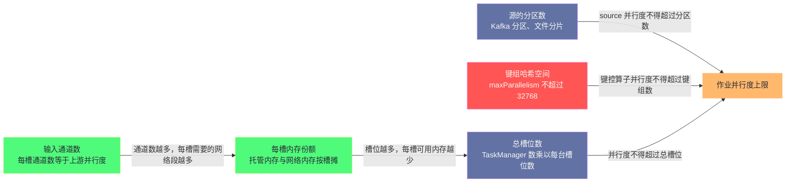
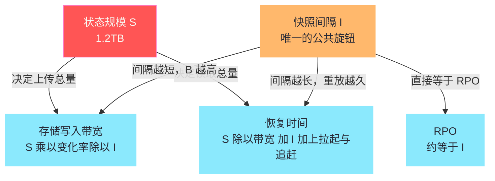
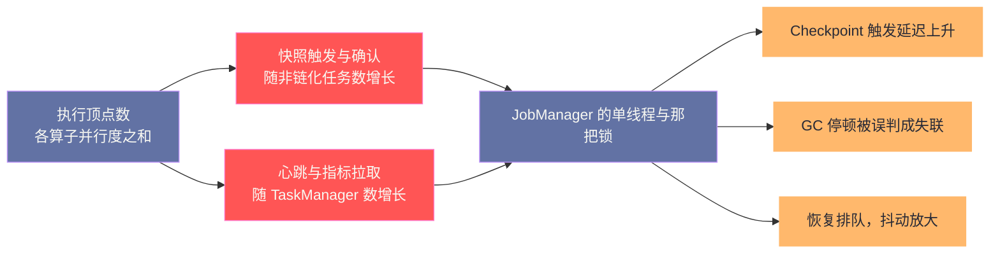
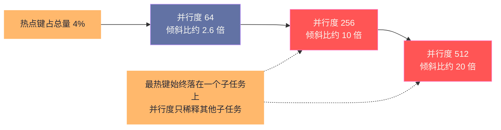
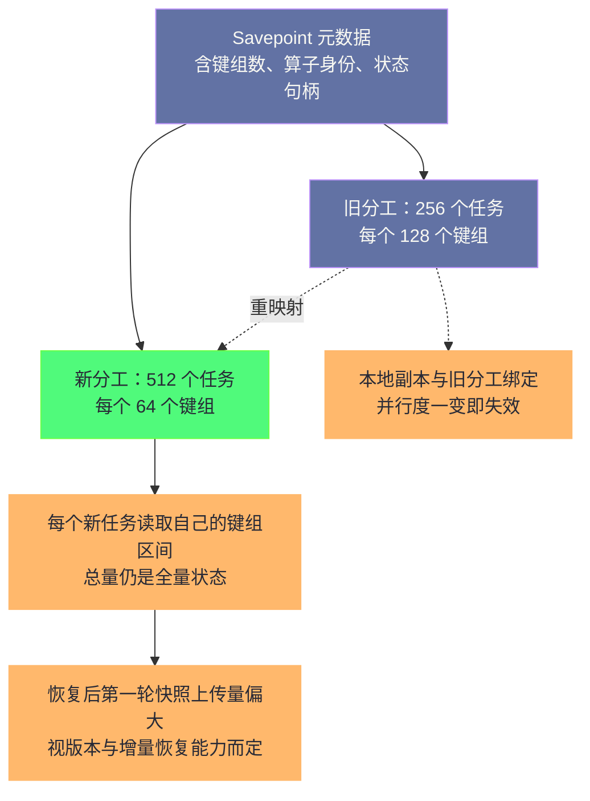

**摘要：**

把一个在小集群上跑得很稳的 Flink 作业搬到十倍规模，通常不会拿到十倍的吞吐，而是收到一串原本不存在的故障：并行度加上去了、消费反而更慢，Checkpoint 从秒级涨到分钟级，故障恢复要等半小时，JobManager 的一次 GC 停顿让健康的心跳被判成失联。这一篇不讨论参数模板，而是逐条拆开那些在规模上悄悄失效的前提——源的分区数、键组（Key Group）的哈希空间、槽位与内存的切分、状态快照的字节吞吐、JobManager 需要维护的执行顶点数量、元数据分发的带宽、共享集群里按人头摊的网络内存，以及热点键在更多分区下依然只有一个归宿。全文用一套电商实时大屏加 CDC 入湖的作业承载算术：并行度天花板链怎么串起来、大状态的三条硬约束为什么互相顶住、单 JobManager 的量级边界落在哪里、为什么三个流行结论在规模上恰好是反的。落点是一句判断：规模并不放大假设，它换了一套假设；扩容之前要做的不是把参数乘以十，而是找出哪一环已经先到顶。

---

## 第 1 章 规模不是放大

### 1.1 一次没有兑现的扩容

给一台机器加内存，瓶颈会消失；给一个流处理作业加并行度，瓶颈往往只是换了个位置。笔者见过、也亲自做过的那类扩容形态高度相似：作业在小集群上跑得很稳，业务量涨上来之后把并行度从 32 提到 256，TaskManager 从 4 台扩到 32 台，配置一个字没改。上线之后的现象却是——吞吐涨幅远小于八倍，Checkpoint 耗时随并行度一起变长，第一次故障恢复跑了十几分钟，而作业日志里没有任何一条明确的错误。

直觉总会先去找“哪个参数没配对”，但真正的变化不在参数上，而在这套作业所依赖的假设上。并行度 32 的时候，那条假设是：每个子任务都有一份独占的本地资源，Checkpoint 的协调量可以忽略，状态小到能在一次磁盘抖动里写完，JobManager 的堆装得下所有执行顶点，热点键造成的偏差被平均掉了。并行度 256 的时候，这些假设一条接一条地不再成立，而它们不会主动告诉你。

规模不是把一个正确配置线性放大，而是让一组本来被稀释掉的约束显形。这篇要做的，是把这些约束按出现的顺序摆出来，让扩容之前的判断有一个可以逐项核对的清单。

### 1.2 三个规模维度

“大规模”这个词在 Flink 语境里至少指三件互不相同的事，它们放大的是不同的成本，混在一起谈就会得出互相矛盾的结论。

其一是子任务数量，也就是并行度乘以非链化算子的个数。它放大的是协调成本：JobManager 要维护的执行顶点、Checkpoint 的触发扇出与确认汇总、调度器每次全图重启时的状态变更次数。它几乎不放大单条记录的处理成本。

其二是状态字节数。它放大的是存储成本：快照的写入吞吐、恢复时的读取与灌入时间、TaskManager 本地磁盘的容量与 IOPS。它与并行度的关系是间接的——并行度提高会让每个子任务的状态变小，但状态总量只由业务决定。

其三是作业与租户的数量。它放大的是隔离成本：槽位争抢、网络内存摊薄、JobManager 的作业簿记、元数据分发的重复拷贝。这一维度在单作业视角下完全不可见，却是共享集群里最常见的事故源。

三个维度里，第一个最先到顶，第二个最难返工，第三个最容易被忽略。后文大致按这个顺序展开，每一处都标出它实际属于哪个维度。

### 1.3 贯穿案例与它的三个刻度

沿用本专栏的案例：一套电商实时数仓作业，双支路，一条从 Kafka 读订单与支付事件，按分钟窗口聚合后写入大屏的指标表；另一条接 MySQL 的变更数据捕获（Change Data Capture，CDC）流，去重合并后写入数据湖。为了讨论规模，给这套作业钉上三个刻度，后文的算术都落在这三个刻度上。

拓扑规模：非链化算子约 20 个，主链路是 source、清洗、keyBy、窗口聚合、两个 sink。部署在 32 台 TaskManager 上，每台 8 个槽位（slot），单台 Flink 内存按 32GB 计，于是总槽位 256 个，主链路并行度 256。上游 Kafka 主题 48 个分区。

状态规模：RocksDB 承载的键控状态约 1.2TB，分散在 256 个子任务上，每份约 4.7GB。增量快照开启，每轮相对上一轮变化的 SST 文件约占状态总量的百分之几。

运维规模：同一集群上还跑着另外两个作业，共享同一批 TaskManager 的槽位，Checkpoint 写到同一套 HDFS 目录。这第三个刻度在扩容时最不起眼，却决定了“能不能再加一个作业”这类问题的答案。

三个刻度互相咬合：并行度、每份状态的大小、快照持续时间与恢复时间彼此牵制，这条链后文会反复出现。

### 1.4 本文的边界

这一篇讲的是机制层面的规模效应：规模上来之后，哪些原本成立的假设先失效、失效的机制是什么、失效之后表现成什么现象、如何用量化的方式在扩容前估算。它是原理列文章，凡是“参数该设成多少”“线上先看哪个面板”“升级窗口怎么排”的工程侧判断，只在机制必需处给出默认值与出处，不展开成清单。

具体的划界如下。三张图的分工、并行度在运行时的展开方式，归 [[大数据/Flink/Flink原理深度解析与性能优化/02 从 StreamGraph 到 JobGraph 再到 ExecutionGraph|执行图与并行展开]]；状态后端的内部结构、键组与哈希空间、`maxParallelism` 的机制细节，归 [[大数据/Flink/Flink原理深度解析与性能优化/05 Flink 状态后端深度解析|状态后端]]；Checkpoint 的对齐、确认汇总与恢复落位，归 [[大数据/Flink/Flink原理深度解析与性能优化/06 Flink Checkpoint 机制深度解析|Checkpoint 机制]]；网络缓冲池与反压的传播路径，归 [[大数据/Flink/Flink原理深度解析与性能优化/04 Flink 网络传输与反压机制深度解析|网络传输与反压]]；调优的因果链与瓶颈判据，归 [[大数据/Flink/Flink原理深度解析与性能优化/09 Flink 性能调优体系|性能调优体系]]；部署形态（会话模式、应用模式、Kubernetes Operator 与 Native 部署的取舍）归 [[大数据/Flink/Flink从入门到实战/09 Flink on YARN 与 Kubernetes 生产部署|生产部署形态]]，线上排障的判据与处置归 [[大数据/Flink/Flink从入门到实战/10 生产运维：监控、调优与常见问题排查|生产运维与排障]]。

规模话题天然带有版本敏感：本文的机制描述以 1.x 的运行时为主体，凡涉及 2.x 的形态变化会单独标注，不能确认的地方写明以对应版本文档为准。

---

## 第 2 章 并行度的天花板链

### 2.1 五道闸串成一条链

很多人把并行度当成一个可以随便拧大的旋钮，原因是它确实是一个整数。但并行度能不能提起来，由五道彼此串联的闸门共同决定，任何一道关着，其余四道开得再大都没有收益。这条链的形状画出来比讲清楚容易，先看图。

图里有三道算不出来就只能停下的硬闸（源的分区数、键组空间、总槽位），与两道给得起但不划算的软闸（每槽内存份额、输入通道数），区分它们很重要。硬闸是算术上的不可能：源没有那么多分区，多出来的子任务就只能空转；键组只有那么多，键控算子的并行度就上不去。软闸是经济学上的不划算：槽位和内存不是不能给，而是给了之后别处会出问题。扩容失效的故事，多数发生在软闸上，而返工代价最大的问题，全部出在硬闸上。

### 2.2 闸一：源的分区数

Source 的并行度上限由数据源本身的可分片数决定。Kafka 的消费并行度不会超过主题分区数，超出的子任务会被分配零个分区，处于空闲状态——它们照常占用槽位、照常参与 Checkpoint 的屏障广播与确认汇总、照常在 JobManager 里占着一个执行顶点，但不贡献吞吐。

反直觉的后果在这里：Source 到顶之后，下游继续加并行度，只会把空转成本按比例放大。案例里 48 个分区就是这样一个天花板，source 侧的有效吞吐由 48 个消费者线程决定；下游从 48 提到 256 有意义，因为键控聚合的负载可以在 256 个实例上分摊，再往上提，边际收益要先扣掉空转带来的 Checkpoint 与协调开销。

更隐蔽的一层是水位线：空闲子任务若不做空闲标记，会拖住整个作业的水位线推进，窗口迟迟不触发，反压从窗口一路传回 Source。小集群上并行度通常与分区数贴得很近，规模上来之后两者脱钩，它就成了常态。

### 2.3 闸二：键组与 maxParallelism

键控算子的可伸缩性并不由并行度直接决定，中间隔着一层键组（Key Group）。键先经过哈希映射到某个键组，键组再按当前并行度分给子任务。映射关系是两条整数运算：键组编号等于哈希值对 `maxParallelism` 取模，子任务编号等于键组编号乘并行度再除以 `maxParallelism`。

这层间接带来的第一个约束是并行度不得超过键组数：键组是状态的分配单位，键组比子任务少的时候，一个子任务至少要拿一个键组，于是并行度的上限就停在键组数上。而键组数由 `maxParallelism` 决定，它的上限是 32768——这个数字来自源码里的一条注释：键组映射的整数运算要求 `maxParallelism` 不超过 `Short.MAX_VALUE + 1`，否则乘法会溢出。换句话说，**上限是 32768**，不是工程上随便挑的。

第二个约束是默认值会悄悄决定未来的空间。用户不显式配置时，`maxParallelism` 由算子的并行度算出来：取并行度的 1.5 倍，向上取到 2 的幂，再夹在 128 与 32768 之间。这条规则在源码里只有几行，但它意味着：**并行度从 8 起步的作业，键组数默认是 128**；等业务长大想扩到 256，就会在恢复时撞上“并行度不能超过最大并行度”的校验，而 1.x 没有官方的键组数改写工具。

第三个约束与恢复有关：键组数是状态分片的粒度，也是并行度变更时的搬运单位。键组越多，单个键组越小，扩缩容时每个子任务要搬的份额越细；但键组越多并不意味着恢复更快，因为总量不变。这部分机制在 [[大数据/Flink/Flink原理深度解析与性能优化/05 Flink 状态后端深度解析|状态后端]]里有完整推导，这里只保留结论。

### 2.4 闸三：槽位与共享组

并行度的下一个上限是总槽位数。这里有一个容易被记错的关系：**并行度上限等于总槽位数**，而不是总槽位数除以算子数。原因是槽位共享——一条算子链上每个算子的一个并行实例，住在同一个槽位里，一个槽位承载的是一条完整的流水线切片，不是某个算子的一个切片。

这个关系一旦记反，容量规划会全盘错位。案例里 32 台 TaskManager、每台 8 个槽位，总槽位 256，恰好装下主链路 256 的并行度。如果按“槽位除以算子数”去算，会得出只需要十几个槽位的结论，然后作业会卡在创建阶段，反复申请资源而永远凑不齐。

共享组会给这条上限加倍。若某个算子被显式放进独立的共享组，它与主链路不再共享槽位，需要的槽位要单独计一份。一个作业里有两个互不共享的组、每组并行度 256，就需要 512 个槽位。生产上出现“槽位明明还有空余，作业就是起不来”，多数是共享组与碎片化叠加的结果，第 6 章会展开。

### 2.5 闸四与闸五：槽位数、托管内存与网络内存

前三道闸都通过之后，剩下两道最容易被忽略的软闸，它们都落在同一台机器的内存账上：槽位不是凭空变出来的，多一个槽位就意味着同一台机器的内存要多切一份。

托管内存（managed memory）按槽位均分：一台 TaskManager 的托管内存，按 Flink 内存的默认 0.4 比例算出总量，再平均分给每个槽位。案例里单台 32GB Flink 内存、8 个槽位，每个槽位约 1.6GB 托管内存，RocksDB 的写缓冲与读缓存都从这一份里出；若把每台槽位数调到 16 而机器不变，每个槽位只剩 800MB，写缓冲一缩，compaction 的写放大立刻变成写停顿。

网络内存的算法与托管内存不同，**网络内存按 TaskManager 一份**配置（默认取 Flink 内存的 0.1，下限 64MB），但使用方是槽位里的输入门。每个输入门的目标段数是“通道数乘以每通道独占段数，再加每门浮动段数”，而通道数等于上游并行度。于是并行度提高会同时做两件事：让每个输入门需要更多段，让每个槽位分到的网络内存更少。

这两件事叠加的后果，Flink 官方文档写得很直白：缓冲区的动态裁剪（buffer debloating）在并行度超过约 200 时，默认配置可能不再工作，表现为吞吐下降或 Checkpoint 耗时上升，建议把每门浮动段数至少调到与并行度相当。这条被写在文档里的阈值，是“默认配置在规模上失效”最干净的一处证据。

### 2.6 任一环不足，其余环的扩容都不产生收益

把这几道闸门连同共享组的切分并排放在一张表里，扩容时该核对什么就清楚了。表里的“能否绕开”一列尤其重要，它区分了“改配置”和“改架构”。

| 闸门 | 硬上限由什么决定 | 不足时的现象 | 能否在不重导状态的前提下绕开 |
|---|---|---|---|
| 源的分区数 | 主题分区数、文件分片数 | 子任务空转，水位线被拖住，窗口不触发 | 不能；只能扩分区或改源 |
| 键组哈希空间 | `maxParallelism`，上限 32768 | 恢复时报并行度超过最大并行度 | 不能；1.x 无官方改写工具 |
| 总槽位数 | TaskManager 数乘以每台槽位数 | 作业卡在创建阶段，反复申请资源 | 能；加机器或调槽位数 |
| 每槽内存份额 | 托管内存与网络内存的切分 | 写停顿、反压、缓冲区不足告警 | 能；但受单机内存上限约束 |
| 每输入门通道数 | 上游并行度 | 吞吐静默下降、Checkpoint 变慢 | 能；提浮动段数，代价是内存 |
| 共享组切分 | 共享组个数与各组并行度 | 有空闲槽位却凑不齐并行实例 | 能；调共享组或独占集群 |

案例里的那一次扩容，恰好同时踩了前三条中的两条、后三条中的一条：48 个分区的天花板没动，并行度提到 256 之后有 208 个槽位的下游负载被 48 个源摊薄；`maxParallelism` 用了默认值，从 32 算出的键组数是 128，于是键控算子的并行度上限其实只有 128，剩下的槽位被调度器反复尝试又放弃；每台机器的槽位数从 8 提到 16 之后，每槽托管内存减半，RocksDB 开始写停顿。三个失效点各自都能解释一部分“吞吐不涨”。

### 2.7 反例：把 maxParallelism 留到以后再说

关于这道闸，最典型的反例是把它留到以后再说。作业起步时并行度 16，`maxParallelism` 走默认，算出来的键组数是 128；两年后业务量涨了十倍，并行度要提到 256，此时从 Savepoint 恢复会在校验处失败，报错大意是新的并行度超过了作业的最大并行度。

1.x 的处理方式只有三条，都不轻松：把作业拆成两个并行度不超过 128 的作业（状态分裂，键的归属必须自己保证）；放弃状态、从源头重放（数据湖里的历史要重算，CDC 的位点要重定）；或者在离线环境里改写状态文件的键组元数据（没有官方工具，风险自担）。三条路的成本都与状态规模成正比，而状态规模在这两年里也涨了十倍。

把这件事反过来看，结论就很清楚：`maxParallelism` 是作业生命周期里少数几个**一次定终身**的常量。它不需要精确，只需要留足空间；按未来三到五年的并行度上限去设，宁可多留，不可少留，因为多留的代价只是键组变小、元数据项变多，而少留的代价是重导一次全部状态。

---

## 第 3 章 大状态的三条硬约束

### 3.1 第一条：快照体积乘以频率

Checkpoint 的写入成本不是由状态大小单独决定的，而是由“状态大小乘以变化比例、再除以快照间隔”决定的。增量快照只上传相对上一轮有变化的 SST 文件，于是持续写入吞吐等于每轮变化量除以间隔，这个量才是要跟存储系统对齐的数字。

用案例的刻度做一次示例推算：状态 1.2TB，每轮变化约 3%，即 36GB；快照间隔 5 分钟，则持续上传吞吐约 120MB/s。HDFS 默认三副本，集群侧的写入放大是三倍，约 360MB/s 的集群带宽被这一个作业长期占用。同集群上另外两个作业若也是这个量级，合计超过 1GB/s，这已经接近一套中小型 HDFS 集群能稳定提供的写带宽上限。若快照目录落在对象存储上，约束的形状又变一次：每次上传是一个对象写，吞吐由并发连接数与单连接带宽共同决定，小文件多时请求率而非磁盘 IO 先成为瓶颈，而这类限流往往不出现在作业侧的指标里。

这个算术里最容易被低估的是“持续”二字。快照不是瞬时尖峰，而是每五分钟一次的稳定负载，挤占的是 Sink 写出、Shuffle 溢出与同一批磁盘上 compaction 的带宽。规模上来之后，Checkpoint 慢往往不是快照那一刻的问题，而是它在与常态负载抢同一批资源。

增量快照还带来一笔存储账：HDFS 目录里同时被引用的快照代数越多，旧 SST 文件越晚被回收。`execution.checkpointing.num-retained` 的默认值是 1，正常情况下只保留最后一份完成的快照，旧文件在下一轮完成后即可回收；把它调到 3 到 5 以求多留几个恢复点，代价是同时挂着三五代 SST 引用，容量按状态大小的倍数膨胀。它能换来的是恢复时的选择余地，付出的是存储与元数据的线性增长。

### 3.2 第二条：恢复时间与 RPO 是一对反向指标

恢复时间与恢复点目标（Recovery Point Objective，RPO）是同一枚硬币的两面，而它们被同一个参数同时拉动：快照间隔。

恢复的总时间可以拆成四段：从远端读取状态并灌进 RocksDB、重建执行图、拉起容器、重放快照点之后的数据。第一段由状态规模与存储带宽决定，第二段与第三段由调度和容器启动决定，第四段几乎完全等于 RPO——间隔多长，就要重放多长的数据。

案例的算术：1.2TB 状态、256 个子任务并行下载，若存储侧能给到 1GB/s 的聚合带宽，读取本身约 20 分钟；灌进 RocksDB 还要消耗 CPU 与本地写带宽，实际往往更长一些。此时若快照间隔是 5 分钟，重放 5 分钟的数据按 20 万条每秒计约 6000 万条，追上还要几分钟。于是恢复总时长落在 25 到 30 分钟这个量级，而其中的 20 分钟来自状态规模，与间隔无关。

矛盾就在这里显形：把间隔从 5 分钟压到 1 分钟，RPO 降到 1 分钟，恢复时间几乎不动，但快照的持续上传吞吐变成五倍；把间隔放到 30 分钟，上传压力降到六分之一，恢复时间里却多出 25 分钟重放。三条边不可能同时压小。

### 3.3 第三条：RocksDB 的本地磁盘

第三条约束不在存储系统上，而在每台 TaskManager 的本地盘上。RocksDB 的状态是本地 LSM 树，容量与 IOPS 都要按放大后的量级规划。

容量这一侧，案例里每槽 4.7GB 的逻辑状态，落到 SST 文件上要乘一个 LSM 放大系数，量级上按 1.2 到 1.5 估；若再开启任务本地恢复，本地还要多留一份快照副本，容量需求可能接近逻辑状态的三倍。按“状态大小除以槽位数”去规划磁盘，是第一年会踩的坑，因为 compaction 过程中的临时文件与多层 SST 并不遵守这个除法。

IOPS 这一侧更隐蔽。RocksDB 的读会穿过多层 SST，写会触发 compaction，两者都是随机 IO；机械盘与低配云盘的随机 IOPS 只有百级到千级，一旦 compaction 追不上写入，RocksDB 会主动限速（write stall），表现为处理吞吐周期性掉坑。此时反压会从状态算子传上来，Checkpoint 的屏障对齐等待变长，快照耗时跟着涨——一个磁盘问题最后表现成 Checkpoint 问题，是规模上最常见的因果错位。

本地恢复还带来两条硬的机制限制。其一，开启任务本地恢复要求任务的槽位分配在失败后尽量保持原样，也就是分配保持（allocation-preserving）调度，否则本地副本找不到原来的位置；其二，本地副本依赖硬链接或同一物理设备，文档明确写到本地恢复目录与 RocksDB 目录若被拆到多块物理设备上，硬链接会失败，本地恢复直接不可用。再加上一条：非对齐快照（unaligned checkpoint）目前不支持任务本地恢复。这意味着反压严重时用非对齐快照换来的稳定性，会以失去本地恢复为代价，恢复时间反而变长。

### 3.4 2.x 改变了约束的形态

以上讨论建立在 1.x 的嵌入式 RocksDB 上，状态与计算同机。2025 年 3 月发布的 Flink 2.0 引入了分离式状态管理（Disaggregated State Management），把状态主存放到分布式文件系统，并配套给出一个名为 ForSt 的状态后端，同时改造了运行时的异步执行模型与若干 SQL 算子。

这条变化对本文的三条约束意味着什么，值得单独说清。本地磁盘的容量与 IOPS 约束被显著削弱：状态不再必然占用本地盘，本地盘退化为缓存，恢复也不必把全部状态下载一遍才能开始处理，快照本身变轻。代价转移到别处：每次状态访问可能落到远程存储上，延迟高出本地一到两个数量级，于是必须有异步状态访问与乱序处理来掩盖延迟，SQL 侧要开 `table.exec.async-state.enabled` 才能让支持的算子切到异步模式。**分离式状态把本地磁盘约束换成了远程带宽与延迟约束**，约束没有消失，只是换了名字。哪些算子支持异步状态访问、ForSt 在什么规模下更划算，以对应版本文档为准。

### 3.5 反例：把快照间隔设得比快照本身还短

大状态作业最典型的反例，是“为了 RPO 好看，把快照间隔设成 30 秒”。机制上的后果可以直接推演，不需要现场试验。

Flink 默认同时只允许一个快照在途（`execution.checkpointing.max-concurrent-checkpoints` 为 1），并且两轮之间还有一个最小间隔（`execution.checkpointing.min-pause`，默认 0）。若一轮大状态快照需要两分钟才能完成，那么把间隔设成 30 秒并不产生“每 30 秒一个快照”的效果，实际结果是：每两分钟完成一个，其间不断有触发被推迟。更糟的是，反压之下屏障对齐本身会变慢，快照耗时进一步上升，于是作业进入一种接近稳定的“永远在拍快照”的状态。

这时候的失效是双重的。其一，有效 RPO 不再是配置的 30 秒，而是“快照持续时间”这个由状态规模与存储带宽决定的量；配置值变成了一个不兑现的承诺。其二，快照超时的默认值是 10 分钟，连续失败容忍度默认是 0，也就是一次失败就触发作业重启；重启后又要从上一个完成的快照恢复，恢复期间积压进一步加剧反压，形成“快照慢、超时、重启、更慢”的循环。规模越大，这个循环的周期越长，业务感知到的抖动越明显。

正确的做法不是把间隔往小里压，而是先确认快照的持续时间由哪一段构成：同步段阻塞、上传带宽、对齐等待。三者的处置手段完全不同，间隔只是把它们全部放大的乘数。

---

## 第 4 章 大集群的协调开销

### 4.1 账本一：执行顶点的数量

JobManager 里最占内存的不是数据，而是“账本”：每个算子的每个并行实例，在作业图上对应一个执行顶点（ExecutionVertex），顶点下面挂着执行尝试、输入输出分区、状态监听器、以及 Checkpoint 的统计对象。

数量级很容易算，但很容易算错。准确的算法是各算子并行度之和，而不是并行度乘以算子数——链化之后，同一条链上的多个算子虽然各自有执行顶点，但它们的数量仍然按各自的并行度累加。案例里 20 个算子、主链路并行度 256，如果全部非链化是 5120 个顶点；实际链化后约 6 条链，顶点数仍是 20 乘以 256 这个量级，链化减少的是任务线程与 RPC 数量，不减少顶点数。

把顶点数当成一个小数字是危险的，因为它同时出现在下面这几本账上，前四本随顶点数线性增长，最后一本随变更次数增长，而一次全图重启会为每个顶点产生多次状态变更。

| 开销项 | 放大因子 | 案例量级 | 观测点 |
|---|---|---|---|
| 执行顶点对象图 | 各算子并行度之和 | 约 5000 个 | JobManager 堆占用与 GC 停顿 |
| 快照触发扇出 | 需快照的任务数 | 约 1500 条 | 触发到屏障到达的延迟 |
| 确认汇总 | 非链化任务数 | 约 1500 条 | 确认处理耗时与锁等待 |
| 统计对象历史 | 子任务数乘以保留轮数 | 数千乘以十轮 | 堆内统计对象的增长 |
| 调度状态变更 | 顶点数乘以变更次数 | 全图重启时数万次 | 恢复阶段调度器线程占用 |

这张表也是排查时区分“慢在哪一本账”的依据：触发延迟高而确认耗时正常，问题在调度线程；确认耗时高而触发正常，问题在锁竞争与统计对象。三本账最终汇到同一个瓶颈上，形状如下图。

### 4.2 账本二：Checkpoint 的扇出与汇总

一次 Checkpoint 在 JobManager 侧是两波消息：触发时向所有需要快照的任务各发一条，完成时接收所有任务的确认。

这里有一处流传很广的误算，需要纠正：确认消息的数量不是“并行度乘以算子数”。Flink 在任务（task）这一级取快照，一条算子链上的所有算子共享同一个任务线程，快照完成后由这个任务向 JobManager 发一条确认消息，消息里带的是整条链上所有算子的状态句柄。所以**ack 的粒度是 task，不是算子**。案例里链化后约 6 条链、256 个并行实例，确认消息约 1536 条；若按“256 乘以 20”去估算会得到 5120 条，高估三倍多。

这个纠正改变了扩容时的判断方向：若 ack 数随算子数增长，拆算子就是减负手段；实际上它只随非链化任务数增长，减负的正确方向是少并行度或少分段，而不是把链拆开。

真正的成本也不在消息条数上。1536 条确认消息集中在屏障对齐完成后的几秒内涌入，每条消息的处理都要更新协调器的状态并写统计对象，而这些动作发生在 JobManager 同一个线程与同一把锁上。5000 个子任务、每分钟一轮快照的作业，峰值是每秒上千次带锁操作，与调度、心跳、REST 请求共享同一个执行线程。规模上来之后，JobManager 的问题很少是“RPC 打满”，而是“锁内的活儿太多，单线程跑不完”。

### 4.3 账本三：心跳、指标与连接

心跳常被列为大规模集群的头号杀手，这个说法需要拆开看。Flink 的心跳按 TaskManager 与目标（JobManager、ResourceManager）成对维护，间隔默认 10 秒、超时默认 50 秒，连续 2 次失败即判定不可达。案例里 32 台 TaskManager，每秒约 3 次心跳；即使扩到 1000 台，每秒也只有 100 次，对任何 RPC 框架都不构成压力。

被心跳真正放大的是误判的代价。JobManager 的一次长 GC 停顿会让一批心跳同时超时，于是调度器把一批 TaskManager 判死，触发区域恢复，恢复期间所有任务重新部署、重新拉状态，反过来加剧 JobManager 的负载。规模越大，一次误判牵连的任务越多，恢复本身又成为下一轮误判的诱因，这也是调大超时的真正理由——不是为了省 RPC，而是为了给 GC 留出余量。

指标是第二个被低估的负载。任务级指标由 JobManager 侧按上报周期向每个 TaskManager 拉取，TaskManager 数量增长直接放大拉取与序列化的开销，而指标里的每个子任务条目又让每次拉取的报文体积随子任务数增长。

### 4.4 单 JobManager 能管多少子任务

把上面三本账合起来，可以给一个量级判断：在 4 到 8GB 堆的 JobManager 上，数千个执行顶点是稳态区间，一万个以上进入风险区，数万个基本不可行。

这个判断的根据不是某条硬限制，而是三条曲线的交点。第一条是堆占用：每个执行顶点连同它的尝试、分区与统计对象按数 KB 计，五千个顶点是几十 MB，一万个顶点是几百 MB 量级，单看内存并不致命。第二条是单线程的处理能力：触发扇出、确认汇总、状态变更、指标拉取都挤在同一个线程与同一把锁里，顶点数翻倍，这一段耗时也翻倍，而它直接决定 Checkpoint 的触发延迟。第三条是 GC 停顿与误判的耦合：堆越大、对象越多，停顿越长，误判概率越高，而一次误判的恢复成本随顶点数线性上升。

三条曲线里，笔者所见的第一条最容易被误当成唯一的约束，于是有人给 JobManager 加内存；加到 16GB 之后堆占用问题解决了，GC 停顿却变长，误判变多，整体表现反而更差。这也是“单 JobManager 管上万子任务”必须被当作反例来记住的原因。

### 4.5 反例：一个 JobManager 管一万个子任务

把一万个子任务塞进一个 JobManager，是扩容到某个阶段之后很自然的一步：作业数在涨，每个作业都要一个 JobManager，资源浪费看着心疼，于是把多个作业合并进会话集群，共享一个 JobManager。

机制的后果可以逐条列出。会话集群里所有作业的执行顶点都挂在这一个 JobManager 上，顶点总数是各作业之和；Checkpoint 协调器要同时为多个作业各维护一条协调链，触发与确认的峰值叠加；任一作业的失败恢复都要在这个已经繁忙的线程上排队；一个作业的异常状态（譬如同步段卡住）会拖慢所有作业的 Checkpoint 触发。最后一条最致命，因为它把“单作业故障”变成了“集群级抖动”。

正确的边界不是“一个 JobManager 管多少作业”，而是“一个 JobManager 管多少执行顶点、以及这些顶点是否属于同一个故障域”。判据很实际：若两个作业的恢复时间窗不能互相影响，它们就不该共用同一个 JobManager。至于用多少个 JobManager、按什么维度切分，属于平台侧的部署决策，见 [[大数据/Flink/Flink从入门到实战/09 Flink on YARN 与 Kubernetes 生产部署|生产部署形态]]。

---

## 第 5 章 元数据与部署

### 5.1 提交路径上的两件大对象

规模上来之后，提交与部署这一段会先出现“莫名其妙很慢”的现象：作业从提交到 RUNNING 要几分钟，期间没有任何任务在跑。原因通常不是调度慢，而是在搬东西。

第一件大对象是作业图（JobGraph）。它在客户端构造完成后一次性发给 JobManager，体积随算子数与并行度增长，因为每个执行顶点、每条中间结果、每个输入通道的描述符都在里面。它的传输只发生一次，所以通常不是瓶颈，但有一个副作用：作业图大到超过 RPC 单帧上限时，提交会直接失败，报的是帧过大一类错误，需要调大 RPC 帧大小。

第二件大对象是每个子任务的部署描述符。TaskManager 收到的不是整张作业图，而是自己那部分任务的部署报文，里面有序列化后的算子工厂、输入通道的部署描述、以及该作业 jar 文件的 blob 键。部署报文按子任务各一份，总量约等于“单份报文大小乘以子任务数”。案例里 1536 个任务，每份几十到上百 KB，总量在百 MB 量级。

### 5.2 BlobServer 与 jar 分发

部署报文里引用的 jar 不由 RPC 传，而是由 JobManager 进程里的 BlobServer 提供。jar 先上传到 BlobServer，再由每个 TaskManager 按需拉取。这条设计在单作业视角下非常省事——上传一次、多处引用；在集群视角下则是一个天然的汇聚点。

汇聚点的后果是**分发成本约等于字节数乘以接收方数**。一个 200MB 的胖 jar，被 256 台 TaskManager 各拉一次，就是 50GB 的出向流量，全部要经过 JobManager 所在的那台机器。BlobServer 的并发拉取数默认限制在 50，于是 256 台 TaskManager 的首次部署要分五波完成；每波都要等 200MB 传完，叠起来就是分钟级的部署延迟。若同时发生区域恢复，所有 TaskManager 一起重新部署，jar 拉取与状态下载会互相抢带宽。

Flink 在 TaskManager 侧做了库缓存，同一作业的多个任务共享同一份用户代码类加载器，同一个类的字节不会被重复解析成多份；但这个优化解决的是内存与类加载成本，解决不了第一份字节的传输成本。规模上真正管用的是减小 jar 的传递依赖——把连接器、日志、工具库从胖 jar 里剔出去，或者把公共依赖放进集群的 `lib/` 目录，前者改的是分发字节数，后者改的是分发次数。

### 5.3 用户 jar 与类加载器

类加载器（ClassLoader）这一层在大规模下的麻烦，来自两个方向的挤压：jar 越多，类加载的冲突面越大；作业越多，类加载器的生命周期越难管。

Flink 的类加载结构是分层的：框架类由应用类加载器加载，用户代码由每个作业自己的类加载器加载，父优先规则决定同名类由谁胜出。用户代码里的 `provided` 依赖若与集群 `lib/` 目录下的版本不一致，就会在运行时抛出方法不存在或类转换失败——这类问题在单机开发时被依赖管理掩盖，在集群里换一个 Flink 版本就集中爆发。

生命周期的另一头是泄漏。同一个作业的所有子任务共享一份用户类加载器，作业结束后引用计数归零才回收；若某个库起了常驻线程、或者缓存了类加载器的引用，这个类加载器就永远不释放，元空间与类对象随之累积。`classloader.check-leaked-classloader` 默认开启，作用是在作业结束后再有人通过旧类加载器加载类时直接报错，把泄漏从“慢慢变慢”变成“立刻失败”。

### 5.4 部署阶段与恢复阶段的叠加

部署开销与恢复开销是两笔账，却在同一时刻结算。区域恢复的流程是：确定受影响的流水线区域、取消区域内的任务、重新申请槽位、重新部署任务（拉 jar、解析部署报文）、从最近一次快照恢复状态、重放数据。前四步是部署成本，第五步是状态成本；规模上来之后两者互相放大——TaskManager 同时在拉 jar 与拉状态，JobManager 同时在处理部署报文与 Checkpoint 相关的 RPC，而集群里其他作业的常态负载不会因此让路。一次单点故障最后演变成整个集群的抖动，走的就是这条路。

---

## 第 6 章 多租户与资源隔离

### 6.1 槽位的形状比数量更重要

共享集群里，槽位的可见性有两个维度：数量与形状。数量是“还有几个空闲槽位”，形状是“这些空闲槽位能不能拼出一个作业需要的并行实例集合”。

碎片化的机制很朴素：一个作业需要的并行度是固定的，槽位分布在若干台 TaskManager 上，每台机器的空闲槽位不连续；只要凑不齐某个共享组所需的完整并行实例，作业就停在创建阶段等待，而集群面板上明明显示还有空闲槽位。并行度 8 的作业只要找到一台有空闲槽位的机器即可，并行度 256 的作业却需要集群里恰好有 256 个可同时分配的槽位，而它们面对的是几十个作业的交替申请与释放。会话集群里最常见的告警是“资源充足但作业起不来”，判据就在这里。

### 6.2 网络内存按 TaskManager 一份

网络内存的分配粒度是 TaskManager，使用粒度是槽位里的输入门，这两个粒度不一致，就是共享集群里最隐蔽的一处摊薄。

一台 TaskManager 的网络内存按 Flink 内存的固定比例配出（默认 0.1），是一个固定预算；消耗方是每个输入门的缓冲段，而每个输入门需要的段数由上游并行度决定。于是同一台机器上住两个作业时，两组输入门在同一个预算里取段，谁的通道多、谁的水位高，谁占的段就多。一个并行度 512 的作业与一个并行度 8 的作业同住一台机器，前者的输入门需要的段数是后者的六十多倍，预算几乎全被它吃掉，后者在高峰期拿不到足够的段。

文档对这种静默限速有描述：读缓冲的门槛值调低会让“网络缓冲不足”的异常更少出现，而工作负载可能在无报错的情况下性能下降。摊薄的后果不一定是一条错误，可能只是一个说不清的变慢。

### 6.3 队列与配额管的是申请，不是争抢

YARN 队列与 Kubernetes 配额是两个层面的手段，它们解决的是“能不能申请到”，不是“申请到之后跑得好不好”。

YARN 的队列按容量调度分配资源池，队列内的作业按优先级与提交顺序排队；Kubernetes 侧用命名空间隔离，用 ResourceQuota 限制申请总量，用 LimitRange 限制单 Pod 的资源上界。两者的共同点是：一旦资源批给了你的作业，邻居的负载不会因为配额而减少对你的干扰——网络带宽、本地磁盘 IOPS、节点页缓存，都不在配额的管理范围里。

真正需要隔离到这一层的，是那些对尾延迟敏感的作业。把计算隔离做到了、把 IO 隔离没做到，最后的结论往往是“隔离没用”，而实际只是隔离错了层。

### 6.4 隔离的层级与代价

隔离手段可以按粒度排成一条阶梯，每一级都更彻底，也都会牺牲一部分利用率。

| 隔离层级 | 手段 | 隔离掉什么 | 代价 |
|---|---|---|---|
| 槽位级 | 共享组、每作业独立槽位 | 并行实例的槽位争抢 | 碎片化，利用率下降 |
| 进程级 | 每作业独立 TaskManager | 内存池、GC、类加载器 | TaskManager 固定开销成倍增加 |
| 容器级 | 独立 Pod 或 YARN 容器 | CPU、内存、本地磁盘配额 | 调度排队与冷启动时间 |
| 队列级 | YARN 队列、K8s 命名空间配额 | 资源申请总量与优先级 | 队列容量规划与闲置成本 |
| 集群级 | 独立集群或独立 JobManager | 故障域、JobManager 抖动 | 资源闲置最严重 |

这张表的用法不是“越往下越好”，而是“按故障域的边界选层级”：两个作业若可以互相拖慢而不影响业务承诺，槽位级共享就够；若一个作业的失败恢复会让另一个作业超时，就必须走到容器级或集群级。

### 6.5 反例：用大 TaskManager 减少数量

为了减少 TaskManager 数量，把每台槽位数从 2 提到 16、内存从 8GB 提到 64GB，是很有诱惑力的一步：机器少了，要管的心跳少了，部署也省事。

代价在三处体现。第一处是爆炸半径：譬如一次 TaskManager 故障会同时带走 16 个并行实例，作业并行度 512 时是 3% 的实例一次性丢失，而小 TaskManager 方案下同样一次故障只影响 0.4%；丢失的实例越多，恢复时要重建的状态与重放的数据越多，本地恢复能救回来的比例越低。

第二处是 GC 的共享。同一 JVM 里的所有槽位共享堆与垃圾回收器，64GB 堆的一次完整回收停顿从亚秒级升到秒级，而这段时间里 16 个槽位的任务线程全部停摆；在 8GB 的小进程里，同样的回收只影响 2 个实例。第三处是每槽内存份额，第 2.5 节的算术已经说明：槽位数翻倍、机器不变，托管内存与网络内存都要除以翻倍后的槽位数。

三处叠起来的结论是：大 TaskManager 换来的是运维对象数量减少，付出的是单点故障影响面、GC 停顿面与内存粒度的三重恶化。它适合“作业多、每个作业小”的集群；对单个大状态作业，恰恰要反着来。

---

## 第 7 章 倾斜在大规模下的放大

### 7.1 倾斜的两种形态

倾斜（data skew）有两种形态，规模上来之后同时恶化。

吞吐倾斜是大家熟悉的那种：少数键的数据量远高于其他键，键控算子按哈希分到子任务之后，承载热点键的那个子任务成为瓶颈。状态倾斜则更少被注意：热点键的状态本身也集中在同一个子任务上，于是那个子任务的 RocksDB 比邻居大得多，它的快照上传时间成为整轮快照完成时间的下限，它的恢复下载量成为整批恢复时间的下限。

两种形态的共同点是“只有一个归宿”。键经过哈希之后落在哪个键组是确定的，一个键只能落在一个子任务里，无论并行度提到多少。

### 7.2 一个可以算出来的放大系数

均匀哈希下，倾斜程度与并行度成正比，这一点可以推出来。设总吞吐为 T、并行度为 P、最热键的流量占总量的比例为 r，则该键所在的子任务承担 r 乘以 T 的流量，而每个子任务的平均负载是 T 除以 P；两者之比，也就是最热子任务相对平均负载的倍数，**倾斜比约等于 r 乘以 P**。

按案例的刻度算一次示例推算：r 取 4%，并行度 64 时倾斜比约 2.6 倍，多数作业能扛；并行度提到 512 时倾斜比约 20 倍，最热的子任务要处理 20 倍于平均量的记录，而它的处理能力与其他子任务一样。并行度越高，倾斜比越大——这就是“更多分区里仍然有热点”的算术版本。

### 7.3 Checkpoint 与恢复把倾斜再放大一次

倾斜对吞吐的影响只是第一层，第二层在快照与恢复上。

屏障对齐是这一层的关键机制：多输入算子要等所有输入通道的屏障都到齐才能取快照，而最慢的分支由热点子任务决定。热点子任务处理慢，它的屏障就晚到，其他子任务在等它的时间里既要缓冲数据又要保持处理，反压随之上升，快照的同步段与整轮耗时一起变长。

状态倾斜则直接决定快照完成时间的下限。案例里状态总量 1.2TB，若热点键及其相关状态占 6%，承载它的子任务就有约 72GB 状态，而邻居只有几 GB；整轮快照要等最慢的实例上传完，72GB 除以单实例上传带宽就是整轮快照的硬下限。恢复时同样如此：其他子任务早已恢复完，集群在等这一个实例下载完、灌完、追平。

这三处叠加之后，倾斜在规模化下的表现是“作业平均资源占用不高，但永远有几个实例撑着上限”，看板一切正常，端到端延迟却由那几个实例决定。

### 7.4 手段与它们的边界

倾斜的处置手段在调优篇里有完整清单，这里只保留机制侧的边界判断。局部预聚合（local-global）在 shuffle 之前先做一次本地聚合，把发往热点子任务的记录数降下来，代价是多一次 shuffle 与一份中间状态；加盐拆分（salting）把热点键人为打散成若干份，代价是聚合需要两阶段，状态量按盐的份数增长，而第二阶段仍然是单点；缩短状态 TTL 不解决倾斜，它只是让热点键的状态早点消失，业务语义先被改掉。

判断要不要治的依据不是倾斜比，而是绝对吞吐：若最热子任务的绝对吞吐远低于单核能力，倾斜比再难看也不必管；若它已经顶到单核上限且随并行度上升而恶化，任何“加并行度”的操作都只是把等待的时间拉长。

---

## 第 8 章 升级与变更的规模成本

### 8.1 Savepoint 的时间结构

Savepoint 与 Checkpoint 共用一套快照机制，但契约不同：Checkpoint 为自动恢复服务，可以增量、可以被覆盖；Savepoint 为人工变更服务，必须是自包含的全量快照，可以长期保存；全量二字在规模上直接换算成时间。

生成时间由两段组成：同步段与上传段。同步段发生在任务线程里，任务要停下手上的活，把所有状态整理成一份不变化的视图，这段时间与状态规模成正比，且期间处理是停顿的；上传段把这份视图写到存储上，时间等于字节数除以带宽。案例里 1.2TB 状态、聚合上传带宽按 500MB/s 计，上传段约 40 分钟，同步段再叠加若干分钟，一次 Savepoint 落在半小时到一小时的量级。

这个数字直接决定变更方案。若升级需要 Savepoint，一次发布的时间预算就是：Savepoint 时间、状态重新加载时间、位点回退后的重放时间、验证时间，四段相加，规模大的作业一次发布占用一小时以上是常态；这也是大状态作业把“尽量少做需要 Savepoint 的变更”当成纪律的原因。

### 8.2 状态 schema 的兼容边界

变更的第二类成本来自状态的结构。状态不是一堆无名字节，它带着序列化器的元数据：类型信息、序列化器快照、状态描述符的名字。恢复时 Flink 会逐项校验，对不上就拒绝恢复。

最常见的三类不兼容：状态描述符改名或改类型（等于换了一个状态，旧状态不会被读取，直接丢）；序列化器从一种换成另一种（快照里的序列化器与当前不一致，校验失败）；POJO 的字段类型或顺序变化（POJO 序列化器有 schema 化的兼容规则，Kryo 没有，字段顺序变化会读出脏数据而不是报错）。这三类里，前两类会在恢复时报错，第三类可能悄悄产生错误结果，危害更大。

还有一类容易被忽略的兼容边界是键组数：它被写进 Savepoint 的元数据，且没有改写工具。并行度可以改，键组数不能改，这就是第 2 章那个结论在变更场景下的具体形态。

### 8.3 并行度变更时到底搬了什么

并行度变更的机制常被误解成“搬一部分状态”。实际过程是：恢复时每个子任务按新的并行度算出自己负责的键组区间，再从快照里把落在区间内的键组读取出来，灌进自己的状态后端。

从总量上看，读出的键组总数等于全部键组，**读取总量仍是全量状态**；从单任务上看，每个任务读的是自己新份额。于是并行度变更的恢复时间与“从零恢复”是同一量级，不会因为只改了一点而变快。更麻烦的是本地恢复：本地副本按任务落在原机器上，并行度一变，任务与键组的对应关系全部改变，原来的副本与新分工错位，本地恢复基本失效，只能全量走远端存储。

图里那条“恢复后第一轮快照上传量偏大”，要留一个版本说明：恢复出来的状态后端与之前的 SST 布局不一定相同，增量快照能不能立刻接上旧文件，取决于版本与恢复方式，保守的容量规划应该假设第一轮接近全量。

### 8.4 一次变更的时间预算

把前面几节合起来，可以给一次“改并行度 + 升级代码”的发布算一笔账，全部为示例推算：Savepoint 40 分钟；停机与重新提交 5 分钟；恢复时状态加载 20 分钟；位点回退后的重放与追平 15 分钟；验证与观察 20 分钟。合计约 100 分钟，其中 75 分钟与状态规模直接相关。

这笔账决定两件事：变更窗口要按 100 分钟而不是 10 分钟来约；是否需要双跑，也就是新旧作业并行、对比结果、再切流量，代价是双倍资源与对账工作。

---

## 第 9 章 三个反直觉的结论

### 9.1 并行度不是越高越好

第一个结论在容量规划里最容易被顶掉：提并行度带来的收益是线性分摊负载，成本却有三项是非线性的。

其一是调度与协调，第 4 章那几本账都随执行顶点数增长，而顶点数等于各算子并行度之和。其二是网络，逻辑通道数等于上下游并行度的乘积，每个输入门都要为此配一组缓冲段，段数又受每槽网络内存份额约束。其三是恢复，并行度越高，要部署的任务、要重建的状态实例、要重放的位点越多，恢复时间反而可能变长。

案例里还有一项最直白的成本：源只有 48 个分区，并行度 256 里有 208 个槽位在 source 这一段空转。它们照常参与屏障广播与确认汇总，照常占执行顶点、消耗部署报文与心跳，却不产生任何吞吐。**并行度超过源的分区数之后，每加一档都在为协调开销付费。**

### 9.2 状态不是越小越好

第二个结论听起来像是给懒人找理由，其实是快照成本的形状决定的。Checkpoint 的成本里有一大块与状态大小弱相关：屏障广播要覆盖所有任务、对齐要等最慢的输入、确认要逐任务汇总并在 JobManager 的锁内更新、完成后的元数据要写入高可用存储。这些动作的次数等于快照次数，与快照里装了多少字节关系不大；状态从 1TB 压到 100GB、间隔从 10 分钟压到 30 秒，固定成本乘以二十，字节成本只降九成，总成本大概率上升。

恢复时间也未必跟着状态变小：四段里容器拉起与调度重建是常数项，位点回退的重放等于 RPO，只有读取与灌入这一段与状态规模成正比，一个 50GB 状态但间隔半小时的作业，恢复时可能把大部分时间花在重放上。

还有一层是语义。压缩状态的常用手段——缩短 TTL、缩小窗口、放弃去重——改变的是计算结果。**正确的目标不是状态最小，而是让状态规模、快照间隔、恢复时间三者互相匹配。**

### 9.3 TaskManager 不是越大越好

第三个结论在第 6.5 节已经算过，这里只补它的普遍形态：把资源集中到大 TaskManager 上，减少的是运维对象数量，放大的是单点影响面、GC 停顿面与内存摊薄。故障爆炸半径、GC 停顿影响的任务数都与每台槽位数成正比，每槽可用内存与之成反比。

### 9.4 三个结论的共同结构

三个结论看起来在讲三件事，结构是同一个：**边际成本不是常数**。并行度的边际成本随并行度上升，快照频率的边际成本与状态大小弱相关，TaskManager 规模的边际成本随规模上升。这也解释了“小集群能跑、大集群出事”为什么是必然现象：小集群上这些边际成本被稀释在噪声里，规模把它们一项项抬到台面上，而抬上来的顺序是可预测的——先是源与键组两道硬闸，然后是内存摊薄与倾斜，最后是协调与部署。

---

## 第 10 章 边界、判据与落点

### 10.1 一组可以直接带走的判据

全文的机制压成一张对照表，扩容或排障时按现象查行。

| 现象 | 先查哪一环 | 判据 |
|---|---|---|
| 并行度加了，吞吐不动 | 源分区数与键组数 | 有效 source 并行度是否已等于分区数；键控并行度是否已顶到 `maxParallelism` |
| 作业卡在创建阶段 | 总槽位与共享组 | 各共享组的并行度是否都能凑齐完整实例 |
| 吞吐周期性掉坑 | 每槽托管内存与本地盘 | RocksDB 是否有写停顿；单槽托管内存是否被槽位数摊薄 |
| Checkpoint 越来越慢 | 状态规模、变化率、间隔 | 上传吞吐是否超过存储能力；间隔是否短于快照持续时间 |
| 恢复动辄十几分钟 | 状态规模与 RPO | 读取时间与重放时间各占多少；本地恢复是否可用 |
| 面板资源空闲但延迟高 | 倾斜 | 最热子任务的负载倍数是否约等于 r 乘以 P |
| 一次故障拖垮整个集群 | 故障域与 JobManager | 受影响执行顶点是否共用同一个 JobManager 或同一批 TaskManager |
| 部署阶段要几分钟 | 分发字节数与接收方数 | jar 体积乘以 TaskManager 数是否超过 BlobServer 的并发与带宽 |

### 10.2 什么时候该放弃“一个作业一个 JobManager”

规模到某个阶段之后，单作业单 JobManager 的模型本身会成为成本项：作业之间的资源无法复用，小作业各自占一个 JobManager 的固定开销，于是平台自然走向会话集群或多作业共享的调度形态。

需要写清的边界是：共享的是资源，不共享的是故障域。会话集群可以共享 TaskManager 与槽位，但不同业务承诺的作业不应共享 JobManager，共享了 JobManager 就等于共享了 Checkpoint 的协调线程与恢复的排队顺序。真正的分界不是作业数量，而是恢复时间窗能否互相影响。

同理，把一个大作业拆成两个，几乎总能在故障域、状态规模、并行度上限这三处换来空间，代价要算在别处：多一段 Kafka 中间主题意味着多一跳端到端延迟，多一份状态意味着多一份存储与恢复，拆开之后的结果一致性还要额外保证。拆与不拆的判据不是规模数字，而是这三笔账里哪一笔更贵。

### 10.3 落点

行文至此可以下一个判断：**规模不是把假设放大，而是把假设换掉。**小集群上成立的“每个子任务有独占资源”“快照很快”“恢复很快”“协调可以忽略”，在大集群上一条条变成不成立；而新的一套假设是“资源是摊薄的”“快照是持续负载”“恢复是集群级竞态”“协调是单线程瓶颈”。架构上的应对，本质是把这四条新假设写进容量规划、参数默认值与变更流程里，而不是在出问题之后逐个参数去试。

这也回应了本文开头的那次扩容：真正需要提前做的不是把并行度乘以八，而是在扩容之前沿着天花板链逐环核对一遍——源还剩多少分区、键组数留了多少空间、槽位是怎么切的、每槽的内存够不够撑住 RocksDB、Checkpoint 的字节吞吐是否在存储能力之内、JobManager 的执行顶点数是否还在量级边界之内。这六项里任何一项到顶，其余的扩容都不产生收益；而其中最难返工的两项——键组数与状态 schema——必须在第一版上线之前就定对。

---

## 参考资料

1. Apache Flink 官方文档，*Configuration*（1.20）：`heartbeat.interval`（10 秒）、`heartbeat.timeout`（50 秒）、`heartbeat.rpc-failure-threshold`（2）、`taskmanager.memory.network.fraction`（0.1）、`taskmanager.memory.network.min`（64MB）、`taskmanager.memory.managed.fraction`（0.4）、`taskmanager.memory.segment-size`（32KB）、`taskmanager.numberOfTaskSlots`（1）的默认值出处，[nightlies.apache.org](https://nightlies.apache.org/flink/flink-docs-release-1.20/docs/deployment/config/)。
2. Apache Flink 官方文档，*Configuration*：`execution.checkpointing.max-concurrent-checkpoints`（1）、`min-pause`（0）、`timeout`（10 分钟）、`tolerable-failed-checkpoints`（0）、`num-retained`（1）、`unaligned.enabled`（false）、`blob.fetch.num-concurrent`（50）、`blob.offload.minsize`（1MB）的默认值。
3. Apache Flink 源码，`KeyGroupRangeAssignment`（release-1.20）：`computeDefaultMaxParallelism` 的 1.5 倍、向上取 2 的幂、下限 128 与上限夹取，`computeOperatorIndexForKeyGroup` 的除法映射，以及“`maxParallelism` 不得超过 `Short.MAX_VALUE + 1`”的注释，[源码镜像](https://raw.githubusercontent.com/apache/flink/release-1.20/flink-runtime/src/main/java/org/apache/flink/runtime/state/KeyGroupRangeAssignment.java)。
4. Apache Flink 官方文档，*Tuning Checkpoints and Large State*：增量快照只上传相对上一轮变化的文件、任务本地恢复默认关闭（`state.backend.local-recovery`）、分配保持调度、硬链接与同一物理设备的要求、非对齐快照不支持本地恢复，[nightlies.apache.org](https://nightlies.apache.org/flink/flink-docs-release-1.20/docs/ops/state/large_state_tuning/)。
5. Apache Flink 官方文档，*Network Buffer Tuning*：输入池容量公式、并行度约 200 以上时默认配置的失真与浮动段建议值、读缓冲门槛与静默降速，[nightlies.apache.org](https://nightlies.apache.org/flink/flink-docs-release-1.20/docs/deployment/memory/network_mem_tuning/)。
6. Apache Flink 官方文档，*Debugging Classloading*：用户代码类加载器的父优先规则与 `classloader.check-leaked-classloader` 的语义。
7. Apache Flink 官方文档，*State Backends* 与 *Incremental Checkpoints*：嵌入式 RocksDB 的增量快照机制与内存托管方式。
8. Apache Flink 2.0.0 发布公告，2025 年 3 月 24 日：分离式状态管理、ForSt 状态后端、异步执行模型与 `table.exec.async-state.enabled`，[flink.apache.org](https://flink.apache.org/2025/03/24/apache-flink-2.0.0-a-new-era-of-real-time-data-processing/)。
9. FLIP-160 *Adaptive Scheduler*：按实际可用槽位决定并行度、支持运行中扩缩容，Flink 1.15 起可选，[cwiki.apache.org](https://cwiki.apache.org/confluence/display/FLINK/FLIP-160%3A+Adaptive+Scheduler)。

---

> [!note] 思考题
> 1. 源有 48 个分区、键控并行度 256，扩容时你只能改一个数字。改哪一个最可能带来收益，改另一个会付出什么代价。
> 2. `maxParallelism` 用默认值从小并行度起步的作业，三年后要扩到四倍并行度。除了放弃状态重放，还有什么路径，各自的风险在哪里。
> 3. 一个作业的快照耗时从 40 秒涨到 6 分钟，状态规模没变。请按同步段、上传段、对齐等待三段分别列出可以区分的观测量。
> 4. 状态 1.2TB、快照间隔 5 分钟、恢复 25 分钟，若把间隔改成 1 分钟，恢复总时间会怎么变，代价落在哪里。
> 5. 倾斜比约等于 r 乘以 P 这个估算在什么前提下成立，什么情况下会严重低估。