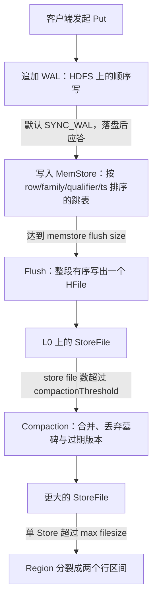
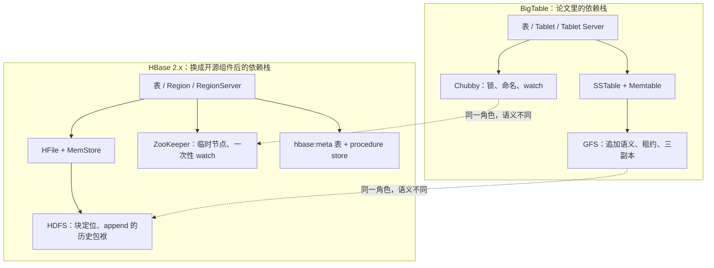
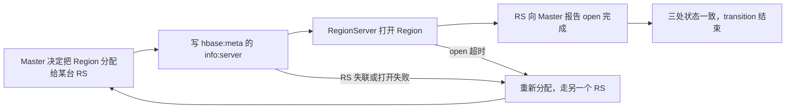
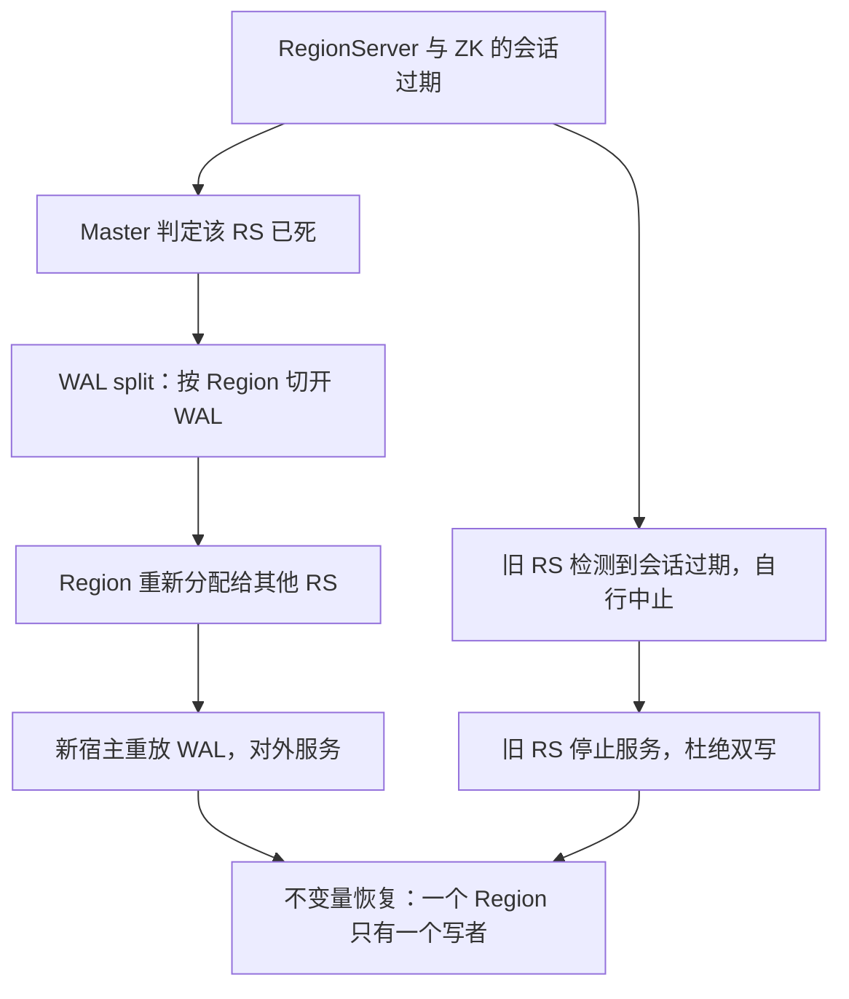
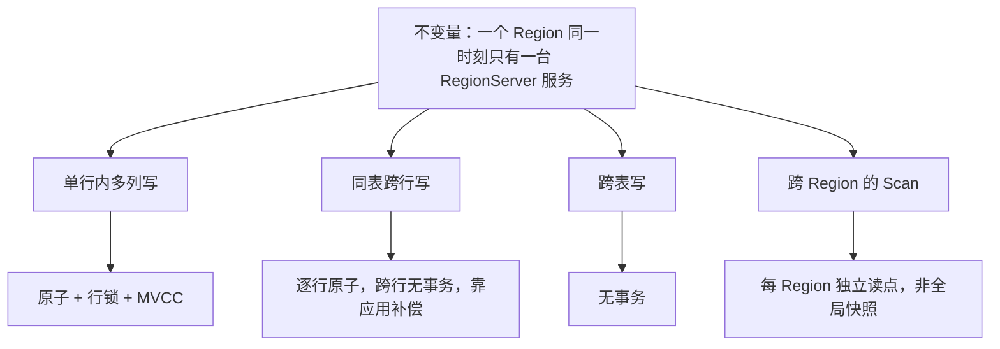
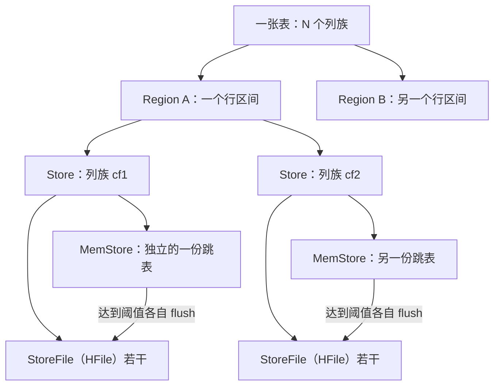

# HBase 的诞生——为什么 HDFS 不够用，列族存储的设计哲学

**摘要：**

HBase 常被描述成"跑在 HDFS 上的数据库"，这个说法掩盖了它真正的来历。它并不是在 HDFS 之上补了一个索引层，而是把 HDFS 的三条物理限制逐条翻译成了三笔必须偿还的账：HDFS 只支持追加，于是 HBase 用 MemStore 缓冲随机写、用 HFile 承载有序不可变的数据，把随机写折叠成顺序写，代价是写放大与 Compaction；HDFS 没有记录级索引，于是 HBase 让行键排序本身成为索引，代价是排序位置决定写入位置，热点从建表那天就被写进表结构；HDFS 不为低延迟随机读设计，于是 HBase 用 BlockCache 与 Bloom Filter 把读路径从 HDFS 手里抢回来，代价是 RegionServer 堆里那笔固定的内存账。本文沿这三笔账展开，再辨清"HBase 是 BigTable 的开源实现"这句话的准确边界——哪些是照搬，哪些是被 GFS 换成 HDFS、Chubby 换成 ZooKeeper 逼出来的不同；随后给出 HBase 一致性的精确表述（单行原子、跨行无事务、跨表无事务），把"强一致"这个含糊词拆开；最后落到列族的物理约束与"HBase 不适合什么"的判据清单。全文的落点是一句判断：HBase 的每一个长处，都能在它付出的某一笔账里找到对价。

> [!info] 本列的口径
> 大数据概览那一组 survey 里，HBase 是作为 Hadoop 生态的一个组件被顺带提到的，讲的是"它是什么、适合什么"（见 [[大数据/读书笔记-大数据概览/01 HDFS：分布式文件系统的数据可靠性与扩展性|概览篇的 HDFS 那一节]]）。本列写另一层：每个机制在 RegionServer 内部怎么实现、参数调大调小各付什么钱、出问题时日志长什么样。HDFS 自身的取舍见 [[大数据/Hadoop/HDFS/01 HDFS 的诞生——大规模分布式存储的工程哲学|HDFS 的诞生]]，LSM 的写放大、读放大、空间放大三笔账见 [[中间件/Leveldb/01 LevelDB 全局架构——LSM-Tree 的写优化设计|LevelDB 的 LSM-Tree]]，这两处已定稿，本文只给结论并注明出处。

---

## 第 1 章 三条硬限制，三次交易

### 1.1 先把需求钉死

在线服务向存储系统提出的请求，说到底只有三种形状：给定一个标识（订单号、用户 ID、URL、设备号），返回该标识下的一小组列，响应时间以毫秒计；给定同样的标识与一组列值，写入并确认，写的时候不知道这一行现在有多大、将来会有多少列；给定标识的一个区间，按顺序取一批。这三件事在关系型数据库里由 B+Tree 与聚簇索引包办，在 HDFS 上则处处掣肘。

拘束的根源可以用一句话说清：HDFS 的定位单位是"文件加字节偏移"，而在线服务的定位单位是"记录键"。HDFS 里一个文件被切成 128MB 的块，NameNode 记的是每个块在第几个 DataNode 上，它并不知道文件内部第 300 万条记录的键是什么、在哪个偏移处。要把这个差说透，不妨把 HDFS 想成一座按卷存放的档案馆：每一卷都有编号、有厚度、有对应的架子，但没有目录卡片告诉你"张三的合同在第几卷第几页"。要查一个人，只能把相关卷从头翻到尾。批处理不在乎这一点，因为它本来就要把全部卷翻完；在线查询在乎，因为它每次只想翻一页。

HBase 做的事，不是改造这座档案馆，而是在档案馆门口另建一套目录与借阅规则：目录（行键排序、`hbase:meta`、HFile 的块索引）由 HBase 自己维护，卷（HFile）一旦封存就不再修改，新的借阅登记（WAL 加 MemStore）单独记一本流水账，等攒够了再封成一卷。这套规则的每一部分都对应一条 HDFS 的硬限制，而每一条规则都要付钱。

### 1.2 限制一：只能追加

HDFS 的写语义是 `create`、`append`、`hflush`、`hsync`，没有"打开文件、定位到第 N 字节、覆写两百字节"这种操作。DataNode 上的块是"一次写成、多次读取"的，块的校验和、副本同步、租约机制全都建立在"只追加"这个前提上。HDFS 对 append 的支持在早期版本里一度移除、后来又重新加回——但即便支持，语义也只是在文件尾部续写，而不是在任意位置修改。对一个需要"更新第 12345 号用户的余额"的系统来说，这条语义等于零。

为什么"只能追加"会成为一个值得专门对策的硬限制？原因在磁盘的物理脾气上：机械盘每一次随机写都要付出寻道加旋转的延迟，折算下来每秒完成的次数停在百次量级；顺序写则能把带宽跑满，每秒搬运的数据量高出一个到三个数量级（示例量级，具体取决于介质与队列深度）。两者之间的差距不是靠加机器就能抹平的，因为它来自介质本身的工作方式。

HBase 的翻译很干脆：数据库语义里的"更新一行"，在物理上变成"追加一条新记录"。同一条逻辑单元格被写十次，磁盘上就有十条物理记录，靠 `(RowKey, Family, Qualifier, Timestamp, Type)` 这个五元组的排序与列族的版本数决定哪一条对读可见。删除也不是删除，而是追加一条墓碑（tombstone），等到 Compaction 时再把墓碑和它遮蔽的旧值一起丢掉。理解了这一点，才谈得上理解 HBase 为什么把 Compaction 看得比什么都重——它不是清理垃圾的保洁，它是这套"只追加"语义的必要收尾。

一次 Put 从客户端到磁盘的完整路径如下，其中 WAL 的持久性级别、flush 的触发序列另有细账，见 [[大数据/HBase/05 HBase 写入链路深度解析——WAL、MemStore Flush 与持久性保证|写入链路]]。

1. 客户端先用缓存的元数据定位 Region 所在的 RegionServer，RPC 到 `RSRpcServices.mutate`；
2. RegionServer 把这条 Mutation 追加进 WAL（WAL 本身是 HDFS 上的文件，走 append 加 hflush/hsync），默认的 `SYNC_WAL` 要求写入到 DataNode 管线之后才向客户端确认；
3. 同一条 Mutation 写进 MemStore，它的实现是一张按五元组排序的 `ConcurrentSkipListMap`（`CellSet`），以保证后续读能第一时间看到最新值；
4. MemStore 的字节数超过阈值，触发一次 flush，把当前跳表整段有序写出成一个 HFile——这是一次纯顺序写，写完的文件此后不再修改；
5. 后台 Compaction 把多个 HFile 合并成更大的 HFile，顺带兑现墓碑与 TTL。

**代价一：写放大。** 一条记录从写入到最终被合并掉，至少要经历 WAL 一次、flush 一次，再被 Compaction 搬运若干次；HDFS 的三副本又把每一次物理写放大三倍。具体被重写几遍取决于合并策略与 Region 大小，在 L0 到 L1 的常规节奏下，个位数到十几次都算常见（示例量级，非实测数字）。LSM 的这笔账在 [[中间件/Leveldb/01 LevelDB 全局架构——LSM-Tree 的写优化设计|LevelDB 那一篇]] 里已经算得很细，此处的结论是：HBase 用磁盘带宽换写入吞吐，这笔账不会消失，只会在 Compaction 排队时以另一种形式回到你面前。

**代价二：读放大与空间放大。** 读一行要同时问 MemStore 与全部 HFile，文件越多，读越慢；墓碑与多版本占着磁盘空间等 Compaction 回收。这两笔账分别在 [[大数据/HBase/06 HBase 读取链路深度解析——BlockCache、Scanner 与多版本合并|读取链路]] 与 [[大数据/HBase/07 HBase Compaction 机制深度解析——Minor、Major 与写放大的三角关系|Compaction 机制]] 里展开。

**代价三：写不动的时候会拒绝。** MemStore 不是无底洞。单个 Region 的 MemStore 超过 `hbase.hregion.memstore.flush.size`（默认 128MB）的 4 倍（`hbase.hregion.memstore.block.multiplier` 默认 4），RegionServer 直接抛 `RegionTooBusyException`，日志里能搜到 `Blocking updates for 'Put' on region ... memstore size ... is >= than blocking` 这类字样；Store 的文件数超过 `hbase.hstore.blockingStoreFiles`（2.x 默认 16，1.x 为 10），flush 会阻塞写入最长 `hbase.hstore.blockingWaitTime`（默认 90000 毫秒）。这两条阈值是"顺序写折叠"策略的止血阀：宁可拒绝请求，也不能让 MemStore 撑爆堆。

### 1.3 限制二：没有索引

HDFS 的索引只到块一级：给定文件名，它能告诉你第几块在哪台机器上；给定记录键，它一个字都说不上。关系型数据库之所以能毫秒级返回 `WHERE id = 12345`，靠的是 B+Tree 把"键的比较"落到"页的定位"上——每一层比较都把候选集缩小一个数量级。HBase 的答案是**索引即排序**：不额外造一棵树，而是让数据本身长期保持**行键全序**，于是"找某个键"退化成"在有序序列上二分"。

这套索引是分四层落地的。

| 层级 | 载体 | 记的是什么 | 定位粒度 |
| :--- | :--- | :--- | :--- |
| 第一层 | ZooKeeper 的 `/hbase/meta-region-server` | `hbase:meta` 这张表自己的 Region 在哪台机器 | 单点 |
| 第二层 | `hbase:meta` 表 | 每张表的每个 Region 的起止行键与所在 RegionServer | Region |
| 第三层 | Region 的 `[startKey, endKey)` 与 HFile 的块索引 | 键落在哪个 Region；落在哪份 HFile 的哪个数据块 | 数据块 |
| 第四层 | 数据块内的 KeyValue 序列 | 五元组的精确顺序，二分或顺序扫 | 单元格 |

第一层是 HBase 最容易被忽略的设计：`hbase:meta` 本身就是一张 HBase 表，也按行键排序、也会分裂、也归某个 RegionServer 管，那么"meta 在哪"这个问题就必须由 HBase 之外的东西回答——答案是 ZooKeeper 上的一个 znode。第二层的行键构造得相当讲究，形如 `<表名>,<Region 起止行键的编码>,<Region 名后缀>`，于是同一张表的所有 Region 在 meta 里是连续存放的，客户端一次前缀 Scan 就能取回整张表的路由表；2.x 去掉了 1.x 时代的 `-ROOT-` 表，把定位链路从四级压缩到三级。第三层是 HFile 的块索引（[[大数据/HBase/04 HBase 存储引擎深度解析——LSM-Tree、MemStore 与 HFile 的设计奥秘|04 存储引擎]]那一篇拆过 block 结构与索引编制方式），2.0 之后索引可以是多级的 root、intermediate、leaf，让一个上百 GB 的 HFile 也能在两次块读之内落到目标数据块。第四层才是真正的比较，数据块默认 64KB（列族属性 `BLOCKSIZE`），块内按五元组有序，二分即可。

**代价：热点。** 排序的物理后果是"行键相邻即物理相邻，物理相邻即同一个 Region，同一个 Region 即同一台 RegionServer"。一旦行键是单调递增的（时间戳前缀、自增序列、按天递增的业务号），所有新写入就都压在表的最后一个 Region 上；集群有 50 台 RegionServer、5000 个 Region，承压的永远只有 1 台。这不是实现缺陷，而是"索引即排序"这个决策的必然后果——你要求有序，就得接受位置由键决定。缓解手段一抓一把：加盐前缀、反转、哈希、预分区，每一手都在削范围扫描的能力。加盐之后"取某用户一段时间的记录"这种 Scan 仍然成立（同一前缀内部依旧有序），而"取全局时间区间"则被彻底打散到所有 Region 上。

顺带说清一个常被混淆的机制：`hbase.hregion.max.filesize` 在 2.x 的默认值是 10GB，配套的 `hbase.hregion.max.filesize.jitter` 默认 0.25，意思是分裂点在这个值上下浮动四分之一。它防的是"所有 Region 同时涨到 10GB、同时分裂"的分裂风暴，不是防热点；把 jitter 当成热点解药，是读文档时很容易犯的一次错。分裂点怎么选、分裂之后由谁负责把 Region 摊平，是另一套机制，见 [[大数据/HBase/08 HBase Region 分裂与负载均衡——水平扩展的工程底层|Region 分裂与负载均衡]]。

行键设计还有一层不可逆性：改动行键等于全表重写。所以"这张表能不能用 HBase"这个问题，在 schema 落地那天就已经被回答了一半；到了慢查询的阶段再来拯救，成本会高到多数团队选择重建。

### 1.4 限制三：不为低延迟随机读设计

HDFS 上一次读的固定开销是：向 NameNode 要块位置（本地有缓存），与 DataNode 建连接，磁盘寻道，传输。冷读几十毫秒起步是常态量级，对批处理是噪声，对 p99 敏感度高的在线接口就是灾难。HBase 的对策是三层接力，目标只有一个：让绝大多数点查永远不要走到 HDFS 的 open 流程上。

第一层是常驻的连接与偏移定位。RegionServer 启动时就把自己负责的每个 StoreFile 打开，持有 HFile reader、块索引、Bloom 块等元数据；读一个数据块时直接按偏移 seek，而不是走 HDFS 客户端的文件打开与块定位。开了 `dfs.client.read.shortcircuit` 之后，本地副本还可以短路读取，省掉 DataNode 协议与网络栈的开销。

第二层是 BlockCache。`hfile.block.cache.size` 默认 0.4，表示堆内存的 40% 用来缓存 HFile 的块。实现上分两档：L1 是堆内的 `LruBlockCache`，按 single、multi、in-memory 三个队列管理热度；L2 是 `BucketCache`，可以落在 off-heap、普通文件或 mmap 文件上（`hbase.bucketcache.ioengine` 取 `offheap`、`file`、`mmap`，容量由 `hbase.bucketcache.size` 指定），两者组合成 `CombinedBlockCache`。索引块与 Bloom 块属于"必须常驻"，数据块按热度淘汰。

第三层是 Bloom Filter。列族属性 `BLOOMFILTER` 取 `ROW`（默认）、`ROWCOL` 或 `NONE`，过滤器以 HFile 的 meta block 形式随文件存放，打开文件时整块加载进内存。查某个行键时先问每一份 HFile"我可能包含它吗"，一次比较就能把读放大从"文件数"砍到"可能命中的那一两份"。代价写在文件里：Bloom 块常驻内存，`ROWCOL` 的精度更高但体积更大。

**代价：内存账。** RegionServer 的堆被三笔固定开销切走：BlockCache 0.4、MemStore 0.4，加起来 0.8，剩下 20% 要装 RPC 队列、Scanner 上下文、Cell 临时对象、GC 元数据，以及一切没预料到的东西。这个 0.8 是 HBase 容量规划里最硬的一条线：调大 BlockCache 必然挤 MemStore，flush 更频繁、写放大更大；调大 MemStore 必然挤 BlockCache，缓存命中率下降、读延迟上升。想突破 0.8 只有一条路，把 BlockCache 挪到 off-heap 的 BucketCache 上，代价是块在堆外是序列化存放的，命中时要反序列化回堆内，而且 bucket 尺寸与总容量要对齐，配置比堆内 LRU 复杂得多。

**代价：低延迟是概率性的。** 缓存未命中时请求照样要落回 HDFS，所以 HBase 的延迟分布由"热数据占比加读放大"共同决定，没有任何一个参数能把它变成 Redis。工程上能做的，是让 BlockCache 里装的是索引与热点数据块，让 Bloom 把无关文件挡在门外，剩下的交给容量规划。

### 1.5 三笔账合起来看

把三条限制、三个对策与三份代价列在一张表里，HBase 的骨架就清楚了：它没有发明任何新能力，只是把 HDFS 缺的三件事各补了一次，每次补课都记了一笔账。

| HDFS 的硬限制 | HBase 的对策 | 直接代价 | 运维可见的失效形态 |
| :--- | :--- | :--- | :--- |
| 只能追加，不能原地更新 | WAL 加 MemStore 缓冲，flush 成有序不可变 HFile | 写放大、Compaction 占用带宽、空间放大 | `RegionTooBusyException`、Store 文件数触顶导致写阻塞 |
| 没有记录级索引 | 行键全序，`hbase:meta` 加 HFile 块索引 | 写入位置由键决定，单调键必然热点 | 单 Region 写入打满、`ScannerTimeoutException`、Region 数暴涨 |
| 不为低延迟随机读设计 | 常驻 reader 加 BlockCache 加 Bloom Filter | 堆内固定 0.8 的内存账、off-heap 配置复杂度 | GC 停顿、缓存命中率骤降、BlockCache 与 MemStore 互相挤占 |

表里最右边一列值得多看一眼，它是这三笔账在值班时的样子。写放大不会以"写放大"三个字的形态出现，它表现为 Compaction 队列积压、Store 文件数触顶、写入请求被阻塞几百毫秒后抛异常；热点的表现不是"排序不好"，而是某一台 RegionServer 的 CPU 与磁盘打满、其余机器闲着；内存账的表现不是"配置不对"，而是 GC 日志里 Full GC 越来越密、RPC 队列堆积、客户端开始超时。把机制与症状对上号，是读这类文章最有实际价值的部分——机制决定你能解释什么，症状决定你能救什么。

---

## 第 2 章 BigTable 谱系：哪些是照搬，哪些是被逼的

### 2.1 论文给的是一份契约，不是一份实现

2006 年 OSDI 上的 BigTable 论文开篇把目标写得很干脆：为结构化数据设计的分布式存储系统，要能扩到 PB 级、几千台廉价服务器。论文的结构值得留意，因为它恰好是"接口、依赖、实现、优化"四段式：先给数据模型与 API（含它明确只支持单行事务这一条），再讲依赖的两个基石（GFS 与 Chubby）与 SSTable 这种文件格式，然后是 tablet 的位置管理、tablet server 与 master 的分工，最后才是压缩、locality group、Bloom Filter 这些优化。

HBase 取的是这份契约，而且取法相当忠实。2006 年底 Powerset 的工程师写下原型，2007 年进入 Hadoop 子项目，2010 年成为 Apache 顶级项目；把 HBase 2.x 的代码摊开对照论文，会发现论文里描述过的机制几乎都能找到对应实现。但"忠实"只到契约这一层，再往下就是分叉——凡论文里依赖 GFS 与 Chubby 特定能力的地方，HBase 都必须换一种写法，换法又反过来塑造了它今天的运维面貌。

### 2.2 一一对应的清单

下表把两个系统的概念对齐，并标注每一对关系的性质：是照搬的契约，还是依赖替换之后被迫长出来的不同。

| BigTable（2006） | HBase 2.x | 关系性质 | 差异的来由 |
| :--- | :--- | :--- | :--- |
| 稀疏、分布式、多维有序映射 | 同一套数据模型：行、列族、列限定符、时间戳 | 照搬 | 论文的核心契约，一字未改 |
| 值是不解释的字节数组 | `byte[]`，类型解释留给应用 | 照搬 | 与 schema 自由度的取舍直接相关 |
| 单行事务 | 单行原子（RowMutations、Increment、CheckAndMutate） | 照搬 | 论文 API 里就写明了只支持单行事务 |
| Memtable 加 SSTable 加 Compaction | MemStore 加 HFile 加 Compaction | 照搬 | LSM 组织的标准形态 |
| Tablet 加 Tablet Server | Region 加 RegionServer | 照搬 | 行区间切分加分裂的形态一致 |
| GFS | HDFS | 被迫不同 | 依赖的开源替代，块大小与 append 语义不同 |
| Chubby | ZooKeeper | 被迫不同 | 锁原语与 watch 语义不同，znode 容量有限 |
| 根 tablet 加 METADATA 两级 | `hbase:meta` 单表，位置记在 ZooKeeper | 被迫不同 | 2.x 去掉 `-ROOT-`，定位链路从四级收敛到三级 |
| master 负责分配、负载均衡、文件回收 | HMaster 负责分配、负载均衡、DDL，另加 procedure store | 被迫不同 | 状态要自己持久化，于是分配变成一个要运维的状态机 |
| 托管服务，无参数可调 | 几百个配置项 | 被迫不同 | 软件与服务的形态差异，代价转移给运维 |

"照搬"这一栏也体现在 API 的形状上。把论文里的接口与 HBase 的客户端接口并排放，会发现两者连"哪些操作是原子的"都一致，这也是判断一个系统血缘关系最可靠的方式——数据模型的相似可以是巧合，原子性边界的相似不是。

| 能力 | BigTable 论文的接口 | HBase 的对应接口 | 语义是否一致 |
| :--- | :--- | :--- | :--- |
| 单行读 | `Read`，可指定行、列与版本条件 | `Get`，配 `maxVersions` 与 `TimeRange` | 一致 |
| 单行写 | `Write`，单行原子 | `Put`，单行原子 | 一致 |
| 行内读改写 | 论文明确列出单行事务与原子读改写 | `Increment`、`Append`、`CheckAndMutate` | 一致，落地成服务端行锁 |
| 区间扫描 | `Scanner`，可指定行区间与列 | `Scan`，配起止行、`Filter`、`Caching` | 一致，HBase 另加过滤器下推与协处理器 |
| 行内批量变更 | 未提供跨行原子接口 | `RowMutations`，仅限同一行 | 一致，仍然不跨行 |
| 表管理 | `CreateTable`、`DeleteTable` | Admin API，经 Master 执行 | 一致，实现换成 ProcedureV2 |

可见"只支持单行事务"不是 HBase 暂时没做，而是从论文开始就写进契约的一条边界；理解了这一点，就不会再去等 HBase 的跨行事务补丁。

### 2.3 被迫不同的那条链：从依赖替换到元数据分层

把上表里"被迫不同"那几行串起来看，会发现它们不是四个孤立的差异，而是一条因果链。

第一环是文件系统。GFS 在论文里提供了"追加写"与"记录追加"两种语义，并且用租约（lease）保证多个副本上的追加顺序一致；HDFS 的 append 语义在早期版本里一度移除、后来又重新支持，即便今天的版本支持，HBase 也不敢把更新语义押在它身上。于是 HBase 的写只做两件事：往 WAL 追加，写全新的 HFile——**只追加**这一个动作，撑起了整个写路径。第二个后果更隐蔽——HFile 这种"每个 Store 每种情况一个文件"的组织方式，在 HDFS 上意味着大量小文件：每个 StoreFile 在 HDFS 侧是若干块加一个 INode，Compaction 有一部分价值就是在替 HDFS 收拾文件数，而不只是替 HBase 收拾读放大。

第二环是协调服务。Chubby 提供的是粗粒度的锁与一致性小文件，配 cache 加 watch；ZooKeeper 提供的是临时节点、顺序节点与一次性触发的 watch。HBase 用 ZK 的方式很有代表性：把"谁在服务哪个 Region"表达成 `/hbase/rs/<hostname>` 这样的临时节点，把"谁是 active master"表达成 `/hbase/master`，把"`hbase:meta` 在哪台机器上"写进 `/hbase/meta-region-server`。这些都是 HBase 自己发明的协议，BigTable 论文里没有对应物，因为 Chubby 在论文里只被当作一个现成的锁与命名服务用。

第三环是元数据分层。ZK 的 znode 容量有限（单节点数据量在 1MB 量级，实际用起来只放几百字节的元数据），装不下"所有 Region 到 RegionServer 的映射"，所以这份映射必须放在一张 HBase 表里；而那张表自身也需要一个位置指针，只好再放回 ZK。三级结构由此形成：ZK 指针、`hbase:meta` 表、用户表。1.x 时代是四级（ZK 指 `-ROOT-`、`-ROOT-` 指 `.META.`、`.META.` 指用户 Region），2.x 砍掉 `-ROOT-` 之后收敛为三级。

第四环是状态收敛的可见化。既然映射分散在 ZK、`hbase:meta` 与 RegionServer 的内存里，那么"把一个 Region 从 A 机器搬到 B 机器"就不再是一次函数调用，而是三处状态依次改写、任何一步都可能失败的分布式过程。这个过程有个专门的名字：Region 处于 transition（RIT）。**运维对象由此诞生。**

把 BigTable 的 tablet 交接比作路边换司机，车靠边停一下，方向盘递过去就完事；HBase 的 Region 交接更像给一辆行驶中的车换轮子，三处状态必须依次落定，任何一处卡住，车就得停下来等——等多久、谁来判定、卡住了怎么收场，全都变成了要写进值班手册的事。

### 2.4 Master 到底做什么：一句被简化过的话

流行说法是"BigTable 的单 Master 只做元数据，HBase 的 Master 还要做 Region 分配，于是引入了 assignment 的复杂性"。这句话的**结论对，前提不准确**。BigTable 论文里 master 的职责写得很清楚：给 tablet server 分配 tablet、检测 tablet server 的加入与过期、做负载均衡、回收 GFS 上的垃圾文件。也就是说，分配与均衡在 BigTable 里同样由 master 承担，HBase 并没有在这里新增职责。

真正的差异在状态的存放方式与可见性。BigTable 把 tablet 的位置与归属收敛在 METADATA tablet 里，master 与 tablet server 之间的交接对客户端是一段不可见的内部过程；HBase 把同一件事拆成**三处持久状态**：ZK 里的 RegionServer 会话与 meta 位置，`hbase:meta` 表里的 `info:server`、`info:splitA`、`info:splitB` 等列，以及 2.x 引入的 procedure store（`MasterProcWALs` 目录下的过程日志）。三处状态的收敛过程必须以某种方式被描述、被恢复、被人工干预，于是 assignment 从一个函数变成了一套状态机，`RIT`、`PleaseHoldException`、assignment 超时这些概念才成为日常运维词汇。

Master 与 RegionServer、ZooKeeper 三者的职责边界，在 [[大数据/HBase/03 HBase 整体架构——Master、RegionServer 与 ZooKeeper 的三角协作|整体架构]]那一篇里有逐项拆解。代价同样明确：Master 是所有管理动作的串行点。2.x 把建表、禁用、截断、分配、迁移、分裂、合并统统改写成 ProcedureV2 的过程（`CreateTableProcedure`、`AssignProcedure`、`MoveRegionProcedure`、`MergeTableRegionsProcedure` 等），每条过程有状态、有超时、可重放，持久化在 procedure store 里。可靠性因此提升——Master 换了进程，未完成的过程还能继续——但吞吐被这个串行点锁住：一次建几千张表要等，大批量 Region 迁移要排。这是 HBase 的一个真实上限，不是配置没调好。

这条链在故障现场的表现值得单独记住。`PleaseHoldException: Master is initializing` 说明 master 刚起来，还在加载 meta 与恢复 RIT，客户端重试即可，此时重启 master 只会让恢复从头再来一遍；`Region in transition` 意味着某个 Region 的归属卡在中间态，先查它前一个宿主是否还在做 WAL split；`RegionServer is not online` 多数时候是客户端缓存的路由过期，触发一次 meta 重载就能恢复；真正麻烦的是 `hbase:meta` 不可用——它的 Region 也归某台 RegionServer 管，一旦那台机器出事，全集群的定位链路一起断，表现是所有客户端同时报 `NotServingRegionException` 或者直接连不上。处置顺序也因此固定：先确认 meta 的 Region 在线，再看 ZK 上的 rs 节点与 master 的 RIT 列表，最后才轮到离线工具。

### 2.5 那句话该怎么说才准确

回到"HBase 是 BigTable 的开源实现"这句流传甚广的话。准确的说法是：HBase 复刻了 BigTable 的数据模型与 LSM 物理组织，把它移植到 Hadoop 的存储与协调设施上；凡是论文里依赖 GFS 与 Chubby 特定能力的地方，HBase 都做了替代实现，并在替代处引入了论文里根本不存在的运维对象——RIT、procedure store、meta 表自身的高可用、参数体系。

这句话的实用价值在于划清边界：读 BigTable 论文能解释 HBase 为什么这样设计（为什么是宽表、为什么只有单行事务、为什么必须 Compaction），但不能解释 HBase 为什么这样运维（为什么要盯 RIT、为什么要给 meta 做副本、为什么升级要跑一遍 hbck）。把两者混为一谈，就会出现"论文里没有这个问题，所以是 HBase 实现得不好"的误判——多数情况下，那是依赖被替换之后必然要付的账。

---

## 第 3 章 CAP 与"它到底是什么一致性"

### 3.1 CAP 在 HBase 里的落点：只有一个不变量

讨论 CAP 最容易滑向复述教科书，所以先把问题收窄到 HBase 实际要守住的那一条不变量：**单 Region 单写者**——一个 Region 在任一时刻最多被一台 RegionServer 打开并服务写入。守住它，单行原子就有依托；守不住，两个写者各自在内存里改同一行，谁也不知道对方存在，所谓一致性立刻归零。

建立与维持这条不变量的机制有三段。第一段是分配：Master 决定把某个 Region 给某台 RegionServer，写 `hbase:meta` 的 `info:server`，然后 RegionServer 在自己的进程里打开这个 Region；打开动作包含读取 StoreFile 列表、回放该 Region 未 flush 的 WAL、清理过期的 MVCC 记录，完成后向 Master 报告。第二段是心跳与会话：每台 RegionServer 在 ZooKeeper 上有一个临时节点，会话超时的时间由 `zookeeper.session.timeout` 决定，默认 90000 毫秒；节点消失，Master 就判定这台机器已死。第三段是善后：Master 启动 `ServerShutdownHandler`，把该死机器的 Region 重新分配，分配之前先做 WAL split——把那台 RegionServer 的 WAL 按 Region 切开，交还给各 Region 的新宿主去重放。

关键在于，这套机制在"分区还是可用"之间是明确选择了停。假设某台 RegionServer 遭遇长时间 Full GC 或者网络隔离，它与 ZK 的会话过期，Master 已经开始把它名下的 Region 分给别人；而那台机器实际上还活着，内存里还有未 flush 的数据，客户端可能还连得上它。HBase 的处理方式不是设法让两边共存，而是让旧主自杀：一旦 RegionServer 检测到自己的 ZK 会话过期，它会主动中止进程，日志关键字是 `Processing Fatal ZK session expiration` 一类，而不是继续服务。宁可让这个 Region 短暂不可服务，也绝不允许两台机器同时写同一份数据。

这也解释了 HBase 写路径的确认语义为什么设计成那样。默认的 `SYNC_WAL` 要求 WAL 写入 HDFS 的 DataNode 管线之后才向客户端返回成功，持久性（durability）级别还可以调到 `FSYNC_WAL`（连操作系统缓冲都要刷）、`ASYNC_WAL`（异步，机器崩溃会丢最后一段）或 `SKIP_WAL`（完全不写，只在可重建的数据上使用）。写 WAL 这一步看起来是在拿延迟换安全，实质上是在为"Region 可以在另一台机器上重建"这个承诺预付费用。

### 3.2 可用性让位之后，缺口长什么样

CP 不是一个标签，它是一组具体的不可用窗口。把常见场景列出来，才能判断某个业务能不能接受 HBase。

| 故障场景 | HBase 的行为 | 可用性代价 | 一致性是否受损 |
| :--- | :--- | :--- | :--- |
| 单台 RegionServer 崩溃 | 会话超时后重新分配它名下的 Region，先 WAL split 再重放 | 该 RS 上所有 Region 在恢复完成前读写不可用，窗口约为会话超时加 split 加 open 的时间 | 不损，已确认的写都在 WAL 里 |
| RegionServer 假死或网络分区 | 旧 RS 因 ZK 会话过期而自行中止 | 同上的不可用窗口，但可能更长，需要等旧 RS 进程真正退出 | 不损，靠自杀避免双写 |
| ZooKeeper 失去多数派 | Master 与 RegionServer 都失去会话，无法确认归属 | 集群整体不可用，HBase 没有"ZK 降级模式" | 不损，但什么也做不了 |
| Master 进程挂掉 | 数据面不受影响，读写照旧；DDL、分配、均衡停摆 | 管理面不可用，客户端可能收到 `PleaseHoldException` | 不影响数据，影响运维动作 |
| HDFS 不可写（WAL 写不进去） | RegionServer 写失败并中止自己，避免产生无法恢复的内存状态 | 该 RS 上的写入失败，进而触发重新分配 | 不损，因为失败发生在应答之前 |
| `hbase:meta` 所在 Region 不可用 | 客户端无法定位任何 Region | 全集群读写在客户端侧失败 | 不损，属于定位链路故障 |

这张表里最需要正视的是第一行：HBase 的故障恢复以"十秒到分钟"为量级，因为 `zookeeper.session.timeout` 默认就是 90 秒，加上 WAL split 与 Region open，一次单机故障的业务影响通常落在分钟这一档。这也正是这个参数最典型的权衡：

| 参数 | 默认 | 调大的代价 | 调小的代价 |
| :--- | ---: | :--- | :--- |
| `zookeeper.session.timeout` | 90000 毫秒 | 故障发现变慢，Region 不可用窗口被拉长；长时间 GC 不容易被误判为死亡 | GC 停顿或短暂网络抖动就被判死，触发不必要的重新分配，严重时形成"自杀—重分配—再自杀"的循环 |
| `hbase.hstore.blockingWaitTime` | 90000 毫秒 | Store 文件数触顶后写阻塞时间变长，客户端先超时 | 阻塞提前放弃，返回 `RegionTooBusyException`，把压力推给上游重试 |
| `hbase.client.retries.number` | 以对应版本文档为准 | 客户端重试更久，遇到真故障时用户等待更久，可能放大下游压力 | 提前失败，但对短暂的 Region 迁移不够宽容 |

### 3.3 精确表述：单行原子，跨行最终，跨表无事务

"HBase 是强一致"这句话如果不再往下拆，排障时一定会误导人。更准确的表述分四层，每层边界不同。

| 操作边界 | HBase 的保证 | 不保证什么 | 工程后果 |
| :--- | :--- | :--- | :--- |
| 单行内多列写（一次 Put 带多列、`RowMutations`） | 原子，要么全可见要么全不可见 | 不涉及其他行 | 可以把"必须一起对"的字段放进同一行 |
| 单行内的 `Increment`、`Append`、`CheckAndMutate` | 原子，服务端持行锁完成读改写 | 条件是同一行，写也是同一行 | 行内状态机、行内计数器、行级乐观锁都可行 |
| 同一张表的多行写 | 逐行原子，行与行之间无事务 | 任何跨行原子性；中途失败留下半成品 | 一致性只能由应用补偿，或把数据合并到同一行 |
| 跨表写 | 无事务，也没有跨表原子写 | 任何跨表原子性 | 分表即分事务，需业务侧对账 |
| 跨 Region 的 Scan | 每个 Region 建立自己的读点，读到的是"各自的"一致视图 | 全局快照；扫描期间可见到不同 Region 处于不同时间点 | 离线统计可接受，账务类统计不可接受 |

由此可以给出一句可以直接写进设计文档的定义：HBase 提供的是行级原子、读已提交、按行键有序的存储；Region 级单写者保证同一行不会被两个写者同时修改；跨行、跨表没有事务，跨 Region 的扫描不是全局快照。它既不是"全局强一致"，也不是"最终一致"，硬塞进任何一边，都会在故障复盘时给出错误的预期。多版本、时间戳与墓碑的读写语义见 [[大数据/HBase/02 HBase 数据模型深度解析——RowKey、列族、Cell 与多版本机制|数据模型]]；RegionServer 崩溃之后的重建流程见 [[大数据/HBase/09 HBase 高可用与容灾——崩溃恢复、备份与复制|高可用与容灾]]。

### 3.4 CheckAndMutate 的能与不能

`CheckAndMutate` 是 HBase 最接近"事务"的原语，也最容易被误用。它的服务端实现是在持有该行行锁的前提下，比较指定列的最新值与给定条件（`CompareOperator`，可以带 `TimeRange` 与版本约束），条件成立才执行写入；比较与写入落在同一个临界区里，中间插不进别的写。于是它能做三件真事：行内状态机流转（`status == 'PENDING'` 才改成 `RUNNING`）、行内乐观锁（用版本号或时间戳列做标记）、行内计数器（配合 `Increment` 的原子增减）。

它不能做的事，边界同样清楚。一次 `CheckAndMutate` 只作用于一行，两行就是两次独立操作，中间可以失败，可以超时，可以被别人插队。它也不能和外部副作用组成一个原子单元——条件成立、写入成功，但紧接着要发的消息没有发出去，这段缺口它管不了。所以用它实现跨行转账，得到的不是事务，而是"两个各自原子、整体不原子"的操作序列，中间任何一步失败都会留下半成品，只能靠幂等键与对账去补。

真正管用的手法在另一边：把"必须一起原子"的数据塞进同一行。订单状态与库存占用写在同一行的两个列里，一次 `Put` 或一次 `RowMutations` 就能保证两者同时可见，代价是这一行会承担两个业务实体的写压力，也可能变成热点。这是用行键设计换事务能力的经典做法，也是 HBase 里"数据模型即事务边界"这句话的具体含义。

### 3.5 ProcedureV2 解决的是 DDL，不是 DML 事务

HBase 2.x 引入 `ProcedureV2` 之后，有一个流传很广的误解：既然有了过程框架、有了过程 WAL、有了状态机，HBase 是不是终于支持事务了。答案是否定的，`ProcedureV2` 的事务边界在 Master 的管理动作上，与用户的多行写没有关系。

它解决的问题很具体：Master 上的每个管理动作都可能是多步的（建表要写 meta、要分配 Region、要更新表状态；迁移要关旧宿主、改 meta、开新宿主），任何一步失败或 Master 进程重启，都必须能从中间状态继续推进而不是留下半截。`ProcedureV2` 的做法是把这些动作建模成可重放的 Procedure，过程的每一步落进 `MasterProcedureStore`（HDFS 上的 `MasterProcWALs` 目录），恢复时扫描未完成的过程继续执行。`CreateTableProcedure`、`DisableTableProcedure`、`TruncateTableProcedure`、`AssignProcedure`、`UnassignProcedure`、`MoveRegionProcedure`、`MergeTableRegionsProcedure` 都是这个框架里的实现。

它带来的收益是管理面的幂等与可恢复：Master 换进程不影响正在进行的建表，Region 迁移失败可以重试而不会重复执行。它的边界也在那里：这套框架从不介入客户端的一次 `Put`，也从不试图让两行写入变成一个不可分割的动作。分裂过程是理解这条边界的好例子——父 Region 关闭、子 Region 打开、meta 的 split 列更新，这几步由 Procedure 推进并保证最终完成，期间客户端可能看到短暂的不可用，但不会有"一半数据在新 Region、一半在旧 Region 且都声称自己完整"的状态。也就是说，Procedure 保证的是"管理动作最终完成"，不是"用户操作的跨行原子"。

---

## 第 4 章 列族的物理真相：为什么通常只该建一个

### 4.1 一个列族就是一个 Store

列族在逻辑上是 schema 的一个维度，在物理上是独立的存储单元。一张表的每个 Region 会为每个列族维护一个 Store，一个 Store 包含一个 MemStore、一组 StoreFile（HFile），以及一条独立于其他列族的读路径。

这张图要读出的信息只有一句：MemStore 的分配粒度是 Store，不是 Region。这句话决定了列族数量的所有后果——多一个列族，就多一份 MemStore，多一条独立的 flush 触发线，多一组独立累积的 HFile，多一路独立的 Compaction 输入。

### 4.2 全局 memstore 预算被所有列族平分

RegionServer 上给 MemStore 的钱是一笔定额：`hbase.regionserver.global.memstore.size`，默认 0.4，含义是这台机器 JVM 堆的 40% 作为**所有列族、所有 Region 的 MemStore 之和**的上限。注意这句话里的三个"所有"：不是单表，不是单 Region，也不是单列族。

围绕这笔定额有三个关键机制。其一是水位线：当全局 MemStore 用量达到上限的 95%（`hbase.regionserver.global.memstore.size.lower.limit` 默认 0.95）时，RegionServer 开始挑选最大的几个 Store 强制 flush；一旦真的顶到 100%，所有写入被阻塞，日志里会出现 `Blocking updates ... because global memstore size` 一类的信息。其二是单 Region 阈值：每个 Region 打开时会算一个 memstore flush size，取值是 `hbase.hregion.memstore.flush.size`（默认 128MB）与"全局预算分给这台机器上 Region 的那一份"之间的较小者，具体拆分逻辑以对应版本源码为准，但方向很明确——Region 越多，每个 Region 能分到的缓冲越小。其三是选择性 flush：多列族场景下，全局水位触发时不必把所有 Store 一起 flush，`FlushLargeStoresPolicy` 只挑超过"下限"的那些，下限取 `flush.size ÷ 列族数`，且不低于 `hbase.hregion.percolumnfamilyflush.size.lower.bound.min`（默认 16777216 字节，即 16MB）。

这笔预算好比一间公共厨房里唯一的一口灶，列族数就是把灶眼分成几份来用，分得越细，每一份都烧不开一锅水。

第三条机制直接给出了列族数量的一个反直觉后果：列族越多，选择性 flush 的门槛越低（128MB 除以 10 是 12.8MB，被 16MB 托底），于是全局水位一到，被选中的 Store 更多、单次 flush 出去的数据更少。攒批这件事被切碎了。

### 4.3 一次算账：把 10 个列族摊开

设一台 RegionServer 的堆是 16GB，`hbase.regionserver.global.memstore.size` 取默认 0.4，于是全局 MemStore 预算约 6.4GB；这台机器上有 200 个 Region，每个 Region 一个列族。

- 单列族：每个 Region 的 flush 阈值约是 `min(128MB, 6.4GB ÷ 200 ≈ 32.8MB)`，也就是 32.8MB 左右。写满一个 Region 的 32.8MB 就落一个 HFile，一轮下来 200 个 HFile，每个都不小。
- 十个列族：Region 数不变，Store 数变成 2000，每个 Store 的预算被摊到 3.28MB 左右。每个 Store 各自判断是否 flush，一次写入风暴下来，产出的 HFile 数量是单列族场景的十倍量级，而且每个文件都只有几 MB。
- 连锁反应：Store 的文件数按列分头累积，`hbase.hstore.blockingStoreFiles`（2.x 默认 16）更快被触到，写入开始阻塞；Compaction 的输入从"几个大文件"变成"一堆小文件"，合并频率上升，写放大跟着上升；HDFS 上小文件变多，NameNode 的元数据压力同步变大。

这些数字是示例推算，真实环境还要叠加写倾斜、Region 分布与合并策略的影响，但量级关系是可靠的：列族数进入的是乘法项，它同时乘了 Store 数、flush 次数与 HFile 数量。更本质的一层在于——顺序写的收益来自攒批，把缓冲池切成十份，每一份都攒不到能抵消一次落盘开销的体量，LSM 的红利就被自己吃掉了。

### 4.4 判据：通常只建一个列族

**通常只建一个列族。** 这不是风格建议，是 4.2 与 4.3 两节推出来的结论。多列族要成立，必须有"单列族做不到"的硬理由，而现实中站得住的只有两类。

第一类是生命周期完全不同。列族的 TTL、`VERSIONS`、`MIN_VERSIONS`、`KEEP_DELETED_CELLS`、压缩算法、`DATA_BLOCK_ENCODING` 都是列族级属性，无法按列限定符单独设置。会话数据七天后要清、用户画像要永久保留，两条数据放进同一个列族，就只能取最长的 TTL，让过期数据留在磁盘上靠应用层过滤，或者靠定期重写整表来清理。这种情况下分族是正当的。

第二类是访问模式完全不同，尤其是大小字段混在一张表里。把网页原文、二进制附件这类大字段与状态、时间戳这类小字段分到两个列族，读小字段时就不会把大字段的数据块带进 BlockCache，缓存的经济性立刻不同。这一条在真实生产里反复成立，也是最常见的第二种正当理由。

除此之外的理由大多站不住。按业务维度分（用户、订单、日志、画像各一个）、按字段数量分、按"看起来整齐"分，都是把逻辑分组当成了物理优化。真正需要按业务切开的，应该切成两张表——表级别才有多套 Region 分布、独立的预分区、独立的配额与限流。

列族数量与后果之间的关系可以列得更直白一些。

| 列族数 | 每 Region 的 Store 数 | 典型后果 | 建议 |
| ---: | ---: | :--- | :--- |
| 1 | 1 | 缓冲集中，攒批效率最好，HFile 数量最少 | 默认选择 |
| 2 至 3 | 2 至 3 | 内存被切成两三份，flush 更零碎，但尚可控 | 仅在 TTL 或大小字段确实需要隔离时使用 |
| 5 以上 | 5 以上 | 每 Store 的缓冲被摊薄，HFile 数量与合并压力成倍上升，`blockingStoreFiles` 更易触顶 | 基本可以判定设计有问题，考虑换表或改列限定符 |
| 10 以上 | 10 以上 | 缓冲几乎攒不起来，flush 频繁、写放大显著、Region 打开变慢 | 必然返工 |

### 4.5 相关参数与各自的代价

列族设计与内存参数是一体的，把参数与代价放在一张表里，比背默认值有用得多；这些参数之间的联动关系与整体调整顺序，见 [[大数据/HBase/10 HBase 生产调优实战——从诊断到落地的系统方法论|生产调优]]。默认值以 HBase 2.5 的 `hbase-default.xml` 为准，跨版本升级时应当重新核对。

| 参数 | 默认值 | 作用 | 调大的代价 | 调小的代价 |
| :--- | ---: | :--- | :--- | :--- |
| `hbase.regionserver.global.memstore.size` | 0.4 | 全 RS 所有 Store 的 MemStore 之和上限 | 与 BlockCache 抢堆，GC 压力上升，极端时频繁 Full GC | flush 更频繁、写放大上升，写吞吐下降 |
| `hfile.block.cache.size` | 0.4 | BlockCache 占堆比例 | 挤占 MemStore，写入更容易被阻塞 | 缓存命中率下降，读延迟上升，索引块也可能被淘汰 |
| `hbase.hregion.memstore.flush.size` | 128MB | 单 Store 的 flush 触发阈值 | 单次 flush 更重，恢复时 WAL 回放更久，峰值内存更高 | flush 更频繁，HFile 更小更多，合并压力上升 |
| `hbase.hregion.memstore.block.multiplier` | 4 | 单 Region MemStore 超过 flush size 多少倍就拒绝写入 | 允许更大缓冲，堆风险上升 | 更早抛 `RegionTooBusyException`，上游需要更强的重试与背压 |
| `hbase.hstore.blockingStoreFiles` | 16（2.x） | Store 文件数超过此值则阻塞写入等待合并 | 合并压力大时容忍更多文件，但读放大与打开耗时上升 | 更早阻塞写入，吞吐出现尖刺式下跌 |
| `hbase.hstore.compactionThreshold` | 3 | Store 文件数达到该值触发一次 minor compaction | 合并更少更大，写放大降低，但读放大与空间占用上升 | 合并更频繁，写放大与 CPU 消耗上升 |
| `hbase.hregion.max.filesize` | 10GB | 单 Store 大小达到该值触发 Region 分裂 | Region 更大，分裂更少，但单 Region 恢复与合并更慢 | Region 更多，元数据与打开开销上升，小 Region 问题凸显 |
| `hbase.hregion.max.filesize.jitter` | 0.25 | 分裂点的随机抖动比例 | 分裂点更分散，单 Region 大小更不均匀 | 抖动不足，容易出现同一批 Region 同时分裂 |

---

## 第 5 章 边界：HBase 不适合什么

前面的推演都是"它为什么这样"，这一章换成"它因此做不到什么"。这个转换很重要，因为 HBase 的每一个短板都能在前面的某一笔账里找到出处——它不是没做好，而是选了另一边。

### 5.1 没有行键前缀的二级索引查询

HBase **只有一种索引**：行键的全序。任何查询只要能映射成"行键等值"或"行键前缀范围"，就已经落在 B+Tree 那一类索引的效率上；任何查询只要过滤条件里包含不属于行键前缀的列，代价就是全表 Scan。

这不是"慢一点"的问题，而是"规模一大就无法接受"的问题。粗算一下，一张 10 亿行的表做一次全表 Scan，即便每台机器每秒能扫 10 万行，也要几十台机器跑上几分钟，而且这段时间 BlockCache 会被彻底冲掉，连带把正常的点查延迟一起拉高。所以凡是想在 HBase 上做"按状态查订单""按城市查用户""按商品查评价"的需求，工程上只有三条路，每条都有自己的价。

第一条是另建一张索引表，把查询列当行键、把主键当列值，由应用在写入时双写。代价是双写的一致性完全没有保障（除非用 Procedure 或外部事务协调），并且索引表本身还要处理热点与分裂。第二条是用 Phoenix 的二级索引，本质仍然是索引表加协处理器维护，好处是 SQL 层把这层复杂度收了进去，代价是索引维护带来额外的写放大，全局索引的写入路径也更重。第三条是把这类查询交给 Elasticsearch 之类的检索系统，HBase 只保留主键查询，两边靠消息或批同步保持一致，代价是引入了第二个存储系统与一条最终一致的链路。

HBase 的查询能力像一把只有一个齿的钥匙，那个齿就是行键，能开哪扇门在打这把钥匙的时候就定了。

判据可以写得很直白：把线上查询按条件拆开，如果过滤条件里落不到行键前缀上的比例超过一半，HBase 就不是这张表该用的存储。

### 5.2 跨行事务

第 3 章已经把边界划清楚了，这里只补工程上的实际感受。HBase 不给跨行事务，意味着所有"要么一起成功、要么一起失败"的业务语义都要从存储层上移到应用层，而应用层的补偿很难做到无懈可击：扣了库存没建订单，要靠对账把库存补回去；建了订单没扣库存，要靠定时任务发现并撤销。补偿逻辑本身要幂等，要能处理重复投递，要能应对补偿也失败的情况——这些都是真金白银的代码量。

有些业务确实可以在模型上绕开：把库存占用与订单状态放进同一行（同一个订单号做行键），用一次 `RowMutations` 完成；把账户余额的变更做成一条流水记录追加，用余额快照加流水重算来代替原地扣减。这些手法成立的共同前提是"参与原子变更的数据能塞进一行"。塞不进去的，就不该指望 HBase。

### 5.3 复杂聚合与多表关联

HBase 没有查询优化器，没有下推的聚合算子，没有 JOIN。`Scan` 支持过滤器（`PrefixFilter`、`SingleColumnValueFilter`、`FilterList`），但这些过滤器默认在服务端逐行判断，减少的是网络传输，不是扫描量；真正意义上的"只读需要的块"，要么靠行键设计，要么靠 `Coprocessor` 的 Endpoint 自己写聚合代码。连行数统计都没有元数据捷径，`RowCounter` 这类工具本质上仍是扫全表，只是把扫描分摊到了计算框架上。

所以聚合与关联应当放在计算层：Spark 或 Flink 读 HBase 做批量计算，结果写回 HBase 或另一个分析型存储。把 HBase 当成明细层而不是分析层，是这套生态里最常见的分工。

### 5.4 小数据量与运维成本门槛

HBase 有一个容易被低估的成本：它是三套分布式系统的组合。HDFS 要有 NameNode 高可用与 JournalNode 仲裁，ZooKeeper 至少要三个节点才能容忍一台故障，HBase 自己要 Master 高可用与至少两三台 RegionServer，再加上监控、备份、升级窗口。这一套下来的机器数量与人力投入，对几十 GB 的数据量是完全不划算的——同样的问题 PostgreSQL 单机就能解，还附带事务与 SQL。

HBase 的经济性来自规模效应：Region 数足够多，BlockCache 才能装下足够比例的热数据，Compaction 的摊薄成本才合理，RegionServer 的故障切换才有其他机器接手。数据规模与并发量都上不去的时候，引入 HBase 得到的不是扩展性，而是一套需要长期照看的分布式系统。

### 5.5 判据清单

把上面几条收成一张表，用来在方案评审上快速判断。

| 需求特征 | HBase 是否合适 | 更合适的选择 | 判据一句话 |
| :--- | :--- | :--- | :--- |
| 按主键或主键前缀做点查、范围扫描，数据量 TB 到 PB | 合适 | HBase | 这正是行键索引的甜蜜区 |
| 写入量大、以追加为主、需要按时间或用户回查明细 | 合适 | HBase | 写入路径是顺序写，天然扛高吞吐 |
| 稀疏宽表，列随业务增长，不同行差异极大 | 合适 | HBase | 不存在的列不占空间，无需 DDL |
| 按非行键列做等值查询或分页 | 不合适 | 索引表、Phoenix、Elasticsearch | 没有行键前缀就是全表扫描 |
| 需要跨行原子写（转账、扣库存加建单） | 不合适 | 关系型数据库、支持分布式事务的 NewSQL | HBase 只有单行原子 |
| 需要多表 JOIN、复杂聚合、报表 | 不合适 | 数仓、ClickHouse、Spark SQL | 没有优化器也没有 JOIN |
| 需要二级索引且不想引入第二个系统 | 不合适 | 原生支持二级索引的数据库 | HBase 的二级索引都要自己搭 |
| 数据量几十 GB、并发不高、团队没有大数据运维 | 不合适 | 单机关系型数据库 | 运维成本远超收益 |

### 5.6 选型前先回答的三个问题

上面这张表是结论，落到具体项目上还需要三个前置问题，它们决定的是"能不能改模型"而不只是"要不要用 HBase"。

第一个问题：查询能不能落回行键或行键前缀。把业务方近半年的查询清单拉出来，逐条标出过滤条件，凡是只能落在非行键列上的，数一数占比。这个比例决定了索引方案要额外投入多少，也决定了 HBase 是不是在替一个本该用检索系统的需求背锅。

第二个问题：需要原子性的数据能不能塞进同一行。转账、扣库存、状态流转，先问参与者能不能共享一个行键。能，就用 `RowMutations` 或一次 `Put` 解决；不能，就得预备补偿与对账的预算。很多项目在选型阶段觉得"事务以后再说"，实际结果是这笔技术债在业务量上来之后集中爆发。

第三个问题：团队能不能长期养这三套系统。HBase 的日常开销不在写代码，而在升级、Region 治理、Compaction 调优、故障演练、备份恢复演练。没有专职的人，集群会以一种慢性病的方式退化：小文件越来越多、RIT 偶发、Region 数失控，直到某次写入风暴把问题一次性暴露出来。

三个问题的答案如果都不乐观，那么正确的选择往往不是"用 HBase 但要小心"，而是"换一个存储系统"。选型讨论里最贵的一句话是"先上，不行再换"——数据一旦按行键组织好，迁移成本会高到没人愿意启动第二次。

---

## 第 6 章 三个反例

### 6.1 反例一：按业务维度建十个列族

这个错误的起点往往是善意的：设计者看到"列族可以独立配置 TTL 与压缩"，于是按业务维度把用户表拆成基础信息、扩展属性、标签、行为统计、设备信息、风控标记等十个列族，觉得边界清晰、各管一摊，将来改一个列族的 TTL 也不影响别人。

上线初期的症状并不明显，数据量小的时候一切正常。等到写入量上去，问题开始成串出现：写入延迟出现尖刺，日志里时不时冒出 `RegionTooBusyException`；Compaction 队列长期非空，`blockingStoreFiles` 偶发触顶导致写入被阻塞一段时间；Region 打开变慢，RegionServer 重启后的恢复时间被拉长；HDFS 上的文件数增长得比数据量快得多，NameNode 的元数据压力同步上升。

根因就在 4.3 节那笔账里：十个列族把每个 Store 的 MemStore 预算摊到不足原来的十分之一，缓冲区攒不到足够的数据就必须落盘，顺序写的红利被自己抵消；HFile 数量按列族成倍增加，合并压力与读放大一起上升。所谓"边界清晰"在物理层没有对应收益——列族之间不会因为业务不同就减少互相干扰，它们共享同一个堆、同一条 HDFS、同一批磁盘。

处置方式有两种：把十个列族合并成一个，用列限定符（qualifier）区分业务语义，因为限定符不是 Store，不额外占缓冲；确实需要不同 TTL 或不同压缩策略的部分，单独拆成另一张表，而不是同一张表的另一个列族。

### 6.2 反例二：用 HBase 承担需要二级索引的查询

典型场景是订单系统：行键设计成 `订单号`，因为写入时需要按订单号做幂等，点查也以订单号为主。业务上线后运营提出需求——"查一下某用户最近的订单""查一下所有待支付的订单""按时间段导出订单"。前一个需求可以在行键里加用户 ID 前缀（代价是幂等键与查询键分离，需要两张表或两套行键规则），后两个需求则完全落在行键之外。

工程上常见的应对是硬扫：客户端起一个 `Scan`，加 `SingleColumnValueFilter` 过滤状态，然后分页取。数据量到千万级时这个问题还不明显，到十亿级时 `Scan` 会持续占满 RegionServer 的读线程与 BlockCache，把正常的订单点查一起拖慢，客户端侧则表现为 `ScannerTimeoutException` 或者干脆 RPC 超时。更麻烦的是这类查询往往来自运营后台，没有流量治理，一次导出就能把在线集群打垮。

根因还是那句话：没有行键前缀的过滤等于全表扫描。处置上，短期可以给这类查询加限流与独立集群（`rsgroup` 把运营查询隔到一组机器上），中期建索引表或接 Elasticsearch，长期则要在模型上重新设计——把"按状态查"变成"状态加时间做行键前缀"的索引表，让查询落回行键范围。

### 6.3 反例三：以为 HBase 支持跨行事务

这个误解最常见于从关系型数据库迁过来的团队。业务逻辑写得很自然：先读库存行，判断足够，扣减；再写订单行；最后写流水行。开发阶段一切正常，因为失败很少发生。上线之后，超时、Region 迁移、RegionServer 重启都会打断中间某一步，于是库里出现扣了库存没有订单、或者有订单没有流水的数据，对账任务每天都能捞出一批。

根因是第 3 章那条边界：原子性的边界只到单行。要修，先要在模型上想办法——把参与原子变更的数据合并进同一行，用一次 `RowMutations` 完成；合并不了的，就得在应用层设计补偿：每一步都带幂等键，失败时按相反顺序回滚，再配一个定期对账把不一致捞出来。这两条路都比直接写事务代码贵，这也是"选型阶段就要想清楚"的原因——等到业务跑起来再补一致性，成本会翻好几倍。

---

## 第 7 章 结语

把全文收束成一条主线：HBase 的所有关键设计，都是被"随机读写"这一个需求逼出来的，而每一个对策都附带着明确的代价。随机写被折叠成顺序写，账单是写放大与 Compaction；无索引被换成行键全序，账单是热点与行键不可改；低延迟读被换成缓存与过滤器，账单是堆内存里那 0.8 的固定开销；列族被当成物理隔离单元，账单是 MemStore 预算被摊薄。这些代价没有一个能被参数抹平，参数只能在几笔账之间挪动份额，这正是任何一次调优都在做的事。

谱系那一章要留下的判断是：HBase 忠实继承的是 BigTable 的数据模型与 LSM 组织，被迫分叉的是依赖替换之后长出来的运维形态。RIT、procedure store、meta 表自身的可用性、几百个参数，这些在论文里找不到，因为 BigTable 是服务而 HBase 是软件。读论文能读懂设计，读 `hbase-default.xml` 才能读懂日常。

一致性那一章要留下的判断是：把 HBase 归入 CP 是对的，但 CP 只描述了"分区时选择停"这一件事；真正落到代码里的，是**四条边界**——单行原子、跨行无事务、跨表无事务、跨 Region 扫描非全局快照。它们决定了一张表的数据模型该怎么切，也决定了哪些业务从一开始就不该放在这里。

架构不是发明出来的，是在约束下演进出来的。HBase 今天的长处与短处，几乎都能追到 2003 到 2006 年间那几篇论文里的一段取舍，以及开源替代品与原版之间那几处语义差异。下一次翻开 HBase 的配置文档时，不妨先问一句：这个参数是在替哪一笔账付钱，付给谁，又向谁转移。

---

## 参考资料

1. Chang, F., Dean, J., Ghemawat, S., et al. *Bigtable: A Distributed Storage System for Structured Data*. OSDI 2006. [PDF](https://static.googleusercontent.com/media/research.google.com/en//archive/bigtable-osdi06.pdf)
2. Ghemawat, S., Gobioff, H., Leung, S.-T. *The Google File System*. SOSP 2003. [PDF](https://static.googleusercontent.com/media/research.google.com/en//archive/gfs-sosp2003.pdf)
3. Burrows, M. *The Chubby Lock Service for Loosely-Coupled Distributed Systems*. OSDI 2006. [PDF](https://static.googleusercontent.com/media/research.google.com/en//archive/chubby-osdi06.pdf)
4. Hunt, P., Konar, M., Junqueira, F., Reed, B. *ZooKeeper: Wait-free Coordination for Internet-scale Systems*. USENIX ATC 2010. [PDF](https://www.usenix.org/legacy/events/usenix10/tech/full_papers/Hunt.pdf)
5. Apache HBase. *Apache HBase Reference Guide*. [https://hbase.apache.org/book.html](https://hbase.apache.org/book.html)
6. Apache HBase. `hbase-default.xml`（各参数默认值的唯一权威来源）. [GitHub](https://github.com/apache/hbase/blob/master/hbase-common/src/main/resources/hbase-default.xml)
7. Apache HBase JIRA. *HBASE-15324: Jitter may cause desiredMaxFileSize overflow in ConstantSizeRegionSplitPolicy*（`hbase.hregion.max.filesize.jitter` 的由来）. [JIRA](https://issues.apache.org/jira/browse/HBASE-15324)
8. George, L. *HBase: The Definitive Guide*. O'Reilly Media, 2011.

---

> [!note] 思考题
> 1. 如果把 `hfile.block.cache.size` 从 0.4 调到 0.6，写路径会在哪一个环节先出问题？请沿着 MemStore 的 flush 触发条件往下推。
> 2. HBase 的行键全序带来范围扫描能力，也带来热点。加盐前缀解决了热点，代价落在哪一个具体操作上？
> 3. 假设一个 Region 在迁移过程中，旧宿主与新宿主的 ZK 会话状态不一致，HBase 靠什么机制保证不会出现双写？
> 4. `CheckAndMutate` 能做行内乐观锁，却不能做跨行事务。如果把两行业务数据强行合并成一行来换取原子性，会引入哪些新的问题？
> 5. 同样是受 BigTable 启发，Cassandra 放弃了行键全序换取对等架构。如果一个业务既需要范围扫描又需要写高可用，有没有第三条路？
